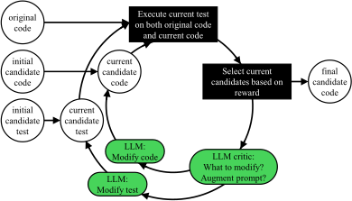
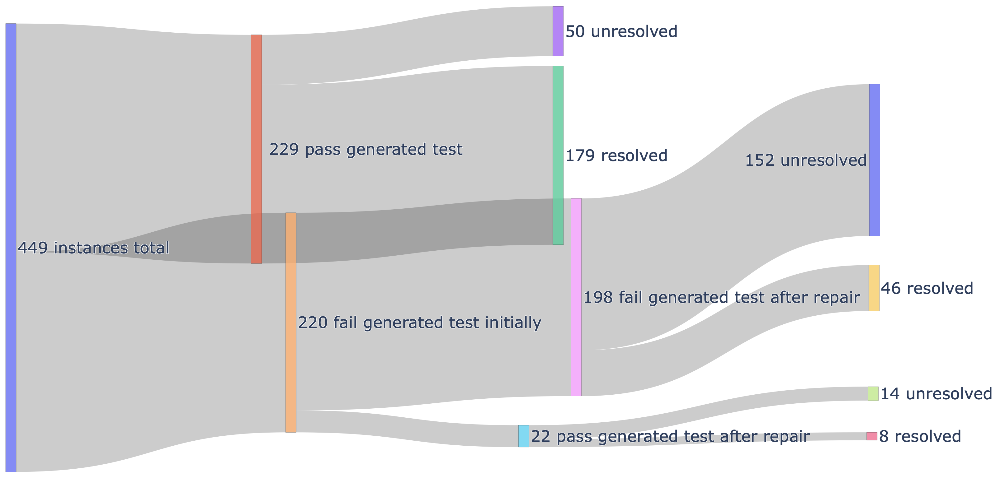

**Source:** *Investigating Test Overfitting on SWE-bench* — [PDF](https://arxiv.org/pdf/2511.16858) · [arXiv](https://arxiv.org/abs/2511.16858)

# Investigating Test Overfitting on SWE-bench

Conference: 34th ACM Joint European Software Engineering Conference and Symposium on the Foundations of Software Engineering; July 05–09, 2026; Montreal, QC, Canada34th ACM Joint European Software Engineering Conference and Symposium on the Foundations of Software Engineering (FSE Companion ’26), July 05–09, 2026, Montreal, QC, CanadaDOI: [10.1145/3803437.3805574](https://doi.org/10.1145/3803437.3805574)ISBN: 979-8-4007-2636-1/2026/07CCS: Software and its engineering Automatic programming

Toufique Ahmed, Jatin Ganhotra, Avraham Shinnar, and Martin Hirzel  Affiliation: IBM, Yorktown Heights, New York, USA, 10603 email: [tfahmed@ibm.com, jatinganhotra, shinnar, hirzel@us.ibm.com](mailto:tfahmed@ibm.com,%20jatinganhotra,%20shinnar,%20hirzel@us.ibm.com)

© cc

###### Abstract.

Tests can be useful towards resolving issues on code repositories. However, relying too much on tests for issue resolution can lead to code that technically passes observed tests but actually misses important cases or even breaks functionality. This problem, called _test overfitting_ , is exacerbated by the fact that issues usually lack readily executable tests. Instead, several issue resolution systems use tests auto-generated from issues, which may be imperfect. Some systems even iteratively refine code and tests jointly. This paper presents the first empirical study of test overfitting in this setting.

###### Keywords: 

LLMs, SWE Patches, Reproduction Tests 

††cc-license: by

## 1\. Introduction

Issue resolution systems, which automatically resolve bug reports or feature requests in code repositories, are useful. They are also challenging to build, because issue descriptions tend to be informal and code repositories are often large and complex ([Jimenez et al., 2024](https://arxiv.org/html/2511.16858#bib.bib12)). Several issue resolution systems leverage tests: for code candidate selection in parallel inference scaling ([Arora et al., 2024](https://arxiv.org/html/2511.16858#bib.bib3); [Gao et al., 2025](https://arxiv.org/html/2511.16858#bib.bib10); [Jain et al., 2025](https://arxiv.org/html/2511.16858#bib.bib11); [Ruan et al., 2024](https://arxiv.org/html/2511.16858#bib.bib17); [Xia et al., 2025](https://arxiv.org/html/2511.16858#bib.bib21); [Zhang et al., 2025](https://arxiv.org/html/2511.16858#bib.bib24)), code refinement in sequential inference scaling ([Chen et al., 2024](https://arxiv.org/html/2511.16858#bib.bib6); [Li et al., 2025b](https://arxiv.org/html/2511.16858#bib.bib13); [Yang et al., 2024](https://arxiv.org/html/2511.16858#bib.bib22); [Zhang et al., 2024](https://arxiv.org/html/2511.16858#bib.bib23)), or both ([Ehrlich et al., 2025](https://arxiv.org/html/2511.16858#bib.bib9); [Li et al., 2025c](https://arxiv.org/html/2511.16858#bib.bib14)). These systems rely upon the implicit premise that tests offer a reliable signal in this setting. Unfortunately, little is known about whether this premise holds. To the contrary, startling results in adjacent settings cast doubt upon it ([Baker et al., 2025](https://arxiv.org/html/2511.16858#bib.bib4); [Smith et al., 2015](https://arxiv.org/html/2511.16858#bib.bib18); [Stroebl et al., 2024](https://arxiv.org/html/2511.16858#bib.bib19)). Relying upon tests for issue resolution can cause _test overfitting_ : generated code that narrowly passes the observed tests but breaks other functionality. This paper empirically investigates the problem of test overfitting in repository-level issue resolution, on benchmarks such as SWE-bench ([Jimenez et al., 2024](https://arxiv.org/html/2511.16858#bib.bib12)).

An issue resolution system takes an issue description \(d_{\textrm{issue}}\) along with the original code \(c_{\textrm{old}}\) of a repository as input and produces modified code \(c_{\textrm{new}}\) as output. While many repositories come with regression tests \(t_{\textrm{old}}\subset c_{\textrm{old}}\), those only test existing behavior, not the desired functionality of \(d_{\textrm{issue}}\). Instead, issue resolution systems are evaluated by running acceptance tests \(t_{\textrm{gold}}\) on \(c_{\textrm{new}}\). In SWE-bench, \(t_{\textrm{gold}}\) is mined from issue-resolving pull requests ([Jimenez et al., 2024](https://arxiv.org/html/2511.16858#bib.bib12)). Since most open issues lack acceptance tests, \(t_{\textrm{gold}}\) is not yet available during issue resolution — neither in practice nor in the benchmark. Therefore, several issue resolution systems instead generate surrogate tests \(t_{\textrm{gen}}\), based only on \(d_{\textrm{issue}}\) and \(c_{\textrm{old}}\). Since generated tests \(t_{\textrm{gen}}\) are imperfect, over-relying on them risks test overfitting, where \(c_{\textrm{new}}\) passes \(t_{\textrm{gen}}\) but fails the hidden \(t_{\textrm{gold}}\).

issue description \(d_{\textrm{issue}}\)   

⬇

1 JSONField values are displayed as dict when readonly in the admin.

2 For example, {"foo": "bar"} would be displayed as {’foo’: ’bar’}.

code patch \(c_{\textrm{new}}\) without refinement

⬇

1 + elif isinstance(field, JSONField):

2 + return field.prepare_value(value)

observed generated test \(t_{\textrm{gen}}\)

⬇

1 value, disp = {"foo": "bar"}, ’{"foo": "bar"}’

2 self.assertEqual(

3 display_for_field(value, JSONField(), empty), disp)

code patch \(c^{\prime}_{\textrm{new}}\) with refinement

⬇

1 + elif isinstance(field, JSONField):

2 + try:

3 + return json.dumps(value)

4 + except (TypeError, ValueError):

5 + return empty_value_display

hidden golden test \(t_{\textrm{gold}}\)

⬇

1 for value, disp in [

2 ({’a’: {’b’: ’c’}}, ’{"a": {"b": "c"}}’),

3 ([’a’, ’b’], ’["a", "b"]’),

4 (’a’, ’"a"’),

5 ({(’a’, ’b’): ’c’}, "{(’a’, ’b’): ’c’}"), # Invalid JSON.

6 ]:

7 self.assertEqual(

8 display_for_field(value, JSONField(), empty), disp)

Figure 1. Test overfitting example on django__django-12308.

Figure [1](https://arxiv.org/html/2511.16858#S1.F1 "Figure 1 ‣ 1. Introduction ‣ Investigating Test Overfitting on SWE-bench") shows a concrete example. Based on the issue description \(d_{\textrm{issue}}\), an issue resolution system generates initial new code \(c_{\textrm{new}}\) and a reproduction test generator generates a test \(t_{\textrm{gen}}\). However, \(c_{\textrm{new}}\) fails on \(t_{\textrm{gen}}\), triggering code refinement based on observed test \(t_{\textrm{gen}}\). The refined code \(c^{\prime}_{\textrm{new}}\) passes \(t_{\textrm{gen}}\) but overfits to it, since it fails other cases covered by the hidden golden test \(t_{\textrm{gold}}\).

This paper empirically investigates test overfitting in issue resolution using popular large-scale open-source repositories and issues. It was inspired by two earlier studies. The paper “Is the cure worse than the disease?” ([Smith et al., 2015](https://arxiv.org/html/2511.16858#bib.bib18)) demonstrated that test overfitting is a serious problem. But unlike our paper, it predated large language models (LLMs) and focused on student projects. The “Inference scaling FLaws” ([Stroebl et al., 2024](https://arxiv.org/html/2511.16858#bib.bib19)) paper found test overfitting to be a limiting factor for inference scaling in LLM-based code generation. But unlike our paper, it did not study repository-level tasks, nor did it explore test-based code refinement. Overall, while these papers highlighted the problem in adjacent settings, to our knowledge, ours is the first to explore it in the setting of LLM-based issue resolution.

Our empirical study answers three research questions:

  * RQ1. Do LLM-generated code patches \(c_{\textrm{new}}\) overfit to tests \(t_{\textrm{gen}}\) generated using the same LLM? 
  * RQ2. How does refining code \(c_{\textrm{new}}\) based on observed tests \(t_{\textrm{gen}}\) affect test overfitting? 
  * RQ3. If the hidden tests \(t_{\textrm{gold}}\) were revealed, would refining code based on them break other functionality? 

Our experiments use two LLMs, Claude-3.7 Sonnet and GPT-4o. We use strong existing LLM-based systems as a starting point, obtaining the candidate code \(c_{\textrm{new}}\) from Agentless ([Xia et al., 2025](https://arxiv.org/html/2511.16858#bib.bib21)) and the surrogate test \(t_{\textrm{gen}}\) from e-Otter++ ([Ahmed et al., 2026](https://arxiv.org/html/2511.16858#bib.bib2)). We extend these systems with a test-based code refinement loop that is representative of those found in recent work ([Ehrlich et al., 2025](https://arxiv.org/html/2511.16858#bib.bib9); [Li et al., 2025c](https://arxiv.org/html/2511.16858#bib.bib14); [Li et al., 2025b](https://arxiv.org/html/2511.16858#bib.bib13); [Li et al., 2025a](https://arxiv.org/html/2511.16858#bib.bib15)). The experiments are based on the TDD-bench Verified ([Ahmed et al., 2024](https://arxiv.org/html/2511.16858#bib.bib1)) benchmark for test-driven development, which is derived from SWE-bench ([Jimenez et al., 2024](https://arxiv.org/html/2511.16858#bib.bib12)). TDD-bench Verified comprises challenging real-world Python issue resolution tasks. This paper makes the following contributions.

  * It measures the degree of test overfitting by LLMs in repository-level issue resolution tasks. 
  * It describes techniques to reduce overfitting and reports how they impact both overfitting and performance. 
  * It also includes a limit study of how much an oracle with access to the hidden golden tests could help performance. 

This paper demonstrates that test overfitting is a clear problem in modern LLM-based issue resolution systems. And unfortunately, while attempts to mitigate this overfitting do work to some extent, they also reduce effectiveness on the original task of issue resolution. Even if golden tests were available, refining code to pass them can still break other functionality. Overall, we caution against over-reliance on tests during code generation and hope to inspire future work in reducing test overfitting.

## 2\. Background and Related Work

Test overfitting happens when an system generates code that passes observed tests but fails held-out hidden tests ([Smith et al., 2015](https://arxiv.org/html/2511.16858#bib.bib18)). Test overfitting is similar to overfitting a model to its training data, where the model performs worse on held-out test data; but note that in this work, we use only pre-trained LLMs without fine-tuning. Instead, test overfitting means that generated code \(c_{\textrm{new}}\) is too narrow to generalize to held-out tests \(t_{\textrm{gold}}\). Stroebl et al. report that this happens when a loop repeatedly generates code for the HumanEval or MBPP benchmarks until finding code that passes observed tests ([Stroebl et al., 2024](https://arxiv.org/html/2511.16858#bib.bib19)). Unlike Stroebl et al., we experiment with repository-level benchmarks and we also explore test-based code refinement loops.

SWE-bench is a benchmark where the input comprises an issue description \(d_{\textrm{issue}}\) and the original code \(c_{\textrm{old}}\) of an entire repository before issue resolution and the output is repaired code \(c_{\textrm{new}}\) ([Jimenez et al., 2024](https://arxiv.org/html/2511.16858#bib.bib12)). Solutions are evaluated on whether \(c_{\textrm{new}}\) passes a held-out test set \(t_{\textrm{gold}}\). To emulate the real-world situation where issues do not come with readily executable tests, the benchmark does not make those held-out tests available to the issue resolution system. SWE-bench Verified is a subset of 500 high-quality SWE-bench instances, targeted by most issue resolution systems ([Chowdhury et al., 2024](https://arxiv.org/html/2511.16858#bib.bib8)). SWT-bench ([Mündler et al., 2024](https://arxiv.org/html/2511.16858#bib.bib16)) and TDD-Bench Verified ([Ahmed et al., 2024](https://arxiv.org/html/2511.16858#bib.bib1)) are reproduction test benchmarks derived from SWE-bench and SWE-Bench Verified.

Several issue resolution systems leverage generated tests \(t_{\textrm{gen}}\). CodeT generates many code candidates and many candidate tests, then uses a dual execution agreement to pick a single output code ([Chen et al., 2023](https://arxiv.org/html/2511.16858#bib.bib5)). Agentless generates up to 40 candidate codes for SWE-bench and generates a reproduction test, then uses the test to filter the candidate codes as part of code selection ([Xia et al., 2025](https://arxiv.org/html/2511.16858#bib.bib21)). S* ([Li et al., 2025a](https://arxiv.org/html/2511.16858#bib.bib15)), CodeMonkeys ([Ehrlich et al., 2025](https://arxiv.org/html/2511.16858#bib.bib9)), and InfCode ([Li et al., 2025c](https://arxiv.org/html/2511.16858#bib.bib14)) also generate both candidate codes and candidate tests, followed by a loop where the LLM improves the code based on the test and vice versa. These papers might suffer from test overfitting but do not study it.

Test overfitting is related to _reward hacking_ , where a reward is a reinforcement-learning (RL) objective, and a hack finds a loop-hole for improving the reward while circumventing its intention. CURE uses RL to co-evolve an LLM to generate both code and white-box tests, and might be susceptible to test overfitting and reward hacking ([Wang et al., 2025](https://arxiv.org/html/2511.16858#bib.bib20)). Baker et al. found that RL to improve frontier LLMs for repository-level coding tasks can cause the reward hack of disabling tests instead of improving code ([Baker et al., 2025](https://arxiv.org/html/2511.16858#bib.bib4)).

## 3\. Methodology

We assume a simple three-step pipeline for issue resolution.

  1. (1) Run an off-the-shelf issue resolver (Agentless ([Xia et al., 2025](https://arxiv.org/html/2511.16858#bib.bib21))) on \(d_{\textrm{issue}}\) and original code \(c_{\textrm{old}}\) to obtain initial candidate code \(c_{\textrm{new}}\). 
  2. (2) Run an off-the-shelf reproduction test generator (e-Otter++ ([Ahmed et al., 2026](https://arxiv.org/html/2511.16858#bib.bib2))) on \(d_{\textrm{issue}}\) and \(c_{\textrm{old}}\) to obtain an initial candidate test \(t_{\textrm{gen}}\). 
  3. (3) Run test-based code refinement (described below) on the initial \(c_{\textrm{new}}\) and \(t_{\textrm{gen}}\) to obtain final candidate code \(c^{\prime}_{\textrm{new}}\). 

After that, we can quantify test overfitting by checking which code (\(c_{\textrm{new}}\) or \(c^{\prime}_{\textrm{new}}\)) passes which tests (\(t_{\textrm{gen}}\), \(t_{\textrm{gold}}\), or \(t_{\textrm{old}}\)).

Since Agentless ([Xia et al., 2025](https://arxiv.org/html/2511.16858#bib.bib21)) and e-Otter++ ([Ahmed et al., 2026](https://arxiv.org/html/2511.16858#bib.bib2)) have been described in prior work, here we only briefly discuss characteristics salient to our paper. First, both Agentless and e-Otter++ internally employ some parallel inference scaling. In our pipeline, we only take the single final result selected by each system and feed it into our own test-based code refinement stage, which can be viewed as a form of sequential inference scaling. Second, both Agentless and e-Otter++ internally make use of regression tests \(t_{\textrm{old}}\subset c_{\textrm{old}}\) from the original code of the repository. This is a realistic reflection of how a human software engineer might consult regression tests when tackling an issue. At the same time, it only yields limited benefit, since existing tests \(t_{\textrm{old}}\) tend not to test the open issue \(d_{\textrm{issue}}\).

 

Figure 2. Overview of test-based code refinement.

Figure [2](https://arxiv.org/html/2511.16858#S3.F2 "Figure 2 ‣ 3. Methodology ‣ Investigating Test Overfitting on SWE-bench") shows our test-based code refinement approach. It starts with the initial candidate code \(c_{\textrm{new}}\) from Agentless and the initial candidate test \(t_{\textrm{gen}}\) from e-Otter++. We execute the test on \(c_{\textrm{old}}\) and \(c_{\textrm{new}}\). If the test goes from fail-to-pass, we immediately stop and declare success. Otherwise, we collect the execution logs from both test executions, the focal functions modified by \(c_{\textrm{new}}\), and the test function \(t_{\textrm{gen}}\) and provide them to an LLM-based critic. We ask the critic which part to modify (focal or test). Inspired by e-Otter++, we also collect additional information such as the buggy line, relevant issue line, and lookup function (the function the model wants to see to fix it). Then, we ask the LLM to modify the focal code or test, exposing the counterpart (e.g., for focal, the test) and additional information. After updating the code \(c_{\textrm{new}}\) or test \(t_{\textrm{gen}}\), if the test is still not fail-to-pass, we need to decide whether to stick with our initial code or test or update it with the recently generated code or test, even though the test is not fail-to-pass. To do this, we use a reward function to guide our decision: \(\mathit{Reward}(c_{\mathit{old}},c_{\mathit{new}},t_{\textrm{gen}})\,=\)

\[\begin{aligned}
 & \frac{1}{3}\mathit{isFail}(t,c_{\mathrm{old}})+\frac{1}{3}\mathit{isPass}(t,c_{\mathrm{new}})+\frac{1}{3}\mathit{coverage}(c_{\mathit{old}},c_{\mathit{new}},t_{\textrm{gen}}) & 
\end{aligned}\]

 

In the reward function, the first two components are binary, but coverage can vary from 0 to 1. Since we know both the code patch and the test, we can compute how many deleted lines in \(c_{\mathrm{old}}\) and how many added lines in \(c_{\mathrm{new}}\) have been covered by the test. We divide the covered lines by the total number of added or deleted lines to compute coverage. If our new \(\langle c_{\mathit{new}},t_{\textrm{gen}}\rangle\) pair achieves a higher reward score than the previous one, we replace it with the new one. We repeat the improvement loop for at most 15 iterations if the observed test \(t_{\textrm{gen}}\) does not change from fail to pass.

## 4\. Results

The experiments in this paper are based on Agentless11 1 https://github.com/OpenAutoCoder/Agentless-generated code patches and e-Otter++22 2 https://zenodo.org/records/16755224-generated tests. Agentless was evaluated on SWE-bench Verified, and e-Otter++ was evaluated on TDD-Bench Verified, a subset of 449 instances from SWE-bench Verified. We evaluated on all 449 instances. Our primary metric is test _overfitting rate_. A code patch \(c_{\textrm{new}}\) is overfitting tests if it passes \(t_{\textrm{gen}}\) but fails \(t_{\textrm{gold}}\) or \(t_{\textrm{old}}\). Dividing the number of instances where that happens by the total instances yields the overfitting rate.

 

Figure 3. How severe is test overfitting? (Claude-3.7-Sonnet) Table 1. Test overfitting rate of automated issue resolution.

<table id="S4.T1.5.1" class="ltx_tabular ltx_guessed_headers ltx_align_middle">
<thead class="ltx_thead">
<tr id="S4.T1.5.1.1" class="ltx_tr">
<th id="S4.T1.5.1.1.1" class="ltx_td ltx_align_center ltx_th ltx_th_column ltx_border_tt" style="padding-top:1pt;padding-bottom:1pt;">Model</th>
<th id="S4.T1.5.1.1.2" class="ltx_td ltx_align_center ltx_th ltx_th_column ltx_border_tt" style="padding-top:1pt;padding-bottom:1pt;">Setup</th>
<th id="S4.T1.5.1.1.3" class="ltx_td ltx_align_center ltx_th ltx_th_column ltx_border_tt" style="padding-top:1pt;padding-bottom:1pt;">
<table id="S4.T1.5.1.1.3.1" class="ltx_tabular ltx_align_middle">
<tr id="S4.T1.5.1.1.3.1.1" class="ltx_tr">
<td id="S4.T1.5.1.1.3.1.1.1" class="ltx_td ltx_nopad_r ltx_align_center" style="padding-top:1pt;padding-bottom:1pt;"># of</td></tr>
<tr id="S4.T1.5.1.1.3.1.2" class="ltx_tr">
<td id="S4.T1.5.1.1.3.1.2.1" class="ltx_td ltx_nopad_r ltx_align_center" style="padding-top:1pt;padding-bottom:1pt;">Sample</td></tr>
</table></th>
<th id="S4.T1.5.1.1.4" class="ltx_td ltx_align_center ltx_th ltx_th_column ltx_border_tt" style="padding-top:1pt;padding-bottom:1pt;">Resolved</th>
<th id="S4.T1.5.1.1.5" class="ltx_td ltx_align_center ltx_th ltx_th_column ltx_border_tt" style="padding-top:1pt;padding-bottom:1pt;">Unresolved</th>
<th id="S4.T1.5.1.1.6" class="ltx_td ltx_align_center ltx_th ltx_th_column ltx_border_tt" style="padding-top:1pt;padding-bottom:1pt;">
<table id="S4.T1.5.1.1.6.1" class="ltx_tabular ltx_align_middle">
<tr id="S4.T1.5.1.1.6.1.1" class="ltx_tr">
<td id="S4.T1.5.1.1.6.1.1.1" class="ltx_td ltx_nopad_r ltx_align_center" style="padding-top:1pt;padding-bottom:1pt;">%of</td></tr>
<tr id="S4.T1.5.1.1.6.1.2" class="ltx_tr">
<td id="S4.T1.5.1.1.6.1.2.1" class="ltx_td ltx_nopad_r ltx_align_center" style="padding-top:1pt;padding-bottom:1pt;">Overfitting</td></tr>
</table></th></tr>
</thead>
<tbody class="ltx_tbody">
<tr id="S4.T1.5.1.2" class="ltx_tr">
<td id="S4.T1.5.1.2.1" class="ltx_td ltx_align_left ltx_border_t" style="padding-top:1pt;padding-bottom:1pt;" rowspan="2">Claude-3.7-Sonnet</td>
<td id="S4.T1.5.1.2.2" class="ltx_td ltx_align_left ltx_border_t" style="padding-top:1pt;padding-bottom:1pt;">w/o Refinement</td>
<td id="S4.T1.5.1.2.3" class="ltx_td ltx_align_right ltx_border_t" style="padding-top:1pt;padding-bottom:1pt;">229</td>
<td id="S4.T1.5.1.2.4" class="ltx_td ltx_align_right ltx_border_t" style="padding-top:1pt;padding-bottom:1pt;">179</td>
<td id="S4.T1.5.1.2.5" class="ltx_td ltx_align_right ltx_border_t" style="padding-top:1pt;padding-bottom:1pt;">50</td>
<td id="S4.T1.5.1.2.6" class="ltx_td ltx_align_right ltx_border_t" style="padding-top:1pt;padding-bottom:1pt;">21.8</td></tr>
<tr id="S4.T1.5.1.3" class="ltx_tr">
<td id="S4.T1.5.1.3.1" class="ltx_td ltx_align_left" style="padding-top:1pt;padding-bottom:1pt;">w/ Refinement</td>
<td id="S4.T1.5.1.3.2" class="ltx_td ltx_align_right" style="padding-top:1pt;padding-bottom:1pt;">251</td>
<td id="S4.T1.5.1.3.3" class="ltx_td ltx_align_right" style="padding-top:1pt;padding-bottom:1pt;">187</td>
<td id="S4.T1.5.1.3.4" class="ltx_td ltx_align_right" style="padding-top:1pt;padding-bottom:1pt;">64</td>
<td id="S4.T1.5.1.3.5" class="ltx_td ltx_align_right" style="padding-top:1pt;padding-bottom:1pt;">25.5</td></tr>
<tr id="S4.T1.5.1.4" class="ltx_tr">
<td id="S4.T1.5.1.4.1" class="ltx_td ltx_align_left ltx_border_bb ltx_border_t" style="padding-top:1pt;padding-bottom:1pt;" rowspan="2">GPT-4o</td>
<td id="S4.T1.5.1.4.2" class="ltx_td ltx_align_left ltx_border_t" style="padding-top:1pt;padding-bottom:1pt;">w/o Refinement</td>
<td id="S4.T1.5.1.4.3" class="ltx_td ltx_align_right ltx_border_t" style="padding-top:1pt;padding-bottom:1pt;">176</td>
<td id="S4.T1.5.1.4.4" class="ltx_td ltx_align_right ltx_border_t" style="padding-top:1pt;padding-bottom:1pt;">118</td>
<td id="S4.T1.5.1.4.5" class="ltx_td ltx_align_right ltx_border_t" style="padding-top:1pt;padding-bottom:1pt;">58</td>
<td id="S4.T1.5.1.4.6" class="ltx_td ltx_align_right ltx_border_t" style="padding-top:1pt;padding-bottom:1pt;">33.0</td></tr>
<tr id="S4.T1.5.1.5" class="ltx_tr">
<td id="S4.T1.5.1.5.1" class="ltx_td ltx_align_left ltx_border_bb" style="padding-top:1pt;padding-bottom:1pt;">w/ Refinement</td>
<td id="S4.T1.5.1.5.2" class="ltx_td ltx_align_right ltx_border_bb" style="padding-top:1pt;padding-bottom:1pt;">198</td>
<td id="S4.T1.5.1.5.3" class="ltx_td ltx_align_right ltx_border_bb" style="padding-top:1pt;padding-bottom:1pt;">127</td>
<td id="S4.T1.5.1.5.4" class="ltx_td ltx_align_right ltx_border_bb" style="padding-top:1pt;padding-bottom:1pt;">71</td>
<td id="S4.T1.5.1.5.5" class="ltx_td ltx_align_right ltx_border_bb" style="padding-top:1pt;padding-bottom:1pt;">35.9</td></tr>
</tbody>
</table>

 

### 4.1. Overfitting without Code Refinement (RQ1)

To quantify overfitting without refinement, we run the e-Otter++ generated tests \(t_{\textrm{gen}}\) on Agentless code patches \(c_{\textrm{new}}\) and see how many pass. Figure [3](https://arxiv.org/html/2511.16858#S4.F3 "Figure 3 ‣ 4. Results ‣ Investigating Test Overfitting on SWE-bench") shows that with the Claude-3.7-Sonnet model, for 229 instances, the initial code passes the generated tests. Does this mean that the hidden golden tests \(t_{\textrm{gold}}\) will pass on these patches? The answer is no. There are 50 instances where \(t_{\textrm{gold}}\) failed, rendering them unresolved according to the benchmark. That means the overfitting rate among the 229 instances is \(\frac{50}{229}=21.8\%\). For the GPT-4o model, the overfitting rate is 33.0%, even higher than the Claude-3.7-Sonnet model (see Table [1](https://arxiv.org/html/2511.16858#S4.T1 "Table 1 ‣ 4. Results ‣ Investigating Test Overfitting on SWE-bench")). Note that a test can overfit due to weaknesses in both the code patches and the tests. However, we did not explicitly differentiate between the two, as doing so would require extensive qualitative studies, which are difficult to scale.

### 4.2. Overfitting with Code Refinement (RQ2)

Tests have been used to validate SWE-patches. What about using tests to improve patches at generation time? We apply the test-based code refinement loop from Section [3](https://arxiv.org/html/2511.16858#S3 "3. Methodology ‣ Investigating Test Overfitting on SWE-bench") to each of the 220 instances from Figure [3](https://arxiv.org/html/2511.16858#S4.F3 "Figure 3 ‣ 4. Results ‣ Investigating Test Overfitting on SWE-bench") where the initial code \(c_{\textrm{new}}\) failed the observed generated tests \(t_{\textrm{gen}}\). This yielded 22 instances where the refined code \(c^{\prime}_{\textrm{new}}\) passed the generated tests. Unfortunately, 14 out of the 22 fail the hidden tests \(t_{\textrm{gold}}\), increasing the overfitting. If we include these in our existing overfitted samples, the overfitting rate increases to \(\frac{50\,+\,14}{229+22}=\frac{64}{251}=25.5\%\) (see Table [1](https://arxiv.org/html/2511.16858#S4.T1 "Table 1 ‣ 4. Results ‣ Investigating Test Overfitting on SWE-bench")). GPT-4o experiences a similar increase in overfitting, indicating that it is difficult to improve code patches by exposing tests to LLMs.

In the above experiments, the refinement loop exposed the generated tests \(t_{\textrm{gen}}\) and additional information to the LLMs. One idea to reduce overfitting might be to hide the tests and additional information, so the LLMs may not be able to trick the tests. Indeed, hiding the generated tests and revealing merely a pass/fail flag to the LLM causes a drop in agreement between code patches and generated tests. However, the number of instances passing the hidden tests \(t_{\textrm{gold}}\) also goes down a bit. If we remove the additional information, it becomes more difficult for LLMs to overfit the patch. Unfortunately, we still see a high overfitting rate even after this intuitive overfitting reduction approach. The model can find a way by knowing that the existing test is not fail-to-pass (third row in Table [2](https://arxiv.org/html/2511.16858#S4.T2 "Table 2 ‣ 4.2. Overfitting with Code Refinement \(RQ2\) ‣ 4. Results ‣ Investigating Test Overfitting on SWE-bench")). Note that this will not have any impact on instances that were already overfitted before the refinement.

Table 2. Test overfitting rate of repaired samples, and effect over hiding information to mitigate overfitting.

<table id="S4.T2.5.1" class="ltx_tabular ltx_guessed_headers ltx_align_middle">
<thead class="ltx_thead">
<tr id="S4.T2.5.1.1" class="ltx_tr">
<th id="S4.T2.5.1.1.1" class="ltx_td ltx_align_center ltx_th ltx_th_column ltx_border_tt" style="padding-top:1pt;padding-bottom:1pt;">Model</th>
<th id="S4.T2.5.1.1.2" class="ltx_td ltx_align_center ltx_th ltx_th_column ltx_border_tt" style="padding-top:1pt;padding-bottom:1pt;">
<table id="S4.T2.5.1.1.2.1" class="ltx_tabular ltx_align_middle">
<tr id="S4.T2.5.1.1.2.1.1" class="ltx_tr">
<td id="S4.T2.5.1.1.2.1.1.1" class="ltx_td ltx_nopad_r ltx_align_center" style="padding-top:1pt;padding-bottom:1pt;">Expose</td></tr>
<tr id="S4.T2.5.1.1.2.1.2" class="ltx_tr">
<td id="S4.T2.5.1.1.2.1.2.1" class="ltx_td ltx_nopad_r ltx_align_center" style="padding-top:1pt;padding-bottom:1pt;">Test</td></tr>
</table></th>
<th id="S4.T2.5.1.1.3" class="ltx_td ltx_align_center ltx_th ltx_th_column ltx_border_tt" style="padding-top:1pt;padding-bottom:1pt;">
<table id="S4.T2.5.1.1.3.1" class="ltx_tabular ltx_align_middle">
<tr id="S4.T2.5.1.1.3.1.1" class="ltx_tr">
<td id="S4.T2.5.1.1.3.1.1.1" class="ltx_td ltx_nopad_r ltx_align_center" style="padding-top:1pt;padding-bottom:1pt;">Augment</td></tr>
<tr id="S4.T2.5.1.1.3.1.2" class="ltx_tr">
<td id="S4.T2.5.1.1.3.1.2.1" class="ltx_td ltx_nopad_r ltx_align_center" style="padding-top:1pt;padding-bottom:1pt;">Prompt</td></tr>
</table></th>
<th id="S4.T2.5.1.1.4" class="ltx_td ltx_align_center ltx_th ltx_th_column ltx_border_tt" style="padding-top:1pt;padding-bottom:1pt;">
<table id="S4.T2.5.1.1.4.1" class="ltx_tabular ltx_align_middle">
<tr id="S4.T2.5.1.1.4.1.1" class="ltx_tr">
<td id="S4.T2.5.1.1.4.1.1.1" class="ltx_td ltx_nopad_r ltx_align_center" style="padding-top:1pt;padding-bottom:1pt;"># of</td></tr>
<tr id="S4.T2.5.1.1.4.1.2" class="ltx_tr">
<td id="S4.T2.5.1.1.4.1.2.1" class="ltx_td ltx_nopad_r ltx_align_center" style="padding-top:1pt;padding-bottom:1pt;">Sample</td></tr>
</table></th>
<th id="S4.T2.5.1.1.5" class="ltx_td ltx_align_center ltx_th ltx_th_column ltx_border_tt" style="padding-top:1pt;padding-bottom:1pt;">Resolved</th>
<th id="S4.T2.5.1.1.6" class="ltx_td ltx_align_center ltx_th ltx_th_column ltx_border_tt" style="padding-top:1pt;padding-bottom:1pt;">Unresolved</th>
<th id="S4.T2.5.1.1.7" class="ltx_td ltx_align_center ltx_th ltx_th_column ltx_border_tt" style="padding-top:1pt;padding-bottom:1pt;">
<table id="S4.T2.5.1.1.7.1" class="ltx_tabular ltx_align_middle">
<tr id="S4.T2.5.1.1.7.1.1" class="ltx_tr">
<td id="S4.T2.5.1.1.7.1.1.1" class="ltx_td ltx_nopad_r ltx_align_center" style="padding-top:1pt;padding-bottom:1pt;">%of</td></tr>
<tr id="S4.T2.5.1.1.7.1.2" class="ltx_tr">
<td id="S4.T2.5.1.1.7.1.2.1" class="ltx_td ltx_nopad_r ltx_align_center" style="padding-top:1pt;padding-bottom:1pt;">Overfitting</td></tr>
</table></th></tr>
</thead>
<tbody class="ltx_tbody">
<tr id="S4.T2.5.1.2" class="ltx_tr">
<td id="S4.T2.5.1.2.1" class="ltx_td ltx_align_left ltx_border_t" style="padding-top:1pt;padding-bottom:1pt;" rowspan="3">Claude-3.7 Sonnet</td>
<td id="S4.T2.5.1.2.2" class="ltx_td ltx_align_center ltx_border_t" style="padding-top:1pt;padding-bottom:1pt;">✓</td>
<td id="S4.T2.5.1.2.3" class="ltx_td ltx_align_center ltx_border_t" style="padding-top:1pt;padding-bottom:1pt;">✓</td>
<td id="S4.T2.5.1.2.4" class="ltx_td ltx_align_right ltx_border_t" style="padding-top:1pt;padding-bottom:1pt;">22</td>
<td id="S4.T2.5.1.2.5" class="ltx_td ltx_align_right ltx_border_t" style="padding-top:1pt;padding-bottom:1pt;">8</td>
<td id="S4.T2.5.1.2.6" class="ltx_td ltx_align_right ltx_border_t" style="padding-top:1pt;padding-bottom:1pt;">14</td>
<td id="S4.T2.5.1.2.7" class="ltx_td ltx_align_right ltx_border_t" style="padding-top:1pt;padding-bottom:1pt;">63.6</td></tr>
<tr id="S4.T2.5.1.3" class="ltx_tr">
<td id="S4.T2.5.1.3.1" class="ltx_td ltx_align_center" style="padding-top:1pt;padding-bottom:1pt;">✗</td>
<td id="S4.T2.5.1.3.2" class="ltx_td ltx_align_center" style="padding-top:1pt;padding-bottom:1pt;">✓</td>
<td id="S4.T2.5.1.3.3" class="ltx_td ltx_align_right" style="padding-top:1pt;padding-bottom:1pt;">18</td>
<td id="S4.T2.5.1.3.4" class="ltx_td ltx_align_right" style="padding-top:1pt;padding-bottom:1pt;">5</td>
<td id="S4.T2.5.1.3.5" class="ltx_td ltx_align_right" style="padding-top:1pt;padding-bottom:1pt;">13</td>
<td id="S4.T2.5.1.3.6" class="ltx_td ltx_align_right" style="padding-top:1pt;padding-bottom:1pt;">72.2</td></tr>
<tr id="S4.T2.5.1.4" class="ltx_tr">
<td id="S4.T2.5.1.4.1" class="ltx_td ltx_align_center" style="padding-top:1pt;padding-bottom:1pt;">✗</td>
<td id="S4.T2.5.1.4.2" class="ltx_td ltx_align_center" style="padding-top:1pt;padding-bottom:1pt;">✗</td>
<td id="S4.T2.5.1.4.3" class="ltx_td ltx_align_right" style="padding-top:1pt;padding-bottom:1pt;">14</td>
<td id="S4.T2.5.1.4.4" class="ltx_td ltx_align_right" style="padding-top:1pt;padding-bottom:1pt;">6</td>
<td id="S4.T2.5.1.4.5" class="ltx_td ltx_align_right" style="padding-top:1pt;padding-bottom:1pt;">8</td>
<td id="S4.T2.5.1.4.6" class="ltx_td ltx_align_right" style="padding-top:1pt;padding-bottom:1pt;">57.1</td></tr>
<tr id="S4.T2.5.1.5" class="ltx_tr">
<td id="S4.T2.5.1.5.1" class="ltx_td ltx_align_left ltx_border_bb ltx_border_t" style="padding-top:1pt;padding-bottom:1pt;" rowspan="3">GPT-4o</td>
<td id="S4.T2.5.1.5.2" class="ltx_td ltx_align_center ltx_border_t" style="padding-top:1pt;padding-bottom:1pt;">✓</td>
<td id="S4.T2.5.1.5.3" class="ltx_td ltx_align_center ltx_border_t" style="padding-top:1pt;padding-bottom:1pt;">✓</td>
<td id="S4.T2.5.1.5.4" class="ltx_td ltx_align_right ltx_border_t" style="padding-top:1pt;padding-bottom:1pt;">22</td>
<td id="S4.T2.5.1.5.5" class="ltx_td ltx_align_right ltx_border_t" style="padding-top:1pt;padding-bottom:1pt;">9</td>
<td id="S4.T2.5.1.5.6" class="ltx_td ltx_align_right ltx_border_t" style="padding-top:1pt;padding-bottom:1pt;">13</td>
<td id="S4.T2.5.1.5.7" class="ltx_td ltx_align_right ltx_border_t" style="padding-top:1pt;padding-bottom:1pt;">59.1</td></tr>
<tr id="S4.T2.5.1.6" class="ltx_tr">
<td id="S4.T2.5.1.6.1" class="ltx_td ltx_align_center" style="padding-top:1pt;padding-bottom:1pt;">✗</td>
<td id="S4.T2.5.1.6.2" class="ltx_td ltx_align_center" style="padding-top:1pt;padding-bottom:1pt;">✓</td>
<td id="S4.T2.5.1.6.3" class="ltx_td ltx_align_right" style="padding-top:1pt;padding-bottom:1pt;">17</td>
<td id="S4.T2.5.1.6.4" class="ltx_td ltx_align_right" style="padding-top:1pt;padding-bottom:1pt;">5</td>
<td id="S4.T2.5.1.6.5" class="ltx_td ltx_align_right" style="padding-top:1pt;padding-bottom:1pt;">12</td>
<td id="S4.T2.5.1.6.6" class="ltx_td ltx_align_right" style="padding-top:1pt;padding-bottom:1pt;">70.6</td></tr>
<tr id="S4.T2.5.1.7" class="ltx_tr">
<td id="S4.T2.5.1.7.1" class="ltx_td ltx_align_center ltx_border_bb" style="padding-top:1pt;padding-bottom:1pt;">✗</td>
<td id="S4.T2.5.1.7.2" class="ltx_td ltx_align_center ltx_border_bb" style="padding-top:1pt;padding-bottom:1pt;">✗</td>
<td id="S4.T2.5.1.7.3" class="ltx_td ltx_align_right ltx_border_bb" style="padding-top:1pt;padding-bottom:1pt;">16</td>
<td id="S4.T2.5.1.7.4" class="ltx_td ltx_align_right ltx_border_bb" style="padding-top:1pt;padding-bottom:1pt;">5</td>
<td id="S4.T2.5.1.7.5" class="ltx_td ltx_align_right ltx_border_bb" style="padding-top:1pt;padding-bottom:1pt;">11</td>
<td id="S4.T2.5.1.7.6" class="ltx_td ltx_align_right ltx_border_bb" style="padding-top:1pt;padding-bottom:1pt;">68.8</td></tr>
</tbody>
</table>

 

Table [2](https://arxiv.org/html/2511.16858#S4.T2 "Table 2 ‣ 4.2. Overfitting with Code Refinement \(RQ2\) ‣ 4. Results ‣ Investigating Test Overfitting on SWE-bench") shows that exposing tests and prompt augmentation resolved 8 samples. Do all these 8 samples help us resolve additional instances? The answer is no. The initial code patch for one instance was already passing on the golden test. And besides these 8, there were 2 instances that went from resolved to non-resolved. So the net gain is +5 instead of +8. That indicates the actual gain from test-based refinement is less than the apparent gain. The refinement reward’s coverage term may structurally push patches toward fitting \(t_{\textrm{gen}}\)’s execution path. However, it is also believed that tests with higher coverage are qualitatively better than other tests.

### 4.3. Impact of Revealing Golden Tests (RQ3)

RQ3 asks what would happen if the test-based code refinement would not use imperfect generated tests \(t_{\textrm{gen}}\) but rather golden tests \(t_{\textrm{gold}}\). This is a limit study, because in practice, issues do not usually come with oracular executable acceptance tests. Table [3](https://arxiv.org/html/2511.16858#S4.T3 "Table 3 ‣ 4.3. Impact of Revealing Golden Tests \(RQ3\) ‣ 4. Results ‣ Investigating Test Overfitting on SWE-bench") shows how much overfitting occurs in this setting. Here, the final determination of whether an instance is resolved is based on passing both golden tests \(t_{\textrm{gold}}\) and a subset of regression tests \(t_{\textrm{old}}\). (While issue-resolution systems such as Agentless have access to the full regression testing suite contained in the original code \(c_{\textrm{old}}\), they do not know which subset of those tests are expected to pass after issue resolution ([Chen et al., 2026](https://arxiv.org/html/2511.16858#bib.bib7)).) The overfitting rate, which means passing now-revealed golden tests \(t_{\textrm{gold}}\) but failing the relevant subset of regression tests \(t_{\textrm{old}}\), is low (13/223=5.8% and 22/194=11.3% with Claude and GPT-4o, respectively). Apart from overfitting, this also shows how well the model performs when golden tests \(t_{\textrm{gold}}\) are exposed. When the model passes the golden reproduction tests, the probability that the issue is resolved is high, but not 100%, because regression tests can still fail. The improvement from using golden tests in issue resolution is modest: the number of resolved instances with the Claude model goes up from 229 to 243, around a 3% increase. This experiment emulates a situation where developers follow test-driven development and write tests prior to generating \(c_{\textrm{new}}\). Unfortunately, the gains are limited, highlighting that current issue resolution systems often miss the bigger picture.

Table 3. Impact of revealing golden test on issue resolution.

Model |  | # of  
---  
Sample  
Resolved | Unresolved |  | %of  
---  
Overfitting  
Claude-3.7 Sonnet | 223 | 210 | 13 | 5.8  
GPT-4o | 194 | 172 | 22 | 11.3

 

## 5\. Discussion

#### LLMs’ Preference on Focal and Test

Test-based code refinement gives LLMs a choice to modify both the code (focal function) and/or the test. Table [4](https://arxiv.org/html/2511.16858#S5.T4 "Table 4 ‣ LLMs’ Preference on Focal and Test ‣ 5. Discussion ‣ Investigating Test Overfitting on SWE-bench") shows that for instances where refinement succeeds, the model mostly elects to modify the focal function instead of the test. For each scenario, the number of test updates is low compared to focal updates. Also, there are few cases where the LLMs tries to fix both the focal function and the test. That indicates the model has a preference for focal modification and believes that the tests are mostly perfect.

Table 4. LLMs preference for focal/test modifications

<table id="S5.T4.5.1" class="ltx_tabular ltx_guessed_headers ltx_align_middle">
<thead class="ltx_thead">
<tr id="S5.T4.5.1.1" class="ltx_tr">
<th id="S5.T4.5.1.1.1" class="ltx_td ltx_align_center ltx_th ltx_th_column ltx_th_row ltx_border_tt" style="padding-top:1pt;padding-bottom:1pt;">Model</th>
<th id="S5.T4.5.1.1.2" class="ltx_td ltx_align_center ltx_th ltx_th_column ltx_th_row ltx_border_tt" style="padding-top:1pt;padding-bottom:1pt;">
<table id="S5.T4.5.1.1.2.1" class="ltx_tabular ltx_align_middle">
<tr id="S5.T4.5.1.1.2.1.1" class="ltx_tr">
<td id="S5.T4.5.1.1.2.1.1.1" class="ltx_td ltx_nopad_r ltx_align_center" style="padding-top:1pt;padding-bottom:1pt;">Expose</td></tr>
<tr id="S5.T4.5.1.1.2.1.2" class="ltx_tr">
<td id="S5.T4.5.1.1.2.1.2.1" class="ltx_td ltx_nopad_r ltx_align_center" style="padding-top:1pt;padding-bottom:1pt;">Test</td></tr>
</table></th>
<th id="S5.T4.5.1.1.3" class="ltx_td ltx_align_center ltx_th ltx_th_column ltx_th_row ltx_border_tt" style="padding-top:1pt;padding-bottom:1pt;">
<table id="S5.T4.5.1.1.3.1" class="ltx_tabular ltx_align_middle">
<tr id="S5.T4.5.1.1.3.1.1" class="ltx_tr">
<td id="S5.T4.5.1.1.3.1.1.1" class="ltx_td ltx_nopad_r ltx_align_center" style="padding-top:1pt;padding-bottom:1pt;">Prompt</td></tr>
<tr id="S5.T4.5.1.1.3.1.2" class="ltx_tr">
<td id="S5.T4.5.1.1.3.1.2.1" class="ltx_td ltx_nopad_r ltx_align_center" style="padding-top:1pt;padding-bottom:1pt;">Augment</td></tr>
</table></th>
<th id="S5.T4.5.1.1.4" class="ltx_td ltx_align_center ltx_th ltx_th_column ltx_border_tt" style="padding-top:1pt;padding-bottom:1pt;"># of Sample</th>
<th id="S5.T4.5.1.1.5" class="ltx_td ltx_align_center ltx_th ltx_th_column ltx_border_tt" style="padding-top:1pt;padding-bottom:1pt;">
<table id="S5.T4.5.1.1.5.1" class="ltx_tabular ltx_align_middle">
<tr id="S5.T4.5.1.1.5.1.1" class="ltx_tr">
<td id="S5.T4.5.1.1.5.1.1.1" class="ltx_td ltx_nopad_r ltx_align_center" style="padding-top:1pt;padding-bottom:1pt;">Focal</td></tr>
<tr id="S5.T4.5.1.1.5.1.2" class="ltx_tr">
<td id="S5.T4.5.1.1.5.1.2.1" class="ltx_td ltx_nopad_r ltx_align_center" style="padding-top:1pt;padding-bottom:1pt;">Update</td></tr>
</table></th>
<th id="S5.T4.5.1.1.6" class="ltx_td ltx_align_center ltx_th ltx_th_column ltx_border_tt" style="padding-top:1pt;padding-bottom:1pt;">
<table id="S5.T4.5.1.1.6.1" class="ltx_tabular ltx_align_middle">
<tr id="S5.T4.5.1.1.6.1.1" class="ltx_tr">
<td id="S5.T4.5.1.1.6.1.1.1" class="ltx_td ltx_nopad_r ltx_align_center" style="padding-top:1pt;padding-bottom:1pt;">Test</td></tr>
<tr id="S5.T4.5.1.1.6.1.2" class="ltx_tr">
<td id="S5.T4.5.1.1.6.1.2.1" class="ltx_td ltx_nopad_r ltx_align_center" style="padding-top:1pt;padding-bottom:1pt;">Update</td></tr>
</table></th>
<th id="S5.T4.5.1.1.7" class="ltx_td ltx_align_center ltx_th ltx_th_column ltx_border_tt" style="padding-top:1pt;padding-bottom:1pt;">
<table id="S5.T4.5.1.1.7.1" class="ltx_tabular ltx_align_middle">
<tr id="S5.T4.5.1.1.7.1.1" class="ltx_tr">
<td id="S5.T4.5.1.1.7.1.1.1" class="ltx_td ltx_nopad_r ltx_align_center" style="padding-top:1pt;padding-bottom:1pt;">Both</td></tr>
<tr id="S5.T4.5.1.1.7.1.2" class="ltx_tr">
<td id="S5.T4.5.1.1.7.1.2.1" class="ltx_td ltx_nopad_r ltx_align_center" style="padding-top:1pt;padding-bottom:1pt;">Update</td></tr>
</table></th></tr>
</thead>
<tbody class="ltx_tbody">
<tr id="S5.T4.5.1.2" class="ltx_tr">
<th id="S5.T4.5.1.2.1" class="ltx_td ltx_align_left ltx_th ltx_th_row ltx_border_t" style="padding-top:1pt;padding-bottom:1pt;" rowspan="4">Claude-3.7 Sonnet</th>
<th id="S5.T4.5.1.2.2" class="ltx_td ltx_align_left ltx_th ltx_th_row ltx_border_t" style="padding-top:1pt;padding-bottom:1pt;">✓</th>
<th id="S5.T4.5.1.2.3" class="ltx_td ltx_align_left ltx_th ltx_th_row ltx_border_t" style="padding-top:1pt;padding-bottom:1pt;">✓</th>
<td id="S5.T4.5.1.2.4" class="ltx_td ltx_align_right ltx_border_t" style="padding-top:1pt;padding-bottom:1pt;">22</td>
<td id="S5.T4.5.1.2.5" class="ltx_td ltx_align_right ltx_border_t" style="padding-top:1pt;padding-bottom:1pt;">18</td>
<td id="S5.T4.5.1.2.6" class="ltx_td ltx_align_right ltx_border_t" style="padding-top:1pt;padding-bottom:1pt;">3</td>
<td id="S5.T4.5.1.2.7" class="ltx_td ltx_align_right ltx_border_t" style="padding-top:1pt;padding-bottom:1pt;">1</td></tr>
<tr id="S5.T4.5.1.3" class="ltx_tr">
<th id="S5.T4.5.1.3.1" class="ltx_td ltx_align_left ltx_th ltx_th_row" style="padding-top:1pt;padding-bottom:1pt;">✗</th>
<th id="S5.T4.5.1.3.2" class="ltx_td ltx_align_left ltx_th ltx_th_row" style="padding-top:1pt;padding-bottom:1pt;">✓</th>
<td id="S5.T4.5.1.3.3" class="ltx_td ltx_align_right" style="padding-top:1pt;padding-bottom:1pt;">18</td>
<td id="S5.T4.5.1.3.4" class="ltx_td ltx_align_right" style="padding-top:1pt;padding-bottom:1pt;">15</td>
<td id="S5.T4.5.1.3.5" class="ltx_td ltx_align_right" style="padding-top:1pt;padding-bottom:1pt;">3</td>
<td id="S5.T4.5.1.3.6" class="ltx_td ltx_align_right" style="padding-top:1pt;padding-bottom:1pt;">0</td></tr>
<tr id="S5.T4.5.1.4" class="ltx_tr">
<th id="S5.T4.5.1.4.1" class="ltx_td ltx_align_left ltx_th ltx_th_row" style="padding-top:1pt;padding-bottom:1pt;">✗</th>
<th id="S5.T4.5.1.4.2" class="ltx_td ltx_align_left ltx_th ltx_th_row" style="padding-top:1pt;padding-bottom:1pt;">✗</th>
<td id="S5.T4.5.1.4.3" class="ltx_td ltx_align_right" style="padding-top:1pt;padding-bottom:1pt;">14</td>
<td id="S5.T4.5.1.4.4" class="ltx_td ltx_align_right" style="padding-top:1pt;padding-bottom:1pt;">13</td>
<td id="S5.T4.5.1.4.5" class="ltx_td ltx_align_right" style="padding-top:1pt;padding-bottom:1pt;">0</td>
<td id="S5.T4.5.1.4.6" class="ltx_td ltx_align_right" style="padding-top:1pt;padding-bottom:1pt;">1</td></tr>
<tr id="S5.T4.5.1.5" class="ltx_tr">
<th id="S5.T4.5.1.5.1" class="ltx_td ltx_align_left ltx_th ltx_th_row" style="padding-top:1pt;padding-bottom:1pt;">✓(Gold)</th>
<th id="S5.T4.5.1.5.2" class="ltx_td ltx_align_left ltx_th ltx_th_row" style="padding-top:1pt;padding-bottom:1pt;">✓(Gold)</th>
<td id="S5.T4.5.1.5.3" class="ltx_td ltx_align_right" style="padding-top:1pt;padding-bottom:1pt;">25</td>
<td id="S5.T4.5.1.5.4" class="ltx_td ltx_align_right" style="padding-top:1pt;padding-bottom:1pt;">23</td>
<td id="S5.T4.5.1.5.5" class="ltx_td ltx_align_right" style="padding-top:1pt;padding-bottom:1pt;">0</td>
<td id="S5.T4.5.1.5.6" class="ltx_td ltx_align_right" style="padding-top:1pt;padding-bottom:1pt;">2</td></tr>
<tr id="S5.T4.5.1.6" class="ltx_tr">
<th id="S5.T4.5.1.6.1" class="ltx_td ltx_align_left ltx_th ltx_th_row ltx_border_t" style="padding-top:1pt;padding-bottom:1pt;" rowspan="3">GPT-4o</th>
<th id="S5.T4.5.1.6.2" class="ltx_td ltx_align_left ltx_th ltx_th_row ltx_border_t" style="padding-top:1pt;padding-bottom:1pt;">✓</th>
<th id="S5.T4.5.1.6.3" class="ltx_td ltx_align_left ltx_th ltx_th_row ltx_border_t" style="padding-top:1pt;padding-bottom:1pt;">✓</th>
<td id="S5.T4.5.1.6.4" class="ltx_td ltx_align_right ltx_border_t" style="padding-top:1pt;padding-bottom:1pt;">22</td>
<td id="S5.T4.5.1.6.5" class="ltx_td ltx_align_right ltx_border_t" style="padding-top:1pt;padding-bottom:1pt;">16</td>
<td id="S5.T4.5.1.6.6" class="ltx_td ltx_align_right ltx_border_t" style="padding-top:1pt;padding-bottom:1pt;">2</td>
<td id="S5.T4.5.1.6.7" class="ltx_td ltx_align_right ltx_border_t" style="padding-top:1pt;padding-bottom:1pt;">4</td></tr>
<tr id="S5.T4.5.1.7" class="ltx_tr">
<th id="S5.T4.5.1.7.1" class="ltx_td ltx_align_left ltx_th ltx_th_row" style="padding-top:1pt;padding-bottom:1pt;">✗</th>
<th id="S5.T4.5.1.7.2" class="ltx_td ltx_align_left ltx_th ltx_th_row" style="padding-top:1pt;padding-bottom:1pt;">✓</th>
<td id="S5.T4.5.1.7.3" class="ltx_td ltx_align_right" style="padding-top:1pt;padding-bottom:1pt;">17</td>
<td id="S5.T4.5.1.7.4" class="ltx_td ltx_align_right" style="padding-top:1pt;padding-bottom:1pt;">13</td>
<td id="S5.T4.5.1.7.5" class="ltx_td ltx_align_right" style="padding-top:1pt;padding-bottom:1pt;">1</td>
<td id="S5.T4.5.1.7.6" class="ltx_td ltx_align_right" style="padding-top:1pt;padding-bottom:1pt;">3</td></tr>
<tr id="S5.T4.5.1.8" class="ltx_tr">
<th id="S5.T4.5.1.8.1" class="ltx_td ltx_align_left ltx_th ltx_th_row" style="padding-top:1pt;padding-bottom:1pt;">✗</th>
<th id="S5.T4.5.1.8.2" class="ltx_td ltx_align_left ltx_th ltx_th_row" style="padding-top:1pt;padding-bottom:1pt;">✗</th>
<td id="S5.T4.5.1.8.3" class="ltx_td ltx_align_right" style="padding-top:1pt;padding-bottom:1pt;">16</td>
<td id="S5.T4.5.1.8.4" class="ltx_td ltx_align_right" style="padding-top:1pt;padding-bottom:1pt;">11</td>
<td id="S5.T4.5.1.8.5" class="ltx_td ltx_align_right" style="padding-top:1pt;padding-bottom:1pt;">1</td>
<td id="S5.T4.5.1.8.6" class="ltx_td ltx_align_right" style="padding-top:1pt;padding-bottom:1pt;">4</td></tr>
<tr id="S5.T4.5.1.9" class="ltx_tr">
<th id="S5.T4.5.1.9.1" class="ltx_td ltx_th ltx_th_row ltx_border_bb" style="padding-top:1pt;padding-bottom:1pt;"></th>
<th id="S5.T4.5.1.9.2" class="ltx_td ltx_align_left ltx_th ltx_th_row ltx_border_bb" style="padding-top:1pt;padding-bottom:1pt;">✓(Gold)</th>
<th id="S5.T4.5.1.9.3" class="ltx_td ltx_align_left ltx_th ltx_th_row ltx_border_bb" style="padding-top:1pt;padding-bottom:1pt;">✓(Gold)</th>
<td id="S5.T4.5.1.9.4" class="ltx_td ltx_align_right ltx_border_bb" style="padding-top:1pt;padding-bottom:1pt;">28</td>
<td id="S5.T4.5.1.9.5" class="ltx_td ltx_align_right ltx_border_bb" style="padding-top:1pt;padding-bottom:1pt;">20</td>
<td id="S5.T4.5.1.9.6" class="ltx_td ltx_align_right ltx_border_bb" style="padding-top:1pt;padding-bottom:1pt;">2</td>
<td id="S5.T4.5.1.9.7" class="ltx_td ltx_align_right ltx_border_bb" style="padding-top:1pt;padding-bottom:1pt;">6</td></tr>
</tbody>
</table>

 

#### Coverage for Overfitted Sample

We compare the coverage between unbiased code patches (both \(t_{\textrm{gen}}\) and \(t_{\textrm{gold}}\) pass) and overfitted patches for Claude-3.7. The median for unbiased patches is 1, while for overfitted patches it is less than 0.8. Also, the mean coverage is higher for unbiased patches (0.95 vs. 0.9). These results indicate that even though both unbiased and overfitted patches pass observed tests \(t_{\textrm{gen}}\), overfitted patches have lower coverage. Execution coverage or static analysis might be used as a warning against overfitting early during patch generation, without relying on hidden golden tests. We leave this for future work.

## 6\. Threats to Validity

Since the benchmarks include only Python repositories, our findings may not generalize to other programming languages. We experimented with two models but did not investigate model contamination or memorization. However, prior works show that model-generated tests are very different from those written by developers. On another note, our approach may be considered a way to measure contamination by exposing overfitted patches. We leave this for future research. Other minor limitations include our reliance on the coverage package for reward formulation. The Python coverage package sometimes does not work due to dependency issues or multithreading. However, this happens in less than 1% of cases, and we assign a coverage of 1 to mitigate the impact of imperfect coverage reports. Our results can also be affected by test flakiness. However, we use pre-built docker containers for the experiments, which should minimize the impact of flakiness.

## 7\. Conclusion

In this work, we systematically show that test overfitting is still a problem in LLM-based program repair. We also show that test-based refinement may resolve some additional issues but increases overfitting. Therefore, using tests for patch generation needs more deliberation. We share the initial and modified code patches at this link: <https://doi.org/10.5281/zenodo.17227318>

## References

  * Ahmed et al. (2026) T. Ahmed, J. Ganhotra, A. Shinnar, and M. Hirzel Heterogeneous prompting and execution feedback for SWE issue test generation and selection.  In International Conference on Software Engineering (ICSE),  Cited by: [§1](https://arxiv.org/html/2511.16858#S1.p5.2.1 "1. Introduction ‣ Investigating Test Overfitting on SWE-bench"), [item 2](https://arxiv.org/html/2511.16858#S3.I1.i2.p1.1.1 "In 3. Methodology ‣ Investigating Test Overfitting on SWE-bench"), [§3](https://arxiv.org/html/2511.16858#S3.p4.1.1 "3. Methodology ‣ Investigating Test Overfitting on SWE-bench"). 
  * Ahmed et al. (2024) T. Ahmed, M. Hirzel, R. Pan, A. Shinnar, and S. Sinha TDD-Bench Verified: can LLMs generate tests for issues before they get resolved?.  External Links: [Link](https://arxiv.org/abs/2412.02883) Cited by: [§1](https://arxiv.org/html/2511.16858#S1.p5.2 "1. Introduction ‣ Investigating Test Overfitting on SWE-bench"), [§2](https://arxiv.org/html/2511.16858#S2.p2.1 "2. Background and Related Work ‣ Investigating Test Overfitting on SWE-bench"). 
  * Arora et al. (2024) D. Arora, A. Sonwane, N. Wadhwa, A. Mehrotra, S. Utpala, R. Bairi, A. Kanade, and N. Natarajan MASAI: modular architecture for software-engineering AI agents.  External Links: [Link](https://arxiv.org/abs/2406.11638) Cited by: [§1](https://arxiv.org/html/2511.16858#S1.p1.1 "1. Introduction ‣ Investigating Test Overfitting on SWE-bench"). 
  * Baker et al. (2025) B. Baker, J. Huizinga, L. Gao, Z. Dou, M. Y. Guan, A. Madry, W. Zaremba, J. Pachocki, and D. Farhi Monitoring reasoning models for misbehavior and the risks of promoting obfuscation.  External Links: [Link](https://arxiv.org/abs/2503.11926) Cited by: [§1](https://arxiv.org/html/2511.16858#S1.p1.1 "1. Introduction ‣ Investigating Test Overfitting on SWE-bench"), [§2](https://arxiv.org/html/2511.16858#S2.p4.1 "2. Background and Related Work ‣ Investigating Test Overfitting on SWE-bench"). 
  * Chen et al. (2023) B. Chen, F. Zhang, A. Nguyen, D. Zan, Z. Lin, J. Lou, and W. Chen CodeT: code generation with generated tests.  In International Conference on Learning Representations (ICLR),  Cited by: [§2](https://arxiv.org/html/2511.16858#S2.p3.1 "2. Background and Related Work ‣ Investigating Test Overfitting on SWE-bench"). 
  * Chen et al. (2024) D. Chen, S. Lin, M. Zeng, D. Zan, J. Wang, A. Cheshkov, J. Sun, H. Yu, G. Dong, A. Aliev, J. Wang, X. Cheng, G. Liang, Y. Ma, P. Bian, T. Xie, and Q. Wang CodeR: issue resolving with multi-agent and task graphs.  External Links: [Link](https://arxiv.org/abs/2406.01304) Cited by: [§1](https://arxiv.org/html/2511.16858#S1.p1.1 "1. Introduction ‣ Investigating Test Overfitting on SWE-bench"). 
  * Chen et al. (2026) Y. Chen, T. Ahmed, R. Jabbarvand, and M. Hirzel Can old tests do new tricks for resolving SWE issues?.  In Symposium on the Foundations of Software Engineering (FSE),  Cited by: [§4.3](https://arxiv.org/html/2511.16858#S4.SS3.p1.1 "4.3. Impact of Revealing Golden Tests \(RQ3\) ‣ 4. Results ‣ Investigating Test Overfitting on SWE-bench"). 
  * Chowdhury et al. (2024) N. Chowdhury, J. Aung, C. J. Shern, O. Jaffe, D. Sherburn, G. Starace, E. Mays, R. Dias, M. Aljubeh, M. Glaese, C. E. Jimenez, J. Yang, K. Liu, and A. Madry Introducing SWE-bench Verified.  External Links: [Link](https://openai.com/index/introducing-swe-bench-verified/) Cited by: [§2](https://arxiv.org/html/2511.16858#S2.p2.1 "2. Background and Related Work ‣ Investigating Test Overfitting on SWE-bench"). 
  * Ehrlich et al. (2025) R. Ehrlich, B. Brown, J. Juravsky, R. Clark, C. Re, and A. Mirhoseini CodeMonkeys: scaling test-time compute for software engineering.  External Links: [Link](https://arxiv.org/abs/2501.14723) Cited by: [§1](https://arxiv.org/html/2511.16858#S1.p1.1 "1. Introduction ‣ Investigating Test Overfitting on SWE-bench"), [§1](https://arxiv.org/html/2511.16858#S1.p5.2 "1. Introduction ‣ Investigating Test Overfitting on SWE-bench"), [§2](https://arxiv.org/html/2511.16858#S2.p3.1 "2. Background and Related Work ‣ Investigating Test Overfitting on SWE-bench"). 
  * Gao et al. (2025) P. Gao, Z. Tian, X. Meng, X. Wang, R. Hu, Y. Xiao, Y. Liu, Z. Zhang, J. Chen, C. Gao, Y. Lin, Y. Xiong, C. Peng, and X. Liu Trae agent: an LLM-based agent for software engineering with test-time scaling.  External Links: [Link](https://arxiv.org/abs/2507.23370) Cited by: [§1](https://arxiv.org/html/2511.16858#S1.p1.1 "1. Introduction ‣ Investigating Test Overfitting on SWE-bench"). 
  * Jain et al. (2025) N. Jain, J. Singh, M. Shetty, L. Zheng, K. Sen, and I. Stoica R2E-Gym: procedural environments and hybrid verifiers for scaling open-weights SWE agents.  External Links: [Link](https://arxiv.org/abs/2504.07164) Cited by: [§1](https://arxiv.org/html/2511.16858#S1.p1.1 "1. Introduction ‣ Investigating Test Overfitting on SWE-bench"). 
  * Jimenez et al. (2024) C. E. Jimenez, J. Yang, A. Wettig, S. Yao, K. Pei, O. Press, and K. Narasimhan SWE-bench: can language models resolve real-world GitHub issues?.  In International Conference on Learning Representations (ICLR),  Cited by: [§1](https://arxiv.org/html/2511.16858#S1.p1.1 "1. Introduction ‣ Investigating Test Overfitting on SWE-bench"), [§1](https://arxiv.org/html/2511.16858#S1.p2.1 "1. Introduction ‣ Investigating Test Overfitting on SWE-bench"), [§1](https://arxiv.org/html/2511.16858#S1.p5.2 "1. Introduction ‣ Investigating Test Overfitting on SWE-bench"), [§2](https://arxiv.org/html/2511.16858#S2.p2.1 "2. Background and Related Work ‣ Investigating Test Overfitting on SWE-bench"). 
  * Li et al. (2025a) D. Li, S. Cao, C. Cao, X. Li, S. Tan, K. Keutzer, J. Xing, J. E. Gonzalez, and I. Stoica S*: test time scaling for code generation.  External Links: [Link](https://arxiv.org/abs/2502.14382) Cited by: [§1](https://arxiv.org/html/2511.16858#S1.p5.2 "1. Introduction ‣ Investigating Test Overfitting on SWE-bench"), [§2](https://arxiv.org/html/2511.16858#S2.p3.1 "2. Background and Related Work ‣ Investigating Test Overfitting on SWE-bench"). 
  * Li et al. (2025b) H. Li, Y. Tang, S. Wang, and W. Guo PatchPilot: a stable and cost-efficient agentic patching framework.  In International Conference on Machine Learning (ICML),  Cited by: [§1](https://arxiv.org/html/2511.16858#S1.p1.1 "1. Introduction ‣ Investigating Test Overfitting on SWE-bench"), [§1](https://arxiv.org/html/2511.16858#S1.p5.2 "1. Introduction ‣ Investigating Test Overfitting on SWE-bench"). 
  * Li et al. (2025c) K. Li, M. Wang, H. Zhang, Z. Li, Y. Yuan, M. Li, X. Gao, H. Sun, C. Hu, and W. Lv InfCode: adversarial iterative refinement of tests and patches for reliable software issue resolution.  External Links: [Link](https://arxiv.org/abs/2511.16004) Cited by: [§1](https://arxiv.org/html/2511.16858#S1.p1.1 "1. Introduction ‣ Investigating Test Overfitting on SWE-bench"), [§1](https://arxiv.org/html/2511.16858#S1.p5.2 "1. Introduction ‣ Investigating Test Overfitting on SWE-bench"), [§2](https://arxiv.org/html/2511.16858#S2.p3.1 "2. Background and Related Work ‣ Investigating Test Overfitting on SWE-bench"). 
  * Mündler et al. (2024) N. Mündler, M. N. Müller, J. He, and M. Vechev SWT-Bench: testing and validating real-world bug-fixes with code agents.  In Conference on Neural Information Processing Systems (NeurIPS),  Cited by: [§2](https://arxiv.org/html/2511.16858#S2.p2.1 "2. Background and Related Work ‣ Investigating Test Overfitting on SWE-bench"). 
  * Ruan et al. (2024) H. Ruan, Y. Zhang, and A. Roychoudhury SpecRover: code intent extraction via LLMs.  External Links: [Link](https://arxiv.org/abs/2408.02232) Cited by: [§1](https://arxiv.org/html/2511.16858#S1.p1.1 "1. Introduction ‣ Investigating Test Overfitting on SWE-bench"). 
  * Smith et al. (2015) E. K. Smith, E. T. Barr, C. Le Goues, and Y. Brun Is the cure worse than the disease? overfitting in automated program repair.  In Symposium on the Foundations of Software Engineering (FSE),  External Links: [Link](https://doi.org/10.1145/2786805.2786825) Cited by: [§1](https://arxiv.org/html/2511.16858#S1.p1.1 "1. Introduction ‣ Investigating Test Overfitting on SWE-bench"), [§1](https://arxiv.org/html/2511.16858#S1.p4.1 "1. Introduction ‣ Investigating Test Overfitting on SWE-bench"), [§2](https://arxiv.org/html/2511.16858#S2.p1.1 "2. Background and Related Work ‣ Investigating Test Overfitting on SWE-bench"). 
  * Stroebl et al. (2024) B. Stroebl, S. Kapoor, and A. Narayanan Inference scaling FLaws: the limits of LLM resampling with imperfect verifiers.  External Links: [Link](https://arxiv.org/abs/2411.17501) Cited by: [§1](https://arxiv.org/html/2511.16858#S1.p1.1 "1. Introduction ‣ Investigating Test Overfitting on SWE-bench"), [§1](https://arxiv.org/html/2511.16858#S1.p4.1 "1. Introduction ‣ Investigating Test Overfitting on SWE-bench"), [§2](https://arxiv.org/html/2511.16858#S2.p1.1 "2. Background and Related Work ‣ Investigating Test Overfitting on SWE-bench"). 
  * Wang et al. (2025) Y. Wang, L. Yang, Y. Tian, K. Shen, and M. Wang Co-evolving LLM coder and unit tester via reinforcement learning.  External Links: [Link](https://arxiv.org/abs/2506.03136) Cited by: [§2](https://arxiv.org/html/2511.16858#S2.p4.1 "2. Background and Related Work ‣ Investigating Test Overfitting on SWE-bench"). 
  * Xia et al. (2025) C. S. Xia, Y. Deng, S. Dunn, and L. Zhang Demystifying LLM-based software engineering agents.  In Symposium on the Foundations of Software Engineering (FSE),  pp. 801–824.  External Links: [Link](https://doi.org/10.1145/3715754) Cited by: [§1](https://arxiv.org/html/2511.16858#S1.p1.1 "1. Introduction ‣ Investigating Test Overfitting on SWE-bench"), [§1](https://arxiv.org/html/2511.16858#S1.p5.2 "1. Introduction ‣ Investigating Test Overfitting on SWE-bench"), [§2](https://arxiv.org/html/2511.16858#S2.p3.1 "2. Background and Related Work ‣ Investigating Test Overfitting on SWE-bench"), [item 1](https://arxiv.org/html/2511.16858#S3.I1.i1.p1.1 "In 3. Methodology ‣ Investigating Test Overfitting on SWE-bench"), [§3](https://arxiv.org/html/2511.16858#S3.p4.1 "3. Methodology ‣ Investigating Test Overfitting on SWE-bench"). 
  * Yang et al. (2024) J. Yang, C. E. Jimenez, A. Wettig, K. Lieret, S. Yao, K. Narasimhan, and O. Press SWE-Agent: agent-computer interfaces enable automated software engineering.  In Conference on Neural Information Processing Systems (NeurIPS),  External Links: [Link](https://proceedings.neurips.cc/paper_files/paper/2024/hash/5a7c947568c1b1328ccc5230172e1e7c-Abstract-Conference.html) Cited by: [§1](https://arxiv.org/html/2511.16858#S1.p1.1 "1. Introduction ‣ Investigating Test Overfitting on SWE-bench"). 
  * Zhang et al. (2025) K. Zhang, W. Yao, Z. Liu, Y. Feng, Z. Liu, R. Murthy, T. Lan, L. Li, R. Lou, J. Xu, B. Pang, Y. Zhou, S. Heinecke, S. Savarese, H. Wang, and C. Xiong Diversity empowers intelligence: integrating expertise of software engineering agents.  In International Conference on Learning Representations (ICLR),  Cited by: [§1](https://arxiv.org/html/2511.16858#S1.p1.1 "1. Introduction ‣ Investigating Test Overfitting on SWE-bench"). 
  * Zhang et al. (2024) Y. Zhang, H. Ruan, Z. Fan, and A. Roychoudhury AutoCodeRover: autonomous program improvement.  In International Symposium on Software Testing and Analysis (ISSTA),  pp. 1592–1604.  External Links: [Link](https://doi.org/10.1145/3650212.3680384) Cited by: [§1](https://arxiv.org/html/2511.16858#S1.p1.1 "1. Introduction ‣ Investigating Test Overfitting on SWE-bench"). 

