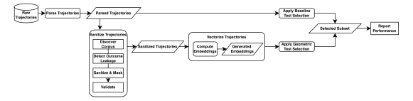
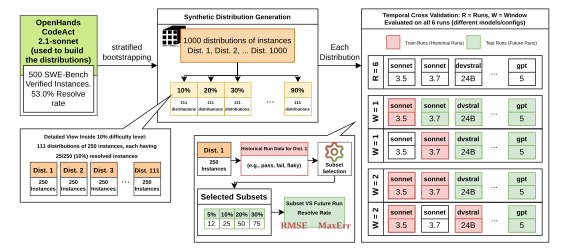
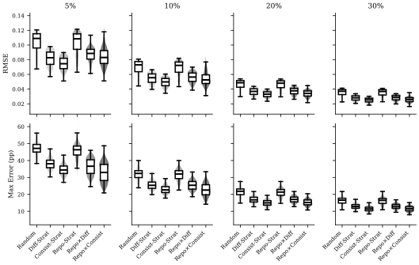
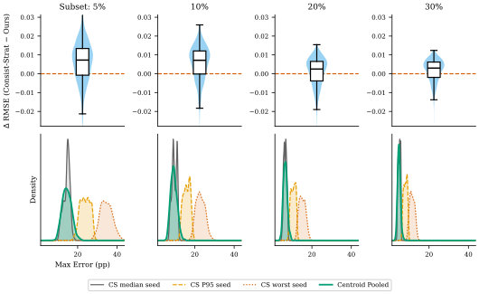
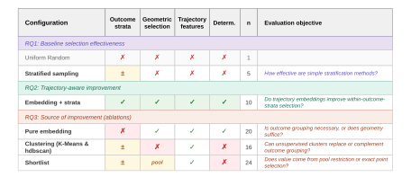

**Source:** *Trajectory-Aware Benchmark Subset Selection for Cost-Efficient Software Engineering Agent Regression Testing* — [PDF](https://arxiv.org/pdf/2609.24928) · [arXiv](https://arxiv.org/abs/2609.24928)

# Trajectory-Aware Benchmark Subset Selection for Cost-Efficient Software Engineering Agent Regression Testing

Journal: TOSEMDOI: [XXXXXXX.XXXXXXX](https://doi.org/XXXXXXX.XXXXXXX)Conference: Make sure to enter the correct conference title from your rights confirmation email; June 03–05, 2018; Woodstock, NYISBN: 978-1-4503-XXXX-X/2026/06CCS: Software and its engineering Software testing and debuggingCCS: Software and its engineering Empirical software validationCCS: Computing methodologies Intelligent agents

Mahmoud Ayyad   email: [mahmoud.ayyad@queensu.ca](mailto:mahmoud.ayyad@queensu.ca) Affiliation: Queen’s University, Canada ,  Zehao Wang   email: [w_zeha@encs.concordia.ca](mailto:w_zeha@encs.concordia.ca) Affiliation: Concordia University, Canada ,  Jiho Shin   email: [jiho.shin@queensu.ca](mailto:jiho.shin@queensu.ca) Affiliation: Queen’s University, Canada ,  Ying Zou   email: [ying.zou@queensu.ca](mailto:ying.zou@queensu.ca) Affiliation: Queen’s University, Canada and  Bram Adams   email: [bram.adams@queensu.ca](mailto:bram.adams@queensu.ca) Affiliation: Queen’s University, Canada

2026

###### Abstract.

Autonomous software engineering agents (SWE-agents) automate complex coding tasks such as fixing issues and implementing new features. While evaluating SWE-agents requires running large benchmarks over many real-world software tasks, each agent update may require re-running the full benchmark again to detect regressions and improvements, at a cost of hundreds of millions of LLM tokens per run, which makes evaluation a bottleneck during development. One solution is to evaluate only a subset of benchmark instances. Yet, simple approaches, such as random sampling or stratified random sampling based on past pass/fail outcomes, risk producing high variance and unrepresentative subsets. To address this issue, we turn to agent trajectories, the step-by-step record of the actions an agent took and the observations it made while working on an instance. Prior work analyzes trajectories to characterize agent behavior and failure modes, but, to our knowledge, none uses them to select which instances to evaluate. We propose a trajectory-aware subset selection approach that replaces random sampling with deterministic selection based on trajectory embeddings. We first group test set instances by their test outcome in a recent full test run to preserve the historical pass/fail rate, then select the subset using the trajectory’s embedding space.

We systematically evaluate 76 subset selection configurations, including random sampling, embedding-based selection, clustering-based selection, and hybrid shortlist-then-subsample strategies, across three regression scenarios: same-configuration reruns, model and configuration changes, and agent framework changes. Our best trajectory-aware method is the one selecting benchmark instances closest to the centroid of each outcome group in the embedding space. It achieves the lowest estimation error among all methods we evaluate, where the error is the gap between the resolve rate measured on the subset and the resolve rate of the full benchmark. For instance, when evaluating a given agent version on a selected subset of only 5% or 10% of the test instances, our approach reduces the average estimation error by 3–11% and the worst-case error, the largest difference between the subset’s resolve rate and the full benchmark’s resolve rate on any single run, by 4–11% relative to the typical draw and 38–46% relative to the 95th-percentile draw of the strongest baseline. Our results show that a 10% trajectory-aware subset keeps the median estimation error below 5% while cutting token cost by roughly 90%.

###### Keywords: 

Trajectory, Software Engineering Agents, Subset Selection 

## 1\. Introduction

Autonomous software engineering agents (SWE-agents) are increasingly capable of repairing programs ([Zhang et al., 2024](https://arxiv.org/html/2609.24928#bib.bib46)), debugging software systems ([Zhong et al., 2024](https://arxiv.org/html/2609.24928#bib.bib47)), and generating and executing tests ([Huang et al., 2024](https://arxiv.org/html/2609.24928#bib.bib48)). Benchmarks such as SWE-Bench ([Jimenez et al., 2024](https://arxiv.org/html/2609.24928#bib.bib1)) and its curated subset, SWE-Bench Verified ([Chowdhury et al., 2024](https://arxiv.org/html/2609.24928#bib.bib2)), have been widely used for testing SWE-agents, with newer, harder benchmarks such as SWE-Bench Pro ([Deng et al., 2025](https://arxiv.org/html/2609.24928#bib.bib53)) continuing this line. Each benchmark consists of a set of instances, where each instance typically is a real GitHub issue in an existing codebase. The agent attempts to resolve the GitHub issue by taking a series of actions, such as reading files and modifying code, generating a trajectory. To resolve each instance, the agent must output a final code fix that makes the instance’s previously failing tests pass while keeping the previously passing tests green.

Major SWE-agent frameworks, such as OpenHands ([Wang et al., 2025](https://arxiv.org/html/2609.24928#bib.bib13)), have been using SWE-Bench instances for quality monitoring during development. Running such benchmarks is costly, both in terms of time and money. This is because each evaluation requires executing hundreds of instances (e.g., 500 in SWE-Bench Verified), and each instance involves a full agent loop with multiple LLM API calls, tool invocations, and code-test execution steps. As a result, repeatedly evaluating every SWE-agent update, for instance in a CI workflow or even ad hoc on the framework developers’ end, becomes impractical. Yet, developers continuously modify models, prompts, and agent architectures, and each change may require regression testing to detect improvements or performance drops ([Fan et al., 2025](https://arxiv.org/html/2609.24928#bib.bib3)), which calls for a cheaper check than a full benchmark run.

One mitigation for this evaluation cost is therefore to evaluate on a smaller subset of the benchmark. Prior work has explored curated subsets based on instance difficulty and solvability ([Chowdhury et al., 2024](https://arxiv.org/html/2609.24928#bib.bib2); [Ndzomga, 2026](https://arxiv.org/html/2609.24928#bib.bib51)). For example, the developers behind OpenHands have recognized the necessity of smaller subsets ([Wang et al., 2025](https://arxiv.org/html/2609.24928#bib.bib13)). Their evaluation infrastructure supports limiting runs to smaller instance counts (e.g., 50 or 200 out of 500 in SWE-bench Verified), yet the subset is selected via a fixed-seed random sample.11 1 See prepare_dataset at line 70 of <https://github.com/OpenHands/benchmarks/blob/4e5469e0caaf54d1ad827d18b524bdfb79d58430/benchmarks/utils/dataset.py#L70C9-L70C80>, which calls dataset.sample(n=n_limit, random_state=42). While traditional software engineering has long used historical pass/fail outcomes as an effective signal for the test-suite reduction and prioritization ([Kim and Porter, 2002](https://arxiv.org/html/2609.24928#bib.bib6); [Elbaum et al., 2014](https://arxiv.org/html/2609.24928#bib.bib10)), to the best of our knowledge, no technique thus far has exploited this idea in the context of SWE-agent regression testing.

Motivated by the prior work, one direction is to construct subsets that preserve the full test suite’s overall difficulty using agents’ historical pass/fail outcomes, even though such subset selection is challenging ([Polo et al., 2024](https://arxiv.org/html/2609.24928#bib.bib52)). In particular, subset selection based only on static instance properties or final pass/fail labels ignores what happens during execution: instances with the same outcome can reflect very different agent behaviors and failure modes. Recent studies of agent trajectories show that similar failures can happen for different reasons, such as repetitive command loops or failure to run the test suite ([Bouzenia and Pradel, 2025](https://arxiv.org/html/2609.24928#bib.bib15); [Majgaonkar et al., 2025](https://arxiv.org/html/2609.24928#bib.bib16)). In other words, building an evaluation subset that accurately reflects the full test suite requires behavioral information extracted directly from the agent’s step-by-step trajectories on prior runs. Furthermore, subsets built without trajectory data can produce unstable estimates. At small subset sizes, random sampling has high variance and may over-represent rare edge cases rather than typical execution patterns ([Polo et al., 2024](https://arxiv.org/html/2609.24928#bib.bib52)). Stratifying by outcome reduces this variance but does not remove it, since stratification controls the variation along the variable used to form the groups ([Neyman, 1934](https://arxiv.org/html/2609.24928#bib.bib29)): within each outcome group, instances are still drawn at random. Our approach keeps this stratification but replaces the random draw.

Hence, we propose a trajectory-aware subset selection approach that combines historical execution outcomes with the actions the agent took while solving each instance (its trajectory), for example, the number of steps it took, the amount of tests ran, and the number of produced errors. Our approach selects a subset of benchmark instances whose execution profile matches the full test suite, so the subset reflects the same workload the agent faces on the full run. We first group benchmark instances (i.e., individual issues) by the historical pass/fail outcomes of the agent under development (its earlier versions or configurations), a step we call outcome grouping, to preserve the full test suite’s overall difficulty distribution. We then apply a sanitization pipeline to remove outcome leakage: words in the trajectory that reveal whether the run passed or failed (e.g., “tests passed”, “exit code 0”), along with repository-specific terms that identify the instance rather than describe the agent’s behavior. Finally, we transform the sanitized trajectories into semantic embeddings, which allow us to measure the distance between different agent behaviors and apply geometric selection algorithms. Inspired by traditional test prioritization approaches based on execution traces ([Jabbar et al., 2022](https://arxiv.org/html/2609.24928#bib.bib4); [Al-Sharif and Jeffery, 2024](https://arxiv.org/html/2609.24928#bib.bib5); [Kim and Porter, 2002](https://arxiv.org/html/2609.24928#bib.bib6)), we take the trajectories from the most recent full runs and use them to select a small set of instances that represent the full benchmark.

To validate our approach under realistic development conditions, where developers iterate on agents by changing models, configurations, or frameworks and rerun the benchmark to check for regressions, we empirically analyze subset selection performance on 31,779 publicly available trajectories from 58 runs spanning five agent frameworks. The data covers three distinct regression testing scenarios: (1) 45 reruns of the same OpenHands agent on SWE-Rebench (3,188 instances, 25,279 trajectories), (2) 6 runs of OpenHands with different models/configurations on SWE-Bench Verified (3,000 trajectories), and (3) 7 runs across five distinct SWE-agents on SWE-Bench Verified (3,500 trajectories). Using this data, we investigate four research questions:

RQ1: How effective are baseline subset selection approaches at approximating full-test suite resolve rates? To establish a baseline, we evaluate several simple selection methods. We test methods such as “uniform random sampling" (picking instances at random without prior knowledge), “repository stratification" (grouping instances by their source repository), and “outcome-based stratification" (grouping instances by their historical outcomes, such as pass, fail, or flaky, and sampling proportionally from those groups). While grouping by past test outcomes reduces the median error by 31–51% relative to random selection, all simple methods prove unreliable: at subset sizes of 5% and 10%, even the strongest baseline has a worst-case error of up to 14% on a typical draw and up to 35% on its worst draw.

RQ2: To what extent do trajectory-aware embedding methods improve subset selection compared to the strongest baseline? We investigate whether selecting instances based on the agent’s step-by-step behavior (trajectory) provides a more reliable subset. After grouping the instances by their past test outcomes (outcome grouping), we transform the agents’ trajectories from recent runs into embeddings. Instead of pulling random instances, we apply geometric selection by choosing the instances closest to the center of each group. At subset sizes of 5% and 10%, the method reduces the average estimation error by 3–11% while cutting the worst-case error by 4–11% relative to the typical draw and 38–46% relative to the 95th-percentile draw of the strongest baseline approach. Using a 10% subset, our approach reduces test suite execution by 90% while maintaining median estimation error below 5%.

RQ3: What drives the improvement of trajectory-aware methods over the baselines? We measure the impact of outcome grouping and geometric selection on the median estimation error and worst-case error reduction reported in RQ2, both individually and combined. We find that both components are necessary. Removing outcome grouping increases the average estimation error by 30–37%, while a fixed selection rule that uses past outcomes but no embeddings is not consistently better than random sampling and falls behind it as the subset grows. Replacing exact geometric selection with random sampling from a candidate pool worsens the average estimation error by 21–26%. Only the combination of outcome grouping and geometric selection improves the average accuracy by 3–11% and reduces worst-case error by 4–11% relative to the typical draw and 38–46% relative to the 95th-percentile draw of the strongest baseline approach, as it preserves the balance between hard and easy instances, and geometric selection over the embedding space captures representative behavior without random variance.

RQ4: How much does subset selection reduce evaluation cost? Whether selecting a 10% subset saves 90% of the benchmark execution cost depends on which instances it contains, since some instances cost more to evaluate than others. We measure the total token cost of 3,000 trajectories from six runs of the same agent (i.e., OpenHands) under different models and configurations, then draw 10,000 random \(k\)% subsets per run to estimate the actual token cost savings. We find that our approach is cost-neutral: it favors neither cheap nor expensive instances, so a k% subset consumes k% of the full token cost on average. The accuracy and worst-case error gains from RQ2 therefore come with proportional cost savings. A 10% subset reduces token consumption from 3.44B to 345M, a 90% saving, while keeping median estimation error below 5%.

The contributions of this paper are as follows:

  * We propose the first trajectory-aware subset selection approach for SWE-agent regression testing that combines deterministic geometric selection with historical outcome grouping over sanitized trajectory embeddings. 
  * We develop a four-phase sanitization pipeline that removes outcome leakage from agent trajectories while preserving behaviorally meaningful signals. We additionally provide a unified parsing schema that standardizes heterogeneous trajectory formats across five agent frameworks into a common representation. 
  * We evaluate 76 subset selection configurations for SWE-agent regression testing across three regression scenarios (same-configuration reruns, model and configuration changes, and agent framework changes) with strict temporal cross-validation. 
  * We release the complete dataset of standardized trajectories, the unified parsing schema, and selection algorithms to facilitate replication22 2 [www.github.com/SAILResearch/swe-agent-subset-selection](https://www.github.com/SAILResearch/swe-agent-subset-selection). 

The remainder of this paper is organized as follows. Section [2](https://arxiv.org/html/2609.24928#S2 "2. Background ‣ Trajectory-Aware Benchmark Subset Selection for Cost-Efficient Software Engineering Agent Regression Testing") introduces background concepts. Section [3](https://arxiv.org/html/2609.24928#S3 "3. Related Work ‣ Trajectory-Aware Benchmark Subset Selection for Cost-Efficient Software Engineering Agent Regression Testing") introduces related works. Section [4](https://arxiv.org/html/2609.24928#S4 "4. Test Selection Approach ‣ Trajectory-Aware Benchmark Subset Selection for Cost-Efficient Software Engineering Agent Regression Testing") details our approach. Section [5](https://arxiv.org/html/2609.24928#S5 "5. Evaluation Setup ‣ Trajectory-Aware Benchmark Subset Selection for Cost-Efficient Software Engineering Agent Regression Testing") outlines the experimental setup. Section [6](https://arxiv.org/html/2609.24928#S6 "6. Experiment Results ‣ Trajectory-Aware Benchmark Subset Selection for Cost-Efficient Software Engineering Agent Regression Testing") presents the findings. Section [7](https://arxiv.org/html/2609.24928#S7 "7. Implications ‣ Trajectory-Aware Benchmark Subset Selection for Cost-Efficient Software Engineering Agent Regression Testing") discusses the implications and practical insights from our findings. Section [8](https://arxiv.org/html/2609.24928#S8 "8. Threats to Validity ‣ Trajectory-Aware Benchmark Subset Selection for Cost-Efficient Software Engineering Agent Regression Testing") examines validity threats, and Section [9](https://arxiv.org/html/2609.24928#S9 "9. Conclusion ‣ Trajectory-Aware Benchmark Subset Selection for Cost-Efficient Software Engineering Agent Regression Testing") concludes.

## 2\. Background

### 2.1. SWE-Agents

An AI agent is an autonomous software system driven by an AI model that can reason, use tools, and run in a loop to achieve a specific goal. In each iteration of the loop, the agent chooses an action, executes it through a tool (e.g., a shell or a file editor), and observes the result, which informs its next action. In the context of software engineering agents (SWE-agents), the goal is to work on software. Given an issue report and access to the corresponding codebase, a SWE-agent reads files, modifies code, and runs commands and tests until it produces a candidate code fix. There are several SWE-agent frameworks. For instance, AutoCodeRover ([Zhang et al., 2024](https://arxiv.org/html/2609.24928#bib.bib46)) iteratively searches the codebase to locate and patch the code responsible for an issue, while OpenHands ([Wang et al., 2025](https://arxiv.org/html/2609.24928#bib.bib13)) provides an open platform where agents act through a shell, a file editor, and a browser.

### 2.2. Agent Trajectories

During execution, SWE-agent frameworks log the agent’s sequence of thoughts, actions, and observations, called a trajectory. Figure [1](https://arxiv.org/html/2609.24928#S2.F1 "Figure 1 ‣ 2.2. Agent Trajectories ‣ 2. Background ‣ Trajectory-Aware Benchmark Subset Selection for Cost-Efficient Software Engineering Agent Regression Testing") shows the structure of a trajectory: each step in a trajectory records the action the agent took (e.g., a file edit or a shell command) and the observation it received back (e.g., the edit confirmation or the command output).

⬇

Step 1

Thought: "The issue mentions a bug in

misc.py, let me inspect it."

Action: open codebase/utils/misc.py

Observation: <file contents>

Step 2

Thought: "The comparison operator is

wrong, I will fix it."

Action: edit codebase/utils/misc.py

Observation: "The file has been edited..."

Step 3

Thought: "Let me run the tests to

verify the fix."

Action: run pytest codebase/utils/

Observation: <test output>

...

Final output: candidate code fix (patch)

Figure 1. Example of a SWE-agent trajectory. Each step records the agent’s thought, the action it took, and the observation it received.

## 3\. Related Work

### 3.1. Behavioral Analysis of Agent Trajectories

A growing line of work analyzes these trajectories to understand agent behavior. Bouzenia and Pradel ([Bouzenia and Pradel, 2025](https://arxiv.org/html/2609.24928#bib.bib15)) study thought-action-result patterns in SWE-agents to characterize decision-making dynamics and failure modes. Ceka et al. ([Ceka et al., 2026](https://arxiv.org/html/2609.24928#bib.bib56)) trace the full decision-making pipelines of five agents, derive a taxonomy of their decision pathways, and identify bug localization and reproduction-test generation as core behavioral modules. Majgaonkar et al. ([Majgaonkar et al., 2025](https://arxiv.org/html/2609.24928#bib.bib16)) compare successful and failed trajectories, showing that longer and more variable trajectories are often associated with failure. Beyond characterization, recent work scores trajectory quality: AgentLens ([Sahoo et al., 2026](https://arxiv.org/html/2609.24928#bib.bib57)) computes deterministic process scores for SWE-agent trajectories to expose solutions that pass tests despite flawed processes. However, prior trajectory analysis targets interpretability and post-hoc characterization. We instead use trajectories as a selection signal, embedding them to pick a behaviorally representative subset of benchmark instances.

### 3.2. Efficient Evaluation of Autonomous SWE-Agents

SWE-agents are evaluated on benchmarks such as SWE-Bench ([Jimenez et al., 2024](https://arxiv.org/html/2609.24928#bib.bib1)) and the newer, harder SWE-Bench Pro ([Deng et al., 2025](https://arxiv.org/html/2609.24928#bib.bib53)). Each benchmark consists of a set of instances, where each instance typically is a real GitHub issue in an existing codebase. The fraction of resolved instances is the agent’s resolve rate. Evaluating an agent means running it on every instance of the benchmark, and this high cost has motivated two lines of research: reducing the resources required to execute a single benchmark instance and reducing the total number of instances to evaluate.

To reduce the cost of executing individual benchmark instances, prior work has focused on lowering token usage and execution time. For example, Fan et al. ([Fan et al., 2025](https://arxiv.org/html/2609.24928#bib.bib3)) propose SWE-Effi, a resource-aware evaluation framework that measures agent effectiveness under resource constraints and penalizes excessive token and time consumption. AgentDiet ([Xiao et al., 2025](https://arxiv.org/html/2609.24928#bib.bib7)) reduces inference-time cost by compressing agent trajectories and removing redundant or expired context from the growing interaction history. While these methods reduce the cost per evaluated instance, they do not reduce the number of instances that must be evaluated.

To reduce the total number of instances that require evaluation, researchers have explored evaluating smaller benchmarks. SWE-Bench Lite ([Jimenez et al., 2024](https://arxiv.org/html/2609.24928#bib.bib1)) and the human-validated SWE-Bench Verified ([Chowdhury et al., 2024](https://arxiv.org/html/2609.24928#bib.bib2)), both curated subsets of SWE-Bench, cut cost this way, but they are fixed sets, not methods that adapt the subset per run, and even SWE-Bench Verified remains costly: each evaluation executes 500 instances, each involving a full agent loop with multiple LLM calls and test executions ([Fan et al., 2025](https://arxiv.org/html/2609.24928#bib.bib3)). Closer to our setting, agent frameworks already subsample their benchmarks to cut evaluation cost during development. The OpenHands evaluation harness, for example, limits a run to a fixed-seed random sample of SWE-Bench Verified (e.g. 50 or 200 of 500) with no selection criteria beyond the fixed random seed.[1](https://arxiv.org/html/2609.24928#footnote1 "footnote 1 ‣ 1. Introduction ‣ Trajectory-Aware Benchmark Subset Selection for Cost-Efficient Software Engineering Agent Regression Testing") This is the practice our work targets: our trajectory-aware selection replaces such blind random sampling.

Beyond software engineering agents, prior work on general LLM evaluation has also studied algorithmic benchmark reduction. Zhao et al. ([Zhao et al., 2024](https://arxiv.org/html/2609.24928#bib.bib8)) propose BenTo, which embeds instance prompts and selects a subset that maximizes in-context transferability. Bean et al. ([Bean et al., 2025](https://arxiv.org/html/2609.24928#bib.bib9)) introduce Scales++, which shifts attention from question text to the underlying skills each instance tests. Their method uses an LLM to rate the cognitive demands of each instance from its description text alone, embeds these demand ratings, and selects a subset that maximizes diversity in the demand space.

Our work differs from these approaches in both the selection signal and the evaluation objective. BenTo and Scales++ rely on static task properties and target cross-model ranking preservation: they pick instances so that the subset ranks a set of models in the same order as the full benchmark, on multi-task benchmarks with categorical task structure such as MMLU. We instead track a single agent’s resolve rate across successive runs of the same benchmark, where each instance is an individual issue report without a predefined category structure, and this rate depends on how the agent behaves rather than on fixed instance properties. Direct application of BenTo and Scales++ to our setting is impractical due to their computational requirements: BenTo requires \(\mathcal{O}(n^{2})\) LLM calls to build its transferability matrix, exceeding the cost of running the full benchmark, and Scales++, although needing only a one-time LLM pass per instance, still optimizes for ranking a set of models rather than estimating one agent’s resolve rate.

### 3.3. Execution-Based Test Case Prioritization

Dynamic selection based on execution data is an established technique in traditional software engineering for improving software testing efficiency, with a large literature surveyed in ([Yoo and Harman, 2012](https://arxiv.org/html/2609.24928#bib.bib54); [Lou et al., 2019](https://arxiv.org/html/2609.24928#bib.bib55)). Kim and Porter ([Kim and Porter, 2002](https://arxiv.org/html/2609.24928#bib.bib6)) showed that historical execution data can support cost-effective test prioritization for regression testing in resource-constrained continuous integration environments. Elbaum et al. ([Elbaum et al., 2014](https://arxiv.org/html/2609.24928#bib.bib10)) extended history-based prioritization to industrial-scale continuous integration at Google, using failure history and execution windows to select and prioritize test suites. Reinforcement learning approaches, such as RETECS ([Spieker et al., 2017](https://arxiv.org/html/2609.24928#bib.bib11)) and the work of Bagherzadeh and Briand ([Bagherzadeh et al., 2021](https://arxiv.org/html/2609.24928#bib.bib12)), further learn prioritization policies from sequences of continuous integration outcomes. More recent learning-based approaches scale ML-based prioritization to CI environments using comprehensive feature sets ([Yaraghi et al., 2023](https://arxiv.org/html/2609.24928#bib.bib58)), or rank test cases by semantic similarity to code changes using pretrained language models ([Li et al., 2024](https://arxiv.org/html/2609.24928#bib.bib59)).

Test2Vec ([Jabbar et al., 2022](https://arxiv.org/html/2609.24928#bib.bib4)) embeds execution traces into a latent space for test case prioritization and demonstrates that trace-based representations capture behavioral semantics that are missed by code coverage metrics. AbstractTrace ([Al-Sharif and Jeffery, 2024](https://arxiv.org/html/2609.24928#bib.bib5)) similarly uses execution traces to cluster and prioritize test suites. We adapt the trace-embedding approach to the agent setting by treating agent trajectories as behavioral abstractions for subset selection rather than test prioritization.

## 4\. Test Selection Approach

This section details the end-to-end pipeline for our SWE-agent regression test selection approach, as outlined in Figure [2](https://arxiv.org/html/2609.24928#S4.F2 "Figure 2 ‣ 4. Test Selection Approach ‣ Trajectory-Aware Benchmark Subset Selection for Cost-Efficient Software Engineering Agent Regression Testing"). We first parse raw trajectories into a standardized format as different agent frameworks record trajectories in incompatible ways. Next, we sanitize the parsed trajectories to remove explicit outcome signals, since leaked success or failure tokens would make embeddings cluster by result rather than behavior. We then pass the sanitized trajectories into an embedding model to generate numerical representations. Based on the embeddings of the most recent full regression run, we select a small subset of instances. On later runs, we evaluate only the selected subset and use its resolve rate to estimate the full suite’s resolve rate.

 Figure 2. Overview of the test selection approach.

### 4.1. Parse Trajectories

Different agent frameworks record their trajectory data in different ways. As shown in Figure [3](https://arxiv.org/html/2609.24928#S4.F3 "Figure 3 ‣ 4.1. Parse Trajectories ‣ 4. Test Selection Approach ‣ Trajectory-Aware Benchmark Subset Selection for Cost-Efficient Software Engineering Agent Regression Testing"), OpenHands ([Wang et al., 2025](https://arxiv.org/html/2609.24928#bib.bib13)) logs actions as a flat list, whereas Moatless ([Antoniades et al., 2025](https://arxiv.org/html/2609.24928#bib.bib14)) nests them inside a search tree. To ease our downstream analysis, we implement a parsing pipeline that converts diverse formats into a single, unified JSON schema.

The parsing is fully automated and deterministic, using rule-based normalization of shell commands, pattern matching to detect test runs, and exit-code to extract errors, without manual labeling or model inference. For error extraction, each step’s observation is scanned for an exit code. An exit code of 0 means no error. For any other exit code, the parser records the Python traceback as the error message. All parsing rules and the analysis scripts are included in our replication package.33 3 [www.github.com/SAILResearch/swe-agent-subset-selection](https://www.github.com/SAILResearch/swe-agent-subset-selection) We confirm that parsed trajectories faithfully reflect the originals in two steps. First, we automatically compare every one of the parsed trajectories against its raw log: each recorded action and observation must appear verbatim in the log, each extracted exit code must match the one the log reports. All trajectories pass. We also manually verify 20 trajectories, reading the raw logs directly and confirming that every step is captured and that commands, test runs, and errors are classified correctly. All 20 matched. The unified schema captures what the agent does, not how the framework formats it, as illustrated in Figure [3](https://arxiv.org/html/2609.24928#S4.F3 "Figure 3 ‣ 4.1. Parse Trajectories ‣ 4. Test Selection Approach ‣ Trajectory-Aware Benchmark Subset Selection for Cost-Efficient Software Engineering Agent Regression Testing")(c).

(a) OpenHands (Flat List)

⬇

[

{

"role": "assistant",

"tool_calls": [{

"function": {

"name": "str_replace_editor",

"arguments": {

"command": "str_replace",

"path": "astropy/utils/misc.py",

"old_str": "...",

"new_str": "..."

}

}

}]

},

{

"role": "tool",

"name": "str_replace_editor",

"content": "The␣file␣has␣been␣edited..."

}

]

(b) Moatless (Tree Structure)

⬇

{

"nodes": [{

"node_id": 5,

"action_steps": [{

"action": {

"path": "astropy/utils/misc.py",

"old_str": "...",

"new_str": "...",

"action_class":

"StringReplaceArgs"

},

"observation": {

"message":

"The␣file␣has␣been␣edited...",

"terminal": false

}

}],

"visits": 15,

"value": 917.0

}]

}

(c) Our Unified Schema

⬇

{

"trajectory_id": "astropy-7166",

"repo_name": "astropy",

"agent_name": "OpenHandsSonnet4",

"final_outcome": true,

"steps": [{

"step_index": 1,

"action_command": "str_replace",

"files_touched":

["astropy/utils/misc.py"],

"tests_run": [],

"edit_size": 3,

"error_message": "",

"observation":

"The␣file␣has␣been␣edited...",

...

}]

}

Figure 3. Comparison of raw trajectory formats and the unified schema. (a) OpenHands records agent actions as a flat list. (b) Moatless organizes its trajectory into a layered tree structure. (c) Our parsing pipeline converts these different formats into one standard layout, allowing every agent’s data to be handled using a single schema

### 4.2. Sanitize Trajectories

A central challenge in using trajectories for subset selection is data leakage. Outcome tokens, such as passed or exit code 0 reveal whether a run succeeded, while repository names and test-harness artifacts can reveal task identity. If retained, such signals cause embeddings to be clustered by outcome or repository rather than by agent behavior. To avoid these unwanted signals, we develop a four-phase sanitization pipeline.

#### 4.2.1. Phase 1: Discover Corpus

As we want our downstream analysis to reflect actual agent behavior rather than formatting artifacts, we first analyze all tokens (whitespace-separated words, symbols, and numbers) across all trajectories to find tokens that are uninformative for comparing trajectories. These tokens fall into two categories: random identifiers, which almost never repeat across trajectories, and repetitive boilerplate, which appears identically in nearly all of them. We detect each with an automated statistical pass over the corpus, described below. This pass proposes candidate tokens and patterns, which we review once to build a stop-word list and a set of regex rules. We perform this calibration once per dataset, since the noise tokens are dataset-specific, while the procedure itself is general.

To detect random identifiers such as UUIDs, commit hashes, and temporary folder names, our analysis script converts each token into a character pattern: every letter in the token becomes c and every digit becomes d (e.g., 3f8a2b \(\rightarrow\) dcdcdc). Tokens that produce the same pattern form a group. For each pattern, the script counts how often it appears and how many distinct tokens produce it. A pattern produced by many distinct tokens is auto-generated text, such as a random seed or a temporary path, while a pattern produced by a few tokens repeated often is a genuine vocabulary term. The script outputs the list of patterns it flags as auto-generated. We then manually review the list of flagged patterns once per dataset and encode each confirmed pattern as a regular-expression rule that replaces matching tokens with a typed placeholder (for example, a temporary path becomes [PATH] and a random seed becomes [RANDOM_SEED]), applied automatically across the corpus. Table [1](https://arxiv.org/html/2609.24928#S4.T1 "Table 1 ‣ 4.2.1. Phase 1: Discover Corpus ‣ 4.2. Sanitize Trajectories ‣ 4. Test Selection Approach ‣ Trajectory-Aware Benchmark Subset Selection for Cost-Efficient Software Engineering Agent Regression Testing") shows examples.

Table 1. How we tell random identifiers from real tokens. For each token we compare how often it appears (#Occurrences) with how many _different_ strings produce it (Distinct). A random identifier is a new string almost every time, so the two counts match, and we replace the random identifier with a typed placeholder. Boilerplate is one string repeated constantly, so it appears very often but as a single distinct string, and we remove these boilerplate strings. 

<table id="S4.T1.4" class="ltx_tabular ltx_centering ltx_guessed_headers ltx_align_middle">
<tbody class="ltx_tbody">
<tr id="S4.T1.4.1" class="ltx_tr">
<td id="S4.T1.4.1.1" class="ltx_td ltx_border_tt"></td>
<th id="S4.T1.4.1.2" class="ltx_td ltx_align_left ltx_th ltx_th_column ltx_border_tt">Example token</th>
<th id="S4.T1.4.1.3" class="ltx_td ltx_align_right ltx_th ltx_th_column ltx_border_tt">#Occurrences</th>
<th id="S4.T1.4.1.4" class="ltx_td ltx_align_right ltx_th ltx_th_column ltx_border_tt">#Distinct</th>
<th id="S4.T1.4.1.5" class="ltx_td ltx_nopad_r ltx_align_left ltx_th ltx_th_column ltx_border_tt">Action</th></tr>
<tr id="S4.T1.4.2" class="ltx_tr">
<td id="S4.T1.4.2.1" class="ltx_td ltx_align_left ltx_border_t" rowspan="3">

Identifier
</td>
<td id="S4.T1.4.2.2" class="ltx_td ltx_align_left ltx_border_t">PYTHONHASHSEED=1868256478</td>
<td id="S4.T1.4.2.3" class="ltx_td ltx_align_right ltx_border_t">491</td>
<td id="S4.T1.4.2.4" class="ltx_td ltx_align_right ltx_border_t">491</td>
<td id="S4.T1.4.2.5" class="ltx_td ltx_nopad_r ltx_align_left ltx_border_t">mask [RANDOM_SEED]</td></tr>
<tr id="S4.T1.4.3" class="ltx_tr">
<td id="S4.T1.4.3.1" class="ltx_td ltx_align_left">/workspace/django__django…</td>
<td id="S4.T1.4.3.2" class="ltx_td ltx_align_right">278</td>
<td id="S4.T1.4.3.3" class="ltx_td ltx_align_right">278</td>
<td id="S4.T1.4.3.4" class="ltx_td ltx_nopad_r ltx_align_left">mask [PATH]</td></tr>
<tr id="S4.T1.4.4" class="ltx_tr">
<td id="S4.T1.4.4.1" class="ltx_td ltx_align_left">sphinx/locale/da/…/sphinx.po</td>
<td id="S4.T1.4.4.2" class="ltx_td ltx_align_right">422</td>
<td id="S4.T1.4.4.3" class="ltx_td ltx_align_right">422</td>
<td id="S4.T1.4.4.4" class="ltx_td ltx_nopad_r ltx_align_left">mask [PATH]</td></tr>
<tr id="S4.T1.4.5" class="ltx_tr">
<td id="S4.T1.4.5.1" class="ltx_td ltx_align_left ltx_border_bb ltx_border_t" rowspan="3">

Boiler.
</td>
<td id="S4.T1.4.5.2" class="ltx_td ltx_align_left ltx_border_t">execute_bash:</td>
<td id="S4.T1.4.5.3" class="ltx_td ltx_align_right ltx_border_t">79,431</td>
<td id="S4.T1.4.5.4" class="ltx_td ltx_align_right ltx_border_t">1</td>
<td id="S4.T1.4.5.5" class="ltx_td ltx_nopad_r ltx_align_left ltx_border_t">remove</td></tr>
<tr id="S4.T1.4.6" class="ltx_tr">
<td id="S4.T1.4.6.1" class="ltx_td ltx_align_left">[Command</td>
<td id="S4.T1.4.6.2" class="ltx_td ltx_align_right">78,885</td>
<td id="S4.T1.4.6.3" class="ltx_td ltx_align_right">1</td>
<td id="S4.T1.4.6.4" class="ltx_td ltx_nopad_r ltx_align_left">remove</td></tr>
<tr id="S4.T1.4.7" class="ltx_tr">
<td id="S4.T1.4.7.1" class="ltx_td ltx_align_left ltx_border_bb">interpreter:</td>
<td id="S4.T1.4.7.2" class="ltx_td ltx_align_right ltx_border_bb">73,076</td>
<td id="S4.T1.4.7.3" class="ltx_td ltx_align_right ltx_border_bb">1</td>
<td id="S4.T1.4.7.4" class="ltx_td ltx_nopad_r ltx_align_left ltx_border_bb">remove</td></tr>
</tbody>
</table>

 

To detect repetitive boilerplate, we rank every token in the corpus by frequency. Zipf’s law ([Zipf, 1949](https://arxiv.org/html/2609.24928#bib.bib17); [Manning and Schütze, 1999](https://arxiv.org/html/2609.24928#bib.bib18)) states that in natural language, token frequency is inversely proportional to rank: the most frequent token appears roughly twice as often as the second, three times as often as the third, and so on. The most frequent tokens in natural text are therefore common words like “the” or “of.” In our trajectories, however, the top-ranked tokens are not natural words but structural characters ([, &&), harness commands (e.g., pytest, make test), and fixed environment paths (e.g., /workspace, /tmp) that repeat identically across nearly every trajectory. The script flags the top-ranked tokens, which we manually review once per dataset to compile a stop-word list. The list is then applied automatically to every trajectory during sanitization.

#### 4.2.2. Phase 2: Detect Outcome Leakage

Phase 1 removes formatting noise, but a subtler problem remains: some words in the trajectories directly reveal whether a run has passed or failed. SWE-agent benchmarks score each run by whether the instance was resolved, so every trajectory already carries a pass/fail outcome. Words that reveal that outcome therefore add no new information, if left in the text, may dominate the resulting embeddings, causing trajectories to be grouped by outcome rather than by the agent’s actual problem-solving behavior.

To identify outcome-leakage words, we split the corpus into two groups (passing and failing trajectories) and count how often each word appears in each group. We then apply log-likelihood keyness analysis (\(G^{2}\)) ([Dunning, 1993](https://arxiv.org/html/2609.24928#bib.bib20)), a statistical test that measures whether a word appears disproportionately more often in one group than in the other. A high \(G^{2}\) score means the word is strongly associated with one group (i.e., test outcome). We use a significance threshold of \(G^{2}>10.83\) (\(p<0.001\)) to flag words for review.

We then review the flagged words once per dataset. We remove a word if it reveals the instance outcome or the repository identity, while we keep a word if it reflects what the task requires the agent to do. Some calls are clear, such as removing “passed” or repository tooling like pylint. Others require judgment, so we treat this as a per-dataset calibration rather than a fixed rule. We group the flagged words as follows:

  * Removed. Outcome indicators such as “passed” or “exit code 0,” and repository tooling such as dvc (Data Version Control) or pylint (a code linter), which are hard-coded into specific repositories’ test harnesses. Keeping “pylint” would let the embedding associate it with failure, encoding which repository the agent is in rather than how it solves problems. 
  * Retained. Terms that name what the task requires, such as asyncio (asynchronous concurrency) or hypothesis (property-based testing ([MacIver and Hatfield-Dodds, 2019](https://arxiv.org/html/2609.24928#bib.bib21))). These reflect the task’s demands and the agent’s approach, so they help distinguish trajectories by behavior and stay in the embeddings. 

#### 4.2.3. Phase 3: Sanitize & Mask

We remove the outcome-leakage words identified in Phase 2, such as passed and exit code 0, and we automatically mask repository identities by replacing repository-specific terms with [REPO_VAR]. We map structured error types to abstract tokens, for example AssertionError \(\rightarrow\) [ERR_ASSERT], to preserve error-category information without retaining message-level details.

#### 4.2.4. Phase 4: Validate

To verify whether our sanitization has removed outcome leakage while preserving behavioral signal, we convert each trajectory’s text into a numerical vector using TF-IDF ([Salton and Buckley, 1988](https://arxiv.org/html/2609.24928#bib.bib42)), a standard method that assigns higher weight to words that are distinctive to a document relative to the full corpus. We train a logistic regression classifier optimized with stochastic gradient descent ([Bottou, 2010](https://arxiv.org/html/2609.24928#bib.bib43)) on the datasets used in our empirical study (Section [5.1](https://arxiv.org/html/2609.24928#S5.SS1 "5.1. Dataset: Three Agent Evaluation Scenarios ‣ 5. Evaluation Setup ‣ Trajectory-Aware Benchmark Subset Selection for Cost-Efficient Software Engineering Agent Regression Testing")) to predict whether each trajectory passed or failed. A logistic regression classifier learns which words are most predictive of an outcome, so by inspecting the words with the largest coefficients, we can see what information the text still contains.

We run the test on both the raw and sanitized corpora of all three datasets. Similar accuracy is expected, since the classifier can still predict from task-related words once the outcome words are removed. We confirm that classification accuracy remains in a similar range (68.9% raw versus 65.7% sanitized on Single-setup, 72.8% versus 76.2% on Multi-model, and 78.3% versus 80.3% on Multi-agent), but the words the classifier relies on change. On the raw corpora, the words with the largest coefficients include the outcome indicator “passed” (on Single-setup) and repository identifiers and repository-specific tooling, such as scrapy__scrapy and pylint, on all three datasets. On the sanitized corpora, the outcome indicators and repository terms disappear, and the words with the largest coefficients are engineering terms such as “scope” and “hypothesis,” which reflect the nature of the task rather than its outcome or origin. The shift in the top-coefficient words confirms that the classifier no longer relies on explicit outcome words. As a final check, we automatically scan 200 randomly sampled sanitized trajectories from each dataset for the words flagged for removal in Phases 1 and 2 and find no remaining instances.

### 4.3. Vectorize Trajectories

Our subset selection operates in a geometric space because trajectories that are close in this space reflect similar agent behavior. By measuring these distances, we aim to pick a subset that covers the full range of behaviors rather than just matching outcomes. To place trajectories in the geometric space, we convert each trajectory step’s text into a numerical representation. We use Nomic Embed v1.5 ([Nussbaum et al., 2024](https://arxiv.org/html/2609.24928#bib.bib22)), a text embedding model that reads a piece of text, regardless of its length, and produces a fixed-size vector of embeddings that captures its meaning. Text that is similar in meaning produces vectors that are close together, allowing us to measure similarity between trajectory steps numerically. We select this model for two reasons: its 8,192-token context window can capture long error tracebacks without truncation, and it remains computationally practical on consumer hardware. We fix the embedding dimensionality at \(d=768\) using Matryoshka Representation Learning ([Kusupati et al., 2024](https://arxiv.org/html/2609.24928#bib.bib23)). For each step, the embedding input is the step’s sanitized action and observation from the unified schema (Figure [3](https://arxiv.org/html/2609.24928#S4.F3 "Figure 3 ‣ 4.1. Parse Trajectories ‣ 4. Test Selection Approach ‣ Trajectory-Aware Benchmark Subset Selection for Cost-Efficient Software Engineering Agent Regression Testing")(c)), joined into a single string. Other schema fields, such as the files touched or the edit size, are not part of the embedding input.

We compute two embedding variants:

Pooled Embeddings: Many subset selection methods require each instance to be represented as a fixed-dimensional vector. Each trajectory produces a matrix of \(T\times 768\), where \(T\) is the number of steps the agent took (which is different across trajectories). To convert the matrix into a single vector, we apply statistics pooling ([Snyder et al., 2018](https://arxiv.org/html/2609.24928#bib.bib44); [Okabe et al., 2018](https://arxiv.org/html/2609.24928#bib.bib45)), a technique originally developed for speaker verification where audio recordings of different lengths must be compressed into a single fixed-length representation. According to pooling, we need to compute the mean and standard deviation of the \(T\) step embeddings. The mean vector captures the central tendency of the trajectory’s semantic content, while the standard deviation vector captures how much the agent’s behavior varies from step to step. Okabe et al. ([Okabe et al., 2018](https://arxiv.org/html/2609.24928#bib.bib45)) show that including the standard deviation along with the mean captures long-term variation that mean alone would miss.

However, mean pooling discards chronological order. Mean pooling, although effective for capturing global semantics ([Reimers and Gurevych, 2019](https://arxiv.org/html/2609.24928#bib.bib24)), is order-invariant and cannot distinguish between trajectories that differ only in the sequence of events. To encode temporal progression explicitly, we also calculate trajectory step embeddings for the beginning (step \(0\)), middle (step \(\lfloor T/2\rfloor\)), and end (step \(T-1\)) of each trajectory. These structural anchors represent the agent’s initial state, mid-execution behavior, and final state. We then concatenate all five vectors (mean, standard deviation, first step, middle step, and last step), producing a fixed-size vector of dimension \(5\times 768=3{,}840\) for each trajectory. This design combines statistical aggregation with temporal anchors.

Time-Series Embeddings: In contrast to pooled embeddings, this technique preserves the full sequence of step embeddings as a \(T\times 768\) matrix, retaining the order in which the agent took its actions.

### 4.4. Select Subset

The developer specifies a subset size (e.g., 10% of the full test suite). We consider two families of selection methods: baseline test selection, which draws instances at random, and geometric test selection, which selects instances deterministically from the embedding space. The baseline methods serve as comparison points in our evaluation, our proposed approach is the geometric selection of Section [4.4.2](https://arxiv.org/html/2609.24928#S4.SS4.SSS2 "4.4.2. Geometric Test Selection ‣ 4.4. Select Subset ‣ 4. Test Selection Approach ‣ Trajectory-Aware Benchmark Subset Selection for Cost-Efficient Software Engineering Agent Regression Testing").

#### 4.4.1. Baseline Test Selection

We consider six baseline methods:

  1. (1) Uniform Random (Random): Picks instances at random from the full test suite, with no grouping or prior knowledge. 
  2. (2) Repository Stratified (Repo-Strat): Groups instances by which repository they belong to (e.g., all Django issues together, all Flask issues together), mapping each instance to its source subsystem, then randomly samples from each group in proportion to its size. When a grouping produces a single group, for example if all instances come from one repository, the stratified method reduces to uniform random sampling within that group. 
  3. (3) Difficulty Stratified (Diff-Strat): Splits instances into two groups based on historical outcomes: those the agent solved in the majority of the prior full runs (easy instances), and those it did not (hard instances). Then it randomly samples from each group in proportion to its size. Difficulty stratification requires at least one prior full run. 
  4. (4) Consistency Stratified (Consist-Strat): Groups instances by their exact number of passes across prior runs. For example, with three prior runs, instances are separated into four groups: those that passed zero, one, two, or all three times. Grouping by consistency captures not just whether an instance is hard or easy, but how reliably the agent solves it across previous runs. With a single prior run, the pass counts reduce to the pass/fail split of difficulty stratification, so consistency stratification is applicable only when at least two prior runs are available. 
  5. (5) Repository \(\times\) Difficulty (Repo\(\times\)Diff): Combines repository grouping with difficulty grouping, creating subgroups (e.g., hard Django instances, easy Django instances) before sampling proportionally. 
  6. (6) Repository \(\times\) Consistency (Repo\(\times\)Consist): Combines repository grouping with consistency grouping, creating subgroups by repository and exact pass count before sampling proportionally. 

All stratified methods preserve each group’s proportion of the full test suite when building the subset ([Cochran, 1977](https://arxiv.org/html/2609.24928#bib.bib27); [Neyman, 1934](https://arxiv.org/html/2609.24928#bib.bib29)). For example, if a group contains 60% of all instances, it receives 60% of the subset’s slots.

#### 4.4.2. Geometric Test Selection

The stratified baselines fix each group’s share of the subset but still draw instances at random within each group. Our geometric methods keep the same grouping by pass counts (consistency groups, or the pass/fail split when only one prior full run is available) and replace the random draw within each group: instances are selected deterministically based on their position in the embedding space. We refer to this combination of outcome grouping and geometric selection as Embedding-Within-Strata. We use five geometric algorithms:

  1. (1) Centroid ([Manning et al., 2008](https://arxiv.org/html/2609.24928#bib.bib19)): Computes the average embedding of all instances in the group (the set of instances with the same pass count, as defined above), then selects the instances whose embeddings are closest to the average, up to the group’s share of the subset. The selected instances are those where the agent followed the most common pattern of actions in the group, such as similar sequences of edits, test runs, and error handling. 
  2. (2) Facility Location ([Nemhauser et al., 1978](https://arxiv.org/html/2609.24928#bib.bib30)): Selects instances one at a time, each time choosing the instance that increases the total embedding similarity between the selected set and all remaining instances the most. This produces a set where every unselected instance has at least one similar representative in the subset. 
  3. (3) Medoid (PAM Build) ([Kaufman and Rousseeuw, 1990](https://arxiv.org/html/2609.24928#bib.bib31)): First selects the single instance with the smallest total distance to all others (the most central real data point). It then adds the remaining instances one at a time, each time picking the one that best reduces the remaining distances to the already-selected set. Unlike Centroid, which computes an average point that may not correspond to any real instance, Medoid always picks actual instances from the data. 
  4. (4) Kennard-Stone ([Kennard and Stone, 1969](https://arxiv.org/html/2609.24928#bib.bib32)): Selects instances one at a time, each time selecting the instance farthest from all previously selected instances. This maximizes diversity by spreading selections as far apart as possible in the embedding space. 
  5. (5) Core/Edge ([Manning et al., 2008](https://arxiv.org/html/2609.24928#bib.bib19); [Kennard and Stone, 1969](https://arxiv.org/html/2609.24928#bib.bib32)): A hybrid that allocates 90% of the group’s share using Centroid (picking typical instances) and 10% using Kennard-Stone (picking the most different outliers). This balances representativeness with coverage of unusual behaviors. 

Given the same prior runs, embeddings, and subset size, each geometric algorithm always produces the same subset, with no random draws. On later runs, the developer evaluates only the selected subset and uses its resolve rate to estimate the full test suite’s resolve rate.

## 5\. Evaluation Setup

### 5.1. Dataset: Three Agent Evaluation Scenarios

To evaluate the effectiveness of our test selection approach (Section [4](https://arxiv.org/html/2609.24928#S4 "4. Test Selection Approach ‣ Trajectory-Aware Benchmark Subset Selection for Cost-Efficient Software Engineering Agent Regression Testing")) under different types of agent changes, we curate a dataset comprising three evaluation scenarios: (1) reruns of the same agent configurations, (2) changes to the model or configurations of a given agent, and (3) changes to the agent framework. We collect trajectory data from established benchmarks to represent each of these scenarios:

  1. (1) Single-setup: Rerun Same Agent. This is a sanity-check scenario where nothing changes between runs. The same agent is run repeatedly in the same deployment environment, so the only variation comes from the stochasticity of the model’s outputs. This scenario captures the easiest case, where a subset only needs to absorb run-to-run noise rather than any real change in behavior. We use existing, publicly available trajectories of the OpenHands agent with the Qwen3-Coder model, which we downloaded from SWE-Rebench ([Trofimova et al., 2025](https://arxiv.org/html/2609.24928#bib.bib61))44 4 <https://huggingface.co/datasets/nebius/SWE-rebench-openhands-trajectories>. The full dataset contains 67,074 trajectories over 6,306 instances, with each instance rerun a varying number of times. We keep instances rerun 5 to 10 times, a range comparable to the run counts of the other datasets included in the study. The retained dataset includes 45 runs over the SWE-Rebench benchmark instances (3,188 instances, 25,279 trajectories). The runs form six independent groups, where, in each group, the same set of instances is rerun a fixed number of times, from 5 reruns for one group up to 10 for another. The groups differ in size, so the total number of trajectories is not a simple product of instances and runs. 
  2. (2) Multi-model: Change Models. This scenario captures a common development case where the agent framework stays the same but the underlying foundation model or its execution settings change. A model change can alter how instances are solved and which of them pass, so the subset must remain representative as per-instance outcomes change between runs. Unlike the Single-setup dataset, we downloaded OpenHands trajectories from the SWE-bench experiments repository55 5 <https://github.com/SWE-bench/experiments>, where each run pairs OpenHands with a different model and diverse execution settings (e.g., inference scaling, adjusted reasoning effort, and varying iteration limits). This dataset consists of 6 runs of 500 SWE-bench Verified instances each, yielding 3,000 trajectories. 
  3. (3) Multi-agent: Change Agent Framework. To assess subset selection under more substantial changes to the agent’s architecture, we include trajectories from five agent frameworks: OpenHands, Moatless, Lingxi, Trae, and Refact, paired with models including Claude 3.5 Sonnet, Claude 4 Sonnet, Kimi K2, and multi-model ensembles. A framework change alters the agent’s entire problem-solving strategy, not just how a fixed agent behaves, so the historical trajectories used for selection may no longer reflect the new agent’s behavior. This is the hardest scenario for our approach and tests where trajectory-based selection reaches its limits. Also downloaded from the SWE-bench experiments repository, the dataset comprises 7 runs on 500 SWE-bench Verified instances, yielding 3,500 trajectories. 

### 5.2. Evaluation Protocol

Figure [4](https://arxiv.org/html/2609.24928#S5.F4 "Figure 4 ‣ 5.2. Evaluation Protocol ‣ 5. Evaluation Setup ‣ Trajectory-Aware Benchmark Subset Selection for Cost-Efficient Software Engineering Agent Regression Testing") provides a high-level overview of our evaluation protocol. Because the source datasets differ substantially in the number of runs they contain and the difficulty of the instances, the protocol has two main phases. First, we generate representative, synthetic trajectory distributions by sampling benchmark instances (across all runs), at controlled resolve rates (10% through 90%) to validate our methods across a broad range of difficulty levels. Second, we simulate realistic development conditions by treating earlier runs as historical data, from which we compute embeddings and select the subset, and later runs as unseen future runs, preserving chronological order and preventing look-ahead bias. The following sections describe these steps in detail.

 Figure 4. Evaluation protocol, illustrated on the Multi-model dataset. The Multi-agent dataset follows the same protocol. The Single-setup dataset follows the same protocol without the synthetic distribution generation step, since its 45 empirical runs already provide enough data. Left: stratified bootstrapping over the source run generates 1,000 synthetic distributions, each a set of 250 benchmark instances, spread across nine difficulty levels. Right: each distribution is evaluated on all runs under temporal cross-validation, which splits runs into past (training) and future (test) runs. Example splits are shown for window sizes one and two. Bottom: the evaluation flow for one distribution, comparing the subset resolve rate against the full distribution’s resolve rate on future runs to compute RMSE and MaxErr.

#### 5.2.1. Synthetic Distribution Generation

The Single-setup dataset is a sanity-check scenario containing 45 empirical runs over 3,188 instances, which provide enough data for direct evaluation. In contrast, the Multi-model and Multi-agent datasets contain only 6 and 7 runs, respectively, which is insufficient for robust comparison across selection methods. We therefore generate synthetic distributions only for the Multi-model and Multi-agent datasets, applying the same procedure to each. Everything after this distributions generation step applies identically to all three datasets.

To support evaluation over a broad range of test suite conditions for the Multi-model and Multi-agent datasets, we sample 1,000 synthetic test suite distributions from the 500-instance SWE-Bench Verified pool, where each distribution is a set of benchmark instances. We build the distributions from a single run of each dataset, which we call the source run. For both the Multi-model and Multi-agent datasets, the source run is the earliest run (OpenHands CodeAct 2.1-sonnet, 53% resolve rate), whose near-balanced resolve rate allows sampling distributions at both low and high difficulty. The cross-run validity analysis at the end of this section verifies that the difficulty levels defined on the source run remain valid on all other runs. Each distribution contains \(N=250\) instances sampled without replacement ([Cochran, 1977](https://arxiv.org/html/2609.24928#bib.bib27)). For each of its instances, a distribution carries the instance’s trajectories across all runs of the dataset (e.g., \(500\times 6=3{,}000\) trajectories in the Multi-model dataset). To ensure balanced coverage, we control the sampling so that distributions are spread evenly across nine difficulty levels, defined by their resolve rate on the source run (10%, 20%, …, 90%), producing approximately 111 distributions per level ([Efron and Tibshirani, 1993](https://arxiv.org/html/2609.24928#bib.bib25)). We refer to these levels as source-run difficulty levels throughout the paper. Having many distributions at each level allows us to compare methods using rank-based statistical tests that make no assumptions about how errors are distributed ([Arcuri and Briand, 2011](https://arxiv.org/html/2609.24928#bib.bib26)), rather than relying on tests that assume a specific error distribution, such as a normal distribution.

Selection methods that involve randomness, such as uniform random sampling and the stratified sampling baselines, can produce a different subset on every draw. For each distribution and train/test split, we therefore keep the distribution fixed and repeat the subset selection with 500 independent random seeds, reporting results across all 500 subsets. To check that 500 seeds are enough, we repeated the experiment with 1,000 and 2,000 seeds. The method rankings and effect sizes do not change, so we fix the number of seeds at 500 for computational efficiency.

To verify that the synthetic distributions are sufficiently diverse, we compute the Jaccard similarity ([Jaccard, 1901](https://arxiv.org/html/2609.24928#bib.bib28)) of every pair of the 1,000 distributions: the number of instances two distributions share, divided by the number of distinct instances they cover together. The mean over all pairs is 0.35, which is as diverse as the design allows. With 1,000 distributions of 250 instances drawn from a pool of 500, the average pairwise overlap is about 125 instances by construction, corresponding to a mean Jaccard similarity of approximately 0.33. The observed mean similarity of 0.35 is therefore close to the minimum average overlap allowed by the design. The small gap above the floor comes from the stratified sampling: distributions at the extreme difficulty levels must draw most of their instances from the same outcome group (a 10% distribution takes 225 of the 235 instances that fail on the source run), so they overlap more than an unconstrained draw would. Within the middle difficulty levels (40% to 60% source resolve rate), where this constraint is weakest, the mean similarity is 0.33 to 0.36, at the floor. The overlap is therefore a property of the pool size rather than of the sampling, and Sections [5.4](https://arxiv.org/html/2609.24928#S5.SS4 "5.4. Statistical Analysis ‣ 5. Evaluation Setup ‣ Trajectory-Aware Benchmark Subset Selection for Cost-Efficient Software Engineering Agent Regression Testing") and [8.4](https://arxiv.org/html/2609.24928#S8.SS4 "8.4. Conclusion Validity ‣ 8. Threats to Validity ‣ Trajectory-Aware Benchmark Subset Selection for Cost-Efficient Software Engineering Agent Regression Testing") state how it affects the statistical tests.

##### Cross-run validity of difficulty levels.

We estimate all difficulty levels from the single source run to avoid the cost of evaluating every candidate distribution on every run. Using one run is valid because the difficulty ranking holds across runs: distributions ranked harder on the source run stay harder on the remaining runs, even though the absolute resolve rates shift as models get stronger (e.g., a distribution at the lowest difficulty level resolves at 10% on the source run but at 42% under Sonnet 3.7). Section [8](https://arxiv.org/html/2609.24928#S8 "8. Threats to Validity ‣ Trajectory-Aware Benchmark Subset Selection for Cost-Efficient Software Engineering Agent Regression Testing") provides the supporting correlation analysis.

Table 2. Temporal cross-validation splits, illustrated for the Multi-model dataset (\(R{=}6\) runs) at window size \(W{=}2\). The other datasets and window sizes follow the same enumeration. Train (2 runs): the subset selection method uses outcomes and trajectories from these runs to compute outcome groups, calculate the trajectories embeddings, and select the subset. Test (runs strictly after the latest training run): the selected subset is evaluated on these runs by comparing its resolve rate against the full distribution’s resolve rate on the run under test. Runs that fall before or between the training runs are unused (—). Of the \(\binom{6}{2}=15\) possible combinations, 5 have the latest training run at GPT-5 (run 6), leaving no runs for evaluation, these are excluded, yielding 10 usable splits. This procedure is applied independently to each of the 1,000 synthetic distributions, for stochastic methods, each split is repeated with 500 random seeds. 

<table id="S5.T2.6" class="ltx_tabular ltx_centering ltx_align_middle">
<tbody class="ltx_tbody">
<tr id="S5.T2.6.1" class="ltx_tr">
<td id="S5.T2.6.1.1" class="ltx_td ltx_border_tt"></td>
<td id="S5.T2.6.1.2" class="ltx_td ltx_align_center ltx_border_tt" colspan="6">Runs (chronological order)</td>
<td id="S5.T2.6.1.3" class="ltx_td ltx_border_tt"></td></tr>
<tr id="S5.T2.6.2" class="ltx_tr">
<td id="S5.T2.6.2.1" class="ltx_td ltx_align_center">Split</td>
<td id="S5.T2.6.2.2" class="ltx_td ltx_align_center ltx_border_t">

Sonnet 3.5

</td>
<td id="S5.T2.6.2.3" class="ltx_td ltx_align_center ltx_border_t">

Sonnet 3.7

</td>
<td id="S5.T2.6.2.4" class="ltx_td ltx_align_center ltx_border_t">

Devstral

</td>
<td id="S5.T2.6.2.5" class="ltx_td ltx_align_center ltx_border_t">

Sonnet 4

</td>
<td id="S5.T2.6.2.6" class="ltx_td ltx_align_center ltx_border_t">

Kimi K2

</td>
<td id="S5.T2.6.2.7" class="ltx_td ltx_align_center ltx_border_t">

GPT-5

</td>
<td id="S5.T2.6.2.8" class="ltx_td ltx_align_center"># Test</td></tr>
<tr id="S5.T2.6.3" class="ltx_tr">
<td id="S5.T2.6.3.1" class="ltx_td ltx_align_center ltx_border_t">1</td>
<td id="S5.T2.6.3.2" class="ltx_td ltx_align_center ltx_border_t" style="--ltx-bg-color:#F2DCDB;">Train</td>
<td id="S5.T2.6.3.3" class="ltx_td ltx_align_center ltx_border_t" style="--ltx-bg-color:#F2DCDB;">Train</td>
<td id="S5.T2.6.3.4" class="ltx_td ltx_align_center ltx_border_t" style="--ltx-bg-color:#D8E4BC;">Test</td>
<td id="S5.T2.6.3.5" class="ltx_td ltx_align_center ltx_border_t" style="--ltx-bg-color:#D8E4BC;">Test</td>
<td id="S5.T2.6.3.6" class="ltx_td ltx_align_center ltx_border_t" style="--ltx-bg-color:#D8E4BC;">Test</td>
<td id="S5.T2.6.3.7" class="ltx_td ltx_align_center ltx_border_t" style="--ltx-bg-color:#D8E4BC;">Test</td>
<td id="S5.T2.6.3.8" class="ltx_td ltx_align_center ltx_border_t">4</td></tr>
<tr id="S5.T2.6.4" class="ltx_tr">
<td id="S5.T2.6.4.1" class="ltx_td ltx_align_center">2</td>
<td id="S5.T2.6.4.2" class="ltx_td ltx_align_center" style="--ltx-bg-color:#F2DCDB;">Train</td>
<td id="S5.T2.6.4.3" class="ltx_td ltx_align_center">—</td>
<td id="S5.T2.6.4.4" class="ltx_td ltx_align_center" style="--ltx-bg-color:#F2DCDB;">Train</td>
<td id="S5.T2.6.4.5" class="ltx_td ltx_align_center" style="--ltx-bg-color:#D8E4BC;">Test</td>
<td id="S5.T2.6.4.6" class="ltx_td ltx_align_center" style="--ltx-bg-color:#D8E4BC;">Test</td>
<td id="S5.T2.6.4.7" class="ltx_td ltx_align_center" style="--ltx-bg-color:#D8E4BC;">Test</td>
<td id="S5.T2.6.4.8" class="ltx_td ltx_align_center">3</td></tr>
<tr id="S5.T2.6.5" class="ltx_tr">
<td id="S5.T2.6.5.1" class="ltx_td ltx_align_center">3</td>
<td id="S5.T2.6.5.2" class="ltx_td ltx_align_center" style="--ltx-bg-color:#F2DCDB;">Train</td>
<td id="S5.T2.6.5.3" class="ltx_td ltx_align_center">—</td>
<td id="S5.T2.6.5.4" class="ltx_td ltx_align_center">—</td>
<td id="S5.T2.6.5.5" class="ltx_td ltx_align_center" style="--ltx-bg-color:#F2DCDB;">Train</td>
<td id="S5.T2.6.5.6" class="ltx_td ltx_align_center" style="--ltx-bg-color:#D8E4BC;">Test</td>
<td id="S5.T2.6.5.7" class="ltx_td ltx_align_center" style="--ltx-bg-color:#D8E4BC;">Test</td>
<td id="S5.T2.6.5.8" class="ltx_td ltx_align_center">2</td></tr>
<tr id="S5.T2.6.6" class="ltx_tr">
<td id="S5.T2.6.6.1" class="ltx_td ltx_align_center">4</td>
<td id="S5.T2.6.6.2" class="ltx_td ltx_align_center" style="--ltx-bg-color:#F2DCDB;">Train</td>
<td id="S5.T2.6.6.3" class="ltx_td ltx_align_center">—</td>
<td id="S5.T2.6.6.4" class="ltx_td ltx_align_center">—</td>
<td id="S5.T2.6.6.5" class="ltx_td ltx_align_center">—</td>
<td id="S5.T2.6.6.6" class="ltx_td ltx_align_center" style="--ltx-bg-color:#F2DCDB;">Train</td>
<td id="S5.T2.6.6.7" class="ltx_td ltx_align_center" style="--ltx-bg-color:#D8E4BC;">Test</td>
<td id="S5.T2.6.6.8" class="ltx_td ltx_align_center">1</td></tr>
<tr id="S5.T2.6.7" class="ltx_tr">
<td id="S5.T2.6.7.1" class="ltx_td ltx_align_center">5</td>
<td id="S5.T2.6.7.2" class="ltx_td ltx_align_center">—</td>
<td id="S5.T2.6.7.3" class="ltx_td ltx_align_center" style="--ltx-bg-color:#F2DCDB;">Train</td>
<td id="S5.T2.6.7.4" class="ltx_td ltx_align_center" style="--ltx-bg-color:#F2DCDB;">Train</td>
<td id="S5.T2.6.7.5" class="ltx_td ltx_align_center" style="--ltx-bg-color:#D8E4BC;">Test</td>
<td id="S5.T2.6.7.6" class="ltx_td ltx_align_center" style="--ltx-bg-color:#D8E4BC;">Test</td>
<td id="S5.T2.6.7.7" class="ltx_td ltx_align_center" style="--ltx-bg-color:#D8E4BC;">Test</td>
<td id="S5.T2.6.7.8" class="ltx_td ltx_align_center">3</td></tr>
<tr id="S5.T2.6.8" class="ltx_tr">
<td id="S5.T2.6.8.1" class="ltx_td ltx_align_center">6</td>
<td id="S5.T2.6.8.2" class="ltx_td ltx_align_center">—</td>
<td id="S5.T2.6.8.3" class="ltx_td ltx_align_center" style="--ltx-bg-color:#F2DCDB;">Train</td>
<td id="S5.T2.6.8.4" class="ltx_td ltx_align_center">—</td>
<td id="S5.T2.6.8.5" class="ltx_td ltx_align_center" style="--ltx-bg-color:#F2DCDB;">Train</td>
<td id="S5.T2.6.8.6" class="ltx_td ltx_align_center" style="--ltx-bg-color:#D8E4BC;">Test</td>
<td id="S5.T2.6.8.7" class="ltx_td ltx_align_center" style="--ltx-bg-color:#D8E4BC;">Test</td>
<td id="S5.T2.6.8.8" class="ltx_td ltx_align_center">2</td></tr>
<tr id="S5.T2.6.9" class="ltx_tr">
<td id="S5.T2.6.9.1" class="ltx_td ltx_align_center">7</td>
<td id="S5.T2.6.9.2" class="ltx_td ltx_align_center">—</td>
<td id="S5.T2.6.9.3" class="ltx_td ltx_align_center" style="--ltx-bg-color:#F2DCDB;">Train</td>
<td id="S5.T2.6.9.4" class="ltx_td ltx_align_center">—</td>
<td id="S5.T2.6.9.5" class="ltx_td ltx_align_center">—</td>
<td id="S5.T2.6.9.6" class="ltx_td ltx_align_center" style="--ltx-bg-color:#F2DCDB;">Train</td>
<td id="S5.T2.6.9.7" class="ltx_td ltx_align_center" style="--ltx-bg-color:#D8E4BC;">Test</td>
<td id="S5.T2.6.9.8" class="ltx_td ltx_align_center">1</td></tr>
<tr id="S5.T2.6.10" class="ltx_tr">
<td id="S5.T2.6.10.1" class="ltx_td ltx_align_center">8</td>
<td id="S5.T2.6.10.2" class="ltx_td ltx_align_center">—</td>
<td id="S5.T2.6.10.3" class="ltx_td ltx_align_center">—</td>
<td id="S5.T2.6.10.4" class="ltx_td ltx_align_center" style="--ltx-bg-color:#F2DCDB;">Train</td>
<td id="S5.T2.6.10.5" class="ltx_td ltx_align_center" style="--ltx-bg-color:#F2DCDB;">Train</td>
<td id="S5.T2.6.10.6" class="ltx_td ltx_align_center" style="--ltx-bg-color:#D8E4BC;">Test</td>
<td id="S5.T2.6.10.7" class="ltx_td ltx_align_center" style="--ltx-bg-color:#D8E4BC;">Test</td>
<td id="S5.T2.6.10.8" class="ltx_td ltx_align_center">2</td></tr>
<tr id="S5.T2.6.11" class="ltx_tr">
<td id="S5.T2.6.11.1" class="ltx_td ltx_align_center">9</td>
<td id="S5.T2.6.11.2" class="ltx_td ltx_align_center">—</td>
<td id="S5.T2.6.11.3" class="ltx_td ltx_align_center">—</td>
<td id="S5.T2.6.11.4" class="ltx_td ltx_align_center" style="--ltx-bg-color:#F2DCDB;">Train</td>
<td id="S5.T2.6.11.5" class="ltx_td ltx_align_center">—</td>
<td id="S5.T2.6.11.6" class="ltx_td ltx_align_center" style="--ltx-bg-color:#F2DCDB;">Train</td>
<td id="S5.T2.6.11.7" class="ltx_td ltx_align_center" style="--ltx-bg-color:#D8E4BC;">Test</td>
<td id="S5.T2.6.11.8" class="ltx_td ltx_align_center">1</td></tr>
<tr id="S5.T2.6.12" class="ltx_tr">
<td id="S5.T2.6.12.1" class="ltx_td ltx_align_center ltx_border_bb">10</td>
<td id="S5.T2.6.12.2" class="ltx_td ltx_align_center ltx_border_bb">—</td>
<td id="S5.T2.6.12.3" class="ltx_td ltx_align_center ltx_border_bb">—</td>
<td id="S5.T2.6.12.4" class="ltx_td ltx_align_center ltx_border_bb">—</td>
<td id="S5.T2.6.12.5" class="ltx_td ltx_align_center ltx_border_bb" style="--ltx-bg-color:#F2DCDB;">Train</td>
<td id="S5.T2.6.12.6" class="ltx_td ltx_align_center ltx_border_bb" style="--ltx-bg-color:#F2DCDB;">Train</td>
<td id="S5.T2.6.12.7" class="ltx_td ltx_align_center ltx_border_bb" style="--ltx-bg-color:#D8E4BC;">Test</td>
<td id="S5.T2.6.12.8" class="ltx_td ltx_align_center ltx_border_bb">1</td></tr>
</tbody>
</table>

 

#### 5.2.2. Temporal Cross-Validation

In practice, a developer selects a subset based on runs that have already been completed and uses it to evaluate future runs that have not yet occurred ([Kim and Porter, 2002](https://arxiv.org/html/2609.24928#bib.bib6); [Elbaum et al., 2014](https://arxiv.org/html/2609.24928#bib.bib10)). To replicate this setting, we ensure that subset selection (Section [4.4](https://arxiv.org/html/2609.24928#S4.SS4 "4.4. Select Subset ‣ 4. Test Selection Approach ‣ Trajectory-Aware Benchmark Subset Selection for Cost-Efficient Software Engineering Agent Regression Testing")) is trained only on past data, using it to compute embeddings, the pass counts that form the outcome groups, and the selected subset, and is always tested on later runs it has never seen. Given \(R\) runs (each covering the same set of instances) sorted chronologically and a window size \(W\), we enumerate all \(\binom{R}{W}\) combinations rather than only the most recent \(W\) runs. The enumeration is a stress test of the selection methods across different histories rather than a claim that a developer would assemble a history this way. Splits whose training runs are not contiguous place the training runs further from the test run than a deployment history would, so they probe the methods under older history rather than under the most favorable conditions. We refer to each train/test partition as a temporal split. As an illustration, Table [2](https://arxiv.org/html/2609.24928#S5.T2 "Table 2 ‣ Cross-run validity of difficulty levels. ‣ 5.2.1. Synthetic Distribution Generation ‣ 5.2. Evaluation Protocol ‣ 5. Evaluation Setup ‣ Trajectory-Aware Benchmark Subset Selection for Cost-Efficient Software Engineering Agent Regression Testing") lists all 10 usable splits for \(W=2\) on the Multi-model dataset (\(R=6\)). The same enumeration applies to every dataset and window size, with the number of splits determined by \(R\) and \(W\). We evaluate every window size from \(W=1\) to \(W=R-1\) for each dataset. Runs that fall between the two training runs are skipped: for example, split 2 trains on Sonnet 3.5 and Devstral, skipping Sonnet 3.7 because it falls between them, and tests on Sonnet 4 through GPT-5.

### 5.3. Evaluation Metrics

We evaluate subset quality using two main metrics: Root Mean Square Error and Max Error.

##### Root Mean Square Error (RMSE)

Our primary metric is RMSE, which measures how closely the subset tracks the full population’s resolve rate across unseen future runs ([Shepperd and MacDonell, 2012](https://arxiv.org/html/2609.24928#bib.bib35)):

\[\begin{aligned}
 & \text{RMSE}=\sqrt{\frac{1}{|\mathcal{T}|}\sum_{r\in\mathcal{T}}\left(\overline{y}_{S,r}-\overline{y}_{P,r}\right)^{2}} & 
\end{aligned}\]

 

Here, \(S\) denotes the selected subset; \(P\) denotes the full population; and \(\overline{y}_{\cdot,r}\) denotes the resolve rate on run \(r\), computed over either the subset (\(S\)) or the full population (\(P\)). The set \(\mathcal{T}\) contains the held-out test runs that occur chronologically after the training window. The subset \(S\) is selected using the training runs only. On each test run, we then measure the resolve rate of the subset’s instances and compare it against the full population’s resolve rate on that same run, which serves as the ground truth. For deterministic methods, which produce one fixed subset per temporal split, we report the mean RMSE across all temporal splits for each distribution. For stochastic methods, each temporal split is repeated with 500 independent random seeds, each producing a different subset, and we report the mean RMSE across all seeds and splits.

##### Maximum Error (MaxErr)

RMSE averages errors across runs and can obscure worst-case risk ([Shepperd and MacDonell, 2012](https://arxiv.org/html/2609.24928#bib.bib35)). Hence, we also report Maximum Error (MaxErr), computed per distribution and expressed as a percentage. For a given distribution, MaxErr is the largest absolute difference in the resolve rate between the selected subset and the full population, taken over all held-out test runs and all temporal splits:

\[\begin{aligned}
 & \text{MaxErr}_{k}=100\times\max_{s\in\mathcal{S}}\max_{r\in\mathcal{T}_{s}}\left|\overline{y}_{S_{k},r}^{(s)}-\overline{y}_{P,r}^{(s)}\right| & 
\end{aligned}\]

 

Here, \(\mathcal{S}\) denotes the set of temporal splits for a given distribution, \(\mathcal{T}_{s}\) denotes the held-out test runs for split \(s\), and \(S_{k}\) denotes the subset selected with random seed \(k\). For stochastic methods that draw 500 random subsets, each seed \(k\) therefore produces its own \(\text{MaxErr}_{k}\). We report three summary statistics: the median (typical draw), the 95th percentile (P95, a bad-luck draw), and the maximum over all seeds (worst). For deterministic methods that produce a single fixed subset, all three coincide. Minimizing MaxErr is important in regression testing settings, where a single misleading estimate can lead to an incorrect deployment decision.

### 5.4. Statistical Analysis

##### Significance Testing

To determine whether one subset selection approach performs significantly better than another, we use the Wilcoxon signed-rank test ([Wilcoxon, 1945](https://arxiv.org/html/2609.24928#bib.bib36)), which compares two methods across the same set of instance distributions and checks whether one consistently produces lower error than the other. Unlike tests that assume errors to follow a normal statistical distribution, this test only relies on the relative ranking of differences, making it suitable for our setting. Because we run many pairwise comparisons, we apply Holm-Bonferroni correction ([Holm, 1979](https://arxiv.org/html/2609.24928#bib.bib39)) to the p-values within each comparison family, defined as all method pairs compared on the same dataset and subset size. Holm’s step-down procedure sorts the \(m\) p-values of a family and compares the smallest against \(\alpha/m\), the next against \(\alpha/(m-1)\), and so on, at \(\alpha=0.05\).

We also report Demšar’s paired dominance ranking ([Demšar, 2006](https://arxiv.org/html/2609.24928#bib.bib37)). The dominance ranking assigns each method a single score: the number of other methods that significantly outperform it after Holm correction. A method with rank 0 is not beaten by any other method. The synthetic distributions are drawn from a pool of 500 instances and overlap (mean Jaccard 0.35, Section [5.2.1](https://arxiv.org/html/2609.24928#S5.SS2.SSS1 "5.2.1. Synthetic Distribution Generation ‣ 5.2. Evaluation Protocol ‣ 5. Evaluation Setup ‣ Trajectory-Aware Benchmark Subset Selection for Cost-Efficient Software Engineering Agent Regression Testing")), so the paired samples are not independent as the test assumes. Dependence inflates the effective sample size and makes \(p\)-values optimistic, and reporting effect sizes does not correct the \(p\)-values. We therefore rest our conclusions on Cliff’s \(\delta\), treat a negligible \(\delta\) as no difference regardless of the \(p\)-value, and report a robustness check on the dependence in Section [8.4](https://arxiv.org/html/2609.24928#S8.SS4 "8.4. Conclusion Validity ‣ 8. Threats to Validity ‣ Trajectory-Aware Benchmark Subset Selection for Cost-Efficient Software Engineering Agent Regression Testing").

##### Effect Size

While the Wilcoxon test tells us whether a difference exists, it does not tell us how large that difference is. To measure the difference, we report Cliff’s \(\delta\) ([Cliff, 1993](https://arxiv.org/html/2609.24928#bib.bib40)), which quantifies how often one method outperforms another across all paired comparisons. Because it is based purely on counting wins and losses, it makes no assumptions about how the data are distributed. We interpret effect sizes using the standard thresholds: negligible (\(|\delta|<0.147\)), small (\(|\delta|<0.33\)), medium (\(|\delta|<0.474\)), and large (\(|\delta|\geq 0.474\)) ([Romano et al., 2006](https://arxiv.org/html/2609.24928#bib.bib41)).

## 6\. Experiment Results

### 6.1. RQ1: How effective are baseline subset selection approaches at approximating full-test suite resolve rates?

#### Motivation:

Before testing our embedding-based methods, we establish baselines by evaluating how well simple approaches work on their own. If random sampling or grouping by past outcomes already produces reliable subsets, a more complex method would not be needed.

#### Approach:

We evaluate the six baseline selection methods described in Section [4.4.1](https://arxiv.org/html/2609.24928#S4.SS4.SSS1 "4.4.1. Baseline Test Selection ‣ 4.4. Select Subset ‣ 4. Test Selection Approach ‣ Trajectory-Aware Benchmark Subset Selection for Cost-Efficient Software Engineering Agent Regression Testing"). Each method is run with 500 independent random seeds under our full evaluation protocol, reporting Root Mean Square Error (RMSE) and Maximum Error (MaxErr) against the resolve rate of all instances in the distribution.

In this RQ, we evaluate how performance changes when we adjust the number of historical runs available (\(W\)), the difficulty level of the test suite (nine difficulty levels, Section [5.2.1](https://arxiv.org/html/2609.24928#S5.SS2.SSS1 "5.2.1. Synthetic Distribution Generation ‣ 5.2. Evaluation Protocol ‣ 5. Evaluation Setup ‣ Trajectory-Aware Benchmark Subset Selection for Cost-Efficient Software Engineering Agent Regression Testing")), and the size of the selected test subset (from 5% to 30% of the full test suite).

#### Finding 1.1:

Consistency Stratification is the strongest baseline Among the six baseline approaches, a performance hierarchy appears across experimental settings. Methods that use historical outcome information outperform uniform random sampling, with Consist-Strat (Consistency Stratification) emerging as the strongest baseline overall. It achieves the lowest median RMSE in all datasets and subset sizes (Table [3](https://arxiv.org/html/2609.24928#S6.T3 "Table 3 ‣ Finding 1.1: ‣ 6.1. RQ1: How effective are baseline subset selection approaches at approximating full-test suite resolve rates? ‣ 6. Experiment Results ‣ Trajectory-Aware Benchmark Subset Selection for Cost-Efficient Software Engineering Agent Regression Testing")). It reduces median RMSE relative to Random by 51% in Single-setup, by 31–32% in Multi-model, and by 40–42% in Multi-agent. For example, at 5% subset size, it reduces RMSE from 0.07 to 0.04 (Single-setup), from 0.11 to 0.07 (Multi-model), and from 0.10 to 0.06 (Multi-agent). The same holds at the 95th percentile of RMSE across distributions (P95 in Table [3](https://arxiv.org/html/2609.24928#S6.T3 "Table 3 ‣ Finding 1.1: ‣ 6.1. RQ1: How effective are baseline subset selection approaches at approximating full-test suite resolve rates? ‣ 6. Experiment Results ‣ Trajectory-Aware Benchmark Subset Selection for Cost-Efficient Software Engineering Agent Regression Testing")), so its advantage is not limited to typical distributions but also holds where errors are the largest.

The results of Consist-Strat suggest that grouping instances by their exact pass count across prior runs captures how reliably an instance is resolved. Random can accidentally over-represent easy instances or under-represent brittle ones, skewing the estimated resolve rate. Consist-Strat preserves the distribution of always-passing, sometimes-passing, and always-failing instances, so the subset remains representative even when the underlying model changes. Under Demšar’s paired dominance ranking, Consist-Strat significantly outperforms Random across all datasets and subset sizes (\(p<0.001\), \(\delta=1.000\), large effect size), with a perfect 1000/0/0 win/tie/loss record across the 1,000 synthetic evaluation distributions.

 Figure 5. Distributions of RMSE and Max Error for the baselines across 1,000 synthetic evaluations (Multi-model). Top Row: Average predictive accuracy (RMSE), Bottom Row: Per-seed worst-case error (MaxErr). Per-seed statistics are reported in Table [4](https://arxiv.org/html/2609.24928#S6.T4 "Table 4 ‣ Finding 1.1: ‣ 6.1. RQ1: How effective are baseline subset selection approaches at approximating full-test suite resolve rates? ‣ 6. Experiment Results ‣ Trajectory-Aware Benchmark Subset Selection for Cost-Efficient Software Engineering Agent Regression Testing"), revealing the severe risk inherent in all stochastic subset selection approaches. At a 5% subset size, the best baseline’s worst draw produces a worst-case error of 35%, and even at 30% its worst draw still produces 11%. Table 3. RQ1: Baseline RMSE across datasets and subset sizes. Med = median RMSE, P95 = 95th percentile RMSE across \(N{=}1{,}000\) synthetic distributions. The strongest baseline is bolded. MaxErr is reported separately in Table [4](https://arxiv.org/html/2609.24928#S6.T4 "Table 4 ‣ Finding 1.1: ‣ 6.1. RQ1: How effective are baseline subset selection approaches at approximating full-test suite resolve rates? ‣ 6. Experiment Results ‣ Trajectory-Aware Benchmark Subset Selection for Cost-Efficient Software Engineering Agent Regression Testing").

<table id="S6.T3.4.1" class="ltx_tabular ltx_guessed_headers ltx_align_middle">
<thead class="ltx_thead">
<tr id="S6.T3.4.1.1" class="ltx_tr">
<th id="S6.T3.4.1.1.1" class="ltx_td ltx_align_left ltx_th ltx_th_column ltx_th_row ltx_border_tt">Approach</th>
<th id="S6.T3.4.1.1.2" class="ltx_td ltx_align_left ltx_th ltx_th_column ltx_th_row ltx_border_tt">Subset</th>
<th id="S6.T3.4.1.1.3" class="ltx_td ltx_align_center ltx_th ltx_th_column ltx_border_tt" colspan="2">Single-Setup</th>
<th id="S6.T3.4.1.1.4" class="ltx_td ltx_align_center ltx_th ltx_th_column ltx_border_tt" colspan="2">Multi-Model</th>
<th id="S6.T3.4.1.1.5" class="ltx_td ltx_align_center ltx_th ltx_th_column ltx_border_tt" colspan="2">Multi-Agent</th></tr>
<tr id="S6.T3.4.1.2" class="ltx_tr">
<th id="S6.T3.4.1.2.1" class="ltx_td ltx_th ltx_th_row"></th>
<th id="S6.T3.4.1.2.2" class="ltx_td ltx_th ltx_th_column ltx_th_row"></th>
<th id="S6.T3.4.1.2.3" class="ltx_td ltx_align_right ltx_th ltx_th_column ltx_border_t">Med</th>
<th id="S6.T3.4.1.2.4" class="ltx_td ltx_align_right ltx_th ltx_th_column ltx_border_t">P95</th>
<th id="S6.T3.4.1.2.5" class="ltx_td ltx_align_right ltx_th ltx_th_column ltx_border_t">Med</th>
<th id="S6.T3.4.1.2.6" class="ltx_td ltx_align_right ltx_th ltx_th_column ltx_border_t">P95</th>
<th id="S6.T3.4.1.2.7" class="ltx_td ltx_align_right ltx_th ltx_th_column ltx_border_t">Med</th>
<th id="S6.T3.4.1.2.8" class="ltx_td ltx_align_right ltx_th ltx_th_column ltx_border_t">P95</th></tr>
</thead>
<tbody class="ltx_tbody">
<tr id="S6.T3.4.1.3" class="ltx_tr">
<th id="S6.T3.4.1.3.1" class="ltx_td ltx_align_left ltx_th ltx_th_row ltx_border_t">Random</th>
<th id="S6.T3.4.1.3.2" class="ltx_td ltx_align_left ltx_th ltx_th_row ltx_border_t">5%</th>
<td id="S6.T3.4.1.3.3" class="ltx_td ltx_align_right ltx_border_t">0.0744</td>
<td id="S6.T3.4.1.3.4" class="ltx_td ltx_align_right ltx_border_t">0.0777</td>
<td id="S6.T3.4.1.3.5" class="ltx_td ltx_align_right ltx_border_t">0.1090</td>
<td id="S6.T3.4.1.3.6" class="ltx_td ltx_align_right ltx_border_t">0.1182</td>
<td id="S6.T3.4.1.3.7" class="ltx_td ltx_align_right ltx_border_t">0.1048</td>
<td id="S6.T3.4.1.3.8" class="ltx_td ltx_align_right ltx_border_t">0.1183</td></tr>
<tr id="S6.T3.4.1.4" class="ltx_tr">
<th id="S6.T3.4.1.4.1" class="ltx_td ltx_align_left ltx_th ltx_th_row">Diff-Strat</th>
<th id="S6.T3.4.1.4.2" class="ltx_td ltx_th ltx_th_row"></th>
<td id="S6.T3.4.1.4.3" class="ltx_td ltx_align_right">0.0410</td>
<td id="S6.T3.4.1.4.4" class="ltx_td ltx_align_right">0.0474</td>
<td id="S6.T3.4.1.4.5" class="ltx_td ltx_align_right">0.0827</td>
<td id="S6.T3.4.1.4.6" class="ltx_td ltx_align_right">0.0954</td>
<td id="S6.T3.4.1.4.7" class="ltx_td ltx_align_right">0.0689</td>
<td id="S6.T3.4.1.4.8" class="ltx_td ltx_align_right">0.0839</td></tr>
<tr id="S6.T3.4.1.5" class="ltx_tr">
<th id="S6.T3.4.1.5.1" class="ltx_td ltx_align_left ltx_th ltx_th_row">Consist-Strat</th>
<th id="S6.T3.4.1.5.2" class="ltx_td ltx_th ltx_th_row"></th>
<td id="S6.T3.4.1.5.3" class="ltx_td ltx_align_right">0.0367</td>
<td id="S6.T3.4.1.5.4" class="ltx_td ltx_align_right">0.0416</td>
<td id="S6.T3.4.1.5.5" class="ltx_td ltx_align_right">0.0746</td>
<td id="S6.T3.4.1.5.6" class="ltx_td ltx_align_right">0.0868</td>
<td id="S6.T3.4.1.5.7" class="ltx_td ltx_align_right">0.0633</td>
<td id="S6.T3.4.1.5.8" class="ltx_td ltx_align_right">0.0764</td></tr>
<tr id="S6.T3.4.1.6" class="ltx_tr">
<th id="S6.T3.4.1.6.1" class="ltx_td ltx_align_left ltx_th ltx_th_row">Repo-Strat</th>
<th id="S6.T3.4.1.6.2" class="ltx_td ltx_th ltx_th_row"></th>
<td id="S6.T3.4.1.6.3" class="ltx_td ltx_align_right">0.0761</td>
<td id="S6.T3.4.1.6.4" class="ltx_td ltx_align_right">0.0769</td>
<td id="S6.T3.4.1.6.5" class="ltx_td ltx_align_right">0.1085</td>
<td id="S6.T3.4.1.6.6" class="ltx_td ltx_align_right">0.1183</td>
<td id="S6.T3.4.1.6.7" class="ltx_td ltx_align_right">0.1037</td>
<td id="S6.T3.4.1.6.8" class="ltx_td ltx_align_right">0.1171</td></tr>
<tr id="S6.T3.4.1.7" class="ltx_tr">
<th id="S6.T3.4.1.7.1" class="ltx_td ltx_align_left ltx_th ltx_th_row">Repo<math id="S6.T3.m3" class="ltx_Math" alttext="\times" display="inline" intent=":literal"><semantics><mo>×</mo><annotation encoding="application/x-tex">\times</annotation></semantics></math>Diff</th>
<th id="S6.T3.4.1.7.2" class="ltx_td ltx_th ltx_th_row"></th>
<td id="S6.T3.4.1.7.3" class="ltx_td ltx_align_right">0.0983</td>
<td id="S6.T3.4.1.7.4" class="ltx_td ltx_align_right">0.1038</td>
<td id="S6.T3.4.1.7.5" class="ltx_td ltx_align_right">0.0886</td>
<td id="S6.T3.4.1.7.6" class="ltx_td ltx_align_right">0.0993</td>
<td id="S6.T3.4.1.7.7" class="ltx_td ltx_align_right">0.0803</td>
<td id="S6.T3.4.1.7.8" class="ltx_td ltx_align_right">0.1023</td></tr>
<tr id="S6.T3.4.1.8" class="ltx_tr">
<th id="S6.T3.4.1.8.1" class="ltx_td ltx_align_left ltx_th ltx_th_row">Repo<math id="S6.T3.m4" class="ltx_Math" alttext="\times" display="inline" intent=":literal"><semantics><mo>×</mo><annotation encoding="application/x-tex">\times</annotation></semantics></math>Consist</th>
<th id="S6.T3.4.1.8.2" class="ltx_td ltx_th ltx_th_row"></th>
<td id="S6.T3.4.1.8.3" class="ltx_td ltx_align_right">0.0709</td>
<td id="S6.T3.4.1.8.4" class="ltx_td ltx_align_right">0.0905</td>
<td id="S6.T3.4.1.8.5" class="ltx_td ltx_align_right">0.0830</td>
<td id="S6.T3.4.1.8.6" class="ltx_td ltx_align_right">0.1050</td>
<td id="S6.T3.4.1.8.7" class="ltx_td ltx_align_right">0.0783</td>
<td id="S6.T3.4.1.8.8" class="ltx_td ltx_align_right">0.1171</td></tr>
<tr id="S6.T3.4.1.9" class="ltx_tr">
<th id="S6.T3.4.1.9.1" class="ltx_td ltx_align_left ltx_th ltx_th_row ltx_border_t">Random</th>
<th id="S6.T3.4.1.9.2" class="ltx_td ltx_align_left ltx_th ltx_th_row ltx_border_t">10%</th>
<td id="S6.T3.4.1.9.3" class="ltx_td ltx_align_right ltx_border_t">0.0511</td>
<td id="S6.T3.4.1.9.4" class="ltx_td ltx_align_right ltx_border_t">0.0534</td>
<td id="S6.T3.4.1.9.5" class="ltx_td ltx_align_right ltx_border_t">0.0730</td>
<td id="S6.T3.4.1.9.6" class="ltx_td ltx_align_right ltx_border_t">0.0792</td>
<td id="S6.T3.4.1.9.7" class="ltx_td ltx_align_right ltx_border_t">0.0720</td>
<td id="S6.T3.4.1.9.8" class="ltx_td ltx_align_right ltx_border_t">0.0807</td></tr>
<tr id="S6.T3.4.1.10" class="ltx_tr">
<th id="S6.T3.4.1.10.1" class="ltx_td ltx_align_left ltx_th ltx_th_row">Diff-Strat</th>
<th id="S6.T3.4.1.10.2" class="ltx_td ltx_th ltx_th_row"></th>
<td id="S6.T3.4.1.10.3" class="ltx_td ltx_align_right">0.0283</td>
<td id="S6.T3.4.1.10.4" class="ltx_td ltx_align_right">0.0332</td>
<td id="S6.T3.4.1.10.5" class="ltx_td ltx_align_right">0.0556</td>
<td id="S6.T3.4.1.10.6" class="ltx_td ltx_align_right">0.0640</td>
<td id="S6.T3.4.1.10.7" class="ltx_td ltx_align_right">0.0470</td>
<td id="S6.T3.4.1.10.8" class="ltx_td ltx_align_right">0.0562</td></tr>
<tr id="S6.T3.4.1.11" class="ltx_tr">
<th id="S6.T3.4.1.11.1" class="ltx_td ltx_align_left ltx_th ltx_th_row">Consist-Strat</th>
<th id="S6.T3.4.1.11.2" class="ltx_td ltx_th ltx_th_row"></th>
<td id="S6.T3.4.1.11.3" class="ltx_td ltx_align_right">0.0250</td>
<td id="S6.T3.4.1.11.4" class="ltx_td ltx_align_right">0.0287</td>
<td id="S6.T3.4.1.11.5" class="ltx_td ltx_align_right">0.0498</td>
<td id="S6.T3.4.1.11.6" class="ltx_td ltx_align_right">0.0576</td>
<td id="S6.T3.4.1.11.7" class="ltx_td ltx_align_right">0.0422</td>
<td id="S6.T3.4.1.11.8" class="ltx_td ltx_align_right">0.0507</td></tr>
<tr id="S6.T3.4.1.12" class="ltx_tr">
<th id="S6.T3.4.1.12.1" class="ltx_td ltx_align_left ltx_th ltx_th_row">Repo-Strat</th>
<th id="S6.T3.4.1.12.2" class="ltx_td ltx_th ltx_th_row"></th>
<td id="S6.T3.4.1.12.3" class="ltx_td ltx_align_right">0.0470</td>
<td id="S6.T3.4.1.12.4" class="ltx_td ltx_align_right">0.0480</td>
<td id="S6.T3.4.1.12.5" class="ltx_td ltx_align_right">0.0723</td>
<td id="S6.T3.4.1.12.6" class="ltx_td ltx_align_right">0.0788</td>
<td id="S6.T3.4.1.12.7" class="ltx_td ltx_align_right">0.0706</td>
<td id="S6.T3.4.1.12.8" class="ltx_td ltx_align_right">0.0794</td></tr>
<tr id="S6.T3.4.1.13" class="ltx_tr">
<th id="S6.T3.4.1.13.1" class="ltx_td ltx_align_left ltx_th ltx_th_row">Repo<math id="S6.T3.m5" class="ltx_Math" alttext="\times" display="inline" intent=":literal"><semantics><mo>×</mo><annotation encoding="application/x-tex">\times</annotation></semantics></math>Diff</th>
<th id="S6.T3.4.1.13.2" class="ltx_td ltx_th ltx_th_row"></th>
<td id="S6.T3.4.1.13.3" class="ltx_td ltx_align_right">0.0378</td>
<td id="S6.T3.4.1.13.4" class="ltx_td ltx_align_right">0.0497</td>
<td id="S6.T3.4.1.13.5" class="ltx_td ltx_align_right">0.0564</td>
<td id="S6.T3.4.1.13.6" class="ltx_td ltx_align_right">0.0661</td>
<td id="S6.T3.4.1.13.7" class="ltx_td ltx_align_right">0.0485</td>
<td id="S6.T3.4.1.13.8" class="ltx_td ltx_align_right">0.0570</td></tr>
<tr id="S6.T3.4.1.14" class="ltx_tr">
<th id="S6.T3.4.1.14.1" class="ltx_td ltx_align_left ltx_th ltx_th_row">Repo<math id="S6.T3.m6" class="ltx_Math" alttext="\times" display="inline" intent=":literal"><semantics><mo>×</mo><annotation encoding="application/x-tex">\times</annotation></semantics></math>Consist</th>
<th id="S6.T3.4.1.14.2" class="ltx_td ltx_th ltx_th_row"></th>
<td id="S6.T3.4.1.14.3" class="ltx_td ltx_align_right">0.0340</td>
<td id="S6.T3.4.1.14.4" class="ltx_td ltx_align_right">0.0409</td>
<td id="S6.T3.4.1.14.5" class="ltx_td ltx_align_right">0.0526</td>
<td id="S6.T3.4.1.14.6" class="ltx_td ltx_align_right">0.0715</td>
<td id="S6.T3.4.1.14.7" class="ltx_td ltx_align_right">0.0443</td>
<td id="S6.T3.4.1.14.8" class="ltx_td ltx_align_right">0.0556</td></tr>
<tr id="S6.T3.4.1.15" class="ltx_tr">
<th id="S6.T3.4.1.15.1" class="ltx_td ltx_align_left ltx_th ltx_th_row ltx_border_t">Random</th>
<th id="S6.T3.4.1.15.2" class="ltx_td ltx_align_left ltx_th ltx_th_row ltx_border_t">20%</th>
<td id="S6.T3.4.1.15.3" class="ltx_td ltx_align_right ltx_border_t">0.0342</td>
<td id="S6.T3.4.1.15.4" class="ltx_td ltx_align_right ltx_border_t">0.0356</td>
<td id="S6.T3.4.1.15.5" class="ltx_td ltx_align_right ltx_border_t">0.0487</td>
<td id="S6.T3.4.1.15.6" class="ltx_td ltx_align_right ltx_border_t">0.0527</td>
<td id="S6.T3.4.1.15.7" class="ltx_td ltx_align_right ltx_border_t">0.0474</td>
<td id="S6.T3.4.1.15.8" class="ltx_td ltx_align_right ltx_border_t">0.0532</td></tr>
<tr id="S6.T3.4.1.16" class="ltx_tr">
<th id="S6.T3.4.1.16.1" class="ltx_td ltx_align_left ltx_th ltx_th_row">Diff-Strat</th>
<th id="S6.T3.4.1.16.2" class="ltx_td ltx_th ltx_th_row"></th>
<td id="S6.T3.4.1.16.3" class="ltx_td ltx_align_right">0.0189</td>
<td id="S6.T3.4.1.16.4" class="ltx_td ltx_align_right">0.0221</td>
<td id="S6.T3.4.1.16.5" class="ltx_td ltx_align_right">0.0369</td>
<td id="S6.T3.4.1.16.6" class="ltx_td ltx_align_right">0.0426</td>
<td id="S6.T3.4.1.16.7" class="ltx_td ltx_align_right">0.0309</td>
<td id="S6.T3.4.1.16.8" class="ltx_td ltx_align_right">0.0372</td></tr>
<tr id="S6.T3.4.1.17" class="ltx_tr">
<th id="S6.T3.4.1.17.1" class="ltx_td ltx_align_left ltx_th ltx_th_row">Consist-Strat</th>
<th id="S6.T3.4.1.17.2" class="ltx_td ltx_th ltx_th_row"></th>
<td id="S6.T3.4.1.17.3" class="ltx_td ltx_align_right">0.0167</td>
<td id="S6.T3.4.1.17.4" class="ltx_td ltx_align_right">0.0191</td>
<td id="S6.T3.4.1.17.5" class="ltx_td ltx_align_right">0.0331</td>
<td id="S6.T3.4.1.17.6" class="ltx_td ltx_align_right">0.0385</td>
<td id="S6.T3.4.1.17.7" class="ltx_td ltx_align_right">0.0275</td>
<td id="S6.T3.4.1.17.8" class="ltx_td ltx_align_right">0.0335</td></tr>
<tr id="S6.T3.4.1.18" class="ltx_tr">
<th id="S6.T3.4.1.18.1" class="ltx_td ltx_align_left ltx_th ltx_th_row">Repo-Strat</th>
<th id="S6.T3.4.1.18.2" class="ltx_td ltx_th ltx_th_row"></th>
<td id="S6.T3.4.1.18.3" class="ltx_td ltx_align_right">0.0315</td>
<td id="S6.T3.4.1.18.4" class="ltx_td ltx_align_right">0.0324</td>
<td id="S6.T3.4.1.18.5" class="ltx_td ltx_align_right">0.0481</td>
<td id="S6.T3.4.1.18.6" class="ltx_td ltx_align_right">0.0525</td>
<td id="S6.T3.4.1.18.7" class="ltx_td ltx_align_right">0.0465</td>
<td id="S6.T3.4.1.18.8" class="ltx_td ltx_align_right">0.0527</td></tr>
<tr id="S6.T3.4.1.19" class="ltx_tr">
<th id="S6.T3.4.1.19.1" class="ltx_td ltx_align_left ltx_th ltx_th_row">Repo<math id="S6.T3.m7" class="ltx_Math" alttext="\times" display="inline" intent=":literal"><semantics><mo>×</mo><annotation encoding="application/x-tex">\times</annotation></semantics></math>Diff</th>
<th id="S6.T3.4.1.19.2" class="ltx_td ltx_th ltx_th_row"></th>
<td id="S6.T3.4.1.19.3" class="ltx_td ltx_align_right">0.0169</td>
<td id="S6.T3.4.1.19.4" class="ltx_td ltx_align_right">0.0198</td>
<td id="S6.T3.4.1.19.5" class="ltx_td ltx_align_right">0.0377</td>
<td id="S6.T3.4.1.19.6" class="ltx_td ltx_align_right">0.0431</td>
<td id="S6.T3.4.1.19.7" class="ltx_td ltx_align_right">0.0314</td>
<td id="S6.T3.4.1.19.8" class="ltx_td ltx_align_right">0.0377</td></tr>
<tr id="S6.T3.4.1.20" class="ltx_tr">
<th id="S6.T3.4.1.20.1" class="ltx_td ltx_align_left ltx_th ltx_th_row">Repo<math id="S6.T3.m8" class="ltx_Math" alttext="\times" display="inline" intent=":literal"><semantics><mo>×</mo><annotation encoding="application/x-tex">\times</annotation></semantics></math>Consist</th>
<th id="S6.T3.4.1.20.2" class="ltx_td ltx_th ltx_th_row"></th>
<td id="S6.T3.4.1.20.3" class="ltx_td ltx_align_right">0.0538</td>
<td id="S6.T3.4.1.20.4" class="ltx_td ltx_align_right">0.0632</td>
<td id="S6.T3.4.1.20.5" class="ltx_td ltx_align_right">0.0342</td>
<td id="S6.T3.4.1.20.6" class="ltx_td ltx_align_right">0.0400</td>
<td id="S6.T3.4.1.20.7" class="ltx_td ltx_align_right">0.0291</td>
<td id="S6.T3.4.1.20.8" class="ltx_td ltx_align_right">0.0349</td></tr>
<tr id="S6.T3.4.1.21" class="ltx_tr">
<th id="S6.T3.4.1.21.1" class="ltx_td ltx_align_left ltx_th ltx_th_row ltx_border_t">Random</th>
<th id="S6.T3.4.1.21.2" class="ltx_td ltx_align_left ltx_th ltx_th_row ltx_border_t">30%</th>
<td id="S6.T3.4.1.21.3" class="ltx_td ltx_align_right ltx_border_t">0.0260</td>
<td id="S6.T3.4.1.21.4" class="ltx_td ltx_align_right ltx_border_t">0.0273</td>
<td id="S6.T3.4.1.21.5" class="ltx_td ltx_align_right ltx_border_t">0.0371</td>
<td id="S6.T3.4.1.21.6" class="ltx_td ltx_align_right ltx_border_t">0.0403</td>
<td id="S6.T3.4.1.21.7" class="ltx_td ltx_align_right ltx_border_t">0.0361</td>
<td id="S6.T3.4.1.21.8" class="ltx_td ltx_align_right ltx_border_t">0.0405</td></tr>
<tr id="S6.T3.4.1.22" class="ltx_tr">
<th id="S6.T3.4.1.22.1" class="ltx_td ltx_align_left ltx_th ltx_th_row">Diff-Strat</th>
<th id="S6.T3.4.1.22.2" class="ltx_td ltx_th ltx_th_row"></th>
<td id="S6.T3.4.1.22.3" class="ltx_td ltx_align_right">0.0145</td>
<td id="S6.T3.4.1.22.4" class="ltx_td ltx_align_right">0.0167</td>
<td id="S6.T3.4.1.22.5" class="ltx_td ltx_align_right">0.0281</td>
<td id="S6.T3.4.1.22.6" class="ltx_td ltx_align_right">0.0327</td>
<td id="S6.T3.4.1.22.7" class="ltx_td ltx_align_right">0.0236</td>
<td id="S6.T3.4.1.22.8" class="ltx_td ltx_align_right">0.0283</td></tr>
<tr id="S6.T3.4.1.23" class="ltx_tr">
<th id="S6.T3.4.1.23.1" class="ltx_td ltx_align_left ltx_th ltx_th_row">Consist-Strat</th>
<th id="S6.T3.4.1.23.2" class="ltx_td ltx_th ltx_th_row"></th>
<td id="S6.T3.4.1.23.3" class="ltx_td ltx_align_right">0.0128</td>
<td id="S6.T3.4.1.23.4" class="ltx_td ltx_align_right">0.0147</td>
<td id="S6.T3.4.1.23.5" class="ltx_td ltx_align_right">0.0253</td>
<td id="S6.T3.4.1.23.6" class="ltx_td ltx_align_right">0.0293</td>
<td id="S6.T3.4.1.23.7" class="ltx_td ltx_align_right">0.0208</td>
<td id="S6.T3.4.1.23.8" class="ltx_td ltx_align_right">0.0253</td></tr>
<tr id="S6.T3.4.1.24" class="ltx_tr">
<th id="S6.T3.4.1.24.1" class="ltx_td ltx_align_left ltx_th ltx_th_row">Repo-Strat</th>
<th id="S6.T3.4.1.24.2" class="ltx_td ltx_th ltx_th_row"></th>
<td id="S6.T3.4.1.24.3" class="ltx_td ltx_align_right">0.0305</td>
<td id="S6.T3.4.1.24.4" class="ltx_td ltx_align_right">0.0317</td>
<td id="S6.T3.4.1.24.5" class="ltx_td ltx_align_right">0.0368</td>
<td id="S6.T3.4.1.24.6" class="ltx_td ltx_align_right">0.0401</td>
<td id="S6.T3.4.1.24.7" class="ltx_td ltx_align_right">0.0355</td>
<td id="S6.T3.4.1.24.8" class="ltx_td ltx_align_right">0.0401</td></tr>
<tr id="S6.T3.4.1.25" class="ltx_tr">
<th id="S6.T3.4.1.25.1" class="ltx_td ltx_align_left ltx_th ltx_th_row">Repo<math id="S6.T3.m9" class="ltx_Math" alttext="\times" display="inline" intent=":literal"><semantics><mo>×</mo><annotation encoding="application/x-tex">\times</annotation></semantics></math>Diff</th>
<th id="S6.T3.4.1.25.2" class="ltx_td ltx_th ltx_th_row"></th>
<td id="S6.T3.4.1.25.3" class="ltx_td ltx_align_right">0.0219</td>
<td id="S6.T3.4.1.25.4" class="ltx_td ltx_align_right">0.0234</td>
<td id="S6.T3.4.1.25.5" class="ltx_td ltx_align_right">0.0286</td>
<td id="S6.T3.4.1.25.6" class="ltx_td ltx_align_right">0.0329</td>
<td id="S6.T3.4.1.25.7" class="ltx_td ltx_align_right">0.0238</td>
<td id="S6.T3.4.1.25.8" class="ltx_td ltx_align_right">0.0286</td></tr>
<tr id="S6.T3.4.1.26" class="ltx_tr">
<th id="S6.T3.4.1.26.1" class="ltx_td ltx_align_left ltx_th ltx_th_row ltx_border_bb">Repo<math id="S6.T3.m10" class="ltx_Math" alttext="\times" display="inline" intent=":literal"><semantics><mo>×</mo><annotation encoding="application/x-tex">\times</annotation></semantics></math>Consist</th>
<th id="S6.T3.4.1.26.2" class="ltx_td ltx_th ltx_th_row ltx_border_bb"></th>
<td id="S6.T3.4.1.26.3" class="ltx_td ltx_align_right ltx_border_bb">0.0385</td>
<td id="S6.T3.4.1.26.4" class="ltx_td ltx_align_right ltx_border_bb">0.0450</td>
<td id="S6.T3.4.1.26.5" class="ltx_td ltx_align_right ltx_border_bb">0.0259</td>
<td id="S6.T3.4.1.26.6" class="ltx_td ltx_align_right ltx_border_bb">0.0300</td>
<td id="S6.T3.4.1.26.7" class="ltx_td ltx_align_right ltx_border_bb">0.0217</td>
<td id="S6.T3.4.1.26.8" class="ltx_td ltx_align_right ltx_border_bb">0.0262</td></tr>
</tbody>
</table>

 

Table 4. RQ1: Per-seed worst-case error (MaxErr, %) across datasets and subset sizes. Each of 500 random seeds selects one subset whose MaxErr is computed independently. Med = median across seeds (the error a typical draw produces), P95 = 95th percentile (an unlucky draw), Worst = maximum across all seeds. The strongest baseline is bolded.

<table id="S6.T4.4.1" class="ltx_tabular ltx_guessed_headers ltx_align_middle">
<thead class="ltx_thead">
<tr id="S6.T4.4.1.1" class="ltx_tr">
<th id="S6.T4.4.1.1.1" class="ltx_td ltx_align_left ltx_th ltx_th_column ltx_th_row ltx_border_tt">Approach</th>
<th id="S6.T4.4.1.1.2" class="ltx_td ltx_align_left ltx_th ltx_th_column ltx_th_row ltx_border_tt">Subset</th>
<th id="S6.T4.4.1.1.3" class="ltx_td ltx_align_center ltx_th ltx_th_column ltx_border_tt" colspan="3">Single-Setup</th>
<th id="S6.T4.4.1.1.4" class="ltx_td ltx_align_center ltx_th ltx_th_column ltx_border_tt" colspan="3">Multi-Model</th>
<th id="S6.T4.4.1.1.5" class="ltx_td ltx_align_center ltx_th ltx_th_column ltx_border_tt" colspan="3">Multi-Agent</th></tr>
<tr id="S6.T4.4.1.2" class="ltx_tr">
<th id="S6.T4.4.1.2.1" class="ltx_td ltx_th ltx_th_row"></th>
<th id="S6.T4.4.1.2.2" class="ltx_td ltx_th ltx_th_column ltx_th_row"></th>
<th id="S6.T4.4.1.2.3" class="ltx_td ltx_align_right ltx_th ltx_th_column ltx_border_t">Med</th>
<th id="S6.T4.4.1.2.4" class="ltx_td ltx_align_right ltx_th ltx_th_column ltx_border_t">P95</th>
<th id="S6.T4.4.1.2.5" class="ltx_td ltx_align_right ltx_th ltx_th_column ltx_border_t">Worst</th>
<th id="S6.T4.4.1.2.6" class="ltx_td ltx_align_right ltx_th ltx_th_column ltx_border_t">Med</th>
<th id="S6.T4.4.1.2.7" class="ltx_td ltx_align_right ltx_th ltx_th_column ltx_border_t">P95</th>
<th id="S6.T4.4.1.2.8" class="ltx_td ltx_align_right ltx_th ltx_th_column ltx_border_t">Worst</th>
<th id="S6.T4.4.1.2.9" class="ltx_td ltx_align_right ltx_th ltx_th_column ltx_border_t">Med</th>
<th id="S6.T4.4.1.2.10" class="ltx_td ltx_align_right ltx_th ltx_th_column ltx_border_t">P95</th>
<th id="S6.T4.4.1.2.11" class="ltx_td ltx_align_right ltx_th ltx_th_column ltx_border_t">Worst</th></tr>
</thead>
<tbody class="ltx_tbody">
<tr id="S6.T4.4.1.3" class="ltx_tr">
<th id="S6.T4.4.1.3.1" class="ltx_td ltx_align_left ltx_th ltx_th_row ltx_border_t">Random</th>
<th id="S6.T4.4.1.3.2" class="ltx_td ltx_align_left ltx_th ltx_th_row ltx_border_t">5%</th>
<td id="S6.T4.4.1.3.3" class="ltx_td ltx_align_right ltx_border_t">9.20</td>
<td id="S6.T4.4.1.3.4" class="ltx_td ltx_align_right ltx_border_t">13.78</td>
<td id="S6.T4.4.1.3.5" class="ltx_td ltx_align_right ltx_border_t">17.91</td>
<td id="S6.T4.4.1.3.6" class="ltx_td ltx_align_right ltx_border_t">20.21</td>
<td id="S6.T4.4.1.3.7" class="ltx_td ltx_align_right ltx_border_t">32.97</td>
<td id="S6.T4.4.1.3.8" class="ltx_td ltx_align_right ltx_border_t">47.22</td>
<td id="S6.T4.4.1.3.9" class="ltx_td ltx_align_right ltx_border_t">21.76</td>
<td id="S6.T4.4.1.3.10" class="ltx_td ltx_align_right ltx_border_t">33.82</td>
<td id="S6.T4.4.1.3.11" class="ltx_td ltx_align_right ltx_border_t">47.78</td></tr>
<tr id="S6.T4.4.1.4" class="ltx_tr">
<th id="S6.T4.4.1.4.1" class="ltx_td ltx_align_left ltx_th ltx_th_row">Diff-Strat</th>
<th id="S6.T4.4.1.4.2" class="ltx_td ltx_th ltx_th_row"></th>
<td id="S6.T4.4.1.4.3" class="ltx_td ltx_align_right">5.35</td>
<td id="S6.T4.4.1.4.4" class="ltx_td ltx_align_right">8.37</td>
<td id="S6.T4.4.1.4.5" class="ltx_td ltx_align_right">11.35</td>
<td id="S6.T4.4.1.4.6" class="ltx_td ltx_align_right">16.25</td>
<td id="S6.T4.4.1.4.7" class="ltx_td ltx_align_right">26.57</td>
<td id="S6.T4.4.1.4.8" class="ltx_td ltx_align_right">38.16</td>
<td id="S6.T4.4.1.4.9" class="ltx_td ltx_align_right">15.91</td>
<td id="S6.T4.4.1.4.10" class="ltx_td ltx_align_right">25.34</td>
<td id="S6.T4.4.1.4.11" class="ltx_td ltx_align_right">36.95</td></tr>
<tr id="S6.T4.4.1.5" class="ltx_tr">
<th id="S6.T4.4.1.5.1" class="ltx_td ltx_align_left ltx_th ltx_th_row">Consist-Strat</th>
<th id="S6.T4.4.1.5.2" class="ltx_td ltx_th ltx_th_row"></th>
<td id="S6.T4.4.1.5.3" class="ltx_td ltx_align_right">4.58</td>
<td id="S6.T4.4.1.5.4" class="ltx_td ltx_align_right">7.16</td>
<td id="S6.T4.4.1.5.5" class="ltx_td ltx_align_right">9.77</td>
<td id="S6.T4.4.1.5.6" class="ltx_td ltx_align_right">14.42</td>
<td id="S6.T4.4.1.5.7" class="ltx_td ltx_align_right">23.83</td>
<td id="S6.T4.4.1.5.8" class="ltx_td ltx_align_right">34.61</td>
<td id="S6.T4.4.1.5.9" class="ltx_td ltx_align_right">14.28</td>
<td id="S6.T4.4.1.5.10" class="ltx_td ltx_align_right">22.15</td>
<td id="S6.T4.4.1.5.11" class="ltx_td ltx_align_right">31.25</td></tr>
<tr id="S6.T4.4.1.6" class="ltx_tr">
<th id="S6.T4.4.1.6.1" class="ltx_td ltx_align_left ltx_th ltx_th_row">Repo-Strat</th>
<th id="S6.T4.4.1.6.2" class="ltx_td ltx_th ltx_th_row"></th>
<td id="S6.T4.4.1.6.3" class="ltx_td ltx_align_right">9.93</td>
<td id="S6.T4.4.1.6.4" class="ltx_td ltx_align_right">14.05</td>
<td id="S6.T4.4.1.6.5" class="ltx_td ltx_align_right">17.28</td>
<td id="S6.T4.4.1.6.6" class="ltx_td ltx_align_right">19.94</td>
<td id="S6.T4.4.1.6.7" class="ltx_td ltx_align_right">32.14</td>
<td id="S6.T4.4.1.6.8" class="ltx_td ltx_align_right">45.72</td>
<td id="S6.T4.4.1.6.9" class="ltx_td ltx_align_right">21.24</td>
<td id="S6.T4.4.1.6.10" class="ltx_td ltx_align_right">32.59</td>
<td id="S6.T4.4.1.6.11" class="ltx_td ltx_align_right">45.98</td></tr>
<tr id="S6.T4.4.1.7" class="ltx_tr">
<th id="S6.T4.4.1.7.1" class="ltx_td ltx_align_left ltx_th ltx_th_row">Repo<math id="S6.T4.m1" class="ltx_Math" alttext="\times" display="inline" intent=":literal"><semantics><mo>×</mo><annotation encoding="application/x-tex">\times</annotation></semantics></math>Diff</th>
<th id="S6.T4.4.1.7.2" class="ltx_td ltx_th ltx_th_row"></th>
<td id="S6.T4.4.1.7.3" class="ltx_td ltx_align_right">10.46</td>
<td id="S6.T4.4.1.7.4" class="ltx_td ltx_align_right">12.49</td>
<td id="S6.T4.4.1.7.5" class="ltx_td ltx_align_right">14.14</td>
<td id="S6.T4.4.1.7.6" class="ltx_td ltx_align_right">16.89</td>
<td id="S6.T4.4.1.7.7" class="ltx_td ltx_align_right">26.31</td>
<td id="S6.T4.4.1.7.8" class="ltx_td ltx_align_right">36.52</td>
<td id="S6.T4.4.1.7.9" class="ltx_td ltx_align_right">16.97</td>
<td id="S6.T4.4.1.7.10" class="ltx_td ltx_align_right">24.51</td>
<td id="S6.T4.4.1.7.11" class="ltx_td ltx_align_right">34.15</td></tr>
<tr id="S6.T4.4.1.8" class="ltx_tr">
<th id="S6.T4.4.1.8.1" class="ltx_td ltx_align_left ltx_th ltx_th_row">Repo<math id="S6.T4.m2" class="ltx_Math" alttext="\times" display="inline" intent=":literal"><semantics><mo>×</mo><annotation encoding="application/x-tex">\times</annotation></semantics></math>Consist</th>
<th id="S6.T4.4.1.8.2" class="ltx_td ltx_th ltx_th_row"></th>
<td id="S6.T4.4.1.8.3" class="ltx_td ltx_align_right">11.01</td>
<td id="S6.T4.4.1.8.4" class="ltx_td ltx_align_right">12.38</td>
<td id="S6.T4.4.1.8.5" class="ltx_td ltx_align_right">13.35</td>
<td id="S6.T4.4.1.8.6" class="ltx_td ltx_align_right">15.72</td>
<td id="S6.T4.4.1.8.7" class="ltx_td ltx_align_right">24.03</td>
<td id="S6.T4.4.1.8.8" class="ltx_td ltx_align_right">33.00</td>
<td id="S6.T4.4.1.8.9" class="ltx_td ltx_align_right">16.43</td>
<td id="S6.T4.4.1.8.10" class="ltx_td ltx_align_right">22.48</td>
<td id="S6.T4.4.1.8.11" class="ltx_td ltx_align_right">28.86</td></tr>
<tr id="S6.T4.4.1.9" class="ltx_tr">
<th id="S6.T4.4.1.9.1" class="ltx_td ltx_align_left ltx_th ltx_th_row ltx_border_t">Random</th>
<th id="S6.T4.4.1.9.2" class="ltx_td ltx_align_left ltx_th ltx_th_row ltx_border_t">10%</th>
<td id="S6.T4.4.1.9.3" class="ltx_td ltx_align_right ltx_border_t">6.32</td>
<td id="S6.T4.4.1.9.4" class="ltx_td ltx_align_right ltx_border_t">9.60</td>
<td id="S6.T4.4.1.9.5" class="ltx_td ltx_align_right ltx_border_t">12.99</td>
<td id="S6.T4.4.1.9.6" class="ltx_td ltx_align_right ltx_border_t">13.76</td>
<td id="S6.T4.4.1.9.7" class="ltx_td ltx_align_right ltx_border_t">22.36</td>
<td id="S6.T4.4.1.9.8" class="ltx_td ltx_align_right ltx_border_t">32.12</td>
<td id="S6.T4.4.1.9.9" class="ltx_td ltx_align_right ltx_border_t">15.03</td>
<td id="S6.T4.4.1.9.10" class="ltx_td ltx_align_right ltx_border_t">23.21</td>
<td id="S6.T4.4.1.9.11" class="ltx_td ltx_align_right ltx_border_t">32.85</td></tr>
<tr id="S6.T4.4.1.10" class="ltx_tr">
<th id="S6.T4.4.1.10.1" class="ltx_td ltx_align_left ltx_th ltx_th_row">Diff-Strat</th>
<th id="S6.T4.4.1.10.2" class="ltx_td ltx_th ltx_th_row"></th>
<td id="S6.T4.4.1.10.3" class="ltx_td ltx_align_right">3.92</td>
<td id="S6.T4.4.1.10.4" class="ltx_td ltx_align_right">5.79</td>
<td id="S6.T4.4.1.10.5" class="ltx_td ltx_align_right">7.76</td>
<td id="S6.T4.4.1.10.6" class="ltx_td ltx_align_right">10.97</td>
<td id="S6.T4.4.1.10.7" class="ltx_td ltx_align_right">17.92</td>
<td id="S6.T4.4.1.10.8" class="ltx_td ltx_align_right">25.60</td>
<td id="S6.T4.4.1.10.9" class="ltx_td ltx_align_right">10.86</td>
<td id="S6.T4.4.1.10.10" class="ltx_td ltx_align_right">17.04</td>
<td id="S6.T4.4.1.10.11" class="ltx_td ltx_align_right">24.68</td></tr>
<tr id="S6.T4.4.1.11" class="ltx_tr">
<th id="S6.T4.4.1.11.1" class="ltx_td ltx_align_left ltx_th ltx_th_row">Consist-Strat</th>
<th id="S6.T4.4.1.11.2" class="ltx_td ltx_th ltx_th_row"></th>
<td id="S6.T4.4.1.11.3" class="ltx_td ltx_align_right">3.35</td>
<td id="S6.T4.4.1.11.4" class="ltx_td ltx_align_right">4.99</td>
<td id="S6.T4.4.1.11.5" class="ltx_td ltx_align_right">6.51</td>
<td id="S6.T4.4.1.11.6" class="ltx_td ltx_align_right">9.63</td>
<td id="S6.T4.4.1.11.7" class="ltx_td ltx_align_right">15.87</td>
<td id="S6.T4.4.1.11.8" class="ltx_td ltx_align_right">22.92</td>
<td id="S6.T4.4.1.11.9" class="ltx_td ltx_align_right">9.60</td>
<td id="S6.T4.4.1.11.10" class="ltx_td ltx_align_right">14.94</td>
<td id="S6.T4.4.1.11.11" class="ltx_td ltx_align_right">21.23</td></tr>
<tr id="S6.T4.4.1.12" class="ltx_tr">
<th id="S6.T4.4.1.12.1" class="ltx_td ltx_align_left ltx_th ltx_th_row">Repo-Strat</th>
<th id="S6.T4.4.1.12.2" class="ltx_td ltx_th ltx_th_row"></th>
<td id="S6.T4.4.1.12.3" class="ltx_td ltx_align_right">7.24</td>
<td id="S6.T4.4.1.12.4" class="ltx_td ltx_align_right">10.12</td>
<td id="S6.T4.4.1.12.5" class="ltx_td ltx_align_right">12.78</td>
<td id="S6.T4.4.1.12.6" class="ltx_td ltx_align_right">13.62</td>
<td id="S6.T4.4.1.12.7" class="ltx_td ltx_align_right">22.07</td>
<td id="S6.T4.4.1.12.8" class="ltx_td ltx_align_right">31.50</td>
<td id="S6.T4.4.1.12.9" class="ltx_td ltx_align_right">14.75</td>
<td id="S6.T4.4.1.12.10" class="ltx_td ltx_align_right">22.68</td>
<td id="S6.T4.4.1.12.11" class="ltx_td ltx_align_right">31.92</td></tr>
<tr id="S6.T4.4.1.13" class="ltx_tr">
<th id="S6.T4.4.1.13.1" class="ltx_td ltx_align_left ltx_th ltx_th_row">Repo<math id="S6.T4.m3" class="ltx_Math" alttext="\times" display="inline" intent=":literal"><semantics><mo>×</mo><annotation encoding="application/x-tex">\times</annotation></semantics></math>Diff</th>
<th id="S6.T4.4.1.13.2" class="ltx_td ltx_th ltx_th_row"></th>
<td id="S6.T4.4.1.13.3" class="ltx_td ltx_align_right">5.16</td>
<td id="S6.T4.4.1.13.4" class="ltx_td ltx_align_right">6.48</td>
<td id="S6.T4.4.1.13.5" class="ltx_td ltx_align_right">7.47</td>
<td id="S6.T4.4.1.13.6" class="ltx_td ltx_align_right">11.12</td>
<td id="S6.T4.4.1.13.7" class="ltx_td ltx_align_right">17.97</td>
<td id="S6.T4.4.1.13.8" class="ltx_td ltx_align_right">25.35</td>
<td id="S6.T4.4.1.13.9" class="ltx_td ltx_align_right">10.95</td>
<td id="S6.T4.4.1.13.10" class="ltx_td ltx_align_right">16.60</td>
<td id="S6.T4.4.1.13.11" class="ltx_td ltx_align_right">23.47</td></tr>
<tr id="S6.T4.4.1.14" class="ltx_tr">
<th id="S6.T4.4.1.14.1" class="ltx_td ltx_align_left ltx_th ltx_th_row">Repo<math id="S6.T4.m4" class="ltx_Math" alttext="\times" display="inline" intent=":literal"><semantics><mo>×</mo><annotation encoding="application/x-tex">\times</annotation></semantics></math>Consist</th>
<th id="S6.T4.4.1.14.2" class="ltx_td ltx_th ltx_th_row"></th>
<td id="S6.T4.4.1.14.3" class="ltx_td ltx_align_right">5.16</td>
<td id="S6.T4.4.1.14.4" class="ltx_td ltx_align_right">6.06</td>
<td id="S6.T4.4.1.14.5" class="ltx_td ltx_align_right">6.63</td>
<td id="S6.T4.4.1.14.6" class="ltx_td ltx_align_right">10.28</td>
<td id="S6.T4.4.1.14.7" class="ltx_td ltx_align_right">16.41</td>
<td id="S6.T4.4.1.14.8" class="ltx_td ltx_align_right">22.68</td>
<td id="S6.T4.4.1.14.9" class="ltx_td ltx_align_right">9.90</td>
<td id="S6.T4.4.1.14.10" class="ltx_td ltx_align_right">14.66</td>
<td id="S6.T4.4.1.14.11" class="ltx_td ltx_align_right">19.66</td></tr>
<tr id="S6.T4.4.1.15" class="ltx_tr">
<th id="S6.T4.4.1.15.1" class="ltx_td ltx_align_left ltx_th ltx_th_row ltx_border_t">Random</th>
<th id="S6.T4.4.1.15.2" class="ltx_td ltx_align_left ltx_th ltx_th_row ltx_border_t">20%</th>
<td id="S6.T4.4.1.15.3" class="ltx_td ltx_align_right ltx_border_t">4.19</td>
<td id="S6.T4.4.1.15.4" class="ltx_td ltx_align_right ltx_border_t">6.42</td>
<td id="S6.T4.4.1.15.5" class="ltx_td ltx_align_right ltx_border_t">8.50</td>
<td id="S6.T4.4.1.15.6" class="ltx_td ltx_align_right ltx_border_t">9.17</td>
<td id="S6.T4.4.1.15.7" class="ltx_td ltx_align_right ltx_border_t">14.95</td>
<td id="S6.T4.4.1.15.8" class="ltx_td ltx_align_right ltx_border_t">21.33</td>
<td id="S6.T4.4.1.15.9" class="ltx_td ltx_align_right ltx_border_t">9.99</td>
<td id="S6.T4.4.1.15.10" class="ltx_td ltx_align_right ltx_border_t">15.40</td>
<td id="S6.T4.4.1.15.11" class="ltx_td ltx_align_right ltx_border_t">21.51</td></tr>
<tr id="S6.T4.4.1.16" class="ltx_tr">
<th id="S6.T4.4.1.16.1" class="ltx_td ltx_align_left ltx_th ltx_th_row">Diff-Strat</th>
<th id="S6.T4.4.1.16.2" class="ltx_td ltx_th ltx_th_row"></th>
<td id="S6.T4.4.1.16.3" class="ltx_td ltx_align_right">2.58</td>
<td id="S6.T4.4.1.16.4" class="ltx_td ltx_align_right">3.85</td>
<td id="S6.T4.4.1.16.5" class="ltx_td ltx_align_right">5.16</td>
<td id="S6.T4.4.1.16.6" class="ltx_td ltx_align_right">7.32</td>
<td id="S6.T4.4.1.16.7" class="ltx_td ltx_align_right">11.86</td>
<td id="S6.T4.4.1.16.8" class="ltx_td ltx_align_right">16.95</td>
<td id="S6.T4.4.1.16.9" class="ltx_td ltx_align_right">7.16</td>
<td id="S6.T4.4.1.16.10" class="ltx_td ltx_align_right">11.08</td>
<td id="S6.T4.4.1.16.11" class="ltx_td ltx_align_right">15.83</td></tr>
<tr id="S6.T4.4.1.17" class="ltx_tr">
<th id="S6.T4.4.1.17.1" class="ltx_td ltx_align_left ltx_th ltx_th_row">Consist-Strat</th>
<th id="S6.T4.4.1.17.2" class="ltx_td ltx_th ltx_th_row"></th>
<td id="S6.T4.4.1.17.3" class="ltx_td ltx_align_right">2.15</td>
<td id="S6.T4.4.1.17.4" class="ltx_td ltx_align_right">3.28</td>
<td id="S6.T4.4.1.17.5" class="ltx_td ltx_align_right">4.41</td>
<td id="S6.T4.4.1.17.6" class="ltx_td ltx_align_right">6.41</td>
<td id="S6.T4.4.1.17.7" class="ltx_td ltx_align_right">10.53</td>
<td id="S6.T4.4.1.17.8" class="ltx_td ltx_align_right">15.11</td>
<td id="S6.T4.4.1.17.9" class="ltx_td ltx_align_right">6.30</td>
<td id="S6.T4.4.1.17.10" class="ltx_td ltx_align_right">9.78</td>
<td id="S6.T4.4.1.17.11" class="ltx_td ltx_align_right">13.84</td></tr>
<tr id="S6.T4.4.1.18" class="ltx_tr">
<th id="S6.T4.4.1.18.1" class="ltx_td ltx_align_left ltx_th ltx_th_row">Repo-Strat</th>
<th id="S6.T4.4.1.18.2" class="ltx_td ltx_th ltx_th_row"></th>
<td id="S6.T4.4.1.18.3" class="ltx_td ltx_align_right">5.02</td>
<td id="S6.T4.4.1.18.4" class="ltx_td ltx_align_right">6.75</td>
<td id="S6.T4.4.1.18.5" class="ltx_td ltx_align_right">8.14</td>
<td id="S6.T4.4.1.18.6" class="ltx_td ltx_align_right">9.09</td>
<td id="S6.T4.4.1.18.7" class="ltx_td ltx_align_right">14.84</td>
<td id="S6.T4.4.1.18.8" class="ltx_td ltx_align_right">21.14</td>
<td id="S6.T4.4.1.18.9" class="ltx_td ltx_align_right">9.83</td>
<td id="S6.T4.4.1.18.10" class="ltx_td ltx_align_right">15.16</td>
<td id="S6.T4.4.1.18.11" class="ltx_td ltx_align_right">21.21</td></tr>
<tr id="S6.T4.4.1.19" class="ltx_tr">
<th id="S6.T4.4.1.19.1" class="ltx_td ltx_align_left ltx_th ltx_th_row">Repo<math id="S6.T4.m5" class="ltx_Math" alttext="\times" display="inline" intent=":literal"><semantics><mo>×</mo><annotation encoding="application/x-tex">\times</annotation></semantics></math>Diff</th>
<th id="S6.T4.4.1.19.2" class="ltx_td ltx_th ltx_th_row"></th>
<td id="S6.T4.4.1.19.3" class="ltx_td ltx_align_right">4.55</td>
<td id="S6.T4.4.1.19.4" class="ltx_td ltx_align_right">5.28</td>
<td id="S6.T4.4.1.19.5" class="ltx_td ltx_align_right">5.86</td>
<td id="S6.T4.4.1.19.6" class="ltx_td ltx_align_right">7.42</td>
<td id="S6.T4.4.1.19.7" class="ltx_td ltx_align_right">12.03</td>
<td id="S6.T4.4.1.19.8" class="ltx_td ltx_align_right">17.11</td>
<td id="S6.T4.4.1.19.9" class="ltx_td ltx_align_right">7.20</td>
<td id="S6.T4.4.1.19.10" class="ltx_td ltx_align_right">11.08</td>
<td id="S6.T4.4.1.19.11" class="ltx_td ltx_align_right">15.65</td></tr>
<tr id="S6.T4.4.1.20" class="ltx_tr">
<th id="S6.T4.4.1.20.1" class="ltx_td ltx_align_left ltx_th ltx_th_row">Repo<math id="S6.T4.m6" class="ltx_Math" alttext="\times" display="inline" intent=":literal"><semantics><mo>×</mo><annotation encoding="application/x-tex">\times</annotation></semantics></math>Consist</th>
<th id="S6.T4.4.1.20.2" class="ltx_td ltx_th ltx_th_row"></th>
<td id="S6.T4.4.1.20.3" class="ltx_td ltx_align_right">5.50</td>
<td id="S6.T4.4.1.20.4" class="ltx_td ltx_align_right">5.95</td>
<td id="S6.T4.4.1.20.5" class="ltx_td ltx_align_right">6.31</td>
<td id="S6.T4.4.1.20.6" class="ltx_td ltx_align_right">6.61</td>
<td id="S6.T4.4.1.20.7" class="ltx_td ltx_align_right">10.76</td>
<td id="S6.T4.4.1.20.8" class="ltx_td ltx_align_right">15.20</td>
<td id="S6.T4.4.1.20.9" class="ltx_td ltx_align_right">6.47</td>
<td id="S6.T4.4.1.20.10" class="ltx_td ltx_align_right">9.80</td>
<td id="S6.T4.4.1.20.11" class="ltx_td ltx_align_right">13.51</td></tr>
<tr id="S6.T4.4.1.21" class="ltx_tr">
<th id="S6.T4.4.1.21.1" class="ltx_td ltx_align_left ltx_th ltx_th_row ltx_border_t">Random</th>
<th id="S6.T4.4.1.21.2" class="ltx_td ltx_align_left ltx_th ltx_th_row ltx_border_t">30%</th>
<td id="S6.T4.4.1.21.3" class="ltx_td ltx_align_right ltx_border_t">3.22</td>
<td id="S6.T4.4.1.21.4" class="ltx_td ltx_align_right ltx_border_t">4.90</td>
<td id="S6.T4.4.1.21.5" class="ltx_td ltx_align_right ltx_border_t">6.50</td>
<td id="S6.T4.4.1.21.6" class="ltx_td ltx_align_right ltx_border_t">7.01</td>
<td id="S6.T4.4.1.21.7" class="ltx_td ltx_align_right ltx_border_t">11.43</td>
<td id="S6.T4.4.1.21.8" class="ltx_td ltx_align_right ltx_border_t">16.30</td>
<td id="S6.T4.4.1.21.9" class="ltx_td ltx_align_right ltx_border_t">7.61</td>
<td id="S6.T4.4.1.21.10" class="ltx_td ltx_align_right ltx_border_t">11.73</td>
<td id="S6.T4.4.1.21.11" class="ltx_td ltx_align_right ltx_border_t">16.28</td></tr>
<tr id="S6.T4.4.1.22" class="ltx_tr">
<th id="S6.T4.4.1.22.1" class="ltx_td ltx_align_left ltx_th ltx_th_row">Diff-Strat</th>
<th id="S6.T4.4.1.22.2" class="ltx_td ltx_th ltx_th_row"></th>
<td id="S6.T4.4.1.22.3" class="ltx_td ltx_align_right">1.99</td>
<td id="S6.T4.4.1.22.4" class="ltx_td ltx_align_right">2.92</td>
<td id="S6.T4.4.1.22.5" class="ltx_td ltx_align_right">3.77</td>
<td id="S6.T4.4.1.22.6" class="ltx_td ltx_align_right">5.57</td>
<td id="S6.T4.4.1.22.7" class="ltx_td ltx_align_right">9.06</td>
<td id="S6.T4.4.1.22.8" class="ltx_td ltx_align_right">12.90</td>
<td id="S6.T4.4.1.22.9" class="ltx_td ltx_align_right">5.44</td>
<td id="S6.T4.4.1.22.10" class="ltx_td ltx_align_right">8.43</td>
<td id="S6.T4.4.1.22.11" class="ltx_td ltx_align_right">11.94</td></tr>
<tr id="S6.T4.4.1.23" class="ltx_tr">
<th id="S6.T4.4.1.23.1" class="ltx_td ltx_align_left ltx_th ltx_th_row">Consist-Strat</th>
<th id="S6.T4.4.1.23.2" class="ltx_td ltx_th ltx_th_row"></th>
<td id="S6.T4.4.1.23.3" class="ltx_td ltx_align_right">1.64</td>
<td id="S6.T4.4.1.23.4" class="ltx_td ltx_align_right">2.45</td>
<td id="S6.T4.4.1.23.5" class="ltx_td ltx_align_right">3.28</td>
<td id="S6.T4.4.1.23.6" class="ltx_td ltx_align_right">4.89</td>
<td id="S6.T4.4.1.23.7" class="ltx_td ltx_align_right">8.02</td>
<td id="S6.T4.4.1.23.8" class="ltx_td ltx_align_right">11.44</td>
<td id="S6.T4.4.1.23.9" class="ltx_td ltx_align_right">4.78</td>
<td id="S6.T4.4.1.23.10" class="ltx_td ltx_align_right">7.43</td>
<td id="S6.T4.4.1.23.11" class="ltx_td ltx_align_right">10.50</td></tr>
<tr id="S6.T4.4.1.24" class="ltx_tr">
<th id="S6.T4.4.1.24.1" class="ltx_td ltx_align_left ltx_th ltx_th_row">Repo-Strat</th>
<th id="S6.T4.4.1.24.2" class="ltx_td ltx_th ltx_th_row"></th>
<td id="S6.T4.4.1.24.3" class="ltx_td ltx_align_right">4.42</td>
<td id="S6.T4.4.1.24.4" class="ltx_td ltx_align_right">5.65</td>
<td id="S6.T4.4.1.24.5" class="ltx_td ltx_align_right">6.68</td>
<td id="S6.T4.4.1.24.6" class="ltx_td ltx_align_right">6.95</td>
<td id="S6.T4.4.1.24.7" class="ltx_td ltx_align_right">11.32</td>
<td id="S6.T4.4.1.24.8" class="ltx_td ltx_align_right">16.04</td>
<td id="S6.T4.4.1.24.9" class="ltx_td ltx_align_right">7.49</td>
<td id="S6.T4.4.1.24.10" class="ltx_td ltx_align_right">11.55</td>
<td id="S6.T4.4.1.24.11" class="ltx_td ltx_align_right">16.03</td></tr>
<tr id="S6.T4.4.1.25" class="ltx_tr">
<th id="S6.T4.4.1.25.1" class="ltx_td ltx_align_left ltx_th ltx_th_row">Repo<math id="S6.T4.m7" class="ltx_Math" alttext="\times" display="inline" intent=":literal"><semantics><mo>×</mo><annotation encoding="application/x-tex">\times</annotation></semantics></math>Diff</th>
<th id="S6.T4.4.1.25.2" class="ltx_td ltx_th ltx_th_row"></th>
<td id="S6.T4.4.1.25.3" class="ltx_td ltx_align_right">3.75</td>
<td id="S6.T4.4.1.25.4" class="ltx_td ltx_align_right">4.29</td>
<td id="S6.T4.4.1.25.5" class="ltx_td ltx_align_right">4.71</td>
<td id="S6.T4.4.1.25.6" class="ltx_td ltx_align_right">5.63</td>
<td id="S6.T4.4.1.25.7" class="ltx_td ltx_align_right">9.14</td>
<td id="S6.T4.4.1.25.8" class="ltx_td ltx_align_right">13.03</td>
<td id="S6.T4.4.1.25.9" class="ltx_td ltx_align_right">5.46</td>
<td id="S6.T4.4.1.25.10" class="ltx_td ltx_align_right">8.43</td>
<td id="S6.T4.4.1.25.11" class="ltx_td ltx_align_right">11.86</td></tr>
<tr id="S6.T4.4.1.26" class="ltx_tr">
<th id="S6.T4.4.1.26.1" class="ltx_td ltx_align_left ltx_th ltx_th_row ltx_border_bb">Repo<math id="S6.T4.m8" class="ltx_Math" alttext="\times" display="inline" intent=":literal"><semantics><mo>×</mo><annotation encoding="application/x-tex">\times</annotation></semantics></math>Consist</th>
<th id="S6.T4.4.1.26.2" class="ltx_td ltx_th ltx_th_row ltx_border_bb"></th>
<td id="S6.T4.4.1.26.3" class="ltx_td ltx_align_right ltx_border_bb">3.56</td>
<td id="S6.T4.4.1.26.4" class="ltx_td ltx_align_right ltx_border_bb">3.88</td>
<td id="S6.T4.4.1.26.5" class="ltx_td ltx_align_right ltx_border_bb">4.08</td>
<td id="S6.T4.4.1.26.6" class="ltx_td ltx_align_right ltx_border_bb">5.02</td>
<td id="S6.T4.4.1.26.7" class="ltx_td ltx_align_right ltx_border_bb">8.17</td>
<td id="S6.T4.4.1.26.8" class="ltx_td ltx_align_right ltx_border_bb">11.53</td>
<td id="S6.T4.4.1.26.9" class="ltx_td ltx_align_right ltx_border_bb">4.90</td>
<td id="S6.T4.4.1.26.10" class="ltx_td ltx_align_right ltx_border_bb">7.45</td>
<td id="S6.T4.4.1.26.11" class="ltx_td ltx_align_right ltx_border_bb">10.34</td></tr>
</tbody>
</table>

 

#### Finding 1.2:

Repository metadata is not a meaningful predictor of instance difficulty. Repository Stratification (Repo-Strat) provides little value across all conditions and fails to separate instances by evaluation difficulty. Table [3](https://arxiv.org/html/2609.24928#S6.T3 "Table 3 ‣ Finding 1.1: ‣ 6.1. RQ1: How effective are baseline subset selection approaches at approximating full-test suite resolve rates? ‣ 6. Experiment Results ‣ Trajectory-Aware Benchmark Subset Selection for Cost-Efficient Software Engineering Agent Regression Testing") shows that in Multi-model at a 5% subset size, Repo-Strat yields a median RMSE of 0.10, which is nearly identical to Random. The pattern persists at larger subset sizes. For example, in Multi-agent at 30%, Repo-Strat improves on Random by less than 2%. This seems to suggest that repository identity is a weak proxy for instance difficulty. In agent regression testing, evaluation difficulty is shaped more by how the agent interacts with the instance than by the repository which the instance belongs to.

The baseline approaches that combine repository metadata with outcome-aware strategies, for example Repo\(\times\)Consist, consistently worsen average predictive accuracy (RMSE) relative to the corresponding non-repository variants. In Multi-model at a 5% subset size, Repo\(\times\)Consist yields a median RMSE of 0.08, compared with 0.07 for Consist-Strat, a degradation of 11%. This pattern holds in nearly all subset sizes and datasets (Table [3](https://arxiv.org/html/2609.24928#S6.T3 "Table 3 ‣ Finding 1.1: ‣ 6.1. RQ1: How effective are baseline subset selection approaches at approximating full-test suite resolve rates? ‣ 6. Experiment Results ‣ Trajectory-Aware Benchmark Subset Selection for Cost-Efficient Software Engineering Agent Regression Testing")), suggesting that the added repository dimension over-fragments the test suite into strata that are too small for reliable proportional sampling (Table [3](https://arxiv.org/html/2609.24928#S6.T3 "Table 3 ‣ Finding 1.1: ‣ 6.1. RQ1: How effective are baseline subset selection approaches at approximating full-test suite resolve rates? ‣ 6. Experiment Results ‣ Trajectory-Aware Benchmark Subset Selection for Cost-Efficient Software Engineering Agent Regression Testing"): in Single-Setup, Repo\(\times\)Consist RMSE increases from 0.0340 at 10% to 0.0538 at 20%, then drops to 0.0385 at 30%).

#### Finding 1.3:

All stochastic approaches retain substantial worst-case risk, regardless of stratification quality. Although Consist-Strat achieves the best average accuracy among baseline approaches, Figure [5](https://arxiv.org/html/2609.24928#S6.F5 "Figure 5 ‣ Finding 1.1: ‣ 6.1. RQ1: How effective are baseline subset selection approaches at approximating full-test suite resolve rates? ‣ 6. Experiment Results ‣ Trajectory-Aware Benchmark Subset Selection for Cost-Efficient Software Engineering Agent Regression Testing") shows that all stochastic methods still carry substantial worst-case risk. The bottom row of the figure highlights MaxErr directly, revealing a long tail of severe mispredictions.

Table [4](https://arxiv.org/html/2609.24928#S6.T4 "Table 4 ‣ Finding 1.1: ‣ 6.1. RQ1: How effective are baseline subset selection approaches at approximating full-test suite resolve rates? ‣ 6. Experiment Results ‣ Trajectory-Aware Benchmark Subset Selection for Cost-Efficient Software Engineering Agent Regression Testing") reports per-seed MaxErr statistics. At 5%, a typical random draw (Med) already produces a worst-case error of 20.21% in Multi-model and 21.76% in Multi-agent, and the unluckiest seed (Worst) reaches 47.22% and 47.78%. Even Consist-Strat produces a median per-seed MaxErr of 14.42% in Multi-model and 14.28% in Multi-agent, with worst seeds reaching 34.61% and 31.25%. At 30%, Consist-Strat still yields a worst seed error of 11.44% and 10.5%.

Two patterns explain why the worst-case error stays high. First, stratification controls the proportion of passes and fails in the subset, but does not control which instances are selected from each group. Random draws within a group can still skip behaviors the full test suite contains, so the worst-case error drops only 27–35% from Random to Consist-Strat in Multi-model and Multi-agent.

Second, worst-case error does not scale with subset size. Going from 5% to 30% adds six times more instances but only cuts worst-case error by three times (from 34.61% to 11.44% in Multi-model).

In practice, looking only at the average error underestimates the risk of stochastic approaches. The averages in Table [3](https://arxiv.org/html/2609.24928#S6.T3 "Table 3 ‣ Finding 1.1: ‣ 6.1. RQ1: How effective are baseline subset selection approaches at approximating full-test suite resolve rates? ‣ 6. Experiment Results ‣ Trajectory-Aware Benchmark Subset Selection for Cost-Efficient Software Engineering Agent Regression Testing") summarize 500 random draws, but the spread of outcomes around each average is wide: at 10% in Multi-model, Consist-Strat has a median RMSE of 0.05 but a typical-draw worst-case error of 9.63% and a 95th-percentile worst-case error of 15.87% (Table [4](https://arxiv.org/html/2609.24928#S6.T4 "Table 4 ‣ Finding 1.1: ‣ 6.1. RQ1: How effective are baseline subset selection approaches at approximating full-test suite resolve rates? ‣ 6. Experiment Results ‣ Trajectory-Aware Benchmark Subset Selection for Cost-Efficient Software Engineering Agent Regression Testing")), both far larger than the average suggests. A developer draws a subset once and gets a single outcome from this spread, which can be far worse than the average suggests.

In our use case, a developer changes their SWE-agent, for example by swapping the model or modifying the architecture, and evaluates the subset to decide whether to keep the change. One wrong estimate can trigger a rollback of a valid update or hide a real drop in resolve rate. A worst-seed error of 11% at 30% subset size leaves the result unreliable for the developers, motivating the deterministic methods in RQ2.

#### Sensitivity Analysis

##### By Temporal Window (\(W\)).

The strongest baseline depends on how much historical information is available. At \(W=1\), where only a single past run is available, Consistency Stratification (Consist-Strat) cannot be applied, and Difficulty Stratification (Diff-Strat) instead serves as the strongest available baseline. When \(W\geq 2\), Consist-Strat becomes the dominant baseline, using finer-grained historical pass counts to distinguish consistently brittle instances from consistently trivial ones.

##### Across Difficulty Levels.

Outcome-aware stratification adapts to variation in test suite resolve rates. Consist-Strat samples proportionally from each pass-count group, so the subset preserves the difficulty mix regardless of the overall resolve rate. Random sampling can skew the subset toward any difficulty level, inflating MaxErr.

##### Across Subset Sizes and Datasets.

The advantage of Consist-Strat over Random holds across all evaluated subset sizes, from 5% to 30%, and is statistically significant at every size (\(p<0.001\) after Holm correction, \(\delta=1.000\)). The ranking Consist-Strat \(>\) Diff-Strat \(>\) Random is consistent across all datasets, suggesting that consistency-based stratification captures a general property of the test suite rather than an artifact of any particular temporal split.

Summary of RQ1: Consistency Stratification (Consist-Strat) is the strongest baseline, reducing median RMSE by 31–51% relative to Random (\(\delta=1.000\), \(p<0.001\)). Under Demšar’s paired dominance ranking with Holm correction, Consist-Strat significantly outperforms all other baselines at every subset size. Repository Stratification provides negligible benefits (\(<2\%\)). All baseline approaches retain substantial worst-case risk. Even Consist-Strat yields a worst-case error of about 14% on a typical draw at 5% subset size, rising to 31–35% on its worst seed, and its worst seed still reaches 10–11% at a 30% subset size.

### 6.2. RQ2: To what extent do trajectory-aware embedding methods improve subset selection compared to the strongest baseline?

#### Motivation:

As we saw in RQ1, at a 5% subset size the best baseline produces a worst-case error of about 14% on a typical draw and up to 35% on its worst draw. RQ2 investigates whether we can reduce worst-case error by incorporating the agent’s step-by-step behavior (i.e., its trajectory) from historical full runs rather than relying solely on its final pass/fail outcome. If the specific way an agent solves an instance provides a more reliable signal for subset selection, then our trajectory-aware methods should outperform the strongest approaches identified in RQ1.

Table 5. RQ2: RMSE of Embedding-Within-Strata methods vs. the strongest baseline (Consist-Strat), shown as a reference row. We show the pooled variant of each algorithm, which matches or outperforms the time-series variant. Single-setup results are consistent and omitted for space (see replication package). The best value per column, subset size, and dataset is bolded. Med = median RMSE. \(\Delta\%_{R}\) = relative change in mean RMSE vs. Consist-Strat (negative = lower error). \(p\) = Holm-adjusted Wilcoxon. \(\delta\) = Cliff’s delta ([Romano et al., 2006](https://arxiv.org/html/2609.24928#bib.bib41)). MaxErr is reported separately in Table [6](https://arxiv.org/html/2609.24928#S6.T6 "Table 6 ‣ Motivation: ‣ 6.2. RQ2: To what extent do trajectory-aware embedding methods improve subset selection compared to the strongest baseline? ‣ 6. Experiment Results ‣ Trajectory-Aware Benchmark Subset Selection for Cost-Efficient Software Engineering Agent Regression Testing").

<table id="S6.T5.8.1" class="ltx_tabular ltx_guessed_headers ltx_align_middle">
<tbody class="ltx_tbody">
<tr id="S6.T5.8.1.1" class="ltx_tr">
<th id="S6.T5.8.1.1.1" class="ltx_td ltx_th ltx_th_row ltx_border_tt"></th>
<td id="S6.T5.8.1.1.2" class="ltx_td ltx_align_center ltx_border_tt" colspan="4">Multi-Model</td>
<td id="S6.T5.8.1.1.3" class="ltx_td ltx_align_center ltx_border_tt" colspan="4">Multi-Agent</td></tr>
<tr id="S6.T5.8.1.2" class="ltx_tr">
<th id="S6.T5.8.1.2.1" class="ltx_td ltx_align_left ltx_th ltx_th_row">Method</th>
<td id="S6.T5.8.1.2.2" class="ltx_td ltx_align_right ltx_border_t">Med</td>
<td id="S6.T5.8.1.2.3" class="ltx_td ltx_align_right ltx_border_t"><math id="S6.T5.m7" class="ltx_math_unparsed" alttext="\Delta\%_{R}" display="inline" intent=":literal"><semantics><mrow><mi mathvariant="normal">Δ</mi><mo>%</mo><msub><mrow></mrow><mi>R</mi></msub></mrow><annotation encoding="application/x-tex">\Delta\%_{R}</annotation></semantics></math></td>
<td id="S6.T5.8.1.2.4" class="ltx_td ltx_align_right ltx_border_t"><math id="S6.T5.m8" class="ltx_Math" alttext="p" display="inline" intent=":literal"><semantics><mi>p</mi><annotation encoding="application/x-tex">p</annotation></semantics></math></td>
<td id="S6.T5.8.1.2.5" class="ltx_td ltx_align_right ltx_border_t"><math id="S6.T5.m9" class="ltx_Math" alttext="\delta" display="inline" intent=":literal"><semantics><mi>δ</mi><annotation encoding="application/x-tex">\delta</annotation></semantics></math></td>
<td id="S6.T5.8.1.2.6" class="ltx_td ltx_align_right ltx_border_t">Med</td>
<td id="S6.T5.8.1.2.7" class="ltx_td ltx_align_right ltx_border_t"><math id="S6.T5.m10" class="ltx_math_unparsed" alttext="\Delta\%_{R}" display="inline" intent=":literal"><semantics><mrow><mi mathvariant="normal">Δ</mi><mo>%</mo><msub><mrow></mrow><mi>R</mi></msub></mrow><annotation encoding="application/x-tex">\Delta\%_{R}</annotation></semantics></math></td>
<td id="S6.T5.8.1.2.8" class="ltx_td ltx_align_right ltx_border_t"><math id="S6.T5.m11" class="ltx_Math" alttext="p" display="inline" intent=":literal"><semantics><mi>p</mi><annotation encoding="application/x-tex">p</annotation></semantics></math></td>
<td id="S6.T5.8.1.2.9" class="ltx_td ltx_align_right ltx_border_t"><math id="S6.T5.m12" class="ltx_Math" alttext="\delta" display="inline" intent=":literal"><semantics><mi>δ</mi><annotation encoding="application/x-tex">\delta</annotation></semantics></math></td></tr>
<tr id="S6.T5.8.1.3" class="ltx_tr">
<th id="S6.T5.8.1.3.1" class="ltx_td ltx_align_left ltx_th ltx_th_row ltx_border_t" colspan="9">Subset size: 5%</th></tr>
<tr id="S6.T5.8.1.4" class="ltx_tr">
<th id="S6.T5.8.1.4.1" class="ltx_td ltx_align_left ltx_th ltx_th_row ltx_border_t">Consist-Strat (ref.)</th>
<td id="S6.T5.8.1.4.2" class="ltx_td ltx_align_right ltx_border_t">0.0746</td>
<td id="S6.T5.8.1.4.3" class="ltx_td ltx_align_right ltx_border_t">–</td>
<td id="S6.T5.8.1.4.4" class="ltx_td ltx_align_right ltx_border_t">–</td>
<td id="S6.T5.8.1.4.5" class="ltx_td ltx_align_right ltx_border_t">–</td>
<td id="S6.T5.8.1.4.6" class="ltx_td ltx_align_right ltx_border_t">0.0633</td>
<td id="S6.T5.8.1.4.7" class="ltx_td ltx_align_right ltx_border_t">–</td>
<td id="S6.T5.8.1.4.8" class="ltx_td ltx_align_right ltx_border_t">–</td>
<td id="S6.T5.8.1.4.9" class="ltx_td ltx_align_right ltx_border_t">–</td></tr>
<tr id="S6.T5.8.1.5" class="ltx_tr">
<th id="S6.T5.8.1.5.1" class="ltx_td ltx_align_left ltx_th ltx_th_row">Centroid Pooled</th>
<td id="S6.T5.8.1.5.2" class="ltx_td ltx_align_right">0.0679</td>
<td id="S6.T5.8.1.5.3" class="ltx_td ltx_align_right"><math id="S6.T5.m13" class="ltx_Math" alttext="-" display="inline" intent=":literal"><semantics><mo>−</mo><annotation encoding="application/x-tex">-</annotation></semantics></math>8.4</td>
<td id="S6.T5.8.1.5.4" class="ltx_td ltx_align_right"><math id="S6.T5.m14" class="ltx_Math" alttext="&lt;" display="inline" intent=":literal"><semantics><mo>&lt;</mo><annotation encoding="application/x-tex">&lt;</annotation></semantics></math>0.001</td>
<td id="S6.T5.8.1.5.5" class="ltx_td ltx_align_right">+0.456 (M)</td>
<td id="S6.T5.8.1.5.6" class="ltx_td ltx_align_right">0.0591</td>
<td id="S6.T5.8.1.5.7" class="ltx_td ltx_align_right"><math id="S6.T5.m15" class="ltx_Math" alttext="-" display="inline" intent=":literal"><semantics><mo>−</mo><annotation encoding="application/x-tex">-</annotation></semantics></math>5.7</td>
<td id="S6.T5.8.1.5.8" class="ltx_td ltx_align_right"><math id="S6.T5.m16" class="ltx_Math" alttext="&lt;" display="inline" intent=":literal"><semantics><mo>&lt;</mo><annotation encoding="application/x-tex">&lt;</annotation></semantics></math>0.001</td>
<td id="S6.T5.8.1.5.9" class="ltx_td ltx_align_right">+0.366 (M)</td></tr>
<tr id="S6.T5.8.1.6" class="ltx_tr">
<th id="S6.T5.8.1.6.1" class="ltx_td ltx_align_left ltx_th ltx_th_row">Core/Edge Pooled</th>
<td id="S6.T5.8.1.6.2" class="ltx_td ltx_align_right">0.0677</td>
<td id="S6.T5.8.1.6.3" class="ltx_td ltx_align_right"><math id="S6.T5.m17" class="ltx_Math" alttext="-" display="inline" intent=":literal"><semantics><mo>−</mo><annotation encoding="application/x-tex">-</annotation></semantics></math>7.4</td>
<td id="S6.T5.8.1.6.4" class="ltx_td ltx_align_right"><math id="S6.T5.m18" class="ltx_Math" alttext="&lt;" display="inline" intent=":literal"><semantics><mo>&lt;</mo><annotation encoding="application/x-tex">&lt;</annotation></semantics></math>0.001</td>
<td id="S6.T5.8.1.6.5" class="ltx_td ltx_align_right">+0.372 (M)</td>
<td id="S6.T5.8.1.6.6" class="ltx_td ltx_align_right">0.0586</td>
<td id="S6.T5.8.1.6.7" class="ltx_td ltx_align_right"><math id="S6.T5.m19" class="ltx_Math" alttext="-" display="inline" intent=":literal"><semantics><mo>−</mo><annotation encoding="application/x-tex">-</annotation></semantics></math>6.6</td>
<td id="S6.T5.8.1.6.8" class="ltx_td ltx_align_right"><math id="S6.T5.m20" class="ltx_Math" alttext="&lt;" display="inline" intent=":literal"><semantics><mo>&lt;</mo><annotation encoding="application/x-tex">&lt;</annotation></semantics></math>0.001</td>
<td id="S6.T5.8.1.6.9" class="ltx_td ltx_align_right">+0.454 (M)</td></tr>
<tr id="S6.T5.8.1.7" class="ltx_tr">
<th id="S6.T5.8.1.7.1" class="ltx_td ltx_align_left ltx_th ltx_th_row">Medoid Pooled</th>
<td id="S6.T5.8.1.7.2" class="ltx_td ltx_align_right">0.0709</td>
<td id="S6.T5.8.1.7.3" class="ltx_td ltx_align_right">+1.4</td>
<td id="S6.T5.8.1.7.4" class="ltx_td ltx_align_right">0.76</td>
<td id="S6.T5.8.1.7.5" class="ltx_td ltx_align_right">–</td>
<td id="S6.T5.8.1.7.6" class="ltx_td ltx_align_right">0.0624</td>
<td id="S6.T5.8.1.7.7" class="ltx_td ltx_align_right">+0.3</td>
<td id="S6.T5.8.1.7.8" class="ltx_td ltx_align_right">1.00</td>
<td id="S6.T5.8.1.7.9" class="ltx_td ltx_align_right">–</td></tr>
<tr id="S6.T5.8.1.8" class="ltx_tr">
<th id="S6.T5.8.1.8.1" class="ltx_td ltx_align_left ltx_th ltx_th_row">FL Pooled</th>
<td id="S6.T5.8.1.8.2" class="ltx_td ltx_align_right">0.0714</td>
<td id="S6.T5.8.1.8.3" class="ltx_td ltx_align_right">+1.3</td>
<td id="S6.T5.8.1.8.4" class="ltx_td ltx_align_right">0.29</td>
<td id="S6.T5.8.1.8.5" class="ltx_td ltx_align_right">–</td>
<td id="S6.T5.8.1.8.6" class="ltx_td ltx_align_right">0.0650</td>
<td id="S6.T5.8.1.8.7" class="ltx_td ltx_align_right">+6.3</td>
<td id="S6.T5.8.1.8.8" class="ltx_td ltx_align_right"><math id="S6.T5.m21" class="ltx_Math" alttext="&lt;" display="inline" intent=":literal"><semantics><mo>&lt;</mo><annotation encoding="application/x-tex">&lt;</annotation></semantics></math>0.001</td>
<td id="S6.T5.8.1.8.9" class="ltx_td ltx_align_right"><math id="S6.T5.m22" class="ltx_Math" alttext="-" display="inline" intent=":literal"><semantics><mo>−</mo><annotation encoding="application/x-tex">-</annotation></semantics></math>0.108 (N)</td></tr>
<tr id="S6.T5.8.1.9" class="ltx_tr">
<th id="S6.T5.8.1.9.1" class="ltx_td ltx_align_left ltx_th ltx_th_row">KS Pooled</th>
<td id="S6.T5.8.1.9.2" class="ltx_td ltx_align_right">0.0716</td>
<td id="S6.T5.8.1.9.3" class="ltx_td ltx_align_right"><math id="S6.T5.m23" class="ltx_Math" alttext="-" display="inline" intent=":literal"><semantics><mo>−</mo><annotation encoding="application/x-tex">-</annotation></semantics></math>2.3</td>
<td id="S6.T5.8.1.9.4" class="ltx_td ltx_align_right"><math id="S6.T5.m24" class="ltx_Math" alttext="&lt;" display="inline" intent=":literal"><semantics><mo>&lt;</mo><annotation encoding="application/x-tex">&lt;</annotation></semantics></math>0.001</td>
<td id="S6.T5.8.1.9.5" class="ltx_td ltx_align_right">+0.208 (S)</td>
<td id="S6.T5.8.1.9.6" class="ltx_td ltx_align_right">0.0605</td>
<td id="S6.T5.8.1.9.7" class="ltx_td ltx_align_right"><math id="S6.T5.m25" class="ltx_Math" alttext="-" display="inline" intent=":literal"><semantics><mo>−</mo><annotation encoding="application/x-tex">-</annotation></semantics></math>2.8</td>
<td id="S6.T5.8.1.9.8" class="ltx_td ltx_align_right"><math id="S6.T5.m26" class="ltx_Math" alttext="&lt;" display="inline" intent=":literal"><semantics><mo>&lt;</mo><annotation encoding="application/x-tex">&lt;</annotation></semantics></math>0.001</td>
<td id="S6.T5.8.1.9.9" class="ltx_td ltx_align_right">+0.282 (S)</td></tr>
<tr id="S6.T5.8.1.10" class="ltx_tr">
<th id="S6.T5.8.1.10.1" class="ltx_td ltx_align_left ltx_th ltx_th_row ltx_border_t" colspan="9">Subset size: 10%</th></tr>
<tr id="S6.T5.8.1.11" class="ltx_tr">
<th id="S6.T5.8.1.11.1" class="ltx_td ltx_align_left ltx_th ltx_th_row ltx_border_t">Consist-Strat (ref.)</th>
<td id="S6.T5.8.1.11.2" class="ltx_td ltx_align_right ltx_border_t">0.0498</td>
<td id="S6.T5.8.1.11.3" class="ltx_td ltx_align_right ltx_border_t">–</td>
<td id="S6.T5.8.1.11.4" class="ltx_td ltx_align_right ltx_border_t">–</td>
<td id="S6.T5.8.1.11.5" class="ltx_td ltx_align_right ltx_border_t">–</td>
<td id="S6.T5.8.1.11.6" class="ltx_td ltx_align_right ltx_border_t">0.0422</td>
<td id="S6.T5.8.1.11.7" class="ltx_td ltx_align_right ltx_border_t">–</td>
<td id="S6.T5.8.1.11.8" class="ltx_td ltx_align_right ltx_border_t">–</td>
<td id="S6.T5.8.1.11.9" class="ltx_td ltx_align_right ltx_border_t">–</td></tr>
<tr id="S6.T5.8.1.12" class="ltx_tr">
<th id="S6.T5.8.1.12.1" class="ltx_td ltx_align_left ltx_th ltx_th_row">Centroid Pooled</th>
<td id="S6.T5.8.1.12.2" class="ltx_td ltx_align_right">0.0431</td>
<td id="S6.T5.8.1.12.3" class="ltx_td ltx_align_right"><math id="S6.T5.m27" class="ltx_Math" alttext="-" display="inline" intent=":literal"><semantics><mo>−</mo><annotation encoding="application/x-tex">-</annotation></semantics></math>11.4</td>
<td id="S6.T5.8.1.12.4" class="ltx_td ltx_align_right"><math id="S6.T5.m28" class="ltx_Math" alttext="&lt;" display="inline" intent=":literal"><semantics><mo>&lt;</mo><annotation encoding="application/x-tex">&lt;</annotation></semantics></math>0.001</td>
<td id="S6.T5.8.1.12.5" class="ltx_td ltx_align_right">+0.492 (L)</td>
<td id="S6.T5.8.1.12.6" class="ltx_td ltx_align_right">0.0400</td>
<td id="S6.T5.8.1.12.7" class="ltx_td ltx_align_right"><math id="S6.T5.m29" class="ltx_Math" alttext="-" display="inline" intent=":literal"><semantics><mo>−</mo><annotation encoding="application/x-tex">-</annotation></semantics></math>3.1</td>
<td id="S6.T5.8.1.12.8" class="ltx_td ltx_align_right"><math id="S6.T5.m30" class="ltx_Math" alttext="&lt;" display="inline" intent=":literal"><semantics><mo>&lt;</mo><annotation encoding="application/x-tex">&lt;</annotation></semantics></math>0.001</td>
<td id="S6.T5.8.1.12.9" class="ltx_td ltx_align_right">+0.222 (S)</td></tr>
<tr id="S6.T5.8.1.13" class="ltx_tr">
<th id="S6.T5.8.1.13.1" class="ltx_td ltx_align_left ltx_th ltx_th_row">Core/Edge Pooled</th>
<td id="S6.T5.8.1.13.2" class="ltx_td ltx_align_right">0.0444</td>
<td id="S6.T5.8.1.13.3" class="ltx_td ltx_align_right"><math id="S6.T5.m31" class="ltx_Math" alttext="-" display="inline" intent=":literal"><semantics><mo>−</mo><annotation encoding="application/x-tex">-</annotation></semantics></math>8.6</td>
<td id="S6.T5.8.1.13.4" class="ltx_td ltx_align_right"><math id="S6.T5.m32" class="ltx_Math" alttext="&lt;" display="inline" intent=":literal"><semantics><mo>&lt;</mo><annotation encoding="application/x-tex">&lt;</annotation></semantics></math>0.001</td>
<td id="S6.T5.8.1.13.5" class="ltx_td ltx_align_right">+0.470 (M)</td>
<td id="S6.T5.8.1.13.6" class="ltx_td ltx_align_right">0.0401</td>
<td id="S6.T5.8.1.13.7" class="ltx_td ltx_align_right"><math id="S6.T5.m33" class="ltx_Math" alttext="-" display="inline" intent=":literal"><semantics><mo>−</mo><annotation encoding="application/x-tex">-</annotation></semantics></math>2.6</td>
<td id="S6.T5.8.1.13.8" class="ltx_td ltx_align_right"><math id="S6.T5.m34" class="ltx_Math" alttext="&lt;" display="inline" intent=":literal"><semantics><mo>&lt;</mo><annotation encoding="application/x-tex">&lt;</annotation></semantics></math>0.001</td>
<td id="S6.T5.8.1.13.9" class="ltx_td ltx_align_right">+0.158 (S)</td></tr>
<tr id="S6.T5.8.1.14" class="ltx_tr">
<th id="S6.T5.8.1.14.1" class="ltx_td ltx_align_left ltx_th ltx_th_row">Medoid Pooled</th>
<td id="S6.T5.8.1.14.2" class="ltx_td ltx_align_right">0.0465</td>
<td id="S6.T5.8.1.14.3" class="ltx_td ltx_align_right"><math id="S6.T5.m35" class="ltx_Math" alttext="-" display="inline" intent=":literal"><semantics><mo>−</mo><annotation encoding="application/x-tex">-</annotation></semantics></math>3.0</td>
<td id="S6.T5.8.1.14.4" class="ltx_td ltx_align_right"><math id="S6.T5.m36" class="ltx_Math" alttext="&lt;" display="inline" intent=":literal"><semantics><mo>&lt;</mo><annotation encoding="application/x-tex">&lt;</annotation></semantics></math>0.001</td>
<td id="S6.T5.8.1.14.5" class="ltx_td ltx_align_right">+0.234 (S)</td>
<td id="S6.T5.8.1.14.6" class="ltx_td ltx_align_right">0.0407</td>
<td id="S6.T5.8.1.14.7" class="ltx_td ltx_align_right"><math id="S6.T5.m37" class="ltx_Math" alttext="-" display="inline" intent=":literal"><semantics><mo>−</mo><annotation encoding="application/x-tex">-</annotation></semantics></math>0.2</td>
<td id="S6.T5.8.1.14.8" class="ltx_td ltx_align_right">0.78</td>
<td id="S6.T5.8.1.14.9" class="ltx_td ltx_align_right">–</td></tr>
<tr id="S6.T5.8.1.15" class="ltx_tr">
<th id="S6.T5.8.1.15.1" class="ltx_td ltx_align_left ltx_th ltx_th_row">FL Pooled</th>
<td id="S6.T5.8.1.15.2" class="ltx_td ltx_align_right">0.0472</td>
<td id="S6.T5.8.1.15.3" class="ltx_td ltx_align_right">+0.2</td>
<td id="S6.T5.8.1.15.4" class="ltx_td ltx_align_right">0.05</td>
<td id="S6.T5.8.1.15.5" class="ltx_td ltx_align_right">–</td>
<td id="S6.T5.8.1.15.6" class="ltx_td ltx_align_right">0.0424</td>
<td id="S6.T5.8.1.15.7" class="ltx_td ltx_align_right">+5.2</td>
<td id="S6.T5.8.1.15.8" class="ltx_td ltx_align_right"><math id="S6.T5.m38" class="ltx_Math" alttext="&lt;" display="inline" intent=":literal"><semantics><mo>&lt;</mo><annotation encoding="application/x-tex">&lt;</annotation></semantics></math>0.001</td>
<td id="S6.T5.8.1.15.9" class="ltx_td ltx_align_right"><math id="S6.T5.m39" class="ltx_Math" alttext="-" display="inline" intent=":literal"><semantics><mo>−</mo><annotation encoding="application/x-tex">-</annotation></semantics></math>0.150 (S)</td></tr>
<tr id="S6.T5.8.1.16" class="ltx_tr">
<th id="S6.T5.8.1.16.1" class="ltx_td ltx_align_left ltx_th ltx_th_row">KS Pooled</th>
<td id="S6.T5.8.1.16.2" class="ltx_td ltx_align_right">0.0498</td>
<td id="S6.T5.8.1.16.3" class="ltx_td ltx_align_right">+1.4</td>
<td id="S6.T5.8.1.16.4" class="ltx_td ltx_align_right">1.00</td>
<td id="S6.T5.8.1.16.5" class="ltx_td ltx_align_right">–</td>
<td id="S6.T5.8.1.16.6" class="ltx_td ltx_align_right">0.0427</td>
<td id="S6.T5.8.1.16.7" class="ltx_td ltx_align_right">+3.1</td>
<td id="S6.T5.8.1.16.8" class="ltx_td ltx_align_right"><math id="S6.T5.m40" class="ltx_Math" alttext="&lt;" display="inline" intent=":literal"><semantics><mo>&lt;</mo><annotation encoding="application/x-tex">&lt;</annotation></semantics></math>0.001</td>
<td id="S6.T5.8.1.16.9" class="ltx_td ltx_align_right"><math id="S6.T5.m41" class="ltx_Math" alttext="-" display="inline" intent=":literal"><semantics><mo>−</mo><annotation encoding="application/x-tex">-</annotation></semantics></math>0.160 (S)</td></tr>
<tr id="S6.T5.8.1.17" class="ltx_tr">
<th id="S6.T5.8.1.17.1" class="ltx_td ltx_align_left ltx_th ltx_th_row ltx_border_t" colspan="9">Subset size: 20%</th></tr>
<tr id="S6.T5.8.1.18" class="ltx_tr">
<th id="S6.T5.8.1.18.1" class="ltx_td ltx_align_left ltx_th ltx_th_row ltx_border_t">Consist-Strat (ref.)</th>
<td id="S6.T5.8.1.18.2" class="ltx_td ltx_align_right ltx_border_t">0.0331</td>
<td id="S6.T5.8.1.18.3" class="ltx_td ltx_align_right ltx_border_t">–</td>
<td id="S6.T5.8.1.18.4" class="ltx_td ltx_align_right ltx_border_t">–</td>
<td id="S6.T5.8.1.18.5" class="ltx_td ltx_align_right ltx_border_t">–</td>
<td id="S6.T5.8.1.18.6" class="ltx_td ltx_align_right ltx_border_t">0.0275</td>
<td id="S6.T5.8.1.18.7" class="ltx_td ltx_align_right ltx_border_t">–</td>
<td id="S6.T5.8.1.18.8" class="ltx_td ltx_align_right ltx_border_t">–</td>
<td id="S6.T5.8.1.18.9" class="ltx_td ltx_align_right ltx_border_t">–</td></tr>
<tr id="S6.T5.8.1.19" class="ltx_tr">
<th id="S6.T5.8.1.19.1" class="ltx_td ltx_align_left ltx_th ltx_th_row">Centroid Pooled</th>
<td id="S6.T5.8.1.19.2" class="ltx_td ltx_align_right">0.0313</td>
<td id="S6.T5.8.1.19.3" class="ltx_td ltx_align_right"><math id="S6.T5.m42" class="ltx_Math" alttext="-" display="inline" intent=":literal"><semantics><mo>−</mo><annotation encoding="application/x-tex">-</annotation></semantics></math>2.8</td>
<td id="S6.T5.8.1.19.4" class="ltx_td ltx_align_right"><math id="S6.T5.m43" class="ltx_Math" alttext="&lt;" display="inline" intent=":literal"><semantics><mo>&lt;</mo><annotation encoding="application/x-tex">&lt;</annotation></semantics></math>0.001</td>
<td id="S6.T5.8.1.19.5" class="ltx_td ltx_align_right">+0.220 (S)</td>
<td id="S6.T5.8.1.19.6" class="ltx_td ltx_align_right">0.0279</td>
<td id="S6.T5.8.1.19.7" class="ltx_td ltx_align_right">+1.6</td>
<td id="S6.T5.8.1.19.8" class="ltx_td ltx_align_right">0.39</td>
<td id="S6.T5.8.1.19.9" class="ltx_td ltx_align_right">–</td></tr>
<tr id="S6.T5.8.1.20" class="ltx_tr">
<th id="S6.T5.8.1.20.1" class="ltx_td ltx_align_left ltx_th ltx_th_row">Core/Edge Pooled</th>
<td id="S6.T5.8.1.20.2" class="ltx_td ltx_align_right">0.0306</td>
<td id="S6.T5.8.1.20.3" class="ltx_td ltx_align_right"><math id="S6.T5.m44" class="ltx_Math" alttext="-" display="inline" intent=":literal"><semantics><mo>−</mo><annotation encoding="application/x-tex">-</annotation></semantics></math>5.4</td>
<td id="S6.T5.8.1.20.4" class="ltx_td ltx_align_right"><math id="S6.T5.m45" class="ltx_Math" alttext="&lt;" display="inline" intent=":literal"><semantics><mo>&lt;</mo><annotation encoding="application/x-tex">&lt;</annotation></semantics></math>0.001</td>
<td id="S6.T5.8.1.20.5" class="ltx_td ltx_align_right">+0.298 (S)</td>
<td id="S6.T5.8.1.20.6" class="ltx_td ltx_align_right">0.0287</td>
<td id="S6.T5.8.1.20.7" class="ltx_td ltx_align_right">+6.9</td>
<td id="S6.T5.8.1.20.8" class="ltx_td ltx_align_right"><math id="S6.T5.m46" class="ltx_Math" alttext="&lt;" display="inline" intent=":literal"><semantics><mo>&lt;</mo><annotation encoding="application/x-tex">&lt;</annotation></semantics></math>0.001</td>
<td id="S6.T5.8.1.20.9" class="ltx_td ltx_align_right"><math id="S6.T5.m47" class="ltx_Math" alttext="-" display="inline" intent=":literal"><semantics><mo>−</mo><annotation encoding="application/x-tex">-</annotation></semantics></math>0.350 (M)</td></tr>
<tr id="S6.T5.8.1.21" class="ltx_tr">
<th id="S6.T5.8.1.21.1" class="ltx_td ltx_align_left ltx_th ltx_th_row">Medoid Pooled</th>
<td id="S6.T5.8.1.21.2" class="ltx_td ltx_align_right">0.0327</td>
<td id="S6.T5.8.1.21.3" class="ltx_td ltx_align_right">+5.9</td>
<td id="S6.T5.8.1.21.4" class="ltx_td ltx_align_right"><math id="S6.T5.m48" class="ltx_Math" alttext="&lt;" display="inline" intent=":literal"><semantics><mo>&lt;</mo><annotation encoding="application/x-tex">&lt;</annotation></semantics></math>0.001</td>
<td id="S6.T5.8.1.21.5" class="ltx_td ltx_align_right"><math id="S6.T5.m49" class="ltx_Math" alttext="-" display="inline" intent=":literal"><semantics><mo>−</mo><annotation encoding="application/x-tex">-</annotation></semantics></math>0.024 (N)</td>
<td id="S6.T5.8.1.21.6" class="ltx_td ltx_align_right">0.0268</td>
<td id="S6.T5.8.1.21.7" class="ltx_td ltx_align_right"><math id="S6.T5.m50" class="ltx_Math" alttext="-" display="inline" intent=":literal"><semantics><mo>−</mo><annotation encoding="application/x-tex">-</annotation></semantics></math>1.4</td>
<td id="S6.T5.8.1.21.8" class="ltx_td ltx_align_right"><math id="S6.T5.m51" class="ltx_Math" alttext="&lt;" display="inline" intent=":literal"><semantics><mo>&lt;</mo><annotation encoding="application/x-tex">&lt;</annotation></semantics></math>0.001</td>
<td id="S6.T5.8.1.21.9" class="ltx_td ltx_align_right">+0.186 (S)</td></tr>
<tr id="S6.T5.8.1.22" class="ltx_tr">
<th id="S6.T5.8.1.22.1" class="ltx_td ltx_align_left ltx_th ltx_th_row">FL Pooled</th>
<td id="S6.T5.8.1.22.2" class="ltx_td ltx_align_right">0.0329</td>
<td id="S6.T5.8.1.22.3" class="ltx_td ltx_align_right">+5.9</td>
<td id="S6.T5.8.1.22.4" class="ltx_td ltx_align_right"><math id="S6.T5.m52" class="ltx_Math" alttext="&lt;" display="inline" intent=":literal"><semantics><mo>&lt;</mo><annotation encoding="application/x-tex">&lt;</annotation></semantics></math>0.001</td>
<td id="S6.T5.8.1.22.5" class="ltx_td ltx_align_right"><math id="S6.T5.m53" class="ltx_Math" alttext="-" display="inline" intent=":literal"><semantics><mo>−</mo><annotation encoding="application/x-tex">-</annotation></semantics></math>0.022 (N)</td>
<td id="S6.T5.8.1.22.6" class="ltx_td ltx_align_right">0.0274</td>
<td id="S6.T5.8.1.22.7" class="ltx_td ltx_align_right">+1.5</td>
<td id="S6.T5.8.1.22.8" class="ltx_td ltx_align_right">1.00</td>
<td id="S6.T5.8.1.22.9" class="ltx_td ltx_align_right">–</td></tr>
<tr id="S6.T5.8.1.23" class="ltx_tr">
<th id="S6.T5.8.1.23.1" class="ltx_td ltx_align_left ltx_th ltx_th_row">KS Pooled</th>
<td id="S6.T5.8.1.23.2" class="ltx_td ltx_align_right">0.0330</td>
<td id="S6.T5.8.1.23.3" class="ltx_td ltx_align_right">+1.3</td>
<td id="S6.T5.8.1.23.4" class="ltx_td ltx_align_right">0.84</td>
<td id="S6.T5.8.1.23.5" class="ltx_td ltx_align_right">–</td>
<td id="S6.T5.8.1.23.6" class="ltx_td ltx_align_right">0.0282</td>
<td id="S6.T5.8.1.23.7" class="ltx_td ltx_align_right">+3.3</td>
<td id="S6.T5.8.1.23.8" class="ltx_td ltx_align_right"><math id="S6.T5.m54" class="ltx_Math" alttext="&lt;" display="inline" intent=":literal"><semantics><mo>&lt;</mo><annotation encoding="application/x-tex">&lt;</annotation></semantics></math>0.001</td>
<td id="S6.T5.8.1.23.9" class="ltx_td ltx_align_right"><math id="S6.T5.m55" class="ltx_Math" alttext="-" display="inline" intent=":literal"><semantics><mo>−</mo><annotation encoding="application/x-tex">-</annotation></semantics></math>0.106 (N)</td></tr>
<tr id="S6.T5.8.1.24" class="ltx_tr">
<th id="S6.T5.8.1.24.1" class="ltx_td ltx_align_left ltx_th ltx_th_row ltx_border_t" colspan="9">Subset size: 30%</th></tr>
<tr id="S6.T5.8.1.25" class="ltx_tr">
<th id="S6.T5.8.1.25.1" class="ltx_td ltx_align_left ltx_th ltx_th_row ltx_border_t">Consist-Strat (ref.)</th>
<td id="S6.T5.8.1.25.2" class="ltx_td ltx_align_right ltx_border_t">0.0253</td>
<td id="S6.T5.8.1.25.3" class="ltx_td ltx_align_right ltx_border_t">–</td>
<td id="S6.T5.8.1.25.4" class="ltx_td ltx_align_right ltx_border_t">–</td>
<td id="S6.T5.8.1.25.5" class="ltx_td ltx_align_right ltx_border_t">–</td>
<td id="S6.T5.8.1.25.6" class="ltx_td ltx_align_right ltx_border_t">0.0208</td>
<td id="S6.T5.8.1.25.7" class="ltx_td ltx_align_right ltx_border_t">–</td>
<td id="S6.T5.8.1.25.8" class="ltx_td ltx_align_right ltx_border_t">–</td>
<td id="S6.T5.8.1.25.9" class="ltx_td ltx_align_right ltx_border_t">–</td></tr>
<tr id="S6.T5.8.1.26" class="ltx_tr">
<th id="S6.T5.8.1.26.1" class="ltx_td ltx_align_left ltx_th ltx_th_row">Centroid Pooled</th>
<td id="S6.T5.8.1.26.2" class="ltx_td ltx_align_right">0.0225</td>
<td id="S6.T5.8.1.26.3" class="ltx_td ltx_align_right"><math id="S6.T5.m56" class="ltx_Math" alttext="-" display="inline" intent=":literal"><semantics><mo>−</mo><annotation encoding="application/x-tex">-</annotation></semantics></math>7.0</td>
<td id="S6.T5.8.1.26.4" class="ltx_td ltx_align_right"><math id="S6.T5.m57" class="ltx_Math" alttext="&lt;" display="inline" intent=":literal"><semantics><mo>&lt;</mo><annotation encoding="application/x-tex">&lt;</annotation></semantics></math>0.001</td>
<td id="S6.T5.8.1.26.5" class="ltx_td ltx_align_right">+0.338 (M)</td>
<td id="S6.T5.8.1.26.6" class="ltx_td ltx_align_right">0.0216</td>
<td id="S6.T5.8.1.26.7" class="ltx_td ltx_align_right">+3.2</td>
<td id="S6.T5.8.1.26.8" class="ltx_td ltx_align_right"><math id="S6.T5.m58" class="ltx_Math" alttext="&lt;" display="inline" intent=":literal"><semantics><mo>&lt;</mo><annotation encoding="application/x-tex">&lt;</annotation></semantics></math>0.001</td>
<td id="S6.T5.8.1.26.9" class="ltx_td ltx_align_right"><math id="S6.T5.m59" class="ltx_Math" alttext="-" display="inline" intent=":literal"><semantics><mo>−</mo><annotation encoding="application/x-tex">-</annotation></semantics></math>0.072 (N)</td></tr>
<tr id="S6.T5.8.1.27" class="ltx_tr">
<th id="S6.T5.8.1.27.1" class="ltx_td ltx_align_left ltx_th ltx_th_row">Core/Edge Pooled</th>
<td id="S6.T5.8.1.27.2" class="ltx_td ltx_align_right">0.0234</td>
<td id="S6.T5.8.1.27.3" class="ltx_td ltx_align_right"><math id="S6.T5.m60" class="ltx_Math" alttext="-" display="inline" intent=":literal"><semantics><mo>−</mo><annotation encoding="application/x-tex">-</annotation></semantics></math>4.6</td>
<td id="S6.T5.8.1.27.4" class="ltx_td ltx_align_right"><math id="S6.T5.m61" class="ltx_Math" alttext="&lt;" display="inline" intent=":literal"><semantics><mo>&lt;</mo><annotation encoding="application/x-tex">&lt;</annotation></semantics></math>0.001</td>
<td id="S6.T5.8.1.27.5" class="ltx_td ltx_align_right">+0.304 (S)</td>
<td id="S6.T5.8.1.27.6" class="ltx_td ltx_align_right">0.0228</td>
<td id="S6.T5.8.1.27.7" class="ltx_td ltx_align_right">+12.8</td>
<td id="S6.T5.8.1.27.8" class="ltx_td ltx_align_right"><math id="S6.T5.m62" class="ltx_Math" alttext="&lt;" display="inline" intent=":literal"><semantics><mo>&lt;</mo><annotation encoding="application/x-tex">&lt;</annotation></semantics></math>0.001</td>
<td id="S6.T5.8.1.27.9" class="ltx_td ltx_align_right"><math id="S6.T5.m63" class="ltx_Math" alttext="-" display="inline" intent=":literal"><semantics><mo>−</mo><annotation encoding="application/x-tex">-</annotation></semantics></math>0.548 (L)</td></tr>
<tr id="S6.T5.8.1.28" class="ltx_tr">
<th id="S6.T5.8.1.28.1" class="ltx_td ltx_align_left ltx_th ltx_th_row">Medoid Pooled</th>
<td id="S6.T5.8.1.28.2" class="ltx_td ltx_align_right">0.0264</td>
<td id="S6.T5.8.1.28.3" class="ltx_td ltx_align_right">+11.4</td>
<td id="S6.T5.8.1.28.4" class="ltx_td ltx_align_right"><math id="S6.T5.m64" class="ltx_Math" alttext="&lt;" display="inline" intent=":literal"><semantics><mo>&lt;</mo><annotation encoding="application/x-tex">&lt;</annotation></semantics></math>0.001</td>
<td id="S6.T5.8.1.28.5" class="ltx_td ltx_align_right"><math id="S6.T5.m65" class="ltx_Math" alttext="-" display="inline" intent=":literal"><semantics><mo>−</mo><annotation encoding="application/x-tex">-</annotation></semantics></math>0.176 (S)</td>
<td id="S6.T5.8.1.28.6" class="ltx_td ltx_align_right">0.0207</td>
<td id="S6.T5.8.1.28.7" class="ltx_td ltx_align_right">+0.5</td>
<td id="S6.T5.8.1.28.8" class="ltx_td ltx_align_right">1.00</td>
<td id="S6.T5.8.1.28.9" class="ltx_td ltx_align_right">–</td></tr>
<tr id="S6.T5.8.1.29" class="ltx_tr">
<th id="S6.T5.8.1.29.1" class="ltx_td ltx_align_left ltx_th ltx_th_row">FL Pooled</th>
<td id="S6.T5.8.1.29.2" class="ltx_td ltx_align_right">0.0261</td>
<td id="S6.T5.8.1.29.3" class="ltx_td ltx_align_right">+10.8</td>
<td id="S6.T5.8.1.29.4" class="ltx_td ltx_align_right"><math id="S6.T5.m66" class="ltx_Math" alttext="&lt;" display="inline" intent=":literal"><semantics><mo>&lt;</mo><annotation encoding="application/x-tex">&lt;</annotation></semantics></math>0.001</td>
<td id="S6.T5.8.1.29.5" class="ltx_td ltx_align_right"><math id="S6.T5.m67" class="ltx_Math" alttext="-" display="inline" intent=":literal"><semantics><mo>−</mo><annotation encoding="application/x-tex">-</annotation></semantics></math>0.138 (N)</td>
<td id="S6.T5.8.1.29.6" class="ltx_td ltx_align_right">0.0208</td>
<td id="S6.T5.8.1.29.7" class="ltx_td ltx_align_right">+1.7</td>
<td id="S6.T5.8.1.29.8" class="ltx_td ltx_align_right">1.00</td>
<td id="S6.T5.8.1.29.9" class="ltx_td ltx_align_right">–</td></tr>
<tr id="S6.T5.8.1.30" class="ltx_tr">
<th id="S6.T5.8.1.30.1" class="ltx_td ltx_align_left ltx_th ltx_th_row ltx_border_bb">KS Pooled</th>
<td id="S6.T5.8.1.30.2" class="ltx_td ltx_align_right ltx_border_bb">0.0245</td>
<td id="S6.T5.8.1.30.3" class="ltx_td ltx_align_right ltx_border_bb">+0.2</td>
<td id="S6.T5.8.1.30.4" class="ltx_td ltx_align_right ltx_border_bb">1.00</td>
<td id="S6.T5.8.1.30.5" class="ltx_td ltx_align_right ltx_border_bb">–</td>
<td id="S6.T5.8.1.30.6" class="ltx_td ltx_align_right ltx_border_bb">0.0206</td>
<td id="S6.T5.8.1.30.7" class="ltx_td ltx_align_right ltx_border_bb"><math id="S6.T5.m68" class="ltx_Math" alttext="-" display="inline" intent=":literal"><semantics><mo>−</mo><annotation encoding="application/x-tex">-</annotation></semantics></math>0.3</td>
<td id="S6.T5.8.1.30.8" class="ltx_td ltx_align_right ltx_border_bb">0.26</td>
<td id="S6.T5.8.1.30.9" class="ltx_td ltx_align_right ltx_border_bb">–</td></tr>
</tbody>
</table>

 

Table 6. RQ2: MaxErr (%) of Embedding-Within-Strata methods vs. the per-seed MaxErr distribution of Consist-Strat (Table [4](https://arxiv.org/html/2609.24928#S6.T4 "Table 4 ‣ Finding 1.1: ‣ 6.1. RQ1: How effective are baseline subset selection approaches at approximating full-test suite resolve rates? ‣ 6. Experiment Results ‣ Trajectory-Aware Benchmark Subset Selection for Cost-Efficient Software Engineering Agent Regression Testing")). Each embedding method produces a single deterministic MaxErr. \(\Delta\%_{Med}\) / \(\Delta\%_{P95}\) / \(\Delta\%_{W}\) = relative change vs. Consist-Strat’s median / 95th-percentile / worst per-seed MaxErr (negative = lower error). The best value per column, subset size, and dataset is bolded.

<table id="S6.T6.8.1" class="ltx_tabular ltx_guessed_headers ltx_align_middle">
<tbody class="ltx_tbody">
<tr id="S6.T6.8.1.1" class="ltx_tr">
<th id="S6.T6.8.1.1.1" class="ltx_td ltx_th ltx_th_row ltx_border_tt"></th>
<td id="S6.T6.8.1.1.2" class="ltx_td ltx_align_center ltx_border_tt" colspan="4">Multi-Model</td>
<td id="S6.T6.8.1.1.3" class="ltx_td ltx_align_center ltx_border_tt" colspan="4">Multi-Agent</td></tr>
<tr id="S6.T6.8.1.2" class="ltx_tr">
<th id="S6.T6.8.1.2.1" class="ltx_td ltx_align_left ltx_th ltx_th_row">Method</th>
<td id="S6.T6.8.1.2.2" class="ltx_td ltx_align_right ltx_border_t">MaxErr</td>
<td id="S6.T6.8.1.2.3" class="ltx_td ltx_align_right ltx_border_t"><math id="S6.T6.m7" class="ltx_math_unparsed" alttext="\Delta\%_{Med}" display="inline" intent=":literal"><semantics><mrow><mi mathvariant="normal">Δ</mi><mo>%</mo><msub><mrow></mrow><mrow><mi>M</mi><mo lspace="0em" rspace="0em">​</mo><mi>e</mi><mo lspace="0em" rspace="0em">​</mo><mi>d</mi></mrow></msub></mrow><annotation encoding="application/x-tex">\Delta\%_{Med}</annotation></semantics></math></td>
<td id="S6.T6.8.1.2.4" class="ltx_td ltx_align_right ltx_border_t"><math id="S6.T6.m8" class="ltx_math_unparsed" alttext="\Delta\%_{P95}" display="inline" intent=":literal"><semantics><mrow><mi mathvariant="normal">Δ</mi><mo>%</mo><msub><mrow></mrow><mrow><mi>P</mi><mo lspace="0em" rspace="0em">​</mo><mn>95</mn></mrow></msub></mrow><annotation encoding="application/x-tex">\Delta\%_{P95}</annotation></semantics></math></td>
<td id="S6.T6.8.1.2.5" class="ltx_td ltx_align_right ltx_border_t"><math id="S6.T6.m9" class="ltx_math_unparsed" alttext="\Delta\%_{W}" display="inline" intent=":literal"><semantics><mrow><mi mathvariant="normal">Δ</mi><mo>%</mo><msub><mrow></mrow><mi>W</mi></msub></mrow><annotation encoding="application/x-tex">\Delta\%_{W}</annotation></semantics></math></td>
<td id="S6.T6.8.1.2.6" class="ltx_td ltx_align_right ltx_border_t">MaxErr</td>
<td id="S6.T6.8.1.2.7" class="ltx_td ltx_align_right ltx_border_t"><math id="S6.T6.m10" class="ltx_math_unparsed" alttext="\Delta\%_{Med}" display="inline" intent=":literal"><semantics><mrow><mi mathvariant="normal">Δ</mi><mo>%</mo><msub><mrow></mrow><mrow><mi>M</mi><mo lspace="0em" rspace="0em">​</mo><mi>e</mi><mo lspace="0em" rspace="0em">​</mo><mi>d</mi></mrow></msub></mrow><annotation encoding="application/x-tex">\Delta\%_{Med}</annotation></semantics></math></td>
<td id="S6.T6.8.1.2.8" class="ltx_td ltx_align_right ltx_border_t"><math id="S6.T6.m11" class="ltx_math_unparsed" alttext="\Delta\%_{P95}" display="inline" intent=":literal"><semantics><mrow><mi mathvariant="normal">Δ</mi><mo>%</mo><msub><mrow></mrow><mrow><mi>P</mi><mo lspace="0em" rspace="0em">​</mo><mn>95</mn></mrow></msub></mrow><annotation encoding="application/x-tex">\Delta\%_{P95}</annotation></semantics></math></td>
<td id="S6.T6.8.1.2.9" class="ltx_td ltx_align_right ltx_border_t"><math id="S6.T6.m12" class="ltx_math_unparsed" alttext="\Delta\%_{W}" display="inline" intent=":literal"><semantics><mrow><mi mathvariant="normal">Δ</mi><mo>%</mo><msub><mrow></mrow><mi>W</mi></msub></mrow><annotation encoding="application/x-tex">\Delta\%_{W}</annotation></semantics></math></td></tr>
<tr id="S6.T6.8.1.3" class="ltx_tr">
<th id="S6.T6.8.1.3.1" class="ltx_td ltx_align_left ltx_th ltx_th_row ltx_border_t" colspan="9">Subset size: 5%</th></tr>
<tr id="S6.T6.8.1.4" class="ltx_tr">
<th id="S6.T6.8.1.4.1" class="ltx_td ltx_align_left ltx_th ltx_th_row ltx_border_t">Centroid Pooled</th>
<td id="S6.T6.8.1.4.2" class="ltx_td ltx_align_right ltx_border_t">12.92</td>
<td id="S6.T6.8.1.4.3" class="ltx_td ltx_align_right ltx_border_t"><math id="S6.T6.m13" class="ltx_Math" alttext="-" display="inline" intent=":literal"><semantics><mo>−</mo><annotation encoding="application/x-tex">-</annotation></semantics></math>10.4</td>
<td id="S6.T6.8.1.4.4" class="ltx_td ltx_align_right ltx_border_t"><math id="S6.T6.m14" class="ltx_Math" alttext="-" display="inline" intent=":literal"><semantics><mo>−</mo><annotation encoding="application/x-tex">-</annotation></semantics></math>45.8</td>
<td id="S6.T6.8.1.4.5" class="ltx_td ltx_align_right ltx_border_t"><math id="S6.T6.m15" class="ltx_Math" alttext="-" display="inline" intent=":literal"><semantics><mo>−</mo><annotation encoding="application/x-tex">-</annotation></semantics></math>62.7</td>
<td id="S6.T6.8.1.4.6" class="ltx_td ltx_align_right ltx_border_t">13.75</td>
<td id="S6.T6.8.1.4.7" class="ltx_td ltx_align_right ltx_border_t"><math id="S6.T6.m16" class="ltx_Math" alttext="-" display="inline" intent=":literal"><semantics><mo>−</mo><annotation encoding="application/x-tex">-</annotation></semantics></math>3.7</td>
<td id="S6.T6.8.1.4.8" class="ltx_td ltx_align_right ltx_border_t"><math id="S6.T6.m17" class="ltx_Math" alttext="-" display="inline" intent=":literal"><semantics><mo>−</mo><annotation encoding="application/x-tex">-</annotation></semantics></math>37.9</td>
<td id="S6.T6.8.1.4.9" class="ltx_td ltx_align_right ltx_border_t"><math id="S6.T6.m18" class="ltx_Math" alttext="-" display="inline" intent=":literal"><semantics><mo>−</mo><annotation encoding="application/x-tex">-</annotation></semantics></math>56.0</td></tr>
<tr id="S6.T6.8.1.5" class="ltx_tr">
<th id="S6.T6.8.1.5.1" class="ltx_td ltx_align_left ltx_th ltx_th_row">Core/Edge Pooled</th>
<td id="S6.T6.8.1.5.2" class="ltx_td ltx_align_right">12.92</td>
<td id="S6.T6.8.1.5.3" class="ltx_td ltx_align_right"><math id="S6.T6.m19" class="ltx_Math" alttext="-" display="inline" intent=":literal"><semantics><mo>−</mo><annotation encoding="application/x-tex">-</annotation></semantics></math>10.4</td>
<td id="S6.T6.8.1.5.4" class="ltx_td ltx_align_right"><math id="S6.T6.m20" class="ltx_Math" alttext="-" display="inline" intent=":literal"><semantics><mo>−</mo><annotation encoding="application/x-tex">-</annotation></semantics></math>45.8</td>
<td id="S6.T6.8.1.5.5" class="ltx_td ltx_align_right"><math id="S6.T6.m21" class="ltx_Math" alttext="-" display="inline" intent=":literal"><semantics><mo>−</mo><annotation encoding="application/x-tex">-</annotation></semantics></math>62.7</td>
<td id="S6.T6.8.1.5.6" class="ltx_td ltx_align_right">13.34</td>
<td id="S6.T6.8.1.5.7" class="ltx_td ltx_align_right"><math id="S6.T6.m22" class="ltx_Math" alttext="-" display="inline" intent=":literal"><semantics><mo>−</mo><annotation encoding="application/x-tex">-</annotation></semantics></math>6.6</td>
<td id="S6.T6.8.1.5.8" class="ltx_td ltx_align_right"><math id="S6.T6.m23" class="ltx_Math" alttext="-" display="inline" intent=":literal"><semantics><mo>−</mo><annotation encoding="application/x-tex">-</annotation></semantics></math>39.8</td>
<td id="S6.T6.8.1.5.9" class="ltx_td ltx_align_right"><math id="S6.T6.m24" class="ltx_Math" alttext="-" display="inline" intent=":literal"><semantics><mo>−</mo><annotation encoding="application/x-tex">-</annotation></semantics></math>57.3</td></tr>
<tr id="S6.T6.8.1.6" class="ltx_tr">
<th id="S6.T6.8.1.6.1" class="ltx_td ltx_align_left ltx_th ltx_th_row">Medoid Pooled</th>
<td id="S6.T6.8.1.6.2" class="ltx_td ltx_align_right">13.44</td>
<td id="S6.T6.8.1.6.3" class="ltx_td ltx_align_right"><math id="S6.T6.m25" class="ltx_Math" alttext="-" display="inline" intent=":literal"><semantics><mo>−</mo><annotation encoding="application/x-tex">-</annotation></semantics></math>6.8</td>
<td id="S6.T6.8.1.6.4" class="ltx_td ltx_align_right"><math id="S6.T6.m26" class="ltx_Math" alttext="-" display="inline" intent=":literal"><semantics><mo>−</mo><annotation encoding="application/x-tex">-</annotation></semantics></math>43.6</td>
<td id="S6.T6.8.1.6.5" class="ltx_td ltx_align_right"><math id="S6.T6.m27" class="ltx_Math" alttext="-" display="inline" intent=":literal"><semantics><mo>−</mo><annotation encoding="application/x-tex">-</annotation></semantics></math>61.2</td>
<td id="S6.T6.8.1.6.6" class="ltx_td ltx_align_right">13.75</td>
<td id="S6.T6.8.1.6.7" class="ltx_td ltx_align_right"><math id="S6.T6.m28" class="ltx_Math" alttext="-" display="inline" intent=":literal"><semantics><mo>−</mo><annotation encoding="application/x-tex">-</annotation></semantics></math>3.7</td>
<td id="S6.T6.8.1.6.8" class="ltx_td ltx_align_right"><math id="S6.T6.m29" class="ltx_Math" alttext="-" display="inline" intent=":literal"><semantics><mo>−</mo><annotation encoding="application/x-tex">-</annotation></semantics></math>37.9</td>
<td id="S6.T6.8.1.6.9" class="ltx_td ltx_align_right"><math id="S6.T6.m30" class="ltx_Math" alttext="-" display="inline" intent=":literal"><semantics><mo>−</mo><annotation encoding="application/x-tex">-</annotation></semantics></math>56.0</td></tr>
<tr id="S6.T6.8.1.7" class="ltx_tr">
<th id="S6.T6.8.1.7.1" class="ltx_td ltx_align_left ltx_th ltx_th_row">FL Pooled</th>
<td id="S6.T6.8.1.7.2" class="ltx_td ltx_align_right">13.57</td>
<td id="S6.T6.8.1.7.3" class="ltx_td ltx_align_right"><math id="S6.T6.m31" class="ltx_Math" alttext="-" display="inline" intent=":literal"><semantics><mo>−</mo><annotation encoding="application/x-tex">-</annotation></semantics></math>5.9</td>
<td id="S6.T6.8.1.7.4" class="ltx_td ltx_align_right"><math id="S6.T6.m32" class="ltx_Math" alttext="-" display="inline" intent=":literal"><semantics><mo>−</mo><annotation encoding="application/x-tex">-</annotation></semantics></math>43.1</td>
<td id="S6.T6.8.1.7.5" class="ltx_td ltx_align_right"><math id="S6.T6.m33" class="ltx_Math" alttext="-" display="inline" intent=":literal"><semantics><mo>−</mo><annotation encoding="application/x-tex">-</annotation></semantics></math>60.8</td>
<td id="S6.T6.8.1.7.6" class="ltx_td ltx_align_right">14.06</td>
<td id="S6.T6.8.1.7.7" class="ltx_td ltx_align_right"><math id="S6.T6.m34" class="ltx_Math" alttext="-" display="inline" intent=":literal"><semantics><mo>−</mo><annotation encoding="application/x-tex">-</annotation></semantics></math>1.5</td>
<td id="S6.T6.8.1.7.8" class="ltx_td ltx_align_right"><math id="S6.T6.m35" class="ltx_Math" alttext="-" display="inline" intent=":literal"><semantics><mo>−</mo><annotation encoding="application/x-tex">-</annotation></semantics></math>36.5</td>
<td id="S6.T6.8.1.7.9" class="ltx_td ltx_align_right"><math id="S6.T6.m36" class="ltx_Math" alttext="-" display="inline" intent=":literal"><semantics><mo>−</mo><annotation encoding="application/x-tex">-</annotation></semantics></math>55.0</td></tr>
<tr id="S6.T6.8.1.8" class="ltx_tr">
<th id="S6.T6.8.1.8.1" class="ltx_td ltx_align_left ltx_th ltx_th_row">KS Pooled</th>
<td id="S6.T6.8.1.8.2" class="ltx_td ltx_align_right">14.20</td>
<td id="S6.T6.8.1.8.3" class="ltx_td ltx_align_right"><math id="S6.T6.m37" class="ltx_Math" alttext="-" display="inline" intent=":literal"><semantics><mo>−</mo><annotation encoding="application/x-tex">-</annotation></semantics></math>1.5</td>
<td id="S6.T6.8.1.8.4" class="ltx_td ltx_align_right"><math id="S6.T6.m38" class="ltx_Math" alttext="-" display="inline" intent=":literal"><semantics><mo>−</mo><annotation encoding="application/x-tex">-</annotation></semantics></math>40.4</td>
<td id="S6.T6.8.1.8.5" class="ltx_td ltx_align_right"><math id="S6.T6.m39" class="ltx_Math" alttext="-" display="inline" intent=":literal"><semantics><mo>−</mo><annotation encoding="application/x-tex">-</annotation></semantics></math>59.0</td>
<td id="S6.T6.8.1.8.6" class="ltx_td ltx_align_right">13.92</td>
<td id="S6.T6.8.1.8.7" class="ltx_td ltx_align_right"><math id="S6.T6.m40" class="ltx_Math" alttext="-" display="inline" intent=":literal"><semantics><mo>−</mo><annotation encoding="application/x-tex">-</annotation></semantics></math>2.5</td>
<td id="S6.T6.8.1.8.8" class="ltx_td ltx_align_right"><math id="S6.T6.m41" class="ltx_Math" alttext="-" display="inline" intent=":literal"><semantics><mo>−</mo><annotation encoding="application/x-tex">-</annotation></semantics></math>37.1</td>
<td id="S6.T6.8.1.8.9" class="ltx_td ltx_align_right"><math id="S6.T6.m42" class="ltx_Math" alttext="-" display="inline" intent=":literal"><semantics><mo>−</mo><annotation encoding="application/x-tex">-</annotation></semantics></math>55.4</td></tr>
<tr id="S6.T6.8.1.9" class="ltx_tr">
<th id="S6.T6.8.1.9.1" class="ltx_td ltx_align_left ltx_th ltx_th_row ltx_border_t" colspan="9">Subset size: 10%</th></tr>
<tr id="S6.T6.8.1.10" class="ltx_tr">
<th id="S6.T6.8.1.10.1" class="ltx_td ltx_align_left ltx_th ltx_th_row ltx_border_t">Centroid Pooled</th>
<td id="S6.T6.8.1.10.2" class="ltx_td ltx_align_right ltx_border_t">8.56</td>
<td id="S6.T6.8.1.10.3" class="ltx_td ltx_align_right ltx_border_t"><math id="S6.T6.m43" class="ltx_Math" alttext="-" display="inline" intent=":literal"><semantics><mo>−</mo><annotation encoding="application/x-tex">-</annotation></semantics></math>11.1</td>
<td id="S6.T6.8.1.10.4" class="ltx_td ltx_align_right ltx_border_t"><math id="S6.T6.m44" class="ltx_Math" alttext="-" display="inline" intent=":literal"><semantics><mo>−</mo><annotation encoding="application/x-tex">-</annotation></semantics></math>46.1</td>
<td id="S6.T6.8.1.10.5" class="ltx_td ltx_align_right ltx_border_t"><math id="S6.T6.m45" class="ltx_Math" alttext="-" display="inline" intent=":literal"><semantics><mo>−</mo><annotation encoding="application/x-tex">-</annotation></semantics></math>62.7</td>
<td id="S6.T6.8.1.10.6" class="ltx_td ltx_align_right ltx_border_t">8.95</td>
<td id="S6.T6.8.1.10.7" class="ltx_td ltx_align_right ltx_border_t"><math id="S6.T6.m46" class="ltx_Math" alttext="-" display="inline" intent=":literal"><semantics><mo>−</mo><annotation encoding="application/x-tex">-</annotation></semantics></math>6.8</td>
<td id="S6.T6.8.1.10.8" class="ltx_td ltx_align_right ltx_border_t"><math id="S6.T6.m47" class="ltx_Math" alttext="-" display="inline" intent=":literal"><semantics><mo>−</mo><annotation encoding="application/x-tex">-</annotation></semantics></math>40.1</td>
<td id="S6.T6.8.1.10.9" class="ltx_td ltx_align_right ltx_border_t"><math id="S6.T6.m48" class="ltx_Math" alttext="-" display="inline" intent=":literal"><semantics><mo>−</mo><annotation encoding="application/x-tex">-</annotation></semantics></math>57.9</td></tr>
<tr id="S6.T6.8.1.11" class="ltx_tr">
<th id="S6.T6.8.1.11.1" class="ltx_td ltx_align_left ltx_th ltx_th_row">Core/Edge Pooled</th>
<td id="S6.T6.8.1.11.2" class="ltx_td ltx_align_right">8.92</td>
<td id="S6.T6.8.1.11.3" class="ltx_td ltx_align_right"><math id="S6.T6.m49" class="ltx_Math" alttext="-" display="inline" intent=":literal"><semantics><mo>−</mo><annotation encoding="application/x-tex">-</annotation></semantics></math>7.4</td>
<td id="S6.T6.8.1.11.4" class="ltx_td ltx_align_right"><math id="S6.T6.m50" class="ltx_Math" alttext="-" display="inline" intent=":literal"><semantics><mo>−</mo><annotation encoding="application/x-tex">-</annotation></semantics></math>43.8</td>
<td id="S6.T6.8.1.11.5" class="ltx_td ltx_align_right"><math id="S6.T6.m51" class="ltx_Math" alttext="-" display="inline" intent=":literal"><semantics><mo>−</mo><annotation encoding="application/x-tex">-</annotation></semantics></math>61.1</td>
<td id="S6.T6.8.1.11.6" class="ltx_td ltx_align_right">9.05</td>
<td id="S6.T6.8.1.11.7" class="ltx_td ltx_align_right"><math id="S6.T6.m52" class="ltx_Math" alttext="-" display="inline" intent=":literal"><semantics><mo>−</mo><annotation encoding="application/x-tex">-</annotation></semantics></math>5.7</td>
<td id="S6.T6.8.1.11.8" class="ltx_td ltx_align_right"><math id="S6.T6.m53" class="ltx_Math" alttext="-" display="inline" intent=":literal"><semantics><mo>−</mo><annotation encoding="application/x-tex">-</annotation></semantics></math>39.4</td>
<td id="S6.T6.8.1.11.9" class="ltx_td ltx_align_right"><math id="S6.T6.m54" class="ltx_Math" alttext="-" display="inline" intent=":literal"><semantics><mo>−</mo><annotation encoding="application/x-tex">-</annotation></semantics></math>57.4</td></tr>
<tr id="S6.T6.8.1.12" class="ltx_tr">
<th id="S6.T6.8.1.12.1" class="ltx_td ltx_align_left ltx_th ltx_th_row">Medoid Pooled</th>
<td id="S6.T6.8.1.12.2" class="ltx_td ltx_align_right">9.09</td>
<td id="S6.T6.8.1.12.3" class="ltx_td ltx_align_right"><math id="S6.T6.m55" class="ltx_Math" alttext="-" display="inline" intent=":literal"><semantics><mo>−</mo><annotation encoding="application/x-tex">-</annotation></semantics></math>5.6</td>
<td id="S6.T6.8.1.12.4" class="ltx_td ltx_align_right"><math id="S6.T6.m56" class="ltx_Math" alttext="-" display="inline" intent=":literal"><semantics><mo>−</mo><annotation encoding="application/x-tex">-</annotation></semantics></math>42.7</td>
<td id="S6.T6.8.1.12.5" class="ltx_td ltx_align_right"><math id="S6.T6.m57" class="ltx_Math" alttext="-" display="inline" intent=":literal"><semantics><mo>−</mo><annotation encoding="application/x-tex">-</annotation></semantics></math>60.3</td>
<td id="S6.T6.8.1.12.6" class="ltx_td ltx_align_right">8.91</td>
<td id="S6.T6.8.1.12.7" class="ltx_td ltx_align_right"><math id="S6.T6.m58" class="ltx_Math" alttext="-" display="inline" intent=":literal"><semantics><mo>−</mo><annotation encoding="application/x-tex">-</annotation></semantics></math>7.2</td>
<td id="S6.T6.8.1.12.8" class="ltx_td ltx_align_right"><math id="S6.T6.m59" class="ltx_Math" alttext="-" display="inline" intent=":literal"><semantics><mo>−</mo><annotation encoding="application/x-tex">-</annotation></semantics></math>40.4</td>
<td id="S6.T6.8.1.12.9" class="ltx_td ltx_align_right"><math id="S6.T6.m60" class="ltx_Math" alttext="-" display="inline" intent=":literal"><semantics><mo>−</mo><annotation encoding="application/x-tex">-</annotation></semantics></math>58.0</td></tr>
<tr id="S6.T6.8.1.13" class="ltx_tr">
<th id="S6.T6.8.1.13.1" class="ltx_td ltx_align_left ltx_th ltx_th_row">FL Pooled</th>
<td id="S6.T6.8.1.13.2" class="ltx_td ltx_align_right">9.22</td>
<td id="S6.T6.8.1.13.3" class="ltx_td ltx_align_right"><math id="S6.T6.m61" class="ltx_Math" alttext="-" display="inline" intent=":literal"><semantics><mo>−</mo><annotation encoding="application/x-tex">-</annotation></semantics></math>4.3</td>
<td id="S6.T6.8.1.13.4" class="ltx_td ltx_align_right"><math id="S6.T6.m62" class="ltx_Math" alttext="-" display="inline" intent=":literal"><semantics><mo>−</mo><annotation encoding="application/x-tex">-</annotation></semantics></math>41.9</td>
<td id="S6.T6.8.1.13.5" class="ltx_td ltx_align_right"><math id="S6.T6.m63" class="ltx_Math" alttext="-" display="inline" intent=":literal"><semantics><mo>−</mo><annotation encoding="application/x-tex">-</annotation></semantics></math>59.8</td>
<td id="S6.T6.8.1.13.6" class="ltx_td ltx_align_right">9.24</td>
<td id="S6.T6.8.1.13.7" class="ltx_td ltx_align_right"><math id="S6.T6.m64" class="ltx_Math" alttext="-" display="inline" intent=":literal"><semantics><mo>−</mo><annotation encoding="application/x-tex">-</annotation></semantics></math>3.7</td>
<td id="S6.T6.8.1.13.8" class="ltx_td ltx_align_right"><math id="S6.T6.m65" class="ltx_Math" alttext="-" display="inline" intent=":literal"><semantics><mo>−</mo><annotation encoding="application/x-tex">-</annotation></semantics></math>38.1</td>
<td id="S6.T6.8.1.13.9" class="ltx_td ltx_align_right"><math id="S6.T6.m66" class="ltx_Math" alttext="-" display="inline" intent=":literal"><semantics><mo>−</mo><annotation encoding="application/x-tex">-</annotation></semantics></math>56.5</td></tr>
<tr id="S6.T6.8.1.14" class="ltx_tr">
<th id="S6.T6.8.1.14.1" class="ltx_td ltx_align_left ltx_th ltx_th_row">KS Pooled</th>
<td id="S6.T6.8.1.14.2" class="ltx_td ltx_align_right">9.82</td>
<td id="S6.T6.8.1.14.3" class="ltx_td ltx_align_right"><math id="S6.T6.m67" class="ltx_Math" alttext="+" display="inline" intent=":literal"><semantics><mo>+</mo><annotation encoding="application/x-tex">+</annotation></semantics></math>2.0</td>
<td id="S6.T6.8.1.14.4" class="ltx_td ltx_align_right"><math id="S6.T6.m68" class="ltx_Math" alttext="-" display="inline" intent=":literal"><semantics><mo>−</mo><annotation encoding="application/x-tex">-</annotation></semantics></math>38.1</td>
<td id="S6.T6.8.1.14.5" class="ltx_td ltx_align_right"><math id="S6.T6.m69" class="ltx_Math" alttext="-" display="inline" intent=":literal"><semantics><mo>−</mo><annotation encoding="application/x-tex">-</annotation></semantics></math>57.2</td>
<td id="S6.T6.8.1.14.6" class="ltx_td ltx_align_right">9.40</td>
<td id="S6.T6.8.1.14.7" class="ltx_td ltx_align_right"><math id="S6.T6.m70" class="ltx_Math" alttext="-" display="inline" intent=":literal"><semantics><mo>−</mo><annotation encoding="application/x-tex">-</annotation></semantics></math>2.1</td>
<td id="S6.T6.8.1.14.8" class="ltx_td ltx_align_right"><math id="S6.T6.m71" class="ltx_Math" alttext="-" display="inline" intent=":literal"><semantics><mo>−</mo><annotation encoding="application/x-tex">-</annotation></semantics></math>37.1</td>
<td id="S6.T6.8.1.14.9" class="ltx_td ltx_align_right"><math id="S6.T6.m72" class="ltx_Math" alttext="-" display="inline" intent=":literal"><semantics><mo>−</mo><annotation encoding="application/x-tex">-</annotation></semantics></math>55.7</td></tr>
<tr id="S6.T6.8.1.15" class="ltx_tr">
<th id="S6.T6.8.1.15.1" class="ltx_td ltx_align_left ltx_th ltx_th_row ltx_border_t" colspan="9">Subset size: 20%</th></tr>
<tr id="S6.T6.8.1.16" class="ltx_tr">
<th id="S6.T6.8.1.16.1" class="ltx_td ltx_align_left ltx_th ltx_th_row ltx_border_t">Centroid Pooled</th>
<td id="S6.T6.8.1.16.2" class="ltx_td ltx_align_right ltx_border_t">5.90</td>
<td id="S6.T6.8.1.16.3" class="ltx_td ltx_align_right ltx_border_t"><math id="S6.T6.m73" class="ltx_Math" alttext="-" display="inline" intent=":literal"><semantics><mo>−</mo><annotation encoding="application/x-tex">-</annotation></semantics></math>8.0</td>
<td id="S6.T6.8.1.16.4" class="ltx_td ltx_align_right ltx_border_t"><math id="S6.T6.m74" class="ltx_Math" alttext="-" display="inline" intent=":literal"><semantics><mo>−</mo><annotation encoding="application/x-tex">-</annotation></semantics></math>44.0</td>
<td id="S6.T6.8.1.16.5" class="ltx_td ltx_align_right ltx_border_t"><math id="S6.T6.m75" class="ltx_Math" alttext="-" display="inline" intent=":literal"><semantics><mo>−</mo><annotation encoding="application/x-tex">-</annotation></semantics></math>61.0</td>
<td id="S6.T6.8.1.16.6" class="ltx_td ltx_align_right ltx_border_t">6.25</td>
<td id="S6.T6.8.1.16.7" class="ltx_td ltx_align_right ltx_border_t"><math id="S6.T6.m76" class="ltx_Math" alttext="-" display="inline" intent=":literal"><semantics><mo>−</mo><annotation encoding="application/x-tex">-</annotation></semantics></math>0.7</td>
<td id="S6.T6.8.1.16.8" class="ltx_td ltx_align_right ltx_border_t"><math id="S6.T6.m77" class="ltx_Math" alttext="-" display="inline" intent=":literal"><semantics><mo>−</mo><annotation encoding="application/x-tex">-</annotation></semantics></math>36.1</td>
<td id="S6.T6.8.1.16.9" class="ltx_td ltx_align_right ltx_border_t"><math id="S6.T6.m78" class="ltx_Math" alttext="-" display="inline" intent=":literal"><semantics><mo>−</mo><annotation encoding="application/x-tex">-</annotation></semantics></math>54.8</td></tr>
<tr id="S6.T6.8.1.17" class="ltx_tr">
<th id="S6.T6.8.1.17.1" class="ltx_td ltx_align_left ltx_th ltx_th_row">Core/Edge Pooled</th>
<td id="S6.T6.8.1.17.2" class="ltx_td ltx_align_right">6.02</td>
<td id="S6.T6.8.1.17.3" class="ltx_td ltx_align_right"><math id="S6.T6.m79" class="ltx_Math" alttext="-" display="inline" intent=":literal"><semantics><mo>−</mo><annotation encoding="application/x-tex">-</annotation></semantics></math>6.1</td>
<td id="S6.T6.8.1.17.4" class="ltx_td ltx_align_right"><math id="S6.T6.m80" class="ltx_Math" alttext="-" display="inline" intent=":literal"><semantics><mo>−</mo><annotation encoding="application/x-tex">-</annotation></semantics></math>42.8</td>
<td id="S6.T6.8.1.17.5" class="ltx_td ltx_align_right"><math id="S6.T6.m81" class="ltx_Math" alttext="-" display="inline" intent=":literal"><semantics><mo>−</mo><annotation encoding="application/x-tex">-</annotation></semantics></math>60.2</td>
<td id="S6.T6.8.1.17.6" class="ltx_td ltx_align_right">6.37</td>
<td id="S6.T6.8.1.17.7" class="ltx_td ltx_align_right"><math id="S6.T6.m82" class="ltx_Math" alttext="+" display="inline" intent=":literal"><semantics><mo>+</mo><annotation encoding="application/x-tex">+</annotation></semantics></math>1.1</td>
<td id="S6.T6.8.1.17.8" class="ltx_td ltx_align_right"><math id="S6.T6.m83" class="ltx_Math" alttext="-" display="inline" intent=":literal"><semantics><mo>−</mo><annotation encoding="application/x-tex">-</annotation></semantics></math>34.9</td>
<td id="S6.T6.8.1.17.9" class="ltx_td ltx_align_right"><math id="S6.T6.m84" class="ltx_Math" alttext="-" display="inline" intent=":literal"><semantics><mo>−</mo><annotation encoding="application/x-tex">-</annotation></semantics></math>54.0</td></tr>
<tr id="S6.T6.8.1.18" class="ltx_tr">
<th id="S6.T6.8.1.18.1" class="ltx_td ltx_align_left ltx_th ltx_th_row">Medoid Pooled</th>
<td id="S6.T6.8.1.18.2" class="ltx_td ltx_align_right">6.40</td>
<td id="S6.T6.8.1.18.3" class="ltx_td ltx_align_right"><math id="S6.T6.m85" class="ltx_Math" alttext="-" display="inline" intent=":literal"><semantics><mo>−</mo><annotation encoding="application/x-tex">-</annotation></semantics></math>0.1</td>
<td id="S6.T6.8.1.18.4" class="ltx_td ltx_align_right"><math id="S6.T6.m86" class="ltx_Math" alttext="-" display="inline" intent=":literal"><semantics><mo>−</mo><annotation encoding="application/x-tex">-</annotation></semantics></math>39.2</td>
<td id="S6.T6.8.1.18.5" class="ltx_td ltx_align_right"><math id="S6.T6.m87" class="ltx_Math" alttext="-" display="inline" intent=":literal"><semantics><mo>−</mo><annotation encoding="application/x-tex">-</annotation></semantics></math>57.6</td>
<td id="S6.T6.8.1.18.6" class="ltx_td ltx_align_right">5.69</td>
<td id="S6.T6.8.1.18.7" class="ltx_td ltx_align_right"><math id="S6.T6.m88" class="ltx_Math" alttext="-" display="inline" intent=":literal"><semantics><mo>−</mo><annotation encoding="application/x-tex">-</annotation></semantics></math>9.7</td>
<td id="S6.T6.8.1.18.8" class="ltx_td ltx_align_right"><math id="S6.T6.m89" class="ltx_Math" alttext="-" display="inline" intent=":literal"><semantics><mo>−</mo><annotation encoding="application/x-tex">-</annotation></semantics></math>41.9</td>
<td id="S6.T6.8.1.18.9" class="ltx_td ltx_align_right"><math id="S6.T6.m90" class="ltx_Math" alttext="-" display="inline" intent=":literal"><semantics><mo>−</mo><annotation encoding="application/x-tex">-</annotation></semantics></math>58.9</td></tr>
<tr id="S6.T6.8.1.19" class="ltx_tr">
<th id="S6.T6.8.1.19.1" class="ltx_td ltx_align_left ltx_th ltx_th_row">FL Pooled</th>
<td id="S6.T6.8.1.19.2" class="ltx_td ltx_align_right">6.40</td>
<td id="S6.T6.8.1.19.3" class="ltx_td ltx_align_right"><math id="S6.T6.m91" class="ltx_Math" alttext="-" display="inline" intent=":literal"><semantics><mo>−</mo><annotation encoding="application/x-tex">-</annotation></semantics></math>0.1</td>
<td id="S6.T6.8.1.19.4" class="ltx_td ltx_align_right"><math id="S6.T6.m92" class="ltx_Math" alttext="-" display="inline" intent=":literal"><semantics><mo>−</mo><annotation encoding="application/x-tex">-</annotation></semantics></math>39.2</td>
<td id="S6.T6.8.1.19.5" class="ltx_td ltx_align_right"><math id="S6.T6.m93" class="ltx_Math" alttext="-" display="inline" intent=":literal"><semantics><mo>−</mo><annotation encoding="application/x-tex">-</annotation></semantics></math>57.6</td>
<td id="S6.T6.8.1.19.6" class="ltx_td ltx_align_right">5.79</td>
<td id="S6.T6.8.1.19.7" class="ltx_td ltx_align_right"><math id="S6.T6.m94" class="ltx_Math" alttext="-" display="inline" intent=":literal"><semantics><mo>−</mo><annotation encoding="application/x-tex">-</annotation></semantics></math>8.1</td>
<td id="S6.T6.8.1.19.8" class="ltx_td ltx_align_right"><math id="S6.T6.m95" class="ltx_Math" alttext="-" display="inline" intent=":literal"><semantics><mo>−</mo><annotation encoding="application/x-tex">-</annotation></semantics></math>40.8</td>
<td id="S6.T6.8.1.19.9" class="ltx_td ltx_align_right"><math id="S6.T6.m96" class="ltx_Math" alttext="-" display="inline" intent=":literal"><semantics><mo>−</mo><annotation encoding="application/x-tex">-</annotation></semantics></math>58.2</td></tr>
<tr id="S6.T6.8.1.20" class="ltx_tr">
<th id="S6.T6.8.1.20.1" class="ltx_td ltx_align_left ltx_th ltx_th_row">KS Pooled</th>
<td id="S6.T6.8.1.20.2" class="ltx_td ltx_align_right">6.40</td>
<td id="S6.T6.8.1.20.3" class="ltx_td ltx_align_right"><math id="S6.T6.m97" class="ltx_Math" alttext="-" display="inline" intent=":literal"><semantics><mo>−</mo><annotation encoding="application/x-tex">-</annotation></semantics></math>0.1</td>
<td id="S6.T6.8.1.20.4" class="ltx_td ltx_align_right"><math id="S6.T6.m98" class="ltx_Math" alttext="-" display="inline" intent=":literal"><semantics><mo>−</mo><annotation encoding="application/x-tex">-</annotation></semantics></math>39.2</td>
<td id="S6.T6.8.1.20.5" class="ltx_td ltx_align_right"><math id="S6.T6.m99" class="ltx_Math" alttext="-" display="inline" intent=":literal"><semantics><mo>−</mo><annotation encoding="application/x-tex">-</annotation></semantics></math>57.6</td>
<td id="S6.T6.8.1.20.6" class="ltx_td ltx_align_right">5.88</td>
<td id="S6.T6.8.1.20.7" class="ltx_td ltx_align_right"><math id="S6.T6.m100" class="ltx_Math" alttext="-" display="inline" intent=":literal"><semantics><mo>−</mo><annotation encoding="application/x-tex">-</annotation></semantics></math>6.6</td>
<td id="S6.T6.8.1.20.8" class="ltx_td ltx_align_right"><math id="S6.T6.m101" class="ltx_Math" alttext="-" display="inline" intent=":literal"><semantics><mo>−</mo><annotation encoding="application/x-tex">-</annotation></semantics></math>39.9</td>
<td id="S6.T6.8.1.20.9" class="ltx_td ltx_align_right"><math id="S6.T6.m102" class="ltx_Math" alttext="-" display="inline" intent=":literal"><semantics><mo>−</mo><annotation encoding="application/x-tex">-</annotation></semantics></math>57.5</td></tr>
<tr id="S6.T6.8.1.21" class="ltx_tr">
<th id="S6.T6.8.1.21.1" class="ltx_td ltx_align_left ltx_th ltx_th_row ltx_border_t" colspan="9">Subset size: 30%</th></tr>
<tr id="S6.T6.8.1.22" class="ltx_tr">
<th id="S6.T6.8.1.22.1" class="ltx_td ltx_align_left ltx_th ltx_th_row ltx_border_t">Centroid Pooled</th>
<td id="S6.T6.8.1.22.2" class="ltx_td ltx_align_right ltx_border_t">4.43</td>
<td id="S6.T6.8.1.22.3" class="ltx_td ltx_align_right ltx_border_t"><math id="S6.T6.m103" class="ltx_Math" alttext="-" display="inline" intent=":literal"><semantics><mo>−</mo><annotation encoding="application/x-tex">-</annotation></semantics></math>9.3</td>
<td id="S6.T6.8.1.22.4" class="ltx_td ltx_align_right ltx_border_t"><math id="S6.T6.m104" class="ltx_Math" alttext="-" display="inline" intent=":literal"><semantics><mo>−</mo><annotation encoding="application/x-tex">-</annotation></semantics></math>44.7</td>
<td id="S6.T6.8.1.22.5" class="ltx_td ltx_align_right ltx_border_t"><math id="S6.T6.m105" class="ltx_Math" alttext="-" display="inline" intent=":literal"><semantics><mo>−</mo><annotation encoding="application/x-tex">-</annotation></semantics></math>61.2</td>
<td id="S6.T6.8.1.22.6" class="ltx_td ltx_align_right ltx_border_t">4.86</td>
<td id="S6.T6.8.1.22.7" class="ltx_td ltx_align_right ltx_border_t"><math id="S6.T6.m106" class="ltx_Math" alttext="+" display="inline" intent=":literal"><semantics><mo>+</mo><annotation encoding="application/x-tex">+</annotation></semantics></math>1.8</td>
<td id="S6.T6.8.1.22.8" class="ltx_td ltx_align_right ltx_border_t"><math id="S6.T6.m107" class="ltx_Math" alttext="-" display="inline" intent=":literal"><semantics><mo>−</mo><annotation encoding="application/x-tex">-</annotation></semantics></math>34.6</td>
<td id="S6.T6.8.1.22.9" class="ltx_td ltx_align_right ltx_border_t"><math id="S6.T6.m108" class="ltx_Math" alttext="-" display="inline" intent=":literal"><semantics><mo>−</mo><annotation encoding="application/x-tex">-</annotation></semantics></math>53.7</td></tr>
<tr id="S6.T6.8.1.23" class="ltx_tr">
<th id="S6.T6.8.1.23.1" class="ltx_td ltx_align_left ltx_th ltx_th_row">Core/Edge Pooled</th>
<td id="S6.T6.8.1.23.2" class="ltx_td ltx_align_right">4.73</td>
<td id="S6.T6.8.1.23.3" class="ltx_td ltx_align_right"><math id="S6.T6.m109" class="ltx_Math" alttext="-" display="inline" intent=":literal"><semantics><mo>−</mo><annotation encoding="application/x-tex">-</annotation></semantics></math>3.2</td>
<td id="S6.T6.8.1.23.4" class="ltx_td ltx_align_right"><math id="S6.T6.m110" class="ltx_Math" alttext="-" display="inline" intent=":literal"><semantics><mo>−</mo><annotation encoding="application/x-tex">-</annotation></semantics></math>41.0</td>
<td id="S6.T6.8.1.23.5" class="ltx_td ltx_align_right"><math id="S6.T6.m111" class="ltx_Math" alttext="-" display="inline" intent=":literal"><semantics><mo>−</mo><annotation encoding="application/x-tex">-</annotation></semantics></math>58.6</td>
<td id="S6.T6.8.1.23.6" class="ltx_td ltx_align_right">5.05</td>
<td id="S6.T6.8.1.23.7" class="ltx_td ltx_align_right"><math id="S6.T6.m112" class="ltx_Math" alttext="+" display="inline" intent=":literal"><semantics><mo>+</mo><annotation encoding="application/x-tex">+</annotation></semantics></math>5.8</td>
<td id="S6.T6.8.1.23.8" class="ltx_td ltx_align_right"><math id="S6.T6.m113" class="ltx_Math" alttext="-" display="inline" intent=":literal"><semantics><mo>−</mo><annotation encoding="application/x-tex">-</annotation></semantics></math>32.0</td>
<td id="S6.T6.8.1.23.9" class="ltx_td ltx_align_right"><math id="S6.T6.m114" class="ltx_Math" alttext="-" display="inline" intent=":literal"><semantics><mo>−</mo><annotation encoding="application/x-tex">-</annotation></semantics></math>51.9</td></tr>
<tr id="S6.T6.8.1.24" class="ltx_tr">
<th id="S6.T6.8.1.24.1" class="ltx_td ltx_align_left ltx_th ltx_th_row">Medoid Pooled</th>
<td id="S6.T6.8.1.24.2" class="ltx_td ltx_align_right">5.11</td>
<td id="S6.T6.8.1.24.3" class="ltx_td ltx_align_right"><math id="S6.T6.m115" class="ltx_Math" alttext="+" display="inline" intent=":literal"><semantics><mo>+</mo><annotation encoding="application/x-tex">+</annotation></semantics></math>4.6</td>
<td id="S6.T6.8.1.24.4" class="ltx_td ltx_align_right"><math id="S6.T6.m116" class="ltx_Math" alttext="-" display="inline" intent=":literal"><semantics><mo>−</mo><annotation encoding="application/x-tex">-</annotation></semantics></math>36.2</td>
<td id="S6.T6.8.1.24.5" class="ltx_td ltx_align_right"><math id="S6.T6.m117" class="ltx_Math" alttext="-" display="inline" intent=":literal"><semantics><mo>−</mo><annotation encoding="application/x-tex">-</annotation></semantics></math>55.3</td>
<td id="S6.T6.8.1.24.6" class="ltx_td ltx_align_right">4.32</td>
<td id="S6.T6.8.1.24.7" class="ltx_td ltx_align_right"><math id="S6.T6.m118" class="ltx_Math" alttext="-" display="inline" intent=":literal"><semantics><mo>−</mo><annotation encoding="application/x-tex">-</annotation></semantics></math>9.5</td>
<td id="S6.T6.8.1.24.8" class="ltx_td ltx_align_right"><math id="S6.T6.m119" class="ltx_Math" alttext="-" display="inline" intent=":literal"><semantics><mo>−</mo><annotation encoding="application/x-tex">-</annotation></semantics></math>41.8</td>
<td id="S6.T6.8.1.24.9" class="ltx_td ltx_align_right"><math id="S6.T6.m120" class="ltx_Math" alttext="-" display="inline" intent=":literal"><semantics><mo>−</mo><annotation encoding="application/x-tex">-</annotation></semantics></math>58.8</td></tr>
<tr id="S6.T6.8.1.25" class="ltx_tr">
<th id="S6.T6.8.1.25.1" class="ltx_td ltx_align_left ltx_th ltx_th_row">FL Pooled</th>
<td id="S6.T6.8.1.25.2" class="ltx_td ltx_align_right">5.09</td>
<td id="S6.T6.8.1.25.3" class="ltx_td ltx_align_right"><math id="S6.T6.m121" class="ltx_Math" alttext="+" display="inline" intent=":literal"><semantics><mo>+</mo><annotation encoding="application/x-tex">+</annotation></semantics></math>4.2</td>
<td id="S6.T6.8.1.25.4" class="ltx_td ltx_align_right"><math id="S6.T6.m122" class="ltx_Math" alttext="-" display="inline" intent=":literal"><semantics><mo>−</mo><annotation encoding="application/x-tex">-</annotation></semantics></math>36.5</td>
<td id="S6.T6.8.1.25.5" class="ltx_td ltx_align_right"><math id="S6.T6.m123" class="ltx_Math" alttext="-" display="inline" intent=":literal"><semantics><mo>−</mo><annotation encoding="application/x-tex">-</annotation></semantics></math>55.5</td>
<td id="S6.T6.8.1.25.6" class="ltx_td ltx_align_right">4.35</td>
<td id="S6.T6.8.1.25.7" class="ltx_td ltx_align_right"><math id="S6.T6.m124" class="ltx_Math" alttext="-" display="inline" intent=":literal"><semantics><mo>−</mo><annotation encoding="application/x-tex">-</annotation></semantics></math>9.0</td>
<td id="S6.T6.8.1.25.8" class="ltx_td ltx_align_right"><math id="S6.T6.m125" class="ltx_Math" alttext="-" display="inline" intent=":literal"><semantics><mo>−</mo><annotation encoding="application/x-tex">-</annotation></semantics></math>41.5</td>
<td id="S6.T6.8.1.25.9" class="ltx_td ltx_align_right"><math id="S6.T6.m126" class="ltx_Math" alttext="-" display="inline" intent=":literal"><semantics><mo>−</mo><annotation encoding="application/x-tex">-</annotation></semantics></math>58.6</td></tr>
<tr id="S6.T6.8.1.26" class="ltx_tr">
<th id="S6.T6.8.1.26.1" class="ltx_td ltx_align_left ltx_th ltx_th_row ltx_border_bb">KS Pooled</th>
<td id="S6.T6.8.1.26.2" class="ltx_td ltx_align_right ltx_border_bb">4.93</td>
<td id="S6.T6.8.1.26.3" class="ltx_td ltx_align_right ltx_border_bb"><math id="S6.T6.m127" class="ltx_Math" alttext="+" display="inline" intent=":literal"><semantics><mo>+</mo><annotation encoding="application/x-tex">+</annotation></semantics></math>0.9</td>
<td id="S6.T6.8.1.26.4" class="ltx_td ltx_align_right ltx_border_bb"><math id="S6.T6.m128" class="ltx_Math" alttext="-" display="inline" intent=":literal"><semantics><mo>−</mo><annotation encoding="application/x-tex">-</annotation></semantics></math>38.5</td>
<td id="S6.T6.8.1.26.5" class="ltx_td ltx_align_right ltx_border_bb"><math id="S6.T6.m129" class="ltx_Math" alttext="-" display="inline" intent=":literal"><semantics><mo>−</mo><annotation encoding="application/x-tex">-</annotation></semantics></math>56.9</td>
<td id="S6.T6.8.1.26.6" class="ltx_td ltx_align_right ltx_border_bb">4.30</td>
<td id="S6.T6.8.1.26.7" class="ltx_td ltx_align_right ltx_border_bb"><math id="S6.T6.m130" class="ltx_Math" alttext="-" display="inline" intent=":literal"><semantics><mo>−</mo><annotation encoding="application/x-tex">-</annotation></semantics></math>9.9</td>
<td id="S6.T6.8.1.26.8" class="ltx_td ltx_align_right ltx_border_bb"><math id="S6.T6.m131" class="ltx_Math" alttext="-" display="inline" intent=":literal"><semantics><mo>−</mo><annotation encoding="application/x-tex">-</annotation></semantics></math>42.1</td>
<td id="S6.T6.8.1.26.9" class="ltx_td ltx_align_right ltx_border_bb"><math id="S6.T6.m132" class="ltx_Math" alttext="-" display="inline" intent=":literal"><semantics><mo>−</mo><annotation encoding="application/x-tex">-</annotation></semantics></math>59.0</td></tr>
</tbody>
</table>

 

#### Approach:

We replace the random sampling step from RQ1 with a targeted selection process based on the agent’s trajectory, then compare the trajectory-aware approach directly against the strongest baseline from RQ1 (Consist-Strat). We use the same evaluation setup (all three datasets, four subset sizes, and temporal cross-validation) as for RQ1. Because our geometric methods and Consist-Strat group instances by their past resolve counts in the same way, any change in average accuracy (RMSE) or worst-case risk (MaxErr) can be directly attributed to the selection method.

Instead of randomly drawing from the test outcome groups, we apply the five geometric algorithms of Section [4.4.2](https://arxiv.org/html/2609.24928#S4.SS4.SSS2 "4.4.2. Geometric Test Selection ‣ 4.4. Select Subset ‣ 4. Test Selection Approach ‣ Trajectory-Aware Benchmark Subset Selection for Cost-Efficient Software Engineering Agent Regression Testing") to the trajectory embeddings, using either the pooled or the time-series variant (Section [4.3](https://arxiv.org/html/2609.24928#S4.SS3 "4.3. Vectorize Trajectories ‣ 4. Test Selection Approach ‣ Trajectory-Aware Benchmark Subset Selection for Cost-Efficient Software Engineering Agent Regression Testing")), yielding ten configurations in total.

We compare all ten configurations against Consist-Strat using the pairwise Wilcoxon test, Holm correction, and Cliff’s \(\delta\) (Section [5.4](https://arxiv.org/html/2609.24928#S5.SS4 "5.4. Statistical Analysis ‣ 5. Evaluation Setup ‣ Trajectory-Aware Benchmark Subset Selection for Cost-Efficient Software Engineering Agent Regression Testing")).

#### Finding 2.1:

Trajectory-aware embedding methods reduce mean RMSE by up to 11.4% over the strongest baseline. Trajectory-aware methods that apply geometric selection within historical test outcome groups (Embedding-Within-Strata, Section [4.4.2](https://arxiv.org/html/2609.24928#S4.SS4.SSS2 "4.4.2. Geometric Test Selection ‣ 4.4. Select Subset ‣ 4. Test Selection Approach ‣ Trajectory-Aware Benchmark Subset Selection for Cost-Efficient Software Engineering Agent Regression Testing")) significantly outperform the strongest baseline (i.e., Consist-Strat) at small subset sizes (5% and 10%) in both datasets (\(p<0.001\), Wilcoxon with Holm correction, Table [5](https://arxiv.org/html/2609.24928#S6.T5 "Table 5 ‣ Motivation: ‣ 6.2. RQ2: To what extent do trajectory-aware embedding methods improve subset selection compared to the strongest baseline? ‣ 6. Experiment Results ‣ Trajectory-Aware Benchmark Subset Selection for Cost-Efficient Software Engineering Agent Regression Testing")). At larger subset sizes (20%–30%), the advantage holds in Multi-model but disappears in Multi-agent, where Centroid Pooled is on par with Consist-Strat (negligible \(\delta\)) and Core/Edge Pooled falls behind it. Table [5](https://arxiv.org/html/2609.24928#S6.T5 "Table 5 ‣ Motivation: ‣ 6.2. RQ2: To what extent do trajectory-aware embedding methods improve subset selection compared to the strongest baseline? ‣ 6. Experiment Results ‣ Trajectory-Aware Benchmark Subset Selection for Cost-Efficient Software Engineering Agent Regression Testing") shows that Centroid Pooled and Core/Edge Pooled consistently rank among the best-performing methods at 5% and 10%.

Centroid Pooled uses the same historical pass-count groups as Consist-Strat, but instead of sampling randomly within each group, it selects instances closest to the group’s embedding center.

At a 10% subset size in the Multi-model dataset, Table [5](https://arxiv.org/html/2609.24928#S6.T5 "Table 5 ‣ Motivation: ‣ 6.2. RQ2: To what extent do trajectory-aware embedding methods improve subset selection compared to the strongest baseline? ‣ 6. Experiment Results ‣ Trajectory-Aware Benchmark Subset Selection for Cost-Efficient Software Engineering Agent Regression Testing") shows that Centroid Pooled reduces mean RMSE by 11.4% relative to Consist-Strat (\(p<0.001\), \(\delta=0.492\), large effect size). Figure [6](https://arxiv.org/html/2609.24928#S6.F6 "Figure 6 ‣ Finding 2.2: ‣ 6.2. RQ2: To what extent do trajectory-aware embedding methods improve subset selection compared to the strongest baseline? ‣ 6. Experiment Results ‣ Trajectory-Aware Benchmark Subset Selection for Cost-Efficient Software Engineering Agent Regression Testing") (top row) compares Centroid Pooled against Consist-Strat on each of the 1,000 synthetic test suite distributions generated (Section [5.2.1](https://arxiv.org/html/2609.24928#S5.SS2.SSS1 "5.2.1. Synthetic Distribution Generation ‣ 5.2. Evaluation Protocol ‣ 5. Evaluation Setup ‣ Trajectory-Aware Benchmark Subset Selection for Cost-Efficient Software Engineering Agent Regression Testing")), each a set of 250 benchmark instances. At 5% and 10% subset sizes, Centroid Pooled produces lower RMSE than Consist-Strat on the large majority of distributions, confirming that the improvement holds across individual distributions, not only in aggregate.

#### Finding 2.2:

Trajectory-aware methods reduce MaxErr by 4–11% relative to the typical draw and 38–46% relative to the 95th-percentile draw, reducing the risk of large errors in baseline approaches. Although the gains in average accuracy are meaningful, the trajectory-aware embedding methods also reduce the worst-case error.

As shown in RQ1, baseline approaches exhibit high MaxErr because random sampling can omit important behavioral profiles. Trajectory-aware methods avoid the high MaxErr of random sampling by selecting instances deterministically from the structure of the embedding space rather than relying on random draws.

Table [6](https://arxiv.org/html/2609.24928#S6.T6 "Table 6 ‣ Motivation: ‣ 6.2. RQ2: To what extent do trajectory-aware embedding methods improve subset selection compared to the strongest baseline? ‣ 6. Experiment Results ‣ Trajectory-Aware Benchmark Subset Selection for Cost-Efficient Software Engineering Agent Regression Testing") shows that Centroid Pooled reduces MaxErr by 4–11% relative to the typical draw and 38–46% relative to the 95th-percentile draw, across the Multi-model and Multi-agent datasets at the 5% and 10% subset sizes. Figure [6](https://arxiv.org/html/2609.24928#S6.F6 "Figure 6 ‣ Finding 2.2: ‣ 6.2. RQ2: To what extent do trajectory-aware embedding methods improve subset selection compared to the strongest baseline? ‣ 6. Experiment Results ‣ Trajectory-Aware Benchmark Subset Selection for Cost-Efficient Software Engineering Agent Regression Testing") illustrates the MaxErr reduction clearly. At a 10% subset size, the strongest baseline’s typical draw produces worst-case errors of about 10 percentage points, with the 95th-percentile draw reaching 15-16 percentage points, whereas Centroid Pooled limits MaxErr to roughly 9%.

 Figure 6. Performance of the strongest trajectory-aware embedding method (Centroid Pooled) vs. the strongest baseline (Consist-Strat) across 1,000 synthetic evaluations (Multi-model dataset). Top Row: The paired difference in RMSE (\(\Delta\) RMSE = Baseline \(-\) Ours). The majority of the interquartile range sits above the break-even line (\(y=0\)), showing that Centroid Pooled produces lower RMSE than the baseline on the majority of individual distributions (\(p<0.001\) across all subset sizes, Table [5](https://arxiv.org/html/2609.24928#S6.T5 "Table 5 ‣ Motivation: ‣ 6.2. RQ2: To what extent do trajectory-aware embedding methods improve subset selection compared to the strongest baseline? ‣ 6. Experiment Results ‣ Trajectory-Aware Benchmark Subset Selection for Cost-Efficient Software Engineering Agent Regression Testing")). Bottom Row: Per-seed MaxErr density for Consist-Strat at three aggregation levels (median, P95, and worst across 500 seeds) compared to the deterministic MaxErr of Centroid Pooled. The deterministic method’s distribution sits below the baseline’s median-seed density, eliminating the long tail of high-error seeds entirely.

To understand the MaxErr reduction, we examine a worst-case draw from Consist-Strat at 5% subset size. Consist-Strat drew 12 instances where every instance passed on the Kimi K2 run, producing a subset resolve rate of 1.00 against a test suite rate of 0.43 on Kimi K2, an error off by 57%. Centroid Pooled, applied to the same test outcome groups, selected instances closest to the embedding center of each group, producing a Kimi K2 subset resolve rate of 0.42 and an error of 1%. Consist-Strat can draw an unrepresentative subset by chance, whereas Centroid Pooled selects instances close to the center of each test outcome group, keeping the subset resolve rate close to the test suite resolve rate. This worst-case benefit extends even to the geometric algorithms that do not improve average accuracy: at a 5% subset size in Multi-model, Medoid Pooled and FL Pooled perform on par with Consist-Strat on RMSE (+1.4% and +1.3%, not statistically significant).

By deterministically selecting the geometric center, trajectory-aware selection reduces the chance that an important behavioral profile is entirely excluded from the subset.

#### Sensitivity Analysis

##### By Temporal Window (\(W\)).

The advantage of embedding-based selection over the baseline holds regardless of how much historical data is available. With only one prior run (\(W=1\)), instances can only be grouped into pass or fail. With two or more prior runs (\(W\geq 2\)), instances can be grouped by their exact number of passes. In both cases, Centroid Pooled produces lower RMSE than the strongest baseline available at that window size, Diff-Strat at \(W=1\) and Consist-Strat at \(W\geq 2\), indicating that trajectory embeddings capture behavioral information beyond what historical resolve rates alone provide.

##### Across Difficulty Levels.

The strongest trajectory-aware method varies with the test suite resolve rate. Across the nine difficulty levels evaluated in Section [5.2.1](https://arxiv.org/html/2609.24928#S5.SS2.SSS1 "5.2.1. Synthetic Distribution Generation ‣ 5.2. Evaluation Protocol ‣ 5. Evaluation Setup ‣ Trajectory-Aware Benchmark Subset Selection for Cost-Efficient Software Engineering Agent Regression Testing"), Centroid Pooled achieves the lowest RMSE when the test suite difficulty level falls in the middle range (40% – 60% source resolve rate), where the test suite contains a balanced mix of passing and failing instances. Core/Edge Pooled achieves the lowest RMSE more often at the lowest difficulty levels (10% – 30% source resolve rate), where the test suite is dominated by failing instances and selection benefits from broader coverage of the embedding space. In practice, Centroid Pooled is the strongest general-purpose default, whereas test suites skewed toward failure may benefit more from core-edge selection.

##### Across Subset Sizes and Datasets.

Embedding-based methods provide the greatest improvement over Consist-Strat at subset sizes of 5% and 10%, where the small subset sizes leave random sampling with too few instances to reliably represent the full test suite. As the subset size increases to 20% and 30%, random sampling includes a larger fraction of the test suite by chance, narrowing the RMSE gap between approaches (Table [5](https://arxiv.org/html/2609.24928#S6.T5 "Table 5 ‣ Motivation: ‣ 6.2. RQ2: To what extent do trajectory-aware embedding methods improve subset selection compared to the strongest baseline? ‣ 6. Experiment Results ‣ Trajectory-Aware Benchmark Subset Selection for Cost-Efficient Software Engineering Agent Regression Testing")). At 30% subset size, baseline methods occasionally match or slightly exceed the average accuracy of embedding methods (for example, Consist-Strat reaches a median RMSE of 0.0208 in Multi-agent, compared to 0.0216 for Centroid Pooled). At 30% subset size, the MaxErr advantage narrows: Centroid Pooled reduces MaxErr by 9% in Multi-model but shows no improvement in Multi-agent relative to the typical Consist-Strat draw.

Summary of RQ2: Centroid Pooled, applied within test outcome groups, reduces mean RMSE by up to 11.4% (\(\delta=0.492\), \(p<0.001\)) and MaxErr by 4–11% relative to the typical draw and 38–46% relative to the 95th-percentile draw of Consist-Strat at 5% and 10% subset size.

### 6.3. RQ3: What drives the improvement of trajectory-aware methods over the baselines?

#### Motivation:

RQ3 is an ablation study that isolates which component of the trajectory-aware method produces the gains observed in RQ2. The improvement in RMSE and MaxErr could come from trajectory embeddings, historical outcome stratification, the fact that geometric selection produces a fixed subset, or a combination of these.

 Figure 7. Ablation matrix of subset selection configurations. Three binary design decisions define the method space. RQ1 establishes baseline selection effectiveness, RQ2 evaluates trajectory-aware improvement, and RQ3 ablations each modify one or two toggles from the full configuration to isolate individual component contributions. \(n\) = number of configurations per family, 76 in total. Uniform Random is a single method, Stratified sampling covers the five baselines that group instances before sampling, and Embedding + strata is 5 geometric algorithms \(\times\) 2 embedding variants. Section [6.3](https://arxiv.org/html/2609.24928#S6.SS3 "6.3. RQ3: What drives the improvement of trajectory-aware methods over the baselines? ‣ 6. Experiment Results ‣ Trajectory-Aware Benchmark Subset Selection for Cost-Efficient Software Engineering Agent Regression Testing") derives the three ablation counts. Every configuration is evaluated at all four subset sizes.

#### Approach:

To identify which components of the pipeline drive the gains from trajectory-aware selection, we conduct a systematic ablation study. Figure [7](https://arxiv.org/html/2609.24928#S6.F7 "Figure 7 ‣ Motivation: ‣ 6.3. RQ3: What drives the improvement of trajectory-aware methods over the baselines? ‣ 6. Experiment Results ‣ Trajectory-Aware Benchmark Subset Selection for Cost-Efficient Software Engineering Agent Regression Testing") summarizes the ablation matrix: each row defines a configuration family, and column \(n\) reports the number of configurations evaluated within each family, totaling 76 configurations across all families. For each ablation, we compare the best configuration of the family against Centroid Pooled on the same 1,000 distributions with the pairwise Wilcoxon test, Holm correction, and Cliff’s \(\delta\) (Section [5.4](https://arxiv.org/html/2609.24928#S5.SS4 "5.4. Statistical Analysis ‣ 5. Evaluation Setup ‣ Trajectory-Aware Benchmark Subset Selection for Cost-Efficient Software Engineering Agent Regression Testing")). We test three specific design decisions, followed by a fourth check on determinism:

  1. (1) Removing Outcome Groups (Pure Embedding): We test if grouping instances by past success rates is necessary. For this ablation, we apply our geometric selection algorithms directly to the full test suite without any prior historical grouping to test the value of geometric selection alone. We evaluate each algorithm with and without a post-hoc calibration step that adjusts the selected subset so its pass-count composition matches the full test suite, giving 5 algorithms \(\times\) 2 embedding variants \(\times\) 2 calibration settings = 20 configurations. 
  2. (2) Replacing Outcome Groups with Unsupervised Clustering: We test if unsupervised clustering over trajectory embeddings can replace outcome-based grouping. Instead of grouping instances by their historical pass counts, we group them by behavioral similarity using two clustering methods: 
     * K-Means ([Arthur and Vassilvitskii, 2007](https://arxiv.org/html/2609.24928#bib.bib33)): Partitions instances into \(K\) groups by repeatedly assigning each instance to the nearest group center, then recomputing each center as the average of its assigned members. Because \(K\) must be specified in advance, we test values from 2 to 15 and select the \(K\) that produces the most internally coherent groups, measured by the silhouette score ([Kaufman and Rousseeuw, 1990](https://arxiv.org/html/2609.24928#bib.bib31)). 
     * HDBSCAN ([McInnes and Healy, 2017](https://arxiv.org/html/2609.24928#bib.bib34)): Finds groups by identifying regions where instances are densely packed together, without requiring the number of groups to be specified in advance. Instances in sparse regions are labeled as noise. To ensure all instances remain eligible for selection, we reassign noise instances to the nearest group center. 

We run each clustering method over four feature spaces: the pooled and time-series trajectory embeddings, all ten trajectory features (e.g., number of steps, edits, errors, and tests), and a subset of five of those features. We include the subset because clustering on all ten features produces poorly separated groups. We rank the features by silhouette score, a measure of how well separated the resulting clusters are, and keep the five that score highest: the number of test steps, edit steps, errors, total steps, and unique files touched. We evaluate each combination twice, once clustering the full test suite and once clustering within each outcome group, giving 2 clustering methods \(\times\) 4 feature spaces \(\times\) 2 grouping settings = 16 configurations.

  3. (3) Shortlisting vs. Exact Selection: Our geometric methods directly select the instances for the final subset. To test whether the value of embeddings lies in selecting those exact instances or in narrowing the pool before selecting the final instances using another sampling method, we apply a two-step approach: first, use a geometric algorithm to select a larger candidate pool (either 1.5 or 2 times the target subset size), then randomly sample from that pool to fill the final subset. We test three geometric algorithms (Facility Location, Centroid, and Kennard-Stone), which are the three base algorithms from which the remaining two (Medoid and Core/Edge) are derived, across both embedding types (pooled and time-series), with and without historical outcome grouping, at both pool multipliers (1.5\(\times\) and 2\(\times\)), producing \(3\times 2\times 2\times 2=24\) configurations, each evaluated at all four subset sizes. 

##### Determinism Validation.

All geometric configurations are deterministic: given the same prior runs, embeddings, and subset size, they always select the same subset (Section [4.4.2](https://arxiv.org/html/2609.24928#S4.SS4.SSS2 "4.4.2. Geometric Test Selection ‣ 4.4. Select Subset ‣ 4. Test Selection Approach ‣ Trajectory-Aware Benchmark Subset Selection for Cost-Efficient Software Engineering Agent Regression Testing")). Consist-Strat, in contrast, draws a different random subset on every run. We validate using Centroid Pooled, the strongest geometric configuration in RQ2.

A fixed subset could produce lower RMSE than a random one simply by avoiding sampling variance, even without the trajectory embeddings. To check whether the embedding signal adds value beyond determinism, we run two additional tests.

First, we compare Centroid Pooled against 500 random draws of Consist-Strat with different random seeds, producing 500 RMSE values for each distribution. We then check where Centroid Pooled’s RMSE falls relative to the middle 95% of those 500 values. Falling inside the range means the two approaches are not distinguishable on that distribution. Falling below it means the deterministic subset is more accurate than nearly every random draw, and falling above it means the opposite. A fixed subset carrying no information about agent behavior would fall below the range on 2.5% of distributions and above it on 2.5%, so an asymmetry between the two indicates a real difference. This test uses the runs where Consist-Strat applies, which are those with at least two prior runs.

Second, we test whether a fixed selection rule without trajectory embeddings reproduces the gains. Stability-Stratified is a control method we construct for this test only, not one of the 76 configurations. It uses the same binary pass/fail groups as Diff-Strat and, within each group, selects the instances whose pass/fail outcome varied least across the training runs, so the pick is fixed and based on past outcomes but ignores the trajectories. We compare it against Diff-Strat, which draws at random from the identical groups, so the only difference between the two is the pick within each group. We use the pairwise Wilcoxon test and Cliff’s \(\delta\) for RMSE, and the per-seed MaxErr statistics of Section [5.3](https://arxiv.org/html/2609.24928#S5.SS3 "5.3. Evaluation Metrics ‣ 5. Evaluation Setup ‣ Trajectory-Aware Benchmark Subset Selection for Cost-Efficient Software Engineering Agent Regression Testing") for worst-case error. The test uses runs with at least two prior runs, since with a single prior run every instance has the same outcome variance and the rule cannot rank them.

Table 7. RQ3 Ablation: best configuration of each ablation family compared against the full method (Centroid Pooled [ES]) at 10% subset size. The families correspond to the three RQ3 ablation families in Figure [7](https://arxiv.org/html/2609.24928#S6.F7 "Figure 7 ‣ Motivation: ‣ 6.3. RQ3: What drives the improvement of trajectory-aware methods over the baselines? ‣ 6. Experiment Results ‣ Trajectory-Aware Benchmark Subset Selection for Cost-Efficient Software Engineering Agent Regression Testing"). Suffixes mark the family: [ES] Embedding-Within-Strata, [PE] Pure Embedding, [CL] Clustering, [SL] Shortlist. Med = median RMSE across distributions. \(\Delta\)%R = relative change in the ablation’s mean RMSE against the full method (positive = the ablation has the higher error). Med reports medians while \(\Delta\)% compares means, so the two are not derivable from each other. \(p\) = Holm-adjusted Wilcoxon. \(\delta\) = Cliff’s delta. Multi-model and Multi-agent datasets shown (\(N{=}1{,}000\) distributions each).

<table id="S6.T7.10.1" class="ltx_tabular ltx_guessed_headers ltx_align_middle">
<thead class="ltx_thead">
<tr id="S6.T7.10.1.1" class="ltx_tr">
<th id="S6.T7.10.1.1.1" class="ltx_td ltx_align_left ltx_th ltx_th_column ltx_th_row ltx_border_tt">Family</th>
<th id="S6.T7.10.1.1.2" class="ltx_td ltx_align_left ltx_th ltx_th_column ltx_th_row ltx_border_tt">Best Config.</th>
<th id="S6.T7.10.1.1.3" class="ltx_td ltx_align_center ltx_th ltx_th_column ltx_border_tt" colspan="4">Multi-model</th>
<th id="S6.T7.10.1.1.4" class="ltx_td ltx_align_center ltx_th ltx_th_column ltx_border_tt" colspan="4">Multi-agent</th></tr>
<tr id="S6.T7.10.1.2" class="ltx_tr">
<th id="S6.T7.10.1.2.1" class="ltx_td ltx_th ltx_th_row"></th>
<th id="S6.T7.10.1.2.2" class="ltx_td ltx_th ltx_th_column ltx_th_row"></th>
<th id="S6.T7.10.1.2.3" class="ltx_td ltx_align_right ltx_th ltx_th_column ltx_border_t">Med</th>
<th id="S6.T7.10.1.2.4" class="ltx_td ltx_align_right ltx_th ltx_th_column ltx_border_t"><math id="S6.T7.m13" class="ltx_Math" alttext="\Delta" display="inline" intent=":literal"><semantics><mi mathvariant="normal">Δ</mi><annotation encoding="application/x-tex">\Delta</annotation></semantics></math>%R</th>
<th id="S6.T7.10.1.2.5" class="ltx_td ltx_align_right ltx_th ltx_th_column ltx_border_t"><math id="S6.T7.m15" class="ltx_Math" alttext="p" display="inline" intent=":literal"><semantics><mi>p</mi><annotation encoding="application/x-tex">p</annotation></semantics></math></th>
<th id="S6.T7.10.1.2.6" class="ltx_td ltx_align_right ltx_th ltx_th_column ltx_border_t"><math id="S6.T7.m16" class="ltx_Math" alttext="\delta" display="inline" intent=":literal"><semantics><mi>δ</mi><annotation encoding="application/x-tex">\delta</annotation></semantics></math></th>
<th id="S6.T7.10.1.2.7" class="ltx_td ltx_align_right ltx_th ltx_th_column ltx_border_t">Med</th>
<th id="S6.T7.10.1.2.8" class="ltx_td ltx_align_right ltx_th ltx_th_column ltx_border_t"><math id="S6.T7.m17" class="ltx_Math" alttext="\Delta" display="inline" intent=":literal"><semantics><mi mathvariant="normal">Δ</mi><annotation encoding="application/x-tex">\Delta</annotation></semantics></math>%R</th>
<th id="S6.T7.10.1.2.9" class="ltx_td ltx_align_right ltx_th ltx_th_column ltx_border_t"><math id="S6.T7.m19" class="ltx_Math" alttext="p" display="inline" intent=":literal"><semantics><mi>p</mi><annotation encoding="application/x-tex">p</annotation></semantics></math></th>
<th id="S6.T7.10.1.2.10" class="ltx_td ltx_align_right ltx_th ltx_th_column ltx_border_t"><math id="S6.T7.m20" class="ltx_Math" alttext="\delta" display="inline" intent=":literal"><semantics><mi>δ</mi><annotation encoding="application/x-tex">\delta</annotation></semantics></math></th></tr>
</thead>
<tbody class="ltx_tbody">
<tr id="S6.T7.10.1.3" class="ltx_tr">
<th id="S6.T7.10.1.3.1" class="ltx_td ltx_align_left ltx_th ltx_th_row ltx_border_t">Embedding-Within-Strata (full method)</th>
<th id="S6.T7.10.1.3.2" class="ltx_td ltx_align_left ltx_th ltx_th_row ltx_border_t">Centroid Pooled [ES]</th>
<td id="S6.T7.10.1.3.3" class="ltx_td ltx_align_right ltx_border_t">0.0431</td>
<td id="S6.T7.10.1.3.4" class="ltx_td ltx_align_right ltx_border_t">—</td>
<td id="S6.T7.10.1.3.5" class="ltx_td ltx_align_right ltx_border_t">—</td>
<td id="S6.T7.10.1.3.6" class="ltx_td ltx_align_right ltx_border_t">—</td>
<td id="S6.T7.10.1.3.7" class="ltx_td ltx_align_right ltx_border_t">0.0400</td>
<td id="S6.T7.10.1.3.8" class="ltx_td ltx_align_right ltx_border_t">—</td>
<td id="S6.T7.10.1.3.9" class="ltx_td ltx_align_right ltx_border_t">—</td>
<td id="S6.T7.10.1.3.10" class="ltx_td ltx_align_right ltx_border_t">—</td></tr>
<tr id="S6.T7.10.1.4" class="ltx_tr">
<th id="S6.T7.10.1.4.1" class="ltx_td ltx_align_left ltx_th ltx_th_row">Pure Embedding</th>
<th id="S6.T7.10.1.4.2" class="ltx_td ltx_align_left ltx_th ltx_th_row">Medoid TS [PE]</th>
<td id="S6.T7.10.1.4.3" class="ltx_td ltx_align_right">0.0634</td>
<td id="S6.T7.10.1.4.4" class="ltx_td ltx_align_right">+36.7</td>
<td id="S6.T7.10.1.4.5" class="ltx_td ltx_align_right"><math id="S6.T7.m21" class="ltx_Math" alttext="&lt;" display="inline" intent=":literal"><semantics><mo>&lt;</mo><annotation encoding="application/x-tex">&lt;</annotation></semantics></math>0.001</td>
<td id="S6.T7.10.1.4.6" class="ltx_td ltx_align_right">+0.588 (L)</td>
<td id="S6.T7.10.1.4.7" class="ltx_td ltx_align_right">0.0573</td>
<td id="S6.T7.10.1.4.8" class="ltx_td ltx_align_right">+30.5</td>
<td id="S6.T7.10.1.4.9" class="ltx_td ltx_align_right"><math id="S6.T7.m22" class="ltx_Math" alttext="&lt;" display="inline" intent=":literal"><semantics><mo>&lt;</mo><annotation encoding="application/x-tex">&lt;</annotation></semantics></math>0.001</td>
<td id="S6.T7.10.1.4.10" class="ltx_td ltx_align_right">+0.778 (L)</td></tr>
<tr id="S6.T7.10.1.5" class="ltx_tr">
<th id="S6.T7.10.1.5.1" class="ltx_td ltx_align_left ltx_th ltx_th_row">Clustering</th>
<th id="S6.T7.10.1.5.2" class="ltx_td ltx_align_left ltx_th ltx_th_row">HDBSCAN Pooled [CL]</th>
<td id="S6.T7.10.1.5.3" class="ltx_td ltx_align_right">0.0526</td>
<td id="S6.T7.10.1.5.4" class="ltx_td ltx_align_right">+15.7</td>
<td id="S6.T7.10.1.5.5" class="ltx_td ltx_align_right"><math id="S6.T7.m23" class="ltx_Math" alttext="&lt;" display="inline" intent=":literal"><semantics><mo>&lt;</mo><annotation encoding="application/x-tex">&lt;</annotation></semantics></math>0.001</td>
<td id="S6.T7.10.1.5.6" class="ltx_td ltx_align_right">+0.620 (L)</td>
<td id="S6.T7.10.1.5.7" class="ltx_td ltx_align_right">0.0448</td>
<td id="S6.T7.10.1.5.8" class="ltx_td ltx_align_right">+9.0</td>
<td id="S6.T7.10.1.5.9" class="ltx_td ltx_align_right"><math id="S6.T7.m24" class="ltx_Math" alttext="&lt;" display="inline" intent=":literal"><semantics><mo>&lt;</mo><annotation encoding="application/x-tex">&lt;</annotation></semantics></math>0.001</td>
<td id="S6.T7.10.1.5.10" class="ltx_td ltx_align_right">+0.500 (L)</td></tr>
<tr id="S6.T7.10.1.6" class="ltx_tr">
<th id="S6.T7.10.1.6.1" class="ltx_td ltx_align_left ltx_th ltx_th_row ltx_border_bb">Shortlist</th>
<th id="S6.T7.10.1.6.2" class="ltx_td ltx_align_left ltx_th ltx_th_row ltx_border_bb">Centroid Pooled +Strata 1.5<math id="S6.T7.m25" class="ltx_Math" alttext="\times" display="inline" intent=":literal"><semantics><mo>×</mo><annotation encoding="application/x-tex">\times</annotation></semantics></math> [SL]</th>
<td id="S6.T7.10.1.6.3" class="ltx_td ltx_align_right ltx_border_bb">0.0565</td>
<td id="S6.T7.10.1.6.4" class="ltx_td ltx_align_right ltx_border_bb">+20.8</td>
<td id="S6.T7.10.1.6.5" class="ltx_td ltx_align_right ltx_border_bb"><math id="S6.T7.m26" class="ltx_Math" alttext="&lt;" display="inline" intent=":literal"><semantics><mo>&lt;</mo><annotation encoding="application/x-tex">&lt;</annotation></semantics></math>0.001</td>
<td id="S6.T7.10.1.6.6" class="ltx_td ltx_align_right ltx_border_bb">+0.866 (L)</td>
<td id="S6.T7.10.1.6.7" class="ltx_td ltx_align_right ltx_border_bb">0.0547</td>
<td id="S6.T7.10.1.6.8" class="ltx_td ltx_align_right ltx_border_bb">+25.5</td>
<td id="S6.T7.10.1.6.9" class="ltx_td ltx_align_right ltx_border_bb"><math id="S6.T7.m27" class="ltx_Math" alttext="&lt;" display="inline" intent=":literal"><semantics><mo>&lt;</mo><annotation encoding="application/x-tex">&lt;</annotation></semantics></math>0.001</td>
<td id="S6.T7.10.1.6.10" class="ltx_td ltx_align_right ltx_border_bb">+0.872 (L)</td></tr>
</tbody>
</table>

 

#### Finding 3.1:

Outcome grouping is necessary, as removing it increases RMSE by 30–37%. Removing outcome grouping (the Pure Embedding ablation in Table [7](https://arxiv.org/html/2609.24928#S6.T7 "Table 7 ‣ Determinism Validation. ‣ Approach: ‣ 6.3. RQ3: What drives the improvement of trajectory-aware methods over the baselines? ‣ 6. Experiment Results ‣ Trajectory-Aware Benchmark Subset Selection for Cost-Efficient Software Engineering Agent Regression Testing") and Figure [7](https://arxiv.org/html/2609.24928#S6.F7 "Figure 7 ‣ Motivation: ‣ 6.3. RQ3: What drives the improvement of trajectory-aware methods over the baselines? ‣ 6. Experiment Results ‣ Trajectory-Aware Benchmark Subset Selection for Cost-Efficient Software Engineering Agent Regression Testing")) increases RMSE by 36.7% in the Multi-model dataset and 30.5% in the Multi-agent dataset relative to Centroid Pooled (Table [7](https://arxiv.org/html/2609.24928#S6.T7 "Table 7 ‣ Determinism Validation. ‣ Approach: ‣ 6.3. RQ3: What drives the improvement of trajectory-aware methods over the baselines? ‣ 6. Experiment Results ‣ Trajectory-Aware Benchmark Subset Selection for Cost-Efficient Software Engineering Agent Regression Testing")). Both differences are significant (\(p<0.001\), Holm-adjusted Wilcoxon) with large effect sizes (\(\delta=0.588\) and \(0.778\)). Without outcome grouping, geometric selection picks the most behaviorally typical instances from the full test suite. When the test suite contains many easy instances, the typical instances are easy. When the test suite contains many hard instances, the typical instances are hard. The resulting subset over-represents whichever difficulty level dominates the test suite, biasing the resolve-rate estimate. The outcome grouping first fixes the difficulty composition, then geometric selection picks typical behavior within each difficulty level.

Outcome grouping and embedding geometry address different problems: outcome grouping controls the difficulty composition of the subset, and embedding geometry controls behavioral representativeness within each difficulty level.

#### Finding 3.2:

Behavioral clustering cannot replace outcome grouping. The best clustering configuration (HDBSCAN Pooled) has 15.7% higher RMSE in Multi-model and 9.0% higher RMSE in Multi-agent than Centroid Pooled (Table [7](https://arxiv.org/html/2609.24928#S6.T7 "Table 7 ‣ Determinism Validation. ‣ Approach: ‣ 6.3. RQ3: What drives the improvement of trajectory-aware methods over the baselines? ‣ 6. Experiment Results ‣ Trajectory-Aware Benchmark Subset Selection for Cost-Efficient Software Engineering Agent Regression Testing")). Both differences are significant (\(p<0.001\)) with large effect sizes (\(\delta=0.620\) and \(0.500\)). Clustering groups’ membership is based on similarity in past behavior, whether measured by trajectory embeddings or by trajectory features such as the number of steps, edits, errors, and tests. Instances that behave similarly can still resolve at different rates, so a behavioral cluster mixes easy and hard instances and the subset no longer preserves the test suite’s difficulty composition. Historical pass counts directly measure the resolve frequency, which is what the subset must preserve to estimate the full test suite’s resolve rate.

#### Finding 3.3:

Exact geometric selection outperforms random sampling from the narrowed pool. The best shortlist configuration has 20.8% higher RMSE in Multi-model and 25.5% higher RMSE in Multi-agent than Centroid Pooled (Table [7](https://arxiv.org/html/2609.24928#S6.T7 "Table 7 ‣ Determinism Validation. ‣ Approach: ‣ 6.3. RQ3: What drives the improvement of trajectory-aware methods over the baselines? ‣ 6. Experiment Results ‣ Trajectory-Aware Benchmark Subset Selection for Cost-Efficient Software Engineering Agent Regression Testing")). Both differences are significant (\(p<0.001\)) with large effect sizes (\(\delta=0.866\) and \(0.872\)). Geometric selection narrows the pool to behaviorally representative candidates, but the random sampling step that follows can still draw an unrepresentative subset from within the pool. Random sampling is effective when instances are exchangeable within a group (as in Consist-Strat). Once geometric selection has identified specific representative instances, replacing them with random draws discards the selection signal and reintroduces sampling variance.

#### Finding 3.4:

Trajectory embeddings improve accuracy beyond what determinism alone provides. The two tests of the Determinism Validation approach separate the effect of determinism from the effect of the trajectory embeddings.

In the first test, Centroid Pooled falls below the middle 95% of the Consist-Strat draws on 20.4% of distributions in Multi-model and 30.7% in Multi-agent at a 10% subset size, and above it on 1.9% and 0.6%. At a 5% subset size the figures are 18.2% and 26.7% below against 0.3% and 0.5% above. A fixed subset with no behavioral signal would land outside the range equally often in both directions, so the asymmetry shows that the trajectory embeddings, and not the fixed subset alone, drive the result.

In the second test, the fixed outcome-based selection is not a substitute for the embedding selection. At 5% and 10% subset size, Stability-Stratified’s mean RMSE ranges from 20.5% lower to 18.3% higher than Diff-Strat’s across the two datasets, and its worst-case error from 20.3% lower to 11.4% higher than a typical Diff-Strat draw. At 20% and 30%, it is worse than the random draw in both datasets, by 19–90% on mean RMSE and 21–69% on typical worst-case error (\(p<0.001\), \(|\delta|\) from 0.37 to 0.72). Centroid Pooled lowers both RMSE and worst-case error relative to Consist-Strat at 5% and 10% in both datasets (Tables [5](https://arxiv.org/html/2609.24928#S6.T5 "Table 5 ‣ Motivation: ‣ 6.2. RQ2: To what extent do trajectory-aware embedding methods improve subset selection compared to the strongest baseline? ‣ 6. Experiment Results ‣ Trajectory-Aware Benchmark Subset Selection for Cost-Efficient Software Engineering Agent Regression Testing") and [6](https://arxiv.org/html/2609.24928#S6.T6 "Table 6 ‣ Motivation: ‣ 6.2. RQ2: To what extent do trajectory-aware embedding methods improve subset selection compared to the strongest baseline? ‣ 6. Experiment Results ‣ Trajectory-Aware Benchmark Subset Selection for Cost-Efficient Software Engineering Agent Regression Testing")) and stays on par at larger sizes. A fixed subset is therefore not what produces the gain. The selection within each outcome group is.

Summary of RQ3: Trajectory-aware subset selection degrades under all three ablations relative to Centroid Pooled. Removing outcome grouping (Pure Embedding) raises RMSE by 30–37%. Replacing outcome grouping with unsupervised clustering raises RMSE by 9–16%. Narrowing the pool geometrically and then sampling randomly from it raises RMSE by 21–26%. Determinism is not the source of the gain: a fixed selection based on past outcomes alone is not consistently better than random sampling and falls behind it from 20% subset size up, while the embedding-based selection improves on random sampling at 5% and 10% subset sizes

### 6.4. RQ4: How much does subset selection reduce evaluation cost?

Motivation: RQ1–RQ3 show that trajectory-aware subset selection reduces estimation error at small subset sizes. Instances differ widely in how many tokens they consume, so a 10% subset does not automatically cost 10% of the full benchmark. A 10% subset that happens to contain the most expensive trajectories saves far less than 90%, and a 10% subset that picks the cheapest trajectories saves more than 90% by under-sampling the harder instances. RQ4 measures to what extent subset cost scales proportionally with subset size, so the accuracy gains observed in Sections [6.1](https://arxiv.org/html/2609.24928#S6.SS1 "6.1. RQ1: How effective are baseline subset selection approaches at approximating full-test suite resolve rates? ‣ 6. Experiment Results ‣ Trajectory-Aware Benchmark Subset Selection for Cost-Efficient Software Engineering Agent Regression Testing")–[6.3](https://arxiv.org/html/2609.24928#S6.SS3 "6.3. RQ3: What drives the improvement of trajectory-aware methods over the baselines? ‣ 6. Experiment Results ‣ Trajectory-Aware Benchmark Subset Selection for Cost-Efficient Software Engineering Agent Regression Testing") translate into proportional cost savings.

Approach: To quantify cost savings, we compute the cumulative token cost (input and output) of each trajectory across all six runs of the Multi-model dataset. We use the Multi-model dataset because it matches the development scenario RQ4 targets, where the framework stays fixed while the model or its settings change. The Single-setup dataset reruns one configuration, so there is no cost change to measure, and the Multi-agent dataset changes the framework, so cost differences reflect the framework rather than the instances. Each trajectory produces a single token count: the total count of all input and output tokens across every step. The per-trajectory total reflects the real API cost: each step re-sends the full conversation history as input, so we count every message once for each later step that includes it in its context. Tokens therefore accumulate and the context grows quickly across steps ([Gao and Peng, 2025](https://arxiv.org/html/2609.24928#bib.bib49); [Xiao et al., 2025](https://arxiv.org/html/2609.24928#bib.bib7)). Following standard agent framework behavior ([Lindenbauer et al., 2025](https://arxiv.org/html/2609.24928#bib.bib50)), we truncate any single tool output longer than 10,000 tokens before adding it to the conversation history.

To measure how cost savings scale with subset size, we draw 10,000 random subsets of instances per run at each subset size (\(k=5,10,20,30\)) and measure each subset’s token cost as a share of the run’s total token cost across all 500 instances. Averaging these 10,000 draws gives the cost share a subset of that size consumes by chance. We then compare the cost share of the Centroid Pooled 10% subset against the 10,000 random draws at the same size. The random draws cover all four subset sizes (Table [9](https://arxiv.org/html/2609.24928#S6.T9 "Table 9 ‣ 6.4. RQ4: How much does subset selection reduce evaluation cost? ‣ 6. Experiment Results ‣ Trajectory-Aware Benchmark Subset Selection for Cost-Efficient Software Engineering Agent Regression Testing")), while we run the Centroid Pooled comparison at 10% only, the subset size we use as the headline setting throughout the paper (Table [7](https://arxiv.org/html/2609.24928#S6.T7 "Table 7 ‣ Determinism Validation. ‣ Approach: ‣ 6.3. RQ3: What drives the improvement of trajectory-aware methods over the baselines? ‣ 6. Experiment Results ‣ Trajectory-Aware Benchmark Subset Selection for Cost-Efficient Software Engineering Agent Regression Testing") and Section [9](https://arxiv.org/html/2609.24928#S9 "9. Conclusion ‣ Trajectory-Aware Benchmark Subset Selection for Cost-Efficient Software Engineering Agent Regression Testing")).

Table [8](https://arxiv.org/html/2609.24928#S6.T8 "Table 8 ‣ 6.4. RQ4: How much does subset selection reduce evaluation cost? ‣ 6. Experiment Results ‣ Trajectory-Aware Benchmark Subset Selection for Cost-Efficient Software Engineering Agent Regression Testing") summarizes the cost profile of the six Multi-model runs. Running all 500 SWE-Bench Verified instances once costs between 335M and 945M tokens depending on the run, and 3.44 billion tokens across all six runs. Input tokens account for 99.3% of the total volume. Cost scales disproportionately with agent steps: Claude 4 Sonnet takes 2.2\(\times\) as many steps as GPT-5 (69.7 vs. 31.2) but costs 2.7\(\times\) more per instance (1.89M vs. 0.70M), consistent with the quadratic accumulation described in prior work ([Gao and Peng, 2025](https://arxiv.org/html/2609.24928#bib.bib49); [Xiao et al., 2025](https://arxiv.org/html/2609.24928#bib.bib7)).

Table 8. Per-run cost profile across 500 SWE-Bench Verified instances. All runs use the OpenHands framework with different models. Token counts reflect cumulative cost (input re-transmission at every turn). Total (M) = total #tokens in millions across all 500 instances. Mean (M) = mean #tokens per instance in millions. Steps = mean number of agent steps per instance. I/O Ratio = ratio of #input tokens to #output tokens. 

OpenHands Run | Total (M) | Mean (M) | Steps | I/O Ratio  
---|---|---|---|---  
Sonnet 3.5 (Oct ’24) | 335 | 0.67 | 26.2 | 128\(\times\)  
Sonnet 3.7 (Apr ’25) | 369 | 0.74 | 37.2 | 109\(\times\)  
Devstral (May ’25) | 758 | 1.52 | 49.3 | 166\(\times\)  
Sonnet 4 (May ’25) | 945 | 1.89 | 69.7 | 147\(\times\)  
Kimi K2 (Jul ’25) | 684 | 1.37 | 55.9 | 114\(\times\)  
GPT-5 (Aug ’25) | 351 | 0.70 | 31.2 | 234\(\times\)  
Aggregate | 3,442 | 1.15 | 44.9 | 140\(\times\)

 

Finding 4.1: Subset cost is proportional to subset size, i.e., a \(k\)% subset consumes \(k\)% of the full benchmark’s token cost on average. The result holds across all runs and subset sizes (Table [9](https://arxiv.org/html/2609.24928#S6.T9 "Table 9 ‣ 6.4. RQ4: How much does subset selection reduce evaluation cost? ‣ 6. Experiment Results ‣ Trajectory-Aware Benchmark Subset Selection for Cost-Efficient Software Engineering Agent Regression Testing")). The reported range is the spread across the 10,000 draws within a run. Individual instances differ in cost by up to 492\(\times\), so one draw can land well above or below its expected \(k\)% share, while the average across the 10,000 draws stays at \(k\)%.

Table 9. Empirical cost savings by subset size. For each of the six runs, we draw 10,000 random subsets of size \(k\)% and compute each subset’s share of the run’s total token cost. Cost Share is the mean over the 10,000 draws, averaged across the six runs, and it matches the subset size to one decimal place. 95% Range is the middle 95% of the draws (2.5th to 97.5th percentile), taken from the run with the widest spread, and it shows how far a single draw can fall from the mean. Savings = \(100-\text{Cost Share}\). 

Subset | Cost Share (\(\mu\)) | 95% Range | Savings  
---|---|---|---  
5% | 5.0% | [2.1%, 8.9%] | 95.0%  
10% | 10.0% | [5.7%, 15.0%] | 90.0%  
20% | 20.0% | [14.0%, 26.6%] | 80.0%  
30% | 30.0% | [23.0%, 37.3%] | 70.0%

 

Finding 4.2: Centroid Pooled does not favor cheap or expensive instances. Our selection optimizes for representativeness rather than cost, it neither favors cheap instances nor avoids expensive ones. Table [9](https://arxiv.org/html/2609.24928#S6.T9 "Table 9 ‣ 6.4. RQ4: How much does subset selection reduce evaluation cost? ‣ 6. Experiment Results ‣ Trajectory-Aware Benchmark Subset Selection for Cost-Efficient Software Engineering Agent Regression Testing") reports random draws. Centroid Pooled is deterministic, so it produces one subset per temporal split rather than a distribution of draws, and we report it separately. Its 10% subset consumes 10.48% of the run’s token cost, averaged over all temporal splits, which sits inside the middle 95% of the random draws at the same subset size and shows no detectable cost bias. In other words, the accuracy and risk improvements from Sections [6.1](https://arxiv.org/html/2609.24928#S6.SS1 "6.1. RQ1: How effective are baseline subset selection approaches at approximating full-test suite resolve rates? ‣ 6. Experiment Results ‣ Trajectory-Aware Benchmark Subset Selection for Cost-Efficient Software Engineering Agent Regression Testing")–[6.3](https://arxiv.org/html/2609.24928#S6.SS3 "6.3. RQ3: What drives the improvement of trajectory-aware methods over the baselines? ‣ 6. Experiment Results ‣ Trajectory-Aware Benchmark Subset Selection for Cost-Efficient Software Engineering Agent Regression Testing") come with proportional cost savings. For example, a 10% Centroid Pooled subset reduces MaxErr by 11% against the typical baseline draw and cuts token consumption from 3.44B to roughly 345M.

Summary of RQ4: Subset cost is proportional to subset size, i.e., a \(k\)% subset consumes \(k\)% of the full benchmark cost on average across 10,000 random draws per run, despite per-instance cost varying up to 492\(\times\). Centroid Pooled shows no detectable cost bias: its 10% subset consumes 10.48% of the full benchmark’s token cost, within the range of the random draws. The RMSE and MaxErr gains come with proportional cost savings. A 10% subset reduces token consumption from 3.44B to roughly 345M.

## 7\. Implications

Selecting subsets of large test suites is important when a full evaluation is too expensive to run on every change. Developers run the full test suite on a fixed cadence, for example once a week, and need a cheaper check for the changes they make in between. After a model, prompt, or agent change, our proposed approach can select a small subset (e.g., 10%) that provides a faster regression signal while preserving the full test suite’s historical difficulty and typical agent trajectory profile.

### 7.1. Implications for Developers

#### 7.1.1. When Embeddings Matter Most

Practitioners face a recurring choice: how small can the evaluation subset be before the savings stop being worth the loss in reliability? Embeddings matter most when the subset is small. The gap between trajectory-aware and baseline selection shrinks as the subset grows. Below 20%, baseline selection produces larger errors in both the average case and the worst case, so embedding-based selection is the safer option. At 30%, Consist-Strat matches the average estimation error of Centroid Pooled, so the embedding pipeline is justified when both lower RMSE and lower MaxErr are needed, for example when a wrong resolve-rate estimate could cause a team to revert a good agent update or miss a real performance drop.

#### 7.1.2. Accuracy and Risk Are Controlled Separately

A subset selection method has two failure modes: it can be wrong on average (high RMSE), or it can produce occasional errors that are much larger than typical (high MaxErr). RQ1 shows that outcome stratification alone (Consist-Strat) reduces RMSE but leaves MaxErr exposed to sampling variance. RQ3 shows that replacing the random draw with a fixed selection is not enough on its own: a fixed outcome-based selection without embeddings (Stability-Stratified) helps only at the smallest subset sizes and falls behind random sampling from 20% up. Centroid Pooled lowers both RMSE and MaxErr at 5% and 10%, so a team that needs either faithful average estimates or protection against large errors needs the embedding-based selection within outcome groups rather than a cheaper deterministic rule.

#### 7.1.3. Operational Guidelines

##### Picking a subset size.

Subset size is a tunable parameter, and Section [7.1.1](https://arxiv.org/html/2609.24928#S7.SS1.SSS1 "7.1.1. When Embeddings Matter Most ‣ 7.1. Implications for Developers ‣ 7. Implications ‣ Trajectory-Aware Benchmark Subset Selection for Cost-Efficient Software Engineering Agent Regression Testing") gives the accuracy trade-off. The practical consequence is a fallback: at 20–30%, a team without a trajectory pipeline can use Consist-Strat and lose little in RMSE, accepting the larger occasional errors that Centroid Pooled avoids. Below 20%, there is no equivalent fallback.

##### Changing the agent architecture.

When a team changes the agent architecture (the scenario evaluated in the Multi-agent dataset), the agent’s behavior on the test suite can shift in ways the historical trajectories do not capture. A change of this size is one a team would typically follow with a full run, both to get a trustworthy number and to refresh the trajectories the selection depends on. Subset selection still applies to the iterations that come before that full run. Centroid Pooled picks the most typical instances, so it may miss the unusual failure modes that a new agent introduces. Core/Edge Pooled keeps most of its picks typical but reserves a small share for the most unusual instances in the embedding space, making it a better fit when the agent architecture changes and unusual behaviors are expected.

##### When to refresh the embeddings.

The embeddings capture what it takes for the agent to solve typical instances, so the selected subset represents the test suite. If a change to the agent or the test suite is large enough to change how the agent solves typical instances, the embeddings no longer reflect current behavior and need to be refreshed by re-running the embedding pipeline on the full test suite.

##### How much history is needed.

Our approach needs at least one past run, more runs improve both average and worst-case error. With one past run, instances can only be grouped into pass or fail. The grouping is too coarse to lower average error, but it still reduces worst-case error, so a team that mainly wants to avoid large mistakes can deploy our approach with a single past run. With two or more past runs, instances can be grouped by how often they passed, which produces stable improvements in both average and worst-case error across different agents. Three or more runs is the recommended target. However, runs that are too old may no longer reflect how the agent behaves. If full runs happen infrequently, using only the two or three most recent runs avoids relying on outdated trajectories.

A team that runs evaluations regularly accumulates history over time, dropping outdated runs and refreshing the strata and embeddings with recent ones. Consider an organization shipping an agent with a weekly release cycle. Before each weekly release, the team runs the full test suite to validate the new version. The full run produces a fresh set of trajectories and outcomes, which feed back into the history. During the week, developers iterate on prompts, models, or architectures, and use the selected subset as a fast regression check in their pipeline, so every pull request can be tested in a fraction of the time and cost of the full test suite before being merged. The next weekly release run then refreshes the history again, and the cycle continues.

### 7.2. Implications for Researchers

Our findings open several research directions:

  * The sanitization pipeline requires per-dataset calibration (Sections [4.2.1](https://arxiv.org/html/2609.24928#S4.SS2.SSS1 "4.2.1. Phase 1: Discover Corpus ‣ 4.2. Sanitize Trajectories ‣ 4. Test Selection Approach ‣ Trajectory-Aware Benchmark Subset Selection for Cost-Efficient Software Engineering Agent Regression Testing") and [4.2.2](https://arxiv.org/html/2609.24928#S4.SS2.SSS2 "4.2.2. Phase 2: Detect Outcome Leakage ‣ 4.2. Sanitize Trajectories ‣ 4. Test Selection Approach ‣ Trajectory-Aware Benchmark Subset Selection for Cost-Efficient Software Engineering Agent Regression Testing")). Automating the detection and removal of outcome leakage across new benchmarks would make the approach easier to adopt. 
  * Pooled embeddings matches or outperforms time-series embeddings in most configurations (Table [5](https://arxiv.org/html/2609.24928#S6.T5 "Table 5 ‣ Motivation: ‣ 6.2. RQ2: To what extent do trajectory-aware embedding methods improve subset selection compared to the strongest baseline? ‣ 6. Experiment Results ‣ Trajectory-Aware Benchmark Subset Selection for Cost-Efficient Software Engineering Agent Regression Testing")). Better temporal representations may produce different results. 
  * Our evaluation covers SWE-Bench Verified and SWE-Rebench. Applying the approach to other agent benchmarks, such as web navigation or tool-use benchmarks, would test whether the findings generalize beyond code-editing instances. 
  * The selected subset is fixed between full runs. Incremental updating, where the subset adapts as new partial results arrive, could reduce the need for periodic full re-runs. 

## 8\. Threats to Validity

### 8.1. External Validity

Our evaluation could overfit to a narrow setting, such as a specific agent, model, or test suite difficulty level. To reduce the overfitting risk, we evaluate across three datasets that cover different sources of variation: 45 reruns of the same agent (Single-setup), 6 runs that change the model or configuration (Multi-model), and 7 runs that change the agent framework (Multi-agent). For the Multi-model and Multi-agent datasets, we generate 1,000 synthetic distributions spread across nine source run difficulty levels (10% to 90%, approximately 111 per level, as described in Section [5.2.1](https://arxiv.org/html/2609.24928#S5.SS2.SSS1 "5.2.1. Synthetic Distribution Generation ‣ 5.2. Evaluation Protocol ‣ 5. Evaluation Setup ‣ Trajectory-Aware Benchmark Subset Selection for Cost-Efficient Software Engineering Agent Regression Testing")), so the results do not depend on a single difficulty level. Both benchmarks are code-repair benchmarks built from GitHub issues, so the findings may not transfer to agent benchmarks in other domains.

### 8.2. Construct Validity

We measure subset quality using RMSE and MaxErr of the estimated resolve rate, which captures how well a subset tracks the full-suite resolve rate but does not directly measure whether the subset reflects what the full test suite requires from the agent. To address the gap, we evaluate the estimate under conditions where a subset that is representative only by coincidence would fail. Every subset is selected from past runs and evaluated on later runs it has never seen (Section [5](https://arxiv.org/html/2609.24928#S5 "5. Evaluation Setup ‣ Trajectory-Aware Benchmark Subset Selection for Cost-Efficient Software Engineering Agent Regression Testing")), across three scenarios that change the model, the execution settings, and the agent framework, so the subset has to stay representative as the agent’s behavior changes. We also report two metrics that capture different failure modes, so a subset that tracks the resolve rate on average but omits behavioral profiles is still penalized through MaxErr. RQ3 confirms that the estimate depends on the subset preserving the full test suite’s difficulty composition: removing outcome grouping raises RMSE by 30–37%, and replacing it with behavioral clustering raises RMSE by 9–16%.

### 8.3. Internal Validity

##### Look-ahead bias in subset selection.

A subset selection method that uses information from future runs would produce optimistic results. To prevent look-ahead bias, all evaluations use a temporal split: for a given window size \(W\), \(W\) past runs are used to select the subset, and the subset is evaluated on runs that happen strictly after the latest past run in the window. The past runs provide the pass/fail outcomes and the trajectories used for selection, so no future-run outcome is visible at selection time. For the Multi-model and Multi-agent datasets, we order runs by their submission date to the SWE-bench experiments repository. Each submission represents a developer updating the agent, so submission order reflects a realistic development timeline. For the Single-setup dataset, no natural chronological order exists among reruns, so any permutation is equally valid.

##### Difficulty levels estimated from one run.

Estimating the difficulty levels from a single source run (Section [5.2.1](https://arxiv.org/html/2609.24928#S5.SS2.SSS1 "5.2.1. Synthetic Distribution Generation ‣ 5.2. Evaluation Protocol ‣ 5. Evaluation Setup ‣ Trajectory-Aware Benchmark Subset Selection for Cost-Efficient Software Engineering Agent Regression Testing")) could misrank distributions on other runs. We verified that it does not: on all remaining runs of both the Multi-model and Multi-agent datasets, the ordering of difficulty levels never inverts. Spearman’s rank correlation between the source-run difficulty level and each remaining run’s resolve rate is \(\rho\geq 0.99\). On every run, distributions within the same difficulty level land within about 2 percentage points of each other, while neighboring levels sit 5–6 percentage points apart, so the levels do not overlap. Individual instances do change outcome between runs. Comparing any two runs of the Multi-model dataset, 21% of instances resolve on one run and fail on the other, on average across all run pairs. The change is mostly in one direction, since the newer models resolve instances the older ones failed, and it concentrates in the lowest difficulty levels. Because our metrics compare subset and population resolve rates within the same run, these changes do not bias the estimation.

##### Outcome leakage in the embeddings.

If the trajectory text contains words that directly reveal whether a run passed or failed, the embeddings would group instances by outcome rather than by agent behavior, which would bias the selection. To prevent outcome leakage, we sanitize the trajectory text in four phases before embedding (Section [4.2](https://arxiv.org/html/2609.24928#S4.SS2 "4.2. Sanitize Trajectories ‣ 4. Test Selection Approach ‣ Trajectory-Aware Benchmark Subset Selection for Cost-Efficient Software Engineering Agent Regression Testing")) and confirm with a TF-IDF probe Section [4.2.4](https://arxiv.org/html/2609.24928#S4.SS2.SSS4 "4.2.4. Phase 4: Validate ‣ 4.2. Sanitize Trajectories ‣ 4. Test Selection Approach ‣ Trajectory-Aware Benchmark Subset Selection for Cost-Efficient Software Engineering Agent Regression Testing")) that the sanitized text no longer contains explicit outcome words. The probe still predicts pass/fail at 66–80% accuracy from task-related words, so the sanitization removes the explicit indicators, not every correlation with outcome.

##### Instability of stochastic baselines.

Each stochastic baseline produces a different subset on every run. With too few runs, the observed performance may reflect a lucky or unlucky set of draws rather than the method’s actual quality. To stabilize the baseline estimates, we run each stochastic method with 500 independent seeds for every distribution and temporal split, and confirm at 500, 1,000, and 2,000 seeds that the rankings and effect sizes do not change. Each seed draws a fresh stratified random sample with an independent numpy random generator, so no seeds overlap across methods or temporal splits. To keep the MaxErr comparison fair between stochastic and deterministic methods, we report per-seed MaxErr statistics (median, P95, worst) rather than a single maximum over all 500 seeds.

### 8.4. Conclusion Validity

Conclusion validity concerns whether the statistical conclusions drawn from the data are correct ([Cook and Campbell, 1979](https://arxiv.org/html/2609.24928#bib.bib60)). Such conclusions can be wrong: \(p\)-values can be inflated by running many comparisons, the chosen test may not fit the data, and dependence between samples can make \(p\)-values optimistic.

To control for inflated \(p\)-values from running many comparisons, we apply Holm-Bonferroni correction ([Holm, 1979](https://arxiv.org/html/2609.24928#bib.bib39)) across the full comparison family. A low \(p\)-value shows that a difference exists but not whether it is large enough to matter in practice. We report Cliff’s \(\delta\) ([Romano et al., 2006](https://arxiv.org/html/2609.24928#bib.bib41)) alongside \(p\)-values to measure the practical size of each difference, following Benavoli et al. ([Benavoli et al., 2017](https://arxiv.org/html/2609.24928#bib.bib38)).

To avoid distributional assumptions that may not hold for our error metrics, all pairwise comparisons use the two-sided Wilcoxon signed-rank test ([Wilcoxon, 1945](https://arxiv.org/html/2609.24928#bib.bib36)), which ranks differences without assuming normality.

The 1,000 synthetic distributions are drawn from a pool of 500 instances, so any two distributions share about a third of their instances (Section [5.2.1](https://arxiv.org/html/2609.24928#S5.SS2.SSS1 "5.2.1. Synthetic Distribution Generation ‣ 5.2. Evaluation Protocol ‣ 5. Evaluation Setup ‣ Trajectory-Aware Benchmark Subset Selection for Cost-Efficient Software Engineering Agent Regression Testing")). The Wilcoxon test treats the distributions as independent pairs, which makes its \(p\)-values optimistic. No subset of independent distributions exists in this design: greedy selection of distributions with pairwise Jaccard below 0.30 retains only 3 of the 1,000 on the Multi-model dataset, because two 250-instance subsets of a 500-instance pool share 125 instances on average. We address the threat in two ways. First, our conclusions rest on Cliff’s \(\delta\), whose point estimate counts paired wins and is not inflated by dependence, and we treat a negligible \(\delta\) as no difference. Second, we repeat the RQ2 comparison at the level of the nine difficulty levels, treating each level as one unit and asking whether the median paired RMSE difference within the level favors the trajectory-aware method. On the Multi-model dataset, Core/Edge Pooled beats Consist-Strat on all nine levels at both 5% and 10% subset size (sign test, \(p=0.004\)), and Centroid Pooled on all nine at 5% and eight of nine at 10% (\(p=0.004\) and \(p=0.039\)). The Table [5](https://arxiv.org/html/2609.24928#S6.T5 "Table 5 ‣ Motivation: ‣ 6.2. RQ2: To what extent do trajectory-aware embedding methods improve subset selection compared to the strongest baseline? ‣ 6. Experiment Results ‣ Trajectory-Aware Benchmark Subset Selection for Cost-Efficient Software Engineering Agent Regression Testing") ranking therefore holds within nearly every difficulty level and is not driven by a few highly overlapping distributions.

## 9\. Conclusion

Developers of SWE-agents rerun a full benchmark after every change to the model, prompt, or architecture, which is too expensive to do on each change. In this study, we introduce a trajectory-aware subset selection approach for SWE-agent regression testing that combines historical outcome stratification with deterministic geometric selection over sanitized trajectory embeddings. Through four research questions, we evaluate 76 subset selection configurations, spanning baselines, trajectory-aware selection, and ablations, across three regression scenarios on SWE-Bench Verified and SWE-Rebench. At a 10% subset size, our approach achieves a median estimation error below 5% and a worst-case error under 10%, reducing worst-case error by 4–11% against the typical baseline draw while maintaining lower average error by up to 11%. The improvement comes with a 90% reduction in token cost, making the approach a practical replacement for full-suite evaluation between the periodic full runs of a SWE-agent under active development. Ablation analysis confirms that outcome stratification and geometric selection are both necessary. Outcome stratification controls the difficulty composition of the subset, and deterministic geometric selection controls behavioral representativeness within each outcome group. Future research can build on our study by studying when the trajectory embeddings should be recomputed as the agent and the test suite change, and by extending the approach to agent domains beyond software engineering.

###### Acknowledgements.

We thank the Nebius team for publicly releasing the SWE-rebench-OpenHands-Trajectories dataset used in our study. 

## References

  * Al-Sharif and Jeffery (2024) Z. A. Al-Sharif and C. L. Jeffery AbstractTrace: the use of execution traces to cluster, classify, prioritize, and optimize a bloated test suite.  Applied Sciences 14 (23).  External Links: [Link](https://www.mdpi.com/2076-3417/14/23/11168), ISSN 2076-3417, [Document](https://dx.doi.org/10.3390/app142311168) Cited by: [§1](https://arxiv.org/html/2609.24928#S1.p5.1 "1. Introduction ‣ Trajectory-Aware Benchmark Subset Selection for Cost-Efficient Software Engineering Agent Regression Testing"), [§3.3](https://arxiv.org/html/2609.24928#S3.SS3.p2.1 "3.3. Execution-Based Test Case Prioritization ‣ 3. Related Work ‣ Trajectory-Aware Benchmark Subset Selection for Cost-Efficient Software Engineering Agent Regression Testing"). 
  * Antoniades et al. (2025) A. Antoniades, A. Örwall, K. Zhang, Y. Xie, A. Goyal, and W. Wang SWE-search: enhancing software agents with monte carlo tree search and iterative refinement.  External Links: 2410.20285, [Link](https://arxiv.org/abs/2410.20285) Cited by: [§4.1](https://arxiv.org/html/2609.24928#S4.SS1.p1.1 "4.1. Parse Trajectories ‣ 4. Test Selection Approach ‣ Trajectory-Aware Benchmark Subset Selection for Cost-Efficient Software Engineering Agent Regression Testing"). 
  * Arcuri and Briand (2011) A. Arcuri and L. Briand A practical guide for using statistical tests to assess randomized algorithms in software engineering.  In Proceedings of the 33rd International Conference on Software Engineering,  ICSE ’11, New York, NY, USA, pp. 1–10.  External Links: ISBN 9781450304450, [Link](https://doi.org/10.1145/1985793.1985795), [Document](https://dx.doi.org/10.1145/1985793.1985795) Cited by: [§5.2.1](https://arxiv.org/html/2609.24928#S5.SS2.SSS1.p2.1 "5.2.1. Synthetic Distribution Generation ‣ 5.2. Evaluation Protocol ‣ 5. Evaluation Setup ‣ Trajectory-Aware Benchmark Subset Selection for Cost-Efficient Software Engineering Agent Regression Testing"). 
  * Arthur and Vassilvitskii (2007) D. Arthur and S. Vassilvitskii K-means++: the advantages of careful seeding.  In Proceedings of the Eighteenth Annual ACM-SIAM Symposium on Discrete Algorithms,  SODA ’07, USA, pp. 1027–1035.  External Links: ISBN 9780898716245 Cited by: [1st item](https://arxiv.org/html/2609.24928#S6.I1.i2.I1.i1.p1.1.1 "In item 2 ‣ Approach: ‣ 6.3. RQ3: What drives the improvement of trajectory-aware methods over the baselines? ‣ 6. Experiment Results ‣ Trajectory-Aware Benchmark Subset Selection for Cost-Efficient Software Engineering Agent Regression Testing"). 
  * Bagherzadeh et al. (2021) M. Bagherzadeh, N. Kahani, and L. Briand Reinforcement learning for test case prioritization.  External Links: 2011.01834, [Link](https://arxiv.org/abs/2011.01834) Cited by: [§3.3](https://arxiv.org/html/2609.24928#S3.SS3.p1.1 "3.3. Execution-Based Test Case Prioritization ‣ 3. Related Work ‣ Trajectory-Aware Benchmark Subset Selection for Cost-Efficient Software Engineering Agent Regression Testing"). 
  * Bean et al. (2025) A. M. Bean, N. Seedat, S. Chen, and J. R. Schwarz Scales++: compute efficient evaluation subset selection with cognitive scales embeddings.  External Links: 2510.26384, [Link](https://arxiv.org/abs/2510.26384) Cited by: [§3.2](https://arxiv.org/html/2609.24928#S3.SS2.p4.1 "3.2. Efficient Evaluation of Autonomous SWE-Agents ‣ 3. Related Work ‣ Trajectory-Aware Benchmark Subset Selection for Cost-Efficient Software Engineering Agent Regression Testing"). 
  * Benavoli et al. (2017) A. Benavoli, G. Corani, J. Demsar, and M. Zaffalon Time for a change: a tutorial for comparing multiple classifiers through bayesian analysis.  External Links: 1606.04316, [Link](https://arxiv.org/abs/1606.04316) Cited by: [§8.4](https://arxiv.org/html/2609.24928#S8.SS4.p2.1 "8.4. Conclusion Validity ‣ 8. Threats to Validity ‣ Trajectory-Aware Benchmark Subset Selection for Cost-Efficient Software Engineering Agent Regression Testing"). 
  * Bottou (2010) L. Bottou Large-scale machine learning with stochastic gradient descent.  In Proceedings of COMPSTAT’2010, Y. Lechevallier and G. Saporta (Eds.),  Heidelberg, pp. 177–186.  External Links: ISBN 978-3-7908-2604-3 Cited by: [§4.2.4](https://arxiv.org/html/2609.24928#S4.SS2.SSS4.p1.1 "4.2.4. Phase 4: Validate ‣ 4.2. Sanitize Trajectories ‣ 4. Test Selection Approach ‣ Trajectory-Aware Benchmark Subset Selection for Cost-Efficient Software Engineering Agent Regression Testing"). 
  * Bouzenia and Pradel (2025) I. Bouzenia and M. Pradel Understanding software engineering agents: a study of thought-action-result trajectories.  External Links: 2506.18824, [Link](https://arxiv.org/abs/2506.18824) Cited by: [§1](https://arxiv.org/html/2609.24928#S1.p4.1 "1. Introduction ‣ Trajectory-Aware Benchmark Subset Selection for Cost-Efficient Software Engineering Agent Regression Testing"), [§3.1](https://arxiv.org/html/2609.24928#S3.SS1.p1.1 "3.1. Behavioral Analysis of Agent Trajectories ‣ 3. Related Work ‣ Trajectory-Aware Benchmark Subset Selection for Cost-Efficient Software Engineering Agent Regression Testing"). 
  * Ceka et al. (2026) I. Ceka, H. Mitchell, S. Pujar, L. Buratti, S. Ramji, J. Yang, G. Kaiser, and B. Ray Understanding automated program repair agents through the lens of traceability: an empirical study.  External Links: 2506.08311, [Link](https://arxiv.org/abs/2506.08311) Cited by: [§3.1](https://arxiv.org/html/2609.24928#S3.SS1.p1.1 "3.1. Behavioral Analysis of Agent Trajectories ‣ 3. Related Work ‣ Trajectory-Aware Benchmark Subset Selection for Cost-Efficient Software Engineering Agent Regression Testing"). 
  * Chowdhury et al. (2024) N. Chowdhury, J. Aung, C. J. Shern, O. Jaffe, D. Sherburn, G. Starace, E. Mays, R. Dias, M. Aljubeh, M. Glaese, C. E. Jimenez, J. Yang, L. Ho, T. Patwardhan, K. Liu, and A. Madry Introducing SWE-bench verified.  External Links: [Link](https://openai.com/index/introducing-swe-bench-verified/) Cited by: [§1](https://arxiv.org/html/2609.24928#S1.p1.1 "1. Introduction ‣ Trajectory-Aware Benchmark Subset Selection for Cost-Efficient Software Engineering Agent Regression Testing"), [§1](https://arxiv.org/html/2609.24928#S1.p3.1 "1. Introduction ‣ Trajectory-Aware Benchmark Subset Selection for Cost-Efficient Software Engineering Agent Regression Testing"), [§3.2](https://arxiv.org/html/2609.24928#S3.SS2.p3.1 "3.2. Efficient Evaluation of Autonomous SWE-Agents ‣ 3. Related Work ‣ Trajectory-Aware Benchmark Subset Selection for Cost-Efficient Software Engineering Agent Regression Testing"). 
  * Cliff (1993) N. Cliff Dominance statistics: ordinal analyses to answer ordinal question.  Psychological Bulletin 114 (3), pp. 494–509.  Cited by: [§5.4](https://arxiv.org/html/2609.24928#S5.SS4.SSS0.Px2.p1.1 "Effect Size ‣ 5.4. Statistical Analysis ‣ 5. Evaluation Setup ‣ Trajectory-Aware Benchmark Subset Selection for Cost-Efficient Software Engineering Agent Regression Testing"). 
  * Cochran (1977) W. G. Cochran Sampling techniques.  3rd edition, John Wiley & Sons, New York.  Cited by: [§4.4.1](https://arxiv.org/html/2609.24928#S4.SS4.SSS1.p1.2 "4.4.1. Baseline Test Selection ‣ 4.4. Select Subset ‣ 4. Test Selection Approach ‣ Trajectory-Aware Benchmark Subset Selection for Cost-Efficient Software Engineering Agent Regression Testing"), [§5.2.1](https://arxiv.org/html/2609.24928#S5.SS2.SSS1.p2.1 "5.2.1. Synthetic Distribution Generation ‣ 5.2. Evaluation Protocol ‣ 5. Evaluation Setup ‣ Trajectory-Aware Benchmark Subset Selection for Cost-Efficient Software Engineering Agent Regression Testing"). 
  * Cook and Campbell (1979) T. D. Cook and D. T. Campbell Quasi-experimentation: design & analysis issues for field settings.  Houghton Mifflin, Boston.  Cited by: [§8.4](https://arxiv.org/html/2609.24928#S8.SS4.p1.1 "8.4. Conclusion Validity ‣ 8. Threats to Validity ‣ Trajectory-Aware Benchmark Subset Selection for Cost-Efficient Software Engineering Agent Regression Testing"). 
  * Demšar (2006) J. Demšar Statistical comparisons of classifiers over multiple data sets.  Journal of Machine Learning Research 7, pp. 1–30.  External Links: ISSN 1532-4435 Cited by: [§5.4](https://arxiv.org/html/2609.24928#S5.SS4.SSS0.Px1.p2.1 "Significance Testing ‣ 5.4. Statistical Analysis ‣ 5. Evaluation Setup ‣ Trajectory-Aware Benchmark Subset Selection for Cost-Efficient Software Engineering Agent Regression Testing"). 
  * Deng et al. (2025) X. Deng, J. Da, E. Pan, Y. Y. He, C. Ide, K. Garg, N. Lauffer, A. Park, N. Pasari, C. Rane, K. Sampath, M. Krishnan, S. Kundurthy, S. Hendryx, Z. Wang, V. Bharadwaj, J. Holm, R. Aluri, C. B. C. Zhang, N. Jacobson, B. Liu, and B. Kenstler SWE-bench pro: can ai agents solve long-horizon software engineering tasks?.  External Links: 2509.16941, [Link](https://arxiv.org/abs/2509.16941) Cited by: [§1](https://arxiv.org/html/2609.24928#S1.p1.1 "1. Introduction ‣ Trajectory-Aware Benchmark Subset Selection for Cost-Efficient Software Engineering Agent Regression Testing"), [§3.2](https://arxiv.org/html/2609.24928#S3.SS2.p1.1 "3.2. Efficient Evaluation of Autonomous SWE-Agents ‣ 3. Related Work ‣ Trajectory-Aware Benchmark Subset Selection for Cost-Efficient Software Engineering Agent Regression Testing"). 
  * Dunning (1993) T. Dunning Accurate methods for the statistics of surprise and coincidence.  Comput. Linguist. 19 (1), pp. 61–74.  External Links: ISSN 0891-2017 Cited by: [§4.2.2](https://arxiv.org/html/2609.24928#S4.SS2.SSS2.p2.1 "4.2.2. Phase 2: Detect Outcome Leakage ‣ 4.2. Sanitize Trajectories ‣ 4. Test Selection Approach ‣ Trajectory-Aware Benchmark Subset Selection for Cost-Efficient Software Engineering Agent Regression Testing"). 
  * Efron and Tibshirani (1993) B. Efron and R. J. Tibshirani An introduction to the bootstrap.  Chapman & Hall, New York.  Cited by: [§5.2.1](https://arxiv.org/html/2609.24928#S5.SS2.SSS1.p2.1 "5.2.1. Synthetic Distribution Generation ‣ 5.2. Evaluation Protocol ‣ 5. Evaluation Setup ‣ Trajectory-Aware Benchmark Subset Selection for Cost-Efficient Software Engineering Agent Regression Testing"). 
  * Elbaum et al. (2014) S. Elbaum, G. Rothermel, and J. Penix Techniques for improving regression testing in continuous integration development environments.  In Proceedings of the 22nd ACM SIGSOFT International Symposium on Foundations of Software Engineering,  FSE 2014, New York, NY, USA, pp. 235–245.  External Links: ISBN 9781450330565, [Link](https://doi.org/10.1145/2635868.2635910), [Document](https://dx.doi.org/10.1145/2635868.2635910) Cited by: [§1](https://arxiv.org/html/2609.24928#S1.p3.1 "1. Introduction ‣ Trajectory-Aware Benchmark Subset Selection for Cost-Efficient Software Engineering Agent Regression Testing"), [§3.3](https://arxiv.org/html/2609.24928#S3.SS3.p1.1 "3.3. Execution-Based Test Case Prioritization ‣ 3. Related Work ‣ Trajectory-Aware Benchmark Subset Selection for Cost-Efficient Software Engineering Agent Regression Testing"), [§5.2.2](https://arxiv.org/html/2609.24928#S5.SS2.SSS2.p1.1 "5.2.2. Temporal Cross-Validation ‣ 5.2. Evaluation Protocol ‣ 5. Evaluation Setup ‣ Trajectory-Aware Benchmark Subset Selection for Cost-Efficient Software Engineering Agent Regression Testing"). 
  * Fan et al. (2025) Z. Fan, K. Vasilevski, D. Lin, B. Chen, Y. Chen, Z. Zhong, J. M. Zhang, P. He, and A. E. Hassan SWE-effi: re-evaluating software ai agent system effectiveness under resource constraints.  External Links: 2509.09853, [Link](https://arxiv.org/abs/2509.09853) Cited by: [§1](https://arxiv.org/html/2609.24928#S1.p2.1 "1. Introduction ‣ Trajectory-Aware Benchmark Subset Selection for Cost-Efficient Software Engineering Agent Regression Testing"), [§3.2](https://arxiv.org/html/2609.24928#S3.SS2.p2.1 "3.2. Efficient Evaluation of Autonomous SWE-Agents ‣ 3. Related Work ‣ Trajectory-Aware Benchmark Subset Selection for Cost-Efficient Software Engineering Agent Regression Testing"), [§3.2](https://arxiv.org/html/2609.24928#S3.SS2.p3.1 "3.2. Efficient Evaluation of Autonomous SWE-Agents ‣ 3. Related Work ‣ Trajectory-Aware Benchmark Subset Selection for Cost-Efficient Software Engineering Agent Regression Testing"). 
  * Gao and Peng (2025) P. Gao and C. Peng More with less: an empirical study of turn-control strategies for efficient coding agents.  External Links: 2510.16786, [Link](https://arxiv.org/abs/2510.16786) Cited by: [§6.4](https://arxiv.org/html/2609.24928#S6.SS4.p2.1 "6.4. RQ4: How much does subset selection reduce evaluation cost? ‣ 6. Experiment Results ‣ Trajectory-Aware Benchmark Subset Selection for Cost-Efficient Software Engineering Agent Regression Testing"), [§6.4](https://arxiv.org/html/2609.24928#S6.SS4.p4.1 "6.4. RQ4: How much does subset selection reduce evaluation cost? ‣ 6. Experiment Results ‣ Trajectory-Aware Benchmark Subset Selection for Cost-Efficient Software Engineering Agent Regression Testing"). 
  * Holm (1979) S. Holm A simple sequentially rejective multiple test procedure.  Scandinavian Journal of Statistics 6 (2), pp. 65–70.  Cited by: [§5.4](https://arxiv.org/html/2609.24928#S5.SS4.SSS0.Px1.p1.1 "Significance Testing ‣ 5.4. Statistical Analysis ‣ 5. Evaluation Setup ‣ Trajectory-Aware Benchmark Subset Selection for Cost-Efficient Software Engineering Agent Regression Testing"), [§8.4](https://arxiv.org/html/2609.24928#S8.SS4.p2.1 "8.4. Conclusion Validity ‣ 8. Threats to Validity ‣ Trajectory-Aware Benchmark Subset Selection for Cost-Efficient Software Engineering Agent Regression Testing"). 
  * Huang et al. (2024) D. Huang, J. M. Zhang, M. Luck, Q. Bu, Y. Qing, and H. Cui AgentCoder: multi-agent-based code generation with iterative testing and optimisation.  External Links: 2312.13010, [Link](https://arxiv.org/abs/2312.13010) Cited by: [§1](https://arxiv.org/html/2609.24928#S1.p1.1 "1. Introduction ‣ Trajectory-Aware Benchmark Subset Selection for Cost-Efficient Software Engineering Agent Regression Testing"). 
  * Jabbar et al. (2022) E. Jabbar, S. Zangeneh, H. Hemmati, and R. Feldt Test2Vec: an execution trace embedding for test case prioritization.  External Links: 2206.15428, [Link](https://arxiv.org/abs/2206.15428) Cited by: [§1](https://arxiv.org/html/2609.24928#S1.p5.1 "1. Introduction ‣ Trajectory-Aware Benchmark Subset Selection for Cost-Efficient Software Engineering Agent Regression Testing"), [§3.3](https://arxiv.org/html/2609.24928#S3.SS3.p2.1 "3.3. Execution-Based Test Case Prioritization ‣ 3. Related Work ‣ Trajectory-Aware Benchmark Subset Selection for Cost-Efficient Software Engineering Agent Regression Testing"). 
  * Jaccard (1901) P. Jaccard Distribution de la flore alpine dans le bassin des dranses.  Bulletin de la Société Vaudoise des Sciences Naturelles 37, pp. 241–272.  Cited by: [§5.2.1](https://arxiv.org/html/2609.24928#S5.SS2.SSS1.p4.1 "5.2.1. Synthetic Distribution Generation ‣ 5.2. Evaluation Protocol ‣ 5. Evaluation Setup ‣ Trajectory-Aware Benchmark Subset Selection for Cost-Efficient Software Engineering Agent Regression Testing"). 
  * Jimenez et al. (2024) C. E. Jimenez, J. Yang, A. Wettig, S. Yao, K. Pei, O. Press, and K. R. Narasimhan SWE-bench: can language models resolve real-world github issues?.  In The Twelfth International Conference on Learning Representations,  External Links: [Link](https://openreview.net/forum?id=VTF8yNQM66) Cited by: [§1](https://arxiv.org/html/2609.24928#S1.p1.1 "1. Introduction ‣ Trajectory-Aware Benchmark Subset Selection for Cost-Efficient Software Engineering Agent Regression Testing"), [§3.2](https://arxiv.org/html/2609.24928#S3.SS2.p1.1 "3.2. Efficient Evaluation of Autonomous SWE-Agents ‣ 3. Related Work ‣ Trajectory-Aware Benchmark Subset Selection for Cost-Efficient Software Engineering Agent Regression Testing"), [§3.2](https://arxiv.org/html/2609.24928#S3.SS2.p3.1 "3.2. Efficient Evaluation of Autonomous SWE-Agents ‣ 3. Related Work ‣ Trajectory-Aware Benchmark Subset Selection for Cost-Efficient Software Engineering Agent Regression Testing"). 
  * Kaufman and Rousseeuw (1990) L. Kaufman and P. J. Rousseeuw Finding groups in data: an introduction to cluster analysis.  Wiley.  Cited by: [item 3](https://arxiv.org/html/2609.24928#S4.I3.i3.p1.1.1 "In 4.4.2. Geometric Test Selection ‣ 4.4. Select Subset ‣ 4. Test Selection Approach ‣ Trajectory-Aware Benchmark Subset Selection for Cost-Efficient Software Engineering Agent Regression Testing"), [1st item](https://arxiv.org/html/2609.24928#S6.I1.i2.I1.i1.p1.1 "In item 2 ‣ Approach: ‣ 6.3. RQ3: What drives the improvement of trajectory-aware methods over the baselines? ‣ 6. Experiment Results ‣ Trajectory-Aware Benchmark Subset Selection for Cost-Efficient Software Engineering Agent Regression Testing"). 
  * Kennard and Stone (1969) R.W. Kennard and L.A. Stone Computer aided design of experiments.  Technometrics 11 (1), pp. 137–148.  Cited by: [item 4](https://arxiv.org/html/2609.24928#S4.I3.i4.p1.1.1 "In 4.4.2. Geometric Test Selection ‣ 4.4. Select Subset ‣ 4. Test Selection Approach ‣ Trajectory-Aware Benchmark Subset Selection for Cost-Efficient Software Engineering Agent Regression Testing"), [item 5](https://arxiv.org/html/2609.24928#S4.I3.i5.p1.1.1 "In 4.4.2. Geometric Test Selection ‣ 4.4. Select Subset ‣ 4. Test Selection Approach ‣ Trajectory-Aware Benchmark Subset Selection for Cost-Efficient Software Engineering Agent Regression Testing"). 
  * Kim and Porter (2002) J. Kim and A. Porter A history-based test prioritization technique for regression testing in resource constrained environments.  In Proceedings of the 24th International Conference on Software Engineering,  ICSE ’02, New York, NY, USA, pp. 119–129.  External Links: ISBN 158113472X, [Link](https://doi.org/10.1145/581339.581357), [Document](https://dx.doi.org/10.1145/581339.581357) Cited by: [§1](https://arxiv.org/html/2609.24928#S1.p3.1 "1. Introduction ‣ Trajectory-Aware Benchmark Subset Selection for Cost-Efficient Software Engineering Agent Regression Testing"), [§1](https://arxiv.org/html/2609.24928#S1.p5.1 "1. Introduction ‣ Trajectory-Aware Benchmark Subset Selection for Cost-Efficient Software Engineering Agent Regression Testing"), [§3.3](https://arxiv.org/html/2609.24928#S3.SS3.p1.1 "3.3. Execution-Based Test Case Prioritization ‣ 3. Related Work ‣ Trajectory-Aware Benchmark Subset Selection for Cost-Efficient Software Engineering Agent Regression Testing"), [§5.2.2](https://arxiv.org/html/2609.24928#S5.SS2.SSS2.p1.1 "5.2.2. Temporal Cross-Validation ‣ 5.2. Evaluation Protocol ‣ 5. Evaluation Setup ‣ Trajectory-Aware Benchmark Subset Selection for Cost-Efficient Software Engineering Agent Regression Testing"). 
  * Kusupati et al. (2024) A. Kusupati, G. Bhatt, A. Rege, M. Wallingford, A. Sinha, V. Ramanujan, W. Howard-Snyder, K. Chen, S. Kakade, P. Jain, and A. Farhadi Matryoshka representation learning.  External Links: 2205.13147, [Link](https://arxiv.org/abs/2205.13147) Cited by: [§4.3](https://arxiv.org/html/2609.24928#S4.SS3.p1.1 "4.3. Vectorize Trajectories ‣ 4. Test Selection Approach ‣ Trajectory-Aware Benchmark Subset Selection for Cost-Efficient Software Engineering Agent Regression Testing"). 
  * Li et al. (2024) Y. Li, Z. Wang, J. Wang, J. Chen, R. Mou, and G. Li Semantic-aware two-phase test case prioritization for continuous integration.  Software Testing, Verification and Reliability 34 (1), pp. e1864.  External Links: [Document](https://dx.doi.org/https%3A//doi.org/10.1002/stvr.1864), [Link](https://onlinelibrary.wiley.com/doi/abs/10.1002/stvr.1864), https://onlinelibrary.wiley.com/doi/pdf/10.1002/stvr.1864 Cited by: [§3.3](https://arxiv.org/html/2609.24928#S3.SS3.p1.1 "3.3. Execution-Based Test Case Prioritization ‣ 3. Related Work ‣ Trajectory-Aware Benchmark Subset Selection for Cost-Efficient Software Engineering Agent Regression Testing"). 
  * Lindenbauer et al. (2025) T. Lindenbauer, I. Slinko, L. Felder, E. Bogomolov, and Y. Zharov The complexity trap: simple observation masking is as efficient as llm summarization for agent context management.  External Links: 2508.21433, [Link](https://arxiv.org/abs/2508.21433) Cited by: [§6.4](https://arxiv.org/html/2609.24928#S6.SS4.p2.1 "6.4. RQ4: How much does subset selection reduce evaluation cost? ‣ 6. Experiment Results ‣ Trajectory-Aware Benchmark Subset Selection for Cost-Efficient Software Engineering Agent Regression Testing"). 
  * Lou et al. (2019) Y. Lou, J. Chen, L. Zhang, and D. Hao Chapter one - a survey on regression test-case prioritization.  A. M. Memon (Ed.),  Advances in Computers, Vol. 113, pp. 1–46.  External Links: ISSN 0065-2458, [Document](https://dx.doi.org/https%3A//doi.org/10.1016/bs.adcom.2018.10.001), [Link](https://www.sciencedirect.com/science/article/pii/S0065245818300615) Cited by: [§3.3](https://arxiv.org/html/2609.24928#S3.SS3.p1.1 "3.3. Execution-Based Test Case Prioritization ‣ 3. Related Work ‣ Trajectory-Aware Benchmark Subset Selection for Cost-Efficient Software Engineering Agent Regression Testing"). 
  * MacIver and Hatfield-Dodds (2019) D. R. MacIver and Z. Hatfield-Dodds Hypothesis: a new approach to property-based testing.  In Journal of Open Source Software,  Vol. 4, pp. 1891.  Cited by: [2nd item](https://arxiv.org/html/2609.24928#S4.I1.i2.p1.1 "In 4.2.2. Phase 2: Detect Outcome Leakage ‣ 4.2. Sanitize Trajectories ‣ 4. Test Selection Approach ‣ Trajectory-Aware Benchmark Subset Selection for Cost-Efficient Software Engineering Agent Regression Testing"). 
  * Majgaonkar et al. (2025) O. Majgaonkar, Z. Fei, X. Li, F. Sarro, and H. Ye Understanding code agent behaviour: an empirical study of success and failure trajectories.  External Links: 2511.00197, [Link](https://arxiv.org/abs/2511.00197) Cited by: [§1](https://arxiv.org/html/2609.24928#S1.p4.1 "1. Introduction ‣ Trajectory-Aware Benchmark Subset Selection for Cost-Efficient Software Engineering Agent Regression Testing"), [§3.1](https://arxiv.org/html/2609.24928#S3.SS1.p1.1 "3.1. Behavioral Analysis of Agent Trajectories ‣ 3. Related Work ‣ Trajectory-Aware Benchmark Subset Selection for Cost-Efficient Software Engineering Agent Regression Testing"). 
  * Manning et al. (2008) C. D. Manning, P. Raghavan, and H. Schütze Introduction to information retrieval.  Cambridge University Press.  Cited by: [item 1](https://arxiv.org/html/2609.24928#S4.I3.i1.p1.1.1 "In 4.4.2. Geometric Test Selection ‣ 4.4. Select Subset ‣ 4. Test Selection Approach ‣ Trajectory-Aware Benchmark Subset Selection for Cost-Efficient Software Engineering Agent Regression Testing"), [item 5](https://arxiv.org/html/2609.24928#S4.I3.i5.p1.1.1 "In 4.4.2. Geometric Test Selection ‣ 4.4. Select Subset ‣ 4. Test Selection Approach ‣ Trajectory-Aware Benchmark Subset Selection for Cost-Efficient Software Engineering Agent Regression Testing"). 
  * Manning and Schütze (1999) C. D. Manning and H. Schütze Foundations of statistical natural language processing.  MIT Press, Cambridge, MA.  Cited by: [§4.2.1](https://arxiv.org/html/2609.24928#S4.SS2.SSS1.p3.1 "4.2.1. Phase 1: Discover Corpus ‣ 4.2. Sanitize Trajectories ‣ 4. Test Selection Approach ‣ Trajectory-Aware Benchmark Subset Selection for Cost-Efficient Software Engineering Agent Regression Testing"). 
  * McInnes and Healy (2017) L. McInnes and J. Healy Accelerated hierarchical density based clustering.  In 2017 IEEE International Conference on Data Mining Workshops (ICDMW),  pp. 33–42.  External Links: [Link](http://dx.doi.org/10.1109/ICDMW.2017.12), [Document](https://dx.doi.org/10.1109/icdmw.2017.12) Cited by: [2nd item](https://arxiv.org/html/2609.24928#S6.I1.i2.I1.i2.p1.1.1 "In item 2 ‣ Approach: ‣ 6.3. RQ3: What drives the improvement of trajectory-aware methods over the baselines? ‣ 6. Experiment Results ‣ Trajectory-Aware Benchmark Subset Selection for Cost-Efficient Software Engineering Agent Regression Testing"). 
  * Ndzomga (2026) F. Ndzomga Efficient benchmarking of ai agents.  External Links: 2603.23749, [Link](https://arxiv.org/abs/2603.23749) Cited by: [§1](https://arxiv.org/html/2609.24928#S1.p3.1 "1. Introduction ‣ Trajectory-Aware Benchmark Subset Selection for Cost-Efficient Software Engineering Agent Regression Testing"). 
  * Nemhauser et al. (1978) G. L. Nemhauser, L. A. Wolsey, and M. L. Fisher An analysis of approximations for maximizing submodular set functions.  Mathematical Programming 14 (1), pp. 265–294.  Cited by: [item 2](https://arxiv.org/html/2609.24928#S4.I3.i2.p1.1.1 "In 4.4.2. Geometric Test Selection ‣ 4.4. Select Subset ‣ 4. Test Selection Approach ‣ Trajectory-Aware Benchmark Subset Selection for Cost-Efficient Software Engineering Agent Regression Testing"). 
  * Neyman (1934) J. Neyman On the two different aspects of the representative method: the method of stratified sampling and the method of purposive selection.  Journal of the Royal Statistical Society 97 (4), pp. 558–625.  Cited by: [§1](https://arxiv.org/html/2609.24928#S1.p4.1 "1. Introduction ‣ Trajectory-Aware Benchmark Subset Selection for Cost-Efficient Software Engineering Agent Regression Testing"), [§4.4.1](https://arxiv.org/html/2609.24928#S4.SS4.SSS1.p1.2 "4.4.1. Baseline Test Selection ‣ 4.4. Select Subset ‣ 4. Test Selection Approach ‣ Trajectory-Aware Benchmark Subset Selection for Cost-Efficient Software Engineering Agent Regression Testing"). 
  * Nussbaum et al. (2024) Z. Nussbaum, J. X. Morris, B. Duderstadt, and A. Mulyar Nomic embed: training a reproducible long context text embedder.  External Links: 2402.01613, [Link](https://arxiv.org/abs/2402.01613) Cited by: [§4.3](https://arxiv.org/html/2609.24928#S4.SS3.p1.1 "4.3. Vectorize Trajectories ‣ 4. Test Selection Approach ‣ Trajectory-Aware Benchmark Subset Selection for Cost-Efficient Software Engineering Agent Regression Testing"). 
  * Okabe et al. (2018) K. Okabe, T. Koshinaka, and K. Shinoda Attentive statistics pooling for deep speaker embedding.  ArXiv abs/1803.10963.  External Links: [Link](https://arxiv.org/pdf/1803.10963.pdf) Cited by: [§4.3](https://arxiv.org/html/2609.24928#S4.SS3.p3.1 "4.3. Vectorize Trajectories ‣ 4. Test Selection Approach ‣ Trajectory-Aware Benchmark Subset Selection for Cost-Efficient Software Engineering Agent Regression Testing"). 
  * Polo et al. (2024) F. M. Polo, L. Weber, L. Choshen, Y. Sun, G. Xu, and M. Yurochkin TinyBenchmarks: evaluating llms with fewer examples.  External Links: 2402.14992, [Link](https://arxiv.org/abs/2402.14992) Cited by: [§1](https://arxiv.org/html/2609.24928#S1.p4.1 "1. Introduction ‣ Trajectory-Aware Benchmark Subset Selection for Cost-Efficient Software Engineering Agent Regression Testing"). 
  * Reimers and Gurevych (2019) N. Reimers and I. Gurevych Sentence-bert: sentence embeddings using siamese bert-networks.  External Links: 1908.10084, [Link](https://arxiv.org/abs/1908.10084) Cited by: [§4.3](https://arxiv.org/html/2609.24928#S4.SS3.p4.1 "4.3. Vectorize Trajectories ‣ 4. Test Selection Approach ‣ Trajectory-Aware Benchmark Subset Selection for Cost-Efficient Software Engineering Agent Regression Testing"). 
  * Romano et al. (2006) J. Romano, J. D. Kromrey, J. Coraggio, and Skowronek Appropriate statistics for ordinal level data.  In Annual Meeting of the Florida Association of Institutional Research,  Cited by: [§5.4](https://arxiv.org/html/2609.24928#S5.SS4.SSS0.Px2.p1.1 "Effect Size ‣ 5.4. Statistical Analysis ‣ 5. Evaluation Setup ‣ Trajectory-Aware Benchmark Subset Selection for Cost-Efficient Software Engineering Agent Regression Testing"), [Table 5](https://arxiv.org/html/2609.24928#S6.T5 "In Motivation: ‣ 6.2. RQ2: To what extent do trajectory-aware embedding methods improve subset selection compared to the strongest baseline? ‣ 6. Experiment Results ‣ Trajectory-Aware Benchmark Subset Selection for Cost-Efficient Software Engineering Agent Regression Testing"), [§8.4](https://arxiv.org/html/2609.24928#S8.SS4.p2.1 "8.4. Conclusion Validity ‣ 8. Threats to Validity ‣ Trajectory-Aware Benchmark Subset Selection for Cost-Efficient Software Engineering Agent Regression Testing"). 
  * Sahoo et al. (2026) P. Sahoo, G. Mittal, X. Li, S. Ma, B. Steenhoek, P. Lin, and Y. Hu AgentLens: revealing the lucky pass problem in swe-agent evaluation.  External Links: 2605.12925, [Link](https://arxiv.org/abs/2605.12925) Cited by: [§3.1](https://arxiv.org/html/2609.24928#S3.SS1.p1.1 "3.1. Behavioral Analysis of Agent Trajectories ‣ 3. Related Work ‣ Trajectory-Aware Benchmark Subset Selection for Cost-Efficient Software Engineering Agent Regression Testing"). 
  * Salton and Buckley (1988) G. Salton and C. Buckley Term-weighting approaches in automatic text retrieval.  Inf. Process. Manage. 24 (5), pp. 513–523.  External Links: ISSN 0306-4573, [Link](https://doi.org/10.1016/0306-4573\(88\)90021-0), [Document](https://dx.doi.org/10.1016/0306-4573%2888%2990021-0) Cited by: [§4.2.4](https://arxiv.org/html/2609.24928#S4.SS2.SSS4.p1.1 "4.2.4. Phase 4: Validate ‣ 4.2. Sanitize Trajectories ‣ 4. Test Selection Approach ‣ Trajectory-Aware Benchmark Subset Selection for Cost-Efficient Software Engineering Agent Regression Testing"). 
  * Shepperd and MacDonell (2012) M. Shepperd and S. MacDonell Evaluating prediction systems in software project estimation.  Information and Software Technology 54 (8), pp. 820–827.  External Links: ISSN 0950-5849, [Link](http://dx.doi.org/10.1016/j.infsof.2011.12.008), [Document](https://dx.doi.org/10.1016/j.infsof.2011.12.008) Cited by: [§5.3](https://arxiv.org/html/2609.24928#S5.SS3.SSS0.Px1.p1.1 "Root Mean Square Error \(RMSE\) ‣ 5.3. Evaluation Metrics ‣ 5. Evaluation Setup ‣ Trajectory-Aware Benchmark Subset Selection for Cost-Efficient Software Engineering Agent Regression Testing"), [§5.3](https://arxiv.org/html/2609.24928#S5.SS3.SSS0.Px2.p1.1 "Maximum Error \(MaxErr\) ‣ 5.3. Evaluation Metrics ‣ 5. Evaluation Setup ‣ Trajectory-Aware Benchmark Subset Selection for Cost-Efficient Software Engineering Agent Regression Testing"). 
  * Snyder et al. (2018) D. Snyder, D. Garcia-Romero, G. Sell, D. Povey, and S. Khudanpur X-vectors: robust dnn embeddings for speaker recognition.  2018 IEEE International Conference on Acoustics, Speech and Signal Processing (ICASSP), pp. 5329–5333.  External Links: [Link](http://ieeexplore.ieee.org/stamp/stamp.jsp?tp=\\&arnumber=8461375) Cited by: [§4.3](https://arxiv.org/html/2609.24928#S4.SS3.p3.1 "4.3. Vectorize Trajectories ‣ 4. Test Selection Approach ‣ Trajectory-Aware Benchmark Subset Selection for Cost-Efficient Software Engineering Agent Regression Testing"). 
  * Spieker et al. (2017) H. Spieker, A. Gotlieb, D. Marijan, and M. Mossige Reinforcement learning for automatic test case prioritization and selection in continuous integration.  In Proceedings of the 26th ACM SIGSOFT International Symposium on Software Testing and Analysis,  pp. 12–22.  External Links: [Link](http://dx.doi.org/10.1145/3092703.3092709), [Document](https://dx.doi.org/10.1145/3092703.3092709) Cited by: [§3.3](https://arxiv.org/html/2609.24928#S3.SS3.p1.1 "3.3. Execution-Based Test Case Prioritization ‣ 3. Related Work ‣ Trajectory-Aware Benchmark Subset Selection for Cost-Efficient Software Engineering Agent Regression Testing"). 
  * Trofimova et al. (2025) M. Trofimova, A. Shevtsov, B. Ibragim, K. Pyaev, S. Karasik, and A. Golubev OpenHands trajectories with qwen3-coder-480b-a35b-instruct.  Nebius blog.  Note:  Cited by: [item 1](https://arxiv.org/html/2609.24928#S5.I1.i1.p1.1 "In 5.1. Dataset: Three Agent Evaluation Scenarios ‣ 5. Evaluation Setup ‣ Trajectory-Aware Benchmark Subset Selection for Cost-Efficient Software Engineering Agent Regression Testing"). 
  * Wang et al. (2025) X. Wang, B. Li, Y. Song, F. F. Xu, X. Tang, M. Zhuge, J. Pan, Y. Song, B. Li, J. Singh, H. H. Tran, F. Li, R. Ma, M. Zheng, B. Qian, Y. Shao, N. Muennighoff, Y. Zhang, B. Hui, J. Lin, R. Brennan, H. Peng, H. Ji, and G. Neubig OpenHands: an open platform for ai software developers as generalist agents.  External Links: 2407.16741, [Link](https://arxiv.org/abs/2407.16741) Cited by: [§1](https://arxiv.org/html/2609.24928#S1.p2.1 "1. Introduction ‣ Trajectory-Aware Benchmark Subset Selection for Cost-Efficient Software Engineering Agent Regression Testing"), [§1](https://arxiv.org/html/2609.24928#S1.p3.1 "1. Introduction ‣ Trajectory-Aware Benchmark Subset Selection for Cost-Efficient Software Engineering Agent Regression Testing"), [§2.1](https://arxiv.org/html/2609.24928#S2.SS1.p1.1 "2.1. SWE-Agents ‣ 2. Background ‣ Trajectory-Aware Benchmark Subset Selection for Cost-Efficient Software Engineering Agent Regression Testing"), [§4.1](https://arxiv.org/html/2609.24928#S4.SS1.p1.1 "4.1. Parse Trajectories ‣ 4. Test Selection Approach ‣ Trajectory-Aware Benchmark Subset Selection for Cost-Efficient Software Engineering Agent Regression Testing"). 
  * Wilcoxon (1945) F. Wilcoxon Individual comparisons by ranking methods.  Biometrics Bulletin 1 (6), pp. 80–83.  Cited by: [§5.4](https://arxiv.org/html/2609.24928#S5.SS4.SSS0.Px1.p1.1 "Significance Testing ‣ 5.4. Statistical Analysis ‣ 5. Evaluation Setup ‣ Trajectory-Aware Benchmark Subset Selection for Cost-Efficient Software Engineering Agent Regression Testing"), [§8.4](https://arxiv.org/html/2609.24928#S8.SS4.p3.1 "8.4. Conclusion Validity ‣ 8. Threats to Validity ‣ Trajectory-Aware Benchmark Subset Selection for Cost-Efficient Software Engineering Agent Regression Testing"). 
  * Xiao et al. (2025) Y. Xiao, P. Gao, C. Peng, and Y. Xiong Improving the efficiency of llm agent systems through trajectory reduction.  External Links: 2509.23586, [Link](https://arxiv.org/abs/2509.23586) Cited by: [§3.2](https://arxiv.org/html/2609.24928#S3.SS2.p2.1 "3.2. Efficient Evaluation of Autonomous SWE-Agents ‣ 3. Related Work ‣ Trajectory-Aware Benchmark Subset Selection for Cost-Efficient Software Engineering Agent Regression Testing"), [§6.4](https://arxiv.org/html/2609.24928#S6.SS4.p2.1 "6.4. RQ4: How much does subset selection reduce evaluation cost? ‣ 6. Experiment Results ‣ Trajectory-Aware Benchmark Subset Selection for Cost-Efficient Software Engineering Agent Regression Testing"), [§6.4](https://arxiv.org/html/2609.24928#S6.SS4.p4.1 "6.4. RQ4: How much does subset selection reduce evaluation cost? ‣ 6. Experiment Results ‣ Trajectory-Aware Benchmark Subset Selection for Cost-Efficient Software Engineering Agent Regression Testing"). 
  * Yaraghi et al. (2023) A. S. Yaraghi, M. Bagherzadeh, N. Kahani, and L. C. Briand Scalable and accurate test case prioritization in continuous integration contexts.  IEEE Transactions on Software Engineering 49 (4), pp. 1615–1639.  External Links: ISSN 2326-3881, [Link](http://dx.doi.org/10.1109/TSE.2022.3184842), [Document](https://dx.doi.org/10.1109/tse.2022.3184842) Cited by: [§3.3](https://arxiv.org/html/2609.24928#S3.SS3.p1.1 "3.3. Execution-Based Test Case Prioritization ‣ 3. Related Work ‣ Trajectory-Aware Benchmark Subset Selection for Cost-Efficient Software Engineering Agent Regression Testing"). 
  * Yoo and Harman (2012) S. Yoo and M. Harman Regression testing minimization, selection and prioritization: a survey.  Software Testing, Verification and Reliability 22 (2), pp. 67–120.  External Links: [Document](https://dx.doi.org/https%3A//doi.org/10.1002/stvr.430), [Link](https://onlinelibrary.wiley.com/doi/abs/10.1002/stvr.430), https://onlinelibrary.wiley.com/doi/pdf/10.1002/stvr.430 Cited by: [§3.3](https://arxiv.org/html/2609.24928#S3.SS3.p1.1 "3.3. Execution-Based Test Case Prioritization ‣ 3. Related Work ‣ Trajectory-Aware Benchmark Subset Selection for Cost-Efficient Software Engineering Agent Regression Testing"). 
  * Zhang et al. (2024) Y. Zhang, H. Ruan, Z. Fan, and A. Roychoudhury AutoCodeRover: autonomous program improvement.  External Links: 2404.05427, [Link](https://arxiv.org/abs/2404.05427) Cited by: [§1](https://arxiv.org/html/2609.24928#S1.p1.1 "1. Introduction ‣ Trajectory-Aware Benchmark Subset Selection for Cost-Efficient Software Engineering Agent Regression Testing"), [§2.1](https://arxiv.org/html/2609.24928#S2.SS1.p1.1 "2.1. SWE-Agents ‣ 2. Background ‣ Trajectory-Aware Benchmark Subset Selection for Cost-Efficient Software Engineering Agent Regression Testing"). 
  * Zhao et al. (2024) H. Zhao, M. Li, L. Sun, and T. Zhou BenTo: benchmark task reduction with in-context transferability.  External Links: 2410.13804, [Link](https://arxiv.org/abs/2410.13804) Cited by: [§3.2](https://arxiv.org/html/2609.24928#S3.SS2.p4.1 "3.2. Efficient Evaluation of Autonomous SWE-Agents ‣ 3. Related Work ‣ Trajectory-Aware Benchmark Subset Selection for Cost-Efficient Software Engineering Agent Regression Testing"). 
  * Zhong et al. (2024) L. Zhong, Z. Wang, and J. Shang Debug like a human: a large language model debugger via verifying runtime execution step-by-step.  External Links: 2402.16906, [Link](https://arxiv.org/abs/2402.16906) Cited by: [§1](https://arxiv.org/html/2609.24928#S1.p1.1 "1. Introduction ‣ Trajectory-Aware Benchmark Subset Selection for Cost-Efficient Software Engineering Agent Regression Testing"). 
  * Zipf (1949) G. K. Zipf Human behaviour and the principle of least effort.  Addison-Wesley.  Cited by: [§4.2.1](https://arxiv.org/html/2609.24928#S4.SS2.SSS1.p3.1 "4.2.1. Phase 1: Discover Corpus ‣ 4.2. Sanitize Trajectories ‣ 4. Test Selection Approach ‣ Trajectory-Aware Benchmark Subset Selection for Cost-Efficient Software Engineering Agent Regression Testing"). 

