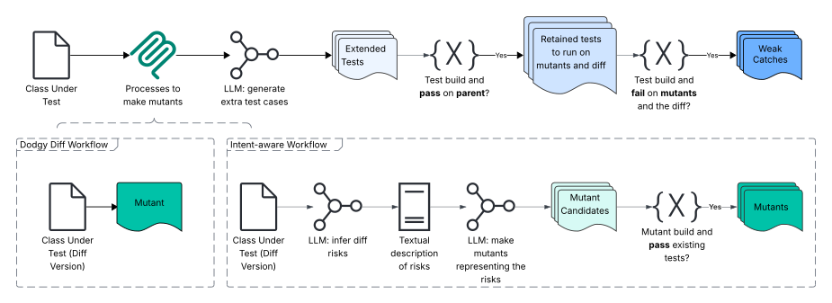

**Source:** *Just-in-Time Catching Test Generation at Meta* — [PDF](https://arxiv.org/pdf/2601.22832) · [arXiv](https://arxiv.org/abs/2601.22832)

# Just-in-Time Catching Test Generation at MetaThanks: *The corresponding author is Mark Harman. Author order is alphabetical.

DOI: [123456789](https://doi.org/123456789)not-yet-knownISBN: 979-8-4007-0658-5/24/07Conference: Companion Proceedings of the 34th ACM International Conference on the Foundations of Software Engineering; June; MontrealCompanion Proceedings of the 34th ACM International Conference on the Foundations of Software Engineering (FSE Companion ’26), June, 2026, MontrealCCS: Software and its engineering Software testing and debugging

Matthew Becker, Yifei Chen, Nicholas Cochran, Pouyan Ghasemi, Abhishek Gulati, Mark Harman*, Zachary Haluza, Mehrdad Honarkhah, Herve Robert, Jiacheng Liu, Weini Liu, Sreeja Thummala, Xiaoning Yang, Rui Xin, Sophie Zeng  Affiliation: Meta Platforms, London UK, Seattle and California USA

© , 2026

###### Abstract.

We report on Just-in-Time catching test generation at Meta, designed to prevent bugs in large scale backend systems of hundreds of millions of line of code. Unlike traditional hardening tests, which pass at generation time, catching tests are meant to fail, surfacing bugs before code lands. The primary challenge is to reduce development drag from false positive test failures. Analyzing 22,126 generated tests, we show code-change-aware methods improve candidate catch generation 4x over hardening tests and 20x over coincidentally failing tests. To address false positives, we use rule-based and LLM-based assessors. These assessors reduce human review load by 70%. Inferential statistical analysis showed that human-accepted code changes are assessed to have significantly more false positives, while human-rejected changes have significantly more true positives. We reported 41 candidate catches to engineers; 8 were confirmed to be true positives, 4 of which would have led to serious failures had they remained uncaught. Overall, our results show that Just-in-Time catching is scalable, industrially applicable, and that it prevents serious failures from reaching production.

###### Keywords: 

Unit Tests, Automated Testing, LLMs, Test Oracles. 

## 1\. Introduction

Most work on unit test generation ([Alshahwan et al., 2024b](https://arxiv.org/html/2601.22832#bib.bib34); [Anand et al., 2012](https://arxiv.org/html/2601.22832#bib.bib2); [Fraser and Arcuri, 2011](https://arxiv.org/html/2601.22832#bib.bib13); [McMinn, 2011](https://arxiv.org/html/2601.22832#bib.bib47); [Harman et al., 2015](https://arxiv.org/html/2601.22832#bib.bib30); [Ryan et al., 2024](https://arxiv.org/html/2601.22832#bib.bib71); [Chen et al., 2024](https://arxiv.org/html/2601.22832#bib.bib72); [Schäfer et al., 2023b](https://arxiv.org/html/2601.22832#bib.bib73); [Liu et al., 2025](https://arxiv.org/html/2601.22832#bib.bib74)) is concerned with ‘hardening’ tests. That is, tests that pass at generation time, and land into the code base to ‘harden’ against future regressions. By contrast, ‘catching’ tests fail at test generation time by design, with the aim of catching bugs in proposed changes ([Harman et al., 2025](https://arxiv.org/html/2601.22832#bib.bib31)). A catching test cannot land together with the changes that it tests, since it fails on those changes. Therefore, the catching test must either be discarded (because it is deemed unhelpful), or its signal must be addressed (to fix the changes and make the test pass).

We target _regression_ catching tests that fail on the proposed changes (a code revision) but pass on the parent revision. For catching tests we cannot rely on the _implicit oracle_ ([Barr et al., 2015](https://arxiv.org/html/2601.22832#bib.bib22)). Our auto-generated tests must detect regressions according to the _general oracle_ —the true, expected behavior, which is often ill-defined and only partly knowable ([Barr et al., 2015](https://arxiv.org/html/2601.22832#bib.bib22); [Weyuker, 1982](https://arxiv.org/html/2601.22832#bib.bib59)). The implicit oracle merely captures errors, such as crashes, that are known to be true positive failures regardless of the specification ([Barr et al., 2015](https://arxiv.org/html/2601.22832#bib.bib22); [Goffi et al., 2016](https://arxiv.org/html/2601.22832#bib.bib19)). By contrast, the general oracle is the (usually vague and informal, even unstated) specification of correct behavior. This inherent vagueness makes it hard (yet no less important) to distinguish true from false positive test failures.

A weak catch is simply one that fails on the current revision, whereas a strong catch is one that also should fail (a true positive failure) according to this general oracle. Its failure reveals a bug in the code under test. A strictly weak catch is a false positive failure that reveals a bug in the test case, including oracle misalignment. The challenge is to determine whether a weak catch is strong. The problem of automatically generating such strong catching tests Just-in-Time (JIT) as revisions are submitted, is called the ‘Catching JiTTest Challenge’, introduced in the FSE 2025 keynote paper ([Harman et al., 2025](https://arxiv.org/html/2601.22832#bib.bib31)).

At Meta, a revision submitted to the Continuous Integration (CI) system is called a ‘diff’ (short for differential). Our catch generation workflows are deployed at diff submission time. We focus on the potential for a diff to introduce a severe regression. It is important to focus on severe regressions, because catching test generation is inherently computationally expensive; many tests must be generated to increase the chances of finding a strong catch. We prioritize catching severe bugs using a targeting mechanism similar to Diff Risk Score (DRS) ([Abreu et al., 2024](https://arxiv.org/html/2601.22832#bib.bib1)), trained on previous code changes and running overnight (west coast USA) using spare capacity. The workflow is triggered for all the diffs submitted for the previous day that are flagged as high risk by the targetter. We seek to answer the following question for automated software test generation:

> How can we automatically generate tests that find the most severe bugs in proposed changes, before the bugs cause severe failures and with high enough true positive rate that the test signal does not impede engineer velocity?

We deployed two catch generation workflows and three true/false positive assessors. We used them to test Meta’s systems of hundreds of millions of lines of code used by over 3.5 billion people worldwide every day. Our primary findings are as follows:-

Effectiveness of diff-awareness: Based on a study of 22,126 tests generated, we found that diff-aware catch generation workflows produce approximately 4 times as many weak catches as hardening workflows. They generate 20 times as many as a baseline that simply attempts to find tests that fail on the diff, and coincidentally pass on its parent revision.

Scaling Human-in-the-loop: Based on a manual study of 600 diffs with weak catches, we found that the LLM-as-judge ensemble helped reduce human-in-the loop review load by approximately 70%, allowing us to scale evaluation capacity to approximately 4 times that of manual review alone.

Consistent with human labelling: Based on a study of diffs reviewed by humans, and thereby labelled as ‘Good’ (accepted to land into the code base) or ‘Bad’ (not accepted to land), we found statistically significantly more false positive assessments for tests that weakly catch diffs labelled ‘Good’ and significantly more true positive assessments for those labelled ‘Bad’. We also found only modest inter-rater agreement and rank correlation between LLM-based and rule-based assessors. Taken together, these findings suggest that the assessors provide complementary discriminating signals.

Severe failures averted: Finally, and most importantly, from 41 reach outs to engineers based on failing test signals from catch, 8 were immediately confirmed to be strong catches, yielding an engineer-experienced true positive rate of 19.5%. Of the 8 strong catches, 4 would have led to serious failures in production. These 4 serious failures were thus averted by Catching JiTTests. We also found that dismissing false positives took only a few minutes and therefore had negligible drag on developer velocity.

## 2\. Baselines for Just in Time Catching

A prerequisite for any approach to generate strong catches on a diff is the ability to generate weak catches. In order to assess the degree to which existing technologies can generate weak catches, we used three ‘baseline’ approaches, described below.

### 2.1. Coincidental regression catches found during ACH hardening deployment

We have already deployed mutation-guided LLM-based hardening test generation ([Foster et al., 2025](https://arxiv.org/html/2601.22832#bib.bib32)) into Meta’s continuous integration system, Phabricator ([Feitelson et al., 2013](https://arxiv.org/html/2601.22832#bib.bib12)). As a byproduct of this hardening test generation deployment, we also produce tests that fail on the diff under test. According to the mutation-guided workflow ([Foster et al., 2025](https://arxiv.org/html/2601.22832#bib.bib32)) these are discarded since they cannot land, by construction. However, where such tests also happen to pass on the parent of the tested diff, these tests denote a weak catch. We call these catches ‘coincidental catches’, because the goal of the test generation was not to produce a weak catch, but to produce a strong hardening test.

### 2.2. Hardening test generation workflows as catching workflows

To provide additional baselines on the chance of generating a weak catch using existing approaches, we also collected results from the application of TestGen-LLM ([Alshahwan et al., 2024b](https://arxiv.org/html/2601.22832#bib.bib34)), and ACH ([Foster et al., 2025](https://arxiv.org/html/2601.22832#bib.bib32)) to the parent of the tested diff. TestGen-LLM ([Alshahwan et al., 2024b](https://arxiv.org/html/2601.22832#bib.bib34)) is a traditional LLM-based test generation system that elevates coverage, stimulating the LLM to generate test cases to target code that is currently uncovered by any existing test case. The system is based on line coverage and has been deployed (and regularly updated and evolved) at Meta for two years now. For establishment of a hardening-based baseline, we use the original system as reported in the literature ([Alshahwan et al., 2024b](https://arxiv.org/html/2601.22832#bib.bib34)). ACH is a mutation-based test generation system ([Foster et al., 2025](https://arxiv.org/html/2601.22832#bib.bib32)) that generates mutants and test cases that kill them.

These two approaches are both deployed at Meta to generate hardening test cases. These are merely ‘baseline’ approaches, because they use existing technologies ‘out of the box’. When such a test case, generated for the parent, fails on the child, it denotes a ‘Weak Catch’ as well as a ‘Harden’ according to the ‘Harden and Catch‘ Framework ([Harman et al., 2025](https://arxiv.org/html/2601.22832#bib.bib31)).

For the TestGen-LLM workflow, we also experimented by removing the requirement to construct tests that achieve additional coverage. That is, we simply require that the workflow should generate a test that builds and passes on the parent revision. This gives the hardening workflow the greatest chance of generating a valid catching test, since we know that approximately half the tests that find simulated bugs do not improve coverage ([Foster et al., 2025](https://arxiv.org/html/2601.22832#bib.bib32)).

Neither of these hardening workflows are diff–aware. That is, the diff is the current revision, but each of the two workflows is applied, not to the current revision, but to its parent (the base revision on which the diff is based). Therefore, neither workflow is supplied with any information about the diff itself. In their production deployment as ‘hardeners’, they cannot ‘know’ about the diff, since they have to cater for any future (unknown) changes.

## 3\. Diff-Aware Workflows

 

Figure 1. Architecture of ‘Dodgy diff’ and Intent-Aware Workflows for generating Just-in-Time Catches.

Unlike hardening workflows, a catch generation workflow can always choose to exploit information about the diff to help it find ways to make the test fail on that diff. A purpose-built catch workflow is thus ‘diff-aware’. We have experimented with two approaches to generating weak catches, based on this diff-awareness (both depicted in Figure [1](https://arxiv.org/html/2601.22832#S3.F1 "Figure 1 ‣ 3. Diff-Aware Workflows ‣ Just-in-Time Catching Test Generation at Meta")). The ‘dodgy diff’ workflow is aware of the diff, but makes no attempt to infer anything about its intention. Rather, it treats the diff as if it were a mutant of its parent, implicitly asserting that the diff is ‘buggy’ (hence the ‘dodgy diff’ moniker).

We know, from previous studies, that the vast majority of code changes do not induce failures (a corollary of the competent programmer hypothesis ([Jia and Harman, 2011](https://arxiv.org/html/2601.22832#bib.bib23))). Nevertheless, it makes sense to have a workflow that maximizes the number of weak catches and thereby maximizes the pool of candidates from which to find a strong catch. The dodgy diff approach relies upon the existence of post-processing to weed out false positive failures, a topic to which we will return Section [6](https://arxiv.org/html/2601.22832#S6 "6. Reducing false positives and identifying likely true positives ‣ Just-in-Time Catching Test Generation at Meta").

We also want a workflow that favors the generation of tests that are more likely to reveal genuine bugs rather than to simply elevate the chances of generating a weak (but not necessarily strong) catch. We therefore implemented a ‘diff-intent aware’ workflow. This workflow attempts to approximate the intention of the diff. We first describe the intent-aware workflow, and then the dodgy diff workflow, which is a simply a projection of the intent-aware workflow onto a simple subset. Both approaches are inspired by mutation testing ([Jia and Harman, 2011](https://arxiv.org/html/2601.22832#bib.bib23)).

### 3.1. Intent aware workflow

The intent-aware workflow is depicted in Figure [1](https://arxiv.org/html/2601.22832#S3.F1 "Figure 1 ‣ 3. Diff-Aware Workflows ‣ Just-in-Time Catching Test Generation at Meta") (lower right-hand side). The workflow first stimulates the language model to describe the ways in which an attempt to implement the intent could produce errors. We call this the ‘risks’ of the diff. The workflow thereby becomes ‘risk aware’ (based on its intent awareness).

From the description of these risks, we construct mutants. Each mutant implements a code modification, based on the parent of the tested diff. Each mutant captures a bug that could be introduced as the result of attempting to implement the diff intent. Of course, we do not expect that we will necessarily catch a bug in the tested diff, because it may not precisely mirror one of the inferred risks, even if it is buggy.

Nevertheless, from the considerable empirical evidence collected (over multiple decades) on the mutation ‘coupling hypothesis’ ([Jia and Harman, 2011](https://arxiv.org/html/2601.22832#bib.bib23)), it is reasonable to suppose that real faults may be ‘coupled’ to these mutants. Therefore, capturing the inferred risks as mutants is a natural first step towards generating tests that check for each risk.

For each of the mutants, we generate a test following the Mutation-Guided LLM-based Test Generation workflow on the parent. That is, we seek to generate tests that will pass on the parent but would fail on the mutated parent version. These tests are then tested on the diff itself, and those that fail on the diff are harvested as weak catches.

### 3.2. Intent-aware baseline for intent computation

Computing the intention behind a code change is inherently problematic. We are essentially tackling, head on, the Oracle problem in software testing ([Barr et al., 2015](https://arxiv.org/html/2601.22832#bib.bib22)). Before the advent of LLM-based Software Engineering ([Fan et al., 2023](https://arxiv.org/html/2601.22832#bib.bib25)), it would have been presumed a foolhardy endeavor: how can we know what the intention of a code change is, when all we have is the code?

However, as noted previously ([Harman et al., 2025](https://arxiv.org/html/2601.22832#bib.bib31)), there is often extra contextual information with a code change, such as the title, summary, emails, and discussion between engineers, task descriptions, and other documentation available. This contextual information can be used to approximate the intention underlying a code change.

We wanted to provide a baseline against which to measure such richer sources of information, and to understand the degree to which simple LLM code summarization could be used to approximate the intention of a diff. With this in mind, the first version of the intent-aware workflow we deployed simply used the code itself, and the diff title and summary, and no other contextual information in order to infer the diff intent.

### 3.3. Dodgy diff: intent-unaware workflow

The ‘dodgy diff’ workflow is depicted in Figure [1](https://arxiv.org/html/2601.22832#S3.F1 "Figure 1 ‣ 3. Diff-Aware Workflows ‣ Just-in-Time Catching Test Generation at Meta")(lower left-hand side). As can be seen from Figure [1](https://arxiv.org/html/2601.22832#S3.F1 "Figure 1 ‣ 3. Diff-Aware Workflows ‣ Just-in-Time Catching Test Generation at Meta"), the dodgy diff workflow is simply a projection of the intent-aware workflow. We simply treat the diff as if it were already a mutant (a buggy version of the parent). We then use a Mutation-Guided LLM-based Test Generator ([Foster et al., 2025](https://arxiv.org/html/2601.22832#bib.bib32)) to generate tests that attempt to kill the mutant (that is, to distinguish its behavior from that of its parent).

## 4\. Results of applying the workflows

Table [1](https://arxiv.org/html/2601.22832#S4.T1 "Table 1 ‣ 4. Results of applying the workflows ‣ Just-in-Time Catching Test Generation at Meta") presents the results for the two diff-aware workflows, the two hardening baselines, and the coincidental catch baseline. The two diff-aware work flows are part of our production deployment since September 2025 and so results were simply taken from production for these. The non-diff-aware workflows are not part of our production deployment and were run solely for the purpose of collecting the results for this paper. We ran the baseline diff-unaware workflows for a period of 10 days between 14th and 24th November 2025. During the 10-day period of assessment, the workflows were applied to the same set of diffs11 1 except for coincidental catches which were taken from production over a longer period, and were initially included as part of the initial production deployment, until 11th November 2025, when the coincidental catch workflow was discontinued.  as the production workflows. The total number of tests generated for the four workflows (two diff-aware and two diff-unaware) was 9,125.

Table 1. Results from five different approaches to generating weak catches as diffs are submitted 

<table id="S4.T1.5" class="ltx_tabular ltx_centering ltx_align_middle">
<tbody class="ltx_tbody">
<tr id="S4.T1.5.1" class="ltx_tr">
<td id="S4.T1.5.1.1" class="ltx_td ltx_border_ll ltx_border_r ltx_border_t"></td>
<td id="S4.T1.5.1.2" class="ltx_td ltx_align_right ltx_border_r ltx_border_t">Total</td>
<td id="S4.T1.5.1.3" class="ltx_td ltx_align_right ltx_border_r ltx_border_t">Total</td>
<td id="S4.T1.5.1.4" class="ltx_td ltx_align_right ltx_border_rr ltx_border_t">%age</td>
<td id="S4.T1.5.1.5" class="ltx_td ltx_align_right ltx_border_r ltx_border_t">Total</td>
<td id="S4.T1.5.1.6" class="ltx_td ltx_align_right ltx_border_r ltx_border_t">Total diffs</td>
<td id="S4.T1.5.1.7" class="ltx_td ltx_align_right ltx_border_rr ltx_border_t">%age</td></tr>
<tr id="S4.T1.5.2" class="ltx_tr">
<td id="S4.T1.5.2.1" class="ltx_td ltx_border_ll ltx_border_r"></td>
<td id="S4.T1.5.2.2" class="ltx_td ltx_align_right ltx_border_r">Tests</td>
<td id="S4.T1.5.2.3" class="ltx_td ltx_align_right ltx_border_r">Weak</td>
<td id="S4.T1.5.2.4" class="ltx_td ltx_align_right ltx_border_rr">Weak</td>
<td id="S4.T1.5.2.5" class="ltx_td ltx_align_right ltx_border_r">Diffs With</td>
<td id="S4.T1.5.2.6" class="ltx_td ltx_align_right ltx_border_r">with Weak</td>
<td id="S4.T1.5.2.7" class="ltx_td ltx_align_right ltx_border_rr">Diffs</td></tr>
<tr id="S4.T1.5.3" class="ltx_tr">
<td id="S4.T1.5.3.1" class="ltx_td ltx_align_left ltx_border_ll ltx_border_r">Approach</td>
<td id="S4.T1.5.3.2" class="ltx_td ltx_align_right ltx_border_r">generated</td>
<td id="S4.T1.5.3.3" class="ltx_td ltx_align_right ltx_border_r">Catches</td>
<td id="S4.T1.5.3.4" class="ltx_td ltx_align_right ltx_border_rr">Catch</td>
<td id="S4.T1.5.3.5" class="ltx_td ltx_align_right ltx_border_r">Tests</td>
<td id="S4.T1.5.3.6" class="ltx_td ltx_align_right ltx_border_r">Catches</td>
<td id="S4.T1.5.3.7" class="ltx_td ltx_align_right ltx_border_rr">Caught</td></tr>
<tr id="S4.T1.5.4" class="ltx_tr">
<td id="S4.T1.5.4.1" class="ltx_td ltx_border_tt" colspan="7"></td></tr>
<tr id="S4.T1.5.5" class="ltx_tr">
<td id="S4.T1.5.5.1" class="ltx_td ltx_align_center ltx_border_ll ltx_border_rr ltx_border_t" colspan="7">Weak catches found by coincidence while attempting to generate hardening tests for the diff’s parent</td></tr>
<tr id="S4.T1.5.6" class="ltx_tr">
<td id="S4.T1.5.6.1" class="ltx_td ltx_align_left ltx_border_ll ltx_border_r ltx_border_t">Coincidental catch</td>
<td id="S4.T1.5.6.2" class="ltx_td ltx_align_right ltx_border_r ltx_border_t">13,001</td>
<td id="S4.T1.5.6.3" class="ltx_td ltx_align_right ltx_border_r ltx_border_t">29</td>
<td id="S4.T1.5.6.4" class="ltx_td ltx_align_right ltx_border_rr ltx_border_t">0.2%</td>
<td id="S4.T1.5.6.5" class="ltx_td ltx_align_right ltx_border_r ltx_border_t">N/A</td>
<td id="S4.T1.5.6.6" class="ltx_td ltx_align_right ltx_border_r ltx_border_t">N/A</td>
<td id="S4.T1.5.6.7" class="ltx_td ltx_align_right ltx_border_rr ltx_border_t">N/A</td></tr>
<tr id="S4.T1.5.7" class="ltx_tr">
<td id="S4.T1.5.7.1" class="ltx_td ltx_border_t" colspan="7"></td></tr>
<tr id="S4.T1.5.8" class="ltx_tr">
<td id="S4.T1.5.8.1" class="ltx_td ltx_align_center ltx_border_ll ltx_border_rr ltx_border_t" colspan="7">hardening approaches that are not aware of the diff under test</td></tr>
<tr id="S4.T1.5.9" class="ltx_tr">
<td id="S4.T1.5.9.1" class="ltx_td ltx_align_left ltx_border_ll ltx_border_r ltx_border_t">TestGen-LLM <cite class="ltx_cite ltx_citemacro_citep">(<a href="https://arxiv.org/html/2601.22832#bib.bib34" title="" class="ltx_ref">Alshahwan et al., 2024b</a>)</cite> – need not add coverage</td>
<td id="S4.T1.5.9.2" class="ltx_td ltx_align_right ltx_border_r ltx_border_t">4,499</td>
<td id="S4.T1.5.9.3" class="ltx_td ltx_align_right ltx_border_r ltx_border_t">89</td>
<td id="S4.T1.5.9.4" class="ltx_td ltx_align_right ltx_border_rr ltx_border_t">2.0%</td>
<td id="S4.T1.5.9.5" class="ltx_td ltx_align_right ltx_border_r ltx_border_t">1,185</td>
<td id="S4.T1.5.9.6" class="ltx_td ltx_align_right ltx_border_r ltx_border_t">43</td>
<td id="S4.T1.5.9.7" class="ltx_td ltx_align_right ltx_border_rr ltx_border_t">3.6%</td></tr>
<tr id="S4.T1.5.10" class="ltx_tr">
<td id="S4.T1.5.10.1" class="ltx_td ltx_align_left ltx_border_ll ltx_border_r ltx_border_t">TestGen-LLM <cite class="ltx_cite ltx_citemacro_citep">(<a href="https://arxiv.org/html/2601.22832#bib.bib34" title="" class="ltx_ref">Alshahwan et al., 2024b</a>)</cite> – must also add coverage22
                  2
                  
                  
                  
                These numbers are estimated based on subsequent competition of proportions of passing and failing tests that add coverage. 16% of failing tests were found to add coverage, whereas 32% of a same-sized random sample of passing tests were found to add coverage.
4,410 passing (1,440 estimated to add coverage) plus 89 failing (14 add coverage) so 1,454 add coverage overall.</td>
<td id="S4.T1.5.10.2" class="ltx_td ltx_align_right ltx_border_r ltx_border_t">1,440</td>
<td id="S4.T1.5.10.3" class="ltx_td ltx_align_right ltx_border_r ltx_border_t">14</td>
<td id="S4.T1.5.10.4" class="ltx_td ltx_align_right ltx_border_rr ltx_border_t">0.9%</td>
<td id="S4.T1.5.10.5" class="ltx_td ltx_align_right ltx_border_r ltx_border_t">N/A</td>
<td id="S4.T1.5.10.6" class="ltx_td ltx_align_right ltx_border_r ltx_border_t">N/A</td>
<td id="S4.T1.5.10.7" class="ltx_td ltx_align_right ltx_border_rr ltx_border_t">N/A</td></tr>
<tr id="S4.T1.5.11" class="ltx_tr">
<td id="S4.T1.5.11.1" class="ltx_td ltx_align_left ltx_border_ll ltx_border_r ltx_border_t">ACH Mutation-Guided <cite class="ltx_cite ltx_citemacro_citep">(<a href="https://arxiv.org/html/2601.22832#bib.bib32" title="" class="ltx_ref">Foster et al., 2025</a>)</cite></td>
<td id="S4.T1.5.11.2" class="ltx_td ltx_align_right ltx_border_r ltx_border_t">754</td>
<td id="S4.T1.5.11.3" class="ltx_td ltx_align_right ltx_border_r ltx_border_t">6</td>
<td id="S4.T1.5.11.4" class="ltx_td ltx_align_right ltx_border_rr ltx_border_t">0.8%</td>
<td id="S4.T1.5.11.5" class="ltx_td ltx_align_right ltx_border_r ltx_border_t">322</td>
<td id="S4.T1.5.11.6" class="ltx_td ltx_align_right ltx_border_r ltx_border_t">5</td>
<td id="S4.T1.5.11.7" class="ltx_td ltx_align_right ltx_border_rr ltx_border_t">1.6%</td></tr>
<tr id="S4.T1.5.12" class="ltx_tr">
<td id="S4.T1.5.12.1" class="ltx_td ltx_border_ttt" colspan="7"></td></tr>
<tr id="S4.T1.5.13" class="ltx_tr">
<td id="S4.T1.5.13.1" class="ltx_td ltx_align_center ltx_border_ll ltx_border_rr ltx_border_t" colspan="7">Just-in-Time Catching approaches that are aware of the diff under test</td></tr>
<tr id="S4.T1.5.14" class="ltx_tr">
<td id="S4.T1.5.14.1" class="ltx_td ltx_align_left ltx_border_ll ltx_border_r ltx_border_t">Dodgy diff</td>
<td id="S4.T1.5.14.2" class="ltx_td ltx_align_right ltx_border_r ltx_border_t">1,621</td>
<td id="S4.T1.5.14.3" class="ltx_td ltx_align_right ltx_border_r ltx_border_t">41</td>
<td id="S4.T1.5.14.4" class="ltx_td ltx_align_right ltx_border_rr ltx_border_t">2.5%</td>
<td id="S4.T1.5.14.5" class="ltx_td ltx_align_right ltx_border_r ltx_border_t">654</td>
<td id="S4.T1.5.14.6" class="ltx_td ltx_align_right ltx_border_r ltx_border_t">26</td>
<td id="S4.T1.5.14.7" class="ltx_td ltx_align_right ltx_border_rr ltx_border_t">4.0%</td></tr>
<tr id="S4.T1.5.15" class="ltx_tr">
<td id="S4.T1.5.15.1" class="ltx_td ltx_align_left ltx_border_ll ltx_border_r ltx_border_t">Use computed diff intention and risks</td>
<td id="S4.T1.5.15.2" class="ltx_td ltx_align_right ltx_border_r ltx_border_t">811</td>
<td id="S4.T1.5.15.3" class="ltx_td ltx_align_right ltx_border_r ltx_border_t">52</td>
<td id="S4.T1.5.15.4" class="ltx_td ltx_align_right ltx_border_rr ltx_border_t">6.4%</td>
<td id="S4.T1.5.15.5" class="ltx_td ltx_align_right ltx_border_r ltx_border_t">617</td>
<td id="S4.T1.5.15.6" class="ltx_td ltx_align_right ltx_border_r ltx_border_t">49</td>
<td id="S4.T1.5.15.7" class="ltx_td ltx_align_right ltx_border_rr ltx_border_t">7.9%</td></tr>
<tr id="S4.T1.5.16" class="ltx_tr">
<td id="S4.T1.5.16.1" class="ltx_td ltx_align_left ltx_border_bb ltx_border_ll ltx_border_r ltx_border_tt">Totals</td>
<td id="S4.T1.5.16.2" class="ltx_td ltx_align_right ltx_border_bb ltx_border_r ltx_border_tt">22,126</td>
<td id="S4.T1.5.16.3" class="ltx_td ltx_align_right ltx_border_bb ltx_border_r ltx_border_tt">231</td>
<td id="S4.T1.5.16.4" class="ltx_td ltx_align_right ltx_border_bb ltx_border_rr ltx_border_tt">1%</td>
<td id="S4.T1.5.16.5" class="ltx_td ltx_align_right ltx_border_bb ltx_border_r ltx_border_tt">N/A</td>
<td id="S4.T1.5.16.6" class="ltx_td ltx_align_right ltx_border_bb ltx_border_r ltx_border_tt">N/A</td>
<td id="S4.T1.5.16.7" class="ltx_td ltx_align_right ltx_border_bb ltx_border_rr ltx_border_tt">N/A</td></tr>
</tbody>
</table>

 

### 4.1. Results for co-incidental catches

The first row of results concerns coincidental catches. We report the proportion of these ‘fail-on-diff’ tests that also, coincidentally, pass on the parent of the diff under test, thereby constituting a weak catch. This proportion is 0.2%; noticeably lower than the other two baselines reported in the table. The low baseline result for coincidental catches highlights the challenges of finding them. The noticeably lower results for the number of weak catches led us to abandon any further attempt to harvest ‘co-incidental catching’ as a practical source of weak catches.

### 4.2. Results for hardening baseline

The TestGen-LLM approach generates 10 times as many catches as the coincidental catch approach. However, it should be noted that this approach simply attempts to generate a test that will build and pass on the parent of the tested diff. It makes no attempt to give any assurance that these tests add value. If we focus more specifically on those that add coverage, the increase in the number of weak catches generated becomes 4x that for a coincidental catch, rather than 10x. For the mutation guided approach, we observe a similar increase in the number of weak catches generated.

From these numbers, we can conclude that, if we generate a hardening test, then the probability that it proves to be a weak catch on the tested diff is approximately four times greater than the probability that a test that happens to fail on the diff will prove to be a weak catch. These results reflect the relative chance of making a test that passes, compared to the chance of generating, for arbitrary code, a test that fails.

The results for the hardening workflows also implicitly assess the probability of a hardening test failing on some possible future change. Essentially, we have picked an arbitrary change, generated a hardening test on the fly, based on the parent of that change, and then assessed the chances that the hardening test would fail for the change. From Table [1](https://arxiv.org/html/2601.22832#S4.T1 "Table 1 ‣ 4. Results of applying the workflows ‣ Just-in-Time Catching Test Generation at Meta") we can see that the probability is approximately 0.01 (0.008 for mutation-guided generation and 0.009 for coverage-guided generation). As a rough overall expectation estimate, we therefore would expect hardening tests to fail on approximately 1% of the diffs to which they are applied.

### 4.3. Results for diff-aware weak catch generation

We expect that if we implement any diff-aware catch generator, it should perform better than the hardening baselines, because it generates tests for a specific (rather than an arbitrary future) code change. Indeed, as the results from Table [1](https://arxiv.org/html/2601.22832#S4.T1 "Table 1 ‣ 4. Results of applying the workflows ‣ Just-in-Time Catching Test Generation at Meta") show, both diff-aware workflows generate far more weak catches per test generated, although fewer overall.

More importantly, the diff-aware approaches are far more capable of finding a weak catch per diff. That is, when we generate tests without any guidance (neither coverage not mutation) we get catches for 3.6% of diffs, and with mutation-guidance this is 1.6%. By contrast, using the dodgy diff approach we generate weak catches for 4.0% of diffs, rising to 7.9% of diffs using the intent-aware workflow. We conclude that, by taking advantage of information about the diff and an approximation of its intention, we can more than double the number of code changes for which we generate a weak catch.

Looking at the differences between the two diff-aware catch approaches, we also see notable differences in the number of tests that are generated. Although the intent-aware approach generates fewer tests than the ‘dodgy diff’ approach, the tests that it generates are far more likely to be weak catches, both per test and overall. More importantly, the intent-aware workflow is able to produce at least one weak catch for almost double the number of diffs. This provides initial evidence that making the workflow intent aware, and focusing on likely risks, can significantly increase the chance of generating a weak catch.

We do not claim that our two diff-aware workflows are the best obtainable. These findings merely provide a foundation for further research and development. Much more research is needed to imbue diff-aware workflows with richer context allowing them to generate more catching tests, and more weak catching tests that are likely to also prove to be strong. We present these results to provide a baseline for future research investigations on catching tests.

## 5\. Initial Evidence that significant real world bugs will be prevented by targeted catch

The primary purpose of the deployment of the catch workflows was to collect the data reported in the paper and to develop and refine the approaches to removing false positives. However, the process of determining ground truth on true/false positives inherently involved reaching out to engineers to confirm whether a weak catch was a strong catch. During the period from mid-September through to the end of October, we reached out to 41 engineers, with a very simple chat-based message asking whether the observed change was intended or not. Engineers reported that dismissing an intended change took only a few minutes, and therefore this low bandwidth high signal introduces a very minimal degree of friction into the overall development process, and has negligible effects on developer velocity.

In the process of reaching out to engineers, we were also able to (strongly) catch 8 issues, of which 4 proved to prevent significant issues that would have led to severe failures had they not been intercepted at diff submission time. For each of these four cases, we undertook a detailed in-depth analysis to confirm that each met the standard criteria for a severe failure had they not been intercepted and averted by the catching test.

It is extremely encouraging (from the point of view of return on test effort) that from 8 issues prevented, 4 of these proved to be severe. This indicates that targeting catch testing at the most sensitive code has a very high return on investment. It is extremely unlikely that 8 arbitrary bugs, chosen it random, would yield 4 that lead to severe errors; most bugs are relatively trivial in nature ([Mockus et al., 2000](https://arxiv.org/html/2601.22832#bib.bib48); [Zeller, 2009](https://arxiv.org/html/2601.22832#bib.bib62)). The scientific literature ([Mockus et al., 2000](https://arxiv.org/html/2601.22832#bib.bib48)), as well as public bug-reporting systems, such as Bugzilla, tend to suggest that we should expect approximately 5%-20% of all bugs to be serious, whereas our results on this (admittedly limited number of bugs) indicates 43%. If these findings scale up, then it would be an extremely encouraging finding concerning the efficiency of targeting.

At this point in the evolution of our catch workflows, we have too few data points to make strong scientific claims of this nature, but the results are tantalizing glimpses of a world in which we can focus testing on catching bugs, reporting low friction signal to engineers, without them ever having to look at test code itself, let alone write it. Most importantly of all, when combined with targeting, it seems that many of the bugs, possibly as much as half, will prove to be severe, thereby focusing test effort where it is most effective.

Of the remaining 4 issues caught, 2 lead to fixes involving landing defensive programming to prevent future regressions, while for the other 2, the diffs were simply abandoned by their authors. The fact that we were able to catch 7 issues from 41 reach outs, gives us an overall true positive rate, as experienced by the engineers who received the signal, of 19.5%. When coupled with the almost negligible effects of false positives, this was a very encouraging signal. We are confident that this baseline performance for engineer-experienced true positive rate can be significantly improved.

### 5.1. Determining whether to reach out

Whether or not either a Human-in-the-Loop or fully automated system should choose to reach out to an engineer is a trade-off between precision and recall, and has to take account of the likely friction caused to the diff author, who is tasked with checking whether the detected change is expected. The friction involved is partly related to the simplicity of the changes, and also partly the nature of the test failure. It is interesting to observe that this is not just an assessment of the likelihood of a true positive, but also an assessment of the impact, in terms of friction, caused by the human effort of eliminating a false positive. The more that can be done to reduce this friction, the lower the precision need be overall, and therefore, when trading precision and recall, we can increase recall by effectively reducing the cost of false positives.

To reduce the cost of false positives, we aim to make it exceptionally easy for an engineer to clearly dismiss a signal that merely flags an intended change. We find that this affects the way the technology should interface to the engineer. Rather than showing them a test case and asking them to debug, it is much better, in the first instance, to clearly articulate what the changed behavior is (between parent and child) and to simply ask whether this is expected. In general, we find that engineers can much more quickly answer this question, compared to considering test case code.

In the rule based approach, therefore, when we have identified a pattern that likely indicates a true positive, we give it a higher overall score if it additionally would be very quick and easy to dismiss. For example, suppose the rule-based pattern that applies would materialize into an engineer reach out with a message like: ‘this expression, used to evaluate to true, but now evaluates to false; is that expected?’. Such a reach out is simple and clear, and if the changed behavior is intended, it is typically easy for the engineer to recognize this.

By contrast, consider a situation where the reach out asks the engineer to confirm whether a change in the order of some subset elements of a large composite data structure is expected. This will typically take orders of magnitude longer to dismiss, should it prove to be a false positive, compared to the boolean change. Consequently, we could afford an order of magnitude more false positives per true positive for the ‘boolean change’ style reach out, when compared to the ‘large composite data structure ordering mismatch’ reach out. In applying the rule based approach to determine true/false positives, we therefore also take into account the ultimate impact on the engineer.

Fortunately, we have found that the catch deployment model significantly reduces the friction caused by false positives. Firstly, the catch is reported at diff time; a time when the developer has maximum mental context on the code change. This makes the signal highly relevant, which we know is important ([Harman and O’Hearn, 2018](https://arxiv.org/html/2601.22832#bib.bib29)). Secondly, the initial signal is expressed simply as a ‘sense-check’ on whether a changed behavior is expected or not. In the case of a false positive, the engineer simply confirms the change is expected, which can take a matter of seconds, and we found, in practice, takes no more than a few minutes. False positives are thus eliminated with alacrity, and consequently a higher proportion can be tolerated than were the engineer required to actually look at test code or code under test.

Finally, only when the sense check fails, and the engineer is surprised by the observed behavior change, do they need to consider test case code itself. Such situations may ultimately prove to be false positives, but the fact that the engineer is surprised makes it worth the double-check, even in false positive situations; it helps to improve developer understanding of the code. This improved understanding is particularly valuable in the rapidly emerging scenario ([Xiao et al., 2024](https://arxiv.org/html/2601.22832#bib.bib61); [Otten et al., 2025](https://arxiv.org/html/2601.22832#bib.bib60)) whereby a large amount of code is machine-generated (under engineer supervision).

Overall, therefore, catch workflows can gain significant real world impact by preventing serious failures and with almost negligible drag on developer velocity, and with many other indirect advantages on newly-emerging development processes.

## 6\. Reducing false positives and identifying likely true positives

For any workflow that aims to generate weak catches, whether diff-aware, intent-aware, both or neither, we must ask the question

> What is the probability that this weak catch (a test failure) is a strong catch (true positive test failure)?

In this section, we report on our initial findings on false and true positive identification. We found it more intuitive to combine the false positive and true positive identifications into a value between -1.0 and 1.0, where -1.0 indicates very high probability of a false positive (a strictly weak catch), while 1.0 represents very high probability of a true positive (a strong catch). We implement this weak/strong catch assessment as a post-processing phase that is applied to all workflows that attempt to produce weak catches as candidate strong catches.

We call these automated true/false positive decision procedures ‘assessors’. The assessors enable the overall Catching JiTTest approach to (1) filter out false positives and prioritize human-in-the-loop review for high-confidence cases, and (2) manage the precision-recall tradeoff of the overall system.

The assessor workflows are only ever deployed when we have a candidate weak catch. The existence of a weak catch means that the assessor always has the tested diff available to it, when forming its judgment. The assessor, therefore, can always be both diff-aware and intent-aware, irrespective of whether the workflow that generated the weak catch was, itself, aware of diff- or intent- aware.

We use two different approaches to judging strong catch likelihood; LLM-as-judge ([Zheng et al., 2023](https://arxiv.org/html/2601.22832#bib.bib65)), and a more traditional rule-based approach called RubFake: Rule Based False-positive Killing Environment. These two approaches are complementary. While the LLM-as-judge has rich semantics available to it, its judgments are both nondeterministic and challenging to verify. We cannot rely on it to give ground truth, but we can aspire to create a rank-based judgment of a set of weak catches with reasonable rank correlation to the ground truth likelihood of a strong catch.

By contrast, the rule based approach searches for specific patterns that are either present or absent, and makes deterministic verified judgments about whether these patterns are present. We can rely on the veracity of the rule-based approach in the sense that we know that the claimed patterns are guaranteed to exist, but interpreting whether these patterns likely correlate with the strongness of catch also remains more of a question of correlation than of ground truth.

We use these signals together to produce an overall ranking of weak catch candidates, with those ranked sufficiently highly being worthy of further consideration. Ultimately, the aspiration is that this correlation will be found sufficiently close to the ground truth that we will be able to define suitable thresholds, above which our infrastructure will automatically send the outcome to the diff author.

In our initial deployment, we also have a human-in-the-loop. The purpose of the human is, simultaneously, to determine whether a candidate strong catch signal is sent to the diff author, and to provide feedback on true and false positive patterns so that we can iteratively improve both the LLM-as-judge and the rule-based approaches.

### 6.1. LLM-as-Judge

To maximize robustness and reduce the risk of idiosyncratic model errors or biases, we employ an ensemble approach, aggregating judgments from several state-of-the-art LLMs (including Llama3.3-70B, Gemini 3 Pro, and Claude Sonnet 4). Each model is tasked with classifying whether a given weak catch represents an unexpected bug introduced by the code diff.

#### 6.1.1. Input

Each LLM-as-Judge receives the following inputs for each candidate test case:

  1. (1) The code of the weak catch test case 
  2. (2) The test execution outcome, including the failure code, message, and test execution trace 
  3. (3) The code changes between parent and child (diff) 
  4. (4) The inferred diff intent 

#### 6.1.2. Output

From the execution of the LLM-as-judge ensemble, we obtain three key outputs for each weak catch case:-

Normalized Token Probability Score (TP Prob) (-1 to 1): Token probability was only available for Llama models, and we chose Llama3.3-70B and tasked the LLM with a binary classification; determining whether a test failure represented by the weak catch is unexpected. The model outputs a ‘yes’ or ‘no’ response, and the normalized logarithmic probability of the first token (‘Yes’ or ‘No’) is assigned to a score between -1 and 1. A ‘yes’ response with high log-probability yields a score close to 1, indicating confidence in a true positive (i.e., strong catch), while a ‘no’ response with high log-probability yields a score close to -1, indicating confidence in a false positive.

Ensemble Categorical Likelihood Score (Bucket Med) (-1 to 1): Each LLM in the ensemble also performs a multi-class classification, producing a categorical output that indicates the likelihood that a weak catch will be unexpected, with possible values of High, Medium, or Low Likelihood. These categorical outputs are subsequently transformed to numerical values, i.e., ‘High’ : 1.0, ‘Medium’: 0.0, ‘Low’: -1.0, yielding a scale consistent with the normalized token probability score described above. The final score is determined by taking the median across the ensemble, providing a consensus-based measure of the likelihood that the test failure represents a bug. The median is chosen over the mean because the mapped values are ordinal rather than continuous, ensuring the aggregation method is appropriate for the nature of the data([Shepperd, 1995](https://arxiv.org/html/2601.22832#bib.bib57)).

Textual explanation: The LLM is instructed to provide a brief, structured rationale for its classification. This rationale describes (i) the code behavior change evidenced by the weak catch test failure and (ii) why this behavior change is judged to be unexpected given the diff and its intent. Although the system employs an ensemble of LLM judges, aggregation of these textual rationales is not currently performed. Instead, the ensemble’s value lies in the diversity of explanations, which offers multiple perspectives rather than a synthesized consensus. Each explanation is presented individually, allowing human reviewers to evaluate the performance of each judge, compare their reasoning, and gain insight into the strengths and weaknesses of different approaches.Future deployments may explore methods for aggregating these explanations—such as selecting the rationale from the most confident judge or synthesizing a consensus explanation—to help diff authors more efficiently interpret test failures and determine appropriate follow-up actions.

The LLM-as-Judge ensemble thus produces, for each weak catch, a set of confidence scores and associated rationales, which are surfaced for human review. Empirical evaluation on 600 weak catches showed that the LLM judges achieved over 98% precision33 3 The tests are drawn from extremely unbalanced population in which almost all of them are false positives. Therefore, high precision is expected. It could be obtained from a technique that simply assessed every single test as false positive. However, our experience was that it was safe to discard those with the lowest scores, and this is what saved 70% of human effort without, we believe, losing any true positive catches. Therefore, the important take-home message from these numbers is the 70% saving, rather than the 98% precision.  in identifying false-positive catches when either the normalized token probability score was –1 or the ensemble categorical likelihood score was 0. This high precision enabled a reduction of human review workload by approximately 70%, effectively allowing us to scale evaluation capacity to approximately 4× that of manual review alone.

### 6.2. Rule-based false positive identification

Between October and November 2025, we manually analyzed 600 weak catches, in order to identify patterns of false positive behavior. We initially had two engineers performing this process, in which one would conduct the assessment and the other act as a checker on this assessment. Subsequently, as we scaled up the deployment, we employed four engineers, each of whom would take a subset of the weak catches and produce an initial assessment which was checked by the others.

This was an informal process, aimed at identifying patterns, rather than precisely computing formally-defined inter-rater agreement or assessment of likelihood of true positive. However, where we found a good candidate for a strong catch, we reached out to the author of the tested diff, and the diff’s reviewers, to check whether they considered it to be a true positive catch. This simple deployment with a Human-in-the-Loop was aimed at refining the rule base approach. Nevertheless, it has already found several important bugs, giving us confidence that the overall approach had comfortably passed the ‘proof of concept’ evaluation bar. Section [5](https://arxiv.org/html/2601.22832#S5 "5. Initial Evidence that significant real world bugs will be prevented by targeted catch ‣ Just-in-Time Catching Test Generation at Meta") provides details of the bugs caught and fixed before reaching production using this approach, and the kind of failures that were thereby averted.

#### 6.2.1. False positive patterns

Table [2](https://arxiv.org/html/2601.22832#S6.T2 "Table 2 ‣ 6.2.1. False positive patterns ‣ 6.2. Rule-based false positive identification ‣ 6. Reducing false positives and identifying likely true positives ‣ Just-in-Time Catching Test Generation at Meta") presents information about the false positive patterns found. We consider three different sources of information when determining a false positive:

  1. (1) The change made to the code under the test 
  2. (2) The generated test code 
  3. (3) The execution trace produced when the test is executed on the diff under test 

False positive patterns can be found in any or all of these sources of signal.

Table 2. False positive patterns 

Pattern Name | Likelihood |  | Source(s)  
---|---|---|---  
| of false |  Description | checked  
| positive |  of pattern | for pattern  
broken_test_runner | high |  when the test has failed because the test runner itself failed that this is a sign of an infrastructure issue not a bug detected | execution log  
reflection | high |  reflection tends to lead to highly brittle test since it is inherently implementation dependent | execution log, test code  
type_missmatch | high |  often the type of methods changes between parent and child and this can lead to false positive test failure | execution log, test code  
bad_mock_smell | medium |  where the test appears to be failing due to an incorrect mock, we cannot be sure | execution log  
should_be_private_smell | high |  We found that LLMs would generate tests that attempt to enforce private methods | execution log, test code  
method_must_be_protected_smell | high |  We found LLMs would occasionally enforce protective methods | execution log, test code  
mock_broken | high |  we found the LLM’s often incorrectly mock | execution log  
data_provider_broken | high |  we found the LLM’s often constructing incorrect data providers | execution log  
not_implemented_exception | high |  almost certainly the engineer intentionally raised an exception to indicate a method signature has been added without an implementation | execution log  
key_value_pair_change | high |  Requiring same key value pairs in the same order is too implementation specific | execution log  
undefined_variable | high |  The undefined variable is likely removed by the code modifications or introduced incorrectly by the test | execution log  
expecting_particular_calls_to_functions | high |  Clearly implementation dependent expectations such as a method being called a certain number of times or with a certain type of parameter | execution log, test code  
web_server_down | high |  test failed due to infrastructure issues | execution log  
flakiness | low |  various patterns that may indicate flaky execution | execution log, test code

 

### 6.3. Flagging true positive patterns

Throughout October and November 2025 the Human-in-the-Loop process of analyzing weak catches (and consequent occasional reaches out to engineers) gave us insights on true positive patterns as well as false positives. Given the success of rule-based identification of false positives, we decided to also implement a rule-based approach to identify true positive patterns. While one can never be 100% certain that a pattern is a true positive, we essentially codified as rules, the patterns that we intuitively found ourselves responding to when deciding to reach out to engineers. These could be regarded as promising patterns for a potential true positive, rather than rule based guarantees of a true positive.

This is to be contrasted with the false positive identification, in which any candidate identified as a false positive is essentially eliminated. Table [3](https://arxiv.org/html/2601.22832#S6.T3 "Table 3 ‣ 6.3. Flagging true positive patterns ‣ 6. Reducing false positives and identifying likely true positives ‣ Just-in-Time Catching Test Generation at Meta") presents information on the true positive patterns identified and used. When codifying true positive likelihood, we took account of the ease with which a wrong true positive claim could be eliminated by an engineer with relevant context.

Table 3. True positive patterns 

Pattern | Execution trace signs |  Corroboration in code/intent |  Explanation  
---|---|---|---  
Unexpected_key_change | key out of bounds |  No update to keys |  Indexing into container fails even though the key fields have not been updated  
Empty_container | empty container exception |  No changed line directly effects container |  A container such as addict, array becomes empty despite not being explicitly changed  
Create_failure | object creation exception |  No direct change to object structure |  An exception indicating an object cannot be created is suspicious if the object structure is not updated  
changed_bool | True becomes false or vice versa |  Context dependent |  When an asserted true becomes false or vice versa service is suspicious, but we need to check whether those have good reason in the code.  
refactor | any specific change in behavior |  Intention is to refactor |  most refactorings should be meaning preserving by construction  
dead_code_removal | any specific change in behavior |  Intention is dead code removal |  the code removal is expected to be safe and therefore meaning preserving  
null_value | value is null |  Defining expression not updated |  suspicious when variables not directly implicated in code changes become null  
monotonic_change | existing behavior change |  Intention is only to add new functionality |  The change clearly intended only to add behavior. For example, adding logging, but existing behavior changed.  
RBAC | assert failure flags RBAC change |  Code does not specifically affect this role |  Rule-Based Access Control (RBAC) can involve complex corner cases, and dependences so unexpected changes are Suspicious

 

As can be seen, a common theme of the identification of a true positive pattern is that the test identifies a specific kind of change, such as the boolean transitioning from true to false, thereby causing the test to fail on the child when it passes on the parent, while not seeing any direct attempt to change the boolean-defining expression in the code itself. We do not claim that it would be prudent to always reach out when such a rule applies, but it certainly adds weight to the overall pool of evidence available, suggesting that it is worth reaching out.

### 6.4. Assessing the assessors

We analyzed the behavior of our three true/false positive assessors using data from two diff-aware catch workflows (Section [3](https://arxiv.org/html/2601.22832#S3 "3. Diff-Aware Workflows ‣ Just-in-Time Catching Test Generation at Meta")), applied to code changes from two distinct groups: ‘good’ diffs (accepted or committed by reviewers) and ‘bad’ diffs (reverted, abandoned, or flagged for changes). ‘Good’ diffs are those deemed landable by human reviewers, but may still contain bugs. ‘Bad’ diffs may be abandoned for various reasons, not necessarily due to bugs. Thus, diff status does not guarantee bug likelihood, but does provide expert-labeled data.

Although these labels are imperfect (‘landable’ vs. ‘not landable’ rather than ‘bug-free’ vs. ‘buggy’), they enable cautious statistical analysis. After all, were ‘Good’ and ‘Bad’ diffs to show no differences, it would undermine the value of modern code review, yet empirical studies have repeatedly confirmed its effectiveness since Fagan inspections in the 1970s ([Bacchelli and Bird, 2013](https://arxiv.org/html/2601.22832#bib.bib4); [Sadowski et al., 2018](https://arxiv.org/html/2601.22832#bib.bib55); [Fagan, 1976](https://arxiv.org/html/2601.22832#bib.bib11)). Given this extensive literature, we expect statistical differences between ‘Good’ and ‘Bad’ diffs and use this expectation to compare test generation methods and assessor performance across these labeled diffs.

Since we are executing multiple statistical tests, there is a probability that some \(P\) values that are found to be significant at the \(\alpha=0.05\) level will be spurious. Fortunately we are not using the outcomes to make life-altering decisions about drug treatments ([Gelman et al., 2012](https://arxiv.org/html/2601.22832#bib.bib16); [Perneger, 1998](https://arxiv.org/html/2601.22832#bib.bib51); [Rothman, 1990](https://arxiv.org/html/2601.22832#bib.bib54)) so we neither want nor need conservative \(p\)-value corrections such as Bonferroni or Hochberg ([Hochberg, 1988](https://arxiv.org/html/2601.22832#bib.bib41)). Rather, in common with almost all Software Engineering applications ([Harman et al., 2012](https://arxiv.org/html/2601.22832#bib.bib24); [Arcuri and Briand, 2011](https://arxiv.org/html/2601.22832#bib.bib3)) it is not just statistical significance that matters, but the effect size. Therefore, to cater for the influence of multiple statistical tests, we assess the likelihood of obtaining a statistically significant result with a given effect size, using similar data to that we study using a permutation-based resampling procedure ([Good, 2013](https://arxiv.org/html/2601.22832#bib.bib20)).

The resampling computes that the chance of obtaining a single observation of small effect size according to Cohen’s \(h\) for two samples deemed statistically significantly different according to Fisher’s exact test. That chance is approximately 0.04. However, the chance of obtaining a medium or large effect size for samples of similar size to our ‘good’ and ‘bad’ diffs was computed to be less than \(0.00001\). We thus pay for more head to medium and larger effect sizes (and/or multiple related occurrences of small effect sizes, for which the joint probability of these occurring by chance is low).

Table 4. Inter-rater agreement and rank correlation among assessment methods. Spearman (\(\rho\)) and Kendall (\(\tau\)) rank correlations show coefficient if \(p<0.05\), otherwise ‘–’. Cohen’s \(\kappa\) for pairwise agreement on FP/TP classification; Fleiss’ \(\kappa\) and Krippendorff’s \(\alpha\) for overall agreement. Grayscale intensity indicates strength (darker = stronger). G=Good (Accepted/Closed), B=Bad (other statuses), \(G\cup B\)=labelled only, UnLab=unlabelled, All=all diffs. Status abbreviations: CLS=Closed, ACC=Accepted, ABD=Abandoned, CHP=Changes Planned, NRS=Needs Revision. Interpretation: Pr=Poor, Sl=Slight, Fr=Fair, Mod=Moderate, Sub=Substantial, AP=Almost Perfect.

Spearman Pair Comparison | All | UnLab | \(G\cup B\) | G | B | CLS | ACC | ABD | CHP | NRS | REV  
---|---|---|---|---|---|---|---|---|---|---|---  
\(n\) (diff count) | 531 | 275 | 256 | 150 | 106 | 90 | 60 | 77 | 12 | 16 | 1  
RubFake vs TPP | -0.146 | – | -0.196 | -0.226 | – | – | -0.265 | – | – | – | –  
RubFake vs Bucket | – | – | – | – | – | – | – | – | – | +0.535 | –  
TPP vs Bucket | +0.260 | +0.266 | +0.254 | +0.249 | +0.229 | +0.313 | – | – | – | +0.512 | –

 

Kendall Pair Comparison | All | UnLab | \(G\cup B\) | G | B | CLS | ACC | ABD | CHP | NRS | REV  
---|---|---|---|---|---|---|---|---|---|---|---  
\(n\) (diff count) | 531 | 275 | 256 | 150 | 106 | 90 | 60 | 77 | 12 | 16 | 1  
RubFake vs TPP | -0.113 | – | -0.152 | -0.182 | – | -0.164 | -0.217 | – | – | – | –  
RubFake vs Bucket | – | – | – | – | – | – | – | – | – | +0.469 | –  
TPP vs Bucket | +0.212 | +0.219 | +0.205 | +0.204 | +0.183 | +0.259 | – | – | – | +0.440 | –

 

False Positive Pair | All | UnLab | \(G\cup B\) | G | B | CLS | ACC | ABD | CHP | NRS  
---|---|---|---|---|---|---|---|---|---|---  
Rubfake vs TP Prob | -0.07 (Pr) | -0.01 (Pr) | -0.15 (Pr) | -0.17 (Pr) | -0.12 (Pr) | -0.16 (Pr) | -0.17 (Pr) | -0.10 (Pr) | -0.24 (Pr) | -0.12 (Pr)  
Rubfake vs Bucket Med | -0.07 (Pr) | -0.09 (Pr) | -0.06 (Pr) | -0.04 (Pr) | -0.07 (Pr) | -0.04 (Pr) | -0.05 (Pr) | -0.16 (Pr) | 0.12 (Sl) | 0.26 (Fr)  
TP Prob vs Bucket Med | 0.20 (Sl) | 0.20 (Sl) | 0.20 (Fr) | 0.18 (Sl) | 0.20 (Sl) | 0.23 (Fr) | 0.10 (Sl) | 0.14 (Sl) | -0.03 (Pr) | 0.62 (Sub)  
Fleiss’ \(\kappa\) (all 3) | 0.01 (Sl) | 0.03 (Sl) | -0.02 (Pr) | -0.04 (Pr) | -0.01 (Pr) | -0.03 (Pr) | -0.06 (Pr) | -0.06 (Pr) | -0.05 (Pr) | 0.25 (Fr)  
Krippendorff’s \(\alpha\) (all 3) | 0.01 (Sl) | 0.03 (Sl) | -0.02 (Pr) | -0.04 (Pr) | -0.01 (Pr) | -0.02 (Pr) | -0.06 (Pr) | -0.05 (Pr) | -0.02 (Pr) | 0.27 (Fr)  
Sample size (n) | 531 | 275 | 256 | 150 | 106 | 90 | 60 | 77 | 12 | 16

 

True Positive Pair | All | UnLab | \(G\cup B\) | G | B | CLS | ACC | ABD | CHP | NRS  
---|---|---|---|---|---|---|---|---|---|---  
Rubfake vs TP Prob | -0.00 (Pr) | -0.02 (Pr) | 0.02 (Sl) | 0.01 (Sl) | 0.01 (Sl) | 0.01 (Sl) | 0.03 (Sl) | -0.04 (Pr) | -0.16 (Pr) | 0.38 (Fr)  
Rubfake vs Bucket Med | -0.02 (Pr) | -0.03 (Pr) | -0.01 (Pr) | 0.07 (Sl) | -0.10 (Pr) | 0.00 (Sl) | 0.24 (Fr) | -0.16 (Pr) | -0.12 (Pr) | 0.18 (Sl)  
TP Prob vs Bucket Med | 0.12 (Sl) | 0.14 (Sl) | 0.10 (Sl) | 0.07 (Sl) | 0.10 (Sl) | 0.09 (Sl) | 0.07 (Sl) | 0.09 (Sl) | 0.06 (Sl) | 0.12 (Sl)  
Fleiss’ \(\kappa\) (all 3) | -0.02 (Pr) | -0.02 (Pr) | -0.02 (Pr) | -0.03 (Pr) | -0.05 (Pr) | -0.01 (Pr) | -0.05 (Pr) | -0.10 (Pr) | -0.13 (Pr) | 0.19 (Sl)  
Krippendorff’s \(\alpha\) (all 3) | -0.02 (Pr) | -0.02 (Pr) | -0.02 (Pr) | -0.03 (Pr) | -0.05 (Pr) | -0.01 (Pr) | -0.05 (Pr) | -0.10 (Pr) | -0.09 (Pr) | 0.21 (Fr)  
Sample size (n) | 531 | 275 | 256 | 150 | 106 | 90 | 60 | 77 | 12 | 16

 

Assessment methods: RubFake = rule-based approach; TPP = LLM log-likelihood probability; Bucket = bucketed LLM-ensemble assessment.

Table 5. Fisher’s Exact Test p-values comparing assessment rates between good and bad diffs for each catch approach. True Positive (TP) columns show p-values for score \(>0\); False Positive (FP) columns show p-values for score \(<0\). For significant results, effect size (Cohen’s \(h\), ([Cohen, 1988](https://arxiv.org/html/2601.22832#bib.bib8))) and direction are shown: N=negligible (\(|h|<0.2\)), S=small (\(0.2\leq|h|<0.5\)), M=medium (\(0.5\leq|h|<0.8\)), L=large (\(|h|\geq 0.8\)); G=good has higher rate, B=bad has higher rate. Significant p-values (\(p<0.05\)) are shown in bold. P-values are uncorrected for multiple testing. 

<table id="S6.T5.5" class="ltx_tabular ltx_centering ltx_guessed_headers ltx_align_middle">
<thead class="ltx_thead">
<tr id="S6.T5.5.1" class="ltx_tr">
<th id="S6.T5.5.1.1" class="ltx_td ltx_th ltx_th_column ltx_th_row ltx_border_tt"></th>
<th id="S6.T5.5.1.2" class="ltx_td ltx_align_center ltx_th ltx_th_column ltx_border_tt" colspan="3">True Positive (score <math id="S6.T5.m17" class="ltx_Math" alttext="&gt;0" display="inline" intent=":literal"><semantics><mrow><mphantom></mphantom><mo>&gt;</mo><mn>0</mn></mrow><annotation encoding="application/x-tex">&gt;0</annotation></semantics></math>)</th>
<th id="S6.T5.5.1.3" class="ltx_td ltx_align_center ltx_th ltx_th_column ltx_border_tt" colspan="3">False Positive (score <math id="S6.T5.m18" class="ltx_Math" alttext="&lt;0" display="inline" intent=":literal"><semantics><mrow><mphantom></mphantom><mo>&lt;</mo><mn>0</mn></mrow><annotation encoding="application/x-tex">&lt;0</annotation></semantics></math>)</th></tr>
<tr id="S6.T5.5.2" class="ltx_tr">
<th id="S6.T5.5.2.1" class="ltx_td ltx_align_left ltx_th ltx_th_column ltx_th_row">Approach</th>
<th id="S6.T5.5.2.2" class="ltx_td ltx_align_right ltx_th ltx_th_column">Rubfake</th>
<th id="S6.T5.5.2.3" class="ltx_td ltx_align_right ltx_th ltx_th_column">TP Prob</th>
<th id="S6.T5.5.2.4" class="ltx_td ltx_align_right ltx_th ltx_th_column ltx_border_r">Bucket Med</th>
<th id="S6.T5.5.2.5" class="ltx_td ltx_align_right ltx_th ltx_th_column">Rubfake</th>
<th id="S6.T5.5.2.6" class="ltx_td ltx_align_right ltx_th ltx_th_column">TP Prob</th>
<th id="S6.T5.5.2.7" class="ltx_td ltx_align_right ltx_th ltx_th_column">Bucket Med</th></tr>
</thead>
<tbody class="ltx_tbody">
<tr id="S6.T5.5.3" class="ltx_tr">
<th id="S6.T5.5.3.1" class="ltx_td ltx_align_left ltx_th ltx_th_row ltx_border_t">intent-aware workflow</th>
<td id="S6.T5.5.3.2" class="ltx_td ltx_align_right ltx_border_t">0.586</td>
<td id="S6.T5.5.3.3" class="ltx_td ltx_align_right ltx_border_t">0.094</td>
<td id="S6.T5.5.3.4" class="ltx_td ltx_align_right ltx_border_r ltx_border_t">0.104</td>
<td id="S6.T5.5.3.5" class="ltx_td ltx_align_right ltx_border_t">0.736</td>
<td id="S6.T5.5.3.6" class="ltx_td ltx_align_right ltx_border_t">0.094</td>
<td id="S6.T5.5.3.7" class="ltx_td ltx_align_right ltx_border_t">0.003 (S,G)</td></tr>
<tr id="S6.T5.5.4" class="ltx_tr">
<th id="S6.T5.5.4.1" class="ltx_td ltx_align_left ltx_th ltx_th_row ltx_border_bb">dodgy diff workflow</th>
<td id="S6.T5.5.4.2" class="ltx_td ltx_align_right ltx_border_bb">0.002 (S,B)</td>
<td id="S6.T5.5.4.3" class="ltx_td ltx_align_right ltx_border_bb"><math id="S6.T5.m19" class="ltx_Math" alttext="&lt;" display="inline" intent=":literal"><semantics><mo>&lt;</mo><annotation encoding="application/x-tex">&lt;</annotation></semantics></math>0.001 (M,B)</td>
<td id="S6.T5.5.4.4" class="ltx_td ltx_align_right ltx_border_bb ltx_border_r"><math id="S6.T5.m20" class="ltx_Math" alttext="&lt;" display="inline" intent=":literal"><semantics><mo>&lt;</mo><annotation encoding="application/x-tex">&lt;</annotation></semantics></math>0.001 (M,B)</td>
<td id="S6.T5.5.4.5" class="ltx_td ltx_align_right ltx_border_bb">0.237</td>
<td id="S6.T5.5.4.6" class="ltx_td ltx_align_right ltx_border_bb"><math id="S6.T5.m21" class="ltx_Math" alttext="&lt;" display="inline" intent=":literal"><semantics><mo>&lt;</mo><annotation encoding="application/x-tex">&lt;</annotation></semantics></math>0.001 (M,G)</td>
<td id="S6.T5.5.4.7" class="ltx_td ltx_align_right ltx_border_bb">0.002 (S,G)</td></tr>
</tbody>
</table>

 

Table [5](https://arxiv.org/html/2601.22832#S6.T5 "Table 5 ‣ 6.4. Assessing the assessors ‣ 6. Reducing false positives and identifying likely true positives ‣ Just-in-Time Catching Test Generation at Meta") shows the results for true and false positive assessment according to the three different ways of determining whether a test failure is true or false positive, for each of the two different test generation techniques. As can be seen, the true positive assessor for all three has a significantly higher rate in the diffs labeled as ‘bad’, compared to those labeled as ‘good’ when using the simple ‘dodgy diff’ test generation approach. Similarly, the two LLM-based assessors have a noticeably higher false positive assessment rate for tests generated on the good diffs.

Also, Table [4](https://arxiv.org/html/2601.22832#S6.T4 "Table 4 ‣ 6.4. Assessing the assessors ‣ 6. Reducing false positives and identifying likely true positives ‣ Just-in-Time Catching Test Generation at Meta") reveals modest levels of inter-rater agreement and rank correlation (\(\rho\leq 0.535\)), especially for the ‘Needs Revisions’ sub-category of diffs. Based on this overall relatively modest correlation, one might be tempted to assume that some/all assessors simply add noise, but low correlation could also indicate complementarity. This complementarity interpretation becomes much more probable given the discriminating power revealed by the Fisher exact test, and results showing the extremely low probability of achieving these effect sizes purely by chance.

Therefore, we conclude that the assessors have some true/false discriminatory power, and that they are likely complementary. However, there remains no guarantee that, even optimally combined, they cannot be significantly improved upon in terms of ability to correctly predict true/false positive. We leave future optimization as an open problem for further research. Our results certainly do indicate that such further research would likely bear significant fruit and industrial impact.

## 7\. Coincidental Hardening tests 

Generating tests to find catches can be expensive. It would also be inefficient if that were all we did with the workflow, because most code changes are bug free, and therefore any attempt to generate tests to catch bugs in them would be futile. Fortunately, hardening tests are a very natural and useful byproduct of the workflows to generate catching tests. Table [6](https://arxiv.org/html/2601.22832#S7.T6 "Table 6 ‣ 7. Coincidental Hardening tests ‣ Just-in-Time Catching Test Generation at Meta") shows the results for coincidentally hardening tests found during attempts to generate weak catching tests in the period from 11th November 202 to 11th December 2025.

Although coincidental catching tests generated from hardening are rare (see Table [1](https://arxiv.org/html/2601.22832#S4.T1 "Table 1 ‣ 4. Results of applying the workflows ‣ Just-in-Time Catching Test Generation at Meta")), coincidental hardening test generated by catching are highly prevalent, as Table [6](https://arxiv.org/html/2601.22832#S7.T6 "Table 6 ‣ 7. Coincidental Hardening tests ‣ Just-in-Time Catching Test Generation at Meta") shows. Therefore, one natural way to approach the overall combined problems of hardening and catching test generation, is to simultaneously do both: primarily focussing on generating catching tests, while also harvesting hardening test generated during this process.

<table id="S7.T6.3" class="ltx_tabular ltx_centering ltx_guessed_headers ltx_align_middle">
<tbody class="ltx_tbody">
<tr id="S7.T6.3.1" class="ltx_tr">
<th id="S7.T6.3.1.1" class="ltx_td ltx_th ltx_th_row ltx_border_l ltx_border_r ltx_border_t"></th>
<th id="S7.T6.3.1.2" class="ltx_td ltx_th ltx_th_row ltx_border_r ltx_border_t"></th>
<td id="S7.T6.3.1.3" class="ltx_td ltx_border_r ltx_border_t"></td>
<td id="S7.T6.3.1.4" class="ltx_td ltx_align_right ltx_border_r ltx_border_t">Max</td>
<td id="S7.T6.3.1.5" class="ltx_td ltx_align_right ltx_border_r ltx_border_t">Total</td></tr>
<tr id="S7.T6.3.2" class="ltx_tr">
<th id="S7.T6.3.2.1" class="ltx_td ltx_th ltx_th_row ltx_border_l ltx_border_r"></th>
<th id="S7.T6.3.2.2" class="ltx_td ltx_th ltx_th_row ltx_border_r"></th>
<td id="S7.T6.3.2.3" class="ltx_td ltx_align_right ltx_border_r">No.</td>
<td id="S7.T6.3.2.4" class="ltx_td ltx_align_right ltx_border_r">Tests</td>
<td id="S7.T6.3.2.5" class="ltx_td ltx_align_right ltx_border_r">No.</td></tr>
<tr id="S7.T6.3.3" class="ltx_tr">
<th id="S7.T6.3.3.1" class="ltx_td ltx_align_left ltx_th ltx_th_row ltx_border_l ltx_border_r">Catch</th>
<th id="S7.T6.3.3.2" class="ltx_td ltx_th ltx_th_row ltx_border_r"></th>
<td id="S7.T6.3.3.3" class="ltx_td ltx_align_right ltx_border_r">of</td>
<td id="S7.T6.3.3.4" class="ltx_td ltx_align_right ltx_border_r">Per</td>
<td id="S7.T6.3.3.5" class="ltx_td ltx_align_right ltx_border_r">of</td></tr>
<tr id="S7.T6.3.4" class="ltx_tr">
<th id="S7.T6.3.4.1" class="ltx_td ltx_align_left ltx_th ltx_th_row ltx_border_l ltx_border_r">Approach</th>
<th id="S7.T6.3.4.2" class="ltx_td ltx_align_left ltx_th ltx_th_row ltx_border_r">Outcome</th>
<td id="S7.T6.3.4.3" class="ltx_td ltx_align_right ltx_border_r">Diffs</td>
<td id="S7.T6.3.4.4" class="ltx_td ltx_align_right ltx_border_r">Diff</td>
<td id="S7.T6.3.4.5" class="ltx_td ltx_align_right ltx_border_r">Tests</td></tr>
<tr id="S7.T6.3.5" class="ltx_tr">
<th id="S7.T6.3.5.1" class="ltx_td ltx_align_center ltx_th ltx_th_row ltx_border_l ltx_border_r ltx_border_tt" colspan="5">All Tests</th></tr>
<tr id="S7.T6.3.6" class="ltx_tr">
<th id="S7.T6.3.6.1" class="ltx_td ltx_align_left ltx_th ltx_th_row ltx_border_l ltx_border_r ltx_border_t">intent-aware workflow</th>
<th id="S7.T6.3.6.2" class="ltx_td ltx_align_left ltx_th ltx_th_row ltx_border_r ltx_border_t">All</th>
<td id="S7.T6.3.6.3" class="ltx_td ltx_align_right ltx_border_r ltx_border_t">1471</td>
<td id="S7.T6.3.6.4" class="ltx_td ltx_align_right ltx_border_r ltx_border_t">42</td>
<td id="S7.T6.3.6.5" class="ltx_td ltx_align_right ltx_border_r ltx_border_t">2923</td></tr>
<tr id="S7.T6.3.7" class="ltx_tr">
<th id="S7.T6.3.7.1" class="ltx_td ltx_align_left ltx_th ltx_th_row ltx_border_l ltx_border_r">dodgy diff workflow</th>
<th id="S7.T6.3.7.2" class="ltx_td ltx_align_left ltx_th ltx_th_row ltx_border_r">All</th>
<td id="S7.T6.3.7.3" class="ltx_td ltx_align_right ltx_border_r">1982</td>
<td id="S7.T6.3.7.4" class="ltx_td ltx_align_right ltx_border_r">62</td>
<td id="S7.T6.3.7.5" class="ltx_td ltx_align_right ltx_border_r">5880</td></tr>
<tr id="S7.T6.3.8" class="ltx_tr">
<th id="S7.T6.3.8.1" class="ltx_td ltx_align_left ltx_th ltx_th_row ltx_border_l ltx_border_r ltx_border_t">Both approaches</th>
<th id="S7.T6.3.8.2" class="ltx_td ltx_align_left ltx_th ltx_th_row ltx_border_r ltx_border_t">All</th>
<td id="S7.T6.3.8.3" class="ltx_td ltx_align_right ltx_border_r ltx_border_t">2729</td>
<td id="S7.T6.3.8.4" class="ltx_td ltx_align_right ltx_border_r ltx_border_t">62</td>
<td id="S7.T6.3.8.5" class="ltx_td ltx_align_right ltx_border_r ltx_border_t">8797</td></tr>
<tr id="S7.T6.3.9" class="ltx_tr">
<th id="S7.T6.3.9.1" class="ltx_td ltx_align_center ltx_th ltx_th_row ltx_border_l ltx_border_r ltx_border_t" colspan="5">All Passing Tests</th></tr>
<tr id="S7.T6.3.10" class="ltx_tr">
<th id="S7.T6.3.10.1" class="ltx_td ltx_align_left ltx_th ltx_th_row ltx_border_l ltx_border_r ltx_border_t">intent-aware workflow</th>
<th id="S7.T6.3.10.2" class="ltx_td ltx_align_left ltx_th ltx_th_row ltx_border_r ltx_border_t">Passed</th>
<td id="S7.T6.3.10.3" class="ltx_td ltx_align_right ltx_border_r ltx_border_t">1271</td>
<td id="S7.T6.3.10.4" class="ltx_td ltx_align_right ltx_border_r ltx_border_t">42</td>
<td id="S7.T6.3.10.5" class="ltx_td ltx_align_right ltx_border_r ltx_border_t">2551</td></tr>
<tr id="S7.T6.3.11" class="ltx_tr">
<th id="S7.T6.3.11.1" class="ltx_td ltx_align_left ltx_th ltx_th_row ltx_border_l ltx_border_r">dodgy diff workflow</th>
<th id="S7.T6.3.11.2" class="ltx_td ltx_align_left ltx_th ltx_th_row ltx_border_r">Passed</th>
<td id="S7.T6.3.11.3" class="ltx_td ltx_align_right ltx_border_r">1763</td>
<td id="S7.T6.3.11.4" class="ltx_td ltx_align_right ltx_border_r">62</td>
<td id="S7.T6.3.11.5" class="ltx_td ltx_align_right ltx_border_r">5436</td></tr>
<tr id="S7.T6.3.12" class="ltx_tr">
<th id="S7.T6.3.12.1" class="ltx_td ltx_align_left ltx_th ltx_th_row ltx_border_l ltx_border_r ltx_border_t">Both approaches</th>
<th id="S7.T6.3.12.2" class="ltx_td ltx_align_left ltx_th ltx_th_row ltx_border_r ltx_border_t">Passed</th>
<td id="S7.T6.3.12.3" class="ltx_td ltx_align_right ltx_border_r ltx_border_t">2517</td>
<td id="S7.T6.3.12.4" class="ltx_td ltx_align_right ltx_border_r ltx_border_t">62</td>
<td id="S7.T6.3.12.5" class="ltx_td ltx_align_right ltx_border_r ltx_border_t">7987</td></tr>
<tr id="S7.T6.3.13" class="ltx_tr">
<th id="S7.T6.3.13.1" class="ltx_td ltx_align_center ltx_th ltx_th_row ltx_border_l ltx_border_r ltx_border_t" colspan="5">All Failing Tests</th></tr>
<tr id="S7.T6.3.14" class="ltx_tr">
<th id="S7.T6.3.14.1" class="ltx_td ltx_align_left ltx_th ltx_th_row ltx_border_l ltx_border_r ltx_border_t">intent-aware workflow</th>
<th id="S7.T6.3.14.2" class="ltx_td ltx_align_left ltx_th ltx_th_row ltx_border_r ltx_border_t">Failed</th>
<td id="S7.T6.3.14.3" class="ltx_td ltx_align_right ltx_border_r ltx_border_t">168</td>
<td id="S7.T6.3.14.4" class="ltx_td ltx_align_right ltx_border_r ltx_border_t">5</td>
<td id="S7.T6.3.14.5" class="ltx_td ltx_align_right ltx_border_r ltx_border_t">200</td></tr>
<tr id="S7.T6.3.15" class="ltx_tr">
<th id="S7.T6.3.15.1" class="ltx_td ltx_align_left ltx_th ltx_th_row ltx_border_l ltx_border_r">dodgy diff workflow</th>
<th id="S7.T6.3.15.2" class="ltx_td ltx_align_left ltx_th ltx_th_row ltx_border_r">Failed</th>
<td id="S7.T6.3.15.3" class="ltx_td ltx_align_right ltx_border_r">140</td>
<td id="S7.T6.3.15.4" class="ltx_td ltx_align_right ltx_border_r">9</td>
<td id="S7.T6.3.15.5" class="ltx_td ltx_align_right ltx_border_r">205</td></tr>
<tr id="S7.T6.3.16" class="ltx_tr">
<th id="S7.T6.3.16.1" class="ltx_td ltx_align_left ltx_th ltx_th_row ltx_border_bb ltx_border_l ltx_border_r ltx_border_t">Both approaches</th>
<th id="S7.T6.3.16.2" class="ltx_td ltx_align_left ltx_th ltx_th_row ltx_border_bb ltx_border_r ltx_border_t">Failed</th>
<td id="S7.T6.3.16.3" class="ltx_td ltx_align_right ltx_border_bb ltx_border_r ltx_border_t">282</td>
<td id="S7.T6.3.16.4" class="ltx_td ltx_align_right ltx_border_bb ltx_border_r ltx_border_t">9</td>
<td id="S7.T6.3.16.5" class="ltx_td ltx_align_right ltx_border_bb ltx_border_r ltx_border_t">405</td></tr>
</tbody>
</table>

 Table 6. Co-incidental Hardening from Catch Workflows

## 8\. Related work

Automated test generation has a long history, dating back to the 1960s ([Boyer et al., 1975](https://arxiv.org/html/2601.22832#bib.bib5)), and remaining active through the decades since ([Korel, 1990](https://arxiv.org/html/2601.22832#bib.bib43)). Currently, established test generation techniques tend to use either search-based and evolutionary approaches ([McMinn, 2004](https://arxiv.org/html/2601.22832#bib.bib46); [Fraser and Arcuri, 2011](https://arxiv.org/html/2601.22832#bib.bib13); [Fraser and Arcuri, 2014](https://arxiv.org/html/2601.22832#bib.bib14); [Arcuri and Briand, 2011](https://arxiv.org/html/2601.22832#bib.bib3)) or Symbolic execution ([Godefroid et al., 2005](https://arxiv.org/html/2601.22832#bib.bib18); [Sen et al., 2005](https://arxiv.org/html/2601.22832#bib.bib56); [Cadar and Sen, 2013](https://arxiv.org/html/2601.22832#bib.bib7)). Research has led to the introduction of practical publicly available test generation tools such as EvoSuite ([Fraser and Arcuri, 2011](https://arxiv.org/html/2601.22832#bib.bib13)), Randoop ([Pacheco and Ernst, 2007](https://arxiv.org/html/2601.22832#bib.bib50)) and Klee ([Cadar et al., 2008](https://arxiv.org/html/2601.22832#bib.bib6)). More recent studies have focussed on LLM-based code generators such as Codex, Copilot, and Code Llama ([Alshahwan et al., 2024b](https://arxiv.org/html/2601.22832#bib.bib34); [Schäfer et al., 2023b](https://arxiv.org/html/2601.22832#bib.bib73); [Liu et al., 2025](https://arxiv.org/html/2601.22832#bib.bib74); [Chen et al., 2024](https://arxiv.org/html/2601.22832#bib.bib72); [Wang et al., 2023](https://arxiv.org/html/2601.22832#bib.bib69); [Ryan et al., 2024](https://arxiv.org/html/2601.22832#bib.bib71)).

Existing tools primarily generate unit tests to improve coverage, but coverage may not entail fault revelation; recent research ([Chekam et al., 2017](https://arxiv.org/html/2601.22832#bib.bib39)) shows mutation testing is more effective, leading to its practical adoption at Meta ([Foster et al., 2025](https://arxiv.org/html/2601.22832#bib.bib32)). Whether mutation- or coverage-guided, these approaches automate human-style unit test writing ([Alshahwan et al., 2024b](https://arxiv.org/html/2601.22832#bib.bib34); [Anand et al., 2012](https://arxiv.org/html/2601.22832#bib.bib2); [Fraser and Arcuri, 2011](https://arxiv.org/html/2601.22832#bib.bib13); [McMinn, 2011](https://arxiv.org/html/2601.22832#bib.bib47); [Harman et al., 2015](https://arxiv.org/html/2601.22832#bib.bib30); [Ryan et al., 2024](https://arxiv.org/html/2601.22832#bib.bib71); [Chen et al., 2024](https://arxiv.org/html/2601.22832#bib.bib72); [Schäfer et al., 2023b](https://arxiv.org/html/2601.22832#bib.bib73); [Liu et al., 2025](https://arxiv.org/html/2601.22832#bib.bib74)), thereby focusing on hardening rather than catching test generation.

By contrast, the focus of this paper is on catching unit tests which are very different: they fail at generation time, a property they share with techniques such as fuzzing ([Manès et al., 2018](https://arxiv.org/html/2601.22832#bib.bib45)) and system level test generation with tools like Sapienz ([Mao et al., 2016](https://arxiv.org/html/2601.22832#bib.bib40); [Alshahwan et al., 2018](https://arxiv.org/html/2601.22832#bib.bib28)). However, unlike these approaches to catching bugs, we focus on generating catching tests with respect to a general oracle rather than the implicit oracle ([Barr et al., 2015](https://arxiv.org/html/2601.22832#bib.bib22)).

We believe that the ‘Catching JiTTest’ challenge ([Harman et al., 2025](https://arxiv.org/html/2601.22832#bib.bib31)) will become increasingly important, due to increasing velocity of software development and consequent volume of code changes and concomitant issues ([Cui et al., 2024](https://arxiv.org/html/2601.22832#bib.bib9)). Tackling this challenge requires determining whether a test failure is a true positive, relating directly to the Oracle Problem([Barr et al., 2015](https://arxiv.org/html/2601.22832#bib.bib22)). Rule-based approaches, such as those leveraging static and dynamic program analysis ([Lakhotia, 1993](https://arxiv.org/html/2601.22832#bib.bib44); [Zhang et al., 2014](https://arxiv.org/html/2601.22832#bib.bib63)), have been proposed to filter out flaky or irrelevant failures. Recent work has explored the use of large language models (LLMs) for classifying test failures and improving oracle quality ([Molina et al., 2024](https://arxiv.org/html/2601.22832#bib.bib49); [Hossain and Dwyer, 2024](https://arxiv.org/html/2601.22832#bib.bib42); [Ibrahimzada et al., 2022](https://arxiv.org/html/2601.22832#bib.bib70)), as well as for automating the assessment and improvement of test oracles ([Barr et al., 2015](https://arxiv.org/html/2601.22832#bib.bib22); [Jahangirova et al., 2021](https://arxiv.org/html/2601.22832#bib.bib21)).

Techniques like coverage-guided prompting ([Pizzorno and Berger, 2024](https://arxiv.org/html/2601.22832#bib.bib53); [Ryan et al., 2024](https://arxiv.org/html/2601.22832#bib.bib71); [Alshahwan et al., 2024b](https://arxiv.org/html/2601.22832#bib.bib34)), adaptive test generation ([Schäfer et al., 2023a](https://arxiv.org/html/2601.22832#bib.bib66)), and prompt engineering ([White et al., 2023](https://arxiv.org/html/2601.22832#bib.bib67); [Shin et al., 2023](https://arxiv.org/html/2601.22832#bib.bib68)) are not focused on Catching JiTTesting. Nevertheless, these methods can enhance relevance to code changes, increasing the likelihood of generating strong catches.

In the past decade, Meta has made considerable investment in automated unit test generation using a variety of testing techniques including Metamorphic Testing ([Ahlgren et al., 2021a](https://arxiv.org/html/2601.22832#bib.bib38)), Mutation testing ([Foster et al., 2025](https://arxiv.org/html/2601.22832#bib.bib32)), Observation based testing ([Alshahwan et al., 2024c](https://arxiv.org/html/2601.22832#bib.bib33)), and LLM based testing ([Alshahwan et al., 2024b](https://arxiv.org/html/2601.22832#bib.bib34)). These unit based techniques are complemented by automated end-to-end testing ([Mao et al., 2022](https://arxiv.org/html/2601.22832#bib.bib37); [Alshahwan et al., 2024a](https://arxiv.org/html/2601.22832#bib.bib35)), and social level testing ([Ahlgren et al., 2020](https://arxiv.org/html/2601.22832#bib.bib27); [Ahlgren et al., 2021a](https://arxiv.org/html/2601.22832#bib.bib38); [Tuli et al., 2023](https://arxiv.org/html/2601.22832#bib.bib36); [Ahlgren et al., 2021b](https://arxiv.org/html/2601.22832#bib.bib26)), and static analyses ([Distefano et al., 2019](https://arxiv.org/html/2601.22832#bib.bib10)), such as Infer ([Calcagno et al., 2015](https://arxiv.org/html/2601.22832#bib.bib64)) and Zoncolan. However, this is the first approach at Meta to focus on ‘catching’ rather than ‘hardening’.

## 9\. Conclusions and Future Work

We reported experience and empirical results from mutation-guided, LLM-based test generation targeting risky code changes (diffs) to uncover faults just before production—the Catching JiTTest Challenge ([Harman et al., 2025](https://arxiv.org/html/2601.22832#bib.bib31)). This approach has prevented severe bugs from landing at Meta. Diff and intent awareness greatly increase the number of weak catches found. To transition from weak to strong catches, LLM-based and rule-based true/false positive assessors reduce human review load by 70%, with statistical analysis showing strong agreement with human labels.

A key advantage is that engineers rarely need to write or review tests, avoiding AI code quality issues ([Fu et al., 2025](https://arxiv.org/html/2601.22832#bib.bib15); [Gitclear, ](https://arxiv.org/html/2601.22832#bib.bib17)). Tests are generated and assessed automatically; engineers only confirm if changes are intended, with negligible impact on development velocity. When changes are unexpected, engineers use test code to quickly identify and fix issues. We hope these results encourage further research on just-in-time catching test generation and provide scalable, industrially relevant baseline results for future improvements.

## 10\. ACKNOWLEDGMENTS

We would like to thank the leadership of Meta’s Product Compliance and Privacy, Fundamental Artificial Intelligence Research (FAIR), Developer Infrastructure (DevInfra), and Instagram Product Foundation teams for supporting our work over the past decade, and the many Meta software engineers and testers whose experience, expertise, and engagement have helped shape the ideas presented here. We would also like to thank the many academics and other researchers with whom we have had the enormous pleasure to interact over 3+ decades of research work on verification, testing and AI.

## References

  * Abreu et al. (2024) R. Abreu, V. Murali, P. C. Rigby, C. Maddila, W. Sun, J. Ge, K. Chinniah, A. Mockus, M. Mehta, and N. Nagappan Moving faster and reducing risk: Using LLMs in release deployment.  External Links: 2410.06351, [Link](https://arxiv.org/abs/2410.06351) Cited by: [§1](https://arxiv.org/html/2601.22832#S1.p4.1 "1. Introduction ‣ Just-in-Time Catching Test Generation at Meta"). 
  * Ahlgren et al. (2020) J. Ahlgren, M. E. Berezin, K. Bojarczuk, E. Dulskyte, I. Dvortsova, J. George, N. Gucevska, M. Harman, R. Laemmel, E. Meijer, S. Sapora, and J. Spahr-Summers WES: agent-based user interaction simulation on real infrastructure (keynote paper).  In \(8^{th}\) Genetic improvement workshop (GI at ICSE 2020), S. Yoo, J. Petke, W. Weimer, and B. R. Bruce (Eds.),  pp. 276–284.  Cited by: [§8](https://arxiv.org/html/2601.22832#S8.p6.1 "8. Related work ‣ Just-in-Time Catching Test Generation at Meta"). 
  * Ahlgren et al. (2021a) J. Ahlgren, M. E. Berezin, K. Bojarczuk, E. Dulskyte, I. Dvortsova, J. George, N. Gucevska, M. Harman, M. Lomeli, E. Meijer, S. Sapora, and J. Spahr-Summers Testing web enabled simulation at scale using metamorphic testing.  In International Conference on Software Engineering (ICSE) Software Engineering in Practice (SEIP) track,  Virtual.  Cited by: [§8](https://arxiv.org/html/2601.22832#S8.p6.1 "8. Related work ‣ Just-in-Time Catching Test Generation at Meta"). 
  * Ahlgren et al. (2021b) J. Ahlgren, K. Bojarczuk, S. Drossopoulou, I. Dvortsova, J. George, N. Gucevska, M. Harman, M. Lomeli, S. Lucas, E. Meijer, S. Omohundro, R. Rojas, S. Sapora, J. M. Zhang, and N. Zhou Facebook’s cyber–cyber and cyber–physical digital twins (keynote paper).  In 25th International Conference on Evaluation and Assessment in Software Engineering (EASE 2021),  Virtual.  Cited by: [§8](https://arxiv.org/html/2601.22832#S8.p6.1 "8. Related work ‣ Just-in-Time Catching Test Generation at Meta"). 
  * Alshahwan et al. (2024a) N. Alshahwan, A. Blasi, K. Bojarczuk, A. Ciancone, N. Gucevska, M. Harman, M. Krolikowski, R. Rojas, D. Martac, S. Schellaert, et al. Enhancing testing at Meta with rich-state simulated populations.  In Proceedings of the 46th International Conference on Software Engineering: Software Engineering in Practice,  pp. 1–12.  Cited by: [§8](https://arxiv.org/html/2601.22832#S8.p6.1 "8. Related work ‣ Just-in-Time Catching Test Generation at Meta"). 
  * Alshahwan et al. (2024b) N. Alshahwan, J. Chheda, A. Finegenova, M. Harman, A. Marginean, S. Sengupta, and E. Wang Automated unit test improvement using Large Language Models at Meta.  In ACM International Conference on the Foundations of Software Engineering (FSE 2024),  Cited by: [§1](https://arxiv.org/html/2601.22832#S1.p1.1 "1. Introduction ‣ Just-in-Time Catching Test Generation at Meta"), [§2.2](https://arxiv.org/html/2601.22832#S2.SS2.p1.1 "2.2. Hardening test generation workflows as catching workflows ‣ 2. Baselines for Just in Time Catching ‣ Just-in-Time Catching Test Generation at Meta"), [Table 1](https://arxiv.org/html/2601.22832#S4.T1.5.10.1 "In 4. Results of applying the workflows ‣ Just-in-Time Catching Test Generation at Meta"), [Table 1](https://arxiv.org/html/2601.22832#S4.T1.5.9.1 "In 4. Results of applying the workflows ‣ Just-in-Time Catching Test Generation at Meta"), [§8](https://arxiv.org/html/2601.22832#S8.p1.1 "8. Related work ‣ Just-in-Time Catching Test Generation at Meta"), [§8](https://arxiv.org/html/2601.22832#S8.p2.1 "8. Related work ‣ Just-in-Time Catching Test Generation at Meta"), [§8](https://arxiv.org/html/2601.22832#S8.p5.1 "8. Related work ‣ Just-in-Time Catching Test Generation at Meta"), [§8](https://arxiv.org/html/2601.22832#S8.p6.1 "8. Related work ‣ Just-in-Time Catching Test Generation at Meta"). 
  * Alshahwan et al. (2018) N. Alshahwan, X. Gao, M. Harman, Y. Jia, K. Mao, A. Mols, T. Tei, and I. Zorin Deploying search based software engineering with Sapienz at Facebook (keynote paper).  In \(10^{th}\) International Symposium on Search Based Software Engineering (SSBSE 2018),  Montpellier, France, pp. 3–45.  Note: Springer LNCS 11036 Cited by: [§8](https://arxiv.org/html/2601.22832#S8.p3.1 "8. Related work ‣ Just-in-Time Catching Test Generation at Meta"). 
  * Alshahwan et al. (2024c) N. Alshahwan, M. Harman, A. Marginean, and E. Wang Observation-based unit test generation at meta.  In Foundations of Software Engineering (FSE 2024),  Cited by: [§8](https://arxiv.org/html/2601.22832#S8.p6.1 "8. Related work ‣ Just-in-Time Catching Test Generation at Meta"). 
  * Anand et al. (2012) S. Anand, M. Naik, M. J. Harrold, and H. Yang Automated concolic testing of smartphone apps.  In Proceedings of the ACM SIGSOFT 20th International Symposium on the Foundations of Software Engineering,  pp. 59.  Cited by: [§1](https://arxiv.org/html/2601.22832#S1.p1.1 "1. Introduction ‣ Just-in-Time Catching Test Generation at Meta"), [§8](https://arxiv.org/html/2601.22832#S8.p2.1 "8. Related work ‣ Just-in-Time Catching Test Generation at Meta"). 
  * Arcuri and Briand (2011) A. Arcuri and L. Briand A practical guide for using statistical tests to assess randomized algorithms in software engineering.  In \(33^{rd}\) International Conference on Software Engineering (ICSE’11),  New York, NY, USA, pp. 1–10.  External Links: ISBN 978-1-4503-0445-0 Cited by: [§A.1](https://arxiv.org/html/2601.22832#A1.SS1.p11.1 "A.1. Methodology ‣ Appendix A Detailed statistical analysis of catch approaches on true/false positive assessors over Human-Labelled sets of diffs ‣ Just-in-Time Catching Test Generation at Meta"), [§6.4](https://arxiv.org/html/2601.22832#S6.SS4.p3.1 "6.4. Assessing the assessors ‣ 6. Reducing false positives and identifying likely true positives ‣ Just-in-Time Catching Test Generation at Meta"), [§8](https://arxiv.org/html/2601.22832#S8.p1.1 "8. Related work ‣ Just-in-Time Catching Test Generation at Meta"). 
  * Bacchelli and Bird (2013) A. Bacchelli and C. Bird Expectations, outcomes, and challenges of modern code review.  In 2013 35th International Conference on Software Engineering (ICSE),  pp. 712–721.  Cited by: [§A.1](https://arxiv.org/html/2601.22832#A1.SS1.p3.1 "A.1. Methodology ‣ Appendix A Detailed statistical analysis of catch approaches on true/false positive assessors over Human-Labelled sets of diffs ‣ Just-in-Time Catching Test Generation at Meta"), [§6.4](https://arxiv.org/html/2601.22832#S6.SS4.p2.1 "6.4. Assessing the assessors ‣ 6. Reducing false positives and identifying likely true positives ‣ Just-in-Time Catching Test Generation at Meta"). 
  * Barr et al. (2015) E. T. Barr, M. Harman, P. McMinn, M. Shahbaz, and S. Yoo The oracle problem in software testing: A survey.  IEEE Transactions on Software Engineering 41 (5), pp. 507–525.  Cited by: [§1](https://arxiv.org/html/2601.22832#S1.p2.1 "1. Introduction ‣ Just-in-Time Catching Test Generation at Meta"), [§3.2](https://arxiv.org/html/2601.22832#S3.SS2.p1.1 "3.2. Intent-aware baseline for intent computation ‣ 3. Diff-Aware Workflows ‣ Just-in-Time Catching Test Generation at Meta"), [§8](https://arxiv.org/html/2601.22832#S8.p3.1 "8. Related work ‣ Just-in-Time Catching Test Generation at Meta"), [§8](https://arxiv.org/html/2601.22832#S8.p4.1 "8. Related work ‣ Just-in-Time Catching Test Generation at Meta"). 
  * Boyer et al. (1975) R. S. Boyer, B. Elspas, and K. N. Levitt SELECT – a formal system for testing and debugging programs by symbolic execution.  In International Conference on Reliable Software,  New York, NY, USA, pp. 234–245.  Cited by: [§8](https://arxiv.org/html/2601.22832#S8.p1.1 "8. Related work ‣ Just-in-Time Catching Test Generation at Meta"). 
  * Cadar et al. (2008) C. Cadar, D. Dunbar, D. R. Engler, et al. Klee: unassisted and automatic generation of high-coverage tests for complex systems programs..  In OSDI,  Vol. 8, pp. 209–224.  Cited by: [§8](https://arxiv.org/html/2601.22832#S8.p1.1 "8. Related work ‣ Just-in-Time Catching Test Generation at Meta"). 
  * Cadar and Sen (2013) C. Cadar and K. Sen Symbolic execution for software testing: three decades later.  Communications of the ACM 56 (2), pp. 82–90.  External Links: ISSN 0001-0782 Cited by: [§8](https://arxiv.org/html/2601.22832#S8.p1.1 "8. Related work ‣ Just-in-Time Catching Test Generation at Meta"). 
  * Calcagno et al. (2015) C. Calcagno, D. Distefano, J. Dubreil, D. Gabi, P. Hooimeijer, M. Luca, P. W. O’Hearn, I. Papakonstantinou, J. Purbrick, and D. Rodriguez Moving fast with software verification.  In NASA Formal Methods - 7th International Symposium,  pp. 3–11.  Cited by: [§8](https://arxiv.org/html/2601.22832#S8.p6.1 "8. Related work ‣ Just-in-Time Catching Test Generation at Meta"). 
  * Chekam et al. (2017) T. T. Chekam, M. Papadakis, Y. L. Traon, and M. Harman An empirical study on mutation, statement and branch coverage fault revelation that avoids the unreliable clean program assumption.  In Proceedings of the 39th International Conference on Software Engineering, ICSE 2017, Buenos Aires, Argentina, May 20-28, 2017,  pp. 597–608.  Cited by: [§8](https://arxiv.org/html/2601.22832#S8.p2.1 "8. Related work ‣ Just-in-Time Catching Test Generation at Meta"). 
  * Chen et al. (2024) Y. Chen, Z. Hu, C. Zhi, J. Han, S. Deng, and J. Yin Chatunitest: a framework for LLM-based test generation.  In Companion Proceedings of the 32nd ACM International Conference on the Foundations of Software Engineering,  pp. 572–576.  Cited by: [§1](https://arxiv.org/html/2601.22832#S1.p1.1 "1. Introduction ‣ Just-in-Time Catching Test Generation at Meta"), [§8](https://arxiv.org/html/2601.22832#S8.p1.1 "8. Related work ‣ Just-in-Time Catching Test Generation at Meta"), [§8](https://arxiv.org/html/2601.22832#S8.p2.1 "8. Related work ‣ Just-in-Time Catching Test Generation at Meta"). 
  * Cohen (1988) J. Cohen Statistical power analysis for the behavioral sciences (second ed.).  Lawrence Erlbaum Associates, New Jersey.  Cited by: [Table 10](https://arxiv.org/html/2601.22832#A0.T10 "In Just-in-Time Catching Test Generation at Meta"), [Table 10](https://arxiv.org/html/2601.22832#A0.T10.4 "In Just-in-Time Catching Test Generation at Meta"), [Table 11](https://arxiv.org/html/2601.22832#A0.T11 "In Just-in-Time Catching Test Generation at Meta"), [Table 11](https://arxiv.org/html/2601.22832#A0.T11.7 "In Just-in-Time Catching Test Generation at Meta"), [Table 12](https://arxiv.org/html/2601.22832#A0.T12 "In Just-in-Time Catching Test Generation at Meta"), [Table 12](https://arxiv.org/html/2601.22832#A0.T12.7 "In Just-in-Time Catching Test Generation at Meta"), [§A.1](https://arxiv.org/html/2601.22832#A1.SS1.p9.1 "A.1. Methodology ‣ Appendix A Detailed statistical analysis of catch approaches on true/false positive assessors over Human-Labelled sets of diffs ‣ Just-in-Time Catching Test Generation at Meta"), [Table 5](https://arxiv.org/html/2601.22832#S6.T5 "In 6.4. Assessing the assessors ‣ 6. Reducing false positives and identifying likely true positives ‣ Just-in-Time Catching Test Generation at Meta"), [Table 5](https://arxiv.org/html/2601.22832#S6.T5.4 "In 6.4. Assessing the assessors ‣ 6. Reducing false positives and identifying likely true positives ‣ Just-in-Time Catching Test Generation at Meta"). 
  * Cui et al. (2024) K. Z. Cui, M. Demirer, S. Jaffe, L. Musolff, S. Peng, and T. Salz The Productivity Effects of Generative AI: evidence from a Field Experiment with GitHub Copilot.  An MIT Exploration of Generative AI.  Note: https://mit-genai.pubpub.org/pub/v5iixksv Cited by: [§8](https://arxiv.org/html/2601.22832#S8.p4.1 "8. Related work ‣ Just-in-Time Catching Test Generation at Meta"). 
  * Distefano et al. (2019) D. Distefano, M. Fähndrich, F. Logozzo, and P. W. O’Hearn Scaling static analyses at facebook.  Communications of the ACM 62 (8), pp. 62–70.  Cited by: [§8](https://arxiv.org/html/2601.22832#S8.p6.1 "8. Related work ‣ Just-in-Time Catching Test Generation at Meta"). 
  * Fagan (1976) M. E. Fagan Design and code inspections to reduce errors in code development.  IBM Systems Journal 15 (3), pp. 182–211.  Cited by: [§A.1](https://arxiv.org/html/2601.22832#A1.SS1.p3.1 "A.1. Methodology ‣ Appendix A Detailed statistical analysis of catch approaches on true/false positive assessors over Human-Labelled sets of diffs ‣ Just-in-Time Catching Test Generation at Meta"), [§6.4](https://arxiv.org/html/2601.22832#S6.SS4.p2.1 "6.4. Assessing the assessors ‣ 6. Reducing false positives and identifying likely true positives ‣ Just-in-Time Catching Test Generation at Meta"). 
  * Fan et al. (2023) A. Fan, B. Gokkaya, M. Lyubarskiy, M. Harman, S. Sengupta, S. Yoo, and J. Zhang Large Language Models for Software Engineering: Survey and open problems.  In ICSE Future of Software Engineering (FoSE 2023),  Cited by: [§3.2](https://arxiv.org/html/2601.22832#S3.SS2.p1.1 "3.2. Intent-aware baseline for intent computation ‣ 3. Diff-Aware Workflows ‣ Just-in-Time Catching Test Generation at Meta"). 
  * Feitelson et al. (2013) D. G. Feitelson, E. Frachtenberg, and K. L. Beck Development and deployment at Facebook.  IEEE Internet Computing 17 (4), pp. 8–17.  Cited by: [§2.1](https://arxiv.org/html/2601.22832#S2.SS1.p1.1 "2.1. Coincidental regression catches found during ACH hardening deployment ‣ 2. Baselines for Just in Time Catching ‣ Just-in-Time Catching Test Generation at Meta"). 
  * Foster et al. (2025) C. Foster, A. Gulati, M. Harman, I. Harper, K. Mao, J. Ritchey, H. Robert, and S. Sengupta Mutation-guided llm-based test generation at meta.  In 2025 ACM Conference on Foundations of Software Engineering (FSE 2025),  Note: Also available as arXiv preprint arXiv:2501.12862 Cited by: [§2.1](https://arxiv.org/html/2601.22832#S2.SS1.p1.1 "2.1. Coincidental regression catches found during ACH hardening deployment ‣ 2. Baselines for Just in Time Catching ‣ Just-in-Time Catching Test Generation at Meta"), [§2.2](https://arxiv.org/html/2601.22832#S2.SS2.p1.1 "2.2. Hardening test generation workflows as catching workflows ‣ 2. Baselines for Just in Time Catching ‣ Just-in-Time Catching Test Generation at Meta"), [§2.2](https://arxiv.org/html/2601.22832#S2.SS2.p3.1 "2.2. Hardening test generation workflows as catching workflows ‣ 2. Baselines for Just in Time Catching ‣ Just-in-Time Catching Test Generation at Meta"), [§3.3](https://arxiv.org/html/2601.22832#S3.SS3.p1.1 "3.3. Dodgy diff: intent-unaware workflow ‣ 3. Diff-Aware Workflows ‣ Just-in-Time Catching Test Generation at Meta"), [Table 1](https://arxiv.org/html/2601.22832#S4.T1.5.11.1 "In 4. Results of applying the workflows ‣ Just-in-Time Catching Test Generation at Meta"), [§8](https://arxiv.org/html/2601.22832#S8.p2.1 "8. Related work ‣ Just-in-Time Catching Test Generation at Meta"), [§8](https://arxiv.org/html/2601.22832#S8.p6.1 "8. Related work ‣ Just-in-Time Catching Test Generation at Meta"). 
  * Fraser and Arcuri (2011) G. Fraser and A. Arcuri EvoSuite: automatic test suite generation for object-oriented software.  In \(8^{th}\) European Software Engineering Conference and the ACM SIGSOFT Symposium on the Foundations of Software Engineering (ESEC/FSE ’11),  pp. 416–419.  External Links: ISBN 978-1-4503-0443-6 Cited by: [§1](https://arxiv.org/html/2601.22832#S1.p1.1 "1. Introduction ‣ Just-in-Time Catching Test Generation at Meta"), [§8](https://arxiv.org/html/2601.22832#S8.p1.1 "8. Related work ‣ Just-in-Time Catching Test Generation at Meta"), [§8](https://arxiv.org/html/2601.22832#S8.p2.1 "8. Related work ‣ Just-in-Time Catching Test Generation at Meta"). 
  * Fraser and Arcuri (2014) G. Fraser and A. Arcuri A large-scale evaluation of automated unit test generation using evosuite.  ACM Transactions on Software Engineering and Methodology (TOSEM) 24 (2), pp. 1–42.  Cited by: [§8](https://arxiv.org/html/2601.22832#S8.p1.1 "8. Related work ‣ Just-in-Time Catching Test Generation at Meta"). 
  * Fu et al. (2025) Y. Fu, P. Liang, A. Tahir, Z. Li, M. Shahin, J. Yu, and J. Chen Security weaknesses of Copilot-generated code in GitHub projects: an empirical study.  External Links: 2310.02059, [Link](https://arxiv.org/abs/2310.02059) Cited by: [§9](https://arxiv.org/html/2601.22832#S9.p2.1 "9. Conclusions and Future Work ‣ Just-in-Time Catching Test Generation at Meta"). 
  * Gelman et al. (2012) A. Gelman, J. Hill, and M. Yajima Why we (usually) don’t have to worry about multiple comparisons.  Journal of research on educational effectiveness 5 (2), pp. 189–211.  Cited by: [§A.1](https://arxiv.org/html/2601.22832#A1.SS1.p10.1 "A.1. Methodology ‣ Appendix A Detailed statistical analysis of catch approaches on true/false positive assessors over Human-Labelled sets of diffs ‣ Just-in-Time Catching Test Generation at Meta"), [§6.4](https://arxiv.org/html/2601.22832#S6.SS4.p3.1 "6.4. Assessing the assessors ‣ 6. Reducing false positives and identifying likely true positives ‣ Just-in-Time Catching Test Generation at Meta"). 
  * [30] Gitclear Coding on Copilot: 2023 data suggests downward pressure on code quality.  External Links: [Link](https://www.gitclear.com/coding_on_copilot_data_shows_ais_downward_pressure_on_code_quality) Cited by: [§9](https://arxiv.org/html/2601.22832#S9.p2.1 "9. Conclusions and Future Work ‣ Just-in-Time Catching Test Generation at Meta"). 
  * Godefroid et al. (2005) P. Godefroid, N. Klarlund, and K. Sen DART: directed automated random testing.  In Programming Language Design and Implementation (PLDI 2005), V. Sarkar and M. W. Hall (Eds.),  pp. 213–223.  External Links: ISBN 1-59593-056-6 Cited by: [§8](https://arxiv.org/html/2601.22832#S8.p1.1 "8. Related work ‣ Just-in-Time Catching Test Generation at Meta"). 
  * Goffi et al. (2016) A. Goffi, A. Gorla, M. D. Ernst, and M. Pezzè Automatic generation of oracles for exceptional behaviors.  In Proceedings of the 25th international symposium on software testing and analysis,  pp. 213–224.  Cited by: [§1](https://arxiv.org/html/2601.22832#S1.p2.1 "1. Introduction ‣ Just-in-Time Catching Test Generation at Meta"). 
  * Good (2013) P. Good Permutation tests: a practical guide to resampling methods for testing hypotheses.  Springer Science & Business Media.  Cited by: [§A.1](https://arxiv.org/html/2601.22832#A1.SS1.p12.1 "A.1. Methodology ‣ Appendix A Detailed statistical analysis of catch approaches on true/false positive assessors over Human-Labelled sets of diffs ‣ Just-in-Time Catching Test Generation at Meta"), [§6.4](https://arxiv.org/html/2601.22832#S6.SS4.p3.1 "6.4. Assessing the assessors ‣ 6. Reducing false positives and identifying likely true positives ‣ Just-in-Time Catching Test Generation at Meta"). 
  * Harman et al. (2015) M. Harman, Y. Jia, and Y. Zhang Achievements, open problems and challenges for search based software testing (keynote paper).  In \(8^{th}\) IEEE International Conference on Software Testing, Verification and Validation (ICST 2015),  Graz, Austria.  Cited by: [§1](https://arxiv.org/html/2601.22832#S1.p1.1 "1. Introduction ‣ Just-in-Time Catching Test Generation at Meta"), [§8](https://arxiv.org/html/2601.22832#S8.p2.1 "8. Related work ‣ Just-in-Time Catching Test Generation at Meta"). 
  * Harman et al. (2012) M. Harman, P. McMinn, J. T. d. Souza, and S. Yoo Search based software engineering: Techniques, taxonomy, tutorial.  In Empirical software engineering and verification: LASER 2009-2010, B. Meyer and M. Nordio (Eds.),  pp. 1–59.  Note: LNCS 7007 Cited by: [§A.1](https://arxiv.org/html/2601.22832#A1.SS1.p11.1 "A.1. Methodology ‣ Appendix A Detailed statistical analysis of catch approaches on true/false positive assessors over Human-Labelled sets of diffs ‣ Just-in-Time Catching Test Generation at Meta"), [§6.4](https://arxiv.org/html/2601.22832#S6.SS4.p3.1 "6.4. Assessing the assessors ‣ 6. Reducing false positives and identifying likely true positives ‣ Just-in-Time Catching Test Generation at Meta"). 
  * Harman et al. (2025) M. Harman, P. O’Hearn, and S. Sengupta Harden and catch for just-in-time assured llm-based software testing: open research challenges (keynote paper).  In 2025 ACM Conference on Foundations of Software Engineering (FSE 2025),  Note: Also available as arXiv preprint arXiv:2504.16472 Cited by: [§1](https://arxiv.org/html/2601.22832#S1.p1.1 "1. Introduction ‣ Just-in-Time Catching Test Generation at Meta"), [§1](https://arxiv.org/html/2601.22832#S1.p3.1 "1. Introduction ‣ Just-in-Time Catching Test Generation at Meta"), [§2.2](https://arxiv.org/html/2601.22832#S2.SS2.p2.1 "2.2. Hardening test generation workflows as catching workflows ‣ 2. Baselines for Just in Time Catching ‣ Just-in-Time Catching Test Generation at Meta"), [§3.2](https://arxiv.org/html/2601.22832#S3.SS2.p2.1 "3.2. Intent-aware baseline for intent computation ‣ 3. Diff-Aware Workflows ‣ Just-in-Time Catching Test Generation at Meta"), [§8](https://arxiv.org/html/2601.22832#S8.p4.1 "8. Related work ‣ Just-in-Time Catching Test Generation at Meta"), [§9](https://arxiv.org/html/2601.22832#S9.p1.1 "9. Conclusions and Future Work ‣ Just-in-Time Catching Test Generation at Meta"). 
  * Harman and O’Hearn (2018) M. Harman and P. O’Hearn From start-ups to scale-ups: Opportunities and open problems for static and dynamic program analysis (keynote paper).  In \(18^{th}\) IEEE International Working Conference on Source Code Analysis and Manipulation (SCAM 2018),  Madrid, Spain, pp. 1–23.  Cited by: [§5.1](https://arxiv.org/html/2601.22832#S5.SS1.p5.1 "5.1. Determining whether to reach out ‣ 5. Initial Evidence that significant real world bugs will be prevented by targeted catch ‣ Just-in-Time Catching Test Generation at Meta"). 
  * Hochberg (1988) Y. Hochberg A sharper bonferroni procedure for multiple tests of significance.  Biometrika 75 (4), pp. 800–802.  Cited by: [§A.1](https://arxiv.org/html/2601.22832#A1.SS1.p10.1 "A.1. Methodology ‣ Appendix A Detailed statistical analysis of catch approaches on true/false positive assessors over Human-Labelled sets of diffs ‣ Just-in-Time Catching Test Generation at Meta"), [§6.4](https://arxiv.org/html/2601.22832#S6.SS4.p3.1 "6.4. Assessing the assessors ‣ 6. Reducing false positives and identifying likely true positives ‣ Just-in-Time Catching Test Generation at Meta"). 
  * Hossain and Dwyer (2024) S. B. Hossain and M. Dwyer TOGLL: correct and strong test oracle generation with LLMs.  arXiv preprint arXiv:2405.03786.  Cited by: [§8](https://arxiv.org/html/2601.22832#S8.p4.1 "8. Related work ‣ Just-in-Time Catching Test Generation at Meta"). 
  * Ibrahimzada et al. (2022) A. R. Ibrahimzada, Y. Varli, D. Tekinoglu, and R. Jabbarvand Perfect is the enemy of test oracle.  In Proceedings of the 30th ACM Joint European Software Engineering Conference and Symposium on the Foundations of Software Engineering,  pp. 70–81.  Cited by: [§8](https://arxiv.org/html/2601.22832#S8.p4.1 "8. Related work ‣ Just-in-Time Catching Test Generation at Meta"). 
  * Jahangirova et al. (2021) G. Jahangirova, D. Clark, M. Harman, and P. Tonella An empirical validation of oracle improvement.  IEEE Transactions on Software Engineering 47 (8), pp. 1708–1728.  External Links: [Link](https://doi.org/10.1109/TSE.2019.2934409), [Document](https://dx.doi.org/10.1109/TSE.2019.2934409) Cited by: [§8](https://arxiv.org/html/2601.22832#S8.p4.1 "8. Related work ‣ Just-in-Time Catching Test Generation at Meta"). 
  * Jia and Harman (2011) Y. Jia and M. Harman An analysis and survey of the development of mutation testing.  IEEE Transactions on Software Engineering 37 (5), pp. 649 – 678.  Cited by: [§3.1](https://arxiv.org/html/2601.22832#S3.SS1.p3.1 "3.1. Intent aware workflow ‣ 3. Diff-Aware Workflows ‣ Just-in-Time Catching Test Generation at Meta"), [§3](https://arxiv.org/html/2601.22832#S3.p2.1 "3. Diff-Aware Workflows ‣ Just-in-Time Catching Test Generation at Meta"), [§3](https://arxiv.org/html/2601.22832#S3.p3.1 "3. Diff-Aware Workflows ‣ Just-in-Time Catching Test Generation at Meta"). 
  * Korel (1990) B. Korel Automated software test data generation.  IEEE Transactions on Software Engineering 16 (8), pp. 870–879.  Cited by: [§8](https://arxiv.org/html/2601.22832#S8.p1.1 "8. Related work ‣ Just-in-Time Catching Test Generation at Meta"). 
  * Lakhotia (1993) A. Lakhotia Rule–based approach to computing module cohesion.  In \(15^{th}\) Conference on Software Engineering (ICSE-15),  pp. 34–44.  Cited by: [§8](https://arxiv.org/html/2601.22832#S8.p4.1 "8. Related work ‣ Just-in-Time Catching Test Generation at Meta"). 
  * Liu et al. (2025) K. Liu, Z. Chen, Y. Liu, J. M. Zhang, M. Harman, Y. Han, Y. Ma, Y. Dong, G. Li, and G. Huang LLM-powered test case generation for detecting bugs in plausible programs.  External Links: 2404.10304, [Link](https://arxiv.org/abs/2404.10304) Cited by: [§1](https://arxiv.org/html/2601.22832#S1.p1.1 "1. Introduction ‣ Just-in-Time Catching Test Generation at Meta"), [§8](https://arxiv.org/html/2601.22832#S8.p1.1 "8. Related work ‣ Just-in-Time Catching Test Generation at Meta"), [§8](https://arxiv.org/html/2601.22832#S8.p2.1 "8. Related work ‣ Just-in-Time Catching Test Generation at Meta"). 
  * Manès et al. (2018) V. J. M. Manès, H. Han, C. Han, S. K. Cha, M. Egele, E. J. Schwartz, and M. Woo The art, science, and engineering of fuzzing: A survey.  CoRR abs/1812.00140.  External Links: 1812.00140 Cited by: [§8](https://arxiv.org/html/2601.22832#S8.p3.1 "8. Related work ‣ Just-in-Time Catching Test Generation at Meta"). 
  * Mao et al. (2016) K. Mao, M. Harman, and Y. Jia Sapienz: multi-objective automated testing for Android applications.  In International Symposium on Software Testing and Analysis (ISSTA 2016),  pp. 94–105.  Cited by: [§8](https://arxiv.org/html/2601.22832#S8.p3.1 "8. Related work ‣ Just-in-Time Catching Test Generation at Meta"). 
  * Mao et al. (2022) K. Mao, T. Kapus, L. Petrou, Á. Hajdu, M. Marescotti, A. Löscher, M. Harman, and D. Distefano FAUSTA: scaling dynamic analysis with traffic generation at whatsapp.  In 15th IEEE Conference on Software Testing, Verification and Validation, ICST 2022, Valencia, Spain, April 4-14, 2022,  pp. 267–278.  Cited by: [§8](https://arxiv.org/html/2601.22832#S8.p6.1 "8. Related work ‣ Just-in-Time Catching Test Generation at Meta"). 
  * McMinn (2004) P. McMinn Search-based software test data generation: a survey.  Software Testing, Verification and Reliability 14 (2), pp. 105–156.  Cited by: [§8](https://arxiv.org/html/2601.22832#S8.p1.1 "8. Related work ‣ Just-in-Time Catching Test Generation at Meta"). 
  * McMinn (2011) P. McMinn Search-based software testing: past, present and future.  In International Workshop on Search-Based Software Testing (SBST 2011),  pp. 153–163.  Note: Keynote paper Cited by: [§1](https://arxiv.org/html/2601.22832#S1.p1.1 "1. Introduction ‣ Just-in-Time Catching Test Generation at Meta"), [§8](https://arxiv.org/html/2601.22832#S8.p2.1 "8. Related work ‣ Just-in-Time Catching Test Generation at Meta"). 
  * Mockus et al. (2000) A. Mockus, R. T. Fielding, and J. Herbsleb A case study of open source software development: the apache server.  In Proceedings of the 22nd international conference on Software engineering,  pp. 263–272.  Cited by: [§5](https://arxiv.org/html/2601.22832#S5.p3.1 "5. Initial Evidence that significant real world bugs will be prevented by targeted catch ‣ Just-in-Time Catching Test Generation at Meta"). 
  * Molina et al. (2024) F. Molina, A. Gorla, and M. d’Amorim Test oracle automation in the era of LLMs.  ACM Transactions on Software Engineering and Methodology.  Cited by: [§8](https://arxiv.org/html/2601.22832#S8.p4.1 "8. Related work ‣ Just-in-Time Catching Test Generation at Meta"). 
  * Otten et al. (2025) D. Otten, T. Stalnaker, N. Wintersgill, O. Chaparro, and D. Poshyvanyk Prompting in practice: investigating software developers’ use of generative AI tools.  External Links: 2510.06000, [Link](https://arxiv.org/abs/2510.06000) Cited by: [§5.1](https://arxiv.org/html/2601.22832#S5.SS1.p6.1 "5.1. Determining whether to reach out ‣ 5. Initial Evidence that significant real world bugs will be prevented by targeted catch ‣ Just-in-Time Catching Test Generation at Meta"). 
  * Pacheco and Ernst (2007) C. Pacheco and M. D. Ernst Randoop: feedback-directed random testing for java.  In Companion to the 22nd ACM SIGPLAN conference on Object-oriented programming systems and applications companion,  pp. 815–816.  Cited by: [§8](https://arxiv.org/html/2601.22832#S8.p1.1 "8. Related work ‣ Just-in-Time Catching Test Generation at Meta"). 
  * Pearl (2009) J. Pearl Causality.  Cambridge university press.  Cited by: [§A.2.4](https://arxiv.org/html/2601.22832#A1.SS2.SSS4.p1.1 "A.2.4. Significant differences between weak catch generator rates ‣ A.2. Results ‣ Appendix A Detailed statistical analysis of catch approaches on true/false positive assessors over Human-Labelled sets of diffs ‣ Just-in-Time Catching Test Generation at Meta"). 
  * Perneger (1998) T. V. Perneger What’s wrong with Bonferroni adjustments.  British Medical Journal 316 (7139), pp. 1236–1238.  Cited by: [§A.1](https://arxiv.org/html/2601.22832#A1.SS1.p10.1 "A.1. Methodology ‣ Appendix A Detailed statistical analysis of catch approaches on true/false positive assessors over Human-Labelled sets of diffs ‣ Just-in-Time Catching Test Generation at Meta"), [§6.4](https://arxiv.org/html/2601.22832#S6.SS4.p3.1 "6.4. Assessing the assessors ‣ 6. Reducing false positives and identifying likely true positives ‣ Just-in-Time Catching Test Generation at Meta"). 
  * Pizzorno and Berger (2024) J. A. Pizzorno and E. D. Berger Coverup: coverage-guided LLM-based test generation.  arXiv preprint arXiv:2403.16218.  Cited by: [§8](https://arxiv.org/html/2601.22832#S8.p5.1 "8. Related work ‣ Just-in-Time Catching Test Generation at Meta"). 
  * Rothman (1990) K. J. Rothman No adjustments are needed for multiple comparisons.  Epidemiology 1 (1), pp. 43–46.  Cited by: [§A.1](https://arxiv.org/html/2601.22832#A1.SS1.p10.1 "A.1. Methodology ‣ Appendix A Detailed statistical analysis of catch approaches on true/false positive assessors over Human-Labelled sets of diffs ‣ Just-in-Time Catching Test Generation at Meta"), [§6.4](https://arxiv.org/html/2601.22832#S6.SS4.p3.1 "6.4. Assessing the assessors ‣ 6. Reducing false positives and identifying likely true positives ‣ Just-in-Time Catching Test Generation at Meta"). 
  * Ryan et al. (2024) G. Ryan, S. Jain, M. Shang, S. Wang, X. Ma, M. K. Ramanathan, and B. Ray Code-aware prompting: a study of coverage-guided test generation in regression setting using LLM.  Proceedings of the ACM on Conference on Foundations of Software Engineering 1 (FSE), pp. 951–971.  Cited by: [§1](https://arxiv.org/html/2601.22832#S1.p1.1 "1. Introduction ‣ Just-in-Time Catching Test Generation at Meta"), [§8](https://arxiv.org/html/2601.22832#S8.p1.1 "8. Related work ‣ Just-in-Time Catching Test Generation at Meta"), [§8](https://arxiv.org/html/2601.22832#S8.p2.1 "8. Related work ‣ Just-in-Time Catching Test Generation at Meta"), [§8](https://arxiv.org/html/2601.22832#S8.p5.1 "8. Related work ‣ Just-in-Time Catching Test Generation at Meta"). 
  * Sadowski et al. (2018) C. Sadowski, E. Söderberg, L. Church, M. Sipko, and A. Bacchelli Modern code review: a case study at Google.  In Proceedings of the 40th International Conference on Software Engineering: Software Engineering in Practice,  pp. 181–190.  Cited by: [§A.1](https://arxiv.org/html/2601.22832#A1.SS1.p3.1 "A.1. Methodology ‣ Appendix A Detailed statistical analysis of catch approaches on true/false positive assessors over Human-Labelled sets of diffs ‣ Just-in-Time Catching Test Generation at Meta"), [§6.4](https://arxiv.org/html/2601.22832#S6.SS4.p2.1 "6.4. Assessing the assessors ‣ 6. Reducing false positives and identifying likely true positives ‣ Just-in-Time Catching Test Generation at Meta"). 
  * Schäfer et al. (2023a) M. Schäfer, S. Nadi, A. Eghbali, and F. Tip Adaptive Test Generation Using a Large Language Model.  arXiv (en).  Note: arXiv:2302.06527 Cited by: [§8](https://arxiv.org/html/2601.22832#S8.p5.1 "8. Related work ‣ Just-in-Time Catching Test Generation at Meta"). 
  * Schäfer et al. (2023b) M. Schäfer, S. Nadi, A. Eghbali, and F. Tip An empirical evaluation of using large language models for automated unit test generation.  IEEE Transactions on Software Engineering.  Cited by: [§1](https://arxiv.org/html/2601.22832#S1.p1.1 "1. Introduction ‣ Just-in-Time Catching Test Generation at Meta"), [§8](https://arxiv.org/html/2601.22832#S8.p1.1 "8. Related work ‣ Just-in-Time Catching Test Generation at Meta"), [§8](https://arxiv.org/html/2601.22832#S8.p2.1 "8. Related work ‣ Just-in-Time Catching Test Generation at Meta"). 
  * Sen et al. (2005) K. Sen, D. Marinov, and G. Agha CUTE: a concolic unit testing engine for C.  In \(10^{th}\) European Software Engineering Conference and 13th ACM International Symposium on Foundations of Software Engineering (ESEC/FSE ’05), M. Wermelinger and H. Gall (Eds.),  pp. 263–272.  External Links: ISBN 1-59593-014-0 Cited by: [§8](https://arxiv.org/html/2601.22832#S8.p1.1 "8. Related work ‣ Just-in-Time Catching Test Generation at Meta"). 
  * Shepperd (1995) M. J. Shepperd Foundations of software measurement.  Prentice Hall.  Cited by: [§A.1](https://arxiv.org/html/2601.22832#A1.SS1.p5.1 "A.1. Methodology ‣ Appendix A Detailed statistical analysis of catch approaches on true/false positive assessors over Human-Labelled sets of diffs ‣ Just-in-Time Catching Test Generation at Meta"), [§6.1.2](https://arxiv.org/html/2601.22832#S6.SS1.SSS2.p3.1 "6.1.2. Output ‣ 6.1. LLM-as-Judge ‣ 6. Reducing false positives and identifying likely true positives ‣ Just-in-Time Catching Test Generation at Meta"). 
  * Shin et al. (2023) J. Shin, C. Tang, T. Mohati, M. Nayebi, S. Wang, and H. Hemmati Prompt engineering or fine tuning: an empirical assessment of large language models in automated software engineering tasks.  arXiv preprint arXiv:2310.10508.  Cited by: [§8](https://arxiv.org/html/2601.22832#S8.p5.1 "8. Related work ‣ Just-in-Time Catching Test Generation at Meta"). 
  * Simpson (1951) E. H. Simpson The interpretation of interaction in contingency tables.  Journal of the Royal Statistical Society: Series B (Methodological) 13 (2), pp. 238–241.  Cited by: [§A.2.4](https://arxiv.org/html/2601.22832#A1.SS2.SSS4.p1.1 "A.2.4. Significant differences between weak catch generator rates ‣ A.2. Results ‣ Appendix A Detailed statistical analysis of catch approaches on true/false positive assessors over Human-Labelled sets of diffs ‣ Just-in-Time Catching Test Generation at Meta"). 
  * Tuli et al. (2023) S. Tuli, K. Bojarczuk, N. Gucevska, M. Harman, X. Wang, and G. Wright Simulation-driven automated end-to-end test and oracle inference.  In 45th IEEE/ACM International Conference on Software Engineering: Software Engineering in Practice, SEIP@ICSE 2023, Melbourne, Australia, May 14-20, 2023,  pp. 122–133.  Cited by: [§8](https://arxiv.org/html/2601.22832#S8.p6.1 "8. Related work ‣ Just-in-Time Catching Test Generation at Meta"). 
  * Wang et al. (2023) J. Wang, Y. Huang, C. Chen, Z. Liu, S. Wang, and Q. Wang Software testing with large language model: survey, landscape, and vision.  Note: arXiv:2307.07221 Cited by: [§8](https://arxiv.org/html/2601.22832#S8.p1.1 "8. Related work ‣ Just-in-Time Catching Test Generation at Meta"). 
  * Weyuker (1982) E. J. Weyuker On testing non-testable programs.  The Computer Journal 25 (4), pp. 465–470.  External Links: ISSN 0010-4620 Cited by: [§1](https://arxiv.org/html/2601.22832#S1.p2.1 "1. Introduction ‣ Just-in-Time Catching Test Generation at Meta"). 
  * White et al. (2023) J. White, S. Hays, Q. Fu, J. Spencer-Smith, and D. C. Schmidt ChatGPT Prompt Patterns for Improving Code Quality, Refactoring, Requirements Elicitation, and Software Design.  arXiv (en).  Note: arXiv:2303.07839 Cited by: [§8](https://arxiv.org/html/2601.22832#S8.p5.1 "8. Related work ‣ Just-in-Time Catching Test Generation at Meta"). 
  * Xiao et al. (2024) T. Xiao, H. Hata, C. Treude, and K. Matsumoto Generative AI for pull request descriptions: adoption, impact, and developer interventions.  Proceedings of the ACM on Software Engineering 1 (FSE), pp. 1043–1065.  External Links: ISSN 2994-970X Cited by: [§5.1](https://arxiv.org/html/2601.22832#S5.SS1.p6.1 "5.1. Determining whether to reach out ‣ 5. Initial Evidence that significant real world bugs will be prevented by targeted catch ‣ Just-in-Time Catching Test Generation at Meta"). 
  * Zeller (2009) A. Zeller Why programs fail: a guide to systematic debugging.  Morgan Kaufmann.  Cited by: [§5](https://arxiv.org/html/2601.22832#S5.p3.1 "5. Initial Evidence that significant real world bugs will be prevented by targeted catch ‣ Just-in-Time Catching Test Generation at Meta"). 
  * Zhang et al. (2014) S. Zhang, D. Jalali, J. Wuttke, K. Muslu, W. Lam, M. D. Ernst, and D. Notkin Empirically revisiting the test independence assumption.  In International Symposium on Software Testing and Analysis (ISSTA 2014), C. S. Pasareanu and D. Marinov (Eds.),  San Jose, CA, USA, pp. 385–396.  External Links: ISBN 978-1-4503-2645-2 Cited by: [§8](https://arxiv.org/html/2601.22832#S8.p4.1 "8. Related work ‣ Just-in-Time Catching Test Generation at Meta"). 
  * Zheng et al. (2023) L. Zheng, W. Chiang, Y. Sheng, S. Zhuang, Z. Wu, Y. Zhuang, Z. Lin, Z. Li, D. Li, E. Xing, et al. Judging LLM-as-a-judge with MT-bench and chatbot arena.  Advances in Neural Information Processing Systems (NeurIPS 2023) 36, pp. 46595–46623.  Cited by: [§6](https://arxiv.org/html/2601.22832#S6.p6.1 "6. Reducing false positives and identifying likely true positives ‣ Just-in-Time Catching Test Generation at Meta"). 

<table id="A0.T7.3" class="ltx_tabular ltx_centering ltx_guessed_headers ltx_align_middle">
<tbody class="ltx_tbody">
<tr id="A0.T7.3.1" class="ltx_tr">
<th id="A0.T7.3.1.1" class="ltx_td ltx_th ltx_th_row ltx_border_tt"></th>
<td id="A0.T7.3.1.2" class="ltx_td ltx_align_center ltx_border_tt">RubFake</td>
<td id="A0.T7.3.1.3" class="ltx_td ltx_align_center ltx_border_tt">TP Prob</td>
<td id="A0.T7.3.1.4" class="ltx_td ltx_align_center ltx_border_tt">Bucket Med</td></tr>
<tr id="A0.T7.3.2" class="ltx_tr">
<th id="A0.T7.3.2.1" class="ltx_td ltx_align_left ltx_th ltx_th_row ltx_border_t" colspan="4">True Positive (score <math id="A0.T7.m1" class="ltx_Math" alttext="&gt;0" display="inline" intent=":literal"><semantics><mrow><mphantom></mphantom><mo>&gt;</mo><mn>0</mn></mrow><annotation encoding="application/x-tex">&gt;0</annotation></semantics></math>)</th></tr>
<tr id="A0.T7.3.3" class="ltx_tr">
<th id="A0.T7.3.3.1" class="ltx_td ltx_align_left ltx_th ltx_th_row">Significant</th>
<td id="A0.T7.3.3.2" class="ltx_td ltx_align_center">4271/100000</td>
<td id="A0.T7.3.3.3" class="ltx_td ltx_align_center">4359/100000</td>
<td id="A0.T7.3.3.4" class="ltx_td ltx_align_center">4379/100000</td></tr>
<tr id="A0.T7.3.4" class="ltx_tr">
<th id="A0.T7.3.4.1" class="ltx_td ltx_align_left ltx_th ltx_th_row">Small</th>
<td id="A0.T7.3.4.2" class="ltx_td ltx_align_center">2977</td>
<td id="A0.T7.3.4.3" class="ltx_td ltx_align_center">3839</td>
<td id="A0.T7.3.4.4" class="ltx_td ltx_align_center">3544</td></tr>
<tr id="A0.T7.3.5" class="ltx_tr">
<th id="A0.T7.3.5.1" class="ltx_td ltx_align_left ltx_th ltx_th_row">Medium</th>
<td id="A0.T7.3.5.2" class="ltx_td ltx_align_center">0</td>
<td id="A0.T7.3.5.3" class="ltx_td ltx_align_center">0</td>
<td id="A0.T7.3.5.4" class="ltx_td ltx_align_center">0</td></tr>
<tr id="A0.T7.3.6" class="ltx_tr">
<th id="A0.T7.3.6.1" class="ltx_td ltx_align_left ltx_th ltx_th_row">Large</th>
<td id="A0.T7.3.6.2" class="ltx_td ltx_align_center">0</td>
<td id="A0.T7.3.6.3" class="ltx_td ltx_align_center">0</td>
<td id="A0.T7.3.6.4" class="ltx_td ltx_align_center">0</td></tr>
<tr id="A0.T7.3.7" class="ltx_tr">
<th id="A0.T7.3.7.1" class="ltx_td ltx_align_left ltx_th ltx_th_row">Prob. <math id="A0.T7.m2" class="ltx_Math" alttext="\geq" display="inline" intent=":literal"><semantics><mo>≥</mo><annotation encoding="application/x-tex">\geq</annotation></semantics></math> L</th>
<td id="A0.T7.3.7.2" class="ltx_td ltx_align_center">0.00000</td>
<td id="A0.T7.3.7.3" class="ltx_td ltx_align_center">0.00000</td>
<td id="A0.T7.3.7.4" class="ltx_td ltx_align_center">0.00000</td></tr>
<tr id="A0.T7.3.8" class="ltx_tr">
<th id="A0.T7.3.8.1" class="ltx_td ltx_align_left ltx_th ltx_th_row">Prob. <math id="A0.T7.m3" class="ltx_Math" alttext="\geq" display="inline" intent=":literal"><semantics><mo>≥</mo><annotation encoding="application/x-tex">\geq</annotation></semantics></math> M</th>
<td id="A0.T7.3.8.2" class="ltx_td ltx_align_center">0.00000</td>
<td id="A0.T7.3.8.3" class="ltx_td ltx_align_center">0.00000</td>
<td id="A0.T7.3.8.4" class="ltx_td ltx_align_center">0.00000</td></tr>
<tr id="A0.T7.3.9" class="ltx_tr">
<th id="A0.T7.3.9.1" class="ltx_td ltx_align_left ltx_th ltx_th_row">Prob. <math id="A0.T7.m4" class="ltx_Math" alttext="\geq" display="inline" intent=":literal"><semantics><mo>≥</mo><annotation encoding="application/x-tex">\geq</annotation></semantics></math> S</th>
<td id="A0.T7.3.9.2" class="ltx_td ltx_align_center">0.02977</td>
<td id="A0.T7.3.9.3" class="ltx_td ltx_align_center">0.03839</td>
<td id="A0.T7.3.9.4" class="ltx_td ltx_align_center">0.03544</td></tr>
<tr id="A0.T7.3.10" class="ltx_tr">
<th id="A0.T7.3.10.1" class="ltx_td ltx_align_left ltx_th ltx_th_row">Prob. <math id="A0.T7.m5" class="ltx_Math" alttext="\geq" display="inline" intent=":literal"><semantics><mo>≥</mo><annotation encoding="application/x-tex">\geq</annotation></semantics></math> N</th>
<td id="A0.T7.3.10.2" class="ltx_td ltx_align_center">0.04271</td>
<td id="A0.T7.3.10.3" class="ltx_td ltx_align_center">0.04359</td>
<td id="A0.T7.3.10.4" class="ltx_td ltx_align_center">0.04379</td></tr>
<tr id="A0.T7.3.11" class="ltx_tr">
<th id="A0.T7.3.11.1" class="ltx_td ltx_align_left ltx_th ltx_th_row ltx_border_t" colspan="4">False Positive (score <math id="A0.T7.m6" class="ltx_Math" alttext="&lt;0" display="inline" intent=":literal"><semantics><mrow><mphantom></mphantom><mo>&lt;</mo><mn>0</mn></mrow><annotation encoding="application/x-tex">&lt;0</annotation></semantics></math>)</th></tr>
<tr id="A0.T7.3.12" class="ltx_tr">
<th id="A0.T7.3.12.1" class="ltx_td ltx_align_left ltx_th ltx_th_row">Significant</th>
<td id="A0.T7.3.12.2" class="ltx_td ltx_align_center">4243/100000</td>
<td id="A0.T7.3.12.3" class="ltx_td ltx_align_center">4262/100000</td>
<td id="A0.T7.3.12.4" class="ltx_td ltx_align_center">4629/100000</td></tr>
<tr id="A0.T7.3.13" class="ltx_tr">
<th id="A0.T7.3.13.1" class="ltx_td ltx_align_left ltx_th ltx_th_row">Small</th>
<td id="A0.T7.3.13.2" class="ltx_td ltx_align_center">3332</td>
<td id="A0.T7.3.13.3" class="ltx_td ltx_align_center">3767</td>
<td id="A0.T7.3.13.4" class="ltx_td ltx_align_center">3904</td></tr>
<tr id="A0.T7.3.14" class="ltx_tr">
<th id="A0.T7.3.14.1" class="ltx_td ltx_align_left ltx_th ltx_th_row">Medium</th>
<td id="A0.T7.3.14.2" class="ltx_td ltx_align_center">0</td>
<td id="A0.T7.3.14.3" class="ltx_td ltx_align_center">0</td>
<td id="A0.T7.3.14.4" class="ltx_td ltx_align_center">0</td></tr>
<tr id="A0.T7.3.15" class="ltx_tr">
<th id="A0.T7.3.15.1" class="ltx_td ltx_align_left ltx_th ltx_th_row">Large</th>
<td id="A0.T7.3.15.2" class="ltx_td ltx_align_center">0</td>
<td id="A0.T7.3.15.3" class="ltx_td ltx_align_center">0</td>
<td id="A0.T7.3.15.4" class="ltx_td ltx_align_center">0</td></tr>
<tr id="A0.T7.3.16" class="ltx_tr">
<th id="A0.T7.3.16.1" class="ltx_td ltx_align_left ltx_th ltx_th_row">Prob. <math id="A0.T7.m7" class="ltx_Math" alttext="\geq" display="inline" intent=":literal"><semantics><mo>≥</mo><annotation encoding="application/x-tex">\geq</annotation></semantics></math> L</th>
<td id="A0.T7.3.16.2" class="ltx_td ltx_align_center">0.00000</td>
<td id="A0.T7.3.16.3" class="ltx_td ltx_align_center">0.00000</td>
<td id="A0.T7.3.16.4" class="ltx_td ltx_align_center">0.00000</td></tr>
<tr id="A0.T7.3.17" class="ltx_tr">
<th id="A0.T7.3.17.1" class="ltx_td ltx_align_left ltx_th ltx_th_row">Prob. <math id="A0.T7.m8" class="ltx_Math" alttext="\geq" display="inline" intent=":literal"><semantics><mo>≥</mo><annotation encoding="application/x-tex">\geq</annotation></semantics></math> M</th>
<td id="A0.T7.3.17.2" class="ltx_td ltx_align_center">0.00000</td>
<td id="A0.T7.3.17.3" class="ltx_td ltx_align_center">0.00000</td>
<td id="A0.T7.3.17.4" class="ltx_td ltx_align_center">0.00000</td></tr>
<tr id="A0.T7.3.18" class="ltx_tr">
<th id="A0.T7.3.18.1" class="ltx_td ltx_align_left ltx_th ltx_th_row">Prob. <math id="A0.T7.m9" class="ltx_Math" alttext="\geq" display="inline" intent=":literal"><semantics><mo>≥</mo><annotation encoding="application/x-tex">\geq</annotation></semantics></math> S</th>
<td id="A0.T7.3.18.2" class="ltx_td ltx_align_center">0.03332</td>
<td id="A0.T7.3.18.3" class="ltx_td ltx_align_center">0.03767</td>
<td id="A0.T7.3.18.4" class="ltx_td ltx_align_center">0.03904</td></tr>
<tr id="A0.T7.3.19" class="ltx_tr">
<th id="A0.T7.3.19.1" class="ltx_td ltx_align_left ltx_th ltx_th_row ltx_border_bb">Prob. <math id="A0.T7.m10" class="ltx_Math" alttext="\geq" display="inline" intent=":literal"><semantics><mo>≥</mo><annotation encoding="application/x-tex">\geq</annotation></semantics></math> N</th>
<td id="A0.T7.3.19.2" class="ltx_td ltx_align_center ltx_border_bb">0.04243</td>
<td id="A0.T7.3.19.3" class="ltx_td ltx_align_center ltx_border_bb">0.04262</td>
<td id="A0.T7.3.19.4" class="ltx_td ltx_align_center ltx_border_bb">0.04629</td></tr>
</tbody>
</table>

 Table 7. Fisher’s Exact Test randomization sense check for Good and Bad diff status groups. Each cell shows the number of significant results (\(p<0.05\)) from 100000 tests on randomly shuffled data. Each shuffled iteration simulates arbitrary good and bad sets by ignoring labels, with set sizes ranging from 205 to 232 (mean: 218.5). Small, Medium, and Large rows show counts of significant results at each effect size level. Cumulative probability rows (Prob. \(\geq\) X) estimate the probability of achieving an effect size at or above level X by chance (e.g., Prob. \(\geq\) M = (L + M) / 100000). Expected false positives by chance: 5000 (5%). 

<table id="A0.T8.3" class="ltx_tabular ltx_centering ltx_guessed_headers ltx_align_middle">
<tbody class="ltx_tbody">
<tr id="A0.T8.3.1" class="ltx_tr">
<th id="A0.T8.3.1.1" class="ltx_td ltx_th ltx_th_row ltx_border_tt"></th>
<td id="A0.T8.3.1.2" class="ltx_td ltx_align_center ltx_border_tt">RubFake</td>
<td id="A0.T8.3.1.3" class="ltx_td ltx_align_center ltx_border_tt">TP Prob</td>
<td id="A0.T8.3.1.4" class="ltx_td ltx_align_center ltx_border_tt">Bucket Med</td></tr>
<tr id="A0.T8.3.2" class="ltx_tr">
<th id="A0.T8.3.2.1" class="ltx_td ltx_align_left ltx_th ltx_th_row ltx_border_t" colspan="4">True Positive (score <math id="A0.T8.m1" class="ltx_Math" alttext="&gt;0" display="inline" intent=":literal"><semantics><mrow><mphantom></mphantom><mo>&gt;</mo><mn>0</mn></mrow><annotation encoding="application/x-tex">&gt;0</annotation></semantics></math>)</th></tr>
<tr id="A0.T8.3.3" class="ltx_tr">
<th id="A0.T8.3.3.1" class="ltx_td ltx_align_left ltx_th ltx_th_row">Significant</th>
<td id="A0.T8.3.3.2" class="ltx_td ltx_align_center">2274/100000</td>
<td id="A0.T8.3.3.3" class="ltx_td ltx_align_center">3216/100000</td>
<td id="A0.T8.3.3.4" class="ltx_td ltx_align_center">2616/100000</td></tr>
<tr id="A0.T8.3.4" class="ltx_tr">
<th id="A0.T8.3.4.1" class="ltx_td ltx_align_left ltx_th ltx_th_row">Small</th>
<td id="A0.T8.3.4.2" class="ltx_td ltx_align_center">48</td>
<td id="A0.T8.3.4.3" class="ltx_td ltx_align_center">122</td>
<td id="A0.T8.3.4.4" class="ltx_td ltx_align_center">62</td></tr>
<tr id="A0.T8.3.5" class="ltx_tr">
<th id="A0.T8.3.5.1" class="ltx_td ltx_align_left ltx_th ltx_th_row">Medium</th>
<td id="A0.T8.3.5.2" class="ltx_td ltx_align_center">1185</td>
<td id="A0.T8.3.5.3" class="ltx_td ltx_align_center">1842</td>
<td id="A0.T8.3.5.4" class="ltx_td ltx_align_center">1362</td></tr>
<tr id="A0.T8.3.6" class="ltx_tr">
<th id="A0.T8.3.6.1" class="ltx_td ltx_align_left ltx_th ltx_th_row">Large</th>
<td id="A0.T8.3.6.2" class="ltx_td ltx_align_center">1041</td>
<td id="A0.T8.3.6.3" class="ltx_td ltx_align_center">1252</td>
<td id="A0.T8.3.6.4" class="ltx_td ltx_align_center">1192</td></tr>
<tr id="A0.T8.3.7" class="ltx_tr">
<th id="A0.T8.3.7.1" class="ltx_td ltx_align_left ltx_th ltx_th_row">Prob. <math id="A0.T8.m2" class="ltx_Math" alttext="\geq" display="inline" intent=":literal"><semantics><mo>≥</mo><annotation encoding="application/x-tex">\geq</annotation></semantics></math> L</th>
<td id="A0.T8.3.7.2" class="ltx_td ltx_align_center">0.01041</td>
<td id="A0.T8.3.7.3" class="ltx_td ltx_align_center">0.01252</td>
<td id="A0.T8.3.7.4" class="ltx_td ltx_align_center">0.01192</td></tr>
<tr id="A0.T8.3.8" class="ltx_tr">
<th id="A0.T8.3.8.1" class="ltx_td ltx_align_left ltx_th ltx_th_row">Prob. <math id="A0.T8.m3" class="ltx_Math" alttext="\geq" display="inline" intent=":literal"><semantics><mo>≥</mo><annotation encoding="application/x-tex">\geq</annotation></semantics></math> M</th>
<td id="A0.T8.3.8.2" class="ltx_td ltx_align_center">0.02226</td>
<td id="A0.T8.3.8.3" class="ltx_td ltx_align_center">0.03094</td>
<td id="A0.T8.3.8.4" class="ltx_td ltx_align_center">0.02554</td></tr>
<tr id="A0.T8.3.9" class="ltx_tr">
<th id="A0.T8.3.9.1" class="ltx_td ltx_align_left ltx_th ltx_th_row">Prob. <math id="A0.T8.m4" class="ltx_Math" alttext="\geq" display="inline" intent=":literal"><semantics><mo>≥</mo><annotation encoding="application/x-tex">\geq</annotation></semantics></math> S</th>
<td id="A0.T8.3.9.2" class="ltx_td ltx_align_center">0.02274</td>
<td id="A0.T8.3.9.3" class="ltx_td ltx_align_center">0.03216</td>
<td id="A0.T8.3.9.4" class="ltx_td ltx_align_center">0.02616</td></tr>
<tr id="A0.T8.3.10" class="ltx_tr">
<th id="A0.T8.3.10.1" class="ltx_td ltx_align_left ltx_th ltx_th_row ltx_border_t" colspan="4">False Positive (score <math id="A0.T8.m5" class="ltx_Math" alttext="&lt;0" display="inline" intent=":literal"><semantics><mrow><mphantom></mphantom><mo>&lt;</mo><mn>0</mn></mrow><annotation encoding="application/x-tex">&lt;0</annotation></semantics></math>)</th></tr>
<tr id="A0.T8.3.11" class="ltx_tr">
<th id="A0.T8.3.11.1" class="ltx_td ltx_align_left ltx_th ltx_th_row">Significant</th>
<td id="A0.T8.3.11.2" class="ltx_td ltx_align_center">3349/100000</td>
<td id="A0.T8.3.11.3" class="ltx_td ltx_align_center">3350/100000</td>
<td id="A0.T8.3.11.4" class="ltx_td ltx_align_center">3320/100000</td></tr>
<tr id="A0.T8.3.12" class="ltx_tr">
<th id="A0.T8.3.12.1" class="ltx_td ltx_align_left ltx_th ltx_th_row">Small</th>
<td id="A0.T8.3.12.2" class="ltx_td ltx_align_center">159</td>
<td id="A0.T8.3.12.3" class="ltx_td ltx_align_center">150</td>
<td id="A0.T8.3.12.4" class="ltx_td ltx_align_center">108</td></tr>
<tr id="A0.T8.3.13" class="ltx_tr">
<th id="A0.T8.3.13.1" class="ltx_td ltx_align_left ltx_th ltx_th_row">Medium</th>
<td id="A0.T8.3.13.2" class="ltx_td ltx_align_center">1917</td>
<td id="A0.T8.3.13.3" class="ltx_td ltx_align_center">1860</td>
<td id="A0.T8.3.13.4" class="ltx_td ltx_align_center">1893</td></tr>
<tr id="A0.T8.3.14" class="ltx_tr">
<th id="A0.T8.3.14.1" class="ltx_td ltx_align_left ltx_th ltx_th_row">Large</th>
<td id="A0.T8.3.14.2" class="ltx_td ltx_align_center">1273</td>
<td id="A0.T8.3.14.3" class="ltx_td ltx_align_center">1340</td>
<td id="A0.T8.3.14.4" class="ltx_td ltx_align_center">1319</td></tr>
<tr id="A0.T8.3.15" class="ltx_tr">
<th id="A0.T8.3.15.1" class="ltx_td ltx_align_left ltx_th ltx_th_row">Prob. <math id="A0.T8.m6" class="ltx_Math" alttext="\geq" display="inline" intent=":literal"><semantics><mo>≥</mo><annotation encoding="application/x-tex">\geq</annotation></semantics></math> L</th>
<td id="A0.T8.3.15.2" class="ltx_td ltx_align_center">0.01273</td>
<td id="A0.T8.3.15.3" class="ltx_td ltx_align_center">0.01340</td>
<td id="A0.T8.3.15.4" class="ltx_td ltx_align_center">0.01319</td></tr>
<tr id="A0.T8.3.16" class="ltx_tr">
<th id="A0.T8.3.16.1" class="ltx_td ltx_align_left ltx_th ltx_th_row">Prob. <math id="A0.T8.m7" class="ltx_Math" alttext="\geq" display="inline" intent=":literal"><semantics><mo>≥</mo><annotation encoding="application/x-tex">\geq</annotation></semantics></math> M</th>
<td id="A0.T8.3.16.2" class="ltx_td ltx_align_center">0.03190</td>
<td id="A0.T8.3.16.3" class="ltx_td ltx_align_center">0.03200</td>
<td id="A0.T8.3.16.4" class="ltx_td ltx_align_center">0.03212</td></tr>
<tr id="A0.T8.3.17" class="ltx_tr">
<th id="A0.T8.3.17.1" class="ltx_td ltx_align_left ltx_th ltx_th_row ltx_border_bb">Prob. <math id="A0.T8.m8" class="ltx_Math" alttext="\geq" display="inline" intent=":literal"><semantics><mo>≥</mo><annotation encoding="application/x-tex">\geq</annotation></semantics></math> S</th>
<td id="A0.T8.3.17.2" class="ltx_td ltx_align_center ltx_border_bb">0.03349</td>
<td id="A0.T8.3.17.3" class="ltx_td ltx_align_center ltx_border_bb">0.03350</td>
<td id="A0.T8.3.17.4" class="ltx_td ltx_align_center ltx_border_bb">0.03320</td></tr>
</tbody>
</table>

 Table 8. Small sample Fisher’s Exact Test randomization sense check. Each cell shows the number of significant results (\(p<0.05\)) from 100000 tests on randomly shuffled data. Each shuffled iteration simulates arbitrary comparisons using sample sizes ranging from 6 to 48 per group, representative of the smallest status pairs that showed significant results with effect size \(\geq\) medium in Tables [11](https://arxiv.org/html/2601.22832#A0.T11 "Table 11 ‣ Just-in-Time Catching Test Generation at Meta") and [12](https://arxiv.org/html/2601.22832#A0.T12 "Table 12 ‣ Just-in-Time Catching Test Generation at Meta"). Small, Medium, and Large rows show counts of significant results at each effect size level. Cumulative probability rows (Prob. \(\geq\) X) estimate the probability of achieving an effect size at or above level X by chance. Expected false positives by chance: 5000 (5%). Table 9. P-value matrices for assessment metrics comparing diff status pairs (upper triangle). Bold values are significant at \(\alpha=0.05\). \(\leftarrow P\) = row has higher scores; \(\uparrow P\) = column has higher scores. Effect size: N=negligible, S=small, M=medium, L=large. Status abbreviations: CLS=CLOSED, ACC=ACCEPTED, ABD=ABANDONED, CHP=CHANGES_PLANNED, NRS=NEEDS_REVISION, REV=REVERTED.

<table id="A0.T9.tab1.1.1" class="ltx_tabular ltx_guessed_headers ltx_align_middle">
<tbody class="ltx_tbody">
<tr id="A0.T9.tab1.1.1.1" class="ltx_tr">
<td id="A0.T9.tab1.1.1.1.1" class="ltx_td ltx_border_t"></td>
<th id="A0.T9.tab1.1.1.1.2" class="ltx_td ltx_align_center ltx_th ltx_th_column ltx_border_t">

ACC

</th>
<th id="A0.T9.tab1.1.1.1.3" class="ltx_td ltx_align_center ltx_th ltx_th_column ltx_border_t">

ABD

</th>
<th id="A0.T9.tab1.1.1.1.4" class="ltx_td ltx_align_center ltx_th ltx_th_column ltx_border_t">

CHP

</th>
<th id="A0.T9.tab1.1.1.1.5" class="ltx_td ltx_align_center ltx_th ltx_th_column ltx_border_t">

NRS

</th>
<th id="A0.T9.tab1.1.1.1.6" class="ltx_td ltx_align_center ltx_th ltx_th_column ltx_border_t">

REV

</th>
<th id="A0.T9.tab1.1.1.1.7" class="ltx_td ltx_align_center ltx_th ltx_th_column ltx_border_t">

Bad

(n=107)

(0.0%)

</th></tr>
<tr id="A0.T9.tab1.1.1.2" class="ltx_tr">
<td id="A0.T9.tab1.1.1.2.1" class="ltx_td ltx_align_left ltx_border_t">CLS (n=91)</td>
<td id="A0.T9.tab1.1.1.2.2" class="ltx_td ltx_align_center ltx_border_t">0.197</td>
<td id="A0.T9.tab1.1.1.2.3" class="ltx_td ltx_align_center ltx_border_t">0.260</td>
<td id="A0.T9.tab1.1.1.2.4" class="ltx_td ltx_align_center ltx_border_t">0.429</td>
<td id="A0.T9.tab1.1.1.2.5" class="ltx_td ltx_align_center ltx_border_t">0.895</td>
<td id="A0.T9.tab1.1.1.2.6" class="ltx_td ltx_align_center ltx_border_t">N/A</td>
<td id="A0.T9.tab1.1.1.2.7" class="ltx_td ltx_border_t"></td></tr>
<tr id="A0.T9.tab1.1.1.3" class="ltx_tr">
<td id="A0.T9.tab1.1.1.3.1" class="ltx_td ltx_align_left">ACC (n=62)</td>
<td id="A0.T9.tab1.1.1.3.2" class="ltx_td"></td>
<td id="A0.T9.tab1.1.1.3.3" class="ltx_td ltx_align_center">0.919</td>
<td id="A0.T9.tab1.1.1.3.4" class="ltx_td ltx_align_center">0.975</td>
<td id="A0.T9.tab1.1.1.3.5" class="ltx_td ltx_align_center">0.381</td>
<td id="A0.T9.tab1.1.1.3.6" class="ltx_td ltx_align_center">N/A</td>
<td id="A0.T9.tab1.1.1.3.7" class="ltx_td"></td></tr>
<tr id="A0.T9.tab1.1.1.4" class="ltx_tr">
<td id="A0.T9.tab1.1.1.4.1" class="ltx_td ltx_align_left">ABD (n=77)</td>
<td id="A0.T9.tab1.1.1.4.2" class="ltx_td"></td>
<td id="A0.T9.tab1.1.1.4.3" class="ltx_td"></td>
<td id="A0.T9.tab1.1.1.4.4" class="ltx_td ltx_align_center">0.935</td>
<td id="A0.T9.tab1.1.1.4.5" class="ltx_td ltx_align_center">0.466</td>
<td id="A0.T9.tab1.1.1.4.6" class="ltx_td ltx_align_center">N/A</td>
<td id="A0.T9.tab1.1.1.4.7" class="ltx_td"></td></tr>
<tr id="A0.T9.tab1.1.1.5" class="ltx_tr">
<td id="A0.T9.tab1.1.1.5.1" class="ltx_td ltx_align_left">CHP (n=12)</td>
<td id="A0.T9.tab1.1.1.5.2" class="ltx_td"></td>
<td id="A0.T9.tab1.1.1.5.3" class="ltx_td"></td>
<td id="A0.T9.tab1.1.1.5.4" class="ltx_td"></td>
<td id="A0.T9.tab1.1.1.5.5" class="ltx_td ltx_align_center">0.568</td>
<td id="A0.T9.tab1.1.1.5.6" class="ltx_td ltx_align_center">N/A</td>
<td id="A0.T9.tab1.1.1.5.7" class="ltx_td"></td></tr>
<tr id="A0.T9.tab1.1.1.6" class="ltx_tr">
<td id="A0.T9.tab1.1.1.6.1" class="ltx_td ltx_align_left">NRS (n=17)</td>
<td id="A0.T9.tab1.1.1.6.2" class="ltx_td"></td>
<td id="A0.T9.tab1.1.1.6.3" class="ltx_td"></td>
<td id="A0.T9.tab1.1.1.6.4" class="ltx_td"></td>
<td id="A0.T9.tab1.1.1.6.5" class="ltx_td"></td>
<td id="A0.T9.tab1.1.1.6.6" class="ltx_td ltx_align_center">N/A</td>
<td id="A0.T9.tab1.1.1.6.7" class="ltx_td"></td></tr>
<tr id="A0.T9.tab1.1.1.7" class="ltx_tr">
<td id="A0.T9.tab1.1.1.7.1" class="ltx_td ltx_align_left">REV (n=1)</td>
<td id="A0.T9.tab1.1.1.7.2" class="ltx_td"></td>
<td id="A0.T9.tab1.1.1.7.3" class="ltx_td"></td>
<td id="A0.T9.tab1.1.1.7.4" class="ltx_td"></td>
<td id="A0.T9.tab1.1.1.7.5" class="ltx_td"></td>
<td id="A0.T9.tab1.1.1.7.6" class="ltx_td"></td>
<td id="A0.T9.tab1.1.1.7.7" class="ltx_td"></td></tr>
<tr id="A0.T9.tab1.1.1.8" class="ltx_tr">
<td id="A0.T9.tab1.1.1.8.1" class="ltx_td ltx_align_left ltx_border_t">G (n=153)</td>
<td id="A0.T9.tab1.1.1.8.2" class="ltx_td ltx_border_t"></td>
<td id="A0.T9.tab1.1.1.8.3" class="ltx_td ltx_border_t"></td>
<td id="A0.T9.tab1.1.1.8.4" class="ltx_td ltx_border_t"></td>
<td id="A0.T9.tab1.1.1.8.5" class="ltx_td ltx_border_t"></td>
<td id="A0.T9.tab1.1.1.8.6" class="ltx_td ltx_border_t"></td>
<td id="A0.T9.tab1.1.1.8.7" class="ltx_td ltx_align_center ltx_border_t">0.633</td></tr>
<tr id="A0.T9.tab1.1.1.9" class="ltx_tr">
<td id="A0.T9.tab1.1.1.9.1" class="ltx_td ltx_align_left ltx_border_b ltx_border_t" colspan="7">Overall total n = 260 diffs</td></tr>
</tbody>
</table>

 

(rubfake_overall_likelihood_score. Mann-Whitney U test; effect size: Cliff’s \(\delta\).)

<table id="A0.T9.tab2.1.1" class="ltx_tabular ltx_guessed_headers ltx_align_middle">
<tbody class="ltx_tbody">
<tr id="A0.T9.tab2.1.1.1" class="ltx_tr">
<td id="A0.T9.tab2.1.1.1.1" class="ltx_td ltx_border_t"></td>
<th id="A0.T9.tab2.1.1.1.2" class="ltx_td ltx_align_center ltx_th ltx_th_column ltx_border_t">

ACC

</th>
<th id="A0.T9.tab2.1.1.1.3" class="ltx_td ltx_align_center ltx_th ltx_th_column ltx_border_t">

ABD

</th>
<th id="A0.T9.tab2.1.1.1.4" class="ltx_td ltx_align_center ltx_th ltx_th_column ltx_border_t">

CHP

</th>
<th id="A0.T9.tab2.1.1.1.5" class="ltx_td ltx_align_center ltx_th ltx_th_column ltx_border_t">

NRS

</th>
<th id="A0.T9.tab2.1.1.1.6" class="ltx_td ltx_align_center ltx_th ltx_th_column ltx_border_t">

REV

</th>
<th id="A0.T9.tab2.1.1.1.7" class="ltx_td ltx_align_center ltx_th ltx_th_column ltx_border_t">

Bad

(n=107)

(0.0%)

</th></tr>
<tr id="A0.T9.tab2.1.1.2" class="ltx_tr">
<td id="A0.T9.tab2.1.1.2.1" class="ltx_td ltx_align_left ltx_border_t">CLS (n=91)</td>
<td id="A0.T9.tab2.1.1.2.2" class="ltx_td ltx_align_center ltx_border_t">0.527</td>
<td id="A0.T9.tab2.1.1.2.3" class="ltx_td ltx_align_center ltx_border_t"><math id="A0.T9.m8" class="ltx_Math" alttext="\uparrow" display="inline" intent=":literal"><semantics><mo stretchy="false">↑</mo><annotation encoding="application/x-tex">\uparrow</annotation></semantics></math>0.002 (S)</td>
<td id="A0.T9.tab2.1.1.2.4" class="ltx_td ltx_align_center ltx_border_t">0.557</td>
<td id="A0.T9.tab2.1.1.2.5" class="ltx_td ltx_align_center ltx_border_t">0.385</td>
<td id="A0.T9.tab2.1.1.2.6" class="ltx_td ltx_align_center ltx_border_t">N/A</td>
<td id="A0.T9.tab2.1.1.2.7" class="ltx_td ltx_border_t"></td></tr>
<tr id="A0.T9.tab2.1.1.3" class="ltx_tr">
<td id="A0.T9.tab2.1.1.3.1" class="ltx_td ltx_align_left">ACC (n=62)</td>
<td id="A0.T9.tab2.1.1.3.2" class="ltx_td"></td>
<td id="A0.T9.tab2.1.1.3.3" class="ltx_td ltx_align_center"><math id="A0.T9.m9" class="ltx_Math" alttext="\uparrow" display="inline" intent=":literal"><semantics><mo stretchy="false">↑</mo><annotation encoding="application/x-tex">\uparrow</annotation></semantics></math>0.038 (S)</td>
<td id="A0.T9.tab2.1.1.3.4" class="ltx_td ltx_align_center">0.778</td>
<td id="A0.T9.tab2.1.1.3.5" class="ltx_td ltx_align_center">0.763</td>
<td id="A0.T9.tab2.1.1.3.6" class="ltx_td ltx_align_center">N/A</td>
<td id="A0.T9.tab2.1.1.3.7" class="ltx_td"></td></tr>
<tr id="A0.T9.tab2.1.1.4" class="ltx_tr">
<td id="A0.T9.tab2.1.1.4.1" class="ltx_td ltx_align_left">ABD (n=77)</td>
<td id="A0.T9.tab2.1.1.4.2" class="ltx_td"></td>
<td id="A0.T9.tab2.1.1.4.3" class="ltx_td"></td>
<td id="A0.T9.tab2.1.1.4.4" class="ltx_td ltx_align_center">0.235</td>
<td id="A0.T9.tab2.1.1.4.5" class="ltx_td ltx_align_center">0.302</td>
<td id="A0.T9.tab2.1.1.4.6" class="ltx_td ltx_align_center">N/A</td>
<td id="A0.T9.tab2.1.1.4.7" class="ltx_td"></td></tr>
<tr id="A0.T9.tab2.1.1.5" class="ltx_tr">
<td id="A0.T9.tab2.1.1.5.1" class="ltx_td ltx_align_left">CHP (n=12)</td>
<td id="A0.T9.tab2.1.1.5.2" class="ltx_td"></td>
<td id="A0.T9.tab2.1.1.5.3" class="ltx_td"></td>
<td id="A0.T9.tab2.1.1.5.4" class="ltx_td"></td>
<td id="A0.T9.tab2.1.1.5.5" class="ltx_td ltx_align_center">0.710</td>
<td id="A0.T9.tab2.1.1.5.6" class="ltx_td ltx_align_center">N/A</td>
<td id="A0.T9.tab2.1.1.5.7" class="ltx_td"></td></tr>
<tr id="A0.T9.tab2.1.1.6" class="ltx_tr">
<td id="A0.T9.tab2.1.1.6.1" class="ltx_td ltx_align_left">NRS (n=17)</td>
<td id="A0.T9.tab2.1.1.6.2" class="ltx_td"></td>
<td id="A0.T9.tab2.1.1.6.3" class="ltx_td"></td>
<td id="A0.T9.tab2.1.1.6.4" class="ltx_td"></td>
<td id="A0.T9.tab2.1.1.6.5" class="ltx_td"></td>
<td id="A0.T9.tab2.1.1.6.6" class="ltx_td ltx_align_center">N/A</td>
<td id="A0.T9.tab2.1.1.6.7" class="ltx_td"></td></tr>
<tr id="A0.T9.tab2.1.1.7" class="ltx_tr">
<td id="A0.T9.tab2.1.1.7.1" class="ltx_td ltx_align_left">REV (n=1)</td>
<td id="A0.T9.tab2.1.1.7.2" class="ltx_td"></td>
<td id="A0.T9.tab2.1.1.7.3" class="ltx_td"></td>
<td id="A0.T9.tab2.1.1.7.4" class="ltx_td"></td>
<td id="A0.T9.tab2.1.1.7.5" class="ltx_td"></td>
<td id="A0.T9.tab2.1.1.7.6" class="ltx_td"></td>
<td id="A0.T9.tab2.1.1.7.7" class="ltx_td"></td></tr>
<tr id="A0.T9.tab2.1.1.8" class="ltx_tr">
<td id="A0.T9.tab2.1.1.8.1" class="ltx_td ltx_align_left ltx_border_t">G (n=153)</td>
<td id="A0.T9.tab2.1.1.8.2" class="ltx_td ltx_border_t"></td>
<td id="A0.T9.tab2.1.1.8.3" class="ltx_td ltx_border_t"></td>
<td id="A0.T9.tab2.1.1.8.4" class="ltx_td ltx_border_t"></td>
<td id="A0.T9.tab2.1.1.8.5" class="ltx_td ltx_border_t"></td>
<td id="A0.T9.tab2.1.1.8.6" class="ltx_td ltx_border_t"></td>
<td id="A0.T9.tab2.1.1.8.7" class="ltx_td ltx_align_center ltx_border_t"><math id="A0.T9.m10" class="ltx_Math" alttext="\uparrow" display="inline" intent=":literal"><semantics><mo stretchy="false">↑</mo><annotation encoding="application/x-tex">\uparrow</annotation></semantics></math>0.005 (S)</td></tr>
<tr id="A0.T9.tab2.1.1.9" class="ltx_tr">
<td id="A0.T9.tab2.1.1.9.1" class="ltx_td ltx_align_left ltx_border_b ltx_border_t" colspan="7">Overall total n = 260 diffs</td></tr>
</tbody>
</table>

 

(true_positive_probability. Mann-Whitney U test; effect size: Cliff’s \(\delta\).)

<table id="A0.T9.tab3.1.1" class="ltx_tabular ltx_guessed_headers ltx_align_middle">
<tbody class="ltx_tbody">
<tr id="A0.T9.tab3.1.1.1" class="ltx_tr">
<td id="A0.T9.tab3.1.1.1.1" class="ltx_td ltx_border_t"></td>
<th id="A0.T9.tab3.1.1.1.2" class="ltx_td ltx_align_center ltx_th ltx_th_column ltx_border_t">

ACC

</th>
<th id="A0.T9.tab3.1.1.1.3" class="ltx_td ltx_align_center ltx_th ltx_th_column ltx_border_t">

ABD

</th>
<th id="A0.T9.tab3.1.1.1.4" class="ltx_td ltx_align_center ltx_th ltx_th_column ltx_border_t">

CHP

</th>
<th id="A0.T9.tab3.1.1.1.5" class="ltx_td ltx_align_center ltx_th ltx_th_column ltx_border_t">

NRS

</th>
<th id="A0.T9.tab3.1.1.1.6" class="ltx_td ltx_align_center ltx_th ltx_th_column ltx_border_t">

REV

</th>
<th id="A0.T9.tab3.1.1.1.7" class="ltx_td ltx_align_center ltx_th ltx_th_column ltx_border_t">

Bad

(n=107)

(0.0%)

</th></tr>
<tr id="A0.T9.tab3.1.1.2" class="ltx_tr">
<td id="A0.T9.tab3.1.1.2.1" class="ltx_td ltx_align_left ltx_border_t">CLS (n=91)</td>
<td id="A0.T9.tab3.1.1.2.2" class="ltx_td ltx_align_center ltx_border_t">0.922</td>
<td id="A0.T9.tab3.1.1.2.3" class="ltx_td ltx_align_center ltx_border_t">0.071</td>
<td id="A0.T9.tab3.1.1.2.4" class="ltx_td ltx_align_center ltx_border_t">0.225</td>
<td id="A0.T9.tab3.1.1.2.5" class="ltx_td ltx_align_center ltx_border_t">0.120</td>
<td id="A0.T9.tab3.1.1.2.6" class="ltx_td ltx_align_center ltx_border_t">N/A</td>
<td id="A0.T9.tab3.1.1.2.7" class="ltx_td ltx_border_t"></td></tr>
<tr id="A0.T9.tab3.1.1.3" class="ltx_tr">
<td id="A0.T9.tab3.1.1.3.1" class="ltx_td ltx_align_left">ACC (n=62)</td>
<td id="A0.T9.tab3.1.1.3.2" class="ltx_td"></td>
<td id="A0.T9.tab3.1.1.3.3" class="ltx_td ltx_align_center">0.076</td>
<td id="A0.T9.tab3.1.1.3.4" class="ltx_td ltx_align_center">0.214</td>
<td id="A0.T9.tab3.1.1.3.5" class="ltx_td ltx_align_center">0.117</td>
<td id="A0.T9.tab3.1.1.3.6" class="ltx_td ltx_align_center">N/A</td>
<td id="A0.T9.tab3.1.1.3.7" class="ltx_td"></td></tr>
<tr id="A0.T9.tab3.1.1.4" class="ltx_tr">
<td id="A0.T9.tab3.1.1.4.1" class="ltx_td ltx_align_left">ABD (n=77)</td>
<td id="A0.T9.tab3.1.1.4.2" class="ltx_td"></td>
<td id="A0.T9.tab3.1.1.4.3" class="ltx_td"></td>
<td id="A0.T9.tab3.1.1.4.4" class="ltx_td ltx_align_center">0.889</td>
<td id="A0.T9.tab3.1.1.4.5" class="ltx_td ltx_align_center">0.737</td>
<td id="A0.T9.tab3.1.1.4.6" class="ltx_td ltx_align_center">N/A</td>
<td id="A0.T9.tab3.1.1.4.7" class="ltx_td"></td></tr>
<tr id="A0.T9.tab3.1.1.5" class="ltx_tr">
<td id="A0.T9.tab3.1.1.5.1" class="ltx_td ltx_align_left">CHP (n=12)</td>
<td id="A0.T9.tab3.1.1.5.2" class="ltx_td"></td>
<td id="A0.T9.tab3.1.1.5.3" class="ltx_td"></td>
<td id="A0.T9.tab3.1.1.5.4" class="ltx_td"></td>
<td id="A0.T9.tab3.1.1.5.5" class="ltx_td ltx_align_center">0.917</td>
<td id="A0.T9.tab3.1.1.5.6" class="ltx_td ltx_align_center">N/A</td>
<td id="A0.T9.tab3.1.1.5.7" class="ltx_td"></td></tr>
<tr id="A0.T9.tab3.1.1.6" class="ltx_tr">
<td id="A0.T9.tab3.1.1.6.1" class="ltx_td ltx_align_left">NRS (n=17)</td>
<td id="A0.T9.tab3.1.1.6.2" class="ltx_td"></td>
<td id="A0.T9.tab3.1.1.6.3" class="ltx_td"></td>
<td id="A0.T9.tab3.1.1.6.4" class="ltx_td"></td>
<td id="A0.T9.tab3.1.1.6.5" class="ltx_td"></td>
<td id="A0.T9.tab3.1.1.6.6" class="ltx_td ltx_align_center">N/A</td>
<td id="A0.T9.tab3.1.1.6.7" class="ltx_td"></td></tr>
<tr id="A0.T9.tab3.1.1.7" class="ltx_tr">
<td id="A0.T9.tab3.1.1.7.1" class="ltx_td ltx_align_left">REV (n=1)</td>
<td id="A0.T9.tab3.1.1.7.2" class="ltx_td"></td>
<td id="A0.T9.tab3.1.1.7.3" class="ltx_td"></td>
<td id="A0.T9.tab3.1.1.7.4" class="ltx_td"></td>
<td id="A0.T9.tab3.1.1.7.5" class="ltx_td"></td>
<td id="A0.T9.tab3.1.1.7.6" class="ltx_td"></td>
<td id="A0.T9.tab3.1.1.7.7" class="ltx_td"></td></tr>
<tr id="A0.T9.tab3.1.1.8" class="ltx_tr">
<td id="A0.T9.tab3.1.1.8.1" class="ltx_td ltx_align_left ltx_border_t">G (n=153)</td>
<td id="A0.T9.tab3.1.1.8.2" class="ltx_td ltx_border_t"></td>
<td id="A0.T9.tab3.1.1.8.3" class="ltx_td ltx_border_t"></td>
<td id="A0.T9.tab3.1.1.8.4" class="ltx_td ltx_border_t"></td>
<td id="A0.T9.tab3.1.1.8.5" class="ltx_td ltx_border_t"></td>
<td id="A0.T9.tab3.1.1.8.6" class="ltx_td ltx_border_t"></td>
<td id="A0.T9.tab3.1.1.8.7" class="ltx_td ltx_align_center ltx_border_t"><math id="A0.T9.m12" class="ltx_Math" alttext="\uparrow" display="inline" intent=":literal"><semantics><mo stretchy="false">↑</mo><annotation encoding="application/x-tex">\uparrow</annotation></semantics></math>0.014 (S)</td></tr>
<tr id="A0.T9.tab3.1.1.9" class="ltx_tr">
<td id="A0.T9.tab3.1.1.9.1" class="ltx_td ltx_align_left ltx_border_b ltx_border_t" colspan="7">Overall total n = 260 diffs</td></tr>
</tbody>
</table>

 

(true_positive_bucket_median_score. Mann-Whitney U test; effect size: Cliff’s \(\delta\).)

Table 10. Catch rate P-value matrices comparing diff status pairs (upper triangle). P-values computed using Fisher’s Exact Test; effect sizes using Cohen’s \(h\) ([Cohen, 1988](https://arxiv.org/html/2601.22832#bib.bib8)). Bold values are significant at \(\alpha=0.05\). \(\leftarrow P\) = row catch rate higher; \(\uparrow P\) = column catch rate higher. n = total samples, (%) = catch rate. Effect size (Cohen’s \(h\)): N=negligible (\(|h|<0.2\)), S=small (\(0.2\leq|h|<0.5\)), M=medium (\(0.5\leq|h|<0.8\)), L=large (\(|h|\geq 0.8\)). Status abbreviations: CLS=CLOSED, ACC=ACCEPTED, ABD=ABANDONED, CHP=CHANGES_PLANNED, NRS=NEEDS_REVISION, REV=REVERTED.

<table id="A0.T10.tab1.1.1" class="ltx_tabular ltx_guessed_headers ltx_align_middle">
<tbody class="ltx_tbody">
<tr id="A0.T10.tab1.1.1.1" class="ltx_tr">
<td id="A0.T10.tab1.1.1.1.1" class="ltx_td ltx_border_t"></td>
<th id="A0.T10.tab1.1.1.1.2" class="ltx_td ltx_align_center ltx_th ltx_th_column ltx_border_t">

ACC

</th>
<th id="A0.T10.tab1.1.1.1.3" class="ltx_td ltx_align_center ltx_th ltx_th_column ltx_border_t">

ABD

</th>
<th id="A0.T10.tab1.1.1.1.4" class="ltx_td ltx_align_center ltx_th ltx_th_column ltx_border_t">

CHP

</th>
<th id="A0.T10.tab1.1.1.1.5" class="ltx_td ltx_align_center ltx_th ltx_th_column ltx_border_t">

NRS

</th>
<th id="A0.T10.tab1.1.1.1.6" class="ltx_td ltx_align_center ltx_th ltx_th_column ltx_border_t">

REV

</th>
<th id="A0.T10.tab1.1.1.1.7" class="ltx_td ltx_align_center ltx_th ltx_th_column ltx_border_t">

Bad

(n=398)

</th></tr>
<tr id="A0.T10.tab1.1.1.2" class="ltx_tr">
<td id="A0.T10.tab1.1.1.2.1" class="ltx_td ltx_align_left ltx_border_t">CLS n=249 (18.5%)</td>
<td id="A0.T10.tab1.1.1.2.2" class="ltx_td ltx_align_center ltx_border_t">0.377</td>
<td id="A0.T10.tab1.1.1.2.3" class="ltx_td ltx_align_center ltx_border_t"><math id="A0.T10.m19" class="ltx_Math" alttext="\leftarrow" display="inline" intent=":literal"><semantics><mo stretchy="false">←</mo><annotation encoding="application/x-tex">\leftarrow</annotation></semantics></math>0.003 (S)</td>
<td id="A0.T10.tab1.1.1.2.4" class="ltx_td ltx_align_center ltx_border_t">0.263</td>
<td id="A0.T10.tab1.1.1.2.5" class="ltx_td ltx_align_center ltx_border_t">0.552</td>
<td id="A0.T10.tab1.1.1.2.6" class="ltx_td ltx_align_center ltx_border_t">0.463</td>
<td id="A0.T10.tab1.1.1.2.7" class="ltx_td ltx_border_t"></td></tr>
<tr id="A0.T10.tab1.1.1.3" class="ltx_tr">
<td id="A0.T10.tab1.1.1.3.1" class="ltx_td ltx_align_left">ACC n=198 (15.2%)</td>
<td id="A0.T10.tab1.1.1.3.2" class="ltx_td"></td>
<td id="A0.T10.tab1.1.1.3.3" class="ltx_td ltx_align_center">0.065</td>
<td id="A0.T10.tab1.1.1.3.4" class="ltx_td ltx_align_center">0.467</td>
<td id="A0.T10.tab1.1.1.3.5" class="ltx_td ltx_align_center">0.282</td>
<td id="A0.T10.tab1.1.1.3.6" class="ltx_td ltx_align_center">0.397</td>
<td id="A0.T10.tab1.1.1.3.7" class="ltx_td"></td></tr>
<tr id="A0.T10.tab1.1.1.4" class="ltx_tr">
<td id="A0.T10.tab1.1.1.4.1" class="ltx_td ltx_align_left">ABD n=305 (9.5%)</td>
<td id="A0.T10.tab1.1.1.4.2" class="ltx_td"></td>
<td id="A0.T10.tab1.1.1.4.3" class="ltx_td"></td>
<td id="A0.T10.tab1.1.1.4.4" class="ltx_td ltx_align_center">1.000</td>
<td id="A0.T10.tab1.1.1.4.5" class="ltx_td ltx_align_center"><math id="A0.T10.m20" class="ltx_Math" alttext="\uparrow" display="inline" intent=":literal"><semantics><mo stretchy="false">↑</mo><annotation encoding="application/x-tex">\uparrow</annotation></semantics></math>0.014 (S)</td>
<td id="A0.T10.tab1.1.1.4.6" class="ltx_td ltx_align_center">0.265</td>
<td id="A0.T10.tab1.1.1.4.7" class="ltx_td"></td></tr>
<tr id="A0.T10.tab1.1.1.5" class="ltx_tr">
<td id="A0.T10.tab1.1.1.5.1" class="ltx_td ltx_align_left">CHP n=41 (9.8%)</td>
<td id="A0.T10.tab1.1.1.5.2" class="ltx_td"></td>
<td id="A0.T10.tab1.1.1.5.3" class="ltx_td"></td>
<td id="A0.T10.tab1.1.1.5.4" class="ltx_td"></td>
<td id="A0.T10.tab1.1.1.5.5" class="ltx_td ltx_align_center">0.156</td>
<td id="A0.T10.tab1.1.1.5.6" class="ltx_td ltx_align_center">0.310</td>
<td id="A0.T10.tab1.1.1.5.7" class="ltx_td"></td></tr>
<tr id="A0.T10.tab1.1.1.6" class="ltx_tr">
<td id="A0.T10.tab1.1.1.6.1" class="ltx_td ltx_align_left">NRS n=49 (22.4%)</td>
<td id="A0.T10.tab1.1.1.6.2" class="ltx_td"></td>
<td id="A0.T10.tab1.1.1.6.3" class="ltx_td"></td>
<td id="A0.T10.tab1.1.1.6.4" class="ltx_td"></td>
<td id="A0.T10.tab1.1.1.6.5" class="ltx_td"></td>
<td id="A0.T10.tab1.1.1.6.6" class="ltx_td ltx_align_center">0.553</td>
<td id="A0.T10.tab1.1.1.6.7" class="ltx_td"></td></tr>
<tr id="A0.T10.tab1.1.1.7" class="ltx_tr">
<td id="A0.T10.tab1.1.1.7.1" class="ltx_td ltx_align_left">REV n=3 (33.3%)</td>
<td id="A0.T10.tab1.1.1.7.2" class="ltx_td"></td>
<td id="A0.T10.tab1.1.1.7.3" class="ltx_td"></td>
<td id="A0.T10.tab1.1.1.7.4" class="ltx_td"></td>
<td id="A0.T10.tab1.1.1.7.5" class="ltx_td"></td>
<td id="A0.T10.tab1.1.1.7.6" class="ltx_td"></td>
<td id="A0.T10.tab1.1.1.7.7" class="ltx_td"></td></tr>
<tr id="A0.T10.tab1.1.1.8" class="ltx_tr">
<td id="A0.T10.tab1.1.1.8.1" class="ltx_td ltx_align_left ltx_border_t">Good n=447 (17.0%)</td>
<td id="A0.T10.tab1.1.1.8.2" class="ltx_td ltx_border_t"></td>
<td id="A0.T10.tab1.1.1.8.3" class="ltx_td ltx_border_t"></td>
<td id="A0.T10.tab1.1.1.8.4" class="ltx_td ltx_border_t"></td>
<td id="A0.T10.tab1.1.1.8.5" class="ltx_td ltx_border_t"></td>
<td id="A0.T10.tab1.1.1.8.6" class="ltx_td ltx_border_t"></td>
<td id="A0.T10.tab1.1.1.8.7" class="ltx_td ltx_align_center ltx_border_t"><math id="A0.T10.m21" class="ltx_Math" alttext="\leftarrow" display="inline" intent=":literal"><semantics><mo stretchy="false">←</mo><annotation encoding="application/x-tex">\leftarrow</annotation></semantics></math>0.018 (N)</td></tr>
<tr id="A0.T10.tab1.1.1.9" class="ltx_tr">
<td id="A0.T10.tab1.1.1.9.1" class="ltx_td ltx_align_left ltx_border_b ltx_border_t" colspan="7">Overall total: n=845 (14.3% of which are catches, which is 121 catches in total)</td></tr>
</tbody>
</table>

 

(intent-aware workflow)

<table id="A0.T10.tab2.1.1" class="ltx_tabular ltx_guessed_headers ltx_align_middle">
<tbody class="ltx_tbody">
<tr id="A0.T10.tab2.1.1.1" class="ltx_tr">
<td id="A0.T10.tab2.1.1.1.1" class="ltx_td ltx_border_t"></td>
<th id="A0.T10.tab2.1.1.1.2" class="ltx_td ltx_align_center ltx_th ltx_th_column ltx_border_t">

ACC

</th>
<th id="A0.T10.tab2.1.1.1.3" class="ltx_td ltx_align_center ltx_th ltx_th_column ltx_border_t">

ABD

</th>
<th id="A0.T10.tab2.1.1.1.4" class="ltx_td ltx_align_center ltx_th ltx_th_column ltx_border_t">

CHP

</th>
<th id="A0.T10.tab2.1.1.1.5" class="ltx_td ltx_align_center ltx_th ltx_th_column ltx_border_t">

NRS

</th>
<th id="A0.T10.tab2.1.1.1.6" class="ltx_td ltx_align_center ltx_th ltx_th_column ltx_border_t">

REV

</th>
<th id="A0.T10.tab2.1.1.1.7" class="ltx_td ltx_align_center ltx_th ltx_th_column ltx_border_t">

Bad

(n=543)

</th></tr>
<tr id="A0.T10.tab2.1.1.2" class="ltx_tr">
<td id="A0.T10.tab2.1.1.2.1" class="ltx_td ltx_align_left ltx_border_t">CLS n=387 (11.6%)</td>
<td id="A0.T10.tab2.1.1.2.2" class="ltx_td ltx_align_center ltx_border_t">0.715</td>
<td id="A0.T10.tab2.1.1.2.3" class="ltx_td ltx_align_center ltx_border_t">0.740</td>
<td id="A0.T10.tab2.1.1.2.4" class="ltx_td ltx_align_center ltx_border_t">0.371</td>
<td id="A0.T10.tab2.1.1.2.5" class="ltx_td ltx_align_center ltx_border_t">1.000</td>
<td id="A0.T10.tab2.1.1.2.6" class="ltx_td ltx_align_center ltx_border_t">1.000</td>
<td id="A0.T10.tab2.1.1.2.7" class="ltx_td ltx_border_t"></td></tr>
<tr id="A0.T10.tab2.1.1.3" class="ltx_tr">
<td id="A0.T10.tab2.1.1.3.1" class="ltx_td ltx_align_left">ACC n=305 (10.5%)</td>
<td id="A0.T10.tab2.1.1.3.2" class="ltx_td"></td>
<td id="A0.T10.tab2.1.1.3.3" class="ltx_td ltx_align_center">0.405</td>
<td id="A0.T10.tab2.1.1.3.4" class="ltx_td ltx_align_center">0.565</td>
<td id="A0.T10.tab2.1.1.3.5" class="ltx_td ltx_align_center">1.000</td>
<td id="A0.T10.tab2.1.1.3.6" class="ltx_td ltx_align_center">1.000</td>
<td id="A0.T10.tab2.1.1.3.7" class="ltx_td"></td></tr>
<tr id="A0.T10.tab2.1.1.4" class="ltx_tr">
<td id="A0.T10.tab2.1.1.4.1" class="ltx_td ltx_align_left">ABD n=381 (12.6%)</td>
<td id="A0.T10.tab2.1.1.4.2" class="ltx_td"></td>
<td id="A0.T10.tab2.1.1.4.3" class="ltx_td"></td>
<td id="A0.T10.tab2.1.1.4.4" class="ltx_td ltx_align_center">0.224</td>
<td id="A0.T10.tab2.1.1.4.5" class="ltx_td ltx_align_center">0.830</td>
<td id="A0.T10.tab2.1.1.4.6" class="ltx_td ltx_align_center">1.000</td>
<td id="A0.T10.tab2.1.1.4.7" class="ltx_td"></td></tr>
<tr id="A0.T10.tab2.1.1.5" class="ltx_tr">
<td id="A0.T10.tab2.1.1.5.1" class="ltx_td ltx_align_left">CHP n=103 (7.8%)</td>
<td id="A0.T10.tab2.1.1.5.2" class="ltx_td"></td>
<td id="A0.T10.tab2.1.1.5.3" class="ltx_td"></td>
<td id="A0.T10.tab2.1.1.5.4" class="ltx_td"></td>
<td id="A0.T10.tab2.1.1.5.5" class="ltx_td ltx_align_center">0.569</td>
<td id="A0.T10.tab2.1.1.5.6" class="ltx_td ltx_align_center">1.000</td>
<td id="A0.T10.tab2.1.1.5.7" class="ltx_td"></td></tr>
<tr id="A0.T10.tab2.1.1.6" class="ltx_tr">
<td id="A0.T10.tab2.1.1.6.1" class="ltx_td ltx_align_left">NRS n=57 (10.5%)</td>
<td id="A0.T10.tab2.1.1.6.2" class="ltx_td"></td>
<td id="A0.T10.tab2.1.1.6.3" class="ltx_td"></td>
<td id="A0.T10.tab2.1.1.6.4" class="ltx_td"></td>
<td id="A0.T10.tab2.1.1.6.5" class="ltx_td"></td>
<td id="A0.T10.tab2.1.1.6.6" class="ltx_td ltx_align_center">1.000</td>
<td id="A0.T10.tab2.1.1.6.7" class="ltx_td"></td></tr>
<tr id="A0.T10.tab2.1.1.7" class="ltx_tr">
<td id="A0.T10.tab2.1.1.7.1" class="ltx_td ltx_align_left">REV n=2 (0.0%)</td>
<td id="A0.T10.tab2.1.1.7.2" class="ltx_td"></td>
<td id="A0.T10.tab2.1.1.7.3" class="ltx_td"></td>
<td id="A0.T10.tab2.1.1.7.4" class="ltx_td"></td>
<td id="A0.T10.tab2.1.1.7.5" class="ltx_td"></td>
<td id="A0.T10.tab2.1.1.7.6" class="ltx_td"></td>
<td id="A0.T10.tab2.1.1.7.7" class="ltx_td"></td></tr>
<tr id="A0.T10.tab2.1.1.8" class="ltx_tr">
<td id="A0.T10.tab2.1.1.8.1" class="ltx_td ltx_align_left ltx_border_t">Good n=692 (11.1%)</td>
<td id="A0.T10.tab2.1.1.8.2" class="ltx_td ltx_border_t"></td>
<td id="A0.T10.tab2.1.1.8.3" class="ltx_td ltx_border_t"></td>
<td id="A0.T10.tab2.1.1.8.4" class="ltx_td ltx_border_t"></td>
<td id="A0.T10.tab2.1.1.8.5" class="ltx_td ltx_border_t"></td>
<td id="A0.T10.tab2.1.1.8.6" class="ltx_td ltx_border_t"></td>
<td id="A0.T10.tab2.1.1.8.7" class="ltx_td ltx_align_center ltx_border_t">0.928</td></tr>
<tr id="A0.T10.tab2.1.1.9" class="ltx_tr">
<td id="A0.T10.tab2.1.1.9.1" class="ltx_td ltx_align_left ltx_border_b ltx_border_t" colspan="7">Overall total: n=1235 (11.3% of which are catches, which is 139 catches in total)</td></tr>
</tbody>
</table>

 

(dodgy diff workflow)

<table id="A0.T10.tab3.1.1" class="ltx_tabular ltx_guessed_headers ltx_align_middle">
<tbody class="ltx_tbody">
<tr id="A0.T10.tab3.1.1.1" class="ltx_tr">
<td id="A0.T10.tab3.1.1.1.1" class="ltx_td ltx_border_t"></td>
<th id="A0.T10.tab3.1.1.1.2" class="ltx_td ltx_align_center ltx_th ltx_th_column ltx_border_t">

ACC

</th>
<th id="A0.T10.tab3.1.1.1.3" class="ltx_td ltx_align_center ltx_th ltx_th_column ltx_border_t">

ABD

</th>
<th id="A0.T10.tab3.1.1.1.4" class="ltx_td ltx_align_center ltx_th ltx_th_column ltx_border_t">

CHP

</th>
<th id="A0.T10.tab3.1.1.1.5" class="ltx_td ltx_align_center ltx_th ltx_th_column ltx_border_t">

NRS

</th>
<th id="A0.T10.tab3.1.1.1.6" class="ltx_td ltx_align_center ltx_th ltx_th_column ltx_border_t">

REV

</th>
<th id="A0.T10.tab3.1.1.1.7" class="ltx_td ltx_align_center ltx_th ltx_th_column ltx_border_t">

Bad

(n=941)

</th></tr>
<tr id="A0.T10.tab3.1.1.2" class="ltx_tr">
<td id="A0.T10.tab3.1.1.2.1" class="ltx_td ltx_align_left ltx_border_t">CLS n=636 (14.3%)</td>
<td id="A0.T10.tab3.1.1.2.2" class="ltx_td ltx_align_center ltx_border_t">0.337</td>
<td id="A0.T10.tab3.1.1.2.3" class="ltx_td ltx_align_center ltx_border_t">0.099</td>
<td id="A0.T10.tab3.1.1.2.4" class="ltx_td ltx_align_center ltx_border_t">0.057</td>
<td id="A0.T10.tab3.1.1.2.5" class="ltx_td ltx_align_center ltx_border_t">0.656</td>
<td id="A0.T10.tab3.1.1.2.6" class="ltx_td ltx_align_center ltx_border_t">0.540</td>
<td id="A0.T10.tab3.1.1.2.7" class="ltx_td ltx_border_t"></td></tr>
<tr id="A0.T10.tab3.1.1.3" class="ltx_tr">
<td id="A0.T10.tab3.1.1.3.1" class="ltx_td ltx_align_left">ACC n=503 (12.3%)</td>
<td id="A0.T10.tab3.1.1.3.2" class="ltx_td"></td>
<td id="A0.T10.tab3.1.1.3.3" class="ltx_td ltx_align_center">0.584</td>
<td id="A0.T10.tab3.1.1.3.4" class="ltx_td ltx_align_center">0.234</td>
<td id="A0.T10.tab3.1.1.3.5" class="ltx_td ltx_align_center">0.339</td>
<td id="A0.T10.tab3.1.1.3.6" class="ltx_td ltx_align_center">0.486</td>
<td id="A0.T10.tab3.1.1.3.7" class="ltx_td"></td></tr>
<tr id="A0.T10.tab3.1.1.4" class="ltx_tr">
<td id="A0.T10.tab3.1.1.4.1" class="ltx_td ltx_align_left">ABD n=686 (11.2%)</td>
<td id="A0.T10.tab3.1.1.4.2" class="ltx_td"></td>
<td id="A0.T10.tab3.1.1.4.3" class="ltx_td"></td>
<td id="A0.T10.tab3.1.1.4.4" class="ltx_td ltx_align_center">0.375</td>
<td id="A0.T10.tab3.1.1.4.5" class="ltx_td ltx_align_center">0.150</td>
<td id="A0.T10.tab3.1.1.4.6" class="ltx_td ltx_align_center">0.452</td>
<td id="A0.T10.tab3.1.1.4.7" class="ltx_td"></td></tr>
<tr id="A0.T10.tab3.1.1.5" class="ltx_tr">
<td id="A0.T10.tab3.1.1.5.1" class="ltx_td ltx_align_left">CHP n=144 (8.3%)</td>
<td id="A0.T10.tab3.1.1.5.2" class="ltx_td"></td>
<td id="A0.T10.tab3.1.1.5.3" class="ltx_td"></td>
<td id="A0.T10.tab3.1.1.5.4" class="ltx_td"></td>
<td id="A0.T10.tab3.1.1.5.5" class="ltx_td ltx_align_center">0.073</td>
<td id="A0.T10.tab3.1.1.5.6" class="ltx_td ltx_align_center">0.371</td>
<td id="A0.T10.tab3.1.1.5.7" class="ltx_td"></td></tr>
<tr id="A0.T10.tab3.1.1.6" class="ltx_tr">
<td id="A0.T10.tab3.1.1.6.1" class="ltx_td ltx_align_left">NRS n=106 (16.0%)</td>
<td id="A0.T10.tab3.1.1.6.2" class="ltx_td"></td>
<td id="A0.T10.tab3.1.1.6.3" class="ltx_td"></td>
<td id="A0.T10.tab3.1.1.6.4" class="ltx_td"></td>
<td id="A0.T10.tab3.1.1.6.5" class="ltx_td"></td>
<td id="A0.T10.tab3.1.1.6.6" class="ltx_td ltx_align_center">1.000</td>
<td id="A0.T10.tab3.1.1.6.7" class="ltx_td"></td></tr>
<tr id="A0.T10.tab3.1.1.7" class="ltx_tr">
<td id="A0.T10.tab3.1.1.7.1" class="ltx_td ltx_align_left">REV n=5 (20.0%)</td>
<td id="A0.T10.tab3.1.1.7.2" class="ltx_td"></td>
<td id="A0.T10.tab3.1.1.7.3" class="ltx_td"></td>
<td id="A0.T10.tab3.1.1.7.4" class="ltx_td"></td>
<td id="A0.T10.tab3.1.1.7.5" class="ltx_td"></td>
<td id="A0.T10.tab3.1.1.7.6" class="ltx_td"></td>
<td id="A0.T10.tab3.1.1.7.7" class="ltx_td"></td></tr>
<tr id="A0.T10.tab3.1.1.8" class="ltx_tr">
<td id="A0.T10.tab3.1.1.8.1" class="ltx_td ltx_align_left ltx_border_t">Good n=1139 (13.4%)</td>
<td id="A0.T10.tab3.1.1.8.2" class="ltx_td ltx_border_t"></td>
<td id="A0.T10.tab3.1.1.8.3" class="ltx_td ltx_border_t"></td>
<td id="A0.T10.tab3.1.1.8.4" class="ltx_td ltx_border_t"></td>
<td id="A0.T10.tab3.1.1.8.5" class="ltx_td ltx_border_t"></td>
<td id="A0.T10.tab3.1.1.8.6" class="ltx_td ltx_border_t"></td>
<td id="A0.T10.tab3.1.1.8.7" class="ltx_td ltx_align_center ltx_border_t">0.162</td></tr>
<tr id="A0.T10.tab3.1.1.9" class="ltx_tr">
<td id="A0.T10.tab3.1.1.9.1" class="ltx_td ltx_align_left ltx_border_b ltx_border_t" colspan="7">Overall total: n=2080 (12.5% of which are catches, which is 260 catches in total)</td></tr>
</tbody>
</table>

 

(All Approaches Combined)

All Approaches:   

|  ACC |  ABD |  CHP |  NRS |  REV  
---|---|---|---|---|---  
CLS n=91 (11.0%) | 0.243 | 0.368 | 1.000 | 0.427 | 1.000  
ACC n=62 (4.8%) |  | \(\uparrow\)0.033 (S) | 0.515 | 0.110 | 1.000  
ABD n=77 (16.9%) |  |  | 0.682 | 1.000 | 1.000  
CHP n=12 (8.3%) |  |  |  | 0.622 | 1.000  
NRS n=17 (17.6%) |  |  |  |  | 1.000  
REV n=1 (0.0%) |  |  |  |  |

 

(a) rubfake

|  ACC |  ABD |  CHP |  NRS |  REV  
---|---|---|---|---|---  
CLS n=90 (37.8%) | 0.178 | \(\uparrow\)0.003 (S) | 1.000 | 0.411 | 1.000  
ACC n=60 (50.0%) |  | 0.226 | 0.754 | 1.000 | 1.000  
ABD n=77 (61.0%) |  |  | 0.225 | 0.420 | 0.397  
CHP n=12 (41.7%) |  |  |  | 0.718 | 1.000  
NRS n=16 (50.0%) |  |  |  |  | 1.000  
REV n=1 (0.0%) |  |  |  |  |

 

(b) probability

|  ACC |  ABD |  CHP |  NRS |  REV  
---|---|---|---|---|---  
CLS n=90 (10.0%) | 0.564 | \(\uparrow\)0.022 (S) | 0.615 | 0.386 | 1.000  
ACC n=60 (6.7%) |  | \(\uparrow\)0.009 (S) | 0.260 | 0.157 | 1.000  
ABD n=77 (23.4%) |  |  | 1.000 | 1.000 | 1.000  
CHP n=12 (16.7%) |  |  |  | 1.000 | 1.000  
NRS n=16 (18.8%) |  |  |  |  | 1.000  
REV n=1 (0.0%) |  |  |  |  |

 

(c) bucket_median_score

intent-aware workflow:   

|  ACC |  ABD |  CHP |  NRS |  REV  
---|---|---|---|---|---  
CLS n=46 (10.9%) | 0.697 | 0.700 | 0.411 | 0.571 | 1.000  
ACC n=30 (6.7%) |  | 1.000 | 0.322 | 1.000 | 1.000  
ABD n=29 (6.9%) |  |  | 0.330 | 1.000 | 1.000  
CHP n=4 (25.0%) |  |  |  | 0.267 | 1.000  
NRS n=11 (0.0%) |  |  |  |  | 1.000  
REV n=1 (0.0%) |  |  |  |  |

 

(d) rubfake

|  ACC |  ABD |  CHP |  NRS |  REV  
---|---|---|---|---|---  
CLS n=45 (31.1%) | \(\uparrow\)0.016 (M) | \(\uparrow\)0.005 (M) | 0.588 | 0.706 | 1.000  
ACC n=28 (60.7%) |  | 0.787 | 1.000 | 0.062 | 0.414  
ABD n=29 (65.5%) |  |  | 0.610 | \(\leftarrow\)0.025 (L) | 0.367  
CHP n=4 (50.0%) |  |  |  | 0.520 | 1.000  
NRS n=10 (20.0%) |  |  |  |  | 1.000  
REV n=1 (0.0%) |  |  |  |  |

 

(e) probability

|  ACC |  ABD |  CHP |  NRS |  REV  
---|---|---|---|---|---  
CLS n=45 (8.9%) | 0.473 | 0.051 | 1.000 | 1.000 | 1.000  
ACC n=28 (14.3%) |  | 0.331 | 1.000 | 1.000 | 1.000  
ABD n=29 (27.6%) |  |  | 0.550 | 0.400 | 1.000  
CHP n=4 (0.0%) |  |  |  | 1.000 | 1.000  
NRS n=10 (10.0%) |  |  |  |  | 1.000  
REV n=1 (0.0%) |  |  |  |  |

 

(f) bucket_median_score

dodgy diff workflow:   

|  ACC |  ABD |  CHP |  NRS  
---|---|---|---|---  
CLS n=45 (11.1%) | 0.391 | 0.173 | 1.000 | \(\uparrow\)0.042 (L)  
ACC n=32 (3.1%) |  | \(\uparrow\)0.023 (M) | 1.000 | \(\uparrow\)0.009 (L)  
ABD n=48 (22.9%) |  |  | 0.333 | 0.173  
CHP n=8 (0.0%) |  |  |  | 0.055  
NRS n=6 (50.0%) |  |  |  |

 

(g) rubfake

|  ACC |  ABD |  CHP |  NRS  
---|---|---|---|---  
CLS n=45 (44.4%) | 0.817 | 0.216 | 1.000 | \(\uparrow\)0.023 (L)  
ACC n=32 (40.6%) |  | 0.171 | 1.000 | \(\uparrow\)0.020 (L)  
ABD n=48 (58.3%) |  |  | 0.445 | 0.074  
CHP n=8 (37.5%) |  |  |  | \(\uparrow\)0.031 (L)  
NRS n=6 (100.0%) |  |  |  |

 

(h) probability

|  ACC |  ABD |  CHP |  NRS  
---|---|---|---|---  
CLS n=45 (11.1%) | 0.072 | 0.264 | 0.283 | 0.186  
ACC n=32 (0.0%) |  | \(\uparrow\)0.005 (L) | \(\uparrow\)0.036 (L) | \(\uparrow\)0.021 (L)  
ABD n=48 (20.8%) |  |  | 1.000 | 0.605  
CHP n=8 (25.0%) |  |  |  | 1.000  
NRS n=6 (33.3%) |  |  |  |

 

(i) bucket_median_score

Table 11. P-value matrices for true positive rates (score \(>0\)) comparing diff status pairs (upper triangle), grouped by catch generation approach. P-values computed using Fisher’s Exact Test; effect sizes using Cohen’s \(h\) ([Cohen, 1988](https://arxiv.org/html/2601.22832#bib.bib8)). Bold values are significant at \(\alpha=0.05\). \(\leftarrow P\) = row has higher TP rate; \(\uparrow P\) = column has higher TP rate. Effect size (Cohen’s \(h\)): N=negligible (\(|h|<0.2\)), S=small (\(0.2\leq|h|<0.5\)), M=medium (\(0.5\leq|h|<0.8\)), L=large (\(|h|\geq 0.8\)). Status abbreviations: CLS=CLOSED, ACC=ACCEPTED, ABD=ABANDONED, CHP=CHANGES_PLANNED, NRS=NEEDS_REVISION, REV=REVERTED.

All Approaches:   

|  ACC |  ABD |  CHP |  NRS |  REV  
---|---|---|---|---|---  
CLS n=91 (51.6%) | 0.622 | 0.878 | 0.373 | 0.795 | 0.489  
ACC n=62 (56.5%) |  | 0.734 | 0.750 | 0.586 | 0.444  
ABD n=77 (53.2%) |  |  | 0.536 | 0.790 | 0.474  
CHP n=12 (66.7%) |  |  |  | 0.451 | 0.385  
NRS n=17 (47.1%) |  |  |  |  | 1.000  
REV n=1 (0.0%) |  |  |  |  |

 

(a) rubfake

|  ACC |  ABD |  CHP |  NRS |  REV  
---|---|---|---|---|---  
CLS n=90 (62.2%) | 0.178 | \(\leftarrow\)0.003 (S) | 1.000 | 0.411 | 1.000  
ACC n=60 (50.0%) |  | 0.226 | 0.754 | 1.000 | 1.000  
ABD n=77 (39.0%) |  |  | 0.225 | 0.420 | 0.397  
CHP n=12 (58.3%) |  |  |  | 0.718 | 1.000  
NRS n=16 (50.0%) |  |  |  |  | 1.000  
REV n=1 (100.0%) |  |  |  |  |

 

(b) probability

|  ACC |  ABD |  CHP |  NRS |  REV  
---|---|---|---|---|---  
CLS n=90 (77.8%) | 0.698 | 0.059 | 0.161 | 0.115 | 1.000  
ACC n=60 (75.0%) |  | 0.195 | 0.294 | 0.213 | 1.000  
ABD n=77 (63.6%) |  |  | 0.755 | 0.583 | 1.000  
CHP n=12 (58.3%) |  |  |  | 1.000 | 1.000  
NRS n=16 (56.2%) |  |  |  |  | 1.000  
REV n=1 (100.0%) |  |  |  |  |

 

(c) bucket_median_score

intent-aware workflow:   

|  ACC |  ABD |  CHP |  NRS |  REV  
---|---|---|---|---|---  
CLS n=46 (65.2%) | 0.478 | 0.298 | 0.612 | 0.511 | 0.362  
ACC n=30 (56.7%) |  | 0.095 | 1.000 | 1.000 | 0.452  
ABD n=29 (79.3%) |  |  | 0.241 | 0.137 | 0.233  
CHP n=4 (50.0%) |  |  |  | 1.000 | 1.000  
NRS n=11 (54.5%) |  |  |  |  | 1.000  
REV n=1 (0.0%) |  |  |  |  |

 

(d) rubfake

|  ACC |  ABD |  CHP |  NRS |  REV  
---|---|---|---|---|---  
CLS n=45 (68.9%) | \(\leftarrow\)0.016 (M) | \(\leftarrow\)0.005 (M) | 0.588 | 0.706 | 1.000  
ACC n=28 (39.3%) |  | 0.787 | 1.000 | 0.062 | 0.414  
ABD n=29 (34.5%) |  |  | 0.610 | \(\uparrow\)0.025 (L) | 0.367  
CHP n=4 (50.0%) |  |  |  | 0.520 | 1.000  
NRS n=10 (80.0%) |  |  |  |  | 1.000  
REV n=1 (100.0%) |  |  |  |  |

 

(e) probability

|  ACC |  ABD |  CHP |  NRS |  REV  
---|---|---|---|---|---  
CLS n=45 (84.4%) | 0.236 | \(\leftarrow\)0.004 (M) | 0.522 | 0.365 | 1.000  
ACC n=28 (71.4%) |  | 0.175 | 1.000 | 1.000 | 1.000  
ABD n=29 (51.7%) |  |  | 0.607 | 0.464 | 1.000  
CHP n=4 (75.0%) |  |  |  | 1.000 | 1.000  
NRS n=10 (70.0%) |  |  |  |  | 1.000  
REV n=1 (100.0%) |  |  |  |  |

 

(f) bucket_median_score

dodgy diff workflow:   

|  ACC |  ABD |  CHP |  NRS  
---|---|---|---|---  
CLS n=45 (37.8%) | 0.163 | 1.000 | 0.065 | 1.000  
ACC n=32 (56.2%) |  | 0.114 | 0.439 | 0.395  
ABD n=48 (37.5%) |  |  | 0.063 | 1.000  
CHP n=8 (75.0%) |  |  |  | 0.277  
NRS n=6 (33.3%) |  |  |  |

 

(g) rubfake

|  ACC |  ABD |  CHP |  NRS  
---|---|---|---|---  
CLS n=45 (55.6%) | 0.817 | 0.216 | 1.000 | \(\leftarrow\)0.023 (L)  
ACC n=32 (59.4%) |  | 0.171 | 1.000 | \(\leftarrow\)0.020 (L)  
ABD n=48 (41.7%) |  |  | 0.445 | 0.074  
CHP n=8 (62.5%) |  |  |  | \(\leftarrow\)0.031 (L)  
NRS n=6 (0.0%) |  |  |  |

 

(h) probability

|  ACC |  ABD |  CHP |  NRS  
---|---|---|---|---  
CLS n=45 (71.1%) | 0.601 | 1.000 | 0.252 | 0.087  
ACC n=32 (78.1%) |  | 0.606 | 0.182 | \(\leftarrow\)0.047 (L)  
ABD n=48 (70.8%) |  |  | 0.254 | 0.087  
CHP n=8 (50.0%) |  |  |  | 0.627  
NRS n=6 (33.3%) |  |  |  |

 

(i) bucket_median_score

Table 12. P-value matrices for false positive rates (score \(<0\)) comparing diff status pairs (upper triangle), grouped by catch generation approach. P-values computed using Fisher’s Exact Test; effect sizes using Cohen’s \(h\) ([Cohen, 1988](https://arxiv.org/html/2601.22832#bib.bib8)). Bold values are significant at \(\alpha=0.05\). \(\leftarrow P\) = row has higher FP rate; \(\uparrow P\) = column has higher FP rate. Effect size (Cohen’s \(h\)): N=negligible (\(|h|<0.2\)), S=small (\(0.2\leq|h|<0.5\)), M=medium (\(0.5\leq|h|<0.8\)), L=large (\(|h|\geq 0.8\)). Status abbreviations: CLS=CLOSED, ACC=ACCEPTED, ABD=ABANDONED, CHP=CHANGES_PLANNED, NRS=NEEDS_REVISION, REV=REVERTED.

## Appendix A Detailed statistical analysis of catch approaches on true/false positive assessors over Human-Labelled sets of diffs

Section [6.4](https://arxiv.org/html/2601.22832#S6.SS4 "6.4. Assessing the assessors ‣ 6. Reducing false positives and identifying likely true positives ‣ Just-in-Time Catching Test Generation at Meta") provided an overview of the statistical analysis of the data for catch approaches and true/false positive assessors on human labeled data. For reasons of brevity, Section [6.4](https://arxiv.org/html/2601.22832#S6.SS4 "6.4. Assessing the assessors ‣ 6. Reducing false positives and identifying likely true positives ‣ Just-in-Time Catching Test Generation at Meta") provided only the primary scientific conclusions. For completeness, and to provide more details to support our scientific conclusions and to more fully support replication, this appendix gives a more in-depth description of the statistical analysis and results.

We use human labeled diffs, which have a final human designation, either landed into the code base or accepted to be landed, (on the positive side). These positive (‘good’) labels are to be contrasted with the four ‘bad’ statuses: abandoned, reverted, changes planned (recognized by the diff author as requiring changes) and with Needs revisions (where revisions are required by the diff reviewer).

Although these labels do not correspond directly to whether or not a diff contains a bug, let alone whether a test has caught that bug, they do provide a useful source of diffs with human labeled acceptance criteria.

### A.1. Methodology

In this section we explain the diff labelling, and the influential statistical tests we used, and how we managed the impact of multiple influential statistical tests being employed.

Implied human ‘labelling’ of diffs:  We call the diffs that are accepted to land (or already landed) by human engineers ‘Good’ diffs, and those that are neither accepted nor landed, ‘Bad’ diffs. The words ‘Good’ and ‘Bad’ are used here only as a convenient shorthand. We make no claims that an individual diff labelled ‘good’ is somehow guaranteed to be better than any labelled ’bad’. Rather, we hope that there may be some overall statistical effect (observable at sufficient scale) that reflects an inherent non-random bias amongst humans when deciding whether to allow a diff to land into the code base. This is a kind of implicit human labelling, and although it is not the ground truth for ultimate questions about true and false positives, we hope it has some (statistically discoverable) relation to these questions.

Why this diff labelling is useful:  If there were to be no difference between diffs we label ‘Good’ and those we label ‘Bad’, then it would call the entire modern code review process into question. However, code review has proved to be one of the enduring positive results for Software Engineering research and practice. Various forms of code review have been repeatedly found successful in Empirical Software Engineering research ([Bacchelli and Bird, 2013](https://arxiv.org/html/2601.22832#bib.bib4); [Sadowski et al., 2018](https://arxiv.org/html/2601.22832#bib.bib55)) and code review have been widely studied and shown to be correlated with the defect prevention since the 1970s and the introduction of Fagan inspections ([Fagan, 1976](https://arxiv.org/html/2601.22832#bib.bib11)). Based on this comprehensive previous literature on modern code review, we expect some statistical differences to emerge between the two broad categories of ‘Good’ and ‘Bad’ diffs.

We might also expect some differences between sub-categories of diff status (e.g., ‘accepted’ vs. ‘needs revision’), where there is a sufficiently large sample size to observe such effects, so we also explore this. If we find no such statistically significant differences, then we may have not collected enough data to observe these and have insufficient statistical power. If we observe no significant differences, and we believe statistical power to be sufficient to reveal them, then we would be forced to conclude there is no difference (or a difference with negligible effect size) between the techniques for generating weak catches, and/or that we can have no confidence in the assessments produced by the assessors that determine whether a weak catch is strong (the test failure is a true positive).

Correlation analysis:  It is also interesting to speculate that there may be some correlation between the true and false positive assessors. These are based on the enumeration of different levels of confidence, with relatively few levels, and therefore it is not appropriate to expect anything other than a rank correlation based on this ordinal scale measurement ([Shepperd, 1995](https://arxiv.org/html/2601.22832#bib.bib57)). We therefore report results for Spearman and Kendall rank correlation. We use Kendall as well as Spearman, since Spearman can be adversely affected by ties, and there are relatively few discrete rankings employed for Rubfake and Ensemble Categorical Likelihood, meaning that there may be a larger number of ties in the data.

The rank correlation investigates the degree to which the three different techniques for assessing true/false positives would agree on an ordering. However, these techniques only produce orderings as an indication of their confidence. Ultimately, they are attempting to approximate a binary classification problem, since either a test failure is a true positive or it is a false positive.

We treat the classification as two separate classification problems. One is the problem of determining whether a test failure is a true positive, while the other is that of determining whether it is a false positive. We formulate the overall problem in these two distinct ways, because the rankings can give the answer zero (neither the true positive nor false positive). We only act on any assessment when it gives a confident prediction of one or the other, treating a zero assessment as ‘no information’.

We complement the correlation analysis with a report on the degree of inter-rater agreement between the classifiers, both collectively, and pairwise. If it turns out that the classifiers are strongly correlated (and/or have high inter-rater agreement), then this would suggest that each is merely a proxy of the other assessors. However, if they exhibit low correlation, then they may be complementary. The ultimate decision about whether a test failure is true or a false positive would best be determined by some aggregated decision process that takes all of these different assessors into account.

Analysis of statistic significant differences:  We investigate statistical differences between the predictions of true positive, respectively false positive, between the two categories of diffs (‘Good’ vs, ‘Bad’), and also between sub categories of diff status label. For this comparison we use Fisher’s exact test and, where this produces a significant outcome at the \(\alpha=0.05\) level, we also report the effect size, using Cohen’s \(h\) statistic. For the \(h\) statistic, we report the effect size ‘bucket’ according to the (widely-used) rule-of thumb suggested by Jacob Cohen himself ([Cohen, 1988](https://arxiv.org/html/2601.22832#bib.bib8)). That rule-of-thumb buckets an effect size as follows: ‘Small’ (\(h\geq 0.2)\), ‘Medium’ (\(h\geq 0.5\)) and ‘Large’ (\(h\geq 0.8\)). When the result is significant according to the Fisher test, and Cohen’s \(h\) is less than \(0.2\), we deem the effect size to reside in the ‘Negligible’ bucket.

Catering for spurious statistical significance:  Since we are executing multiple statistical tests, there is a probability that some \(P\) values that are found to be significant at the \(\alpha=0.05\) level will be spurious. After all, the \(\alpha\) level \(0.05\) simply means that we have at most a 1 and 20 chance of a spurious result. However, we do not want to adopt an arbitrary conservative \(p\)-value correction approach, such as Bonferroni (nor even the, less conservative, Hochberg ([Hochberg, 1988](https://arxiv.org/html/2601.22832#bib.bib41)) correction), since we are simply looking for an understanding of whether there is some form of distinction between behaviors on different classes of diffs according to human labeling. We are not using the outcomes to make life-altering decisions about drug treatments ([Gelman et al., 2012](https://arxiv.org/html/2601.22832#bib.bib16); [Perneger, 1998](https://arxiv.org/html/2601.22832#bib.bib51); [Rothman, 1990](https://arxiv.org/html/2601.22832#bib.bib54)).

As with most scientific work, and certainly almost all Software Engineering applications ([Harman et al., 2012](https://arxiv.org/html/2601.22832#bib.bib24); [Arcuri and Briand, 2011](https://arxiv.org/html/2601.22832#bib.bib3)) it is not just statistical significance that matters, but the effect size; since we can increase the sample size simply by deploying additional computational resources, we are likely to be able to find significant results, even where the effect size is negligible.

We are thus, obviously, more interested in those results where the effect size is larger. With this in mind, we assess the likelihood of obtaining a statistically significant result with the given effect size or higher, using similar data to that we study. We achieve this comparison using sample sizes that are approximately the same size as those we study, but simply discarding labels and thereby choosing arbitrary sets of data for each of the two simulated categories. With these arbitrary sets of data, we can reliably estimate the chance of obtaining the statistically significant result at or above a given effect size for the data used in this paper. Our approach is essentially an implementation of a permutation-based resampling procedure ([Good, 2013](https://arxiv.org/html/2601.22832#bib.bib20)).

### A.2. Results

Overall, based on the results of the analysis, we believe that the ‘Dodgy diff’ workflow does, indeed, generate more tests, and likely also it generates more false positives. Although it generates more tests overall, this does not mean it is able to catch bugs in more diffs, nor even that it generates tests for more diffs. Indeed, as shown in Table [1](https://arxiv.org/html/2601.22832#S4.T1 "Table 1 ‣ 4. Results of applying the workflows ‣ Just-in-Time Catching Test Generation at Meta") the ‘Dodgy diff’ workflow tends to generate many tests for a single diff, rather than covering more diffs overall, when compared to the intent-aware workflow.

We also believe that there is reason to have confidence that all three of the true/false assessors have some distinguishing power between ‘Good’ and ‘Bad’ diffs, both when predicting true positive and when predicting false positive. That is, the differences observed between ‘good’ and ‘bad’ diffs suggest that the assessments are, at least, generally consistent with the human diff labeling. Taken together with the results for correlation, which indicate only weak correlation between them, we believe that this gives us overall confidence in our assessors, but suggests that they each contribute a different facet of the overall decision. Therefore, they need to be used in concert to arrive at a final decision about the likelihood of true/false positive test failure.

#### A.2.1. Permutation-based resampling

Table [7](https://arxiv.org/html/2601.22832#A0.T7 "Table 7 ‣ Just-in-Time Catching Test Generation at Meta") presents the results of the Fisher’s Exact Test randomization sense check, where 100,000 tests were performed on randomly shuffled data (effectively discarding diff labels to make arbitrary simulated ‘Good’ and ‘Bad’ diff sets). With \(\alpha=0.05\), we expect approximately 5,000 spuriously significant outcomes per metric by chance (\(alpha=0.05\)). This table is used to assess the likelihood of achieving a given minimal effect size for the test we perform on diffs labelled ‘Good‘ and ‘Bad‘. As can be seen from the table, the chance of obtaining a significant result with small effect size is approximately similar to the \(alpha\) level traditionally used for significance (only slightly lower than 0.05).

With more than 20 statistical tests, we can therefore expect to find some spurious significant results with small effect size. By contrast, the chance of obtaining a significant result with medium or large size is close to zero. Therefore, we should treat small effect size results with a great degree of caution, but can have considerably more confidence in those with medium or large size, based on this size of sample between ‘Good’ and ‘Bad’.

These results are in stark contrast to those for smaller sample sizes. That is, Table [8](https://arxiv.org/html/2601.22832#A0.T8 "Table 8 ‣ Just-in-Time Catching Test Generation at Meta") was motivated by the fact that the sample sizes were so much smaller than those covered by the permutation-based sampling in Table [7](https://arxiv.org/html/2601.22832#A0.T7 "Table 7 ‣ Just-in-Time Catching Test Generation at Meta"), thereby elevating the chance of a spurious statistical inference.

With \(\alpha=0.05\), we expect approximately 5,000 false positives per metric by chance (\(alpha=0.05\)), as before. Indeed, with such small sample sizes, the chances of a significant result are somewhat diminished, as the table shows. Nevertheless, and much more concerning, notice the relatively high (compared to Table [7](https://arxiv.org/html/2601.22832#A0.T7 "Table 7 ‣ Just-in-Time Catching Test Generation at Meta")) probability of obtaining results that are inferred to exhibit either a medium or a large effect size.

This suggests that a great deal of caution is required when interpreting any results for subclasses of diff status. Some of these are inherently rare, such as diffs which are reverted, and therefore, even at Meta scale, we may not have sufficiently many data points for the statistical power required to make confident claims. Nevertheless, for completeness and replicability, in this appendix, we present all of these results.

#### A.2.2. Correlation and Inter-rater Agreement Between True/false Positive Assessors

Table [4](https://arxiv.org/html/2601.22832#S6.T4 "Table 4 ‣ 6.4. Assessing the assessors ‣ 6. Reducing false positives and identifying likely true positives ‣ Just-in-Time Catching Test Generation at Meta") presents the inter-rater agreement between the assessors and the results of the rank correlation and analysis. In both tables, we use a background gray scale to indicate the strength of correlation/agreement, with darker shades of gray indicating stronger correlation/agreement. As can be seen, there is a greater degree of correlation and greater agreement between the two LLM-based measures than there is between either and the rule-based approach. This is a reflection of the fact that the rule-based approach uses an inherently fundamentally different style, and suggests that it is highly complementary to any LLM-based approach.

It is interesting that the highest degrees of inter-rater agreement, between all the assessors together, and between each pairwise, are observed for the category of diffs marked as ‘Needs Revisions (NRS)’. This class of diffs is that for which we have the greatest confidence that the human labeling signifies the presence of an issue, because a human reviewer has specifically identified that the diff in question needs further revision.

#### A.2.3. Significant differences between diff status categories for workflows and true/false positive assessors

Table [5](https://arxiv.org/html/2601.22832#S6.T5 "Table 5 ‣ 6.4. Assessing the assessors ‣ 6. Reducing false positives and identifying likely true positives ‣ Just-in-Time Catching Test Generation at Meta") gives the top level results for the statistical differences between diffs labelled ‘Good’ and ‘Bad’ for each of the two workflows and each of the three true/false positive assessors, based on whether they predict a true positive or a false positive for each test failure. As can be seen, the ‘dodgy diff’ workflow tends to lead to test failures for which all assessors produce a more noticeable difference, both when predicting true positive and when predicting false positive.

Given the results of the permutation based sampling in Table [7](https://arxiv.org/html/2601.22832#A0.T7 "Table 7 ‣ Just-in-Time Catching Test Generation at Meta") the joint probability that these observations could have resulted merely by chance is extremely low. The ‘Dodgy diff’ workflow makes no attempt to produce a true positive, but merely seeks to maximize the generation of tests which simply distinguish between the observable behaviors of the parent of the diff and the tested diff.

This makes it more likely that it will produce false positives, and it is reassuring that the three assessors appeared to behave significantly differently when applied to diffs labelled ‘Good’ and ‘Bad’ in this regard. It also meets with the underlying intuition that the assessors tend to be more likely to assess a test failure as a true positive on diffs labelled ‘Bad’, and more likely to assess it to be a false positive on the diffs labelled ’good’. Although not entirely sufficient on its own, this is the strongest statistical evidence we have that the assessors give a reasonable signal, that is significantly better than random guessing.

Furthermore, they also behave significantly differently with regard to true positives, and for all three assessors. This is important because good performance on predicting false positives will help us to remove strictly weak catches and avoid unnecessary drag on developer velocity. Essentially, the importance of this is to improve the precision of the overall catching technique. However, if we can find techniques that also have high probability of predicting true positive, then we will also improve the recall of the overall catching approach; catching more bugs just in time.

Tables [11](https://arxiv.org/html/2601.22832#A0.T11 "Table 11 ‣ Just-in-Time Catching Test Generation at Meta") and [12](https://arxiv.org/html/2601.22832#A0.T12 "Table 12 ‣ Just-in-Time Catching Test Generation at Meta") show the statistical significance and effect size for differences between each pairwise diff status comparison. With this many inferential statistical tests, we should be very careful to guard against spuriously significant outcomes. In particular, even though we noticed some effect sizes which are ‘Large’ (according to traditional interpretations of Cohen’s \(h\) statistic), we need to recall that there is a non-trivial probability of this occurring by chance according to the permutation-based resampling results from Table [8](https://arxiv.org/html/2601.22832#A0.T8 "Table 8 ‣ Just-in-Time Catching Test Generation at Meta"). We include these results primarily for completeness and replicability, and therefore refrain from drawing any scientific conclusions at this stage.

#### A.2.4. Significant differences between weak catch generator rates

Table [10](https://arxiv.org/html/2601.22832#A0.T10 "Table 10 ‣ Just-in-Time Catching Test Generation at Meta") uses the Fisher exact test and Cohen \(h\) to investigate whether there are significant differences with non-trivial effects sizes between the catch rates of the two techniques. Overall, there is little evidence for any significant differences. This could be an instance of Simpsons paradox ([Simpson, 1951](https://arxiv.org/html/2601.22832#bib.bib58); [Pearl, 2009](https://arxiv.org/html/2601.22832#bib.bib52)), but given the results from the permutation study, it could also result from a lack of sufficient statistical power given these relatively small sample sizes for individual diff statuses.

Where there is a difference, it tends to suggest that each technique has a slightly higher catch rate for closed diffs (that have been accepted and landed into production), than for the other diff status classes. Since the effect size is negligible or small, this is only a very slight effect, into which we should not read too much. If indeed there is any difference, the likely explanation is that these closed diffs denote completed changes, whereas abandoned diffs and those for which changes are planned, for example, may only be partially written, therefore with fewer changes at the time the test was generated and therefore fewer opportunities to generate distinguishing tests between parent and child.
