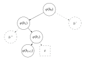
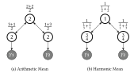
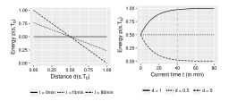
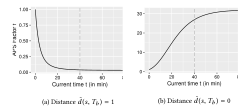
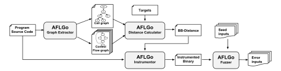
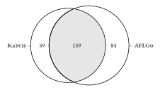

**Source:** *Directed Greybox Fuzzing* — [PDF](https://mboehme.github.io/paper/CCS17.pdf)

## **Directed Greybox Fuzzing**

#### Marcel Böhme

National University of Singapore, Singapore marcel.boehme@acm.org

### Manh-Dung Nguyen

National University of Singapore, Singapore dungnguy@comp.nus.edu.sg

#### **ABSTRACT**

Existing Greybox Fuzzers (GF) cannot be effectively directed, for instance, towards problematic changes or patches, towards critical system calls or dangerous locations, or towards functions in the stacktrace of a reported vulnerability that we wish to reproduce.

In this paper, we introduce Directed Greybox Fuzzing (DGF) which generates inputs with the objective of reaching a given set of target program locations efficiently. We develop and evaluate a simulated annealing-based power schedule that gradually assigns more energy to seeds that are closer to the target locations while reducing energy for seeds that are further away. Experiments with our implementation AFLGo demonstrate that DGF outperforms both directed symbolic-execution-based whitebox fuzzing and undirected greybox fuzzing. We show applications of DGF to patch testing and crash reproduction, and discuss the integration of AFLGo into Google's continuous fuzzing platform OSS-Fuzz. Due to its *directedness*, AFLGo could find 39 bugs in several well-fuzzed, security-critical projects like LibXML2. 17 CVEs were assigned.

#### **KEYWORDS**

patch testing; crash reproduction; reachability; directed testing; coverage-based greybox fuzzing; verifying true positives

#### 1 INTRODUCTION

Greybox fuzzing (GF) is considered the state-of-the-art in vulnerability detection. GF uses lightweight instrumentation to determine, with negligible performance overhead, a unique identifier for the path that is exercised by an input. New inputs are generated by mutating a provided seed input and added to the fuzzer's queue if they exercise a new and interesting path. *AFL* [43] is responsible for the discovery of hundreds of high-impact vulnerabilities [42], has been shown to generate a valid image file "from thin air" [41], and has a large community of security researchers involved in extending it.

Permission to make digital or hard copies of all or part of this work for personal or classroom use is granted without fee provided that copies are not made or distributed for profit or commercial advantage and that copies bear this notice and the full citation on the first page. Copyrights for components of this work owned by others than the author(s) must be honored. Abstracting with credit is permitted. To copy otherwise, or republish, to post on servers or to redistribute to lists, requires prior specific permission and/or a fee. Request permissions from permissions@acm.org.

CCS'17, October 30-November 3, 2017, Dallas, TX, USA

© 2017 Copyright held by the owner/author(s). Publication rights licensed to Association for Computing Machinery.

ACM ISBN 978-1-4503-4946-8/17/10...\$15.00 https://doi.org/10.1145/3133956.3134020

## Van-Thuan Pham\*

National University of Singapore, Singapore thuanpv@comp.nus.edu.sg

## Abhik Roychoudhury

National University of Singapore, Singapore abhik@comp.nus.edu.sg

However, existing greybox fuzzers cannot be effectively directed.<sup>1</sup> Directed fuzzers are important tools in the portfolio of a security reseacher. Unlike undirected fuzzers, a directed fuzzer spends most of its time budget on reaching specific target locations without wasting resources stressing unrelated program components. Typical applications of directed fuzzers may include

- patch testing [4, 21] by setting *changed* statements as targets. When a critical component is changed, we would like to check whether this introduced any vulnerabilities. Figure 1 shows the commit introducing Heartbleed [49]. A fuzzer that focusses on those changes has a higher chance of exposing the regression.
- **crash reproduction** [18, 29] by setting method calls in the stack-trace as targets. When in-field crashes are reported, only stack-trace and some environmental parameters are sent to the in-house development team. To preserve the user's privacy, the specific crashing input is often *not* available. Directed fuzzers allow the in-house team to swiftly reproduce such crashes.
- static analysis report verification [9] by setting statements as targets that a static analysis tool reports as potentially dangerous. In Figure 1, a tool might localize Line 1480 as potential buffer overflow. A directed fuzzer can generate test inputs that show the vulnerability if it actually exists.
- information flow detection [22] by setting sensitive sources and sinks as targets. To expose data leakage vulns, a security researcher would like to generate executions that exercise sensitive sources containing private information and sensitive sinks where data becomes visible to the outside world. A directed fuzzer can be used to generate such executions efficiently.

Most existing directed fuzzers are based on symbolic execution [4, 9, 15, 20, 21, 27, 34, 66]. Symbolic execution is a whitebox fuzzing technique that uses program analysis and constraint solving to synthesize inputs that exercise different program paths. To implement a directed fuzzer, symbolic execution has always been the technique of choice due to its systematic path exploration. Suppose, in the control-flow graph there exists a path  $\pi$  to the target location. A symbolic execution engine can construct a path condition, a first-order logic formula  $\varphi(\pi)$  that is satisfied by all inputs exercising  $\pi$ . A satisfiability modulo theory (SMT) solver generates an actual input t as a solution to the path constraint  $\varphi(\pi)$  if the constraint is satisfiable. Thus, input t exercises path  $\pi$  which contains the target.

<sup>\*</sup>The first and second author contributed equally.

<span id="page-0-0"></span><sup>&</sup>lt;sup>1</sup>With "directed fuzzing" we mean the targeted generation of inputs that can reach a specific set of program locations [20]. We do not mean the identification of the specific input bytes in a seed input that already reaches a dangerous location in order to achieve a specific value at that location as in taint-based directed fuzzing [11, 40]. Moreover, we do not mean the generation of inputs to cover all program elements of a certain type to achieve code coverage as in coverage-based fuzzing [7].

```
1455 + /* Read type and payload length first */
1456 + hbtype = *p++;
1457 + n2s(p, payload);
1458 + pl = p;
...
1465 + if (hbtype == TLS1_HB_REQUEST) {
1477 +
```

Figure 1: Commit introducing Heartbleed: After reading the payload from the incoming message p (1455-8), it copies payload many bytes from the incoming to the outgoing message. If payload is set to 64kb and the incoming message is one byte long, the sender reveals up to ~64kb of private data.

Directed symbolic execution (DSE) casts the reachability problem as iterative constraint satisfaction problem. Since most paths are actually infeasible, the search usually proceeds *iteratively* by finding feasible paths to intermediate targets. For instance, the patch testing tool Katch [21] uses the symbolic execution engine Klee [7] to reach a changed statement. Suppose, we set Line 1480 in Figure 1 as target and Katch found a feasible path  $\pi_0$  reaching Line 1465 as intermediate target. Next, Katch passes the constraint  $\varphi(\pi_0) \wedge (\text{hbtype} == \text{TLS1\_HB\_REQUEST})$  to the constraint solver to generate an input that actually exercises the target location in Line 1480. Unlike greybox fuzzers, symbolic execution-based whitebox fuzzers provide a trivial handle to implement directed fuzzing.

However, DSE's effectiveness comes at the cost of efficiency [5]. DSE spends considerable time with heavy-weight program analysis and constraint solving. At each iteration, DSE identifies those branches that need to be negated to get closer to the target using program analysis, constructs the corresponding path conditions from the sequence of instructions along these paths, and checks the satisfiability of those conditions using a constraint solver. In the same time that a DSE generates a single input, a greybox fuzzer can execute several orders of magnitude more inputs. This provides us with an opportunity to develop light-weight and directed greybox fuzzers. Started with the same seeds, when directed towards the commit in Figure 1 our directed greybox fuzzer AFLGo takes less than 20 minutes to expose Heartbleed while the DSE tool KATCH [21] cannot expose Heartbleed even in 24 hours.

In this paper, we introduce Directed Greybox Fuzzing (DGF) which is focussed on reaching a given set of target locations in a program. On a high level, we cast reachability as an optimization problem and employ a specific meta-heuristic to minimize the distance of the generated seeds to the targets. To compute seed distance, we first compute and instrument the distance of each basic block to the targets. While seed distance is inter-procedural, our novel measure requires analysis only once for the call graph and once for each intraprocedural CFG. At runtime, the fuzzer aggregates the distance values of each exercised basic block to compute the seed distance as their mean. The meta-heuristic that DGF employs to minimize seed distance is called Simulated Annealing [19] and is implemented as power schedule. A power schedule controls the energy of all seeds [6]. A seed's energy specifies the time spent fuzzing the seed. Like with all greybox fuzzing techniques, by moving the analysis to compile-time, we minimize the overhead at runtime.

DGF casts the reachability of target locations as optimization problem while existing directed (whitebox) fuzzing approaches cast reachability as iterative constraint satisfaction problem.

Our experiments demonstrate that directed greybox fuzzing outperforms directed symbolic execution, both in terms of effectiveness (i.e., DGF exposes more vulnerabilities) and in terms of efficiency (i.e., DGF reaches more targets in the same time). Yet, an integration of both techniques performs better than each technique individually. We implemented DGF in the popular and very successful greybox fuzzer AFL [43] and call our directed greybox fuzzer AFLGo. For patch testing, we compare AFLGo to the state-of-the-art, KATCH [21] a directed symbolic execution engine, on the original KATCH benchmark. AFLGo discovers 13 bugs (seven CVEs) that Катсн could not expose, and AFLGo can cover 13% more targets in the same time than KATCH. Yet, when applied together both techniques can cover up to 42% more targets than each individually. Both directed fuzzing approaches complement each other. For crash reproduction, we compare AFLGo to the state-of-the-art, BugRedux [18] a directed symbolic execution engine, on the original BugRedux benchmark. AFLGo can reproduce three times more crashes than BugRedux when only the method calls in the stack trace are available. Our experiments demonstrate that the annealing-based power schedule is effective and AFLGo is effectively directed. We compared AFLGo with the undirected greybox fuzzer AFL into which AFLGo was implemented. Indeed, AFLGo can exercise the given set of targets 3 to 11 times faster than AFL for LibPNG and between 1.5 to 2 times faster for Binutils.

Directed greybox fuzzing is effectively directed and efficiently complements symbolic execution-based directed fuzzing.

Our experiments demonstrate that directed greybox fuzzing is useful in the domains of patch testing and crash reproduction. We also integrated AFLGo into OSS-Fuzz [58], a continuous testing platform for security-critical libraries and other open-source projects that has recently been announced at Google [44]. Our integration with AFLGo discovered 26 previously undiscovered bugs in security-critical libraries, 10 of which are serious vulnerabilities that were assigned CVEs. Most discoveries can be directly attributed to AFLGo's directedness.

AFLGo is an useful patch testing tool that effectively exposes vulnerabilities that were recently introduced and incomplete fixes of previously reported vulnerabilities.

The main contributions of this article are

- the integration of greybox fuzzing and Simulated Annealing,
- a formal measure of distance that is inter-procedural, accounts for multiple targets at once, can be effectively pre-computed at instrumentation-time, and is efficiently derived at runtime,
- the *implementation* of directed greybox fuzzing as AFLGo which is publicly available at https://github.com/aflgo/aflgo,
- the *integration* of AFLGo as patch testing tool into the fully automated toolchain of OSS-Fuzz which is publicly available at <a href="https://github.com/aflgo/oss-fuzz">https://github.com/aflgo/oss-fuzz</a>, and
- a large-scale evaluation of the efficacy and utility of directed greybox fuzzing as patch testing and crash reproduction tool.

The remainder of this article is structured as follows. In Section 2, we use Heartbleed as an example case study to explain the pertinent features of directed greybox fuzzing. In Section 3, we discuss formal measures of distance and the integration of greybox fuzzing with Simulated Annealing. In Section 4, we present our implementation as well as the experimental design. In Section 5, we apply AFLGo to patch testing and compare it with the state-of-the-art (KATCH [21]). In Section 6, we discuss our integration of AFLGo into OSS-Fuzz where it is directed towards the most recent changes. In Section 7, we apply AFLGo to crash reproduction and compare it with the baseline undirected greybox fuzzer (AFL) and the state-of-the-art (BugRedux [18]). Section 8 elicits the threats to validity. The survey of related work in Section 9 is followed by our conclusion in Section 10.

#### <span id="page-2-0"></span>2 MOTIVATING EXAMPLE

We use the Heartbleed vulnerability as case study and motivating example to discuss two different approaches to directed fuzzing. Traditionally, directed fuzzing is based on symbolic execution. Here, we compare KATCH [21], a patch testing tool based on the symbolic execution engine KLEE [7], with AFLGo, our implementation of directed greybox fuzzing that is presented in this paper.

#### 2.1 Heartbleed and Patch Testing

Heartbleed [49] (CVE-2014-0160,  $\bigcirc$ ) is a vulnerability which compromises the privacy and integrity of the data sent via a purportedly secure protocol (SSL/TLS). An excerpt of the commit that introduced Heartbleed [46] is shown in Figure 1. Interestingly, Heartbleed can be exploited without a man in the middle (MITM). Suppose, Bob has a secret that the attacker Mallory wants to find out. First, Bob reads the message type and payload from Mallory's *incoming* message. If the message is of a certain type, Bob sets the type and payload of the *outgoing* message as his response. Finally, Bob copies payload many bytes from the incoming message (pl) to the outgoing message (bp). If less than payload bytes are allocated for pl, Bob reveals his secret. Heartbleed was detected two years after it was introduced into the OpenSSL library which led to a widespread distribution of the vulnerability. As of April 2016, a quarter million machines are still vulnerable [61].

Heartbleed was introduced on New Year's Eve 2011 by commit 4817504d which implemented a new feature called Heartbeat.<sup>2</sup>. A directed fuzzer that takes the changed statements as target locations might have discovered the vulnerability when it was introduced [2], preventing its widespread distribution. Now, OpenSSL consists of almost half a million lines of code [47]; the commit introducing the vulnerability added a bit more than 500 lines of code [46]. Arguably, fuzzing all of OpenSSL in an undirected manner, when really only the recent changes are considered error-prone, would be a waste of resources. A directed fuzzer would exercise these changes much more efficiently. Most patch testing tools are based on directed symbolic execution, such as KATCH [21], PRV [3], MATRIX [34], CIE [4], DiSE [27], and Qi et al.'s patch testing tool [30]. Since KATCH represents the state-of-the-art in automated patch testing and is readily available, we choose KATCH for our motivating example.

<span id="page-2-3"></span>

Figure 2: CFG sketch showing the branch conditions  $\varphi$  that KATCH collects along the path executed by the seed s.

# 2.2 Fuzzing the Heartbleed-Introducing Source Code Commit

KATCH is a state-of-the-art patch testing tool and directed symbolic execution engine implemented on top of KLEE [7]. First, OpenSSL must be compiled to LLVM 2.9 bytecode.<sup>3</sup> Then, Катсн processes one changed basic block at a time. For our motivating example, KATCH identifies 11 changed basic blocks as reachable target locations that are not already covered by the existing regression test suite. For each target *t*, KATCH executes the following *greedy search*: Катсн identifies a seed s in the regression test suite that is "closest" to t. For instance, an existing seed might execute the branch  $b_i$  in Line 1465 but contain an incorrect message type (see Figure 2). This seed is close in the sense that only one branch needs to be negated to reach the target. Now, KATCH uses program analysis i) to identify the executed branch  $b_i$  that is closest to the target t, ii) to construct a path constraint  $\Pi(s) = \varphi(b_0) \wedge \varphi(b_1) \wedge ... \wedge \varphi(b_i) \wedge ...$  as a conjunction of every branch condition that s executes, and iii) to identify the specific input bytes in s it needs to modify to negate  $b_i$ . In this case, those input bytes encode the message type. Then, Катсн negates the condition of  $b_i$  in  $\Pi$  to derive  $\Pi' = \varphi(b_0) \wedge \varphi(b_1) \wedge ... \wedge \neg \varphi(b_i)$ . The constraint  $\Pi'$  is passed to the Z3 Satisfiability Modulo Theory (SMT) solver [10] to compute the specific values of the identified input bytes such that  $b_i$  is indeed negated. In this case, the resulting incoming message would now contain the correct type (Line 1465) and execute the vulnerability at Line 1480.4.

**Challenges.** While directed symbolic-execution-based whitebox fuzzing is very effective, it is also *extremely expensive*. Due to the heavy-weight program analysis, KATCH takes a long time to generate an input. In our experiments, KATCH *cannot detect Heartbleed within 24 hours* (Figure 3). Note that distance is re-computed at runtime for every new path that is explored. The *search might be incomplete* since the interpreter might not support every bytecode, and the constraint solver might not support every language feature, such as floating point arithmetic. The *greedy search* might get stuck in a local rather than a global optimum and never reach the target. Due to *sequential search*, KATCH misses an opportunity to inform the search for other targets by the progress of the search for the current target; the search starts anew for every target.

<span id="page-2-1"></span><sup>&</sup>lt;sup>2</sup>https://git.openssl.org/gitweb/?a=commit&h=4817504d

<span id="page-2-4"></span><span id="page-2-2"></span> $<sup>^3</sup>$  Katch as well as Klee never actually execute the binary but interprets the bytecode.  $^4$  Note that in our experiments we used the setup and seed corpus provided by Hanno Böck [2]. The corpus does not exercise the changed code. Hence, in practice Katch needs to negate more branches before being able to reach the vulnerability.

<span id="page-3-1"></span>

| CVE                     | Fuzzer         | Runs | Mean TTE        | Median <b>TTE</b> |
|-------------------------|----------------|------|-----------------|-------------------|
| $\overline{\mathbb{C}}$ | AFLGo<br>Katch | 30   | 19 <i>m</i> 19s | 17 m04s           |
| M                       | Катсн          | 1    | > 1 day         | > 1 day           |

Figure 3: Time-to-Exposure (TTE), AFLGo versus KATCH.

**Opportunities**. Our tool AFLGo is an extremely efficient *directed greybox fuzzer*. AFLGo generates and executes several thousand inputs per second and *exposes Heartbleed in less than 20 minutes.*<sup>5</sup> AFLGo implements our novel directed greybox fuzzing technique that requires virtually *no program analysis at runtime* and only lightweight program analysis at compile/instrumentation time. AFLGo implements a *global search* based on Simulated Annealing [19]. This allows our directed greybox fuzzer to approach a global optimum and reach the set of targets eventually. Just how fast the search should approach an optimum is an input to our technique (*time-to-exploitation*). AFLGo implements a *parallel search*, searching for all targets simultaneously. The closer a seed *s* is to the targets and the more targets *s* executes, the higher AFLGo assesses the fitness of *s*.

First, AFLGo *instruments* OpenSSL. An additional compiler pass for Clang adds the classical AFL and our AFLGo instrumentation to the compiled binary. The AFL instrumentation informs the fuzzer about the increase in code coverage while the AFLGo instrumentation informs the fuzzer about the distance of the executed seed to given the set of targets. The novel distance computation is discussed in Section 3.2 and substantially more intricate than that of KATCH. It accounts for all targets simultaneously and is fully established during compile time which reduces the overhead during runtime.

Then, AFLGo fuzzes OpenSSL using Simulated Annealing [19]. At the beginning, AFLGo enters the exploration phase and works just like AFL. In the exploration phase, AFLGo randomly mutates the provided seeds to generate many new inputs. If a new input increases the code coverage, it is added to the set of seeds to be fuzzed; otherwise, it is discarded. The provided and generated seeds are fuzzed in a continuous loop. For example, AFLGo is started with two seeds:  $s_0$  exercising branches  $\langle b_0, b' \rangle$  in Figure 2 and  $s_1$  exercising  $\langle b_0, b_1, b'' \rangle$ . Suppose, there is a direct path from b' to t that is infeasible, i.e., cannot be exercised by an input. At the beginning, roughly the same number of new inputs would be generated from both seeds. The rationale for the exploration is to explore other paths, even if longer. Even though  $s_0$  is "closer" to the target, the "children" of  $s_1$  are more likely to actually reach t.

The time when AFLGo enters exploitation is specified by the user. For our experiments, we set the time-to-exploitation to 20 hours and the timeout to 24 hours. In the exploitation phase, AFLGo generates substantially more new inputs from seeds that are closer to the target—essentially not wasting precious time fuzzing seeds that are too far away. Suppose, at this point AFLGo generated a seed  $s_2$  that exercises the branches  $\langle b_0, b_1, b_i, b_{i+1} \rangle$  in Figure 2. In the exploitation phase, most of the time is spent on fuzzing the seed  $s_2$  since it is closest to the target t. AFLGo slowly transitions from the exploration phase to the exploitation phase, according to the annealing function implemented as power schedule.

#### <span id="page-3-0"></span>3 TECHNIQUE

We develop directed greybox fuzzing (DGF), a vulnerability detection technique that is focussed on reaching user-defined target locations. DGF retains the *efficiency* of greybox fuzzing because it does not conduct any program analysis during runtime since all program analysis is conducted at compile-time. DGF is *easily parallelizable* such that more computing power can be assigned as and when needed. DGF allows to specify *multiple target locations*.

We define an *inter-procedural measure* of distance (i.e., seed to target locations) that is *fully established* at instrumentation-time and can be *efficiently* computed at runtime. While our measure is *inter*-procedural, our program analysis is actually *intra*-procedural based on the call graph (CG) and intra-procedural control-flow graphs (CFGs). We show how this yields quadratic savings compared to an inter-procedural analysis. CG and CFGs are readily available in the LLVM compiler infrastructure.

Using this novel measure of distance, we define a novel *power schedule* [6] that integrates the most popular annealing function, the exponential cooling schedule. The annealing-based power schedule gradually assigns more energy to seeds that are closer to the target locations while reducing energy for seeds that are further away, as per our distance measure.

#### 3.1 Greybox Fuzzing

We start by explaining how greybox fuzzing works and by pointing out where the distance-instrumentation and the annealing-based power schedule are implemented—to realize *directed* greybox fuzzing. *Fuzzing* is a term coined in the 1990s, when Miller et al. [24] used an random testing tool to investigate the reliability of UNIX tools. Today, we distinguish three streams based on the degree of program analysis: *black-box fuzzing* only requires the program to execute [60, 62, 65]. *White-box fuzzing* based on symbolic execution [7, 8, 12] requires heavy-weight program analysis and constraint solving. *Greybox fuzzing* is placed in-between and uses only lightweight instrumentation to glean some program structure. Without program analysis, greybox fuzzing may be more efficient than white-box fuzzing. With more information about internal structure, it may be more effective than blackbox fuzzing.

Coverage-based greybox fuzzers (CGF) like AFL [43] and Lib-Fuzzer [53] use lightweight instrumentation to gain coverage information. For instance, AFL's instrumentation captures basic block transitions, along with coarse branch-taken hit counts. CGF uses the coverage information to decide which generated inputs to retain for fuzzing, which input to fuzz next and for how long. We extend this instrumentation to also account for the distance of a chosen seed to the given set of target locations. The distance computation requires finding the shortest path to the target nodes in the call graph and the intra-procedural control-flow graphs which are readily available in LLVM.<sup>6</sup> The shortest path analysis is implemented as Dijkstra's algorithm [23].

Algorithm 1 shows an algorithmic sketch of how CGF works. The fuzzer is provided with a set of seed inputs S and chooses inputs S from S in a continuous loop until a timeout is reached or the fuzzing is aborted. The *selection* is implemented in CHOOSENEXT. For instance, AFL essentially chooses seeds from a circular queue

<span id="page-3-2"></span> $<sup>^5</sup>$ This is the average value over 30 runs of AFLGo (Figure 3). Unlike KATCH, AFLGo is a random test generation technique s.t. experiments require statistical power.

<span id="page-3-3"></span><sup>&</sup>lt;sup>6</sup>http://llvm.org/docs/Passes.html

in the order they are added. For the selected seed input s, the CGF determines the number p of inputs that are generated by fuzzing s as implemented in AssignEnergy (line 3). This is also where the (annealing-based) power schedule is implemented. Then, the fuzzer generates p new inputs by randomly mutating s according to defined mutation operators as implemented in MUTATE\_INPUT (line 5). AFL uses bit flips, simple arithmetics, boundary values, and block deletion and insertion strategies to generate new inputs. If the generated input s' covers a new branch, it is added to the circular queue (line 9). If the generated input s' crashes the program, it is added to the set  $S_X$  of crashing inputs (line 7). A crashing input that is also interesting is marked as  $unique\ crash$ .

#### <span id="page-4-1"></span>Algorithm 1 Greybox Fuzzing

```
Input: Seed Inputs S
 1: repeat
        s = \text{chooseNext}(S)
 2:
 3:
        p = ASSIGNENERGY(s)
                                                  // Our Modifications
 4:
        for i from 1 to p do
            s' = \text{MUTATE INPUT}(s)
 5:
            if t' crashes then
 6:
                add s' to S_x
 7:
            else if isInteresting(s') then
 8:
                add s' to S
 9.
            end if
10:
        end for
11:
12: until timeout reached or abort-signal
Output: Crashing Inputs S<sub>X</sub>
```

Böhme et al. [6] showed that coverage-based greybox fuzzing can be modelled as a Markov chain. A *state i* is a specific path in the program. The *transition probability*  $p_{ij}$  from state i to state j is given by the probability that fuzzing the seed which exercises path i generates a seed which exercises path j. The authors found that a CGF exercises certain (high-frequency) paths significantly more often than others. The density of the stationary distribution formally describes the likelihood that a certain path is exercised by the fuzzer after a certain number of iterations. Böhme et al. developed a technique to gravitate the fuzzer towards low-frequency paths by adjusting the number of fuzz generated from a seed depending on the density of the neighborhood that is implemented into AFLFast,<sup>7</sup> a fork of AFL. The number of fuzz generated for a seed s is also called the *energy* of s. The energy of a seed s is controlled by a so-called *power schedule*. Note that energy is a property that is local to a state in the Markov chain unlike temperature which is global in simulated annealing.

# <span id="page-4-0"></span>3.2 A Measure of Distance between a Seed Input and Multiple Target Locations

In order to compute distance across functions, we assign a value to each node in the call graph (CG) on function-level and in the intraprocedural control-flow graphs (CFGs) on basic-block level. The  $target\ functions\ T_f$  and  $target\ basic\ blocks\ T_b$  can be swiftly identified from the given source-code references (e.g., d1\_both.c:1480).

<span id="page-4-3"></span>

Figure 4: Difference between node distance defined in terms of arithmetic mean versus harmonic mean. Node distance is shown in the white circles. The targets are marked in gray.

The function-level target distance determines the distance from a function to all target functions in the call graph while the function distance determines the distance between any two functions in the call graph. More formally, we define the function distance  $d_f(n,n')$  as the number of edges along the shortest path between functions n and n' in the call graph CG. We define the function-level target distance  $d_f(n,T_f)$  between a function n and the target functions  $T_f$  as the harmonic mean of the function distance between n and any reachable target function  $t_f \in T_f$ :

$$d_f(n, T_f) = \begin{cases} undefined & \text{if } R(n, T_f) = \emptyset \\ \left[ \sum_{t_f \in R(n, T_f)} d_f(n, t_f)^{-1} \right]^{-1} & \text{otherwise} \end{cases}$$
 (1)

where  $R(n,T_f)$  is the set of all target functions that are reachable from n in CG. The *harmonic mean* allows to distinguish between a node that is closer to one target and further from another and a node that is equi-distant from both targets. In contrast, the arithmetic mean would assign both nodes the same target distance. Figure 4 provides an example.

The basic-block-level target distance determines the distance from a basic block to all other basic blocks that call a function, in addition to a multiple of the function-level target distance for the function that is called. Intuitively, we assign the target distance to a basic block based on its average distance to any other basic block that calls a function in the call chain towards the target locations. Moreover, the assigned target distance is smaller if that call chain is shorter. The BB distance determines the distance between any two basic blocks in the CFG. More formally, we define BB distance  $d_b(m_1, m_2)$  as the number of edges along the shortest path between basic block  $m_1$  and  $m_2$  in the control-flow graph  $G_i$  of function i. Let N(m) be the set of functions called by basic block m such that  $\forall n \in N(m).R(n, T_f) \neq \emptyset$ . Let T be the set of basic blocks in  $G_i$  such that  $\forall m \in T.N(m) \neq \emptyset$ . We define the basic-block-level target distance  $d_b(m, T_b)$  between a basic block m and the target basic blocks  $T_b$  as

$$d_b(m, T_b) = \begin{cases} 0 & \text{if } m \in T_b \\ c \cdot \min_{n \in N(m)} (d_f(n, T_f)) & \text{if } m \in T \\ \left[ \sum_{t \in T} (d_b(m, t) + d_b(t, T_b))^{-1} \right]^{-1} & \text{otherwise} \end{cases}$$
(2)

where c=10 is a constant that magnifies function-level distance. Note that  $d_b(m, T_b)$  is defined for all  $m \in G_i$ .

<span id="page-4-2"></span><sup>&</sup>lt;sup>7</sup>https://github.com/mboehme/aflfast

<span id="page-4-4"></span> $<sup>^8</sup>$  Note that none of the target basic blocks  $T_b$  needs to exist in the current CFG  $G_i$  but there may exist BBs T that transitively call a function containing a target BB.

Finally, we have all the ingredients to define the normalized seed distance, the distance of a seed s to the set of target locations  $T_h$ . Let  $\xi(s)$  be the execution trace of a seed s. This trace contains the exercised basic blocks. We define the seed distance  $d(s, T_h)$  as

$$d(s, T_b) = \frac{\sum_{m \in \xi(s)} d_b(m, T_b)}{|\xi(s)|}$$
(3)

The fuzzer continously maintains a set S of seeds to fuzz. We define the normalized seed distance  $d(s, T_h)$  as the difference between the seed distance of s to  $T_b$  and the minimum seed distance of any previous seed  $s' \in S$  to  $T_b$  divided by the difference between the max. and the min. seed distance of any seed  $s' \in S$  to  $T_b$ :

$$\tilde{d}(s, T_b) = \frac{d(s, T_b) - \min D}{\max D - \min D}$$
(4)

where

$$\min D = \min_{s \in \mathcal{S}} \left[ d(s', T_b) \right] \tag{5}$$

$$\min D = \min_{s' \in S} [d(s', T_b)]$$

$$\max D = \max_{s' \in S} [d(s', T_b)]$$
(6)

Note that the normalized seed distance  $\tilde{d} \in [0, 1]$ . Notice also that heavy-weight program analysis of the distance-computation can be moved to instrumentation-time, to keep the performance overhead minimal at runtime. First, call graph and intra-procedural control-flow graphs are extracted. This is achieved either using the compiler itself<sup>10</sup> or when only the binary is available using bit code translation (or lifting).<sup>11</sup> Given the target locations, function-level and basic-block-level target distance can be computed at instrumentation time. Only the normalized seed distance is computed at runtime by collecting these pre-computed distance values.

#### <span id="page-5-10"></span>**Annealing-based Power Schedules**

We develop a novel annealing-based power schedule (APS). Böhme et al. [6] showed that greybox fuzzing can be viewed as a Markov chain that can be efficiently navigated using a power schedule.<sup>12</sup> This provides us with an opportunity to employ Markov Chain Monte Carlo (MCMC) optimization techniques, such as Simulated Annealing. Our annealing-based power schedule assigns more energy to a seed that is "closer" to the targets than to a seed that is "further away", and this energy difference increases as temperature decreases (i.e., with the passage of time).

Simulated Annealing (SA) [19] is inspired by the annealing process in metallurgy, a technique involving heating and the controlled cooling of a material to increase the size of its crystals and reduce their defects. Similarly, the SA algorithm converges asymptotically towards the set of global optimal solutions. This set, in our case, is the set of seeds exercising the maximum number of target locations. SA is a Markov Chain Monte Carlo method (MCMC) for approximating the global optimum in a very large, often discrete search space within an acceptable time budget. The main feature of

<span id="page-5-8"></span>

Figure 5: Impact of seed distance  $\tilde{d}(s, T_b)$  and current time on the energy  $p(s, T_b)$  of the seed s (for  $t_x = 40 \text{ min}$ ).

<span id="page-5-4"></span>SA is that during the random walk it always accepts better solutions but sometimes it may also accept worse solutions. The temperature is a parameter of the SA algorithm that regulates the acceptance of worse solutions and is decreasing according to a cooling schedule. At the beginning, when  $T = T_0 = 1$ , the SA algorithm may accept worse solutions with high probability. Towards the end, when T is close to 0, it degenerates to a classical gradient descent algorithm and will accept only better solutions.

A cooling schedule controls the rate of convergence and is a function of the initial temperature  $T_0 = 1$  and the temperature cycle  $k \in \mathbb{N}$ . Note that while energy is local to a seed, the temperature is global to all seeds. The most popular is the exponential cooling schedule [19]:

<span id="page-5-6"></span><span id="page-5-5"></span>
$$T_{\rm exp} = T_0 \cdot \alpha^k \tag{7}$$

where  $\alpha$  < 1 is a constant and typically  $0.8 \le \alpha \le 0.99$ .

Annealing-based power schedule. In automated vulnerability detection, we usually have only a limited time budget. Hence, we would like to specify a time  $t_x$  when the annealing process should enter "exploitation" after sufficient time of "exploration". Intuitively, at time  $t_x$ , the simulated annealing process is comparable to a classical gradient descent algorithm (a.k.a. greedy search). We let the cooling schedule enter *exploitation* when  $T_k \leq 0.05$ . Adjustment for values other than 0.05 and for different cooling schedules is straightforward. Thus, we compute the temperature  $T_{\rm exp}$  at time tas follows

$$0.05 = \alpha^{k_x}$$
 for  $T_{\text{exp}} = 0.05$ ;  $k = k_x$  in Eq. (7) (8)

$$k_x = \log(0.05)/\log(\alpha)$$
 solving for  $k_x$  in Eq. (8) (9)

$$T_{\rm exp} = \alpha^{\frac{t}{t_X}} \frac{\log(0.05)}{\log(\alpha)} \qquad \qquad \text{for } k = \frac{t}{t_X} k_X \text{ in Eq. (7)} \quad (10)$$

$$= 20^{-\frac{t}{t_X}}$$
 simplifying Eq. (10) (11)

In what follows, we define our annealing-based power schedule (APS) using the exponential cooling schedule. Given the seed s and the target locations  $T_b$ , the APS assigns energy p as

<span id="page-5-9"></span><span id="page-5-7"></span>
$$p(s, T_b) = (1 - \tilde{d}(s, T_b)) \cdot (1 - T_{\text{exp}}) + 0.5T_{\text{exp}}$$
 (12)

The behavior of the APS is illustrated in Figure 5 for three values of current time t and normalized seed distance d, respectively. Notice that energy  $p \in [0, 1]$ . Moreover, when starting the search (t = 0), the APS assigns the same energy to a seed with a high seed distance as to one with a low seed distance. A seed that exercises only targets (i.e., d = 0) is assigned more and more energy as the time progresses.

<span id="page-5-0"></span><sup>&</sup>lt;sup>9</sup>It is worth noting that a definition of normalized seed distance as the arithmetic mean of the "normalized" basic-block-level target distance (w.r.t. min. and max. target distance) - in our experiments - resulted in the probability density being centered around a value much less than 0.5 with significant positive kurtosis. This resulted in substantially reduced energy for every seed. The definition of normalized seed distance in Eq. (4) reduces kurtosis and nicely spreads the distribution between zero and one.  $^{10} https://llvm.org/docs/Passes.html\#dot-callgraph-print-call-graph-to-dot-file$ 

<span id="page-5-2"></span><span id="page-5-1"></span><sup>&</sup>lt;sup>11</sup>For instance, using mcsema: https://github.com/trailofbits/mcsema

<span id="page-5-3"></span> $<sup>^{12}\</sup>mbox{B\"{o}}\mbox{hme}$ et al's  $explore\mbox{-schedule}$  has been implemented into AFL since version 2.33b.

<span id="page-6-1"></span>

Figure 6: Annealing-based power factor which controls the energy that was originally assigned by AFL's power schedule  $(t_x = 40)$ , (a) for seed with maximal distance to all targets  $(\tilde{d} = 1)$  and (b) for a seed with minimal distance to all targets  $(\tilde{d} = 0)$ . Notice the different scales on the y-axis.

**Practical Integration**. Now, AFL already implements a power schedule. <sup>13</sup> So, how do we integrate our APS? The existing schedule assigns energy based on the execution time and input size of s, when s has been found, and how many ancestors s has. We would like to integrate AFL's pre-existing power schedule with our annealing-based power schedule and define the final integrated annealing-based power schedule. Let  $p_{afl}(s)$  be the energy that AFL normally assigns to a seed s. Given basic blocks  $T_b$  as targets, we compute the integrated APS  $\hat{\rho}(s, T_b)$  for a seed s as

$$\hat{p}(s, T_b) = p_{\text{aff}}(s) \cdot 2^{10 \cdot p(s, T_b) - 5} \tag{13}$$

The annealing-based power factor  $f=2^{10(p(s,T_b)-0.5)}$  controls the increase or reduction of energy assigned by AFL's power schedule. The behavior of the annealing-based power factor is shown in Figure 6 for the two extremal cases of the normalized seed distance  $\tilde{d}(s,T_b)$ . Let us consider the first extremal case where the normalized seed distance is maximal (i.e.,  $\tilde{d}(s,T_b)=1$ ; Fig. 6.a). At the beginning (t=0), the power factor f=1, such that the seed is assigned the same energy that AFL would assign  $(\hat{p}(s,T_b)=p_{\rm afl})$ . However, after only ten minutes  $(t=10{\rm min})$ , the same seed is assigned only about 15% of the original energy. In fact, from equations (12) and (13) we can see that

$$\lim_{t \to \infty} \hat{p}(s, T_b) = \frac{p_{\text{aff}}}{32} \qquad \text{if } \tilde{d}(s, T_b) = 1$$
 (14)

In other words, a seed s that is "very far" from reaching the target locations, is assigned less and less energy until only about one thirty-second of the original energy  $p_{\rm aff}$  is assigned. Let us now consider the second extremal case where the normalized seed distance is minimal (i.e.,  $\tilde{d}(s,T_b)=1$ ; Fig. 6.b). At the beginning (t=0), the power factor f=1 just like for the seed with maximal distance. However, from equations (12) and (13) we can see that

$$\lim_{t \to \infty} \hat{p}(s, T_b) = 32 \cdot p_{\text{afl}} \qquad \text{if } \tilde{d}(s, T_b) = 0 \tag{15}$$

In other words, a seed s that is "very close" to reaching the target locations, is assigned more and more energy until about thirty times the original energy  $p_{\rm afl}$  is assigned.

#### 3.4 Scalability of Directed Greybox Fuzzing

The central benefit of greybox fuzzing is its efficiency resulting from the absence of any program analysis; it generates and executes very large numbers of inputs in a short time. Now, directed greybox fuzzing (DGF) seems to add some program analysis, specifically of control-flow and call graphs. So then, how does DGF scale?

While our distance measure is inter-procedural, the program analysis is actually intra-procedural. This provides substantial savings compared to an inter-procedural analysis. Our own experience with an inter-procedural analysis is as follows. In a very early instantiation, AFLGo would first construct the inter-procedural control-flow graph (iCFG) by connecting all the call-sites of one function with the first basic block of the called functions. This would already take several hours. Once the iCFG was available, it would compute the target distance within the iCFG for every basic block as the average length of the shortest path to any target. Due to the huge number of nodes in the iCFG, this could also take several hours. Today, AFLGo completely skips the iCFG computation and after computing function-level target distance in the call graph, only computes the basic-block level target distance to the call sites within the same intra-procedural control-flow graph. At the callsites, the function-level target distance is used as approximation for the remainder of the path to the targets. At its core, BB-level target distance relies on Djikstra's shortest-path algorithm which has a worst-case complexity of  $O(V^2)$  where V is the number of nodes. Suppose, there are n intra-procedural CFGs with an average m nodes. The complexity of a shortest-distance computation in the iCFG is  $O(n^2 \cdot m^2)$ . In contrast, the complexity of *our* shortest distance computation in the call graph and all intra-procedural control-flow graphs is  $O(n^2 + nm^2)$ . This yields savings that are quadratic in the number of functions n.

<span id="page-6-2"></span>Moreover, we designed DGF such that most of the heavy-weight analysis can be moved to compile-time (i.e., instrumentation-time). Hence, DGF retains most of its efficiency at runtime.

- At compile time, the basic-block-level target distance is computed for each basic block in every function. A simple extension of the classical AFL trampoline adds the basic-block target distance to each basic block in the program. A trampoline is a set of instructions that implement the instrumentation. The instrumentation framework, LLVM can handle static analysis for large programs quite efficiently.
- At runtime, AFLGo is as scalable as AFL which is known to scale to large programs such as Firefox, PHP, and Acrobat Reader. The AFLGo trampoline only aggregates the basic-blocklevel target distance values and the number of executed basic blocks and contains only few more instructions than the original AFL trampoline. The annealing-based power schedule is implemented in the fuzzer itself. There is no reason why AFLGo cannot scale as well as AFL.

*In summary*, we move most of the program analysis to instrumentation time to maintain the efficiency at runtime. During instrumentation time, we try to keep the program analysis light-weight by computing an inter-procedural measure via light-weight intraprocedural analysis. In our experience this provides huge savings, reducing instrumentation time from several hours to a few minutes.

<span id="page-6-0"></span> $<sup>^{13}\</sup>mathrm{Since}$  version 2.33b, AFL implements the  $\mathit{explore}$  schedule [6].

<span id="page-7-2"></span>

Figure 7: Architecture: After the Graph Extractor generates the call and control-flow graphs from the source code, the distance calculator computes the basic-block-level target distance for each basic block which is used by the Instrumentor during intrumentation. The instrumented binary informs the Fuzzer not only about coverage but also about the seed distance.

#### <span id="page-7-0"></span>4 EVALUATION SETUP

To evaluate the efficacy and utility of directed greybox fuzzing we conduct several experiments. We implemented the technique into the existing (undirected) greybox fuzzer AFL [43] and call our tool AFLGo. We apply AFLGO to two distinct problem domains: patch testing and crash reproduction, and integrate it with OSS-Fuzz [58].

#### 4.1 Implementation

AFLGo is implemented in four components, the Graph Extractor, the Distance Calculator, the Instrumentor, and the Fuzzer. With our integration into OSS-Fuzz, we demonstrate that these components can be seemlessly integrated in the original build environment (e.g., make or ninja). The overall architecture is shown in Figure 7. In the following, we explain how these components are implemented.

- (1) The AFLGo Graph Extractor (GE) generates the call graph (CG) and the relevant control-flow graphs (CFGs). CG nodes are identified by the function signature while CFG nodes are identified by the source file and line of the first statement of the corresponding basic block. The GE is implemented as extension of the AFL LLVM pass which is activated by the compiler afl-clang-fast. The compiler environment variable CC is set to afl-clang-fast and the project is built.
- (2) The AFLGo Distance Calculator (DC) takes the call graph and each intra-procedural control-flow to compute the inter-procedural distance for each basic block (BB) as per Section 3.2. The DC is implemented as a Python script that uses the networkx package for parsing the graphs and for shortest distance computation according to Djikstra's algorithm. The DC generates the BB-distance file which contains the basic-block-level target distance for each BB.
- (3) The AFLGo Instrumentor takes the BB-distance file and instruments each BB in the target binary. Specifically, for each BB, it determines the respective BB-level target distance and injects the extended trampoline. The trampoline is a piece of assembly code that is executed after each jump instruction to keep track of the covered control-flow edges. An edge is identified by a byte in a 64kb-shared memory. On a 64-bit architecture, our extension uses 16 additional bytes of shared memory: 8 bytes to accumulate the distance values, and 8 bytes to record the number of exercised BBs. For each BB, the AFLGo Instrumentor

- adds assembly code i) to load the current accumulated distance and add the target distance of the current BB, ii) to load and increment the number of exercised BBs, and iii) to store both values to shared memory. The instrumentation is implemented as an extension of the AFL LLVM pass. The compiler is set to afl-clang-fast and the compiler flags to reference the BB-distance file, and the project is built with ASAN [35].
- (4) The *AFLGo Fuzzer* is implemented into AFL version 2.40b (which already integrates AFLFast's *explore* schedule [6]). It fuzzes the instrumented binary according to our annealing-based power schedule (see Section 3.3). The additional 16 bytes in the shared memory inform the fuzzer about the current seed distance. The *current seed distance* is computed by dividing the accumulated BB-distance by the number of exercised BBs.

#### 4.2 Infrastructure

We executed all experiments on machines with an Intel Xeon CPU E5-2620v3 processor that has 24 logical cores running at 2.4GhZ with access to 64GB of main memory and Ubuntu 14.04 (64 bit) as operating system. We always utilized exactly 22 cores to keep the workload compareable and to retain two cores for other processes.

For all experimental comparisons of AFLGo with the baseline (i.e., AFL, KATCH, or BugRedux), both fuzzers are started with the *same* seed corpus. If no seed corpus is available, we start AFLGo with the empty file as seed corpus (i.e., echo "" > in/file). For all experimental comparisons, both fuzzers have the same time budget and computational resources to reach the same set of target locations.

#### <span id="page-7-1"></span>5 APPLICATION 1: PATCH TESTING

We show the application of directed greybox fuzzing to patch testing and compare our implementation AFLGo with the state-of-the-art patch testing tool KATCH. Suppose, a security-critical library like Libbfd is being fuzzed continuously and no vulnerabilities have been found for quite some time. Now, the library is changed to add a new feature. It would be profitable to focus the next fuzzing campaign specifically on these changes to check whether the recent changes *introduced* new vulnerabilities. The state-of-the-art patch testing tool is KATCH [21], a directed whitebox fuzzer that is based on the symbolic execution engine KLEE [7].

<span id="page-8-0"></span>

| Chosen Commits 175 commits from Nov'09–May'12  |  |
|------------------------------------------------|--|
| Chase Commits 175 commits from New 100 Mary 10 |  |
| Program Size 42,930 LoC                        |  |
| Project Tools diff, sdiff, diff3, cmp          |  |

#### **GNU Diffutils**

|                | addr2line, ar, cxxfilt, elfedit, nm, |
|----------------|--------------------------------------|
| Project Tools  | objcopy, objdump, ranlib, readelf    |
|                | size, strings, strip                 |
| Program Size   | 68,830 LoC + 800kLoC from libraries  |
| Chosen Commits | 181 commits from Apr'11-Aug'12       |

**GNU Binutils** 

Figure 8: Description of the KATCH benchmark [21]

In this experiments, we compare our directed greybox fuzzer AFLGo with KATCH in terms of patch coverage and vulnerability detection. We use the same subjects, experimental parameters, and infrastructure as the authors of KATCH. However, we excluded the smallest subject, findutils, because it has the capability to execute arbitrary commands and delete arbitrary files. AFLGo actually executes the instrumented binary while KATCH merely interprets the LLVM Bytecode. Some descriptive statistics about the remaining subjects are shown in Figure 8. The virtual infrastructure is provided on request by the authors of KATCH. We reuse the same scripts in the infrastructure to determine target locations and to analyze the results. We use the same seed corpus und set the same *timeout* (i.e., 10 mins per target for Diffutils, 15 mins per target for Binutils). Conservatively, we make only one virtual core and about 3GB of main memory available to AFLGo while four cores and 16GB were made available to Катсн.

However, we note that such tool comparisons should always be taken with a grain of salt. An empirical evaluation is always comparing only the implementations of two concepts rather than the concepts themselves. Improving the efficiency or extending the search space may only be a question of "engineering effort" that is unrelated to the concept [32]. We make a conscious effort to explain the observed phenomena and distinguish conceptual from technical origins. Moreover, we encourage the reader to consider the perspective of a security researcher who is actually handling these tools to establish whether there exists a vulnerability.

#### 5.1 Patch Coverage

We begin by analyzing the patch coverage achieved by both KATCH and AFLGO as measured by the number of previously uncovered basic blocks that were changed in the respective patch.

<span id="page-8-1"></span>Table 1: Patch coverage results showing the number of previously uncovered targets that KATCH and AFLGO could cover in the stipulated time budget, respectively.

|           | #Changed            |                    |       |       |
|-----------|---------------------|--------------------|-------|-------|
|           | <b>Basic Blocks</b> | <b>Changed BBs</b> | Катсн | AFLGo |
| Binutils  | 852                 | 702                | 135   | 159   |
| Diffutils | 166                 | 108                | 63    | 64    |
| Sum       | 1018                | 810                | 198   | 223   |

<span id="page-8-2"></span>

Figure 9: Venn Diagram showing the number of changed BBs that KATCH and AFLGo cover individually and together.

AFLGo covers 13% more previously uncovered changed basic blocks than KATCH. AFLGO covers 223 of the previously uncovered changed basic blocks while KATCH covers 198. Column 2 of Table 1 shows the total number of changed basic blocks while Column 3 shows those that are not already covered by the existing regression test suite. Finally, columns 4 and 5 show the number of previously uncovered basic blocks that KATCH and AFLGO covered, respectively. We call previously uncovered changed basic blocks targets.

While we would expect KLEE to take a substantial lead, AFLGo actually outperforms KATCH in terms of patch coverage on the same benchmark that was published with the KATCH paper.

We analyzed the reason why the remaining targets have not been covered. Many were not covered because they exist in unreachable code, e.g., are reachable only on certain operating systems (e.g., Mac-OS, Windows) or certain architectures (e.g., ARM or MIPS). Others are due to limitations in our current prototype that we share with KATCH. For instance, more than half of the changed basic blocks are accessible only via register-indirect calls or jumps (e.g., from function-pointers). Those do not appear as edges in the analyzed call-graph or in the control-flow graph. Also, symbolic execution as well as greybox fuzzing is bogged down by the large search space when the program requires complex input structure. For example, many Binutils targets can be executed only if the seed file contains specific sections, with an individually defined structure. Both techniques would stand to benefit from a higher-quality regression test suite and from a model-based fuzzing approach [28].

To understand how researchers can benefit from both approaches, we investigated the set of targets covered by both techniques. As we can see in Figure 9, AFLGo can cover 84 targets that KATCH cannot cover while KATCH covers 59 targets that AFLGo cannot cover. We attribute the reasonably small intersection to the *individual strengths* of each technique. Symbolic execution can solve difficult constraints to enter "compartments" that would otherwise be difficult to access [38]. On the other hand, a greybox fuzzer can quickly explore many paths towards the targets without getting stuck in a particular "neighborhood" of paths.

AFLGo and KATCH complement each other. Together they cover 282 targets, 42% and 26% more than KATCH and AFLGo would cover individually.

As future work, we are planning to integrate symbolic-execution-based directed whitebox fuzzing and directed greybox fuzzing to achieve a directed fuzzing technique that is both very effective and very efficient in terms of reaching pre-specified target locations. We believe that such an integration would be superior to each technique individually. An integrated directed fuzzing technique that leverages both symbolic execution and search as optmization problem would be able to draw on their combined strengths to mitigate their indiviual weaknesses. Driller [38] is an example of an (undirected) fuzzer that integrates the AFL greybox fuzzer and the Klee whitebox fuzzer.

#### 5.2 Vulnerability Detection

Table 2: Showing the number of previously unreported bugs found by AFLGo (reported Apr'2017) in addition to the number of bug reports for KATCH (reported Feb'2013).

|           | Катсн    |                        |              |       |
|-----------|----------|------------------------|--------------|-------|
|           | #Reports | #Reports <sup>14</sup> | #New Reports | #CVEs |
| Binutils  | 7        | 4                      | 12           | 7     |
| Diffutils | 0        | N/A                    | 1            | 0     |
| Sum       | 7        | 4                      | 13           | 7     |

AFLGo found 13 previously unreported bugs in addition to 4 of the 7 bugs that were found by KATCH. Despite the thorough patch testing by KATCH, AFLGo exposed 13 bugs that still existed in the most recent version. These bugs are comprised mostly of buffer overflows and null pointer derefences; types of errors that KATCH (and KLEE) can normally handle. Seven (7) of the previously unreported bugs exist in the libbfd-library and were assigned CVE-IDs. Libbfd allows to manipulate object files that are compiled for a variety of instruction set architectures. Libbfd is widely used in assemblers, linkers, and binary analysis tools.

Our directed greybox fuzzer significantly outperforms the stateof-the-art in terms of vulnerability detection. AFLGo is shown to be an effective patch testing tool.

We investigated how the discovery of these bugs is related to the target locations. Twelve (12) bugs were discovered as a direct consequence of the directedness of AFLGo. Specifically, seven bugs have a stack trace that contain the target locations; the other five bugs are found in the vicinity of the target locations. The original KATCH experiments were conducted on 356 commits to binutils and diffutils *more than four years ago* (Feb'13). Since the early bug reports, countless other bugs have been reported. We reported 13 bugs that still existed in the most recent version of binutils and diffutils (see Table 3). However, we believe that AFLGo exposed many more bugs in the experimental subjects that have since all been fixed.

<span id="page-9-3"></span>Table 3: Bug report and CVE-IDs for discoveries of AFLGo.

|           | $\textbf{Report-ID}^{16}$ | CVE-ID        | Report-ID | CVE-ID        |
|-----------|---------------------------|---------------|-----------|---------------|
|           | 21408                     |               | 21418     |               |
|           | 21409                     | CVE-2017-8392 | 21431     | CVE-2017-8395 |
| Binutils  | 21412                     | CVE-2017-8393 | 21432     | CVE-2017-8396 |
| Dillutiis | 21414                     | CVE-2017-8394 | 21433     |               |
|           | 21415                     |               | 21434     | CVE-2017-8397 |
|           | 21417                     |               | 21438     | CVE-2017-8398 |

**Diffutils** http://lists.gnu.org/archive/html/bug-diffutils/2017-04/msg00002.html

We attribute much of this advantage of AFLGo over KATCH to the efficiency of directed greybox fuzzing. AFLGo requires no program analysis at runtime and hence generates several order of magnitute more inputs than Катсн. Another source of effectivness is the runtime checking while KATCH requires a constraint-based error detection mechanism. A runtime checker [14, 35, 37] crashes the program when it detects an error for an execution. For instance, we instrumented our subjects with the runtime checker Address-Sanitizer (ASAN). If an input causes illegal memory reads or writes, e.g., by reading beyond the memory allocated for a buffer, or by writing memory that has already been free'd, then ASAN signals a SEGFAULT even if the program would not normally crash. The fuzzer uses this signal from the runtime checker to report an error for a generated input. In contrast, Катсн symbolically executes (i.e., interprets) the program's LLVM intermediate representation and uses constraint solving to determine whether an error exists. Most symbolic-execution-based whitebox fuzzers integrate error detection directly into the constraint solving process. This embedding restricts the detection to such errors that can be encoded as constraint violations. The error detection is further impaired by the incompleteness of the environment model that underlies the symbolic interpreter. For instance, the bug we found in diffutils caused a null pointer dereference in the regular expression component of GLIBC. However, KATCH implements a simplified model of GLIBC called Klee-uCLIBC and hence could not possibly find this bug in diffutils. In contrast, AFLGo as greybox fuzzer executes the compiled binary concretely and reports any crashing input.

#### <span id="page-9-0"></span>6 APPLICATION 2: CONTINUOUS FUZZING

To study the practical utility of directed greybox fuzzing, we integrated AFLGo into Google's OSS-Fuzz which was released only few months ago (Dec'16) [44]. OSS-Fuzz [58] is a continuous testing platform for security-critical libraries and other open-source projects. In a fully automated fashion and in regular intervals, OSS-Fuzz checks out the registered projects, builds, and fuzzes them. Bug reports are automatically submitted to the project maintainer and closed once the bug is patched. During on-boarding of a new project, the maintainer provides build scripts and implements one or more test-drivers for OSS-Fuzz. As of May'17, 47 open-source projects have been integrated. On Google's machines, OSS-Fuzz churns ten trillion (1013) inputs per day and has discovered over 1,000 bugs of which 264 are security-critical vulnerabilities [59]. However, while OSS-Fuzz always fuzzes the most recent version, the fuzzers (AFL [43] / LibFuzzer [53]) are not directed towards the most recent changes which could introduce new vulnerabilities.

<span id="page-9-2"></span><span id="page-9-1"></span><sup>&</sup>lt;sup>14</sup>In order to determine which bugs AFLGo can find that were reported by the authors of KATCH (#Reports), we executed all crashing inputs of AFLGo before and after each patch for these errors. If the number of crashing inputs reduces with the patch, the corresponding bug is marked as detected by AFLGo. We sought final confirmation by comparing the stack traces in the bug reports with those produced by our crashers. The bug reports can be found here: https://srg.doc.ic.ac.uk/projects/katch/preview.html
<sup>15</sup> All of the bugs discovered with AFLGo were fixed within the day of our reports.

<span id="page-9-4"></span><sup>16</sup>https://sourceware.org/bugzilla/show\_bug.cgi?id=[report-id]

<span id="page-10-0"></span>Table 4: The tested projects and AFLGo's discoveries.

| Project        | Description              | #Reports  | #CVEs             |
|----------------|--------------------------|-----------|-------------------|
| libxml2 [55]   | XML Parser               | 4         | 4 req. & assigned |
| libming [56]   | SWF Parser               | 1         | 1 req. & assigned |
| libdwarf [52]  | DWARF Parser             | 7         | 4 req. & assigned |
| libc++abi [51] | LLVM Demangler           | 13        | none requested    |
| libav [50]     | Video Processor          | 1         | 1 req. & assigned |
| expat [48]     | XML Parser               | 0         | none requested    |
| boringssl [45] | Google's fork of OpenSSL | 0         | none requested    |
|                |                          | Sum<br>26 | 10 CVEs assigned  |

We integrated AFLGo into Google's fully automated fuzzing platform OSS-Fuzz and discovered 26 distinct bugs in seven securitycritical open-source projects (see [Table 4\)](#page-10-0). A vulnerability in five of the tested projects could be used for remote exploits, as they are facing the internet. We assess 10 bugs as security-critical vulnerabilities that can be exploited for Denial-of-Service attacks or potentially for a remote arbitrary code execution attack.

AFLGo is a successful patch testing tool for OSS-Fuzz that can discover vulnerabilities even in well-fuzzed projects.

In the following, we investigate the AFLGo's discoveries and how its directedness contributed towards exposing these bugs. We focus specifically on the discoveries in LibXML2 and LibMing.

#### 6.1 LibXML2

LibXML2 [\[55\]](#page-15-19) is a widely used XML parser library for C that is a core-component in PHP. By fuzzing the 50 most recent commits of LibXML2, AFLGo discovered four (4) distinct crashing buffer overflows. All of these could be reproduced in the DOM-validator of the most recent version of PHP. Two are invalid writes of size up to 4kb that could potentially be exploited for arbitrary code execution. We submitted bug reports, patches, and published a security advisory. Following four CVEs were assigned: CVE-2017-{9047,9048,9049,9050}

We could identify two crashers (CVE-2017-{9049,9050}) as incomplete fixes. An incomplete bug fix is a patch that attempts to fix a previously reported bug, yet the bug can still be reproduced. The bug may be fixed for the input in the original bug report; but other inputs would still be able to expose the bug. In this case, the first bug was fixed for the parser of "non-colonized" names (NCNames) but not for the parser of more general names (Names). The second bug was fixed for the HTML parser (htmlParseName) but not for the XML parser in general (xmlParseName). By directing the greybox fuzzer towards the changed statements in the previous fixes of these bugs, AFLGo effectively generated other crashing inputs that would expose these bugs that were supposed to be fixed.

The other crashers (CVE-2017-{9047,9048}) are localized in the vicinity of the same commit. In commit ef709ce2, the developer patched a null-pointer dereference by adding a bounds check to method xmlAddID in valid.c. This function is called by two other functions, xmlParseOneAttribute and xmlValidateOneNamespace. However, as shown in [Figure 10,](#page-10-1) in order to reach these functions, the parser must first execute xmlValidateOneElement. Both previously unreported overflows are exposed when this function prints the contents of the element at different points in the function.

```
6397 ret &= xmlValidateOneElement(ctxt, doc, elem);
6398 if (elem->type == XML_ELEMENT_NODE) {
6399 attr = elem->properties;
6400 while (attr != NULL) {
6401 value = xmlNodeListGetString(doc, attr->children, 0);
6402 ret &= xmlValidateOneAttribute(ctxt,elem,attr,value);
6403 if (value != NULL)
6404 xmlFree((char *)value);
6405 attr = attr->next;
6406 }
6407 ns = elem->nsDef;
6408 while (ns != NULL) {
6409 if (elem->ns == NULL)
6410 ret &= xmlValidateOneNamespace(ctxt, doc, elem, ns,
6411 NULL, ns->href);
6412 else
6413 ret &= xmlValidateOneNamespace(ctxt, doc, elem, ns,
6414 elem->ns->prefix, ns->href);
6415 ns = ns->next;
6416 }
6417 }
```

Figure 10: The function containing CVE-2017-{9047,9048} (in bold) is on the path to the function that was changed in commit ef709ce2 via those shown with grey background.

AFLGo can discover previously reported vulnerabilities that were supposed to be fixed. Furthermore, AFLGo can discover new vulnerabilities in error-prone software components that are patched more often than not.

#### 6.2 LibMing

Libming [\[56\]](#page-15-20) is a widely-used library for reading and generating Macromedia Flash files (.swf) that was bundled with PHP until version 5.3.0 and is now available as an extension. By fuzzing the 50 most recent commits of LibMing, AFLGo discovered an incomplete fix. The bug was recently discovered by another security researcher, received CVE-2016-9831, and was patched by the maintainer with a security advisory to update libming. However, directed to these recent changes AFLGo could generate another crashing input that would produce exactly the same stack trace (see [Fig](#page-10-2)[ure 11\)](#page-10-2). The patch was incomplete. We submitted a bug report with a detailed analysis and a patch which was reviewed and accepted. CVE-2017-7578 was assigned to identify this vulnerability.

```
ERROR: AddressSanitizer: heap-buffer-overflow
WRITE of size 1 at 0x62e00000b298 thread T0
  #0 0x5b1be7 in parseSWF_RGBA parser.c:68:14
  #1 0x5f004a in parseSWF_MORPHGRADIENTRECORD parser.c:771:3
  #2 0x5f0c1f in parseSWF_MORPHGRADIENT parser.c:786:5
  #3 0x5ee190 in parseSWF_MORPHFILLSTYLE parser.c:802:7
  #4 0x5f1bbe in parseSWF_MORPHFILLSTYLES parser.c:829:7
  #5 0x634ee5 in parseSWF_DEFINEMORPHSHAPE parser.c:2185:3
  #6 0x543923 in blockParse blocktypes.c:145:14
  #7 0x52b2a9 in readMovie main.c:265:11
  #8 0x528f82 in main main.c:350:2
```

Figure 11: This previously reported bug had been fixed but incompletely. AFLGo could reproduce the exact same stack trace on the most recent (fixed) version.

#### <span id="page-11-0"></span>7 APPLICATION 3: CRASH REPRODUCTION

Directed greybox fuzzing is also relevant for crash reproduction. Many companies that produce well-known commercial software have an automated bug reporting facility. When the VideoLAN Client (VLC) [64] crashes, e.g., due to a buffer overflow in LibPNG [54], the user can choose to report this bug to the developers by the push of a button. Such automated bug reports are important to a company not only to ensure quality of service. From a security-perspective a buffer overflow is a vulnerability that can be exploited to gain root access to any user's machine. However, concerned about the user's privacy, the VideoLan organization would not allow to send the particular file that crashes the video player. After all, it might contain confidential information. Instead, the software would send the stack trace and a few environmental parameters. It remains for the in-house development team to actually reproduce the potentially security-critical vulnerability.

We evaluate whether *directed* greybox fuzzing is indeed directed by comparing AFLGo with the base-line AFL [43] in terms of efficiency. We also evaluate whether directed greybox fuzzing applied to crash reproduction outperforms the state-of-the-art in crash reproduction by comparing AFLGo with BugRedux in terms of effectiveness. BugRedux [18] is a directed symbolic execution-based whitebox fuzzer based on KLEE [7] that takes a sequence of target locations, such as method calls in a stack trace of a program crash, and generates an input that exercises the target locations in the given sequence with the objective of crashing the program.

#### 7.1 Is DGF Really Directed?

In this experiment, we use our directed greybox fuzzer AFLGo to assess how quickly an in-house development team could automatically reproduce the crash—by specifying the method calls in the stack trace as target locations. We compare the average time to reproduce the crashes with the undirected greybox fuzzer AFL. We use the subjects shown in Figure 12. To compare AFLGo to the baseline AFL, we choose the vulnerabilities in Binutils that were reported in the context of our earlier work [6]. However, to mitigate any potential experimenter bias, we chose the reproducible ones from the Top-10 most recent vulnerabilities reported for LibPNG [54]. Binutils is a collection of binary analysis tools and has almost one million Lines of Code (LoC) while LibPNG is an image library and has almost half a million LoC. Both are widely used open-source C projects. The vulnerabilities are identified by the CVE-ID and are discussed in the US National Vulnerability Database [63]. We set a timeout of either (8) hours and the time-to-exploitation  $t_x$  to seven (7) hours. We repeated this experiment 20 times.

We use the following measures of fuzzing efficiency and performance gain. *Time-to-Exposure* (TTE) measures the length of the fuzzing campaign until the first test input is generated that exposes a given error. We determine which error a test case exposes by executing the failing inputs on the set of fixed versions, where each version fixes just one error. If the input passes on a fixed version, it is said to *witness* the corresponding error. If it is the first such test case, it is said to *expose* the error. The *factor improvement* (Factor) measures the performance gain as the mean TTE of AFL divided

<span id="page-11-1"></span>

| Program      | CVE-ID        | Type of Vulnerability  |
|--------------|---------------|------------------------|
| LibPNG [54]  | CVE-2011-2501 | Buffer Overflow        |
| LibPNG [54]  | CVE-2011-3328 | Division by Zero       |
| LibPNG [54]  | CVE-2015-8540 | Buffer Overflow        |
| Binutils [6] | CVE-2016-4487 | Invalid Write          |
| Binutils [6] | CVE-2016-4488 | Invalid Write          |
| Binutils [6] | CVE-2016-4489 | Invalid Write          |
| Binutils [6] | CVE-2016-4490 | Write Access Violation |
| Binutils [6] | CVE-2016-4491 | Stack Corruption       |
| Binutils [6] | CVE-2016-4492 | Write Access Violation |
| Binutils [6] | CVE-2016-6131 | Write Access Violation |

Figure 12: Subjects for Crash Reproduction.

by the mean TTE of AFLGo. Values of *Factor* greater than one indicate that AFLGo outperforms AFL. The *Vargha-Delaney statistic*  $(\hat{A}_{12})$  is a non-parametric measure of effect size [39] and is also the recommended standard measure for the evaluation of randomized algorithms [1]. Given a performance measure M (such as TTE) seen in m measures of AFLGo and n measures of AFL, the  $\hat{A}_{12}$  statistic measures the probability that running AFLGo yields higher M values than running AFL. We use *Mann-Whitney U* to measure the statistical significance of performance gain. When significant, we mark the  $\hat{A}_{12}$  values in bold.

<span id="page-11-2"></span>Table 5: Performance of AFLGo over AFL. We run this experiment 20 times and highlight statistically significant values of  $\hat{A}_{12}$  in bold. A run that does not reproduce the vulnerability within 8 hours receives a TTE of 8 hours.

|              | CVE-ID    | Tool  | Runs | $\mu$ <b>TTE</b>    | Factor | $\hat{A}_{12}$                 |
|--------------|-----------|-------|------|---------------------|--------|--------------------------------|
|              | 2011 2501 | AFLGo | 20   | 0h06m               | 2.81   | 0.79                           |
| 54           | 2011-2501 | AFL   | 20   | 0h18m               | _      | _                              |
| <u>9</u>     | 2011-3328 | AFLGo | 20   | 0h40m               | 4.48   | 0.94                           |
| LibPNG [54]  | 2011-3326 | AFL   | 18   | 3h00m               | _      | _                              |
| Lib          | 2015-8540 | AFLGo | 20   | 0m26s               | 10.66  | 0.87                           |
|              | 2015-8540 | AFL   | 20   | 4m34s               | _      |                                |
|              | 2017 4407 | AFLGo | 20   | 0h02m               | 1.64   | 0.59                           |
|              | 2016-4487 | AFL   | 20   | 0h04m               | _      | _                              |
|              | 2016 4499 | AFLGo | 20   | 0h11m               | 1.53   | 0.72                           |
|              | 2016-4488 | AFL   | 20   | 0h17m               | _      | _                              |
| [9]          | 2016-4489 | AFLGo | 20   | 0h03m               | 2.25   | 0.68                           |
| Binutils [6] |           | AFL   | 20   | 0h07m               | _      | _                              |
|              | 2016-4490 | AFLGo | 20   | 1m33s               | 0.64   | 0.31                           |
| Bi           |           | AFL   | 20   | 0m59s               | -      | _                              |
|              | 2016-4491 | AFLGo | 5    | 6h38m               | 0.85   | 0.44                           |
|              |           | AFL   | 7    | 5h46m               | -      | _                              |
|              | 2016-4492 | AFLGo | 20   | 0h09m               | 1.92   | 0.81                           |
|              | 2016-4492 | AFL   | 20   | 0h16m               | -      | _                              |
|              | 2016-6131 | AFLGo | 6    | 5h53m               | 1.24   | 0.61                           |
|              | 2010-0131 | AFL   | 2    | 7h19m               | _      | _                              |
|              |           |       | Λ    | 1ean $\hat{A}_{12}$ | Med    | $\overline{ian  \hat{A}_{12}}$ |
|              |           | AFLGo |      | 0.66                |        | 0.68                           |

**LibPNG**. To reproduce the CVEs in LibPNG, AFLGo is three (3) to 11 times faster than AFL. More details are shown in Table 5. In eight hours, we can generate a crashing input to collect the stack trace for three (3) CVEs in LibPNG. For CVE-2015-8540, AFLGo needs only in a few seconds to reproduce the vulnerability while AFL requires almost five minutes. For CVE-2011-3328, AFLGo spends merely half an hour while AFL requires three hours. For the remaining CVE, AFLGo can reproduce the crash in only four minutes while AFL takes more than four times as long.

**Binutils**. To reproduce the CVEs in Binutils, AFLGo is usually between 1.5 and 2 times faster than AFL. Two CVEs, are difficult to expose. Both, AFL and AFLGo can reproduce these vulnerabilities only in less than 35% of runs, such that the difference is not statistically significant. The four CVEs on the left side of Table 5 are usually reproduced in less than ten minutes where AFLGo can gain a speedup of up to 3.5 times over AFL. Only for CVE-2016-4490, AFLGo seems to exhibit the same performance as AFL. However, that CVE is exposed in a few seconds and at this scale the external impact is not negligible.

AFLGo as extension of AFL is effectively directed. Unlike AFL, it can be successfully directed towards provided target locations. Moreover, AFLGo is an effective crash reproduction tool.

# 7.2 Does DGF Outperform the Symbolic Execution-based State of the Art?

In this experiment, we compare AFLGo with BugRedux, the state-ofthe-art in crash reproduction, on its own dataset and using the same experimental setup, starting configuration, and timeouts. BugRedux [18] is a directed whitebox fuzzer based on Klee, takes as input a sequence of program statements, and generates as output a test case that exercises that sequence and crashes the program. It was shown that BugRedux works best of the complete method-call sequence is provided that lead to the crash. However, as discussed earlier often only the stack-trace is available, which does not contain methods that have already "returned", i.e., finished execution. Hence, for our comparison, we set the method-calls in the stack trace as targets. Despite our request for all subjects from the original dataset, only a subset of nine subjects could be located for us. For two subjects (exim, xmail), we could not obtain the stack-trace that would specify the target locations. Specifically, the crash in exim can only be reproduced on 32bit architectures while the crash in xmail overflows the stack such that the stack-trace is overridden. The results for the remaining seven subjects are shown in Table 6.

<span id="page-12-1"></span>Table 6: Bugs reproduced for the original BugRedux subjects

| Subjects    | BugRedux | <b>AFLGo</b> | Comments                 |
|-------------|----------|--------------|--------------------------|
| sed.fault1  | X        | X            | Takes two files as input |
| sed.fault2  | X        | ✓            |                          |
| grep        | X        | ✓            |                          |
| gzip.fault1 | X        | ✓            |                          |
| gzip.fault2 | X        | ✓            |                          |
| ncompress   | ✓        | ✓            |                          |
| polymorph   | ✓        | ✓            |                          |

**Result**. AFLGo is substantially more effective than BugRedux on its own benchmark. The only crash that AFLGo cannot reproduce is due to a simple engineering problem. AFLGo is incapable of generating more than one file. AFLGo reproduces four of six crashes in under ten minutes (< 10min) and the remaining two (gzip.1+2) in about four hours ( $\approx 4h$ ) well below the time budget of 24 hours.

Given only the stack-trace, AFLGo can reproduce three times (3x) more crashes than BugRedux on its own benchmark.

#### <span id="page-12-0"></span>8 THREATS TO VALIDITY

The first concern is external validity and notably generality. First, our results may not hold for subjects that we did not test. However, we conduct experiments on a large variety of open-source C projects which comprises the largest class of software with security-critical vulnerabilities. One can establish that this covers indeed the largest class when comparing the number of CVEs issued for this class of programs with the CVEs issued for any other class of programs [57]. Second, a comparison with a directed whitebox fuzzer other than Katch or BugRedux might turn out differently. However, Katch and BugRedux are state-of-the-art directed fuzzers based in KLEE. KLEE [7] is the most widely-used symbolic execution engine and basis for most directed whitebox fuzzers for C [15, 16, 33]. KATCH was implemented by the authors of Klee. Moreover, we make sure that the comparison with KATCH and BugRedux is fair: We re-use the same benchmarks that the authors used to show the effectiveness in the original papers [18, 21].

The second concern is internal validity, i.e., the degree to which a study minimizes systematic error. First, a common threat to internal validity for fuzzer experiments is the selection of initial seeds. However, for our experiments we always used the corpus that was readily available, such as the existing regression test suite for Binutils and the Katch experiments, the available corpora for the OSS-Fuzz experiments, and otherwise the seed corpus that AFL classically provides for the most important file-formats. Moreover, when comparing two fuzzers, they are always started with the same seed corpus such that both fuzzers gain the same (dis-)advantage. Second, like implementations of other techniques, AFLGo may not faithfully implement the technique presented here. However, as shown in the comparison with AFL, AFLGo is effectively directed.

The third concern is construct validity, i.e., the degree to which a test measures what it claims, or purports, to be measuring. We note that results of tool comparisons should always be taken with a grain of salt. An empirical evaluation is always comparing only the implementations of two concepts rather than the concepts themselves. Improving the efficiency or extending the search space of a fuzzer may only be a question of "engineering effort" that is unrelated to the concept [32]. However, we make a conscious effort to explain the observed phenomena and distinguish conceptual from technical origins. Moreover, we encourage the reader to consider the perspective of a security researcher who is actually handling these tools to establish whether there exists a vulnerability.

#### <span id="page-13-0"></span>9 RELATED WORK

We begin with a survey of existing approaches to *directed fuzzing* and typical applications. This is followed by a survey of *coverage-based fuzzing* where the objective is to generate inputs that can achieve maximum code coverage. Finally, we discuss *taint-based directed fuzzers* where the objective is to identify and fuzz the specific input bytes in a seed to achieve a specific value at a given program location.

Directed fuzzing, to the best of our knowledge, is mostly implemented into a symbolic execution engine, like Klee [7]. Directed Symbolic Execution (DSE) employs the heavy machinery of symbolic execution, program analysis, and constraint solving to systematically and effectively explore the state space of feasible paths [20]. Once a feasible path is identified that can actually reach the target, the witnessing test case is generated a posteriori as a solution of the corresponding path constraint. DSE has been employed to reach dangerous program locations, such as critical system calls [15], to cover the changes in a patch [3, 21, 34], to reach previously uncovered program elements to increase coverage [66], to validate static analysis reports [9], for mutation testing [16], and to reproduce field failures in-house [18, 33]. In contrast to DSE, directed greybox fuzzing (DGF) does not require the heavy machinery of symbolic execution, program analysis, and constraint solving. The lightweight program analysis that DGF does implement is completely conducted at compile-time. Our experiments demonstrate that DGF can outperform DWF, and that both techniques together are even more effective than each technique individually.

Coverage-based fuzzing seeks to increase code coverage of a seed corpus in one way or another. The hope is that a seed corpus that does not exercise a program element e will also not be able to discover a vulnerability observable in e. Coverage-directed greybox fuzzers [6, 31, 36, 43, 53] use lightweight instrumentation to collect coverage-information during runtime. There are several boosting techniques. AFLFAST [6] focusses the fuzzing campaign on lowfrequency paths to exercise more paths per unit time. Vuzzer [31] assigns weights to certain basic blocks, such as error-handling code, to prioritize paths that are more likely to reveal a vulnerability. Sparks et al. [36] uses a genetic algorithm to evolve a fixed-size seed corpus and an input grammar to penetrate deeper into the controlflow logic. Coverage-based whitebox fuzzers [7, 12, 13] use symbolicexecution to increase coverage. For instance, Klee [7] has a search strategy to priotize paths which are closer to uncovered basic blocks. The combination and integration of both approaches have been explored as well [26, 38]. In contrast to directed greybox fuzzing, coverage-based fuzzers consider all program elements as targets in order to achieve maximum code coverage. However, stressing unrelated components is a waste of resources if the objective is really only to reach a specific set of target locations.

Taint-based directed whitebox fuzzing leverages classical taint analysis [17, 25] to identify certain parts of the seed input which should be fuzzed with priority to increase the probability to generate a value that is required to observa a vulnerability at a target location (e.g., a zero value in the denominator of a division operator) [11, 31, 40]. This can drastically reduce the search space. For instance, Buzzfuzz [11] marks portions of the seed file as fuzzable which control arguments of all executed and critical system calls.

A large proportion of the seed file does not need to be fuzzed. The coverage-based fuzzer Vuzzer [31] uses tainting to exercise code that is otherwise hard to reach. After identifying pertinent conditional statements, Vuzzer uses tainting to achieve a different branch outcome with an increased likelihood. Unlike DSE, taint-based directed whitebox fuzzing does not require the heavy machinery of symbolic execution and constraint solving. However, it requires that the user provides a seed input that can already reach the target location. In contrast, AFLGo can even start with an empty seed input as is evident in our experiments. In future work, it would be interesting to study how our DGF might benefit from a similar taint-based approach implemented in Vuzzer: At runtime an analysis would first identify those conditional statements that need to be negated in order to decrease the distance, and then use tainting to increase the probability to actually negate these statements during fuzzing. However, our intuition is that a main contributing factor of greybox fuzzing becoming the state-of-the-art in vulnerability detection is its *efficiency*; the ability to generate and execute thousands of inputs per second. Maintaining this philosophy we designed DGF to conduct all heavy-weight analysis at compile-time, while retaining its efficiency at runtime.

#### <span id="page-13-1"></span>10 CONCLUSION

Coverage-based greybox fuzzers like AFL attempt to cover more program paths without incurring any overhead of program analysis. Symbolic execution based whitebox fuzzers like Klee or Katch use symbolic program analysis and constraint solving to accurately direct the search in test generation as and when required.

Symbolic execution has always been the technique of choice to implement a directed fuzzer [3, 4, 9, 15, 20, 21, 27, 29, 33, 34, 66]. Reaching a given target is simply a matter of solving the right path constraints. Symbolic execution provides an analytical, mathematically rigorous framework to explore paths specifically with the objective of reaching a target location. In contrast, greybox fuzzing is inherently a random approach and does not support directedness out of the box. Fundamentally, any greybox fuzzer merely applies random mutations to random locations in a random seed file.

In this paper, we attempted to bring this directedness to greybox fuzzing. To retain the efficiency of greybox fuzzing at runtime, we moved most (light-weight) program analysis to instrumentation-time and use *Simulated Annealing* as practical global meta-heuristic during test generation. Unlike directed symbolic execution, directed greybox fuzzing does not incur any runtime performance overheads due to heavy-weight program analysis, or the encoding and solving of the executed instructions as path constraint.

Our directed greybox fuzzer AFLGo is implemented in only a few thousand lines of code and is easy to set up. In fact, its integration into OSS-Fuzz exposes AFLGo to over 50 different security-critical programs and libraries. Unlike symbolic execution, a directed greybox fuzzer is inherently random and cannot be *systematically* steered towards a given set of targets. Hence, it is astonishing that in our experiments AFLGo performs as well and even better than existing directed symbolic-execution-based whitebox fuzzers, such as BugRedux and KATCH, both in terms of effectiveness (i.e., AFLGo detects more vulnerabilities) as well as in terms of efficiency (i.e., AFLGo reaches more targets in the same time).

Directed greybox fuzzing can be used in myriad ways: for directing the search towards problematic changes or patches, towards critical system calls or dangerous locations, or towards functions in the stacktrace of a reported vulnerability that we wish to reproduce. We show applications of directed greybox fuzzing to patch testing (where locations in the patch code need to be reached) and crash reproduction of field failures (where stack trace needs to be reproduced). We also discuss the integration of our directed fuzzer into the continuous fuzzing platform OSS-Fuzz.

As future work, we are planning to integrate symbolic-execution-based directed whitebox fuzzing and directed greybox fuzzing. An integrated directed fuzzing technique that leverages both symbolic execution and search as optimization problem would be able to draw on their combined strengths to mitigate their indiviual weaknesses. As evidenced by our experiments, this would lead to even more effective patch testing for the purpose of teasing out potentially vulnerable program changes. We are also planning to evaluate the effectiveness of AFLGo when integrated with a static analysis tool that points out dangerous locations or security-critical components. This would allow us to focus the fuzzing effort on corner-cases which are more likely to contain a vulnerability.

In order to download our tool AFLGo and our integration with OSS-Fuzz, the reader can execute the following commands

\$ git clone https://github.com/aflgo/aflgo.git
\$ git clone https://github.com/aflgo/oss-fuzz.git

#### **ACKNOWLEDGEMENT**

This research was partially supported by a grant from the National Research Foundation, Prime Minister's Office, Singapore under its National Cybersecurity R&D Program (TSUNAMi project, No. NRF2014NCR-NCR001-21) and administered by the National Cybersecurity R&D Directorate.

#### REFERENCES

- <span id="page-14-26"></span> Andrea Arcuri and Lionel Briand. 2014. A Hitchhiker's guide to statistical tests for assessing randomized algorithms in software engineering. Software Testing, Verification and Reliability 24. 3 (2014), 219–250.
- <span id="page-14-15"></span>[2] Hanno Böck. 2015. Wie man Heartbleed hätte finden können. Golem.de (April 2015). http://www.golem.de/news/fuzzing-wie-man-heartbleedhaette-finden-koennen-1504-113345.html (DE); https://blog.hboeck.de/archives/868-How-Heartbleed-couldve-been-found.html (EN).
- <span id="page-14-16"></span>[3] Marcel Böhme, Bruno C. d. S. Oliveira, and Abhik Roychoudhury. 2013. Partition-based Regression Verification. In Proceedings of the 2013 International Conference on Software Engineering (ICSE '13). 302–311.
- <span id="page-14-0"></span>[4] Marcel Böhme, Bruno C. d. S. Oliveira, and Abhik Roychoudhury. 2013. Regression Tests to Expose Change Interaction Errors. In Proceedings of the 2013 9th Joint Meeting on Foundations of Software Engineering (ESEC/FSE 2013). 334–344.
- <span id="page-14-12"></span>[5] Marcel Böhme and Soumya Paul. 2016. A Probabilistic Analysis of the Efficiency of Automated Software Testing. IEEE Transactions on Software Engineering 42, 4 (April 2016), 345–360.
- <span id="page-14-14"></span>[6] Marcel Böhme, Van-Thuan Pham, and Abhik Roychoudhury. 2016. Coverage-based Greybox Fuzzing As Markov Chain. In Proceedings of the 2016 ACM SIGSAC Conference on Computer and Communications Security (CCS '16). 1032–1043.
- <span id="page-14-11"></span>[7] Cristian Cadar, Daniel Dunbar, and Dawson Engler. 2008. KLEE: Unassisted and Automatic Generation of High-coverage Tests for Complex Systems Programs. In Proceedings of the 8th USENIX Conference on Operating Systems Design and Implementation (OSDI'08). 209–224.
- <span id="page-14-20"></span>[8] Vitaly Chipounov, Volodymyr Kuznetsov, and George Candea. 2011. S2E: A Platform for In-vivo Multi-path Analysis of Software Systems. In ASPLOS XVI. 265–278.
- <span id="page-14-4"></span>[9] Maria Christakis, Peter Müller, and Valentin Wüstholz. 2016. Guiding Dynamic Symbolic Execution Toward Unverified Program Executions. In Proceedings of

- the 38th International Conference on Software Engineering (ICSE '16). 144-155.
- <span id="page-14-18"></span>[10] Leonardo De Moura and Nikolaj Bjørner. 2008. Z3: An Efficient SMT Solver. In Proceedings of the Theory and Practice of Software, 14th International Conference on Tools and Algorithms for the Construction and Analysis of Systems (TACAS'08/ETAPS'08). 337–340.
- <span id="page-14-10"></span>[11] Vijay Ganesh, Tim Leek, and Martin Rinard. 2009. Taint-based Directed Whitebox Fuzzing. In Proceedings of the 31st International Conference on Software Engineering (ICSE '09). 474–484.
- <span id="page-14-21"></span>[12] Patrice Godefroid, Michael Y. Levin, and David Molnar. 2012. SAGE: Whitebox Fuzzing for Security Testing. Queue 10, 1, Article 20 (Jan. 2012), 8 pages.
- <span id="page-14-30"></span>[13] Patrice Godefroid, Michael Y. Levin, and David A. Molnar. 2008. Automated Whitebox Fuzz Testing.. In NDSS '08 (2009-06-18). The Internet Society.
- <span id="page-14-25"></span>[14] Istvan Haller, Yuseok Jeon, Hui Peng, Mathias Payer, Cristiano Giuffrida, Herbert Bos, and Erik van der Kouwe. 2016. TypeSan: Practical Type Confusion Detection. In Proceedings of the 2016 ACM SIGSAC Conference on Computer and Communications Security (CCS '16). 517–528.
- <span id="page-14-6"></span>[15] Istvan Haller, Asia Slowinska, Matthias Neugschwandtner, and Herbert Bos. 2013. Dowsing for Overflows: A Guided Fuzzer to Find Buffer Boundary Violations. In Proceedings of the 22Nd USENIX Conference on Security (SEC'13). 49–64.
- <span id="page-14-27"></span>[16] Mark Harman, Yue Jia, and William B. Langdon. 2011. Strong Higher Order Mutation-based Test Data Generation. In Proceedings of the 19th ACM SIGSOFT Symposium and the 13th European Conference on Foundations of Software Engineering (ESEC/FSE '11). 212–222.
- <span id="page-14-32"></span>[17] Andrew Henderson, Lok Kwong Yan, Xunchao Hu, Aravind Prakash, Heng Yin, Stephen McCamant, undefined, undefined, undefined, and undefined. 2017. DECAF: A Platform-Neutral Whole-System Dynamic Binary Analysis Platform. IEEE Transactions on Software Engineering 43, 2 (2017), 164–184.
- <span id="page-14-2"></span>[18] Wei Jin and Alessandro Orso. 2012. BugRedux: Reproducing Field Failures for Inhouse Debugging. In Proceedings of the 34th International Conference on Software Engineering (ICSE '12). 474–484.
- <span id="page-14-13"></span>[19] S. Kirkpatrick, C. D. Gelatt, and M. P. Vecchi. 1983. Optimization by simulated annealing. SCIENCE 220, 4598 (1983), 671–680.
- <span id="page-14-7"></span>[20] Kin-Keung Ma, Khoo Yit Phang, Jeffrey S. Foster, and Michael Hicks. 2011. Directed Symbolic Execution. In Proceedings of the 18th International Conference on Static Analysis (SAS'11). 95–111.
- <span id="page-14-1"></span>[21] Paul Dan Marinescu and Cristian Cadar. 2013. KATCH: High-coverage Testing of Software Patches. In Proceedings of the 2013 9th Joint Meeting on Foundations of Software Engineering (ESEC/FSE 2013). 235–245.
- <span id="page-14-5"></span>[22] Björn Matthis, Vitalii Avdiienko, Ezekiel Soremekun, Marcel Böhme, and Andreas Zeller. 2017. Detecting Information Flow by Mutating Input Data. In Proceedings of the 32nd IEEE/ACM International Conference on Automated Software Engineering (ASE '17). 1–11.
- <span id="page-14-22"></span>[23] Kurt Mehlhorn. 1984. Data structures and algorithms: 1. Searching and sorting. Springer 84 (1984), 90.
- <span id="page-14-19"></span>[24] Barton P. Miller, Louis Fredriksen, and Bryan So. 1990. An Empirical Study of the Reliability of UNIX Utilities. Commun. ACM 33, 12 (Dec. 1990), 32–44.
- <span id="page-14-33"></span>[25] James Newsome, Dawn Song, James Newsome, and Dawn Song. 2005. Dynamic taint analysis: Automatic detection, analysis, and signature generation of exploit attacks on commodity software. In Proceedings of the 12th Network and Distributed Systems Security Symposium (NDSS).
- <span id="page-14-31"></span>[26] Brian S. Pak. 2012. Hybrid Fuzz Testing: Discovering Software Bugs via Fuzzing and Symbolic Execution. Ph.D. Dissertation. Carnegie Mellon University Pittsburgh.
- <span id="page-14-8"></span>[27] Suzette Person, Guowei Yang, Neha Rungta, and Sarfraz Khurshid. 2011. Directed Incremental Symbolic Execution. In Proceedings of the 32Nd ACM SIGPLAN Conference on Programming Language Design and Implementation (PLDI '11). 504–515.
- <span id="page-14-24"></span>[28] V. T. Pham, M. Böhme, and A. Roychoudhury. 2016. Model-based whitebox fuzzing for program binaries. In Proceedings of the 31st IEEE/ACM International Conference on Automated Software Engineering (ASE 2016). 543–553.
- <span id="page-14-3"></span>[29] Van-Thuan Pham, Wei Boon Ng, Konstantin Rubinov, and Abhik Roychoudhury. 2015. Hercules: Reproducing Crashes in Real-world Application Binaries. In Proceedings of the 37th International Conference on Software Engineering - Volume 1 (ICSE '15). 891–901.
- <span id="page-14-17"></span>[30] Dawei Qi, Abhik Roychoudhury, and Zhenkai Liang. 2010. Test Generation to Expose Changes in Evolving Programs. In Proceedings of the IEEE/ACM International Conference on Automated Software Engineering (ASE '10). 397–406.
- <span id="page-14-29"></span>[31] Sanjay Rawat, Vivek Jain, Ashish Kumar, Lucian Cojocar, Cristiano Giuffrida, and Herbert Bos. 2017. VUzzer: Application-aware Evolutionary Fuzzing. In NDSS '17. 1–14.
- <span id="page-14-23"></span>[32] Eric F. Rizzi, Sebastian Elbaum, and Matthew B. Dwyer. 2016. On the Techniques We Create, the Tools We Build, and Their Misalignments: A Study of KLEE. In Proceedings of the 38th International Conference on Software Engineering (ICSE '16). 132–143.
- <span id="page-14-28"></span>[33] J. Rößler, A. Zeller, G. Fraser, C. Zamfir, and G. Candea. 2013. Reconstructing Core Dumps. In 2013 IEEE Sixth International Conference on Software Testing, Verification and Validation. 114–123.
- <span id="page-14-9"></span>[34] R. Santelices, P. K. Chittimalli, T. Apiwattanapong, A. Orso, and M. J. Harrold. 2008. Test-Suite Augmentation for Evolving Software. In *Proceedings of the 2008*

- 23rd IEEE/ACM International Conference on Automated Software Engineering (ASE '08) 218-227
- <span id="page-15-15"></span>[35] Konstantin Serebryany, Derek Bruening, Alexander Potapenko, and Dmitry Vyukov. 2012. AddressSanitizer: A Fast Address Sanity Checker. In Proceedings of the 2012 USENIX Conference on Annual Technical Conference (USENIX ATC'12), 28–28.
- <span id="page-15-31"></span>[36] S. Sparks, S. Embleton, R. Cunningham, and C. Zou. 2007. Automated Vulnerability Analysis: Leveraging Control Flow for Evolutionary Input Crafting. In Twenty-Third Annual Computer Security Applications Conference (ACSAC 2007). 477–486.
- <span id="page-15-17"></span>[37] E. Stepanov and K. Serebryany. 2015. MemorySanitizer: Fast detector of uninitialized memory use in C. In 2015 IEEE/ACM International Symposium on Code Generation and Optimization (CGO). 46–55.
- <span id="page-15-16"></span>[38] Nick Stephens, John Grosen, Christopher Salls, Andrew Dutcher, Ruoyu Wang, Jacopo Corbetta, Yan Shoshitaishvili, Christopher Kruegel, and Giovanni Vigna. 2016. Driller: Augmenting Fuzzing Through Selective Symbolic Execution. In NDSS '16. 1–16.
- <span id="page-15-29"></span>[39] András Vargha and Harold D. Delaney. 2000. A Critique and Improvement of the "CL" Common Language Effect Size Statistics of McGraw and Wong. Journal of Educational and Behavioral Statistics 25, 2 (2000), 101–132.
- <span id="page-15-5"></span>[40] Tielei Wang, Tao Wei, Guofei Gu, and Wei Zou. 2010. TaintScope: A Checksum-Aware Directed Fuzzing Tool for Automatic Software Vulnerability Detection. In Proceedings of the 2010 IEEE Symposium on Security and Privacy (SP '10). 497–512.
- <span id="page-15-2"></span>[41] Website. 2017. AFL - Pulling Jpegs out of Thin Air, Michael Zalewski. https://lcamtuf.blogspot.com/2014/11/pulling-jpegs-out-of-thin-air.html. (2017). Accessed: 2017-05-13.
- <span id="page-15-1"></span>[42] Website. 2017. AFL Vulnerability Trophy Case. http://lcamtuf.coredump.cx/afl/ #bugs. (2017). Accessed: 2017-05-13.
- <span id="page-15-0"></span>[43] Website. 2017. American Fuzzy Lop (AFL) Fuzzer. http://lcamtuf.coredump.cx/afl/technical\_details.txt. (2017). Accessed: 2017-05-13.
- <span id="page-15-7"></span>[44] Website. 2017. Announcing OSS-Fuzz. https://testing.googleblog.com/2016/12/ announcing-oss-fuzz-continuous-fuzzing.html. (2017). Accessed: 2017-05-13.
- <span id="page-15-25"></span>[45] Website. 2017. BoringSSL – Google's fork of OpenSSL. https://boringssl. googlesource.com/. (2017). Accessed: 2017-05-13.
- <span id="page-15-8"></span>[46] Website. 2017. Commit to OpenSSL that introduced Heartbleed. https://git. openssl.org/gitweb/?p=openssl.git;a=commitdiff;h=4817504. (2017). Accessed: 2017-05-13
- <span id="page-15-10"></span>[47] Website. 2017. Descriptive statistics of OpenSSL library. https://www.openhub. net/p/openssl. (2017). Accessed: 2017-05-13.
- <span id="page-15-24"></span>[48] Website. 2017. Expat XML Parser. https://libexpat.github.io/. (2017). Accessed: 2017-05-13.

- <span id="page-15-3"></span>[49] Website. 2017. Heartbleed - A vulnerability in OpenSSL. http://heartbleed.com/. (2017). Accessed: 2017-05-13.
- <span id="page-15-23"></span>[50] Website. 2017. Libav Open source audio and video processing tools. https://libav.org/. (2017). Accessed: 2017-05-13.
- <span id="page-15-22"></span>[51] Website. 2017. "libc++abi" C++ Standard Library Support. https://libcxxabi.llvm. org/. (2017). Accessed: 2017-05-13.
- <span id="page-15-21"></span>[52] Website. 2017. LibDwarf is parser for the DWARF information used by compilers and debuggers. https://www.prevanders.net/dwarf.html/. (2017). Accessed: 2017-05-13.
- <span id="page-15-14"></span>[53] Website. 2017. LibFuzzer: A library for coverage-guided fuzz testing. http://llvm.org/docs/LibFuzzer.html. (2017). Accessed: 2017-05-13.
- <span id="page-15-27"></span>[54] Website. 2017. LibPNG - A library for processing PNG files. http://www.libpng. org/pub/png/libpng.html. (2017). Accessed: 2017-05-13.
- <span id="page-15-19"></span>[55] Website. 2017. Libxml2 is the XML C parser and toolkit developed for the Gnome project. http://xmlsoft.org/. (2017). Accessed: 2017-05-13.
- <span id="page-15-20"></span>[56] Website. 2017. Ming is a library for generating Macromedia Flash files. http://www.libming.org/. (2017). Accessed: 2017-05-13.
- <span id="page-15-30"></span>[57] Website. 2017. MTTRE – Common Vulnerabilities and Exposures. https://cve.mitre.org/. (2017). Accessed: 2017-05-13.
- <span id="page-15-6"></span>[58] Website. 2017. OSS-Fuzz: Continuous Fuzzing Framework for Open-Source Projects. https://github.com/google/oss-fuzz. (2017). Accessed: 2017-05-13.
- <span id="page-15-18"></span>[59] Website. 2017. OSS-Fuzz: Five Months Later. https://testing.googleblog.com/ 2017/05/oss-fuzz-five-months-later-and.html. (2017). Accessed: 2017-05-13.
- <span id="page-15-11"></span>[60] Website. 2017. Peach Fuzzer Platform. http://www.peachfuzzer.com/products/peach-platform/. (2017). Accessed: 2017-05-13.
- <span id="page-15-9"></span>[61] Website. 2017. Search engine for the internet of things – devices still vulnerable to Heartbleed. https://www.shodan.io/report/89bnfUyJ. (2017). Accessed: 2017-05-13.
- <span id="page-15-12"></span>[62] Website. 2017. SPIKE Fuzzer Platform. http://www.immunitysec.com. (2017). Accessed: 2017-05-13.
- <span id="page-15-28"></span>[63] Website. 2017. US National Vulnerability Database. https://nvd.nist.gov/vuln/search. (2017). Accessed: 2017-05-13.
- <span id="page-15-26"></span>[64] Website. 2017. Video Lan Client – Open-source Media Player. https://www. videolan.org. (2017). Accessed: 2017-05-13.
- <span id="page-15-13"></span>[65] Website. 2017. Zzuf: multi-purpose fuzzer. http://caca.zoy.org/wiki/zzuf. (2017). Accessed: 2017-05-13.
- <span id="page-15-4"></span>[66] Zhihong Xu, Yunho Kim, Moonzoo Kim, Gregg Rothermel, and Myra B. Cohen. 2010. Directed Test Suite Augmentation: Techniques and Tradeoffs. In Proceedings of the Eighteenth ACM SIGSOFT International Symposium on Foundations of Software Engineering (FSE '10). 257–266.