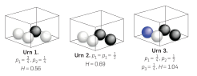
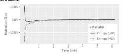
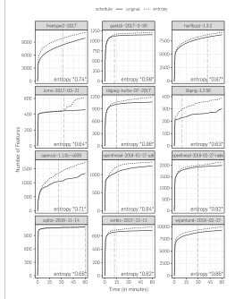
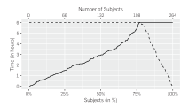
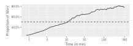
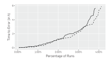
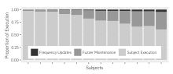

**Source:** *Boosting Fuzzer Efficiency: An Information Theoretic Perspective* — [PDF](https://mboehme.github.io/paper/CACM23-entropic.pdf)

To view the accompanying paper, visit doi.acm.org/10.1145/3611019 **rh**

# **Technical Perspective**

# **What's All the Fuss about Fuzzing?**

By Gordon Fraser

**TESTING PROGRAMS AUTOMATICALLY** is usually done using one of three possible approaches: In the simplest case, we throw random inputs at the program and see what happens. Search-based approaches tend to observe what happens inside the program and use this information to influence the choice of successive inputs. Symbolic approaches try to reason which specific inputs are needed to exercise certain program paths.

After decades of research on each of these approaches, fuzzing has emerged as an effective and successful alternative. Fuzzing consists of feeding random, often invalid, test data to programs in the hope of revealing program crashes, and is usually conducted at scale, with fuzzing campaigns exercising individual programs often for hours. A common classification of fuzzing approaches is between black-box fuzzers that assume no information about the system under test; grey-box fuzzers that inform the generation of new inputs by considering information about past executions such as code coverage; and white-box fuzzers that use symbolic reasoning to generate inputs for specific program paths. At face value, these three approaches to fuzzing appear to be identical to the three established approaches to test generation listed above. So, what's all the fuss about fuzzing?

The fuss about fuzzing becomes clear when picking up any recent fuzzing paper; inevitably, the paper will boast numbers showing how many bugs were found in how many different software systems. This is quite different to more classical test-generation papers, and it demonstrates a different mindset. Competing on such numbers can only be achieved by building robust and flexible tools that work on real systems, and indeed, fuzzers must work well not only on individual systems, but on as many different systems as possible. This requires replacing problematic and inhibiting assumptions, for example, that a test oracle will magically appear, with more pragmatic solutions, such as considering only program crashes as bugs. Clearly, fuzzing has emerged from a practical need and is driven by applications and practitioners.

Traditional test-generation papers appear to put much less focus on building great tools and collecting bugs. That is not to say there are not great test-generation prototypes and tools, but there is a stronger focus on theory and progress quantified using proxy measurements such as code coverage. For example, search-based test-generation approaches build upon evolutionary algorithms, for which we have decades of research, studying and proving various properties of these algorithms on representative and understandable search problems, thus providing a clearer understanding of the complex processes involved while generating tests using search algorithms. Less of this appears to be available for fuzzing, where success is measured in terms of the number of bugs found, and the resulting competition around this. What has counted in fuzzing papers to date are results more than theory explaining how these are achieved.

The following paper presents a novel twist to fuzzing that is shown to increase the central metric of the number of bugs found. A grey-box fuzzer tends to have a set of seed inputs, which are mutated to generate new inputs. Whenever a mutated input covers new aspects of the code, it is added to the seeds. Usually, fuzzers are implemented to prefer seeds added later during the fuzzing process, because intuitively there may be more previously undiscovered program behavior reachable by mutating seeds that have been explored less. This paper introduces an alternative, where the probability of individual seeds being selected for mutation does not depend on the time they were discovered, but rather on how much new program behavior has been discovered so far by mutating them. The more likely a seed is to lead to new program behavior, the more likely that seed is selected for mutation. The more likely new test inputs

discover new program behavior, the

more likely the fuzzer reveals new bugs. How to calculate the probabilities, that is, the "power schedule" for different seeds, is a tricky question, which this paper answers using information theory—the authors define entropy as the average information a generated test input reveals about the resulting coverage of program code. A low entropy for a seed input means mutations of that seed tend to produce similar coverage behavior, while a high entropy signals that mutating the seed input leads to new coverage behavior. Thus, entropy provides not only a means to calculate power schedules, but a more general efficiency measurement for fuzzers. In the tradition of fuzzing research, this is all implemented into a robust fuzzer tool, providing the expected impressive numbers on systems tested and bugs found.

The paper is exciting in that it not only provides an effective algorithmic update to power schedules in grey-box fuzzers, but also a deeper intuitive understanding as to why this works, how it influences behavior during fuzzer campaigns, and a general framework on which to build for future work on fuzzing. Together, these contributions enhance our understanding of fuzzing and will help build more effective test generators, and to answer related questions such as how effective fuzzers are, or when to stop fuzzing campaigns. What makes this paper stand out is that it contributes to linking the viewpoints of traditional test generation and the trendy and seemingly more pragmatic fuzzing approach. Progress on automated testing requires both theory as well as robust tools.

Gordon Fraser is a professor of computer science at the University of Passau, Germany.

Copyright held by author(s)/owner(s).


# Boosting Fuzzer Efficiency: An Information Theoretic Perspective [To view the accompanying Technical Perspective,](https://doi.acm.org/10.1145/3617381) visit doi.acm.org/10.1145/3617381 **tp**

By Marcel Böhme, Valentin J.M. Manès, and Sang Kil Cha

#### **Abstract**

In this paper, we take the fundamental perspective of fuzzing as a learning process. Suppose before fuzzing, we know nothing about the behaviors of a program : What does it do? Executing the first test input, we learn how behaves for this input. Executing the next input, we either observe the same or discover a new behavior. As such, each execution reveals "some amount" of information about 's behaviors. A classic measure of information is Shannon's entropy. Measuring entropy allows us to quantify how much is learned from each generated test input about the behaviors of the program. Within a probabilistic model of fuzzing, we show how entropy also measures fuzzer efficiency. Specifically, it measures the general *rate* at which the fuzzer discovers new behaviors. Intuitively, *efficient fuzzers maximize information*. From this information theoretic perspective, we develop Entropic, an entropy-based power schedule for greybox fuzzing that assigns more energy to seeds that maximize information. We implemented Entropic into the popular greybox fuzzer LibFuzzer. Our experiments with more than 250 open-source programs (60 *million* LoC) demonstrate a substantially improved efficiency and *confirm* our hypothesis that an efficient fuzzer maximizes information. Entropic has been independently evaluated and integrated into the main-line LibFuzzer as the default power schedule. Entropic now runs on more than 25,000 machines fuzzing hundreds of security-critical software systems simultaneously and continuously.

#### **1. INTRODUCTION**

Fuzzing is an automatic software testing technique where the test inputs are generated in a random manner. Due to its efficiency, fuzzing has become one of the most successful vulnerability discovery techniques. For instance, in the three years since its launch, the ClusterFuzz project alone has found about 16,000 bugs in the Chrome browser and about 11,000 bugs in over 160 open-source projects—only by fuzzing.a A fuzzer typically generates random inputs for the program and reports those inputs that crash the program. But, what *is* fuzzer efficiency?

In this paper, we take an information-theoretic perspective and understand fuzzing as a learning process.b We argue that a fuzzer's efficiency is determined by the average *information* that each generated input reveals about the program's behaviors. A classic measure of information is Shannon's entropy.22 If the fuzzer exercises mostly the same few program behaviors, then Shannon's entropy is small, the information content for each input is low, and the fuzzer is not efficient at discovering new behaviors. If however, most fuzzer-generated inputs exercise previously unseen program behaviors, then Shannon's entropy is high and the fuzzer performs much better at discovering new behaviors.

We leverage this insight to develop the first entropybased power schedule for greybox fuzzing. Entropic assigns more energy to seeds revealing more information about the program behaviors. The schedule's objective is to maximize the efficiency of the fuzzer by maximizing entropy. A *greybox fuzzer* generates new inputs by slightly mutating so-called seed inputs. It adds those generated inputs to the corpus of seed inputs which increase code coverage. The *energy* of a seed determines the probability with which the seed is chosen. A seed with more energy is fuzzed more often. A *power schedule* implements a policy to assign energy to the seeds in the seed corpus. Ideally, we want to assign the most energy to those seeds that promise to increase coverage at a maximal rate.

We implemented our entropy-based power schedule into the popular greybox fuzzer LibFuzzer16 and call our extension Entropic. LibFuzzer is a widely-used greybox fuzzer that is responsible for the discovery of several thousand security-critical vulnerabilities in open-source programs. Our experiments with more than 250 open-source programs (60 *million* LoC) demonstrate a substantially improved efficiency and *confirm* our hypothesis that an efficient fuzzer maximizes information.

Since the conference article6 was published, upon which this CACM research highlight is based, Entropic has become the default power schedule in LibFuzzer which powers the largest fuzzing platforms at Google and Microsoft and fuzzes hundreds of security-critical projects, including the Chrome browser, on 100k machines round the clock.

The original version of this paper was published in the *Proceedings of the 28th ACM Joint Meeting on European Software Engineering Conference and Symposium on the Foundations of Software Engineering* (Sacramento, CA, USA, Nov. 2020).

a https://github.com/google/clusterfuzz#trophies.

b As in, learning about the colors in an urn full of colored balls by sampling from it.

In order to stand our information theoretic perspective on solid foundations, we explore a probabilistic model of the fuzzing process. We show how non-deterministic greybox fuzzing can be reduced to a series of non-deterministic blackbox fuzzing campaigns, which allows us to derive the local entropy for each seed and the *current* global entropy for the fuzzer. To efficiently approximate entropy, we introduce several statistical estimators.

Our information-theoretic model explains the performance gains of our entropy-based power schedule for greybox fuzzing. Our schedule assigns more energy to seeds that have a greater local entropy, that is, that promise to reveal more information. However, we also note that this information-theoretic model does not immediately apply to deterministic fuzzers which systematically enumerate all inputs they can generate or whitebox fuzzers which systematically enumerate all (interesting) paths they can explore. For our probabilistic model to apply, the fuzzer should generate inputs in a random manner (with replacement). If a deterministic phase is followed by a non-deterministic phase (for example, in the default configuration of the AFL, American Fuzzy Lop, greybox fuzzer), we can compute Shannon's entropy only for the non-deterministic phase.

*In summary*, our work makes the following contributions:

- We develop an information-theoretic foundation for non-deterministic fuzzing which studies the average information each test reveals about a program's behaviors. We formally link Shannon's entropy to a fuzzer's behavior discovery rate, that is, we establish efficiency as an information-theoretic quantity.
- We present the first entropy-based power schedule to boost the efficiency of greybox fuzzers. We provide an open-source implementation, called Entropic, and present a substantial empirical evaluation on over 250 widely-used, open-source C/C++ programs producing over 2 CPU years worth of data (scripts and data available at https://doi.org/10.6084/m9.figshare.12415622.v2).

#### 2. PROBABILISTIC BLACKBOX FUZZING

Fuzzing is an automatic software testing technique where the test inputs are generated in a random manner. Based on the granularity of the runtime information that is available to the fuzzer, we can distinguish three fuzzing approaches. A *blackbox fuzzer* does not observe or react to any runtime information. A *greybox fuzzer* leverages coverage or other feedback from the program's execution to dynamically steer the fuzzer. A *whitebox fuzzer* has a perfect view of the execution of an input. For instance, symbolic execution enumerates interesting program paths.

Non-deterministic blackbox fuzzing lends itself to probabilistic modeling because of the small number of assumptions about the fuzzing process. Unlike greybox fuzzing, blackbox fuzzing is not subject to adaptive bias. We adopt the recently proposed Software Testing As Species Discovery

of Species (STADS) probabilistic model for non-deterministic blackbox fuzzing<sup>3</sup>: Each generated input can belong to one or more species. Beyond the probabilistic model, STADS provides biostatistical estimators, for example, to estimate, after several hours of fuzzing, the probability of discovering a new species or the total number of species.

#### 2.1. Software testing as discovery of species

Let  $\mathcal{P}$  be the program that we wish to fuzz. We call as  $\mathcal{P}$ 's *input space*  $\mathcal{D}$  the set of all inputs that  $\mathcal{P}$  can take in. The fuzzing of  $\mathcal{P}$  is a stochastic process

$$\mathcal{F} = \left\{ X_n \, \middle| \, X_n \in \mathcal{D} \right\}_{n=1}^N \tag{1}$$

of sampling N inputs with replacement from the program's input space. We call  $\mathcal{F}$  as fuzzing campaign and a tool that performs  $\mathcal{F}$  as a non-deterministic blackbox fuzzer.

Suppose, we can subdivide the search space  $\mathcal{D}$  into S individual subdomains  $\{\mathcal{D}_i\}_{i=1}^S$  called *species*.<sup>3</sup> An input  $X_n \in \mathcal{F}$  is said to *discover* species  $\mathcal{D}_i$  if  $X_n \in \mathcal{D}_i$  and there does not exist a previously sampled input  $X_m \in \mathcal{F}$  such that m < n and  $X_m \in \mathcal{D}_i$  (that is,  $\mathcal{D}_i$  is sampled for the first time). An *input's species* is defined based on the dynamic program properties of the input's execution. For instance, each branch that is exercised by input  $X_n \in \mathcal{D}$  can be identified as a species. The discovery of the new species then corresponds to an increase in branch coverage.

**Global species discovery.** We let  $p_i$  be the probability that the n-th generated input  $X_n$  belongs to species  $\mathcal{D}_i$ ,  $p_i = P[X_n \in \mathcal{D}_i]$  for  $i: 1 \le i \le S$  and  $n: 1 \le n \le N$ . We call  $\{p_i\}_{i=1}^{S^i}$  the fuzzer's global species distribution. The expected number of discovered species  $S(n) = S - \sum_{i=1}^{S} (1 - p_i)^n$ . The discovery rate  $\Delta(n)$ , S that is, the expected number of species discovered with the S-th S-th S-th S-th S-th S-th S-th S-th S-th S-th S-th S-th S-th S-th S-th S-th S-th S-th S-th S-th S-th S-th S-th S-th S-th S-th S-th S-th S-th S-th S-th S-th S-th S-th S-th S-th S-th S-th S-th S-th S-th S-th S-th S-th S-th S-th S-th S-th S-th S-th S-th S-th S-th S-th S-th S-th S-th S-th S-th S-th S-th S-th S-th S-th S-th S-th S-th S-th S-th S-th S-th S-th S-th S-th S-th S-th S-th S-th S-th S-th S-th S-th S-th S-th S-th S-th S-th S-th S-th S-th S-th S-th S-th S-th S-th S-th S-th S-th S-th S-th S-th S-th S-th S-th S-th S-th S-th S-th S-th S-th S-th S-th S-th S-th S-th S-th S-th S-th S-th S-th S-th S-th S-th S-th S-th S-th S-th S-th S-th S-th S-th S-th S-th S-th S-th S-th S-th S-th S-th S-th S-th S-th S-th S-th S-th S-th S-th S-th S-th S-th S-th S-th S-th S-th S-th S-th S-th S-th S-th S-th S-th S-th S-th S-th S-th S-th S-th S-th S-th S-th S-th S-th S-th S-th S-th S-th S-th S-th S-th S-th S-th S-th S-th S-th S-th S-th S-th S-th S-th S-th S-th S-th S-th S-th S-th S-th S-th S-th S-th S-th S-th S-th S-th S-th S-th S-th S-th S-th S-th S-th S-th S-th S-th S-th S-th S-th S-th S-th S-th S-th S-th S-th S-th S-th S-th S-th S-th S-th S-th

**Mutation-based blackbox fuzzing.** We extend the STADS framework with a model for mutation-based fuzzing. Let  $\mathcal{C}$  be a set of seed inputs, called the seed corpus and  $q_t$  be the probability that the fuzzer chooses the seed  $t \in \mathcal{C}$ . For each seed t, let  $\mathcal{D}^t$  be the set of all inputs that can be generated by applying the available mutation operators to t. The mutational fuzzing of t is a stochastic process

$$\mathcal{F}^t = \left\{ X_n^t \mid X_n^t \in \mathcal{D}^t \right\}_{n=1}^{N^t} \tag{2}$$

of sampling  $N^t$  inputs with replacement by random mutation of the seed t. We call all species that can be found by fuzzing a seed t as the species in t's neighborhood.

**Local species discovery.** We let  $p_i^t$  be the probability that the n-th input  $X_n^t$  which is generated by mutating the seed  $t \in \mathcal{C}$  belongs to species  $\mathcal{D}_i$ ,  $p_i^t = P[X_n^t \in \mathcal{D}_i]$  for  $i: 1 \le i \le S$  and  $n: 1 \le n \le N$ . We call  $\left\{p_i^t\right\}_{i=1}^t$  the local species distribution in the neighborhood of the seed t. For a locally unreachable species  $\mathcal{D}_j$ , we have  $p_j^t = 0$ . The discovery rate  $\Delta(n)$ , that is, the expected number of species discovered with the (n+1)-th generated test input is defined as  $\Delta(n) = S(n+1) - S(n)$ .

c Unlike for a blackbox fuzzer, for a greybox fuzzer the probability to observe certain program behaviors during fuzzing changes as new seeds are added to the corpus.

d This probability is also called the seed's energy, weight, or  $perf\_score$  (AFL).

#### 3. INFORMATION THEORY OF FUZZING

We provide an information-theoretic foundation for nondeterministic blackbox fuzzing. In the context of fuzzing, Shannon's entropy H has several interpretations. It quantifies the average information a generated test input reveals about the behaviors (that is, species) of the program. Alternatively, we say, a generated test input reduces our uncertainty by H information units (for example, nats or bits), on average. Entropy also gives the minimum number of information units needed to reliably store the entire set of behaviors the fuzzer is capable of testing. Moreover, entropy is a measure of diversity. Low entropy means that the program does either not exhibit many behaviors or most generated inputs test the same behaviors (that is, belong to an abundant species).

#### 3.1. Information theory in a nutshell

Shannon's entropy  $H^{22}$  measures the average amount of information in each sample  $X_n \in \mathcal{F}$  about the species that can be observed by executing the program  $\mathcal{P}$ . When there are S distinct species, the entropy H is:

$$H = -\sum_{i=1}^{S} p_i \log(p_i).$$
 (3)

Figure 1 illustrates the concept informally. Each color represents a different species. We learn about the colors in each urn by sampling. Just how much we learn from each sampling differs from urn to urn. For instance, in Urn 1 it is three times more likely to draw a white ball than a black. It takes more attempts to learn about black balls in Urn 1 compared to Urn 2. Hence, we expect less information about the urn's colors in a draw from Urn 1. In fact, given the same number of colors S, the entropy is maximal when all colors are equiprobable  $p_1 = ... = p_s$ . Among the three urns, we expect to get the maximal amount of information about the urn's colors by drawing from Urn 3. Even though there is still a dominating color (black), there is now an additional color (blue) that can be discovered.

#### 3.2. If each input belongs to multiple species

Shannon's entropy is defined for the multinomial distribution where each input belongs to exactly one species (for example, exercise exactly one path). However, an input can belong to several species so that  $\sum_{i=1}^{s} p_i \ge 1$ . For instance, considering a branch in  $\mathcal{P}$  as a species, each input exercises multiple branches. The top-level branch is exercised with probability one. When it is possible that  $\sum_{i=1}^{s} p_i \ge 1$ , Chao et al. 11 and Yoo et al. 25 suggest to normalize the probabilities

Figure 1. Learning colors by sampling with replacement.



and compute  $H = -\sum_{i=1}^{s} p_i' \log(p_i')$ , such that  $p_i' = p_i / \sum_{j=1}^{s} p_j$ . This normalization maintains the fundamental properties of information based on which Shannon developed his formula, that is, that information due to independent events is additive, that information is a non-negative quantity, etcetera. The normalized entropy H is computed as

$$H = -\sum_{i=1}^{s} p_i' \log(p_i') = \log\left(\sum_{j=1}^{s} p_j\right) - \frac{\sum_{i=1}^{s} p_i \log(p_i)}{\sum_{j=1}^{s} p_j}$$
(4)

We note that Equation (4) reduces to Equation (3) for the special case where  $\sum_{j=1}^{s} p_j = 1$ . We also note that the resulting quantity is technically *not* the average information per input.

### 3.3. The Local Entropy of a Seed

Recall from Section 2.1, that we call the probabilities  $\left\{p_i^t\right\}_{i=1}^s$ that fuzzing a seed  $t \in \mathcal{C}$  generates an input that belongs to species  $\mathcal{D}_i$  as the *local species distribution* of t. Moreover, we call the set of species  $\{\mathcal{D}_i \mid p_i^t > 0 \land 1 \le i \le S\}$  as the *neighborhood* of the seed t. From the local species distribution of t, we can compute the *local entropy*  $H^t$  of t as a straight-forward application of Equation 4,

$$H^{t} = \log\left(\sum_{j=1}^{s} p_{j}^{t}\right) - \frac{\sum_{i=1}^{s} p_{i}^{t} \log\left(p_{i}^{t}\right)}{\sum_{j=1}^{s} p_{j}^{t}}.$$
 (5)

The local entropy  $H^t$  of t quantifies the information that fuzzing *t* reveals about the species in *t*'s neighborhood.

#### 3.4. Information-theoretic efficiency measure

Intuitively, the rate at which we learn about program behaviors, that is, the species in the program, also quantifies a blackbox fuzzer's efficiency. We formally demonstrate how Shannon's entropy H characterizes the general discovery rate  $\Delta(n)$  as follows.

THEOREM 1. Let Shannon's entropy be defined as in Equation (4). Let  $\Delta(n)$  be the expected number of new species the fuzzer discovers with the (n+1)-th generated test input, then

$$H = \log(c) + \sum_{n=1}^{\infty} \frac{\Delta(n)}{cn}$$
 (6)

characterizes the rate at which species are discovered in an infinitely long-running campaign, where  $c = \sum_{j=1}^{s} p_j$  is a normalizing constant.

PROOF. We refer to the extended version.6 

According to Theorem 1, entropy measures the species discovery rate  $\Delta(n)$  over an infinitely long-running fuzzing campaign where discovery is gradually discounted as the number of executed tests n goes to infinity. Notice that  $\Delta(n) \ge 0$  for all  $n \ge 0$ . If we simply took the sum of  $\Delta(n)$ over all n, we would compute the total number of species  $S = \sum_{n=1}^{\infty} \Delta(n)$ . However, S provides no insight into the *effi*ciency of the discovery process. Instead, the diminishing factor 1/n in Equation (6) reduces the contribution of species discovery as testing effort *n* increases. The number of species discovered at the beginning of the campaign has a higher contribution to H than the number of species discovered later. In other words, a shorter "ramp up" time yields a higher entropy.

**Estimation**. We estimate Shannon's entropy *H* based on how often we have seen each observed species. The incidence frequency Y, for species  $\mathcal{D}$ , is the number of generated test inputs that belong to  $\mathcal{D}_i$ . Undetected species yield  $Y_i = 0$ . An unbiased estimator of the local discovery probability  $p_i$ is  $\hat{p}_i = Y_i / n$ , where n is the total number of generated test inputs. By plugging  $\hat{p}_i$  into Equation (4), we can estimate the entropy *H* using *maximum likelihood estimation* (MLE). In our model, the estimated entropy  $\hat{H}_{\text{MLE}}$  of H is

$$\hat{H}_{\text{MLE}} = \log \left( \sum_{j=1}^{S} Y_j \right) - \frac{\sum_{i=1}^{S} Y_i \log(Y_i)}{\sum_{j=1}^{S} Y_j}$$
 (7)

where we assume that  $\sum_{j=1}^{s} Y_j > 0$ . **Greybox**. Now, non-deterministic blackbox fuzzing satisfies the assumption that the global species distribution  $\{p_i\}_{i=1}^{s}$  is invariant during the campaign. However, this assumption does not hold for greybox fuzzing which leverages program feedback. Generated inputs that have discovered new species (that is, increased coverage) are added to the corpus. The availability of added seeds changes the global species distribution (but not the local distributions for each seed) and thus the global entropy for a greybox fuzzer. In other words, a greybox fuzzer becomes more efficient over time. We refer to the longer conference version<sup>6</sup> for a discussion of the required extension of the probabilistic model to estimate global entropy for greybox fuzzing.

#### **Algorithm 1** Entropic Algorithm.

```
Input: Program \mathcal{P}, Initial Seed Corpus \mathcal{C}
      1: while ¬TIMEOUT() do
                                   for all t \in C. AssignEnergy(t) // power schedule
      2:
                                  \begin{aligned} total &= \Sigma_{t \in \mathcal{C}} \ t.energy \\ \textbf{for all} \ t &\in \mathcal{C}. \ t.energy = \frac{t.energy}{total} \end{aligned}
                                                                                                                                                                                                              // normalizing constant
      3:
      4:
                                                                                                                                                                                                           // normalized energy
                                  terminate the continuous formula to the form the continuous terminate the terminate that the continuous formula to the continuous formula to the continuous formula to the continuous formula to the continuous formula to the continuous formula to the continuous formula to the continuous formula to the continuous formula to the continuous formula to the continuous formula to the continuous formula to the continuous formula to the continuous formula to the continuous formula to the continuous formula to the continuous formula to the continuous formula to the continuous formula to the continuous formula to the continuous formula to the continuous formula to the continuous formula to the continuous formula to the continuous formula to the continuous formula to the continuous formula to the continuous formula to the continuous formula to the continuous formula to the continuous formula to the continuous formula to the continuous formula to the continuous formula to the continuous formula to the continuous formula to the continuous formula to the continuous formula to the continuous formula to the continuous formula to the continuous formula to the continuous formula to the continuous formula to the continuous formula to the continuous formula to the continuous formula to the continuous formula to the continuous formula to the continuous formula to the continuous formula to the continuous formula to the continuous formula to the continuous formula to the continuous formula to the continuous formula to the continuous formula to the continuous formula to the continuous formula to the continuous formula to the continuous formula to the continuous formula to the continuous formula to the continuous formula to the continuous formula to the continuous formula to the continuous formula to the continuous formula to the continuous formula to the continuous formula to the continuous formula to the continuous formula to the continuous formula to the continuous formula to the continuous formula to the continuous formula to the co
      5:
                                  t' = MUTATE(t)
                                                                                                                                                                                                              // fuzzing
      6:
                                  if \mathcal{P}(t') crashes then return crashing seed t'
      7:
                                  else if \mathcal{P}(t') increases coverage then add t' to \mathcal{C}
      8:
                                   for all covered elements i \in \mathcal{P} exercised by t' do
      9:
                                                                                                                                                                                                        // local incidence freq.
10:
                                                     Y_i^t = Y_i^t + 1
                                    end for
11:
12: end while
\operatorname{return} Augmented Seed Corpus \mathcal C
```

## 4. INFORMATION THEORETIC BOOSTING

We present an entropy-based boosting strategy for greybox fuzzing that maximizes the information each generated input reveals about the species (that is, behaviors) in a program. Our technique ENTROPIC is implemented into the popular greybox fuzzer LibFuzzer,16 which is responsible for at least 12,000 bugs reported in security-critical opensource projects and more than 16,000 bugs reported in the Chrome browser.20 After a successful independent evaluation of Entropic by Google, our entropy-based power

schedule has been integrated into the main-line LIBFUZZER and made the default power schedule.

#### 4.1. Overview of entropic

A greybox fuzzer starts with a corpus of seed inputs and continuously fuzzes these by applying random mutations. Generated inputs that increase coverage are added to the corpus. The probability (that is, frequency) with which a seed is chosen for fuzzing is called the seed's *energy*. The procedure that assigns energy to a seed is called the fuzzer's power schedule. For instance, LIBFUZZER's standard schedule assigns more energy to seeds that were found later in the fuzzing campaign. It is this power schedule that we modify.

Algorithm 1 shows how greybox fuzzing is implemented in Libfuzzer; our changes for Entropic are shown as green boxes. In a continuous loop, the fuzzer samples a seed  $t \in \mathcal{C}$  from a distribution that is given by the seeds' normalized energy. This energy is computed using ASSIGNEN-ERGY which implements one of our information-theoretic power schedules. The seed t is then mutated using random bit flips and other mutation operators to generate an input t'. If the execution crashes or terminates unexpectedly, for example, due to limits on execution time, memory usage, or sanitizers, 21 t' is returned as crashing input, and LIBFUZZER stops. If the execution increases coverage, t' is added to the corpus. We call the number of inputs generated by fuzzing a seed  $t \in \mathcal{C}$  and that belongs to species  $\mathcal{D}_t$ as local incidence frequency  $Y_i^t$ .

### 4.2. Entropy-based power schedule

Our entropy-based schedule assigns more energy to seeds that elicit more information about the program's species. In other words, the fuzzer spends more time fuzzing seeds which lead to the more efficient discovery of new behaviors. The amount of information about the species in the neighborhood of a seed t that we expect for each generated test input is measured using the seed's local entropy  $H^t$ .

The entropy-based power schedule is inspired by Active Simultaneous Localization And Mapping (SLAM),<sup>10</sup> a problem in robot mapping: An autonomous robot is placed in an unknown terrain; the objective is to learn the map of the terrain as quickly as possible. General approaches approximate Shannon's entropy of the map under hypothetical actions.<sup>8,10</sup> The next move is chosen such that the reduction in uncertainty is maximized. Similarly, our schedule chooses the next seed such that the information about the program's species is maximized.

Improved estimator. During our experiments, we quickly noticed that the maximum likelihood estimator  $\hat{H}_{\text{MLE}}$  in Equation (7) cannot be used. A new seed t that has never been fuzzed will always be assigned zero energy  $\hat{H}_{\text{MLE}}^t = 0$ . Hence, it would never be chosen for fuzzing and forever remain with zero energy. We experimented with a screening phase to compute a rough estimate. Each new seed was first fuzzed for a fixed number of times. However, we found that too much energy was wasted gaining statistical power that could have otherwise been spent discovering more species.

To overcome this challenge we took a Bayesian approach. We know that entropy is maximal when all probabilities are equal. For a new seed t, we assume an uninformative prior for the probabilities  $p_i^t$ , that is,  $p_1^t = ... = p_S^t$ , where  $p_i^t$  is the probability that fuzzing t generates an input that belongs to species  $\mathcal{D}_{t}$ . With each input that is generated by fuzzing t, the probabilities are incrementally updated. The posterior is a Beta distribution over  $p_i^t$ . The estimate  $\hat{p}_i^t$  of  $p_i^t$  is thus the mean of this beta distribution which is also known as the Laplace estimator (LAP) or add-one smoothing,

$$\hat{p}_{i}^{t} = \frac{Y_{i}^{t} + 1}{S_{g} + \sum_{j=1}^{S} Y_{j}^{t}}$$
 (8)

where  $S_g = S(n)$  is the number of globally discovered species. We define the improved entropy estimator  $\hat{H}_{\text{LAP}}^t(\text{LAP})$  as

$$\hat{H}_{\text{LAP}}^{t} = \log \left( S_g + \sum_{j=1}^{s} Y_j \right) - \frac{\sum_{i=1}^{s} (Y_i + 1) \log(Y_i + 1)}{S_g + \sum_{i=1}^{s} Y_j}$$

Figure 2 illustrates the main idea. Both estimators are nearly unbiased from two hours onwards. In other words, they are within 1% from the true value, that is,  $\hat{H}_{X}^{t} \in H^{t} \pm 1\%$ . In the beginning, the MLE is negatively biased and approaches the true value from below while the LAP is positively biased and approaches the true value from above. Both estimators robustly estimate the same quantity, but only LAP assigns high energy when seed t has not been fuzzed enough for an accurate estimate of the seed's information  $H^t$ .

Measuring information only about rare species. During our initial experiments, we also noticed that the entropy estimates for different seeds were almost the same. We found that the reason is a small number of very abundant species which have a huge impact on the entropy estimate. There are some abundant species to which each and every generated input belongs. Hence, we defined a global abundance threshold  $\theta$  and only maintain local incidence frequencies  $Y_i^t$  of globally rare species  $\mathcal{D}_i$  that have a global incidence frequency  $Y_i \le \theta$ . Intuitively, rare species are the ones creating new behaviors. We refer to the extended version<sup>6</sup> for an

Figure 2. Mean estimator bias over time. We monitored estimates for the same seed t over 6h across 20 runs. Estimator bias is the difference between the mean estimate and the true value  $H^t$  divided by the true value  $H^t$ , where  $H^t$  is the average of both mean estimates at 6 hours.



evaluation of the sensitivity of the boosting technique on the abundance threshold  $\theta$ .

#### 5. EXPERIMENTAL EVALUATION

#### 5.1. Research questions

Our main hypothesis is that increasing information per generated input increases fuzzer efficiency. To evaluate our hypothesis, we ask the following research questions.

**RQ.1** What is the coverage improvement over the baseline? **RQ.2** How much faster are bugs detected vs to the baseline? **RQ.3** What is the cost of maintaining incidence frequencies?

### 5.2. Setup and infrastructure

Implementation and baseline. We implemented our entropy-based power schedule into LibFuzzer (363 lines of change) and call our extension as ENTROPIC. LIBFUZZER is a state-of-the-art vulnerability discovery tool developed at [blinded] which has found almost 30k bugs in hundreds of closed- and open-source projects.

As a coverage-based greybox fuzzer (see Alg. 1), LIB-FUZZER seeks to maximize code coverage. Hence, our species is a coverage element, called a feature. A feature is a combination of the branch covered and hit count. For instance, two inputs (exercising the same branches) have a different feature set if one exercises a branch more often. Hence, feature coverage subsumes branch coverage. In contrast to LIBFUZZER, ENTROPIC also maintains the local and global incidence frequencies for each feature. We study the performance hit in RQ3.

\* Our extension Entropic has been independently evaluated by the company that is developing LibFuzzer and was found to improve on Libfuzzer with statistical significance. Entropic was integrated into the main-line Libfuzzer and is currently subject to public code review. Once integrated, Entropic is poised to run on more than 25,000 machines fuzzing hundreds of security-critical software systems simultaneously and continuously.

Benchmark subjects. We compare Entropic with LIBFUZZER on two benchmarks containing 250+ opensource programs used in many different domains, including browsers. We conducted almost 1000 one-hour fuzzing campaigns and 2,000 six-hour campaigns to generate almost two CPU years' worth of data.

FTS<sup>f</sup> (12 programs, 1.2M LoC, 1 hour, 40 repetitions) is a standard set of real-world programs to evaluate fuzzer performance. The subjects are widely-used implementations of file parsers, protocols, and databases (for example, libpng, openssl, and sqlite), amongst others. Each subject contains at least one known vulnerability (CVE), some of which require weeks to be found. The Fuzzer Test Suite (FTS) allows to compare the coverage achieved as well as the time to find the first crash on the provided subjects. There are originally 25 subjects, but we removed those programs where more than 15% of runs crashed (leaving 12 programs with 1.2M LoC). As LIBFUZZER aborts when the first crash is found, the coverage results for those subjects

In contrast to global entropy H, local entropy  $H^t$  is not subject to any adaptive bias.

f https://github.com/google/fuzzer-test-suite.

would be unreliable. We set an 8GB memory limit and ran LibFuzzer for *1 hour*. To gain statistical power, we repeated each experiment *40 times*. This required 40 CPU days.

**OSS-Fuzz**<sup>g</sup> (*263 programs, 58.3M LoC, 6 hours, 4 repetitions*) is an open-source fuzzing platform developed by Google for the large-scale continuous fuzzing of securitycritical software. At the time of writing, OSS-Fuzz featured 1326 executable programs in 176 open-source projects. We selected 263 programs totaling 58.3 *million* lines of code by choosing subjects that did not crash or reach the saturation point in the first few minutes and that generated more than 1000 executions per second. Even for the chosen subjects, we noticed that the initial seed corpora provided by the project are often for saturation: Feature discovery has effectively stopped shortly after the beginning of the campaign. It does not give much room for further discovery. Hence, we removed all initial seed corporates. We ran LibFuzzer for all programs for 6 hours and, given a large number of subjects, repeated each experiment four times. This required 526 CPU days.

**Computational resources.** All experiments for *FTS* were conducted on a machine with Intel(R) Xeon(R) Platinum 8170 2.10GHz CPUs with 104 cores and 126GB of main memory. All experiments for OSS-Fuzz were conducted on a machine with Intel(R) Xeon(R) CPU E5–2699 v4 2.20GHz with a total of 88 cores and 504GB of main memory. To ensure a fair comparison, we always ran all schedules simultaneously (same workload), each schedule was bound to one (hyperthread) core, and 20% of cores were left unused to avoid interference. In total, our experiments took more than *2 CPU years* which amounts to more than two weeks of wall clock time.

**Setup for Figure 2.** Throughout the paper, we reported on the results of small experiments. In all cases when not otherwise specified, we used LibFuzzer with the original power schedule to fuzz the LibPNG project from the fuzzertest-suite (FTS) started with a single seed input. For Figure 2, we conducted 20 runs of 6 hours and monitored the single seed input that we started LibFuzzer with. We printed all four estimates in regular intervals.

#### **RQ1.1. Code Coverage on FTS**

*Empirical results* confirm *our hypothesis that increasing the average information each generated input reveals about the program's species increases the rate at which new species are discovered. By choosing the seed that reveals more information, efficiency is improved*.

Figure 3 shows the mean coverage over time and the Vargha-Delaney2 effect size . Values above 0.56, 0.63, and 0.71 indicate a small, medium, and large effect size, respectively. More intuitively, the values indicate how much more likely it is for an Entropic run to cover more features than a LibFuzzer run (or less likely if under 0.5). Values in stars ( ) indicate statistical significance (Wilcoxon rank-sum test; *p* < 0.05). For instance, for vorbis-2017-12-11 Entropic

**Figure 3. Mean coverage in a 60-min fuzzing campaign (12 subjects × 2 schedules × 40 runs × 1 hour** ≈ **40 CPU days). The dashed, vertical lines show when Entropic achieves the same coverage as LibFuzzer in 1 hour. The values at the bottom right give the Vargha-Delaney effect size** *A***̂ 12.**



(with our entropy-based schedule) covers about 700 features in under 15 min while LibFuzzer (with the original schedule) takes one hour.

Entropic substantially outperforms LibFuzzer within the one-hour time budget for 9 of 12 subjects. For two out of three cases where the effect size is considered medium, the mean difference in feature coverage is substantial (30% and 80% *increase* for libpng and openssl-1.1.0c, resp.). In almost all cases, Entropic is more than twice as fast (2x) as LibFuzzer. The same coverage that LibFuzzer achieves in one hour, Entropic can achieve in less than 30 min. All differences are statistically significant. The coverage trajectories seem to indicate that the benefit of our entropy schedule becomes even more pronounced for longer campaigns. We increase the campaign length to 6*h* for our experiments with OSS-Fuzz (RQ2).

#### **RQ1.2. Large Scale Validation on OSS-Fuzz**

*Results for 263 open-source C/C++ projects validate our empirical findings*. Entropic *generally achieves more coverage than* LibFuzzer. *The coverage increase is larger than 10% for a quarter of programs*. Entropic *is more than twice as fast as* LibFuzzer *for half the programs. The efficiency boost increases with the length of the campaign*.

g https://github.com/google/oss-fuzz

Figure 4(a) shows the mean coverage increase of Entropic over LibFuzzer on a logarithmic scale over *all* 263 subjects. The dashed line represents the coverage increase of LibFuzzer over Entropic for the cases when LibFuzzer achieves more coverage. We can see that Entropic achieves more coverage than LibFuzzer after six hours of fuzzing for about 77% of subjects. Entropic covers at least 10% more features than LibFuzzer for about 25% of subjects. We investigated more closely the 23% of the subjects where Entropic achieves less coverage. First, for half of them, the coverage difference was marginal (less than 2%). Second, these subjects were much larger (twice the number of branches on average). As we will see in RQ3 that the performance overhead incurred by Entropic grows linearly with the number of branches.

Figure 4(b) shows how much faster Entropic is in achieving the coverage that LibFuzzer achieves in six hours. Again, the dashed line shows the inverse when LibFuzzer achieves more coverage at the six-hour mark. We can see that Entropic achieves the same coverage twice as fast for about 50% of subjects and four times as fast

**Figure 4. OSS-Fuzz coverage results (263 subjects × 2 schedules × 4 runs × 6 hours** ≈ **1.5 CPU years).** 



(a) Mean coverage increase. For *X%* of subjects, ENTROPIC achieves at least *Y%* more coverage than LIBFUZZER



(b) Time to Coverage. For *X%* of subjects, ENTROPIC achieves the same coverage in *Y* hours, that LIBFUZZER achieves in 6 hours (solid line).



(c) Entropic gets better at achieving coverage. After *X* seconds of fuzzing, ENTROPIC achieves more coverage than LIBFUZZER for *Y%* of the 263 subjects.

for 25% of subjects. More specifically, Entropic achieves the same coverage in 1.5h as LibFuzzer achieves in 6h for 66 subjects.

Figure 4(c) shows the proportion of subjects where Entropic achieves more coverage than LibFuzzer (that is, wins) over time. Both fuzzers break even at about 10 min. After 30 min, Entropic already wins for 64% of subjects, until at 6 hours, Entropic wins for about 77% of subjects. We interpret this result as Entropic becoming more effective at boosting LibFuzzer as saturation is being approached. At the beginning of the campaign, almost every new input leads to species discovery. Later in the fuzzing campaign, it becomes more important to choose highentropic seeds. Moreover, estimator bias is reduced when more inputs have been generated.

### **RQ2. Crash Detection**

*In the OSS-Fuzz benchmark,* Entropic *found most crashes faster than* LibFuzzer. *Some crashes were found only by* Entropic. *These crashes are potential zero-day vulnerabilities in widely-used security-critical open-source libraries*.

Figure 5 shows the time it takes to find each crash as an aggregate statistic in ascending order overall crashes that have been discovered in any of the four runs of all subjects for both fuzzers. For instance, for 2.5% of 263 × 4 runs, Entropic finds a crash in 1.5 hours or less while LibFuzzer takes two hours or less. The crashes are real and potentially exploitable. All subjects are security-critical and widely used. Google maintains a responsible disclosure policy for bugs found by OSS-Fuzz. This gives maintainers some time to patch the crash before the bug report is made public. Three bugs are discovered only by Entropic.

**Figure 5. OSS-Fuzz crash Time-To-Error results (**≈ **1.5 CPU years).**  *X***% of runs crashed in** *Y* **hours or less. Entropic (dashed) and LibFuzzer (solid). Lower is better.**



**Figure 6. Entropic instrumentation overhead.**



### **RQ3. Performance Overhead**

*In the FTS benchmark, there is a 2% median overhead for maintaining incidence frequencies compared to the entire fuzzing process. There is a 12% median overhead compared to the time spent only in the fuzzer (not in the subject)*.

Figure 6 shows the proportion of the time that Entropic spends in the different phases of the fuzzing process. In all cases, the most time is spent executing the subject (bright gray). Entropic executes the subject between 10,000 and 100,000 times per second. The remainder of the time is spent in the fuzzer, where the darker gray bars represent functions that LibFuzzer normally performs while the black bars represent the overhead brought by Entropic.

The maintenance of incidence frequencies takes more time away from the fuzzing process than we expected, given the substantial performance gains discussed in RQ1 and RQ2. Note that Entropic outperforms LibFuzzer *despite* this additional overhead. Entropic is a prototype. We are confident that there are plenty of opportunities to reduce this overhead to further boost Entropic's efficiency.

#### **6. THREATS TO VALIDITY**

Like for any empirical study, there are threats to the validity of our results. We adopted several strategies to increase *internal validity*. In order to put no fuzzer at a disadvantage, we used default configurations, provided the exact same starting condition, and executed each technique several times and under the same workload. The time when the fuzzer crashes identify unambiguously when a bug is found. To define species in our experiments, we use the natural measure of progress for LibFuzzer and its extension Entropic. To mitigate threats to *construct validity* such as bugs in Entropic or observed performance differences that are *not* due to our discussed improvements, we extended the baseline LibFuzzer using a readily comprehensible 363 lines of code. We adopted several strategies to increase *external validity*. We repeated all experiments from which we derive empirical statements (RQ1, RQ2, RQ3) at least 40 times. To increase the generality of our results, we conducted experiments on OSS-Fuzz totaling 263 C/C++ programs and 58.3 *million* LoC.

For a sound statistical analysis, we followed the recommendations of Arcuri et al.2 and Klees et al.15 to the extent to which our computational resources permitted.

#### **7. RELATED WORK**

Information theory has previously found application in *software test selection*. Given a test suite *T* and the probability *p*(*t*) that test case *t* Î *T* fails, one may seek to minimize the number of test cases *t* Î *T* to execute while maximizing the information that executing *t* would reveal about the program's correctness. Yang et al.23, 24 give several strategies to select a test case *t*′ Î *T* (or a size-limited set of test cases *T*′ Í *T*) such that—if we were to execute *t*′ (or *T*′)—the uncertainty about test case failure (that is, entropy) is *minimized*. Unlike our model, the model of Yang et al. requires specifying for each input the expected output as well as the probability of failure (that is, the observed not matching the expected output). Hence, Yang's model is practical only in the context of test selection, but not in the context of automated test generation. Similarly, Feldt et al.12 propose an information-theoretic approach to measure the distance between test cases, based on Kolmogorov complexity and uses it to maximize the diversity of selected tests. Although their idea is complementary to ours, it is computationally too expensive to be directly applied to test generation. Finally, by considering fuzzing as a random process in a multidimensional space, Ankou18 enables the detection of a different *combination* of species in fuzzers' fitness function.

Information theory has also found application in *software fault localization*. Given a *failing* test suite *T*, suppose we want to localize the faulty statement as quickly as possible. Yoo, Harmann, and Clark25 discuss an approach to execute test cases in the order of how much information they reveal about the fault location. Specifically, test cases—which most reduce the uncertainty that a statement *is* the fault location—will be executed first. Campos et al.9 propose a search-based test generation technique with a fitness function that maximizes the information about the fault location. In contrast, our objective is to quantify and maximize the *efficiency* of the test generation process in learning about the program's behaviors (incl. whether or not it contains faults).

Bug finding efficiency and scalability are important properties of a fuzzing campaign. Böhme and Paul7 conduct a probabilistic analysis of the efficiency of blackbox versus whitebox fuzzing, and provide concrete bounds on the time a whitebox fuzzer can take per test input in order to remain more efficient than a blackbox fuzzer. Böhme and Falk4 empirically investigate the scalability of nondeterministic black- and greybox fuzzing and postulate an exponential cost of vulnerability discovery. Specifically, they make the following counter-intuitive observation: Finding the same bugs linearly faster requires linearly more machines. Yet, finding linearly more bugs at the same time requires exponentially more machines. For recent improvements to fuzzing, we refer to Manès et al.17

Alshahwan and Harman1 introduced the concept of "output uniqueness" as (blackbox) coverage criterion, where one test suite is considered as more effective than another if it elicits a larger number of unique program outputs. This blackbox criterion turns out to be similarly effective as whitebox criteria (such as code coverage) in assessing test suite effectiveness. In our conceptual framework, a unique output might be considered as a species.

#### **8. CONCLUSION**

In this paper, we presented Entropic, the first greybox fuzzer that leverages Shannon's entropy for scheduling seeds. The key intuition behind our approach is to prefer seeds that reveal more information about the program under test. Our extensive empirical study confirms that our information-theoretic approach indeed helps in boosting fuzzing performance in terms of both code coverage and bug-finding ability.

**Information theory.** We formally link entropy (as a measure of information) to fuzzer efficiency, develop estimators, and boosting techniques for greybox fuzzing that maximize information, and empirically investigate the resulting improvement of fuzzer efficiency. We extend the STADS statistical framework3 to incorporate mutationbased blackbox fuzzing where a new input is generated by modifying a seed input. We hope that our informationtheoretic perspective provides a general framework to think about efficiency in software testing irrespective of the chosen measure of effectiveness (that is, independent of the coverage criterion).

**Practical impact.** Our implementation of Entropic has been incorporated into LibFuzzer, one of the most popular industrial fuzzers. At the time of writing, Entropic was enabled for 50% of fuzzing campaigns that are run on more than 25,000 machines for finding bugs and security vulnerabilities in over 350 open-source projects, including Google Chrome. After several additional improvements, Entropic now outperforms all other fuzzers available on FuzzBench,19 Google's fuzzer benchmarking platform. This resulvt highlights the practical impact of our approach.

**Open science and reproducibility.** The practical impact of Entropic is a testament to the effectiveness of open science, open source, and open discourse. There is a growing number of authors that publicly release their tools and artifacts.13 Conferences are adopting artifact evaluation committees to support reproducibility,14 but, as always, more can be done to accommodate reproducibility as first-class citizens in our peer-reviewing process. We strongly believe that *openness* is a reasonable pathway to foster rapid and sound advances in the field and to enable a meaningful engagement between industry and academia.

- We make our scripts and experimental data publicly available at https://doi.org/10.6084/m9.figshare.12415622.v2
- We provide detailed instructions to reproduce our results at https://github.com/Jiliac/fse20
- Our results for Entropic have been independently reproduced at https://www.fuzzbench.com/reports/2020-03-04.

#### **Acknowledgments**

We thank the anonymous nominator(s) and the ACM SIGSOFT as well as the CACM Research Highlight selection committees for allowing us to present our work to such a broad and distinguished readership. This work was partly funded by the Australian Research Council (ARC) through a Discovery Early Career Researcher Award (DE190100046). This research was supported by the use of the Nectar Research Cloud, a collaborative Australian research platform supported by the NCRIS-funded Australian Research Data Commons (ARDC). This work was partly supported by the Institute of Information & communications Technology Planning & Evaluation (IITP) grant funded by the Korean government (MSIT) (No. 2019-0-01697, Development of Automated Vulnerability Discovery Technologies for Blockchain Platform Security).

#### References

- 1. Alshahwan, N., Harman, M. Coverage and fault detection of the outputuniqueness test selection criteria. In *Proceedings of the 2014 International Symposium on Software Testing and Analysis (ISSTA)* (2014), 181–192.
- 2. Arcuri, A., Briand, L. A practical guide for using statistical tests to assess randomized algorithms in software engineering. In *Proceedings of the 33rd International Conference on Software Engineering (ICSE)* (2011), 1–10.
- 3. Böhme, M. STADS: Software testing as species discovery. *ACM Trans. Software Eng. Method. 27*, 2 (2018), 1–7.
- 4. Böhme, M., Falk, B. Fuzzing: On the exponential cost of vulnerability discovery. In *Proceedings of the 14th Joint meeting of the European Software Engineering Conference and the ACM SIGSOFT Symposium on the Foundations of Software Engineering (ESEC/FSE)* (2020), 1–12.
- 5. Böhme, M., Liyanage, D., Wüstholz, V. Estimating residual risk in greybox fuzzing. In *Proceedings of the 29th ACM Joint Meeting on European Software Engineering Conference and Symposium on the Foundations of Software Engineering (ESEC/FSE)* (2021), ACM, NY, 230–241.
- 6. Böhme, M., Manès, V., Cha, S.K. Boosting fuzzer efficiency: An information theoretic perspective. In *Proceedings of the 14th Joint meeting of the European Software Engineering Conference and the ACM SIGSOFT Symposium on the Foundations of Software Engineering (ESEC/FSE)* (2020), 970–981.
- 7. Böhme, M. Paul, S. A probabilistic analysis of the efficiency of automated software testing. *IEEE Trans. Software Eng. 42*, 4 (Apr. 2016), 345–360.
- 8. Bryson, M., Sukkarieh, S. Observability analysis and active control for airborne slam. *IEEE Trans. Aerosp. Electron. Syst. 44*, 1 (Jan. 2008), 261–280.
- 9. Campos, J., Abreu, R., Fraser, G., d'Amorim, M. Entropy-based test generation for improved fault localization. In *Proceedings of the 28th IEEE/ACM International Conference on Automated Software Engineering (ASE)* (2013), 257–267.
- 10. Carrillo, H., Reid, I., Castellanos, J.A. On the comparison of uncertainty criteria for active slam. In *Proceedings of the IEEE International Conference on Robotics and Automation (ICRA)* (2012), 2080–2087.
- 11. Chao, A., Wang, Y.T., Jost, L. Entropy and the species accumulation curve: a novel entropy estimator via discovery rates of new species. *Methods Ecol. Evol. 4*, 11 (2013), 1091–1100.
- 12. Feldt, R., Poulding, S., Clark, D., Yoo, S. Test set diameter: Quantifying the diversity of sets of test cases. In *Proceedings of the IEEE International Conference on Software Testing, Verification and Validation* (2016), 223–233.

- 13. Fioraldi, A., Maier, D., Eißfeldt, H., Heuse, M. A++: Combining incremental steps of fuzzing research. In *Proceedings of the 14th USENIX Workshop on Offensive Technologies (WOOT)* (2020), 1–12.
- 14. Herrmann, B., Winter, S., Siegmund, J. Community expectations for research artifacts and evaluation processes. In *Proceedings of the ACM Joint European Software Engineering Conference and Symposium on the Foundations of Software Engineering (ESEC/FSE)* (2020), 1–12.
- 15. Klees, G., Ruef, A., Cooper, B., Wei, S., Hicks, M. Evaluating fuzz testing. In *Proceedings of the ACM Conference on Computer and Communications Security* (*CCS*) (2018), ACM, NY, 2123–2138.
- 16. LibFuzzer. Libfuzzer: A library for coverage-guided fuzz testing, 2019. http://llvm.org/docs/LibFuzzer.html. Accessed: February 20, 2019.
- 17. Manès, V.J.M., Han, H., Han, C., Cha, S.K., Egele, M., Schwartz, E.J., et al. The art, science, and engineering of fuzzing: A survey. *IEEE Transa. Software Eng*. *47* (2019), 2312–2331.
- 18. Manès, V.J.M., Kim, S., Cha, S.K. Ankou: Guiding grey-box fuzzing towards combinatorial difference. In *Proceedings of the International Conference on Software Engineering* (2020), 1024–1036.
- 19. Metzman, J., Szekeres, L., Simon, L.M.R., Sprabery, R.T., Arya, A. Fuzzbench: An open fuzzer benchmarking platform and service. In *Proceedings of the 29th ACM Joint Meeting on European Software Engineering Conference and Symposium on the Foundations of Software Engineering* (2021), ACM, NY.
- 20. Ruhstaller, M., Chang, O. A new chapter for oss-fuzz, 2019. https:// security.googleblog.com/2018/11/anew-chapter-for-oss-fuzz.html. Accessed: February 20, 2019.
- 21. Serebryany, K., Bruening, D., Potapenko, A., Vyukov, D. Addresssanitizer: A fast address sanity checker. In *Proceedings of the 2012 USENIX Conference on Annual Technical Conference (USENIX ATC)* (2012), 28–28.
- 22. Shannon, C.E. A mathematical theory of communication. *Bell Syst. Tech. J. 27* (1948), 379–423.
- 23. Yang, L. Entropy and software systems: Towards an informationtheoretic foundation of software testing. PhD thesis (2011).
- 24. Yang, L., Dang, Z., Fischer, T.R. Information gain of black-box testing. *Form. Aspec. Comput. 23*, 4 (Jul. 2011), 513–539.
- 25. Yoo, S., Harman, M., Clark, D. Fault localization prioritization: Comparing information-theoretic and coveragebased approaches. *ACM Trans. Software Eng. Method. 22*, 3 (Jul. 2013), 19.

Marcel Böhme (marcel.boehme@acm. org), MPI-SP, Germany; Monash University, Australia.

Valentin J.M. Manès and Sang Kil Cha (valentinmanes@outlook.fr, sangkilc@ kaist.ac.kr), CSRC, KAIST, Korea.


This work is licensed under a https://creativecommons.org/licenses/by-nc/4.0/