**Source:** *Fuzzing: On the Exponential Cost of Vulnerability Discovery* — [PDF](https://mboehme.github.io/paper/FSE20.EmpiricalLaw.pdf)

# Fuzzing: On the Exponential Cost of Vulnerability Discovery

# Marcel Böhme Monash University, Australia marcel.boehme@acm.org

#### **ABSTRACT**

We present counterintuitive results for the scalability of fuzzing. Given the same non-deterministic fuzzer, finding the same bugs linearly faster requires linearly more machines. For instance, with twice the machines, we can find all known bugs in half the time. Yet, finding linearly *more bugs* in the same time requires exponentially more machines. For instance, for every new bug we want to find in 24 hours, we might need twice more machines. Similarly for coverage. With exponentially more machines, we can cover the same code exponentially faster, but uncovered code only linearly faster. In other words, re-discovering the same vulnerabilities is cheap but finding new vulnerabilities is expensive. This holds even under the simplifying assumption of *no* parallelization overhead.

We derive these observations from over four CPU years worth of fuzzing campaigns involving almost three hundred open source programs, two state-of-the-art greybox fuzzers, four measures of code coverage, and two measures of vulnerability discovery. We provide a probabilistic analysis and conduct simulation experiments to explain this phenomenon.

#### **CCS CONCEPTS**

Software and its engineering → Software testing.

#### **KEYWORDS**

software testing, scalability, probabilistic analysis, coverage frontier **ACM Reference Format:** 

Marcel Böhme and Brandon Falk. 2020. Fuzzing: On the Exponential Cost of Vulnerability Discovery. In Proceedings of the 28th ACM Joint European Software Engineering Conference and Symposium on the Foundations of Software Engineering (ESEC/FSE '20), November 8-13, 2020, Virtual Event, USA. ACM, New York, NY, USA, 12 pages. https://doi.org/10.1145/3368089.3409729

#### INTRODUCTION

Fuzzing has become one of the most successful vulnerability discovery techniques. For instance, Google has been continuously fuzzing its own software and open source projects on more than 25,000 machines since December 2016 and found about 16k bugs in Chrome and 11k bugs in over 160 OSS projects—only by fuzzing [25].

Those bugs that are found and reported are fixed. Hence, less new bugs are found with the available resources. It would be reasonable to increase the available resources to maintain a good bug finding

Permission to make digital or hard copies of all or part of this work for personal or classroom use is granted without fee provided that copies are not made or distributed for profit or commercial advantage and that copies bear this notice and the full citation on the first page. Copyrights for components of this work owned by others than the author(s) must be honored. Abstracting with credit is permitted. To copy otherwise, or republish, to post on servers or to redistribute to lists, requires prior specific permission and/or a fee. Request permissions from permissions@acm.org.

ESEC/FSE '20, November 8-13, 2020, Virtual Event, USA

© 2020 Copyright held by the owner/author(s). Publication rights licensed to ACM. ACM ISBN 978-1-4503-7043-1/20/11...\$15.00

https://doi.org/10.1145/3368089.3409729

# Brandon Falk Gamozo Labs, LLC, USA bfalk@gamozolabs.com

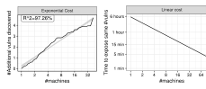

Figure 1: Each vuln. discovery requires exponentially more machines (left). Yet, exponentially more machines allow to find the same vulnerabilities exponentially faster (right).

rate. So then, how is an increase in the amount of available resources related to an increase in vulnerability discovery?

Suppose Google has stopped finding new bugs when fuzzing their software systems on 25 thousand machines for one month. So, Google decides to run their fuzzers on 100x more (2.5 million) machines for one month, finding five (5) new critical bugs. Once these are fixed, how many unknown critical bugs would an attacker find in a month that was running the same fuzzer setup on 5 million machines? What if the attacker had 250 million machines? We propose an empirical law that would suggest that the attacker with 2x more (5 million) machines finds an unknown critical bug with ~15% likelihood or less while the attacker with 100x more (250 million!) machines only finds five (5) unknown critical bugs or less.

We conducted fuzzing experiments involving over three hundred open source projects (incl. OSS-Fuzz [15], FTS [19]), two popular greybox fuzzers (LibFuzzer [12] and AFL [26]), four measures of code coverage (LIBFUZZER's feature and branch coverage as well as AFL's path and map/branch coverage) and two measures of vulnerability discovery (#known vulns. found and #crashing campaigns). From the observations, we derive empirical laws, which are additionally supported and explained by our probabilistic analysis and simulation experiments. An empirical law is a stated fact that is derived based on empirical observations (e.g., Moore's law).

We measure the cost of vulnerability discovery as the number of "machines" required to discover the next vulnerability within a given time budget. The number of machines is merely an abstraction of the number of inputs generated per minute. Twice the machines can generate twice the inputs per minute. Conceptually, one fuzzing campaign remains one campaign where inputs are still generated sequentially—only #machines times as fast. We assume absolutely no synchronization overhead. For mutation-based fuzzers, any seed that is added to the corpus is immediately available to all other machines. Note that this gives us a lower bound on the cost of vulnerability discovery: Our analysis is optimistic. If we took synchronization overhead into account, the cost of vulnerability discovery would further increase with the number of physical machines.

Our first empirical law suggests that a non-deterministic fuzzer that generates exponentially more inputs per minute discovers only linearly more vulnerabilities within a given time budget. This means that (a) given the same time budget, the cost for each new vulnerability is exponentially more machines (cf. Fig. [1.](#page-0-0)left) and (b) given the same #machines, the cost of each new vulnerability is exponentially more time. In fact, we can show this also for the coverage of a new program statement or branch, the violation of a new assertion, or any other discrete program property of interest.

Our second empirical law suggests that a non-deterministic fuzzer which generates exponentially more inputs per minute discovers the same number of vulnerabilities also exponentially faster (cf. Fig. [1.](#page-0-0)right). This means if we want to find the same set of vulnerabilities in half the time, our fuzzer instance only needs to generate twice as many inputs per minute (e.g., on 2x #machines).

Given the same time budget and non-deterministic fuzzer, an attacker with exponentially more machines discovers a given known vulnerability exponentially faster but some unknown vulnerability only linearly faster. Similarly, with exponentially more machines, the same code is covered exponentially faster, but uncovered code only linearly faster. In other words, re-discovering the same vulnerabilities (or achieving the same coverage) is cheap but finding new vulnerabilities (or achieving more coverage) is expensive. This is under the simplifying assumption of no synchronization overhead.

We make an attempt at explaining our empirical observations by probabilistically modelling the fuzzing process. Starting from this model, we conduct simulation experiments that generate graphs that turn out quite similar to those we observe empirically. We hope that our probabilistic analysis sheds some light on the scalability of fuzzing and the cost of vulnerability discovery: Why is it expensive to cover new code but cheap to cover the same code faster?

## 2 EMPIRICAL SETUP

## 2.1 Research Questions

- RQ.1 Given the same non-deterministic fuzzer and time-budget, what is the relationship between the number of available machines and the number of additional species discovered?
- RQ.2 Given the same non-deterministic fuzzer and time-budget, what is the relationship between the number of available machines and the time to discover the same number of species?
- RQ.3 Given the same non-deterministic fuzzer and time-budget, what is the relationship between the number of available machines and the probability to discover a given (set of) species?

We call our dependent variables as łspeciesž (explained in Sec. [2.4\)](#page-2-0).

## 2.2 Non-Deterministic Fuzzers

For our experiments, we use the two most popular non-deterministic, coverage-based greybox fuzzers, LibFuzzer and AFL. Both fuzzers recieve different kinds of coverage-feedback and implement different coverage-guided heuristics. LibFuzzer is a unit-level fuzzer while AFL is a system-level fuzzer.

LibFuzzer [\[12\]](#page-11-4) is a state-of-the-art greybox fuzzer developed at Google and is fully integrated into the FTS and OSS-Fuzz benchmarks. LibFuzzer is a coverage-based greybox fuzzer which seeks to cover program łfeaturesž. Generated inputs that cover a new feature are added to the seed corpus. A feature is a combination of

the branch that is covered and how often it is covered. For instance, two inputs (exercising the same branches) have a different feature set if one exercises a branch more often. Hence, feature coverage subsumes branch coverage. LibFuzzer aborts the fuzzing campaign as soon as the first crash is found or upon expiry of a set timeout. In our experiments, we leverage the default configuration of LibFuzzer if not otherwise required by the benchmark.

AFL [\[26\]](#page-11-5) is one of the most popular greybox fuzzers. In contrast to LibFuzzer, AFL does not require a specific fuzz driver and can be directly run on the command line interface (CLI) of a program. AFL is a coverage-based greybox fuzzer which seeks to maximize branch coverage. Generated inputs that exercise a new branch, or the same branch sufficiently more often, are added to the seed corpus. In AFL terminology, the number of explored łpathsž is actually the number of seeds in the seed corpus.

## 2.3 Benchmarks and Subjects

We chose a wide range of open-source projects and real-world benchmarks. Together, we generated more than four CPU years worth of data by fuzzing almost three hundred different open source programs from various domains.

OSS-Fuzz [\[15\]](#page-11-2) (263 programs, 58.3M LoC, 6 hours, 4 repetitions) is an open-source fuzzing platform developed by Google for the large-scale continuous fuzzing of security-critical software. At the time of writing OSS-Fuzz featured 1,326 executable programs in 176 open-source projects. We selected 263 programs totaling 58.3 million lines of code by choosing subjects that did not crash or reach the saturation point in the first few minutes and that generated more than 1,000 executions per second. Even for the chosen subjects, we noticed that the initial seed corpora provided by the project are often for saturation: Feature discovery has effectively stopped shortly after the beginning of the campaign. It does not give much room for further discovery. Hence, we removed all initial seed corporas. We ran LibFuzzer for all programs for 6 hours and, given the large number of subjects, repeated each experiment 4 times.

FTS [\[20\]](#page-11-6) (25 programs, 2.0M LoC, 6 hours, 20 repetitions) is a standard set of real-world programs used by Google to evaluate fuzzer performance. The subjects are widely-used implementations of file parsers, protocols, and data bases (e.g., libpng, openssl, and sqlite), amongst others. Each subject contains at least one known vulnerability (CVE), some of which require weeks to be found. The Fuzzer Test Suite (FTS) allows to compare the coverage achieved as well as the time to find the first crash on the provided subjects. When reporting coverage results, we removed those programs where more than 15% of runs crash (leaving 13 programs with 1.2M LoC). As LibFuzzer aborts when the first crash is found, the coverage results for those subjects would be unreliable. We set a 8GB memory limit and ran LibFuzzer for 6 hours. To gain statistical power, we repeated each experiment 20 times.

Open-Source (6 programs, 6.1M LoC, 96 hours, 10 repetitions) is a set of open-source programs from a wide range of domains, including a network sniffer (wireshark) and a video and audio codec library (ffmpeg). We ran the default configuration of AFL on all programs for 96 hours, except for libxml2, where we ran AFL for 90 days, i.e., 2160 hours. We repeated each experiment 10 times.

## 2.4 Variables and Measures

We explore several definitions of species as listed below. We collect this information from the standard output of LibFuzzer and the plot\_data file of AFL. We vary one indepent variable (#machines) and measure six dependent variables.

#Machines (#cores, #hyperthreads) is an abstraction of the number of inputs the fuzzer can generate per minute. Twice the machines can generate twice the inputs per minute. Conceptually, this is still a single fuzzing campaign where inputs are still generated sequentially. We assume absolutely no synchronization overhead and that any discovered seed, added to the corpus, is immediately available to all other machines. Note that this gives us a lower bound on the cost of vulnerability discovery: Our analysis is optimistic. If we took synchronization overhead into account, the cost of vulnerability discovery would further increase with the number of physical machines.

Data scaling. In order to vary the number of available machines, we scale our existing data. For OSS-Fuzz and FTS, we measured our dependent variables in over 3,000 fuzzing campaigns of 6 hours. For Open-Source, we measured our dependent variables in 50 campaigns of 7 days and 10 campaigns of 3 months. Again, we assume that for each fuzzing campaign twice the machines can generate twice the inputs per minute with zero synchronization overhead. Hence, we employ a simple scaling strategy: We first make sure that time starts from zero at the beginning of the fuzzing campaign. Then, given a scaling factor 2 x , we divide each time stamp by 2 x . We make no other modifications. We make data and scripts available here: <https://doi.org/10.6084/m9.figshare.11911287>.

#Vulnerabilities (FTS). FTS consists of 25 programs, each containing a known vulnerability. For each run of LibFuzzer on each program, we measure the time needed and number of test cases generated to discover the corresponding vulnerability, i.e., when the first crash is reported. From this information, we can compute the average number of vulnerabilities found at any given time.

#Crashing campaigns (LibFuzzer). When the program crashes during fuzzing, i.e., a bug is found, then the entire fuzzing campaign crashes. This is the default behavior of LibFuzzer. From the time stamp of the crash, we can compute the total number of campaigns that have crashed at any give time.

#Features (LibFuzzer). The classic coverage-feedback for Lib-Fuzzer is the feature (reported as ft:). The LLVM documentation explains: LibFuzzer łuses different signals to evaluate the code coverage: edge coverage, edge counters, value profiles, indirect caller/callee pairs, etc. These signals combined are called featuresž.

#Edges (LibFuzzer). In addition to the number of features, Lib-Fuzzer also reports the number of edges covered (reported as cov:). The proportion of covered edges versus the total number of edges gives the classic branch coverage.

#Seeds (AFL). The classic measure of progress for AFL is the number of seeds added to the corpus (reported as paths\_total). It is often reported as the measure of fuzzer effectiveness [\[5\]](#page-10-0). However, it has been argued that the number of seeds added is strictly dependent on the order in which the seeds are added [\[11\]](#page-11-7). Hence, we also provide the number of branches covered (#branches) as another measure of fuzzer effectiveness.

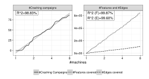

Figure 2: (#Crashes, #Features, #Edges @ OSS-Fuzz). Average number of additional species discovered when fuzzing all 263 programs in OSS-Fuzz simultaneously with LibFuzzer for 45 minutes as a function of available machines (4 reps).

%Map Coverage (AFL). Another measure of progress for the AFL greybox fuzzer is map coverage (reported as map\_size). AFL receives coverage feedback via a shared memory map. For each branch that is exercised, the coverage instrumentation writes to an index in this map. The percentage indices that are set in this map gives the map coverage.

## 2.5 Setup and Infrastructure

All experiments for FTS were conducted on a machine with Intel(R) Xeon(R) Platinum 8170 2.10GHz CPUs with 104 cores and 126GB of main memory. All experiments for OSS-Fuzz were conducted on a machine with Intel(R) Xeon(R) CPU E5-2699 v4 2.20GHz with a total of 88 cores and 504GB of main memory. All experiments for Open Source were conducted on Intel(R) Xeon(R) CPU E5-2600 2.6 GHz with a total of 40 cores and 64GB of main memory. To ensure a fair comparison, we always ran all schedules simultaneously (same workload), each schedule was bound to one (hyperthread) core, and 20% of cores were left unused to avoid interference.

## 3 EMPIRICAL RESULTS

## RQ1. Number of Additional Species Discovered

Given the same non-deterministic fuzzer and time-budget, we investigate the relationship between the number of available machines (i.e., the number of inputs generated per minute) and the number of additional species discovered.

Presentation. For each benchmark and species, we show line plots (geom\_line) of the additional number of species discovered (linear y-axis) as the number of available machines increases (exponential x-axis). With each line plot, we show the R 2 standard measure of goodness-of-fit for a linear regression (lm). An R 2 of 100% would mean that the linear regression explains all of the variation, and that all observations fall exactly on the regression line. We also show the standard error of a linear regression (grey band).

OSS-Fuzz. The results for running LibFuzzer on the almost three hundred programs in OSS-Fuzz are shown in [Figure 2.](#page-2-1) We can clearly observe linear increase in the number of additional species discovered as exponentially more machines become available. In fact, fitting a linear regression model to the logarithm of the number

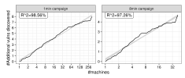

(a) #Vulnerabilities @ FTS. Average number of additional vulnerabilities found when fuzzing all 25 programs in FTS simultaneously with LibFuzzer for 1 or 8 mins, respectively, as the number of available machines increases (20 repetitions).

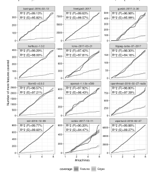

(b) #Features and #Edges @ FTS. Average number of additional number of features / edges covered when fuzzing these 12 programs in FTS with LibFuzzer for 45 minutes, as the number of available machines increases (20 repetitions).

Figure 3: #Vulns, #Features, #Edges @ FTS benchmark.

of machines and the difference in species discovered, we observe a very high goodness-of-fit of R-squared ( $R^2$ ) greater than 98%.

On the left of Figure 2, we can see that the cost of making one more fuzzing campaign crash because an error has been found is exponential. On the right of Figure 2, we can see that the cost of covering one more feature or one more edge is also exponential. It is interesting to observe that the slopes of the increase differ. This is because the number of features is larger than the number of edges.

FTS. The results for running LibFuzzer on the 25 programs in OSS-Fuzz are shown in Figure 3. Again, we can clearly observe linear increase in the number of additional species discovered as exponentially more machines are available. Fitting a linear regression

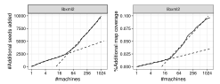

(a) #Seeds and %Map Coverage @ LibXML2. Average number of additional seeds added and average percentage map covered when fuzzing LibXML2 in Open Source with AFL for 45 mins as the number of available machines increases (10 reps).

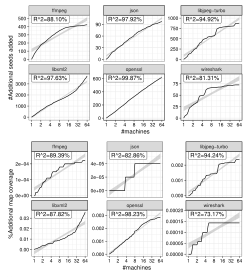

(b) #Seeds and %Map Coverage @ Open Source. Average number of additional seeds added (top two rows) and average percentage map covered (bottom two rows) when fuzzing all six programs in the Open Source benchmark with AFL for 45 minutes as the number of available machines increases (10 repetitions).

Figure 4: #Seeds, %Map Coverage @ Open Source.

model to the logarithm of the number of machines and the difference in species discovered, we observe a very high goodness-of-fit of R-squared ( $R^2$ ) greater than 97% (except for vorbis).

In terms of the additional number of features covered, for the average program in the FTS benchmark the  $R^2$  measure is 98.1%. In terms of the additional number of edges covered, for the average program in the FTS benchmark the  $R^2$  measure is 96.9%. Only for vorbis, the  $R^2$ -measure is below 95%.

FTS is the only benchmark where we can count the number of vulnerabilities exposed in a fuzzing campaign of the entire benchmark (Figure 3.a). It is interesting to observe how the number of machines must increase in order to find the next vulnerability. Each new vulnerability found comes at an exponential cost.

**Open Source**. The results for running AFL on the six programs in the Open Source benchmark are shown in Figure 4. In terms of additional *seeds* added (Figure 4.b, top rows), we observe a linear increase as exponentially more machines are available for three out of six programs ( $R^2 > 97\%$ ). For the remaining three programs, an exponential increase in the number of machines cannot even achieve a linear increase in the number of additional *seeds* added, making it even more expensive. In terms of additional *map coverage* (Figure 4.b, bottom rows), we mostly observe a sub-linear behavior where adding exponentially more machines cannot even achieve a linear increase in the number of additional seeds added. For wire-shark, there is no difference between the map coverage achieved by eight machines in 45 minutes and the map coverage achieved by 64 machines in the same time. However, for LibXML2 we observe an unexpected increase.

We investigated the sudden increase in the additional map coverage achieved in LibXML2 by continuing the fuzzing campaigns for three months, which corresponds to running the fuzzer on 2880 machines for 45 minutes (Figure 4.a). In terms of both, additional seeds added and additional map coverage, we identified two linear phases. In each phase, the goodness-of-fit of a linear regression model is  $R^2 > 99\%$ .

★ First empirical law. Our results from over four CPU years worth of fuzzing involving almost three hundred open source programs, two state-of-the-art greybox fuzzers, four measures of code coverage, and two measures of vulnerability discovery suggest that a non-deterministic fuzzer that generates exponentially more inputs per minute discovers only linearly more new species or less.

#### **RQ2.** Time to Discover the Same #Species

Given the same non-deterministic fuzzer and time-budget, we investigate the relationship between the number of available machines (i.e., the number of inputs generated per minute) and the time to discover the same number of species.

**Presentation**. Suppose, when running the fuzzer for six hours on a single machine, the fuzzer discovers  $S_1$  many species. We show line plots (geom\_line) of the reduction in time for that fuzzer to discover the same number of species  $S_1$  (exponential y-axis) as the number of available machines increases, i.e., the number of inputs that can be generated per minute increases (exponential x-axis). Figure 5 only shows the plots for some benchmarks. The other plots look very similar and provide no extra information.

Results. The results for running LibFuzzer on the almost three hundred programs in OSS-Fuzz and the six programs in FTS are shown in Figure 5. We can see that running LibFuzzer on 512 machines instead of one machine reduces the time to make 166 fuzzing campaigns crash from five hours and fifty five minutes (5h55m) to under one minute (<00h01m; Fig. 5.a-left). Similarly, running LibFuzzer on 512 machines instead of one machine reduces the average time to expose the same vulnerabilities in FTS from five hours and fourty minutes (5h40m) to under one minute (<00h01m; Fig. 5.a-right). Together, 512 machines are also sufficient to achieve the same coverage in under one minute as one machine achieves in six hours (Fig. 5.b). This is reasonable: If LibFuzzer can generate 512 times more inputs per minute, then LibFuzzer can make the same progress in 1/512-th of the time.

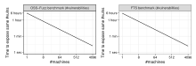

(a) Time to expose the same number of vulnerabilities in OSS-Fuzz (left) and the same number of crashing campaigns in FTS (right) as a single machine in six hours if exponentially more machines were available.

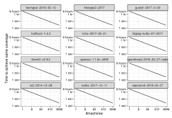

(b) Time to achieve the same coverage as running the fuzzer on a single machine for six hours if the fuzzer would run on exponentially more machines.

Figure 5: #Vulns, #Features @ FTS and #Crashes @ OSS-Fuzz.

★ Second empirical law. Our results suggest that a non-deterministic fuzzer that generates exponentially more inputs per minute discovers the same number of species also exponentially faster.

#### **RQ3. Probability to Discover Given Species**

Given the same non-deterministic fuzzer and time-budget, we investigate the relationship between the number of available machines (i.e., the number of inputs generated per minute) and the probability to discover a given (set of) species.

**Presentation**. We estimate the *probability* of an event to occur in a given time budget and for a given number of machines as the *proportion of runs* where the event occurs in the given time budget for the given number of machines. For instance, if 75% of runs have discovered a given vulnerability in the given time budget using sixteen machines, then the probability to discover the vulnerability within the time budget using sixteen machines is 75%. We show line plots (geom\_line) of the probability that the fuzzer discovers a given (set of) species (*linear* y-axis) as the number of available machines increases, i.e., the number of inputs that can be generated per minute increases (exponential x-axis).

**Results**. The results for the probability to discover a vulnerability in the FTS benchmark by running Libfuzzer for up to six hours are shown in Figure 6. Our first observation is that the plots have a very similar shape to that in Figure 8.left which shows the result of our probabilistic analysis of the third empirical law for non-deterministic blackbox fuzzers. For the bottom three rows, the probability remains close to zero at the beginning, increases at an

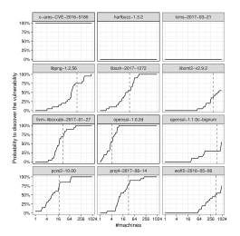

Figure 6: Probability that the vulnerability has been discovered in twenty seconds given the available number of machines (solid line). Average number of machines required to find the vulnerability in twenty seconds (dashed line).

ever faster rate until it reaches the dashed line (i.e., the average #machines where the vulnerability is discovered), slows down again until it reaches almost one, and then remains close to one for the remainder. In fact, the discovery probability curve appears to be very similar to a sigmoid curve.

Our second observation is that for different vulnerabilities often a different average number of machines are required to expect vulnerability discovery (dashed line). The harfbuzz and lcms vulnerabilities are never discovered while the c-ares vulnerability has been discovered in all twenty runs in under twenty seconds already on a single machine (top row). We confirmed that adding up the individual discovery probabilities yields a linear increase in the number of vulnerabilities discovered with an exponential increase in the number of available machines (cf. Figure 3.a & Figure 10).

The results for the probability to cover at least a given number of features S' in the FTS benchmark by running Libfuzzer for up to six hours are shown in Figure 7. We fixed S' arbitrarily as half the number of features that Libfuzzer covers on one machine in six hours. This value of S' allows us to actually observe a transition from probability zero to one for most of the subjects. Again, we make the same observations. Most importantly, the plots look similar to the sigmoid shape that we have seen for our simulation results in Figure 8.left.

★ Third empirical law. Our results suggest that for a nondeterministic fuzzer that generates exponentially more inputs per minute the probability of discovering a given (set of) species seems to increase exponentially until discovery is expected, whence the rate of increase slows down and the curve approaches probability one.

Figure 7: Probability that at least S' features are covered in twenty seconds given the available number of machines (solid line), where S' is half the number of features that LIB-FUZZER can cover in six hours on one machine, on average. We also show the average number of machines needed to discover at least S' features in twenty seconds (dashed line).

#### 4 PROBABILISTIC ANALYSIS

#### 4.1 Probabilistic Model of Fuzzing

We make an attempt at explaining our empirical observations by probabilistically modelling the fuzzing process. Starting from this model, we conduct simulation experiments that generate graphs that turn out quite similar to those we observe empirically. Since the underlying probabilistic model is straightforward for blackbox fuzzers, we focus only on the blackbox fuzzing process. Nevertheless, we hope that our probabilistic analysis sheds some light on our empirical observations for greybox fuzzing and on the scalability of non-deterministic fuzzing in general: Why is it expensive to cover new code but cheap to cover the same code faster?

We borrow the STADS probabilistic model of fuzzing from Böhme [2]. A *non-deterministic fuzzer* generates program inputs by sampling with replacement from the program's input space. Let  $\mathcal P$  be the program that we wish to fuzz. We call as  $\mathcal P$ 's *input space*  $\mathcal D$  the set of all inputs that  $\mathcal P$  can take. Fuzzing  $\mathcal P$  is a stochastic process

$$\mathcal{F} = \{X_n \mid X_n \in \mathbf{D}\}_{n=1}^N \tag{1}$$

of sampling N inputs with replacement from the program's input space. We call  $\mathcal{F}$  as fuzzing campaign and a tool that performs  $\mathcal{F}$  as non-deterministic blackbox fuzzer. Suppose, we can subdivide the input space  $\mathcal{D}$  into S individual subdomains  $\{\mathcal{D}_i\}_{i=1}^S$  called species.

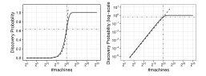

Figure 8: Probability  $Q_{\exp}(x) = S(2^x n)$  to discover a given species within a given time budget as the number of machines increases exponentially (solid line). We also show the inflection point  $x_0$  of  $Q_{\exp}(x)$  (grey lines) and an exponential curve (dashed line) that intersects  $Q_{\exp}(x)$  at x=0 and  $x=x_0$  and that starts out with the same slope as  $Q_{\exp}(x)$  at x=0 but grows slower than  $Q_{\exp}(x)$  in the interval  $x \in [0,x_0]$ . We let the probability q that the species has not been discovered on one machine (x=0) within the time budget be  $q=1-10^{-6}$ , and the exponential be  $ab^x+c$  where  $a=1.03722\times 10^{-6}$ , b=1.95092, and  $c=-3.722\times 10^{-8}$ .

An input  $X_n \in F$  is said to *discover* species  $\mathcal{D}_i$  if  $X_n \in \mathcal{D}_i$  and there does not exist a previously sampled input  $X_m \in F$  such that m < n and  $X_m \in \mathcal{D}_i$  (i.e.,  $\mathcal{D}_i$  is sampled for the first time). An input's species is defined based on the dynamic program properties that are used as the evaluation criteria of the fuzzer. For instance, each branch that is exercised by input  $X_n \in \mathcal{D}$  can be identified as a species. The discovery of the new species, i.e., branch, then corresponds to an increase in branch coverage.

We let  $p_i = P[X_n \in \mathcal{D}_i]$  be the probability that  $X_n$  belongs to  $\mathcal{D}_i$  for  $i: 1 \le i \le S$  and  $t: 1 \le n \le N$ . The expected number of species S(n) discovered by a non-deterministic blackbox fuzzer is

$$S(n) = \sum_{i=1}^{S} \left[ 1 - (1 - p_i)^n \right] = S - \sum_{i=1}^{S} (1 - p_i)^n.$$
 (2)

Intuitively, we can understand a non-deterministic blackbox fuzzer as sampling with replacement from an urn with colored balls, where each ball can have one or more of S colors. The species discovery curve S(n) represents the number of colors that we expect to discover when sampling n balls. Here, a ball is an input while a ball's colors are the input's species.

Fuzzing approaches. We can distinguish a generation-based and a mutation-based approach [14]. A generation-based fuzzer generates random inputs from scratch. A mutation-based fuzzer generates random inputs by modifying existing inputs in a given seed corpus. A mutation-based fuzzer is non-deterministic, as it chooses the seed to fuzz, the location in the chosen seed to mutate, and the mutation operators to apply at the chosen locations all at random. A greybox fuzzer is a mutation-based fuzzer that adds to the corpus generated inputs that increase coverage. A grammar-guided generation-based fuzzer can generate program inputs that are valid w.r.t. a given grammar by random sampling from that grammar [10]. A grammar-guided mutation-based fuzzer can generate valid inputs by parsing a seed as parse tree, randomly mutating the parse tree, and re-constituting the modified tree [17].

**Machines and time budget**. We explore two related problems and show that, under simplifying assumptions, they represent the same case. Firstly, we explore *how the number of species discovered within a fixed time budget increases as the number of machines increases*. From Equation (2), we know that the number of species S(n) we expect a non-deterministic blackbox fuzzer to discover after generating n inputs is the total number of species minus the sum for each species i of the expected probability that i has not been discovered after generating n inputs. With n0 times more machines, we can generate n0 times more inputs per minute, i.e.,

$$S - \sum_{i=1}^{S} \left( (1 - p_i)^{2^x} \right)^n = S - \sum_{i=1}^{S} (1 - p_i)^{2^x n}$$
 (3)

$$=S(2^{x}n)\tag{4}$$

So, given a time budget, such that the fuzzer running on one machine can generate exactly n test inputs, if  $2^x$  times more machines were available,  $S(2^x n) - S(n)$  more species would be discovered.

Secondly, we explore how the number of species discovered on a single machine increases as the available time budget increases. If the non-deterministic fuzzer generated  $2^x$  more test inputs on the same machine,  $S(2^x n) - S(n)$  more species would be discovered.

#### 4.2 Probability to Discover a Given Species

Our first empirical observation is that a non-deterministic fuzzer that generates exponentially more inputs per minute discovers only linearly more new species (or less). Let us begin with an investigation of the special case where we assume that only a single (interesting) species exists, S = 1. How does the probability to discover this species increase within a given time budget as the number of machines (i.e., #inputs per minute) increases? We investigated this question empirically in Section 3.RQ3 and our observations for this special case are counterintuitive.

★ We suggest that a non-deterministic fuzzer that generates exponentially more inputs per minute also discovers a specific species with a probability that is exponentially higher—up to some limit.

In other words, the probability to find a specific species within a given time increases approximately linearly with the number of machines (up to some limit). We conduct a probabilistic analysis for the special case where the fuzzer is blackbox, i.e., for each species, throughout the campaign the fuzzer has the same probability to generate an input that belongs to that species. We also identify exactly where this "limit" is.

In Figure 8, we see an example of the relationship between the probability to discover the species and an exponential increase in the number of available machines (solid line). We also show the inflection point  $x_0$  where the growth starts to decelerate (grey lines), and an exponential function that intersects the discover probability curve at  $x \in \{0, x_0\}$ , starts with the same rate of growth (slope) at x = 0, and lower-bounds the species discovery curve within the interval  $x \in [0, x_0]$  (dashed line).

Given a *specific species*, let p be the probability that the fuzzer generates an input that discovers the species. We compute the expected probability Q(n) that the fuzzer has discovered the species as the complement of the probability that the species has not been discovered using n generated test inputs,  $Q(n) = 1 - (1 - p)^n$ .

|               | Slower growing exponential: $T(x) = ab^x + c$ |         |                            |
|---------------|-----------------------------------------------|---------|----------------------------|
| q             | a                                             | b       | c                          |
| 0.5           | $1.62488 \times 10^{0}$                       | 1.15933 | $-1.12488 \times 10^0$     |
| $1 - 10^{-1}$ | $1.32149 \times 10^{-1}$                      | 1.64439 | $-3.21490 \times 10^{-2}$  |
| $1 - 10^{-2}$ | $1.13899 \times 10^{-2}$                      | 1.83219 | $-1.38990 \times 10^{-3}$  |
| $1 - 10^{-4}$ | $1.05930 \times 10^{-4}$                      | 1.92379 | $-5.93000 \times 10^{-6}$  |
| $1 - 10^{-6}$ | $1.03722 \times 10^{-6}$                      | 1.95092 | $-3.72200 \times 10^{-8}$  |
| $1 - 10^{-8}$ | $1.02711 \times 10^{-8}$                      | 1.96380 | $-2.71100 \times 10^{-10}$ |

Figure 9: Examples of exponential functions  $T(x) = ab^x + c$  that grow *slower* in the interval  $x \in [0, x_0]$  than the probability  $Q_{\exp}(x)$  of discovering a specific species within a given time budget if  $2^x$  more machines were available where T(x) intersects  $Q_{\exp}(x)$  at  $x \in \{0, x_0\}$  and starts with the same slope at the beginning of the interval.

Before we show that the discovery probability increases exponentially up to a certain limit as the number of machines increases exponentially, we will first identify more formally where this "limit" is. Clearly, the discovery probability cannot be larger than one. So, there must be an inflection point. An *inflection point* is a point of the curve where the curvature changes its sign. For brevity, we define two quantities  $Q_{\rm exp}(x)$  and q as follows

$$q = (1 - p)^n$$
 since  $p$  and  $n$  are constants (5)

$$Q_{\rm exp}(x) = 1 - q^{2^x} \tag{6}$$

where q is the probability that running the fuzzer on one machine within a time budget that allows to generate n test inputs has not discovered the species, and where  $Q_{\exp}(x)$  gives the probability that running the fuzzer on  $2^x$  machines within the same time budget has discovered the species.

**Inflection point**. To find the inflection point, we set the second derivative of  $Q_{\text{exp}}(x)$  to 0 and solve for x to find  $x_0$ .

$$x_0 = \log_2\left(-\frac{1}{\log(q)}\right)$$
 where  $x_0 > 0$  if  $e^{-1} < q < 1$ . (7)

Note that the expected probability that the species has been discovered at this inflection point is  $Q_{\exp}(x_0) = 1 - e^{-1}$ .

We can demonstrate that  $Q_{\exp}(x)$  grows exponentially in the interval  $x \in [0, x_0]$  by showing that for all  $q : e^{-1} < q < 1$  and  $x : 0 \le x \le x_0$ , there exists a, b, and c, such that the exponential function  $T(x) = ab^x + c$  intersects with  $Q_{\exp}(x)$  at  $x \in \{0, x_0\}$ , that the slopes of T(x) and  $Q_{\exp}(x)$  are equal at x = 0, i.e.,  $\frac{\partial}{\partial x}(T(x) - Q_{\exp}(x)) = 0$  at x = 0, and that  $Q_{\exp}(x) - T(x) \ge 0$  for  $0 < x < x_0$  (i.e., there is no third intersection in the interval).

Figure 9 shows the values for a, b, and c that satisfy these constraints for some interesting probabilities q that the species has not been discovered within the given time budget on one machine.

 $\bigstar$  Given the probability q that a non-deterministic blackbox fuzzer has not discovered a given species within a given time budget, an attacker that runs the same fuzzer in the same time budget on  $2^x$  times more machines, such that  $x \in [0, \log_2(-1/\log(q))]$ , has a probability  $Q_{exp}(x)$  of discovering the species where  $Q_{exp}(x)$  grows faster than an exponential which intersects  $Q_{exp}(x)$  at the beginning and end of the interval and starts with the same slope.

For non-deterministic blackbox fuzzers, an example is shown in Figure 8. Recall that  $q = 1 - (1 - p)^n$ , where p is the probability that the non-deterministic fuzzer generates an input that belongs to that species and n is the number of test inputs that can be generated within the given time budget on one machine. While the probabalistic results are derived from a model for blackbox fuzzing, they explain the empirical evidence for the two greybox fuzzers in Section 3.RQ3. The graphs generated from our probabilistic analysis in Figure 8.left and as a result of our empirical analysis in Figure 6 and 7 are almost identical.

**Intuition & consequences**. Intuitively, if you buy two, four, or eight lottery tickets—instead of one—also increases your chance of drawing a winning ticket by a factor of two, four, or eight. Rolling six dice simultaneously instead of one increases the chance to roll at least one six by a factor of four. So what does that mean for our empirical observation that the cost of discovering the next unknown vulnerability increases exponentially?

- (1) For a non-deterministic blackbox fuzzer, the probability of exposing a specific known vulnerability, reaching a specific program statement, violating a specific program assertion, or observing a specific event of interest (i.e., species) within a given time budget increases approximately linearly with the number of available machines—up to a certain limit.
- (2) The same observation holds even if our objective is to discover *all* species in a given set of species. On the average, the most difficult species to discover is that which has the highest probability  $q_{\text{max}}$  not to be discovered after generating n test inputs. By setting  $q = q_{\text{max}}$ , we can reduce the problem of discovering *all* species in a given set to exposing a specific species. From the second law, we also know that the time spent finding the same number of species is inversely proportional to the number of available machines.
- (3) The same observation holds even for the discovery of the next unknown vulnerability **if** we assume that there exists only a *single* unknown vulnerability, or **if** we assume that all unknown vulnerabilities have *exactly the same probability*  $q_i = 1/S$  *not* to be discovered within the given time budget on one machine, i.e.,  $q_i = q_{i+1} = 1/S$  for  $i : 1 \le i < S$ .

### 4.3 Explaining the First Empirical Law

Given the insights from the previous section, why do our empirical observations suggest an exponential cost for the discovery of the next unknown vulnerability (our first law)? From the exponential behavior of of the discovery probability curve  $Q_{\rm exp}^i(x)$  for a species i, we can derive that discovery probability is either approximately zero (0) or approximately one (1) with an "almost" linear transition at around  $x = \log_2(1/(1-q_i))$ —when discovery is expected. Figure 8.left illustrates this behavior nicely.

The number of species  $S(2^x n)$  discovered if  $2^x$  more machines were available is the sum of the individual discovery probabilities,  $S(2^x n) = \sum_{i=1}^S Q_{\exp}^i(x)$ . Without making any additional assumptions about the total number S of species or the probabilities  $\{q_i\}_{i=1}^S$ , we mostly observe the effects of the almost-linear transitions of the individual discovery probabilities  $Q_{\exp}^i(x)$  as they contribute to the total number of discovered species  $S(2^x n)$ . This additive

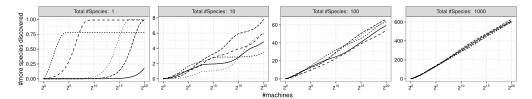

Figure 10: Number of additional species discovered  $S(2^x n) - S(n)$  as the number of available machines increases exponentially  $(S \in \{1, 10, 100, 1000\}, 5 \text{ random samples of } \{q_i\}_{i=1}^S \text{ each})$ . We recognize the exponential increase for a single species on the left and the linear increase for 1000 species on the right.

acummulation of the individual curves for each species explains our empirical observation of a linear increase in the number of new species discovered within the same time budget and as  $2^x$  more machines are available.1

**Simulation**. We explore this explanation in several simulation experiments. We vary the the total number of species S and assume a *power-law distribution*2 over the probabilities  $\{q_i\}_{i=1}^{S}$ . Specifically, for each species i we sample a random floating point value  $X_i$  uniformly from the interval [0,32] and set the probability  $q_i$  that i has not been discovered after generating n inputs (i.e., x=0) as  $q_i=1-2^{-X_i}$ . In other words, the most abundant species is about twice as likely to be discovered as the next most abundant species, and so on. We let the total number of species  $S \in \{1, 10, 100, 1000\}$  and for each value of S repeat the sampling of  $\{q_i\}_{i=1}^{S}$  five times. The simulation should by no means be considered a proof of our first empirical law, but rather as an exploration or as an explanation. For the reader to try out other distributions, we make our scripts available here: https://doi.org/10.6084/m9.figshare.11911287.

Results. The simulation results for a non-deterministic blackbox fuzzer are shown in Figure 10. It depicts the additional number of species found as 2x times more machines are available to an exponentially more powerful attacker, i.e., the attacker can generate  $2^x$  more inputs per minute. On the left, we can recognize the exponential species discovery curve  $Q_{exp}(x)$  from the third empirical law (cf. Fig. 8). If we assume that only a single species exists, exponentially more machines will discover this species also exponentially faster. On the right, we can see the linear discovery curve which is the subject of our first law. If we assume that a thousand species exist, exponentially more machines will increase the number of additional species discovered only linearly. The two charts in between for  $S \in \{10, 100\}$  illustrate how the exponential curves from the individual species additively accumulate to form an approximately linear curve for the additional species discovered. For two non-deterministic greybox fuzzers, we provide empirical evidence in favor of the first empirical law in Section 3.RQ1.

If we assume that there is just one undiscovered species, a nondeterministic fuzzer that generates exponentially more inputs per minute also discovers a specific species with a probability that is exponentially higher—up to some limit (Section 4.2). However, we *cannot assume* to know the total number of species in advance. We cannot assume there is only one species left undiscovered.

★ Without making assumptions on the number of species, if species probabilities are distributed according to the power law, we suggest that a non-deterministic fuzzer that generates exponentially more inputs per minute discovers only linearly more new species (or less).

We call this observation an empirical law because it is contingent on the fact that species are distributed roughly according to the power law. In the special cases—where (a) all species are equally likely ( $p_i = 1/S$  for all  $i: 1 \le i \le S$ ) or (b) there exists just one species (S = 1)—this law does not hold. However, from our empirical observations in Section 3.RQ1, we can derive that the species measured in our dependent variables (e.g., vulnerabilities) are indeed distributed according to the power law. The plots for our empirical observations (Figure 2–4) look very simular to our plots for our simulation results (Figure 10.right).

A *power law distribution* gives a very high probability to a small number of events and a very low probability to a very large number of events. The 80/20 Pareto principle is an example. For us, there are very few extremely abundant species but a large number of extremely rare species. In our simulation, the second most abundant species is only half as likely as the most abundant, and so on.

**Intuition**. When collecting baseball cards, the first couple of cards are always easy to find, but adding a new card to your collection will get progressively more difficult—even if all baseball cards were equally likely. This is related to the *coupon collector's problem*. Similarly, our first law suggests that covering one more branch or discovering one more bug will get progressively more difficult—so difficult, in fact, that each new branch covered and each new vulnerability exposed comes at an exponential cost.

#### 4.4 Explaining the Second Empirical Law

While our first empirical law implies that it is *expensive to cover new code*, the second law implies that it is *cheap to cover the same code*. Similarly, it is expensive to find an unknown vulnerability, but cheap to find the same, known vulnerabilities. Suppose for a non-deterministic blackbox fuzzer, in the original setup one input is generated per minute while in the exponential setup  $2^x$  inputs are generated per minute. Given the original time n, we need to find the

 $^1\mbox{We}$  presented our empirical observations in Section 3.

 $^2$ We also explored the unrealistic assumption of a uniform distribution over  $\{q_i\}_{i=1}^S$ , i.e., to sample  $q_i$  uniformly from the interval [0, 1]. It is unrealistic, because we would otherwise expect discovery of most species with only 10x more machines. We conducted simulation experiments and observed a  $\mathit{sub-linear}$  increase in the number of more species discovered as the number of available machines increases exponentially.

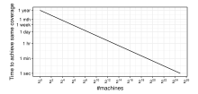

Figure 11: Second law. We observe an exponential decrease in the time spent to discover the same number of species with an exponential increase in available machines (i.e., in the number of test cases that can be generated per minute).

time m, such that the number of species found in the exponential setup in m units of time is equivalent to the number of species found in the original setup in n units of time,

$$S - \sum_{i=1}^{S} \left( 1 - p_i \right)^1 \right)^n = S - \sum_{i=1}^{S} \left( 1 - p_i \right)^{2^x} \right)^m \tag{8}$$

which is true when we have that

$$m = \frac{n}{2^x} \tag{9}$$

For a non-deterministic blackbox fuzzer, Figure 11 illustrates the third empirical law where the original setup spends one year. For two non-deterministic greybox fuzzers, we provided empirical evidence in favor of the second empirical law in Section 3.RQ2.

★ We suggest that a non-deterministic fuzzer that generates exponentially more inputs per minute discovers the same number of species also exponentially faster. More specifically, we suggest that the time to find the same number of species is inversely proportional to the number of machines.

#### 5 RELATED WORK

Fuzzing is a fast-growing research topic with most recent advances in coverage-guided fuzzing, which seeks to maximize coverage of the code. The insight is that a seed corpus that does not exercise a program element e will also not be able to discover a vulnerability observable in e. Coverage-guided greybox fuzzers [4, 5, 11, 12, 18, 21, 26] use lightweight instrumentation to collect coverage-information during runtime. For a comprehensive overview, we refer to a recent survey [14]. Coverage-guided whitebox fuzzers [6–9] use symbolic-execution to increase coverage. For instance, Klee [6] has a search strategy to priotize paths which are closer to uncovered basic blocks. The combination and integration of both approaches have been explored as well [16, 22]. In this paper, we focus only on non-deterministic fuzzers.

Non-deterministic fuzzers generate program inputs in random fashion without ever exhausting the set of inputs that can be generated. In contrast to deterministic fuzzers, there is no enumeration of finite, determined set of inputs (or of program properties like paths). A non-deterministic generation-based fuzzer generates new inputs by sampling from a random distribution over the program's

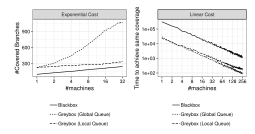

Figure 12: Each new branch covered requires exponentially more machines (left). Yet, exponentially more machines allow to cover the same branches exponentially faster (right).

input space.3 For instance, a random input file can be generated by sampling a random number n of UTF-8 characters,  $\langle c_1, \ldots, c_n \rangle$  where  $c_i \in [0, 255]$ . A non-deterministic mutation-based fuzzer generates inputs by random modifications of a seed input. The fuzzer chooses a random set of mutation operators to apply at random locations in the seed input. In this paper, we conduct an empirical analysis for two non-deterministic greybox fuzzers and provide a probabilistic analysis for non-deterministic blackbox fuzzing in order to shed some light on our observations.

Deterministic fuzzers enumerate a finite number of objects and then terminate. For instance, a symbolic execution-based whitebox fuzzer [6, 7] enumerates (interesting) paths. It might not enumerate all paths, but ideally, it would never generate a second input exercising the same path. A deterministic mutation-based fuzzer [23, 24] enumerates a determined set of mutation operators and applies them to a determined set of locations in the seed input. Greybox fuzzers such as AFL may first fuzz each seed deterministically before switching to a non-deterministic phase. In the limit, such "hybrid" greybox fuzzers are still primarily non-deterministic.

Probabilistic analysis. Arcuri et al. [1] analyzed the scalability of search-based software testing and show that random testing scales better in the number of targets than a directed testing technique that focuses on one target until it is "covered" before proceeding to the next. Böhme and Paul [3] argue that even the most effective technique is less efficient than blackbox fuzzing if the time spent generating a test case takes relatively too long and provide probabilistic bounds. Majumdar and Niksic [13] discuss the efficiency of random testing for distributed and concurrent systems. To the best of our knowledge, ours is the first work to investigate the scalability of fuzzing across machines and the cost of vulnerability discovery.

#### 6 DISCUSSION

Our first empirical law suggests that using a non-deterministic fuzzer (a) given the same time budget, each new vulnerability requires exponentially more machines and (b) given the same number of machines, each new vulnerability requires exponentially more time. *Intuitively*, when collecting baseball cards, the first couple of cards are easy to find, but collecting the next new card gets progressively more difficult.

 $^3$ It is possible, of course, that there is zero probability weight over some inputs.

Our second empirical law suggests that a non-deterministic fuzzer which generates exponentially more machines discovers the same vulnerabilities also exponentially faster. This means that finding the same vulnerabilities in half the time requires only twice as many machines. Intuitively, if each day you would bought twice as many packs of baseball cards, you could have collected the same cards that you have now in half the time.

In our empirical analysis, we make the simplifying assumption that there is no synchronization overhead. Twice the machines can generate twice the inputs per minute. Conceptually, this is still a single fuzzing campaign where inputs are still generated sequentially. Any discovered seed, added to the corpus, is immediately available to all other machines. Our analysis is optimistic.

Open science and reproducibility. We derive our empirical laws from the data that has been available to us and call upon the community to test them for other fuzzing tools, other definitions of species (e.g., mutants killed), other programming languages, and so on. To facilitate this extended investigation, we provide all data and scripts to reproduce our empirical evaluation, our simulation, and all figures in this paper at:

- <https://doi.org/10.6084/m9.figshare.11911287.v1>
- [https://www.kaggle.com/marcelbhme/fuzzing-on-the-exponentia](https://www.kaggle.com/marcelbhme/fuzzing-on-the-exponential-cost-of-vuln-disc)l[cost-of-vuln-disc](https://www.kaggle.com/marcelbhme/fuzzing-on-the-exponential-cost-of-vuln-disc)

## 6.1 Impact of Synchronization Overhead

We conducted preliminary experiments to investigate the impact of this simplifying assumption. We ran X fuzzing campaigns simultaneously on X machines in the following three settings: (a) blackbox fuzzers, (b) greybox fuzzers each with a local seed corpus, and (c) greybox fuzzers all sharing a global seed corpus. The last setting corresponds to our simplifying assumption. For each setting, we measured the increase in coverage over all simultaneous campaigns.

[Figure 12](#page-9-2) shows the tremendous impact of sharing a global queue among greybox fuzzers and making seeds found immediately available to all other fuzzing campaigns. Running 32 greybox fuzzers in parallel without sharing a global queue does not scale much better than running 32 blackbox fuzzers in parallel. Without efficient sharing of information across machines, the cost of covering each new branch is still linear but the slope of the line is much smaller.

## 6.2 Implications in Practice

We reached out to security researchers and practitioners [on Twitter](https://twitter.com/mboehme_/status/1264050597822492672) to understand the practical implications of our findings. In the following, we summarize the discussion.

łCool paper! A somewhat related thought that comes to mind: to find new bugs 'faster' one would need to make a better fuzzer instead of trying to scale up existing ones.ž

ÐAndrey Konovalov (@andreyknvl)

łI think there is something else though: the difficulty of individual bugs/coverage are not fixed. Better mutators and feedback can reduce the cost by orders of magnitude (think: a grammar fuzzer finds more coverage with a fraction of the compute).ž

ÐCornelius Aschermann (@is\_eqv)

łThe results show that only throwing more CPU power at fuzzing is not the way to go. In a similar vein to what @is\_eqv said, we'll be better off optimizing the process: seed selection policy, structureaware mutations, new feedback signals, and combining it with other techniques.ž ÐKhaled Yakdan (@khaledyakdan)

Fuzzing smarter. We cannot simply throw more machines at vulnerability discovery when we stop finding vulnerabilities. Instead, we need to develop smarter and more efficient fuzzers. Similar to compound interest (i.e., exponential growth), even the smallest increase in discovery probability provides tremendous performance gains in the long run. Even small performance gains on one machine has tremendous benefits when scaling to multiple machines.

łThis probably also means that just 'fuzzing everything a little' is pretty lucrative to find the low hanging fruit.ž

ÐHenk Poley (@henkpoley)

Fuzzing in CI/CD. Fuzzing everything for just a little bit, we can already cover a lot of ground. In an unfuzzed target, the majority of vulnerabilities is found with relatively few resources.

łLove the last paragraph! 'Our results suggest to compare fuzzers in terms of time to discover the same bug(s), or the time to achieve the same coverage.ž' ÐChengyu Song (@laosong)

Fuzzing evaluation. Our results suggest to compare fuzzers in terms of the time to discover the same bug(s), or the time to achieve the same coverage. Reporting the increase in coverage within the same time budget may be misleading since even a small increase comes at an exponential cost in terms of time or machines.

## ACKNOWLEDGMENTS

We would like to thank the anonymous reviewers for the constructive and valuable feedback and acknowledge the kind help of Van-Thuan Pham with producing some of the data in other experiments. This work was fully funded by the Australian Research Council (ARC) through a Discovery Early Career Researcher Award (DE190100046) and partially supported by use of the Nectar Research Cloud, a collaborative Australian research platform supported by the NCRIS-funded Australian Research Data Commons (ARDC).

# REFERENCES

- [1] Andrea Arcuri, Muhammad Zohaib Iqbal, and Lionel Briand. 2012. Random Testing: Theoretical Results and Practical Implications. IEEE Transactions on Software Engineering 38, 2 (March 2012), 258âĂŞ277.
- [2] Marcel Böhme. 2018. STADS: Software Testing as Species Discovery. ACM Transactions on Software Engineering and Methodology 27, 2, Article 7 (June 2018), 52 pages. <https://doi.org/10.1145/3210309>
- [3] Marcel Böhme and Soumya Paul. 2016. A Probabilistic Analysis of the Efficiency of Automated Software Testing. IEEE Transactions on Software Engineering 42, 4 (April 2016), 345ś360. <https://doi.org/10.1109/TSE.2015.2487274>
- [4] Marcel Böhme, Van-Thuan Pham, Manh-Dung Nguyen, and Abhik Roychoudhury. 2017. Directed Greybox Fuzzing. In Proceedings of the ACM Conference on Computer and Communications Security (CCS '17). 1ś16.
- [5] Marcel Böhme, Van-Thuan Pham, and Abhik Roychoudhury. 2017. Coveragebased Greybox Fuzzing as Markov Chain. IEEE Transactions on Software Engineering (2017), 1ś18.
- [6] Cristian Cadar, Daniel Dunbar, and Dawson Engler. 2008. KLEE: Unassisted and Automatic Generation of High-coverage Tests for Complex Systems Programs.

- In Proceedings of the 8th USENIX Conference on Operating Systems Design and Implementation (OSDI '08). 209ś224.
- [7] Vitaly Chipounov, Volodymyr Kuznetsov, and George Candea. 2011. S2E: A Platform for In-vivo Multi-path Analysis of Software Systems. In ASPLOS XVI. 265ś278.
- [8] Patrice Godefroid, Michael Y. Levin, and David Molnar. 2012. SAGE: Whitebox Fuzzing for Security Testing. Queue 10, 1, Article 20 (Jan. 2012), 8 pages.
- [9] Patrice Godefroid, Michael Y. Levin, and David A. Molnar. 2008. Automated Whitebox Fuzz Testing.. In NDSS '08 (2009-06-18). The Internet Society.
- [10] Rahul Gopinath and Andreas Zeller. 2019. Building Fast Fuzzers. ArXiv abs/1911.07707 (2019).
- [11] Caroline Lemieux and Koushik Sen. 2018. FairFuzz: A Targeted Mutation Strategy for Increasing Greybox Fuzz Testing Coverage. In Proceedings of the 33rd ACM/IEEE International Conference on Automated Software Engineering (ASE 2018). Association for Computing Machinery, 475âĂŞ485.
- [12] LibFuzzer. 2019. LibFuzzer: A library for coverage-guided fuzz testing. [http:](http://llvm.org/docs/LibFuzzer.html) [//llvm.org/docs/LibFuzzer.html.](http://llvm.org/docs/LibFuzzer.html) (2019). Accessed: 2019-02-20.
- [13] Rupak Majumdar and Filip Niksic. 2017. Why is Random Testing Effective for Partition Tolerance Bugs? Proceedings of the ACM on Programming Languages 2, POPL, Article Article 46 (Dec. 2017), 24 pages. <https://doi.org/10.1145/3158134>
- [14] Valentin J. M. Manès, HyungSeok Han, Choongwoo Han, Sang Kil Cha, Manuel Egele, Edward J. Schwartz, and Maverick Woo. 2018. Fuzzing: Art, Science, and Engineering. CoRR abs/1812.00140 (2018). arXiv[:1812.00140](https://arxiv.org/abs/1812.00140) [http://arxiv.org/abs/](http://arxiv.org/abs/1812.00140) [1812.00140](http://arxiv.org/abs/1812.00140)
- [15] OSS-Fuzz. 2019. Continuous Fuzzing Platform. [https://github.com/google/oss](https://github.com/google/oss-fuzz/tree/master/infra)[fuzz/tree/master/infra.](https://github.com/google/oss-fuzz/tree/master/infra) (2019). Accessed: 2019-02-20.
- [16] Brian S. Pak. 2012. Hybrid Fuzz Testing: Discovering Software Bugs via Fuzzing and Symbolic Execution. Ph.D. Dissertation. Carnegie Mellon University Pittsburgh.

- [17] Van-Thuan Pham, Marcel Böhme, Andrew E. Santosa, Alexandru Razvan Caciulescu, and Abhik Roychoudhury. 2018. Smart Greybox Fuzzing. CoRR abs/1811.09447 (2018). arXiv[:1811.09447](https://arxiv.org/abs/1811.09447)<http://arxiv.org/abs/1811.09447>
- [18] Sanjay Rawat, Vivek Jain, Ashish Kumar, Lucian Cojocar, Cristiano Giuffrida, and Herbert Bos. 2017. VUzzer: Application-aware Evolutionary Fuzzing. In NDSS '17. 1ś14.
- [19] Konstantin Serebryany. 2017. [https://github.com/google/fuzzer-test-suite.](https://github.com/google/fuzzer-test-suite) (2017). Accessed: 2019-02-20.
- [20] Konstantin Serebryany. 2017. [https://github.com/google/fuzzer-test-suite/blob/](https://github.com/google/fuzzer-test-suite/blob/master/engine-comparison/tutorial/abTestingTutorial.md) [master/engine-comparison/tutorial/abTestingTutorial.md.](https://github.com/google/fuzzer-test-suite/blob/master/engine-comparison/tutorial/abTestingTutorial.md) (2017). Accessed: 2019-02-20.
- [21] S. Sparks, S. Embleton, R. Cunningham, and C. Zou. 2007. Automated Vulnerability Analysis: Leveraging Control Flow for Evolutionary Input Crafting. In Twenty-Third Annual Computer Security Applications Conference (ACSAC 2007). 477ś486.
- [22] Nick Stephens, John Grosen, Christopher Salls, Andrew Dutcher, Ruoyu Wang, Jacopo Corbetta, Yan Shoshitaishvili, Christopher Kruegel, and Giovanni Vigna. 2016. Driller: Augmenting Fuzzing Through Selective Symbolic Execution. In NDSS '16. 1ś16.
- [23] Website. 2017. BooFuzz: A fork and successor of the Sulley Fuzzing Framework. [https://github.com/jtpereyda/boofuzz.](https://github.com/jtpereyda/boofuzz) (2017). Accessed: 2019-08-12.
- [24] Website. 2017. Sulley: A pure-python fully automated and unattended fuzzing framework. [https://github.com/OpenRCE/sulley.](https://github.com/OpenRCE/sulley) (2017). Accessed: 2019-08-12.
- [25] Website. 2020. Clusterfuzz: Trophy Case. [https://github.com/google/clusterfuzz#](https://github.com/google/clusterfuzz#trophies) [trophies.](https://github.com/google/clusterfuzz#trophies) (2020). Accessed: 2020-09-16.
- [26] Michal Zalewski. 2019. AFL: American Fuzzy Lop Fuzzer. [http://lcamtuf.](http://lcamtuf.coredump.cx/afl/technical_details.txt) [coredump.cx/afl/technical\\_details.txt.](http://lcamtuf.coredump.cx/afl/technical_details.txt) (2019). Accessed: 2019-02-20.