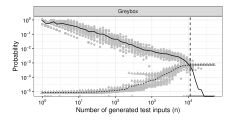
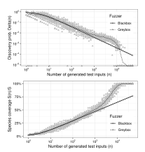
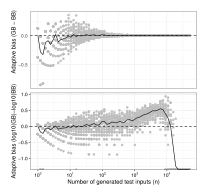

**Source:** *Estimating Residual Risk in Greybox Fuzzing* — [PDF](https://mboehme.github.io/paper/FSE21.pdf)


# **Estimating Residual Risk in Greybox Fuzzing**

Marcel Böhme Monash University, Australia MPI-SP, Germany Danushka Liyanage Monash University Australia Valentin Wüstholz ConsenSys Germany

#### **ABSTRACT**

For any errorless fuzzing campaign, no matter how long, there is always some residual risk that a software error would be discovered if only the campaign was run for just a bit longer. Recently, greybox fuzzing tools have found widespread adoption. Yet, practitioners can only guess when the residual risk of a greybox fuzzing campaign falls below a specific, maximum allowable threshold.

In this paper, we explain why residual risk cannot be directly estimated for greybox campaigns, argue that the discovery probability (i.e., the probability that the next generated input increases code coverage) provides an excellent upper bound, and explore sound statistical methods to estimate the discovery probability in an ongoing greybox campaign. We find that estimators for blackbox fuzzing systematically and substantially under-estimate the true risk. An engineer—who stops the campaign when the estimators purport a risk below the maximum allowable risk-is vastly misled. She might need execute a campaign that is orders of magnitude longer to achieve the allowable risk. Hence, the key challenge we address in this paper is *adaptive bias*: The probability to discover a specific error actually increases over time. We provide the first probabilistic analysis of adaptive bias, and introduce two novel classes of estimators that tackle adaptive bias. With our estimators, the engineer can decide with confidence when to abort the campaign.

#### **CCS CONCEPTS**

Security and privacy → Software and application security;
 Software and its engineering → Software testing and debugging.

#### **KEYWORDS**

software testing, statistics, estimation, assurance, correctness

# ACM Reference Format:

Marcel Böhme, Danushka Liyanage, and Valentin Wüstholz. 2021. Estimating Residual Risk in Greybox Fuzzing. In Proceedings of the 29th ACM Joint European Software Engineering Conference and Symposium on the Foundations of Software Engineering (ESEC/FSE '21), August 23–28, 2021, Athens, Greece. ACM, New York, NY, USA, 12 pages. https://doi.org/10.1145/3468264.3468570

#### 1 INTRODUCTION

On the one hand, we have software verification which allows to demonstrate the correctness of the program for *all inputs*. On the other hand, we have software testing which can demonstrate the


This work is licensed under a Creative Commons Attribution 4.0 Interna-

ESEC/FSE '21, August 23–28, 2021, Athens, Greece © 2021 Copyright held by the owner/author(s). ACM ISBN 978-1-4503-8562-6/21/08. https://doi.org/10.1145/3468264.3468570

<span id="page-0-1"></span>

factor - Discovery probability - Bug Probability

Figure 1: In greybox fuzzing, the probability  $p_{\text{bug}}$  to generate a bug-revealing input (dashed line) increases as n increases. The probability  $\Delta(n)$  that the (n+1)-th input is coverage-increasing (solid line) provides an upper bound on the probability (residual risk) that it is the first bug-revealing input. The vertical line is when we expect the first bug-rev. input.

correctness of the program only for *some inputs*. While verification provides much stronger correctness guarantees, it is *greybox fuzzing*, a specific form of software testing, which has found widespread adoption in industry [24–26].

From a fuzzing campaign that has found no bugs, can we derive some statement about the correctness of the program? Fuzzing being a random process, it should be possible to derive statistical claims about the probability that the next generated input is the first bug-revealing input. We call this probability the *residual risk*. We know how to quantify residual risk for whitebox fuzzing (using model counting) [10] and blackbox fuzzing (using estimation) [1], but not for greybox fuzzing—which has emerged as the state-of-the-art in automated vulnerability discovery.

Greybox fuzzing is subject to adaptive bias, i.e., the probability to generate a bug-revealing input actually increases throughout the fuzzing campaign. Figure 1 shows simulation results for greybox fuzzing. As more seeds become available, the bug probability  $p_{\rm bug}$  increased (dashed line). In contrast, blackbox fuzzing is not subject to adaptive bias and the probability to generate a bug-revealing input remains constant throughout the campaign. If this was the case for greybox fuzzing, we could cast residual risk estimation as a sunrise problem and employ the well-known Laplace estimator. However, in our experiments we find that, in the presence of adaptive bias, the Laplace estimator severely under-estimate the residual risk for greybox campaigns. The true risk is orders of magnitude higher than the estimator purports. A practitioner would abort the campaign many days earlier than necessary, and assume a higher degree of confidence in the correctness than warranted.

<span id="page-0-2"></span><span id="page-0-0"></span> $<sup>^{1}</sup>$ We mean the probability  $p_{\text{bug}}$  to generate any bug-revealing input, not just the first.  $^{2}$ The  $sunrise\ problem$  is the following riddle: "Suppose, we have seen the sun rise ever since we were born N days, ago. What is the probability that the sun rises tomorrow?"

To tackle adaptive bias in greybox fuzzing, we first propose to estimate an *upper bound* on residual risk—called discovery probability. Let's start with the model. Suppose, we are drawing n balls with replacement from an urn containing colored balls. Each ball represents a generated input. The ball's color represents, e.g., the executed program path (i.e., whatever we wish to measure the coverage of). Without loss of generality, we assign the color **black** to balls representing bug-revealing inputs. *Discovery probability*  $\Delta(n)$  is the probability that the (n+1)-th ball we draw has a color we have previously not observed. *Residual risk* is the probability that the (n+1)-th ball we draw is **black**. We argue, *as long as we have not seen any black balls* after drawing n balls with replacement, the probability to draw a ball with an arbitrary unobserved color provides an *upper bound* on the probability to draw a ball with the color **black**.

In this paper, we extend the probabilistic framework for blackbox fuzzing [1] to incorporate concepts from greybox fuzzing, and probabilistically analyze the functional behavior of residual risk and adaptive bias. We define *adaptive bias* as the difference in discovery probability between grey- and blackbox campaigns of equivalent length, started with the same corpus and formally show that, under realistic assumptions, adaptive bias reduces with campaign length.

We propose and study three general approaches to tackle adaptive bias during estimation in greybox fuzzing: (i) reset estimation, (ii) mean local estimation, and (iii) extrapolation. *Reset estimation* arises from the observation that a greybox campaign can be modelled as a sequence of blackbox campaigns, each started when a new seed is added to the corpus. Instead of the entire campaign, an *a*-reset estimator is applied to the partial campaign started before the *a* most recently added seeds. However, in our experiments, reset estimators systematically overestimate and exhibit a high variance.

Mean local estimation is motivated by the observation that the number of times a seed has been fuzzed in the past and the probability to be selected next is entirely disconnected. For instance, old seeds will have been fuzzed much more than new seeds but are less likely used to generate the next input. Hence, mean local estimators are defined as weighted combinations of seed-specific local estimates. In our experiments, we find that those perform best with low bias and variance.

*Extrapolation* is motivated by our observation from simulation and empirical results that discovery probability follows a power law. In our experiments, we find that, at the cost of measuring ground truth, discovery probability can be extrapolated by several orders of magnitude with high accuracy.

*In summary*, the paper makes the following contributions.

- Novel class of estimators that account for adaptive bias.
- Empirical investigation of estimator performance of existing and new estimators of discovery probability.
- Probabilistic analysis of adaptive bias in greybox fuzzing.
- Empirical and simulation study of the functional behavior of discovery probability as more inputs are generated.
- Extension of STADS [1] to accommodate greybox concepts, such as *current* corpus and *current* global distribution.
- All data & scripts are publicly available:
  - ★ https://www.kaggle.com/adaptivebias/empirical
  - ★ https://www.kaggle.com/adaptivebias/simulation

#### 2 MOTIVATING EXAMPLE

Why does the probability to generate a bug-revealing input increase for greybox fuzzing but not for blackbox fuzzing? Let us explore this question for a concrete example.

```
1  void crashme(char* s) {
2    if (strlen(s) != 4) return;
3    if (s[0] == 'b')
4    if (s[1] == 'a')
5    if (s[2] == 'd')
6    if (s[3] == '!')
7    abort();
8 }
```

Listing 1: This program crashes for "bad!". Taken from [5].

Listing 1 shows a program that crashes for input "bad!" when the input executes the abort statement in Line 8. Our task is to generate inputs for crashme, some of which would expose this bug.

**Blackbox fuzzer**. Suppose, we have a blackbox fuzzer that randomly generates strings (char\*) of length four (e.g., "3>r+"). In C, char is one byte and can have one of  $2^8 = 256$  values. There are  $256^4 = 4$  *billion* different strings of length four that our blackbox fuzzer can generate. Only one of those would expose the bug.

Thus, for our blackbox fuzzer, the probability  $p_{\rm bug}$  to generate a bug-revealing input is roughly one in four billion throughout the entire fuzzing campaign.

**Greybox fuzzer**. Suppose, our greybox fuzzer generates the first seed using the blackbox fuzzer. Assume that our greybox fuzzer has the following mutation operator: Given a seed, choose an arbitrary character uniformly at random and substitute it with another character chosen uniformly at random.

<span id="page-1-1"></span>Table 1: Expected #inputs to generate the next coverage-increasing seed (To), given the current corpus.

| #Seeds | From | То   | Expected #inputs required             |
|--------|------|------|---------------------------------------|
| 1      | ???? | b??? | $(1*4^{-1}*2^{-8})^{-1} = 1024$       |
| 2      | b??? | ba?? | $(1/2 * 4^{-1} * 2^{-8})^{-1} = 2048$ |
| 3      | ba?? | bad? | $(1/3 * 4^{-1} * 2^{-8})^{-1} = 3072$ |
| 4      | bad? | bad! | $(1/4 * 4^{-1} * 2^{-8})^{-1} = 4096$ |
| 5      |      |      | Total: 10240 inputs                   |

Table 1 illustrates how adding coverage-increasing inputs to the seed corpus gradually increases the probability  $p_{\rm bug}$  to generate the bug-revealing input. Our greybox fuzzer uses our blackbox fuzzer to generate the first seed ????, where ? denotes a placeholder for an arbitrary character. As we know, the probability that this initial seed exposes the bug is one in four billion. For simplicity, we will assume the initial seed does not start with a 'b'. The next coverage-increasing input b??? is generated with probability  $\frac{1}{4}$  (to choose the first character) multiplied by  $\frac{1}{256}$  to choose b as the first character, i.e., one in 1024. Once this new seed is added to the corpus, suppose we choose the next seed from the corpus uniformly at random. So, the next coverage-increasing input ba?? is generated with probability ( $\frac{1}{2} \cdot \frac{1}{4} \cdot \frac{1}{2^8}$ ), i.e., one in 2048. We proceed accordingly until the bug is found.

For a greybox fuzzer, starting from an arbitrary initial seed and given the mutation operators, the probability  $p_{bug}$  to generate an input that exposes the bug increases from one in four billion for the first generated input to one in four **thousand** for the final corpus—because new seeds are added throughout the campaign. In expectation, we only need about ten thousand inputs, total.

**Residual Risk** is the probability that the (n+1)-st generated input is the *first* bug-revealing input, i.e., a new bug is discovered. For our blackbox fuzzer, the probability  $p_{\text{bug}}$  to generate any bug-revealing input remains constant while generating n inputs. The residual risk decreases monotonically with n, i.e.,  $p_{\text{bug}}(1-p_{\text{bug}})^n$ . For our greybox fuzzer, as  $p_{\text{bug}}$  increases, the residual risk may also increase when new seeds are added before it decreases again.

**Discovery probability** is the probability that the (n+1)-st generated input increases coverage. Suppose our fuzzer generates inputs that exercises the five paths in lines 3–7 of Listing 1 with probabilities  $\langle p_1, p_2, p_3, p_4, p_5 \rangle$ , respectively.<sup>3</sup> For our blackbox fuzzer, the discovery probability is  $\sum_{i=1}^5 p_i (1-p_i)^n$ . For our greybox fuzzer, as  $p_i$  may vary, the discovery probability may increase when new seeds are added before it decreases again. This difference between black- and greybox is the source of adaptive bias.

**Adaptive bias** is the difference between in discovery probability between grey- and blackbox campaigns of equivalent length, started with the same corpus.

### 3 PROBABILISTIC ANALYSIS

#### 3.1 Background

We present more formally the same urn model from the introduction using the species discovery model [1]. Let  $\mathcal{P}$  be the program that we wish to fuzz. We refer to the set of all inputs that  $\mathcal{P}$  can consume as  $\mathcal{P}$ 's *input space*  $\mathcal{D}$ . Fuzzing program  $\mathcal{P}$  is a stochastic process

$$\mathcal{F} = \{X_n \mid X_n \in \mathcal{D}\}_{n=1}^N \tag{1}$$

of sampling N inputs with replacement from the program's input space. We call  $\mathcal{F}$  a fuzzing campaign and a tool that performs  $\mathcal{F}$  a non-deterministic blackbox fuzzer.

Suppose, we can divide the search space  $\mathcal{D}$  into S individual subdomains  $\{\mathcal{D}_i\}_{i=1}^S$  called species [1]. An input  $X_n \in \mathcal{F}$  is said to discover species  $\mathcal{D}_i$  if  $X_n \in \mathcal{D}_i$  and there does not exist a previously sampled input  $X_m \in \mathcal{F}$  such that m < n and  $X_m \in \mathcal{D}_i$  (i.e.,  $\mathcal{D}_i$  is sampled for the first time). An input's species are defined based on behavior observed when executing the input. For instance, a branch that is exercised by input  $X_n \in \mathcal{D}$  can be seen as a species. The discovery of new species then corresponds to an increase in branch coverage.

**Global species distribution**. We let  $p_i$  be the probability that the n-th generated input  $X_n$  belongs to species  $\mathcal{D}_i$ ,

$$p_i = P[X_n \in \mathcal{D}_i] \tag{2}$$

for  $i: 1 \le i \le S$  and  $n: 1 \le n \le N$ . We call  $\{p_i\}_{i=1}^S$  the fuzzer's global species distribution. The expected number of discovered species S(n) can be derived as the complement of the probability that a species  $\mathcal{D}_i$  remains undiscovered after generating n

test inputs, summed over all species.

$$S(n) = \sum_{i=1}^{S} \left[ 1 - (1 - p_i)^n \right] = S - \sum_{i=1}^{S} (1 - p_i)^n.$$
 (3)

We can show that the number of species *S* that the fuzzer discovers in the limit, i.e., the *asymptotic total number of species* is given as

<span id="page-2-2"></span>
$$S = \lim_{n \to \infty} S(n). \tag{4}$$

**Mutation-based fuzzing**. In a mutation-based fuzzing campaign new inputs are generated by mutating existing inputs, so-called seeds. In addition to the global species distribution, this suggests the existence of a local species distribution for each seed [3]. Let C be a set of seed inputs, called the seed corpus and  $q_t$  be the probability that the fuzzer chooses to mutate the seed  $t \in C$ .<sup>4</sup> For each seed t, let  $\mathcal{D}^t$  be the set of all inputs that can be generated by applying the available mutation operators to t. Mutation-based fuzzing of t is a stochastic process

<span id="page-2-4"></span>
$$\mathcal{F}^t = \left\{ X_n^t \mid X_n^t \in \mathbf{D}^t \right\}_{n=1}^{N^t} \tag{5}$$

of sampling  $N^t$  inputs with replacement by random mutation of the seed t. Note that  $\mathcal{F}^t \subseteq \mathcal{F}$  where  $\mathcal{F}$  is a mutation-based fuzzing campaign and t is a member of a corpus C of seeds. We call all species that can be found by fuzzing a seed t as the species in t's neighborhood.

**Local species distribution**. We let  $p_i^t$  be the probability that the n-th input  $X_n^t$  which is generated by mutating the seed  $t \in C$  belongs to species  $\mathcal{D}_i$ ,

$$p_i^t = P[X_n^t \in \mathcal{D}_i] \tag{6}$$

for  $i: 1 \le i \le S$  and  $n: 1 \le n \le N$ . We call  $\{p_i^t\}_{i=1}^S$  the *local species distribution* in the neighborhood of the seed t. Note that global and local distributions, by the law of total expectation, are related as

<span id="page-2-3"></span>
$$p_i = \sum_{t \in C} q_t \cdot p_i^t. \tag{7}$$

for  $i: 1 \le i \le S$  where selection probability  $q_t$  is the probability that  $t \in C$  is chosen for fuzzing. Hence, the number of species discovered over time for a mutation-based blackbox fuzzer according to Equation (3) is given by

$$S(n) = \sum_{i=1}^{S} \left[ 1 - \left( 1 - \sum_{t \in C} q_t \cdot p_i^t \right)^n \right].$$
 (8)

**Assumptions**. For our probabilistic model, we require that global and local species distributions are *invariant* throughout the fuzzing campaign. A contribution of the present work is to relax this assumption for greybox campaigns (cf. Section 3.3). So far, we require

$$p_i = P[X_n \in \mathcal{D}_i] = P[X_{n+1} \in \mathcal{D}_i]$$
 and (9)

$$p_i^t = P[X_n^t \in \mathcal{D}_i] = P[X_{n+1}^t \in \mathcal{D}_i] \tag{10}$$

for  $i: 1 \le i \le S$  and  $n: 1 \le n < N$ , where  $q_t$  is the probability that the fuzzer chooses the seed  $t \in C$ , where  $X_n$  and  $X_{n+1}$  are the n-th and (n+1)-th generated test inputs, respectively, and where  $X_n^t$  and  $X_{n+1}^t$  are the n-th and (n+1)-th test inputs generated by fuzzing the seed t, respectively.

<span id="page-2-0"></span><sup>&</sup>lt;sup>3</sup>Note that  $p_5 = p_{\text{bug}}$  in this example. In general,  $p_{\text{bug}}$  does not need to correspond to a path, branch, or statement in a program. For more details, see Section 3.2.

<span id="page-2-1"></span> $<sup>^4</sup>$ This selection probability is also known as the seed's *energy* or *weight*.

This holds if, for any program input  $d \in \mathcal{D}$  in the program's input space, we have that  $P[X_n = d] = P[X_{n+1} = d]$ , i.e., the probability to generate some input d is invariant throughout the campaign. Our model accommodates that a blackbox fuzzer may generate inputs from a non-uniform distribution, i.e., for any two inputs  $d_1, d_2 \in \mathcal{D}$ , it is entirely possible that the probability that the n-th test input is  $d_1$  or  $d_2$  differs, i.e.,  $P[X_n = d_1] \neq P[X_n = d_2]$ .

For random testing tools and for generation- or mutation-based blackbox fuzzers that generate inputs by some random process it is *realistic* to assume that the probability to sample from a subdomain  $\mathcal{D}_i \subseteq \mathcal{D}$  does *not* change during the fuzzing campaign. After all, without dynamic program feedback, a non-deterministic blackbox fuzzer has no reason to vary its fuzzing heuristics *during* the campaign. A mutation-based blackbox fuzzer usually has a fixed-size seed corpus C and fixed-size set of mutation operators.

Otherwise, we make *no assumptions* about the number S, relative abundance  $\{p_i\}_{i=1}^S$ , or distribution of species in the fuzzer's search space. Specifically, there is no assumption that species are distributed equally. Some rare species (i.e.,  $p_i$  is very small) may well be clustered within a small region of the input space.

# <span id="page-3-0"></span>3.2 Residual Risk and Discovery Probability

We define the *residual risk* of an ongoing fuzzing campaign of length n as the probability that the (n+1)-th generated test input discovers a bug. Given a set of species, without loss of generality, we remove *all bug-revealing inputs* and add them to a new, dedicated species  $\mathcal{D}_{\mathbf{X}}$ . In this context, residual risk is the probability that the (n+1)-th generated input belongs to  $\mathcal{D}_{\mathbf{X}}$ .

Figure 1 shows a simulation of 30 greybox campaigns on a subject with 50 species, including a rare, bug-revealing species. To ensure our simulation is *realistic*, we extended the publicly available simulation script that was used to explain the empirical results on the exponential cost of vulnerability discovery [2]. In the simulation, we sample n balls from an urn where each ball has one of S=50 colors. Each color represents a species while the color **black** is dedicated to the bug-revealing species. To simulate greybox fuzzing, whenever a ball is sampled that belongs to a previously unobserved color, the probability  $p_i$  for future samples to have one of the "neighboring" colors  $\mathcal{D}_i$  slightly increases. The resulting distribution is normalized such that  $\sum_{i=1}^S p_i = 1$ . The residual risk is the expected probability that the (n+1)-th ball is **black** as n increases. We repeat this simulation 30 times and show individual and average values (triangles and lines, resp.).

In greybox fuzzing, the probability to generate a bug-revealing input actually *increases* over time. However, without any evidence about the presence of the bug, there is no way that we can account for this increase in our missing mass estimation. We investigate this adaptive bias in Section 3.3.

To overcome this challenge, we propose to estimate *discovery probability* as an *upper bound* on the residual risk. Like residual risk, discovery probability is subject to adaptive bias. However, unlike residual risk, we can empirically measure the discovery probability in an ongoing fuzzing campaign. While the residual risk measures the probability that the (n+1)-th ball is **black** (which we have not observed), the discovery probability measures the probability that the (n+1)-th ball has an arbitrary color which we have not observed (including the color **black**; cf. Fig. 1 top curve).

<span id="page-3-1"></span>

Figure 2: Discovery probability  $\Delta(n)$  (top) and proportion of discovered species S(n)/S (bottom) as the number n of generated test inputs increases (log-log-scale). Grey triangles are values for individual campaigns while lines show average values. Simulation of 30 greybox and blackbox campaigns of length N=50k).

We define the *discovery probability*  $\Delta(n)$  as the probability that test input  $X_{n+1} \in \mathcal{F}$  discovers a new species, which is derived as the difference in the expected number of discovered species when n and n+1 test inputs have been generated,

<span id="page-3-4"></span>
$$\Delta(n) = S(n+1) - S(n) = \sum_{i=1}^{S} p_i (1 - p_i)^n$$
 (11)

**Power Law.** Figure 2.top illustrates the general behavior of discovery probability.<sup>5</sup> Discovery probability  $\Delta(n)$  appears to be *scale invariant*: one order of magnitude more test inputs reduce the discovery probability by roughly one order of magnitude—a property that holds over the entire campaign. In fact, in the log-log plot, discovery probability for both black- and greybox campaigns appear almost like straight lines. Scale invariance is a well-known attribute of *power law* relationships where a quantity f(x) varies as a power of another quantity x, i.e.,  $f(x) = ax^{-k}$ , where a and b are two non-negative (fixed) parameters.

**Extrapolation**. To leverage the power law relationship, at the beginning of a campaign, we could measure the true discovery probability<sup>6</sup> in exponentially increasing intervals and employ a linear regression on the logarithm of discovery probability and number of generated tests to extrapolate discovery probability by several orders of magnitude. Indeed, a linear regression of  $[\log(n) \sim \log(\Delta(n))]$  yields a *very high goodness-of-fit*. Concretely, in blackand greybox campaigns, respectively, on average  $R^2 = 99\%$  and  $R^2 = 99\%$  and  $R^2 = 99\%$  and  $R^2 = 99\%$  and  $R^2 = 99\%$  and  $R^2 = 99\%$  and  $R^2 = 99\%$  and  $R^2 = 99\%$  and  $R^2 = 99\%$  and  $R^2 = 99\%$  and  $R^2 = 99\%$  and  $R^2 = 99\%$  and  $R^2 = 99\%$  and  $R^2 = 99\%$  and  $R^2 = 99\%$  and  $R^2 = 99\%$  and  $R^2 = 99\%$  and  $R^2 = 99\%$  and  $R^2 = 99\%$  and  $R^2 = 99\%$  and  $R^2 = 99\%$  and  $R^2 = 99\%$  and  $R^2 = 99\%$  and  $R^2 = 99\%$  and  $R^2 = 99\%$  and  $R^2 = 99\%$  and  $R^2 = 99\%$  and  $R^2 = 99\%$  and  $R^2 = 99\%$  and  $R^2 = 99\%$  and  $R^2 = 99\%$  and  $R^2 = 99\%$  and  $R^2 = 99\%$  and  $R^2 = 99\%$  and  $R^2 = 99\%$  and  $R^2 = 99\%$  and  $R^2 = 99\%$  and  $R^2 = 99\%$  and  $R^2 = 99\%$  and  $R^2 = 99\%$  and  $R^2 = 99\%$  and  $R^2 = 99\%$  and  $R^2 = 99\%$  and  $R^2 = 99\%$  and  $R^2 = 99\%$  and  $R^2 = 99\%$  and  $R^2 = 99\%$  and  $R^2 = 99\%$  and  $R^2 = 99\%$  and  $R^2 = 99\%$ 

<span id="page-3-2"></span> $<sup>^5{\</sup>rm For}$  now, we ask the reader to focus on the greybox line. We discuss adaptive bias as the difference between blackbox and greybox fuzzing in Section 3.3.

<span id="page-3-3"></span><sup>&</sup>lt;sup>6</sup>Note that *measuring* discovery probability (as opposed to estimating it) incurs a cost that is prohibitive for reasonably large n (cf. Section 5.3)

<span id="page-4-1"></span>

Figure 3: Adaptive bias (on a log-x-scale, top:  $\Delta_G(n) - \Delta_B(n)$ ; **bottom:**  $\log_{10}(\Delta_G(n)) - \log_{10}(\Delta_B(n))$ , where  $\Delta_G$  and  $\Delta_B$  are discovery probabilities for greybox and blackbox campaigns, resp.). As discovery probabilities span several orders of magnitude, the bottom shows difference in magnitude.

94% of the variance found in the response variable  $\log(\Delta(n))$  can be explained by the predictor variable log(n). We investigate this approach empirically in Section 6.3 for a state-of-the-art greybox fuzzer, and the results confirm our observation (median  $R^2 \ge 97\%$ ).

#### <span id="page-4-0"></span>**Adaptive Bias** 3.3

Residual risk and discovery probability are subject to adaptive bias. Suppose, our fuzzer can be run in two modes, a greybox mode and a blackbox mode. The only difference between the two modes is that, in a greybox campaign  $\mathcal{F}_G$ , the fuzzer adds a generated input to the seed corpus if it discovers a new species, while in a blackbox campaign  $\mathcal{F}_B$ , the fuzzer always maintains the initial seed corpus. All other fuzzer properties, such as the initial corpus, the set of mutation operators, or the power schedule, are equal in both modes.

Informally, we can define adaptive bias as the difference in discovery probability between grey- and blackbox campaigns of equivalent length, started from the same corpus. Figure 2 illustrates the impact of adaptive bias on the discovery probability in a greybox campaign within our simulation study.

Due to adaptive bias, the discovery probability is consistently higher in the greybox campaign than the blackbox campaign (until shortly before 100% of species are discovered; Fig. 3).

We extend the STADS probabilistic model [1] to accommodate greybox fuzzing and adaptive bias. Let  $C_n$  be the current seed corpus after exactly n test inputs have been generated in a greybox campaign  $\mathcal{F}_G = \{X_1, \dots, X_n, \dots, X_N\}$ . Concretely,

$$C_n = \{X_m \mid X_m \in \mathcal{F}_G \land \operatorname{disc}(X_m, \mathcal{F}_G) \land m \le n\}$$
 (12)

where  $\operatorname{disc}(X_m, \mathcal{F}_G)$  holds if there exists a species  $\mathcal{D}_i$  for  $i: 1 \leq i$  $i \leq S$ , such that generated input  $X_m \in \mathcal{D}_i$  and there does *not* exist a previously generated input  $X_l \in \mathcal{F}_G$  such that l < m and  $X_l \in \mathcal{D}_i$ .

Adaptive bias emerges in greybox campaigns as seeds are added to a corpus. Suppose without loss of generality that the (n+1)-th generated input discovers a new species, thus  $|C_n| < |C_{n+1}|$ . Even if the discovery probabilities  $\Delta_G(n)$  and  $\Delta_B(n)$  of grey- and blackbox campaigns, respectively, were the same when n test inputs have been generated, i.e.,  $\Delta_G(n) = \Delta_B(n)$ —we generally have  $\Delta_G(n +$ 1)  $\neq \Delta_B(n+1)$  because of the impact of the added seed's local species distribution on the global distribution (cf. Equation 7 & 11).

**Current distribution**  $p_{i,n}$ . To quantify the impact of adding seeds on the global species distribution, we use Kullback-Leibler (KL) divergence [13] as a measure of distance between two distributions. For a greybox campaign, let  $\{p_{i,n}\}_{i=1}^{S}$  be the *current global* species distribution when n test inputs have been generated, i.e.,

$$p_{i,n} = \sum_{t \in C_n} q_t p_i^t \tag{13}$$

for  $i: 1 \le i \le S$ , where  $q_t$  it the probability that the fuzzer chooses to mutate the seed  $t \in C_n$ .

Adaptive bias reduces. Under a realistic assumption, we show that the "distance" between the species distributions before and after the seed was added reduces as the number *n* of generated test inputs increases. Our assumption is that the probability  $q_{t'}$  that the fuzzer chooses to mutate the most recently added seed t' also reduces as the seed corpus grows, where  $t' \in C_{n+1}$  but  $t' \notin C_n$ . This assumption holds for all known power schedules in the most popular greybox fuzzers, LibFuzzer [14] and AFL [29].

The KL-divergence from the global species distribution  $p_{i,n}$  (before adding the seed t') to the distribution  $p_{i,n+1}$  (after adding t') is a measure of distance between both distributions,

$$D(p_{i,n+1} \mid\mid p_{i,n}) = \sum_{i=1}^{S} p_{i,n+1} \log \left( \frac{p_{i,n+1}}{p_{i,n}} \right)$$
 (14)

We observe that the global distribution  $\{p_{i,n+1}\}_{i=1}^{S}$  after t' was added is composed of the previous global distribution  $\{p_{i,n}\}_{i=1}^{S}$  and the local distribution  $\{p_i^{t'}\}_{i=1}^S$  of the new seed t'

$$p_{i,n+1} = (1 - q_{t'}) \cdot p_{i,n} + q_{t'} \cdot p_i^{t'}$$
(15)

for  $i: 1 \le i \le S$ , such that

$$D(p_{i,n+1} \mid\mid p_{i,n}) = \sum_{i=1}^{S} p_{i,n+1} \log (1 - q_{t'} \cdot c_{i,n,t'}), \qquad (16)$$

where  $q_{t'}$  is the probability that the fuzzer chooses to mutate the most recently added seed t', and  $c_{i,n,t'} = \frac{p_i^{t'}}{p_{i,n}} - 1$ . Recalling that  $\log(1) = 0$  and assuming that  $p_{i,n} > 0$  for all

 $i: 1 \le i \le S$ , we can see that

$$\lim_{q_{t'} \to 0} D(p_{i,n+1} \mid\mid p_{i,n}) = 0 \tag{17}$$

KL-divergence D approaches zero as  $q_{t'}$  approaches zero.

# **OUR ESTIMATORS OF DISCOVERY** PROBABILITY

Discovery probability  $\Delta$  is the probability that the next generated input discovers a new species. In Section 3.2, we discussed how discovery probability provides an upper bound on the residual risk. In our evaluation, we consider a good estimator to be conservative and accurate. Seeking an upper bound on the residual risk, a *conservative*  $\Delta$  estimator might systematically overestimate risk, but it can never systematically underestimate. An *accurate* estimator has a low mean bias, i.e., the average difference between the estimate and the true value is low, and it has a low variance, i.e., the individual estimates are usually quite close to the average estimate.

Unfortunately, the *maximum likelihood estimator* of residual risk, i.e., the proportion of vulnerability-exposing inputs, is neither conservative nor accurate. It would always estimate a *zero residual risk*. However, in the absence of evidence for the existence of a vulnerability, we cannot assign the entire probability mass to the one observed event (i.e., no vulnerability). Hence, the problem of estimating the probability of an event that has not been observed is also known as estimating the *missing mass*. In the following, we recall and propose some estimators of the missing mass.

# 4.1 Laplace Estimator

The well-known Laplace estimator distributes some probability mass across unobserved events by counting every unobserved event as observed exactly once. Pierre-Simon Laplace was interested in solving the *sunrise problem*: based on prior knowledge that the sun has risen *n* consecutive days up to and including today, what is the probability that the sun will rise tomorrow? In what would become the foundations of Bayesian statistics, Laplace developed the rule of succession.

Let  $X'_1, \ldots, X'_n$  be a sequence of independent Bernoulli random variables where  $X'_i = 1$  if the i-th trial is considered a "success". If s out of n trials were successes, then the *rule of succession* provides an estimator  $\hat{\theta}(s,n)$  of the probability  $P(X'_{n+1} = 1 \mid (X'_1 + \ldots + X'_n) = s)$  that the (n+1)-th trial will be a success as

$$\hat{\theta}(s,n) = \frac{s+1}{n+2} \tag{18}$$

Hence, we introduce the *Laplace estimator*  $\hat{\Delta}_L(n)$  as our first estimator of residual risk. Given that, throughout the fuzzing campaign, s=0 out of n generated inputs have exposed a vulnerability, the probability to discover a vulnerability when generating (n+1)-th test input is estimated as

$$\hat{\Delta}_L(n) = \hat{\theta}(0, n) = \frac{1}{n+2}$$
 (19)

**Intuition**. The key idea of Laplace was to report the proportion of times we have observed the sun not rise *assuming* we have observed both events once more than we actually have. As the evidence for the sun always rising increases, the Laplace estimate of the probability of the sun *not* rising approaches zero. Yet, there *always* remains a non-zero probability for the sun not to rise. Similarly, as an estimator of residual risk there always remains a non-zero probability that the (n+1)-th test input exposes a vulnerability. While Laplace is certainly the first, better missing mass estimators have since been proposed.

### 4.2 Good-Turing Estimator

The Good-Turing estimator is perhaps the most widely used estimator of the missing probability mass. It was proposed in a seminal paper by I. J. Good and Alan Turing in 1953 [11]. The Good-Turing

estimator is computed based on the frequency of rarely observed species. Compared to Laplace, the Good-Turing estimator considers more "structure" in the available data and is thus also more amenable to our adjustments for adaptive bias. Concretely, Good-Turing gives an estimate of the probability to discover a previously unseen species. As discussed in Section 3.2, the discovery probability provides an upper bound on the residual risk.

When n test inputs have been generated during a fuzzing campaign, let the *incidence frequency*  $Y_i$  for a species  $\mathcal{D}_i$  be the number of generated test inputs that belong to species  $\mathcal{D}_i$ ,

$$Y_i = |\{X_i \mid X_i \in \mathcal{D}_i \land 1 \le j \le n\}|.$$
 (20)

Let the number of singleton species  $f_1$  be the number of discovered species to which exactly one generated input belongs,

$$f_1 = |\{\mathcal{D}_i \mid Y_i = 1 \land 1 \le i \le S\}|.$$
 (21)

We introduce the *Good-Turing estimator*  $\hat{\Delta}_{GT}(n)$  as our first estimator of discovery probability. Suppose, after generating n test cases throughout the fuzzing campaign,  $f_1$  species were observed exactly once. The Good-Turing estimator of the probability to discover a previously unseen species is computed as the maximum likelihood estimate of the probability to observe a singleton species,

$$\hat{\Delta}_{GT}(n) = \frac{f_1}{n} \tag{22}$$

**Intuition**. The key idea of the Good-Turing estimator is to use an estimate of the probability to observe a rare species as an estimate of the probability to observe an unseen species (which is generally rarer). Concretely, Good-Turing reports the maximum likelihood of the probability that the next generated test input t belongs to a singleton species as an estimate of the probability that t discovers a new species.

The main properties of Good-Turing are, i) the estimator's accuracy strictly increases as the sample size (i.e., number of generated test inputs) increases [21], ii) its convergence to the true value is also reasonably fast [30], iii) its mean squared error is reasonably low [19], and iv) its performance is close to the best natural estimator for any distribution [18]. While Good-Turing is classically defined for multinomial distribution, the definition for the case where an input can belong to multiple species is equivalent [6].

#### 4.3 Reset Estimators

To account for adaptive bias during the estimation of discovery probability in greybox campaigns, we propose to apply estimators of missing mass to incidence frequencies  $Y_i$  that are refreshed every once in a while (i.e., reset  $Y_i = 0$  for all  $i : 1 \le i \le S$ ). Our class of reset estimators is parameterized by the number of seeds that can be added to the corpus before the incidence frequencies are reset to zero. In the current instance, we suggest to apply the Good-Turing estimator of missing mass on the refreshed frequency counts.

Given the same *initial* seed corpus *C*, *adaptive bias* is the difference between discovery probabilities for a blackbox fuzzing campaign and a greybox fuzzing campaign of length *n*. As more seeds are added to the corpus, the probability to discover a previously unobserved species the (*n*+1)-th generated test input usually *increases* for a greybox campaign (cf. Fig. 3). Given the same allowable risk,

compared to a blackbox campaign, a greybox campaign would need to generate less inputs to fall below the given threshold.

We propose to consider a greybox campaign as a sequence of blackbox campaigns each started when a new seed is added. We observe that the adaptive bias emerges only because new seeds are added to the seed corpus. As a new seed becomes available for fuzzing, the probability  $p_i$  that a generated input belongs to a rare species  $\mathcal{D}_i$  might slightly increase. However, for the period between two additions to the seed corpus the global species distribution remains invariant, like in a blackbox fuzzing campaign. Hence, a greybox campaign  $\mathcal{F}$  is a sequence of blackbox campaigns

$$\mathcal{F} = \langle F_1, F_2, \dots, F_k \rangle \tag{23}$$

where k is the number of new seeds that are added to the initial seed corpus throughout the greybox campaign  $\mathcal{F}$ .

Given parameter a, we define the a-reset frequency  $Y_{i,a}$  of species  $\mathcal{D}_i$  as the incidence frequency of  $\mathcal{D}_i$  in the partial greybox campaign that was started when the (k-a)-th seed was added to the initial seed corpus, i.e.,

$$Y_{i,a} = |\{X_i \mid X_i \in \langle F_{k-a}, \dots, F_k \rangle \land X_i \in \mathcal{D}_i \land 1 \le i \le S\}|. \quad (24)$$

Using the a-reset frequency  $Y_{i,a}$ , the definition of the number of a-reset singleton species is straightforward,

$$f_{1,a} = |\{\mathcal{D}_i \mid Y_{i,a} = 1 \land 1 \le i \le S\}|.$$
 (25)

We introduce the *a-reset Good Turing estimator*  $\hat{\Delta}_R(n,a)$  as our first class of estimators of discovery probability that accounts for adaptive bias in greybox campaigns. The *a*-reset Good Turing estimator can be computed as

$$\hat{\Delta}_R(n,a) = \frac{f_{1,a}}{n} \tag{26}$$

where, in practice, *a* is the number of new seeds that can be added to the seed corpus—since the last reset—before the recorded incidence frequencies must be reset again.

**Intuition**. The regular reset of incidence frequencies allows to remove the "weight" of the evidence for the previous species distribution when rare species were less likely. The inverse of the *a*-reset frequencies  $\{1/Y_{i,a}\}_{i=1}^{S}$  provides a less biased estimate of the *current* global species distribution  $\{p_i\}_{i=1}^{S}$  than the inverse of the actual incidence frequencies  $\{1/Y_i\}_{i=1}^{S}$ .

However, considering only the shorter tail of the current greybox campaign will also lead to an overestimate of the true discovery probability. The actual probability to discover a new species might already be much lower. In the following, we present a class of estimators that allows us to use the entire evidence generated throughout the full greybox campaign.

# 4.4 Mean Local Estimators

We can understand adaptive bias also as a property that emerges from an unbalanced distribution of the number of times each seed has been chosen for fuzzing. On the one hand, we have new seeds that—while more likely to be chosen next—may have never been fuzzed before. On the other hand, we have old seeds that—while

much less likely to be chosen next—may have been fuzzed thousands of times. Clearly, if we estimate discovery probability from global incidence frequencies, where the global incidence frequency  $Y_i$  of a species  $\mathcal{D}_i$  is computed as a *linear combination* of the local incidence frequencies  $Y_i^t$  of a seed  $t \in C$ , i.e.,  $Y_i = \sum_{t \in C} Y_i^t$ , then the resulting estimate is bound to be biased towards the neighborhood of the old (less likely) seeds.

Now, adaptive bias is *not* a concern for "local estimators", i.e., estimators that are based on the local distribution  $\{p_i^t\}_{i=1}^S$  of seed t. Given a seed t, let M be the fuzzer's mutation operators,  $L^t$  be the set of locations in t where a mutation operator can be applied. Without loss of generality, suppose the fuzzer generates an input t' only when applying the operator  $m \in M$  to location  $l \in L^t$ . 8 Then,

$$P[X_n^t = t'] = P[A_n^t = m] \cdot P[B_n^t = l]$$
 and (27)

$$P[X_n^t = t'] = P[X_{n+1}^t = t']$$
(28)

where  $X_n^t$  is the n-th input that is generated from t by fuzzing t,  $X_{n+1}^t$  is the (n+1)-th input generated from t by fuzzing t,  $A_n^t$  and  $B_n^t$  are the mutation operator and mutation location in t, respectively, and both are chosen at random when generating input  $X_n^t$ .

We propose to consider a greybox campaign  $\mathcal{F}$  as a set of concurrent blackbox campaigns, one for each seed.

$$\mathcal{F} = \{X_n \mid \exists m. X_n \in \mathcal{F}^{X_m} \land \mathsf{disc}(X_m) \land m < n\}_{n=1}^N$$

where  $\mathcal{F}^{X_m}$  is a seed-specific fuzzing campaign (Eq. (5)), N is the total number of inputs that  $\mathcal{F}$  generates, and  $\operatorname{disc}(X_m)$  holds if there exists a species  $\mathcal{D}_i$  such that  $X_m$  discovered  $\mathcal{D}_i$ . This perspective allows us to estimate quantities emerging from the global distribution as a weighted combination of estimates of quantities emerging from the local distributions.

We introduce the *Mean Local Laplace estimator*  $\hat{\Delta}_{ml,L}(n)$  as a new class of estimators of discovery probability that (i) account for adaptive bias in greybox campaigns and (ii) are computed as a weighted combination of local missing mass estimates (*not* subject to adaptive bias). Given the current corpus  $C_n$  when n test inputs have been generated (cf. Section 3.3), then  $\hat{\Delta}_{ml,L}(n)$  is computed as

$$\hat{\Delta}_{ml.L}(n) = \sum_{t \in C_n} \frac{q_t}{n_t + 2} \tag{29}$$

where  $q_t$  is the probability that, to generate the (n+1)-th test input, the fuzzer chooses to mutate seed  $t \in C_n$ , and  $n_t$  is the number of test inputs that were generated by fuzzing t.

When n test inputs have been generated, let the *local incidence* frequency  $Y_i^t$  for species  $\mathcal{D}_i$  and seed t be the number of test inputs generated by fuzzing t that belong to  $\mathcal{D}_i$ ,

$$Y_i^t = |\{X^t \mid X^t \in \mathcal{D}_i \land X^t \in \mathcal{F}^t\}|. \tag{30}$$

where  $\mathcal{F}^t$  is the seed-specific campaign. Let  $f_1^t$  be the number of local singleton species for a seed t (i.e., #locally discovered species to which exactly one generated input belongs),

$$f_1^t = |\{\mathcal{D}_i \mid Y_i^t = 1 \land 1 \le i \le S\}|. \tag{31}$$

We introduce the *Mean Local Good-Turing estimator*  $\hat{\Delta}_{ml.GT}(n)$  as a weighted combination of the local Good-Turing estimates. In

<span id="page-6-0"></span> $<sup>^7\</sup>mathrm{We}$  note that we prefer conservative estimators. An estimator that overestimates residual risk is preferred over one that underestimates the risk.

<span id="page-6-1"></span> $<sup>^8</sup>$ The application of a mutation operator to a mutation location is merely an abstraction. It means that the fuzzer chooses at random from a large but fixed set of possible modifications to t.

our experiments, we often observed the special case where  $n_t = 0$  (i.e., the seed t has never been fuzzed). In this case, we assume the local discovery probability to be one (1). In the absence of local singletons, we fall back to the local Laplace estimate.

$$\hat{\Delta}_{ml.GT}(n) = \sum_{t \in C_n} q_t \cdot \begin{cases} 1 & \text{if } n_t = 0\\ 1/(n_t + 2) & \text{if } f_1^t = 0\\ f_1^t/n^t & \text{otherwise} \end{cases}$$
(32)

where  $q_t$  is the probability that, to generate the (n+1)-th test input, the fuzzer chooses to mutate seed  $t \in C_n$ ,  $n_t$  is the number of inputs generated by fuzzing t, and  $f_1^t$  is the number of local singleton species for t.

**Intuition**. The weighted combination of local missing mass estimates tackles adaptive bias in discovery probability estimation by accounting for the fact that some seeds have been fuzzed more often than others. The contribution of each seed t to the final discovery probability estimate is decided based on the current power schedule  $q_t$ . While old seeds may have been fuzzed much more often, if the probability  $q_t$  to select that seed is very low, the contribution from that seed to the final discovery probability estimate will also be relatively low.

In contrast to a-reset estimators, our mean local estimators allow to reuse incidence frequencies from the entire fuzzing campaign. This facilitates less imprecision during estimation. However, the weighted combination of local missing mass estimates systematically overestimates  $\Delta(n)$ . For instance, when a new seed is added before it has been fuzzed, a mean local estimator assumes that the first input generated from that seed discovers a new species (which is true only locally). However, a positively biased residual risk estimator is well preferred over a negatively bias one.

#### 5 EXPERIMENTAL SETUP

#### 5.1 Research Questions

- **RQ.1 Classical Estimators.** How do two classical estimators of missing mass, Good-Turing and Laplace, perform in the presence of adaptive bias for greybox campaigns?
- **RQ.2 Our Estimators.** How do our novel 1-reset, 10-reset, the Laplace Mean Local, and Good-Turing Mean Local estimators perform in addressing adaptive bias for greybox campaigns?
- **RQ.3 Extrapolation.** Given a small number of data points of discovery probability at the very beginning of the greybox campaign, how does a linear extrapolation of  $[\log(n) \sim \log(\Delta(n))]$  perform in predicting the discovery probability several orders of magnitude later in the campaign?

# 5.2 Fuzzer, Species, and Subject Programs

For our experiments, we use **LibFuzzer** [14], the default greybox fuzzer in Google's OSSFuzz [25] and Microsoft's OneFuzz [26]. Our species are a coverage elements called features. A *feature* is a combination of covered branch and its hit count. So, feature coverage subsumes branch coverage. We also considered evaluating estimator performance in **AFL**. However, AFL selects each seed from a circular queue that can have an orbit of several hours which makes estimation difficult; in short, the discovery probability fluctuates

significantly depending on the current queue position. Very recently, we became aware that the latest version of AFL's successor AFL++ (v3.0) substituted the AFL-style circular queue with a more efficient LibFuzzer-style weighted sampling [23].

We chose six subjects from FuzzBench [22], a fuzzer benchmarking platform. From FuzzBench, we chose six arbitrary, security-critical programs that did not crash for the first 10<sup>9</sup> generated test inputs. LibFuzzer is an in-process fuzzer that crashes with the subject and restarts, loosing all incidence frequencies. We chose exactly six subjects for practical reasons. An experimental campaign for one subject could run for up to one week. Freetype (286k LoC) is a widely-used software font engine. JSON (12k LoC) is the JSON parser library for CPP. Libpcap (69k LoC) is a library to capture packets from the network. Libpng (423k LoC) is an image parser library for PNG. Libxml2 (503k LoC) is an XML parser library. Zlib (48k LoC) is a data-compression library.

# <span id="page-7-0"></span>5.3 Experiment Methodology

**Data points**. To run a greybox fuzzing campaign, we execute LIB-FUZZER on a subject with the provided seed corpus. At *exponentially increasing intervals*, we record a time stamp and all relevant statistics required for estimation. Starting with 100 generated test inputs, each subsequent data point is chosen after twice as many test inputs were generated compared to the previous data point. We stop the campaign either when we run out of resources, or when  $N = 100 \cdot 2^{23}$  (approx.  $10^9$ ) test inputs were generated. For freetype and libxml2, we ran out of disk space.

**Repetitions**. For each subject, we run 20 fuzzing campaigns and, if not stated otherwise, report average values.

**Ground truth**. For each data point, we determine the true discovery probability as follows. When recording the data point after having generated n test inputs, we suspend the greybox campaign and start a blackbox campaign of length n with the current seed corpus. During that blackbox campaign, generated inputs that discover a new species are *not* added to the seed corpus, and incidence frequencies or other statistics for the greybox campaign are *not* updated. However, we *count* the number d of inputs that belong to species that have *not* been discovered in the greybox campaign.

We determine the true discovery probability as the proportion d/n of inputs generated in the data point-specific blackbox campaign of length n that belong to species that have not been discovered in the greybox campaign of length n. Note that we let the blackbox campaign generate as many inputs as the greybox campaign has already generated. This is because of the exponential cost of reducing discovery probability by one order of magnitude.

Determining ground truth is expensive. One fuzzing campaign of length  $N \approx 10^9$  took between 2 and 7 days of wall-clock time.

### 5.4 Measures of Estimator Performance

We use two classical measures of estimator performance, mean bias and variance. *Mean estimator bias* quantifies the degree to which the estimator systematically over- or under-estimates the estimand. We consider a good estimator to have a *small and positive mean bias*. The estimator might systematically over-estimate the probability that a vulnerability exists, but it should never systematically under-estimate it, and the magnitude of the bias should be small. *Estimator* 

variance is literately the variance of the estimates. While the average might be close to the true value (low mean bias), an individual estimate might still be far from the average estimate (high variance). We consider a good estimator to have a *small variance*.

However, unlike in traditional studies of estimator performance, we measure mean bias and variance as a difference in magnitude. The discovery probability  $\Delta(n)$  for a long-running fuzzing campaign can be very small. In fact, depending on the number of inputs n,  $\Delta(n)$  ranges over many orders of magnitude (cf. Section 3.2). Suppose, the true value is  $10^{-16}$ , but our estimator gives  $10^{-24}$  (or  $10^{-8}$ ). Then neither the absolute nor the relative mean bias would indicate the eight orders of magnitude difference. Hence, we measure bias and variance using the common logarithm.

**Mean Bias**. Suppose, we conduct R fuzzing campaigns. For each campaign  $r: 1 \le r \le R$  of length n, let the true discovery probability be  $\Delta_r(n)$  and the estimated discovery probability be  $\hat{\Delta}_r(n)$ , then the mean bias  $\bar{B}(n,\hat{\Delta})$  of estimator  $\hat{\Delta}$  is computed as

$$\bar{B}(n,\hat{\Delta}) = \sum_{r=1}^{R} \frac{\log_{10}(\hat{\Delta}_r(n)) - \log_{10}(\Delta_r(n))}{R}$$
 (33)

where a positive mean bias of  $\bar{B}(n,\hat{\Delta}) > 0$  can be interpreted as  $\hat{\Delta}(n)$  systematically over-estimating  $\Delta(n)$  by  $\bar{B}(n,\hat{\Delta})$  orders of magnitude (and  $\bar{B}(n,\hat{\Delta}) < 0$  as under-estimating, resp.).

**Variance**. Suppose, we conduct R fuzzing campaigns, for each campaign  $r: 1 \le r \le R$ , when n test inputs have been generated, let the estimated discovery probability be  $\hat{\Delta}_r(n)$ , then the variance  $Var(n, \hat{\Delta})$  of estimator  $\hat{\Delta}$  is computed as

$$Var(n,\hat{\Delta}) = \frac{1}{R} \left[ \sum_{r=1}^R \log_{10}(\hat{\Delta}_r(n)) - \frac{\sum_{s=1}^R \log_{10}(\hat{\Delta}_s(n))}{R} \right]$$

which is the average difference between each individual and the average estimate by  $Var(n, \hat{\Delta})$  orders of magnitude.

#### 5.5 Infrastructure

All experiments were executed on a 32-core cloud instance with Intel(R) Haswell(R) 2.3GhZ CPUs and 64bit main memory and a 120GB hard disk. To facilitate a fair workload, we run all (and only) 20 repetitions of one subject simultaneously.

#### 6 EXPERIMENTAL RESULTS

# 6.1 RO1. Performance of Classical Estimators

Figure 4.a shows the performance of the Laplace  $\hat{\Delta}_L(n)$  and Good-Turing  $\hat{\Delta}_{GT}(n)$  estimators. Both estimators have previously been proposed to estimate the current discovery probability in blackbox campaigns. However, due to the lack of ground truth, they have never been empirically evaluated.

In our evaluation, we find that both estimators,  $\hat{\Delta}_L(n)$  and  $\hat{\Delta}_{GT}(n)$  underestimate the true discovery probability in greybox campaigns. The estimate might be up to four orders of magnitude smaller than the true discovery probability. However, except for freetype, at some point during the campaign, the difference in magnitude usually starts decreasing again. This is consistent with our claim that adaptive bias reduces as more test inputs are generated. A systematic negative bias is undesirable when estimating the residual risk that a vulnerability could be discovered if more time was invested.

Classical estimators systematically and substantially *underestimate* the discovery probability in greybox campaigns. This means that the estimate purports false confidence in program correctness. Suppose the engineer stops the campaign after generating n inputs, such that the current discovery probability estimate  $\hat{\Delta}(n) = \bar{\Delta}$  matches her maximum allowable threshold  $\bar{\Delta}$ . If the mean bias at n shows a difference in magnitude of -2 (negative two), then the engineer will terminate the campaign too early. Because of the power law relationship, she would need to execute about two orders of magnitude more inputs to achieve the required allowable residual risk  $\bar{\Delta}$ .

# 6.2 RQ2. Performance of Our Estimators

Figure 4.b shows the performance of our *a*-reset and mean local estimators which address the key challenge in estimation for greybox fuzzing, i.e., adaptive bias. Our estimators exhibit a smaller and positive mean bias than the previously proposed estimators.

**Reset**. The 1-reset estimator  $\hat{\Delta}_R(n,1)$  resets the frequency counts for each species back to zero every time a new seed is added. The resulting estimate is not subject to adaptive bias because the frequencies/samples come only from the species distribution emerging from the current corpus. However, compared to the total campaign length, we are clearly undersampling. This undersampling leads to an overestimate of the true discovery probability. To reduce the magnitude of this positive bias, we evaluated the 10-reset estimator  $\hat{\Delta}_R(n,10)$  which resets the frequency counts for each species back to zero after every 10th newly discovered seed.

Both reset estimators,  $\hat{\Delta}_R(n,1)$  and  $\hat{\Delta}_R(n,10)$  exhibit a fairly high positive mean bias. The 1-reset  $\hat{\Delta}_R(n,1)$  can provide an estimate up to *three order of magnitudes higher* than the true discovery probability. For the 1-reset, the average distance from the average estimate (i.e., the variance) could be up to about two orders of magnitude. For the 10-reset, mean bias and variance are somewhat lower, but it underestimates. A good *a*-reset estimator  $\hat{\Delta}_R(n,s)$  is likely within the range  $a \in [1,10]$ . Note as *a* approaches the current number of seeds, we have  $\hat{\Delta}_R(n,|C_n|) = \hat{\Delta}_{GT}(n)$ .

**Mean local**. Both mean local estimators have a lower mean bias and variance than the reset estimators. The Mean Local Laplace  $\hat{\Delta}_{ml,L}(n)$  exhibits the smallest mean bias. For all subjects and almost the entire campaign  $\hat{\Delta}_{ml,L}(n)$  is no more than one order of magnitude away from the true discovery probability. While  $\hat{\Delta}_{ml,L}(n)$  often slightly underestimates at the beginning, it conservatively overestimates when a large number of tests have been generated. Variance is very low.

The mean local estimators perform best. The Mean Local Laplace has the lowest bias and variance, but might slightly underestimate. The Mean Local Good-Turing almost never underestimates but has a slightly higher bias and variance. An engineer using our estimators is unlikely to terminate the campaign too early. Given an allowable risk, the engineer is quite likely to determine the correct point in time when to abort the campaign such that the current risk is below the allowable threshold.

<span id="page-9-1"></span>

(a) Results for RQ1. Estimator performance for the classical estimators of discovery probability Laplace  $\hat{\Delta}_L$  and Good-Turing  $\hat{\Delta}_{GT}$ .


(b) Results for RQ2. Estimator performance for our novel estimators of discovery probability that account for adaptive bias: 1-reset  $\hat{\Delta}_R(n,1)$ , 10-reset  $\hat{\Delta}_R(n,10)$ , Laplace mean local  $\hat{\Delta}_{ml,L}(n)$ , and Good-Turing mean local estimators  $\hat{\Delta}_{ml,GT}(n)$ .

Figure 4: Results for estimator performance (20 campaigns on 6 subjects; up to 7 days per subject in wall-clock time).

# <span id="page-9-0"></span>6.3 RQ3. Performance of Extrapolation

From the extended STADS model, we constructed a simulation of thirty greybox campaigns and observed an almost linear behavior of the discovery probability on the log-log scale (cf. Figure 2.top). This suggested a power law relationship.

In Figure 5, our empirical results *confirm* our observation. For four out of six subjects, about  $R^2 = 97\%$  of the variance found in the response variable  $\log(\Delta(n))$  can be explained by the predictor

variable  $\log(n)$  subject to linear regression. For libcap, there are several campaigns with zero values for  $n \le 10^4$ , leading to a lower, yet still fairly high goodness-of-fit of  $R^2 = 87\%$ . For libxml around  $n = 4 \cdot 10^6$ , there is a sudden and consistent increase by almost one order of magnitude across all campaigns, where a lot of new species were discovered due to newly added seeds ( $R^2 = 80\%$ ).

To understand the utility of extrapolation, we chose three data points to measure the discovery probability and measured mean bias

<span id="page-10-0"></span>

Figure 5: Linear regression of  $[\log(n) \sim \log(\Delta(n))]$  and  $R^2$  goodness-of-fit. Grey dots and black stars show individual and average values, resp., of discovery probability  $\Delta(n)$ .

and variance when using linear regression to extrapolate effectively by several orders of magnitude. At the cost of about one *million* additional test inputs, <sup>9</sup> an extrapolation by two orders of magnitude to one *hundred million* test inputs, gives a discovery probability that is only about one order of magnitude higher than the true discovery probability, for the average subject. However, we observed for other data and extrapolation points, that extrapolation underestimates which is undesirable. Cost, mean bias, and variance are much higher than for our mean local estimators.

Our empirical results confirm a power law relationship. This power law relationship suggests that an engineer can extrapolate discovery probability by orders of magnitude with high accuracy. It also suggests that anywhere throughout the fuzzing campaign, if the engineer wants to reduce the residual risk by a factor of 1/x, she just needs the fuzzer to generate  $c \cdot x$  more test cases, where c is a constant.

# 7 THREATS TO VALIDITY

As for any empirical study, there are various threats to the validity of our results and conclusions. One concern is *external validity*, i.e., the degree to which our findings can be generalized to and across other subjects and tools. To mitigate this concern, we defined selection criteria and chose subjects from a well-known fuzzer benchmark according to these criteria (Sec. 4.2). Another concern is *internal validity*, i.e., the degree to which our study minimizes systematic error. Firstly, to mitigate spurious observations due to the randomness of the fuzzers and to gain statistical power, we repeated each experiment 20 times and report average values. Secondly, our evaluation scripts may contain errors. To facilitate scrutiny and reproducibility, we make our scripts and data available.

#### 8 RELATED WORK

Interest in assessing the confidence that a testing technique inspires in the correctness of a tested program dates all the way back to the 1980's [4, 7, 12, 27, 28]. In this stream of works, authors compared, both probabilistically and experimentally, the confidence inspired by a whitebox testing approach (called partition testing) and blackbox testing approach (called random testing). However, they were mostly interested in theoretical properties, such as effectiveness [28] or efficiency [4], rather than practical ways to measure confidence or its complement: residual risk.

Techniques to measure residual risk were proposed more recently for whitebox and blackbox fuzzing. Whitebox fuzzing uses symbolic execution to systematically enumerate the paths of a program. To quantify residual risk in whitebox fuzzing campaigns, it was proposed to apply model counting to the path conditions of the explored paths [8–10]. To quantify residual risk in blackbox campaigns, it was proposed to employ statistical estimators, such as Good-Turing or Laplace [1, 15, 17, 20, 31]. However, in our evaluation for greybox campaigns, we find that those estimators are negatively biased when directly applied to greybox campaigns. In contrast to earlier works, we analyze the adaptive bias and propose two classes of estimators that overcome adaptive bias.

We are concerned with the residual risk that a bug still exists in a program *implementation* given an ongoing greybox campaign. In parallel, there exists a large body of work on quantifying the general reliability of a software system [16]. However, as Filieri et al. [8] recently noted, the proposed approaches are defined on the design- and architectural level rather than on the program itself.

#### 9 DISCUSSION

The decision when to stop fuzzing has always been guesswork. How do we know if the next generated input would not suddenly expose an error? We are excited that we can provide the first answers for greybox fuzzing. This question is *highly practical*. For instance, Fuzzbuzz, <sup>10</sup> a company which offers fuzzing as a service, reached out and provided feedback on earlier versions of this draft. Fuzzbuzz is currently developing an estimation feature for their product which takes inspiration from our residual risk estimation research.

The key idea of residual risk estimation is to model software testing as a sampling process and use statistical methods to estimate the probability that a bug exists that has not yet been found. Once the risk falls below a certain threshold, it becomes impractical to continue the campaign. At this point, you can stop the campaign and change your setup, e.g., by adding a new harness. Our estimators can also be used to manage a resource budget in large-scale continuous fuzzing platforms by automatically terminating campaigns whose residual risk dropped below the given threshold. For the first time, we have a handle on adaptive bias in greybox fuzzing which provides several avenues for future work.

#### ACKNOWLEDGMENT

We are thank Andrei Serban of Fuzzbuzz for his valuable feedback on an earlier version of this draft. This work was partly funded by the Australian Research Council (DE190100046). This research was supported by use of the Nectar Research Cloud.

<span id="page-10-1"></span><sup>&</sup>lt;sup>9</sup>The additional test inputs must be generated in a blackbox manner to measure discovery probability; cf. Section 5.3.

<span id="page-10-2"></span><sup>10</sup> https://fuzzbuzz.io

# <span id="page-11-0"></span>REFERENCES

- <span id="page-11-4"></span>[1] Marcel Böhme. 2018. STADS: Software Testing as Species Discovery. ACM Transactions on Software Engineering and Methodology 27, 2, Article 7 (June 2018), 52 pages. <https://doi.org/10.1145/3210309>
- <span id="page-11-7"></span>[2] Marcel Böhme and Brandon Falk. 2020. Fuzzing: On the exponential cost of vulnerability discovery. In Proceedings of the 28th ACM Joint Meeting on European Software Engineering Conference and Symposium on the Foundations of Software Engineering. 713ś724. <https://doi.org/10.1145/3368089.3409729>
- <span id="page-11-6"></span>[3] Marcel Böhme, Valentin Manès, and Sang Kil Cha. 2020. Boosting Fuzzer Efficiency: An Information Theoretic Perspective. In Proceedings of the 14th Joint meeting of the European Software Engineering Conference and the ACM SIGSOFT Symposium on the Foundations of Software Engineering (ESEC/FSE). 678ś689. <https://doi.org/10.1145/3368089.3409748>
- <span id="page-11-20"></span>[4] Marcel Böhme and Soumya Paul. 2016. A Probabilistic Analysis of the Efficiency of Automated Software Testing. IEEE Transactions on Software Engineering 42, 4 (April 2016), 345ś360. <https://doi.org/10.1109/TSE.2015.2487274>
- <span id="page-11-5"></span>[5] Marcel Böhme, Van-Thuan Pham, and Abhik Roychoudhury. 2017. Coveragebased Greybox Fuzzing as Markov Chain. IEEE Transactions on Software Engineering (2017), 489ś506. <https://doi.org/10.1109/TSE.2017.2785841>
- <span id="page-11-16"></span>[6] Anne Chao and Robert K. Colwell. 2017. Thirty years of progeny from Chao's inequality: Estimating and comparing richness with incidence data and incomplete sampling. Statistics and Operations Research Transactions 41, 1 (2017), 3ś54. <https://doi.org/10.2436/20.8080.02.33>
- <span id="page-11-21"></span>[7] Joe W. Duran and Simeon C. Ntafos. 1984. An Evaluation of Random Testing. IEEE Transactions of Software Engineering 10, 4 (July 1984), 438ś444. [https:](https://doi.org/10.1109/TSE.1984.5010257) [//doi.org/10.1109/TSE.1984.5010257](https://doi.org/10.1109/TSE.1984.5010257)
- <span id="page-11-25"></span>[8] Antonio Filieri, Corina S. Păsăreanu, and Willem Visser. 2013. Reliability Analysis in Symbolic Pathfinder. In Proceedings of the 2013 International Conference on Software Engineering (ICSE '13). 622ś631. <https://doi.org/10.5555/2486788.2486870>
- [9] Antonio Filieri, Corina S. Păsăreanu, Willem Visser, and Jaco Geldenhuys. 2014. Statistical Symbolic Execution with Informed Sampling. In Proceedings of the 22nd ACM SIGSOFT International Symposium on Foundations of Software Engineering (FSE 2014). Association for Computing Machinery, New York, NY, USA, 437ś448. <https://doi.org/10.1145/2635868.2635899>
- <span id="page-11-3"></span>[10] Jaco Geldenhuys, Matthew B. Dwyer, and Willem Visser. 2012. Probabilistic Symbolic Execution. In Proceedings of the 2012 International Symposium on Software Testing and Analysis (ISSTA 2012). 166ś176. [https://doi.org/10.1145/2338965.](https://doi.org/10.1145/2338965.2336773) [2336773](https://doi.org/10.1145/2338965.2336773)
- <span id="page-11-11"></span>[11] I. J. Good. 1953. The Population Frequencies of species and the estimation of population parameters. Biometrika 40 (1953), 16ś264.
- <span id="page-11-22"></span>[12] Richard G. Hamlet and Ross Taylor. 1990. Partition Testing Does Not Inspire Confidence. TSE 16, 12 (1990), 1402ś1411. <https://doi.org/10.1109/32.62448>
- <span id="page-11-8"></span>[13] Solomon Kullback and Richard A Leibler. 1951. On information and sufficiency. The annals of mathematical statistics 22, 1 (1951), 79ś86.
- <span id="page-11-9"></span>[14] LibFuzzer. 2019. LibFuzzer: A library for coverage-guided fuzz testing. [http:](http://llvm.org/docs/LibFuzzer.html) [//llvm.org/docs/LibFuzzer.html.](http://llvm.org/docs/LibFuzzer.html) Accessed: 2020-08-26.

- <span id="page-11-26"></span>[15] Bev Littlewood and David Wright. 1997. Some Conservative Stopping Rules for the Operational Testing of Safety-Critical Software. TSE 23, 11 (1997), 673ś683. <https://doi.org/10.1109/32.637384>
- <span id="page-11-30"></span>[16] Michael R Lyu et al. 1996. Handbook of software reliability engineering. Vol. 222. IEEE computer society press CA.
- <span id="page-11-27"></span>[17] Keith W. Miller, Larry J. Morell, Robert E. Noonan, Stephen K. Park, David M. Nicol, Branson W. Murrill, and Jeffrey M. Voas. 1992. Estimating the Probability of Failure When Testing Reveals No Failures. TSE 18, 1 (1992), 33ś43. [https:](https://doi.org/10.1109/32.120314) [//doi.org/10.1109/32.120314](https://doi.org/10.1109/32.120314)
- <span id="page-11-15"></span>[18] Alon Orlitsky and Ananda Theertha Suresh. 2015. Competitive Distribution Estimation: Why is Good-Turing Good. In Advances in Neural Information Processing Systems 28. 2143ś2151. <https://doi.org/10.5555/2969442.2969479>
- <span id="page-11-14"></span>[19] Herbert E. Robbins. 1968. Estimating the Total Probability of the Unobserved Outcomes of an Experiment. Annals of Mathematical Statistics 39, 1 (02 1968), 256ś257. <https://doi.org/10.1214/aoms/1177698526>
- <span id="page-11-28"></span>[20] M. Stoelinga and M. Timmer. 2009. Interpreting a Successful Testing Process: Risk and Actual Coverage. In 2009 Third IEEE International Symposium on Theoretical Aspects of Software Engineering. 251ś258. <https://doi.org/10.1109/TASE.2009.26>
- <span id="page-11-12"></span>[21] A. B. Wagner, P. Viswanath, and S. R. Kulkarni. 2006. Strong Consistency of the Good-Turing Estimator. In 2006 IEEE International Symposium on Information Theory. 2526ś2530. <https://doi.org/10.1109/ISIT.2006.262066>
- <span id="page-11-19"></span>[22] Website. 2020. FuzzBench: A fuzzer benchmarking platform. [https://github.com/](https://github.com/google/fuzzbench) [google/fuzzbench.](https://github.com/google/fuzzbench) Accessed: 2020-08-26.
- <span id="page-11-18"></span>[23] Website. 2021. aflplusplus/aflplusplus: Version ++3.00c (release). [https://github.](https://github.com/AFLplusplus/AFLplusplus/releases/tag/3.0c) [com/AFLplusplus/AFLplusplus/releases/tag/3.0c.](https://github.com/AFLplusplus/AFLplusplus/releases/tag/3.0c) (Accessed on 02/24/2021).
- <span id="page-11-1"></span>[24] Website. 2021. google/clusterfuzz: Scalable fuzzing infrastructure. [https://github.](https://github.com/google/clusterfuzz) [com/google/clusterfuzz.](https://github.com/google/clusterfuzz) (Accessed on 02/24/2021).
- <span id="page-11-17"></span>[25] Website. 2021. google/oss-fuzz: OSS-Fuzz - continuous fuzzing for open source software. [https://github.com/google/oss-fuzz.](https://github.com/google/oss-fuzz) (Accessed on 02/24/2021).
- <span id="page-11-2"></span>[26] Website. 2021. microsoft/onefuzz: A self-hosted Fuzzing-As-A-Service platform. [https://github.com/microsoft/onefuzz.](https://github.com/microsoft/onefuzz) (Accessed on 02/24/2021).
- <span id="page-11-23"></span>[27] E. J. Weyuker and B. Jeng. 1991. Analyzing partition testing strategies. IEEE Transactions on Software Engineering 17, 7 (July 1991), 703ś711. [https://doi.org/](https://doi.org/10.1109/32.83906) [10.1109/32.83906](https://doi.org/10.1109/32.83906)
- <span id="page-11-24"></span>[28] E. J. Weyuker and T. J. Ostrand. 1980. Theories of Program Testing and the Application of Revealing Subdomains. IEEE Transactions of Software Engineering 6, 3 (May 1980), 236ś246. <https://doi.org/10.1109/TSE.1980.234485>
- <span id="page-11-10"></span>[29] Michal Zalewski. 2019. AFL: American Fuzzy Lop Fuzzer. [http://lcamtuf.](http://lcamtuf.coredump.cx/afl/technical_details.txt) [coredump.cx/afl/technical\\_details.txt.](http://lcamtuf.coredump.cx/afl/technical_details.txt) Accessed: 2019-02-20.
- <span id="page-11-13"></span>[30] Cun-Hui Zhang and Zhiyi Zhang. 2009. Asymptotic normality of a nonparametric estimator of sample coverage. Annals of Statistics 37, 5A (10 2009), 2582ś2595. <https://doi.org/10.1214/08-AOS658>
- <span id="page-11-29"></span>[31] X. Zhao, B. Littlewood, A. Povyakalo, and D. Wright. 2015. Conservative claims about the probability of perfection of software-based systems. In 2015 IEEE 26th International Symposium on Software Reliability Engineering (ISSRE). 130ś140. <https://doi.org/10.1109/ISSRE.2015.7381807>