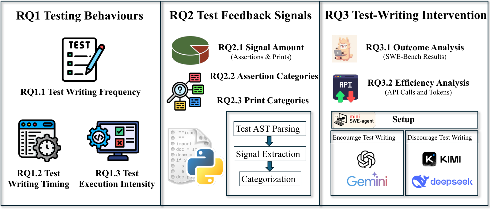
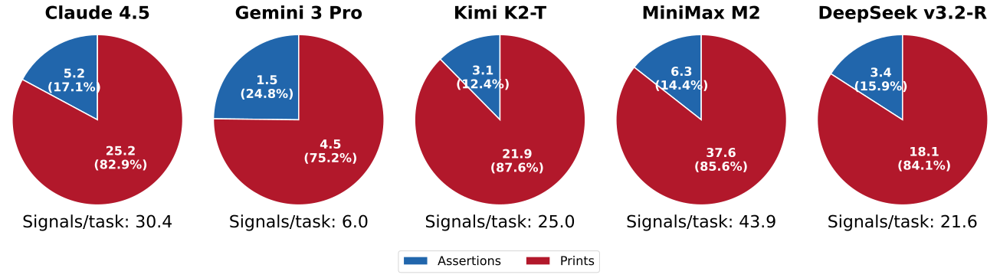
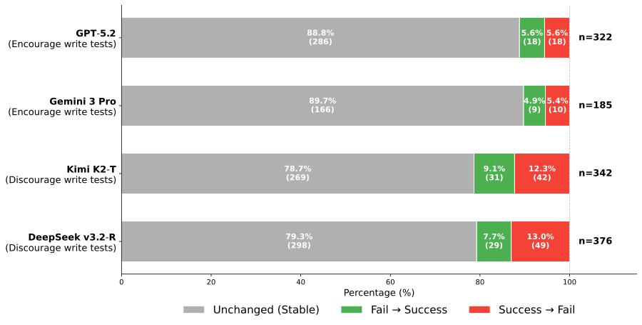

**Source:** *Rethinking the Value of Agent-Generated Tests for LLM-Based Software Engineering Agents* — [PDF](https://arxiv.org/pdf/2602.07900) · [arXiv](https://arxiv.org/abs/2602.07900)

# Rethinking the Value of Agent-Generated Tests for LLM-Based Software Engineering Agents

Conference: ; October, 2026; Washington, DC, USA

Zhi Chen  Affiliation: Singapore Management University, Singapore, Singapore email: [zhi.chen.2023@smu.edu.sg](mailto:zhi.chen.2023@smu.edu.sg) ,  Zhensu Sun  Note: Corresponding author.  Affiliation: Singapore Management University, Singapore, Singapore email: [zssun@smu.edu.sg](mailto:zssun@smu.edu.sg) ,  Yuling Shi  Affiliation: Shanghai Jiao Tong University, Shanghai, China email: [yuling.shi@sjtu.edu.cn](mailto:yuling.shi@sjtu.edu.cn) ,  Chao Peng  Affiliation: ByteDance, Beijing, China email: [chao.peng@acm.org](mailto:chao.peng@acm.org) ,  Xiaodong Gu  Affiliation: Shanghai Jiao Tong University, Shanghai, China email: [xiaodong.gu@sjtu.edu.cn](mailto:xiaodong.gu@sjtu.edu.cn) ,  David Lo  Affiliation: Singapore Management University, Singapore, Singapore email: [davidlo@smu.edu.sg](mailto:davidlo@smu.edu.sg) and  Lingxiao Jiang  Affiliation: Singapore Management University, Singapore, Singapore email: [lxjiang@smu.edu.sg](mailto:lxjiang@smu.edu.sg)

2026

###### Abstract.

Large Language Model (LLM) code agents increasingly resolve repository-level issues by iteratively editing code, invoking tools, and validating candidate patches. In these workflows, agents often write tests on the fly, but the value of this behavior remains unclear. For example, GPT-5.2 writes almost no new tests yet achieves performance comparable to top-ranking agents. This raises a central question: do such tests meaningfully improve issue resolution, or do they mainly mimic a familiar software-development practice while consuming interaction budget?

To better understand the role of agent-written tests, we analyze trajectories produced by six strong LLMs on SWE-bench Verified. Our results show that test writing is common, but resolved and unresolved tasks within the same model exhibit similar test-writing frequencies. When tests are written, they mainly serve as observational feedback channels, with value-revealing print statements appearing much more often than assertion-based checks. Based on these insights, we perform a prompt-intervention study by revising the prompts used with four models to either increase or reduce test writing. The results suggest that prompt-induced changes in the volume of agent-written tests do not significantly change final outcomes in this setting. Taken together, these results suggest that current agent-written testing practices reshape process and cost more than final task outcomes.

###### Keywords: 

Large Language Model, Agent-Written Tests, Agent Trajectory Analysis, Software Development Agent 

## 1\. Introduction

Code agents increasingly tackle software issues by combining Large Language Models (LLMs) ([OpenAI, 2025](https://arxiv.org/html/2602.07900#bib.bib25); [DeepSeek, 2025b](https://arxiv.org/html/2602.07900#bib.bib31); [Chen and Jiang, 2024](https://arxiv.org/html/2602.07900#bib.bib52)) with tools and interaction protocols that let them edit real repositories, invoke tools, and attempt end-to-end issue resolution ([Yang et al., 2024a](https://arxiv.org/html/2602.07900#bib.bib3); [Örwall, 2024](https://arxiv.org/html/2602.07900#bib.bib14); [Wang et al., 2024b](https://arxiv.org/html/2602.07900#bib.bib11); [Gao et al., 2025b](https://arxiv.org/html/2602.07900#bib.bib7); [Hong et al., 2024](https://arxiv.org/html/2602.07900#bib.bib17); [Qian et al., 2024](https://arxiv.org/html/2602.07900#bib.bib18); [Ehrlich et al., 2025](https://arxiv.org/html/2602.07900#bib.bib15); [Xia et al., 2024](https://arxiv.org/html/2602.07900#bib.bib8)). In this paper, a _code agent_ denotes an LLM coupled with external tools and an iterative action–observation loop, and the _scaffold_ refers to the surrounding tool interface and interaction protocol that specifies the agent’s allowed actions and feedback. Among the diverse skills required by code agents, testing plays a critical role: it exposes regressions, validates hypotheses, and provides a feedback loop during patch development ([Zhang et al., 2024](https://arxiv.org/html/2602.07900#bib.bib6); [Xia et al., 2024](https://arxiv.org/html/2602.07900#bib.bib8); [Liu et al., 2024](https://arxiv.org/html/2602.07900#bib.bib13); [Mu et al., 2025](https://arxiv.org/html/2602.07900#bib.bib24)).

 Figure 1. Overview of the study design. RQ1 examines testing behaviors, RQ2 analyzes feedback signals in agent-written tests, and RQ3 studies observed outcome and efficiency changes under test-writing interventions.

When operating on repository-level tasks, agents typically use tests as a primary validation interface, which come from two main sources. The first is the repository’s existing, human-written test suite, which reflects developer intent and established project conventions ([Jimenez et al., 2024](https://arxiv.org/html/2602.07900#bib.bib2); [Chen and Jiang, 2025](https://arxiv.org/html/2602.07900#bib.bib22)). The second is _agent-written tests_ —new test artifacts written by the agent during problem solving that were not present in the original codebase. In contrast to curated human-written tests, agent-written tests are written _on the fly_ during issue resolution, and their reliability depends on the model’s understanding of the specification, domain knowledge, and the semantics of the target codebase. Agent-written tests can be beneficial by surfacing edge cases and providing actionable feedback for fault localization and patch refinement. However, they can also be harmful if they embed incorrect assumptions or oracles, diverting effort toward satisfying the test rather than resolving the target issue. Moreover, test generation and execution introduce non-trivial overhead—consuming API calls and tokens and increasing context footprint—which can reduce the remaining budget available for core debugging and patching ([Kim et al., 2025](https://arxiv.org/html/2602.07900#bib.bib51)). When the resulting signals are low-value, this overhead may dilute the agent’s focus and become net detrimental.

To better understand agent-written tests, we conduct a quantitative analysis of agent trajectories on SWE-bench Verified ([OpenAI, 2024](https://arxiv.org/html/2602.07900#bib.bib9)) using mini-SWE-agent ([SWE-agent Team, 2024](https://arxiv.org/html/2602.07900#bib.bib5)), where testing is optional and not enforced by any hard-coded procedure. Agent-written testing is prevalent for several strong models. For example, Claude Opus 4.5 (ranked #1 in this setting, 74.4% resolution) generates at least one new test artifact in about 83% of tasks. By contrast, GPT-5.2 achieves a comparable resolution rate (71.8%), only 2.6 percentage points below Claude Opus 4.5, while generating near-zero new tests (only in 0.6% of tasks). This observation motivates a core question: _when prompts and model tendencies lead agents to write more tests, do the observed outcomes actually improve, or do models merely mimic a learned software-development practice while the resulting tests contribute little to the final patch?_ If the latter holds, then the widespread creation and execution of agent-written tests may represent a substantial waste of resources, consuming interaction budget without meaningful gains in task success. Therefore, we argue that a systematic empirical study is needed to understand the role of agent-written tests in resolving software issues.

Prior work mostly evaluates and benchmarks LLM-generated tests under predefined testing objectives and fixed quality metrics (e.g., unit tests, assertions, or issue-reproducing tests), typically with respect to a fixed target program or snapshot of code under test ([Lops et al., 2025](https://arxiv.org/html/2602.07900#bib.bib44); [Zhang et al., 2025b](https://arxiv.org/html/2602.07900#bib.bib45); [Mündler et al., 2024](https://arxiv.org/html/2602.07900#bib.bib46); [Yuan et al., 2024](https://arxiv.org/html/2602.07900#bib.bib47); [Wang et al., 2025](https://arxiv.org/html/2602.07900#bib.bib48); [Wang et al., 2024a](https://arxiv.org/html/2602.07900#bib.bib49); [Schäfer et al., 2023](https://arxiv.org/html/2602.07900#bib.bib50)). However, in complex real-world GitHub issue resolution ([Jimenez et al., 2024](https://arxiv.org/html/2602.07900#bib.bib2); [Khandpur et al., 2025](https://arxiv.org/html/2602.07900#bib.bib10)), the codebase and candidate patches evolve over time, and test writing and usage arise dynamically as self-directed behaviors rather than pre-specified evaluation objectives. Yet the intrinsic tendency of high-autonomy agents to write and use tests during such issue resolution—and how prompt-induced changes in test writing relate to observed resolution outcomes and costs—has not been systematically studied. This motivates a closer empirical investigation of agent-written tests, guided by the following three research questions.

##### Research questions and overview.

Guided by this gap, we study the role of agent-written tests in GitHub issue resolution. Figure [1](https://arxiv.org/html/2602.07900#S1.F1 "Figure 1 ‣ 1. Introduction ‣ Rethinking the Value of Agent-Generated Tests for LLM-Based Software Engineering Agents") summarizes our study design, which decomposes the problem into three complementary research questions. RQ1 characterizes the agents’ testing behaviors under a light scaffold where test writing is optional: whether agents write tests, when they introduce them, and how intensively they execute them. RQ2 shifts from behaviors to _test content_ , investigating what feedback signals agent-written tests actually emit at execution time (assertions vs. value-revealing prints), what types of assertions they use, and what kinds of runtime information those value-revealing prints typically inspect. RQ3 examines _observed outcome and efficiency changes_ : by revising prompts to encourage or discourage writing new tests, we measure how changing test-writing behavior is accompanied by changes in task resolution outcomes and efficiency costs (API calls and tokens).

##### Summary of findings.

Across models, agent-written testing is best understood as a _model-dependent process style_ rather than a dependable driver of success. RQ1 shows that test writing is widespread but only weakly aligned with success. RQ2 shows that agent-written tests primarily serve as an _observational_ feedback channel, with value-revealing prints dominating assert-based checks. RQ3 shows that prompt-induced changes in test writing have only small observed effects on task outcomes for most tasks, but can materially change efficiency.

The contributions of this work can be summarized as follows:

  * A behavioral analysis of agent-written tests from code agents. We characterize the agent-written testing behaviors of base LLM agents, including _whether_ they create new test artifacts, _when_ such test creation occurs within a trajectory, and _how_ these tests are executed. Our results show that test writing and execution intensity are largely _model-dependent process styles_ and only weakly align with task success (e.g., some high-performing models resolve many tasks while writing almost no tests). 
  * A feedback-signal analysis of agent-written tests covering assertions and value-revealing prints. We separate verification-oriented assertions from observational outputs and introduce rule-based AST analyses that map assertions into four categories and value-revealing prints into three coarse categories. We find that tests largely serve an _observational_ role: value-revealing prints consistently outnumber assertions, those prints are dominated by value/content inspection and exception/status signals, and assertion usage is dominated by local-property and exact-value checks. 
  * A prompt-intervention study of agent-written tests on observed outcomes and efficiency. Through controlled prompt interventions that either encourage or suppress writing new test files, we study how changes in test-writing cues relate to observed task success and interaction efficiency under the same agent scaffold. We show that large flips in test-writing status are accompanied by only small observed changes in resolution outcomes for most tasks, whereas efficiency changes can be substantial. Inducing tests can increase token and interaction overhead without improving success, while suppressing tests yields large cost reductions with only modest success drops. 

## 2\. Methodology

In this section, we introduce the methodology for this study, including the benchmark, the studied agent and LLMs, the extraction of agent-written tests, and implementation details. Our study is guided by three research questions: RQ1: What Testing Behaviors Emerge Under a Light Agent Scaffold? RQ2: What Feedback Signals Do Agent-Written Tests Provide? RQ3: How Does Prompting Test Writing Change Observed Outcomes and Costs?

### 2.1. Benchmark

We use SWE-bench Verified as our benchmark. The original SWE-bench benchmark is built from resolved GitHub issues drawn from 12 open-source Python repositories ([Jimenez et al., 2024](https://arxiv.org/html/2602.07900#bib.bib2)). SWE-bench Verified is a 500-instance subset released after a human-screening effort led by OpenAI in collaboration with the SWE-bench authors ([OpenAI, 2024](https://arxiv.org/html/2602.07900#bib.bib9)). Each instance provides a GitHub issue, a fixed repository snapshot, and the official evaluation harness. We analyze agent-written test artifacts within the resulting trajectories.

### 2.2. Agent and its LLMs

While many recent LLM-based agents incorporate curated testing components, such as specialized validation modules, dedicated test-planning stages, or multi-agent coordination ([Liu et al., 2024](https://arxiv.org/html/2602.07900#bib.bib13); [Zhang et al., 2024](https://arxiv.org/html/2602.07900#bib.bib6); [Ruan et al., 2024](https://arxiv.org/html/2602.07900#bib.bib43); [Cognition Labs, 2024](https://arxiv.org/html/2602.07900#bib.bib12)), these frameworks can confound a model’s _intrinsic_ tendencies with scaffold-induced constraints. To better isolate base-model behavior, we adopt mini-SWE-agent ([SWE-bench Team, 2024](https://arxiv.org/html/2602.07900#bib.bib4); [SWE-agent Team, 2024](https://arxiv.org/html/2602.07900#bib.bib5)). It provides a lightweight agent work loop restricted to a standard bash interface: the agent interacts with the repository solely through the bash tool, executing commands in a bash shell (e.g., running python) and using standard command-line utilities to inspect and modify files. The model can create executable Python test files on the fly and run them via bash as part of its workflow. Crucially, although the default mini-SWE-agent prompt includes a brief natural-language recommendation such as “Test edge cases to ensure your fix is robust,” this instruction is only advisory: it does not introduce any testing-specific function, dedicated testing tool, or hard-coded workflow component (e.g., a test planner, structured testing module, or enforced test-execution stage). Thus, in our setting, testing remains optional at runtime: the model may follow, delay, or ignore that recommendation, and the decisions of whether, when, and how to test are still left to the model. Accordingly, any observed behaviors (e.g., creating or running test artifacts) can be interpreted as model-native ones.

We select a diverse set of strong LLMs to capture heterogeneous agent-written testing behaviors under mini-SWE-agent. For model selection, we use the SWE-bench _Bash Only_ leaderboard with a cutoff date of 2025-12-1111 1 https://www.swebench.com/ and identify the top-six _model families_ (rather than top entries, since a family may appear with multiple variants on the leaderboard). For each family, we use its highest-ranked model as the representative: claude-opus-4.5 ([Anthropic, 2025](https://arxiv.org/html/2602.07900#bib.bib26)) (74.4%), gemini-3-pro-preview ([Google Cloud, 2025](https://arxiv.org/html/2602.07900#bib.bib27)) (74.2%), gpt-5.2 ([OpenAI, 2025](https://arxiv.org/html/2602.07900#bib.bib25)) (71.8%), kimi-k2-thinking ([Moonshot AI, 2025](https://arxiv.org/html/2602.07900#bib.bib28)) (63.4%), minimax-m2 ([MiniMax, 2025](https://arxiv.org/html/2602.07900#bib.bib29)) (61.0%), and deepseek-v3.2-reasoner ([DeepSeek, 2025a](https://arxiv.org/html/2602.07900#bib.bib30)) (60.0%). In the remainder of the paper, we refer to these models as Claude Opus 4.5, Gemini 3 Pro, GPT-5.2, Kimi K2 Thinking, MiniMax M2, and DeepSeek v3.2 Reasoner. In tables and figures, we further shorten Claude Opus 4.5, Kimi K2 Thinking, and DeepSeek v3.2 Reasoner to Claude 4.5, Kimi K2-T, and DeepSeek v3.2-R to save space. In each case, the shortened form still uniquely identifies the official model version evaluated in this study, without introducing ambiguity with another model release.

### 2.3. Data Extraction of Agent-Written Tests

In our study, agent-written tests are test files that an agent writes using the bash tool during task resolution. We extract agent-written tests from task trajectories, which are time-ordered interaction logs recorded during issue resolution that include the agent’s intermediate reasoning, concrete actions (e.g., bash commands), and the resulting observations. To find test files written during a trajectory, we scan the logged bash actions for file-writing operations, most commonly here-doc writes such as cat <<’EOF’ > path/to/file.py …EOF. We then keep only files whose paths match common Python test naming patterns, including filenames that start with test_ or end with _test.py or tests.py ([pytest developers, 2026](https://arxiv.org/html/2602.07900#bib.bib59)).

### 2.4. Implementation Details

We run all experiments using the official mini-SWE-agent codebase. All tasks are executed on a Linux server (Ubuntu 22.04.5) with an AMD Ryzen Threadripper PRO 7975WX CPU (32 cores / 64 threads), 251 GiB RAM. For model inference, we access LLMs through a combination of official provider APIs and the OpenRouter API. For evaluation, we use the official SWE-bench sb-cli tool to score each submitted patch under the benchmark harness. Across all experiments reported in this paper, the total LLM API cost is approximately USD 1,600.

## 3\. RQ1: What Testing Behaviors Emerge Under a Light Agent Scaffold?

##### Motivation.

In a high-autonomy setting where testing is optional, agents may or may not write tests during issue resolution. RQ1 establishes a descriptive baseline of these emergent testing behaviors—what tests agents write, when they introduce them, and how intensively they run them. This baseline (i) clarifies what "testing" looks like in this setting and (ii) provides grounded behavioral variables for later research questions.

##### Experiment Design.

RQ1 uses resolved vs. unresolved trajectories as a comparative lens to characterize systematic differences in test-related behaviors. We emphasize that these outcome-stratified comparisons are not intended to establish causality regarding task success; rather, they serve as a diagnostic tool to surface consistent differences in testing practices between successful and unsuccessful problem-solving processes. RQ1 reports descriptive summaries of three complementary aspects of test-oriented behavior:

  * Frequency (RQ1.1): whether the agent writes tests, and how many. 
  * Timing (RQ1.2): when test writing happens during issue resolution. 
  * Execution (RQ1.3): how intensively tests are run, and their outcomes. 

### 3.1. RQ1.1 Frequency: Do Agents Write Test Artifacts?

##### Goal and measurements.

We examine whether base LLMs write test artifacts under a light scaffold. For each task, we record (i) whether the agent writes at least one test artifact, and (ii) if so, how many distinct test artifacts it writes. We report results separately for resolved and unresolved tasks.

Table 1. Per-model test writing rate by execution outcome

<table id="S3.T1.4.1" class="ltx_tabular ltx_align_middle">
<tr id="S3.T1.4.1.1" class="ltx_tr">
<td id="S3.T1.4.1.1.1" class="ltx_td ltx_border_tt" style="padding:0.15pt 2.6pt;"></td>
<td id="S3.T1.4.1.1.2" class="ltx_td ltx_align_center ltx_border_tt" style="padding:0.15pt 2.6pt;" colspan="3">Resolved</td>
<td id="S3.T1.4.1.1.3" class="ltx_td ltx_align_center ltx_border_tt" style="padding:0.15pt 2.6pt;" colspan="3">Unresolved</td>
<td id="S3.T1.4.1.1.4" class="ltx_td ltx_align_center ltx_border_tt" style="padding:0.15pt 2.6pt;" colspan="3">All</td></tr>
<tr id="S3.T1.4.1.2" class="ltx_tr">
<td id="S3.T1.4.1.2.1" class="ltx_td ltx_align_left" style="padding:0.15pt 2.6pt;">Model</td>
<td id="S3.T1.4.1.2.2" class="ltx_td ltx_align_center ltx_border_t" style="padding:0.15pt 2.6pt;"> 

#Tasks
</td>
<td id="S3.T1.4.1.2.3" class="ltx_td ltx_align_center ltx_border_t" style="padding:0.15pt 2.6pt;"> 

Tasks w/

tests
</td>
<td id="S3.T1.4.1.2.4" class="ltx_td ltx_align_center ltx_border_t" style="padding:0.15pt 2.6pt;"> 

Mean

#tests
</td>
<td id="S3.T1.4.1.2.5" class="ltx_td ltx_align_center ltx_border_t" style="padding:0.15pt 2.6pt;"> 

#Tasks
</td>
<td id="S3.T1.4.1.2.6" class="ltx_td ltx_align_center ltx_border_t" style="padding:0.15pt 2.6pt;"> 

Tasks w/

tests
</td>
<td id="S3.T1.4.1.2.7" class="ltx_td ltx_align_center ltx_border_t" style="padding:0.15pt 2.6pt;"> 

Mean

#tests
</td>
<td id="S3.T1.4.1.2.8" class="ltx_td ltx_align_center ltx_border_t" style="padding:0.15pt 2.6pt;"> 

#Tasks
</td>
<td id="S3.T1.4.1.2.9" class="ltx_td ltx_align_center ltx_border_t" style="padding:0.15pt 2.6pt;"> 

Tasks w/

tests
</td>
<td id="S3.T1.4.1.2.10" class="ltx_td ltx_align_center ltx_border_t" style="padding:0.15pt 2.6pt;"> 

Mean

#tests
</td></tr>
<tr id="S3.T1.4.1.3" class="ltx_tr">
<td id="S3.T1.4.1.3.1" class="ltx_td ltx_align_left ltx_border_t" style="padding:0.15pt 2.6pt;">Claude 4.5</td>
<td id="S3.T1.4.1.3.2" class="ltx_td ltx_align_center ltx_border_t" style="padding:0.15pt 2.6pt;">372</td>
<td id="S3.T1.4.1.3.3" class="ltx_td ltx_align_center ltx_border_t" style="padding:0.15pt 2.6pt;">314 (84.4%)</td>
<td id="S3.T1.4.1.3.4" class="ltx_td ltx_align_center ltx_border_t" style="padding:0.15pt 2.6pt;">3.33</td>
<td id="S3.T1.4.1.3.5" class="ltx_td ltx_align_center ltx_border_t" style="padding:0.15pt 2.6pt;">128</td>
<td id="S3.T1.4.1.3.6" class="ltx_td ltx_align_center ltx_border_t" style="padding:0.15pt 2.6pt;">101 (78.9%)</td>
<td id="S3.T1.4.1.3.7" class="ltx_td ltx_align_center ltx_border_t" style="padding:0.15pt 2.6pt;">4.12</td>
<td id="S3.T1.4.1.3.8" class="ltx_td ltx_align_center ltx_border_t" style="padding:0.15pt 2.6pt;">500</td>
<td id="S3.T1.4.1.3.9" class="ltx_td ltx_align_center ltx_border_t" style="padding:0.15pt 2.6pt;">415 (83.0%)</td>
<td id="S3.T1.4.1.3.10" class="ltx_td ltx_align_center ltx_border_t" style="padding:0.15pt 2.6pt;">3.52</td></tr>
<tr id="S3.T1.4.1.4" class="ltx_tr">
<td id="S3.T1.4.1.4.1" class="ltx_td ltx_align_left" style="padding:0.15pt 2.6pt;">Gemini 3 Pro</td>
<td id="S3.T1.4.1.4.2" class="ltx_td ltx_align_center" style="padding:0.15pt 2.6pt;">371</td>
<td id="S3.T1.4.1.4.3" class="ltx_td ltx_align_center" style="padding:0.15pt 2.6pt;">235 (63.3%)</td>
<td id="S3.T1.4.1.4.4" class="ltx_td ltx_align_center" style="padding:0.15pt 2.6pt;">2.02</td>
<td id="S3.T1.4.1.4.5" class="ltx_td ltx_align_center" style="padding:0.15pt 2.6pt;">129</td>
<td id="S3.T1.4.1.4.6" class="ltx_td ltx_align_center" style="padding:0.15pt 2.6pt;">73 (56.6%)</td>
<td id="S3.T1.4.1.4.7" class="ltx_td ltx_align_center" style="padding:0.15pt 2.6pt;">2.16</td>
<td id="S3.T1.4.1.4.8" class="ltx_td ltx_align_center" style="padding:0.15pt 2.6pt;">500</td>
<td id="S3.T1.4.1.4.9" class="ltx_td ltx_align_center" style="padding:0.15pt 2.6pt;">308 (61.6%)</td>
<td id="S3.T1.4.1.4.10" class="ltx_td ltx_align_center" style="padding:0.15pt 2.6pt;">2.05</td></tr>
<tr id="S3.T1.4.1.5" class="ltx_tr">
<td id="S3.T1.4.1.5.1" class="ltx_td ltx_align_left" style="padding:0.15pt 2.6pt;">GPT-5.2</td>
<td id="S3.T1.4.1.5.2" class="ltx_td ltx_align_center" style="padding:0.15pt 2.6pt;">359</td>
<td id="S3.T1.4.1.5.3" class="ltx_td ltx_align_center" style="padding:0.15pt 2.6pt;">3 (0.8%)</td>
<td id="S3.T1.4.1.5.4" class="ltx_td ltx_align_center" style="padding:0.15pt 2.6pt;">1.00</td>
<td id="S3.T1.4.1.5.5" class="ltx_td ltx_align_center" style="padding:0.15pt 2.6pt;">141</td>
<td id="S3.T1.4.1.5.6" class="ltx_td ltx_align_center" style="padding:0.15pt 2.6pt;">0 (0.0%)</td>
<td id="S3.T1.4.1.5.7" class="ltx_td ltx_align_center" style="padding:0.15pt 2.6pt;">–</td>
<td id="S3.T1.4.1.5.8" class="ltx_td ltx_align_center" style="padding:0.15pt 2.6pt;">500</td>
<td id="S3.T1.4.1.5.9" class="ltx_td ltx_align_center" style="padding:0.15pt 2.6pt;">3 (0.6%)</td>
<td id="S3.T1.4.1.5.10" class="ltx_td ltx_align_center" style="padding:0.15pt 2.6pt;">1.00</td></tr>
<tr id="S3.T1.4.1.6" class="ltx_tr">
<td id="S3.T1.4.1.6.1" class="ltx_td ltx_align_left" style="padding:0.15pt 2.6pt;">Kimi K2-T</td>
<td id="S3.T1.4.1.6.2" class="ltx_td ltx_align_center" style="padding:0.15pt 2.6pt;">317</td>
<td id="S3.T1.4.1.6.3" class="ltx_td ltx_align_center" style="padding:0.15pt 2.6pt;">309 (97.5%)</td>
<td id="S3.T1.4.1.6.4" class="ltx_td ltx_align_center" style="padding:0.15pt 2.6pt;">3.48</td>
<td id="S3.T1.4.1.6.5" class="ltx_td ltx_align_center" style="padding:0.15pt 2.6pt;">183</td>
<td id="S3.T1.4.1.6.6" class="ltx_td ltx_align_center" style="padding:0.15pt 2.6pt;">178 (97.3%)</td>
<td id="S3.T1.4.1.6.7" class="ltx_td ltx_align_center" style="padding:0.15pt 2.6pt;">3.83</td>
<td id="S3.T1.4.1.6.8" class="ltx_td ltx_align_center" style="padding:0.15pt 2.6pt;">500</td>
<td id="S3.T1.4.1.6.9" class="ltx_td ltx_align_center" style="padding:0.15pt 2.6pt;">487 (97.4%)</td>
<td id="S3.T1.4.1.6.10" class="ltx_td ltx_align_center" style="padding:0.15pt 2.6pt;">3.61</td></tr>
<tr id="S3.T1.4.1.7" class="ltx_tr">
<td id="S3.T1.4.1.7.1" class="ltx_td ltx_align_left" style="padding:0.15pt 2.6pt;">MiniMax M2</td>
<td id="S3.T1.4.1.7.2" class="ltx_td ltx_align_center" style="padding:0.15pt 2.6pt;">305</td>
<td id="S3.T1.4.1.7.3" class="ltx_td ltx_align_center" style="padding:0.15pt 2.6pt;">302 (99.0%)</td>
<td id="S3.T1.4.1.7.4" class="ltx_td ltx_align_center" style="padding:0.15pt 2.6pt;">4.82</td>
<td id="S3.T1.4.1.7.5" class="ltx_td ltx_align_center" style="padding:0.15pt 2.6pt;">195</td>
<td id="S3.T1.4.1.7.6" class="ltx_td ltx_align_center" style="padding:0.15pt 2.6pt;">191 (97.9%)</td>
<td id="S3.T1.4.1.7.7" class="ltx_td ltx_align_center" style="padding:0.15pt 2.6pt;">5.76</td>
<td id="S3.T1.4.1.7.8" class="ltx_td ltx_align_center" style="padding:0.15pt 2.6pt;">500</td>
<td id="S3.T1.4.1.7.9" class="ltx_td ltx_align_center" style="padding:0.15pt 2.6pt;">493 (98.6%)</td>
<td id="S3.T1.4.1.7.10" class="ltx_td ltx_align_center" style="padding:0.15pt 2.6pt;">5.19</td></tr>
<tr id="S3.T1.4.1.8" class="ltx_tr">
<td id="S3.T1.4.1.8.1" class="ltx_td ltx_align_left ltx_border_bb" style="padding:0.15pt 2.6pt;">DeepSeek v3.2-R</td>
<td id="S3.T1.4.1.8.2" class="ltx_td ltx_align_center ltx_border_bb" style="padding:0.15pt 2.6pt;">300</td>
<td id="S3.T1.4.1.8.3" class="ltx_td ltx_align_center ltx_border_bb" style="padding:0.15pt 2.6pt;">277 (92.3%)</td>
<td id="S3.T1.4.1.8.4" class="ltx_td ltx_align_center ltx_border_bb" style="padding:0.15pt 2.6pt;">3.55</td>
<td id="S3.T1.4.1.8.5" class="ltx_td ltx_align_center ltx_border_bb" style="padding:0.15pt 2.6pt;">200</td>
<td id="S3.T1.4.1.8.6" class="ltx_td ltx_align_center ltx_border_bb" style="padding:0.15pt 2.6pt;">169 (84.5%)</td>
<td id="S3.T1.4.1.8.7" class="ltx_td ltx_align_center ltx_border_bb" style="padding:0.15pt 2.6pt;">4.08</td>
<td id="S3.T1.4.1.8.8" class="ltx_td ltx_align_center ltx_border_bb" style="padding:0.15pt 2.6pt;">500</td>
<td id="S3.T1.4.1.8.9" class="ltx_td ltx_align_center ltx_border_bb" style="padding:0.15pt 2.6pt;">446 (89.2%)</td>
<td id="S3.T1.4.1.8.10" class="ltx_td ltx_align_center ltx_border_bb" style="padding:0.15pt 2.6pt;">3.75</td></tr>
</table>

 

_Notes._ “Tasks w/ tests” reports count and percentage within each outcome split. “Mean #tests” is computed only over tasks that write at least one test artifact.

##### Results.

Table [1](https://arxiv.org/html/2602.07900#S3.T1 "Table 1 ‣ Goal and measurements. ‣ 3.1. RQ1.1 Frequency: Do Agents Write Test Artifacts? ‣ 3. RQ1: What Testing Behaviors Emerge Under a Light Agent Scaffold? ‣ Rethinking the Value of Agent-Generated Tests for LLM-Based Software Engineering Agents") shows that writing tests is common for most models, but not for GPT-5.2. Some models write tests in almost every task (e.g., MiniMax M2 and Kimi K2 Thinking). In contrast, GPT-5.2 almost never writes tests (3/500 tasks). Within the same model, resolved and unresolved tasks usually have similar test-writing rates. When tests are written, unresolved tasks often write as many or more distinct test artifacts than resolved tasks. This may reflect that harder tasks trigger more trial-and-error.

 

### 3.2. RQ1.2 Timing: When Are Tests Written During the Run?

##### Goal and measurements.

Beyond whether tests are written (RQ1.1), we examine _when_ test writing happens during a task execution. Writing tests in a tight window may look like a short "checking phase", while writing tests throughout the task may look like iterative debugging. This subsection is descriptive and does not claim effectiveness. We analyze only tasks that write at least one test artifact, so the timing metrics are defined. Because GPT-5.2 writes tests in only 3 tasks (RQ1.1), we omit its per-model timing summaries in RQ1.2 to avoid unstable estimates. We also exclude it from later analyses that require tasks with test writing. We use three normalized positions within the task: the first test-writing position, the last test-writing position, and their span:

\[\begin{aligned}
 & \displaystyle t_{\text{first}} & \displaystyle=\frac{\min(S_{\text{write}})}{N_{\text{steps}}},\quad t_{\text{last}}=\frac{\max(S_{\text{write}})}{N_{\text{steps}}} &  \\
 & \displaystyle s_{\text{write}} & \displaystyle=t_{\text{last}}-t_{\text{first}}=\frac{\max(S_{\text{write}})-\min(S_{\text{write}})}{N_{\text{steps}}} & 
\end{aligned}\]

 

Here, \(S_{\text{write}}\) is the set of step indices where the agent writes test artifacts, and \(N_{\text{steps}}\) is the total number of interaction steps in the task. \(t_{\text{first}}\) and \(t_{\text{last}}\) are normalized positions in \([0,1]\). Smaller values mean the agent writes tests earlier in the task; larger values mean later. The span \(s_{\text{write}}\in[0,1]\) measures how spread out test writing is across the task. Larger values mean more dispersed test writing; smaller values mean a more concentrated window.

Table 2. Per-model timing of test writing events

<table id="S3.T2.4" class="ltx_tabular ltx_centering ltx_figure_panel ltx_align_middle">
<tr id="S3.T2.4.1" class="ltx_tr">
<td id="S3.T2.4.1.1" class="ltx_td ltx_border_tt" style="padding:0.15pt 2.5pt;"></td>
<td id="S3.T2.4.1.2" class="ltx_td ltx_align_center ltx_border_tt" style="padding:0.15pt 2.5pt;" colspan="4">Resolved</td>
<td id="S3.T2.4.1.3" class="ltx_td ltx_align_center ltx_border_tt" style="padding:0.15pt 2.5pt;" colspan="4">Unresolved</td></tr>
<tr id="S3.T2.4.2" class="ltx_tr">
<td id="S3.T2.4.2.1" class="ltx_td ltx_align_left" style="padding:0.15pt 2.5pt;">Model</td>
<td id="S3.T2.4.2.2" class="ltx_td ltx_align_center ltx_border_t" style="padding:0.15pt 2.5pt;"> 

#Tasks
</td>
<td id="S3.T2.4.2.3" class="ltx_td ltx_align_center ltx_border_t" style="padding:0.15pt 2.5pt;"> 

First

pos.
</td>
<td id="S3.T2.4.2.4" class="ltx_td ltx_align_center ltx_border_t" style="padding:0.15pt 2.5pt;"> 

Last

pos.
</td>
<td id="S3.T2.4.2.5" class="ltx_td ltx_align_center ltx_border_t" style="padding:0.15pt 2.5pt;"> 

Span
</td>
<td id="S3.T2.4.2.6" class="ltx_td ltx_align_center ltx_border_t" style="padding:0.15pt 2.5pt;"> 

#Tasks
</td>
<td id="S3.T2.4.2.7" class="ltx_td ltx_align_center ltx_border_t" style="padding:0.15pt 2.5pt;"> 

First

pos.
</td>
<td id="S3.T2.4.2.8" class="ltx_td ltx_align_center ltx_border_t" style="padding:0.15pt 2.5pt;"> 

Last

pos.
</td>
<td id="S3.T2.4.2.9" class="ltx_td ltx_align_center ltx_border_t" style="padding:0.15pt 2.5pt;"> 

Span
</td></tr>
<tr id="S3.T2.4.3" class="ltx_tr">
<td id="S3.T2.4.3.1" class="ltx_td ltx_align_left ltx_border_t" style="padding:0.15pt 2.5pt;">Claude 4.5</td>
<td id="S3.T2.4.3.2" class="ltx_td ltx_align_center ltx_border_t" style="padding:0.15pt 2.5pt;">314</td>
<td id="S3.T2.4.3.3" class="ltx_td ltx_align_center ltx_border_t" style="padding:0.15pt 2.5pt;">0.34</td>
<td id="S3.T2.4.3.4" class="ltx_td ltx_align_center ltx_border_t" style="padding:0.15pt 2.5pt;">0.75</td>
<td id="S3.T2.4.3.5" class="ltx_td ltx_align_center ltx_border_t" style="padding:0.15pt 2.5pt;">0.41</td>
<td id="S3.T2.4.3.6" class="ltx_td ltx_align_center ltx_border_t" style="padding:0.15pt 2.5pt;">101</td>
<td id="S3.T2.4.3.7" class="ltx_td ltx_align_center ltx_border_t" style="padding:0.15pt 2.5pt;">0.30</td>
<td id="S3.T2.4.3.8" class="ltx_td ltx_align_center ltx_border_t" style="padding:0.15pt 2.5pt;">0.78∗</td>
<td id="S3.T2.4.3.9" class="ltx_td ltx_align_center ltx_border_t" style="padding:0.15pt 2.5pt;">0.48∗</td></tr>
<tr id="S3.T2.4.4" class="ltx_tr">
<td id="S3.T2.4.4.1" class="ltx_td ltx_align_left" style="padding:0.15pt 2.5pt;">Gemini 3 Pro</td>
<td id="S3.T2.4.4.2" class="ltx_td ltx_align_center" style="padding:0.15pt 2.5pt;">235</td>
<td id="S3.T2.4.4.3" class="ltx_td ltx_align_center" style="padding:0.15pt 2.5pt;">0.53</td>
<td id="S3.T2.4.4.4" class="ltx_td ltx_align_center" style="padding:0.15pt 2.5pt;">0.67</td>
<td id="S3.T2.4.4.5" class="ltx_td ltx_align_center" style="padding:0.15pt 2.5pt;">0.14</td>
<td id="S3.T2.4.4.6" class="ltx_td ltx_align_center" style="padding:0.15pt 2.5pt;">73</td>
<td id="S3.T2.4.4.7" class="ltx_td ltx_align_center" style="padding:0.15pt 2.5pt;">0.55</td>
<td id="S3.T2.4.4.8" class="ltx_td ltx_align_center" style="padding:0.15pt 2.5pt;">0.70</td>
<td id="S3.T2.4.4.9" class="ltx_td ltx_align_center" style="padding:0.15pt 2.5pt;">0.15</td></tr>
<tr id="S3.T2.4.5" class="ltx_tr">
<td id="S3.T2.4.5.1" class="ltx_td ltx_align_left" style="padding:0.15pt 2.5pt;">Kimi K2-T</td>
<td id="S3.T2.4.5.2" class="ltx_td ltx_align_center" style="padding:0.15pt 2.5pt;">309</td>
<td id="S3.T2.4.5.3" class="ltx_td ltx_align_center" style="padding:0.15pt 2.5pt;">0.40</td>
<td id="S3.T2.4.5.4" class="ltx_td ltx_align_center" style="padding:0.15pt 2.5pt;">0.82</td>
<td id="S3.T2.4.5.5" class="ltx_td ltx_align_center" style="padding:0.15pt 2.5pt;">0.42</td>
<td id="S3.T2.4.5.6" class="ltx_td ltx_align_center" style="padding:0.15pt 2.5pt;">178</td>
<td id="S3.T2.4.5.7" class="ltx_td ltx_align_center" style="padding:0.15pt 2.5pt;">0.40</td>
<td id="S3.T2.4.5.8" class="ltx_td ltx_align_center" style="padding:0.15pt 2.5pt;">0.82</td>
<td id="S3.T2.4.5.9" class="ltx_td ltx_align_center" style="padding:0.15pt 2.5pt;">0.42</td></tr>
<tr id="S3.T2.4.6" class="ltx_tr">
<td id="S3.T2.4.6.1" class="ltx_td ltx_align_left" style="padding:0.15pt 2.5pt;">MiniMax M2</td>
<td id="S3.T2.4.6.2" class="ltx_td ltx_align_center" style="padding:0.15pt 2.5pt;">302</td>
<td id="S3.T2.4.6.3" class="ltx_td ltx_align_center" style="padding:0.15pt 2.5pt;">0.35</td>
<td id="S3.T2.4.6.4" class="ltx_td ltx_align_center" style="padding:0.15pt 2.5pt;">0.86</td>
<td id="S3.T2.4.6.5" class="ltx_td ltx_align_center" style="padding:0.15pt 2.5pt;">0.51</td>
<td id="S3.T2.4.6.6" class="ltx_td ltx_align_center" style="padding:0.15pt 2.5pt;">191</td>
<td id="S3.T2.4.6.7" class="ltx_td ltx_align_center" style="padding:0.15pt 2.5pt;">0.29∗∗∗</td>
<td id="S3.T2.4.6.8" class="ltx_td ltx_align_center" style="padding:0.15pt 2.5pt;">0.85∗∗</td>
<td id="S3.T2.4.6.9" class="ltx_td ltx_align_center" style="padding:0.15pt 2.5pt;">0.56∗∗</td></tr>
<tr id="S3.T2.4.7" class="ltx_tr">
<td id="S3.T2.4.7.1" class="ltx_td ltx_align_left" style="padding:0.15pt 2.5pt;">DeepSeek v3.2-R</td>
<td id="S3.T2.4.7.2" class="ltx_td ltx_align_center" style="padding:0.15pt 2.5pt;">277</td>
<td id="S3.T2.4.7.3" class="ltx_td ltx_align_center" style="padding:0.15pt 2.5pt;">0.43</td>
<td id="S3.T2.4.7.4" class="ltx_td ltx_align_center" style="padding:0.15pt 2.5pt;">0.80</td>
<td id="S3.T2.4.7.5" class="ltx_td ltx_align_center" style="padding:0.15pt 2.5pt;">0.37</td>
<td id="S3.T2.4.7.6" class="ltx_td ltx_align_center" style="padding:0.15pt 2.5pt;">169</td>
<td id="S3.T2.4.7.7" class="ltx_td ltx_align_center" style="padding:0.15pt 2.5pt;">0.40</td>
<td id="S3.T2.4.7.8" class="ltx_td ltx_align_center" style="padding:0.15pt 2.5pt;">0.80</td>
<td id="S3.T2.4.7.9" class="ltx_td ltx_align_center" style="padding:0.15pt 2.5pt;">0.40</td></tr>
<tr id="S3.T2.4.8" class="ltx_tr">
<td id="S3.T2.4.8.1" class="ltx_td ltx_align_left ltx_border_bb ltx_border_t" style="padding:0.15pt 2.5pt;">All models</td>
<td id="S3.T2.4.8.2" class="ltx_td ltx_align_center ltx_border_bb ltx_border_t" style="padding:0.15pt 2.5pt;">1440</td>
<td id="S3.T2.4.8.3" class="ltx_td ltx_align_center ltx_border_bb ltx_border_t" style="padding:0.15pt 2.5pt;">0.40</td>
<td id="S3.T2.4.8.4" class="ltx_td ltx_align_center ltx_border_bb ltx_border_t" style="padding:0.15pt 2.5pt;">0.78</td>
<td id="S3.T2.4.8.5" class="ltx_td ltx_align_center ltx_border_bb ltx_border_t" style="padding:0.15pt 2.5pt;">0.38</td>
<td id="S3.T2.4.8.6" class="ltx_td ltx_align_center ltx_border_bb ltx_border_t" style="padding:0.15pt 2.5pt;">712</td>
<td id="S3.T2.4.8.7" class="ltx_td ltx_align_center ltx_border_bb ltx_border_t" style="padding:0.15pt 2.5pt;">0.37∗∗∗</td>
<td id="S3.T2.4.8.8" class="ltx_td ltx_align_center ltx_border_bb ltx_border_t" style="padding:0.15pt 2.5pt;">0.80∗∗∗</td>
<td id="S3.T2.4.8.9" class="ltx_td ltx_align_center ltx_border_bb ltx_border_t" style="padding:0.15pt 2.5pt;">0.43∗∗∗</td></tr>
</table>

 

_Notes._ Macro-over-tasks means over tasks with tests. Asterisks mark significant resolved-vs.-unresolved differences within a model (two-sided Mann–Whitney U: \({}^{*}p<0.05\), \({}^{**}p<0.01\), \({}^{***}p<0.001\)).

##### Results.

Table [2](https://arxiv.org/html/2602.07900#S3.T2 "Table 2 ‣ Goal and measurements. ‣ 3.2. RQ1.2 Timing: When Are Tests Written During the Run? ‣ 3. RQ1: What Testing Behaviors Emerge Under a Light Agent Scaffold? ‣ Rethinking the Value of Agent-Generated Tests for LLM-Based Software Engineering Agents") summarizes test-writing _positions_ for tasks that write tests. Across all models, the average first test-writing position is 0.40 for resolved tasks and 0.37 for unresolved tasks. The average last test-writing position is 0.78 (resolved) and 0.80 (unresolved). Models differ in _when_ they start writing tests. For example, Gemini 3 Pro starts later (0.53–0.55), while MiniMax M2 and Claude Opus 4.5 start earlier (0.29–0.35). Most models finish test writing late in the task (last position around 0.75–0.86). Models also differ in how spread out test writing is. Gemini 3 Pro has a short span (0.14–0.15). MiniMax M2 has a wider span (0.51–0.56), and Claude Opus 4.5 is also relatively wide (0.41–0.48). Kimi K2 Thinking is almost identical between resolved and unresolved tasks (0.40–0.82; span 0.42). Overall, unresolved tasks have a slightly larger average span than resolved tasks (0.43 vs. 0.38).

 

### 3.3. RQ1.3 Execution: How Intensively Are Agent-Written Tests Executed, and With What Process Outcomes?

##### Goal and measurements.

RQ1.3 describes how agents execute tests after they have written them. We measure (i) how often tests are executed, (ii) how often they are rerun relative to the number of written test artifacts, and (iii) how often executions fail at the process level. We treat an execution as failed if it ends with a non-zero return code (and successful otherwise). This captures execution friction during interaction with the environment, not patch correctness.

For each task \(t\), let \(E_{t}\) be the number of test executions, \(A_{t}\) the number of agent-written test artifacts, and \(F_{t}\) the number of executions with non-zero return codes. We report three task-level metrics: ExecCount (\(E_{t}\)), test executions per task; ExecPerTest (\(E_{t}/A_{t}\)), executions per written test artifact (rerun intensity); and FailRate (\(F_{t}/E_{t}\)), the fraction of executions that fail. We report macro-over-tasks means for each metric.

Table 3. Task-level execution effort and process-level outcomes of agent-written tests

<table id="S3.T3.4.1" class="ltx_tabular ltx_align_middle">
<tr id="S3.T3.4.1.1" class="ltx_tr">
<td id="S3.T3.4.1.1.1" class="ltx_td ltx_border_tt" style="padding:0.25pt 2.6pt;"></td>
<td id="S3.T3.4.1.1.2" class="ltx_td ltx_align_center ltx_border_tt" style="padding:0.25pt 2.6pt;" colspan="4">Resolved</td>
<td id="S3.T3.4.1.1.3" class="ltx_td ltx_align_center ltx_border_tt" style="padding:0.25pt 2.6pt;" colspan="4">Unresolved</td></tr>
<tr id="S3.T3.4.1.2" class="ltx_tr">
<td id="S3.T3.4.1.2.1" class="ltx_td ltx_align_left" style="padding:0.25pt 2.6pt;">Model</td>
<td id="S3.T3.4.1.2.2" class="ltx_td ltx_align_right ltx_border_t" style="padding:0.25pt 2.6pt;"> 

#Tasks

w/ tests
</td>
<td id="S3.T3.4.1.2.3" class="ltx_td ltx_align_right ltx_border_t" style="padding:0.25pt 2.6pt;"> 

Exec

Count
</td>
<td id="S3.T3.4.1.2.4" class="ltx_td ltx_align_right ltx_border_t" style="padding:0.25pt 2.6pt;"> 

Exec

PerTest
</td>
<td id="S3.T3.4.1.2.5" class="ltx_td ltx_align_right ltx_border_t" style="padding:0.25pt 2.6pt;"> 

FailRate

(%)
</td>
<td id="S3.T3.4.1.2.6" class="ltx_td ltx_align_right ltx_border_t" style="padding:0.25pt 2.6pt;"> 

#Tasks

w/ tests
</td>
<td id="S3.T3.4.1.2.7" class="ltx_td ltx_align_right ltx_border_t" style="padding:0.25pt 2.6pt;"> 

Exec

Count
</td>
<td id="S3.T3.4.1.2.8" class="ltx_td ltx_align_right ltx_border_t" style="padding:0.25pt 2.6pt;"> 

Exec

PerTest
</td>
<td id="S3.T3.4.1.2.9" class="ltx_td ltx_align_right ltx_border_t" style="padding:0.25pt 2.6pt;"> 

FailRate

(%)
</td></tr>
<tr id="S3.T3.4.1.3" class="ltx_tr">
<td id="S3.T3.4.1.3.1" class="ltx_td ltx_align_left ltx_border_t" style="padding:0.25pt 2.6pt;">Claude 4.5</td>
<td id="S3.T3.4.1.3.2" class="ltx_td ltx_align_right ltx_border_t" style="padding:0.25pt 2.6pt;">314</td>
<td id="S3.T3.4.1.3.3" class="ltx_td ltx_align_right ltx_border_t" style="padding:0.25pt 2.6pt;">4.87</td>
<td id="S3.T3.4.1.3.4" class="ltx_td ltx_align_right ltx_border_t" style="padding:0.25pt 2.6pt;">1.50</td>
<td id="S3.T3.4.1.3.5" class="ltx_td ltx_align_right ltx_border_t" style="padding:0.25pt 2.6pt;">11.97</td>
<td id="S3.T3.4.1.3.6" class="ltx_td ltx_align_right ltx_border_t" style="padding:0.25pt 2.6pt;">101</td>
<td id="S3.T3.4.1.3.7" class="ltx_td ltx_align_right ltx_border_t" style="padding:0.25pt 2.6pt;">6.27∗∗∗</td>
<td id="S3.T3.4.1.3.8" class="ltx_td ltx_align_right ltx_border_t" style="padding:0.25pt 2.6pt;">1.68</td>
<td id="S3.T3.4.1.3.9" class="ltx_td ltx_align_right ltx_border_t" style="padding:0.25pt 2.6pt;">11.14</td></tr>
<tr id="S3.T3.4.1.4" class="ltx_tr">
<td id="S3.T3.4.1.4.1" class="ltx_td ltx_align_left" style="padding:0.25pt 2.6pt;">Gemini 3 Pro</td>
<td id="S3.T3.4.1.4.2" class="ltx_td ltx_align_right" style="padding:0.25pt 2.6pt;">235</td>
<td id="S3.T3.4.1.4.3" class="ltx_td ltx_align_right" style="padding:0.25pt 2.6pt;">2.71</td>
<td id="S3.T3.4.1.4.4" class="ltx_td ltx_align_right" style="padding:0.25pt 2.6pt;">1.51</td>
<td id="S3.T3.4.1.4.5" class="ltx_td ltx_align_right" style="padding:0.25pt 2.6pt;">8.53</td>
<td id="S3.T3.4.1.4.6" class="ltx_td ltx_align_right" style="padding:0.25pt 2.6pt;">73</td>
<td id="S3.T3.4.1.4.7" class="ltx_td ltx_align_right" style="padding:0.25pt 2.6pt;">2.79</td>
<td id="S3.T3.4.1.4.8" class="ltx_td ltx_align_right" style="padding:0.25pt 2.6pt;">1.40</td>
<td id="S3.T3.4.1.4.9" class="ltx_td ltx_align_right" style="padding:0.25pt 2.6pt;">7.08</td></tr>
<tr id="S3.T3.4.1.5" class="ltx_tr">
<td id="S3.T3.4.1.5.1" class="ltx_td ltx_align_left" style="padding:0.25pt 2.6pt;">Kimi K2-T</td>
<td id="S3.T3.4.1.5.2" class="ltx_td ltx_align_right" style="padding:0.25pt 2.6pt;">309</td>
<td id="S3.T3.4.1.5.3" class="ltx_td ltx_align_right" style="padding:0.25pt 2.6pt;">5.39</td>
<td id="S3.T3.4.1.5.4" class="ltx_td ltx_align_right" style="padding:0.25pt 2.6pt;">1.62</td>
<td id="S3.T3.4.1.5.5" class="ltx_td ltx_align_right" style="padding:0.25pt 2.6pt;">24.95</td>
<td id="S3.T3.4.1.5.6" class="ltx_td ltx_align_right" style="padding:0.25pt 2.6pt;">178</td>
<td id="S3.T3.4.1.5.7" class="ltx_td ltx_align_right" style="padding:0.25pt 2.6pt;">6.54</td>
<td id="S3.T3.4.1.5.8" class="ltx_td ltx_align_right" style="padding:0.25pt 2.6pt;">1.76</td>
<td id="S3.T3.4.1.5.9" class="ltx_td ltx_align_right" style="padding:0.25pt 2.6pt;">21.05</td></tr>
<tr id="S3.T3.4.1.6" class="ltx_tr">
<td id="S3.T3.4.1.6.1" class="ltx_td ltx_align_left" style="padding:0.25pt 2.6pt;">MiniMax M2</td>
<td id="S3.T3.4.1.6.2" class="ltx_td ltx_align_right" style="padding:0.25pt 2.6pt;">302</td>
<td id="S3.T3.4.1.6.3" class="ltx_td ltx_align_right" style="padding:0.25pt 2.6pt;">7.19</td>
<td id="S3.T3.4.1.6.4" class="ltx_td ltx_align_right" style="padding:0.25pt 2.6pt;">1.55</td>
<td id="S3.T3.4.1.6.5" class="ltx_td ltx_align_right" style="padding:0.25pt 2.6pt;">24.11</td>
<td id="S3.T3.4.1.6.6" class="ltx_td ltx_align_right" style="padding:0.25pt 2.6pt;">191</td>
<td id="S3.T3.4.1.6.7" class="ltx_td ltx_align_right" style="padding:0.25pt 2.6pt;">9.70∗∗∗</td>
<td id="S3.T3.4.1.6.8" class="ltx_td ltx_align_right" style="padding:0.25pt 2.6pt;">2.09∗∗</td>
<td id="S3.T3.4.1.6.9" class="ltx_td ltx_align_right" style="padding:0.25pt 2.6pt;">24.10</td></tr>
<tr id="S3.T3.4.1.7" class="ltx_tr">
<td id="S3.T3.4.1.7.1" class="ltx_td ltx_align_left" style="padding:0.25pt 2.6pt;">DeepSeek v3.2-R</td>
<td id="S3.T3.4.1.7.2" class="ltx_td ltx_align_right" style="padding:0.25pt 2.6pt;">277</td>
<td id="S3.T3.4.1.7.3" class="ltx_td ltx_align_right" style="padding:0.25pt 2.6pt;">3.74</td>
<td id="S3.T3.4.1.7.4" class="ltx_td ltx_align_right" style="padding:0.25pt 2.6pt;">1.11</td>
<td id="S3.T3.4.1.7.5" class="ltx_td ltx_align_right" style="padding:0.25pt 2.6pt;">27.37</td>
<td id="S3.T3.4.1.7.6" class="ltx_td ltx_align_right" style="padding:0.25pt 2.6pt;">169</td>
<td id="S3.T3.4.1.7.7" class="ltx_td ltx_align_right" style="padding:0.25pt 2.6pt;">4.66</td>
<td id="S3.T3.4.1.7.8" class="ltx_td ltx_align_right" style="padding:0.25pt 2.6pt;">1.32</td>
<td id="S3.T3.4.1.7.9" class="ltx_td ltx_align_right" style="padding:0.25pt 2.6pt;">29.55</td></tr>
<tr id="S3.T3.4.1.8" class="ltx_tr">
<td id="S3.T3.4.1.8.1" class="ltx_td ltx_align_left ltx_border_bb ltx_border_t" style="padding:0.25pt 2.6pt;">All models</td>
<td id="S3.T3.4.1.8.2" class="ltx_td ltx_align_right ltx_border_bb ltx_border_t" style="padding:0.25pt 2.6pt;">1440</td>
<td id="S3.T3.4.1.8.3" class="ltx_td ltx_align_right ltx_border_bb ltx_border_t" style="padding:0.25pt 2.6pt;">4.89</td>
<td id="S3.T3.4.1.8.4" class="ltx_td ltx_align_right ltx_border_bb ltx_border_t" style="padding:0.25pt 2.6pt;">1.46</td>
<td id="S3.T3.4.1.8.5" class="ltx_td ltx_align_right ltx_border_bb ltx_border_t" style="padding:0.25pt 2.6pt;">19.68</td>
<td id="S3.T3.4.1.8.6" class="ltx_td ltx_align_right ltx_border_bb ltx_border_t" style="padding:0.25pt 2.6pt;">712</td>
<td id="S3.T3.4.1.8.7" class="ltx_td ltx_align_right ltx_border_bb ltx_border_t" style="padding:0.25pt 2.6pt;">6.52∗∗∗</td>
<td id="S3.T3.4.1.8.8" class="ltx_td ltx_align_right ltx_border_bb ltx_border_t" style="padding:0.25pt 2.6pt;">1.70∗∗</td>
<td id="S3.T3.4.1.8.9" class="ltx_td ltx_align_right ltx_border_bb ltx_border_t" style="padding:0.25pt 2.6pt;">21.05</td></tr>
</table>

 

_Notes._ #Tasks: tasks with test writing; all other values are macro-over-tasks means. Asterisks mark significant resolved-vs.-unresolved differences within a model (two-sided Mann–Whitney U: \({}^{*}p<0.05\), \({}^{**}p<0.01\), \({}^{***}p<0.001\)).

##### Results.

Table [3](https://arxiv.org/html/2602.07900#S3.T3 "Table 3 ‣ Goal and measurements. ‣ 3.3. RQ1.3 Execution: How Intensively Are Agent-Written Tests Executed, and With What Process Outcomes? ‣ 3. RQ1: What Testing Behaviors Emerge Under a Light Agent Scaffold? ‣ Rethinking the Value of Agent-Generated Tests for LLM-Based Software Engineering Agents") summarizes execution effort and process-level outcomes for tasks that write tests. Across all models, unresolved tasks execute tests more often than resolved tasks (Mean ExecCount: 6.52 vs. 4.89). They also rerun tests more per written test artifact (Mean ExecPerTest: 1.70 vs. 1.46). Mann–Whitney U tests show that these aggregate resolved-vs.-unresolved differences are statistically significant for ExecCount and ExecPerTest, but not for FailRate. At the model level, significant differences appear mainly for Claude Opus 4.5 (higher ExecCount in unresolved tasks) and MiniMax M2 (higher ExecCount and ExecPerTest in unresolved tasks). FailRate is slightly higher for unresolved tasks (21.05% vs. 19.68%), but this aggregate difference is not statistically significant. Models differ strongly in execution intensity. Gemini 3 Pro runs tests the least (ExecCount \(\approx\) 2.7–2.8). MiniMax M2 runs tests the most, especially for unresolved tasks (ExecCount 9.70; ExecPerTest 2.09). FailRate also varies by model. Claude Opus 4.5 and Gemini 3 Pro have lower FailRate (about 7–12%), while DeepSeek v3.2 Reasoner, Kimi K2 Thinking, and MiniMax M2 are higher (about 21–30%).

 

### 3.4. Summary of RQ1.

RQ1 shows that agent-written testing is better understood as a model-dependent process behavior than as a simple marker of eventual success. This, in turn, raises a more informative question for RQ2: when these tests do appear, what kind of feedback do they actually provide?

## 4\. RQ2: What Feedback Signals Do Agent-Written Tests Provide?

##### Motivation.

In our high-autonomy setting where testing is optional, tests may play different roles depending on the feedback they emit when executed. RQ1 treats tests as _events_ in the trajectory—whether agents write them, when they appear, and how often they are run. RQ2 shifts to the _content_ of those tests: the feedback they produce during execution. We capture this feedback through two common signals in agent-written tests: assertions (which fail when conditions are violated) and value-revealing prints (which expose runtime values). This view clarifies what agents use tests _for_ when resolving GitHub issues.

##### Experiment Design.

RQ2 conditions on tasks that write at least one test artifact and reports descriptive summaries of three aspects of test feedback:

  * Signal counts (RQ2.1): assertion vs. value-revealing print counts in agent-written tests. 
  * Assertion types (RQ2.2): what types of assertions appear in agent-written tests, using a four-type categorization. 
  * Print types (RQ2.3): what value-revealing prints typically inspect, using a three-type categorization. 

RQ2.1 stays at the _task level_ and measures how much feedback agent-written tests emit overall. RQ2.2 and RQ2.3 then move to the _statement level_ , categorizing assertion and value-revealing print statements separately.

### 4.1. RQ2.1 Task-level feedback signal amount: How much feedback do agent-written tests encode?

##### Goal and measurements.

Conditioning on tasks that contain _agent-written_ test artifact, we quantify how many feedback statements are encoded in those artifacts. We distinguish two signal types: (i) verification signals (\(A\)), i.e., assert statements that specify explicit checks, and (ii) observational signals (\(P\)), i.e., _value-revealing_ print statements that expose runtime values or computed expressions. To ensure \(P\) (prints) reflects observational feedback, we exclude pure-literal prints that emit only fixed strings (e.g., print("here")) and count only prints that expose runtime values, expressions, or execution results (e.g., print(obj.attr)). For each task \(t\) with test artifacts \(\mathcal{A}_{t}\), and for signal type \(S\in\{A,P\}\), let \(n^{S}_{t,a}\) be the number of signal statements of type \(S\) in artifact \(a\in\mathcal{A}_{t}\). We define the task-level signal totals:

\[\begin{aligned}
 & N^{S}_{t}=\sum_{a\in\mathcal{A}_{t}}n^{S}_{t,a},\hskip 18.49988ptN^{\mathrm{total}}_{t}=N^{A}_{t}+N^{P}_{t}. & 
\end{aligned}\]

 

We report macro-over-tasks means of \(N^{A}_{t}\) (assertion count), \(N^{P}_{t}\) (value-revealing print count), and \(N^{\mathrm{total}}_{t}\) (overall signal count) for each model, separately for resolved and unresolved tasks.

Table 4. Task-level feedback signal amount encoded in agent-written tests

Resolved Unresolved Model #Tasks w/ tests Assertions per task (\(\bar{N}^{A}\)) Prints per task (\(\bar{N}^{P}\)) Total signals per task (\(\bar{N}^{\mathrm{total}}\)) #Tasks w/ tests Assertions per task (\(\bar{N}^{A}\)) Prints per task (\(\bar{N}^{P}\)) Total signals per task (\(\bar{N}^{\mathrm{total}}\)) Claude 4.5 314 5.16 25.00 30.16 101 5.36 25.61 30.97 Gemini 3 Pro 235 1.45 4.34 5.79 73 1.62 5.04 6.66 Kimi K2-T 309 2.86 20.72 23.57 178 3.51 24.03 27.54 MiniMax M2 302 7.37 34.06 41.43 191 4.66 43.09 47.76 DeepSeek v3.2-R 277 3.51 16.43 19.94 169 3.31 20.95 24.27

Note. Macro-over-tasks means computed over tasks with tests. Assertions count assert statements; prints count _value-revealing_ prints. \(\bar{N}^{\mathrm{total}}=\bar{N}^{A}+\bar{N}^{P}\).

 Figure 2. Composition of feedback signals in agent-written tests across models.

##### Results.

Table [4](https://arxiv.org/html/2602.07900#S4.T4 "Table 4 ‣ Goal and measurements. ‣ 4.1. RQ2.1 Task-level feedback signal amount: How much feedback do agent-written tests encode? ‣ 4. RQ2: What Feedback Signals Do Agent-Written Tests Provide? ‣ Rethinking the Value of Agent-Generated Tests for LLM-Based Software Engineering Agents") shows that, when agent-written tests are present, they can contain a substantial number of feedback statements per task. As shown in Figure [2](https://arxiv.org/html/2602.07900#S4.F2 "Figure 2 ‣ Goal and measurements. ‣ 4.1. RQ2.1 Task-level feedback signal amount: How much feedback do agent-written tests encode? ‣ 4. RQ2: What Feedback Signals Do Agent-Written Tests Provide? ‣ Rethinking the Value of Agent-Generated Tests for LLM-Based Software Engineering Agents"), feedback is predominantly _observational_ : for every model, value-revealing prints exceed assertions in the macro-average counts per task. Signal volume also varies markedly by model, from the lower totals of Gemini 3 Pro to the much higher totals of MiniMax M2. Across models, unresolved tasks tend to show slightly higher total signal counts, driven mainly by more value-revealing prints, while assertion counts remain comparatively stable.

 

### 4.2. RQ2.2 Assertion categorization: What kinds of verification do assertions encode?

##### Goal and measurements.

RQ2.1 counts how many assert statements appear in agent-written tests, but counts alone do not tell us _what_ those assertions check. Assertions can enforce different kinds of checks—for example, basic preconditions (e.g., non-None or type checks) versus checks against expected values or structures. Models may therefore differ not only in how often they assert, but also in what forms of checks they write. RQ2.2 provides a descriptive breakdown of assert statements into four assertion categories:

  * C1 Sanity checks. The assertion only checks existence or type, without constraining the expected behavior. _Example:_ assert x is not None. 
  * C2 Property checks. The assertion checks a property of a value or object (e.g., membership or validity) without fixing an exact output. _Example:_ assert hasattr(obj, "attr"). 
  * C3 Relational checks. The assertion enforces a constraint such as a range, bound, or relationship between values. _Example:_ assert 0 <= score <= 1. This category also includes checks that expect a specific exception, because they constrain the allowed behavior to “must fail with an exception of type \(E\)” rather than matching a single concrete output. 
  * C4 Exact checks. The assertion checks an exact value or deep structural equality. _Example:_ assert output == expected_output. 

To identify and categorize assertions, we implement a rule-based classifier over Python ASTs and map each assertion to exactly one category. The classifier covers both native assert statements (e.g., assert a == b) and framework-provided assertion calls (e.g., self.assertEqual(a, b) in unittest). Concretely, for each test artifact, we parse the code into an AST and extract assertion events from: (i) native assert <expr> statements, and (ii) calls to framework assertion APIs. Some assert statements contain multiple checks in one line with boolean operators (e.g., assert a > 0 and b == 1). In this example, a > 0 is a constraint check (C3) and b == 1 is an exact check (C4). For such compound assert statements, we decompose the expression into atomic checks and assign a single category by taking the highest category under the ordering from C1 to C4, because the most specific check in the statement best reflects what the assertion is trying to enforce. Thus, assert a > 0 and b == 1 is labeled C4.

Table 5. Assertion category distribution by model. Counts and percentages are computed over all assertion statements written by each model.

Model #Assertions C1 Sanity C2 Property C3 Relational C4 Exact # % # % # % # % Claude 4.5 2160 351 16.25% 807 37.36% 93 4.31% 909 42.08% Gemini 3 Pro 458 76 16.59% 154 33.62% 36 7.86% 192 41.92% Kimi K2-T 1508 225 14.92% 622 41.25% 45 2.98% 616 40.85% MiniMax M2 3117 618 19.83% 1291 41.42% 132 4.23% 1076 34.52% DeepSeek v3.2-R 1531 285 18.62% 537 35.08% 52 3.40% 657 42.91%

Note. C1–C4 denote four assertion categories defined by the form of the check (sanity, property, relational/approximate, and exact-output). Percentages are computed within each model, relative to the model’s total assertion count.

##### Results.

Table [5](https://arxiv.org/html/2602.07900#S4.T5 "Table 5 ‣ Goal and measurements. ‣ 4.2. RQ2.2 Assertion categorization: What kinds of verification do assertions encode? ‣ 4. RQ2: What Feedback Signals Do Agent-Written Tests Provide? ‣ Rethinking the Value of Agent-Generated Tests for LLM-Based Software Engineering Agents") shows that models have broadly similar assertion-category distributions. Across all five models, most assertions fall into C2 Property and C4 Exact, while C3 Relational remains consistently uncommon. For four models (Claude Opus 4.5, Gemini 3 Pro, Kimi K2 Thinking, and DeepSeek v3.2 Reasoner), C4 Exact accounts for roughly 41–43% of assertions (40.85–42.91%), and C2 Property accounts for roughly 34–41% (33.62–41.25%). MiniMax M2 follows the same overall shape but allocates a smaller share to C4 Exact (34.52%) and larger shares to C1 Sanity (19.83%) and C2 Property (41.42%). Across all models, C3 Relational is rare (2.98–7.86%), with the highest proportion in Gemini 3 Pro (7.86%). This scarcity suggests that agents more often fall back on local property checks (C2) or exact expected outputs (C4), while relational or approximate constraints may be harder to specify and less common in the test patterns models imitate. We treat these distributions as descriptive of which assertion forms appear in agent-written tests, not as evidence of correctness or impact on task resolution.

 

### 4.3. RQ2.3 Print categorization: What do value-revealing prints typically inspect?

##### Goal and measurements.

Since value-revealing prints substantially outnumber assertions, we further inspect what these prints expose in practice. This helps clarify whether agent-written tests are primarily used to inspect values, inspect structural summaries, or surface execution status, thereby refining our interpretation of tests as observational debugging tools. We group value-revealing prints into three categories:

  * P1 Value / content inspection. The print inspects a concrete runtime value or content, such as a returned output, an intermediate result, an object field, or part of a generated string. This category is used when the print is meant to reveal _what the program produced_ , rather than a structural summary or an error/status signal; _e.g.,_ print(add(1, 2)). 
  * P2 Structural summary inspection. The print reports an aggregate structural summary, such as length, size, shape, number of items, or emptiness. This category is reserved for prints that summarize _how much_ data is present or _what structure_ it has, rather than showing the content itself; _e.g.,_ print(len(items)). 
  * P3 Exception / execution-status signals. The print surfaces an exception, an error message, or a coarse execution-status indicator, such as a success/failure flag. This category is used when the print primarily indicates _what happened during execution_ , rather than the program’s computed content; _e.g.,_ except Exception as exc: print(exc). 

We implement a rule-based classifier over Python ASTs. For each parseable test artifact, we extract value-revealing print(...) calls, exclude pure-literal or formatting-only prints, and assign each print to one of the three categories above using deterministic category rules.

Table 6. Value-revealing print category distribution by model.

Model #Prints P1 Value/Content P2 Structural P3 Exception/Status # % # % # % Claude 4.5 7919 6136 77.48% 274 3.46% 1509 19.06% Gemini 3 Pro 1352 942 69.67% 72 5.33% 338 25.00% Kimi K2-T 8909 6556 73.59% 584 6.56% 1769 19.86% MiniMax M2 15685 11003 70.15% 921 5.87% 3761 23.98% DeepSeek v3.2-R 7495 5709 76.17% 280 3.74% 1506 20.09%

##### Results.

Table [6](https://arxiv.org/html/2602.07900#S4.T6 "Table 6 ‣ Goal and measurements. ‣ 4.3. RQ2.3 Print categorization: What do value-revealing prints typically inspect? ‣ 4. RQ2: What Feedback Signals Do Agent-Written Tests Provide? ‣ Rethinking the Value of Agent-Generated Tests for LLM-Based Software Engineering Agents") shows a stable pattern across models. P1 Value / content inspection dominates for every model (69.67–77.48%), indicating that most prints are used to inspect concrete outputs, intermediate values, or object contents. P3 Exception / execution-status signals form the second-largest category (19.06–25.00%), whereas P2 structural-summary inspection remains comparatively uncommon (3.46–6.56%). Overall, value-revealing prints are used mainly to inspect runtime values and coarse execution outcomes rather than encode strong pass/fail criteria, reinforcing our interpretation of agent-written tests as observational debugging tools.

 

### 4.4. Summary of RQ2

RQ2 shows that agent-written tests function primarily as an _observational_ feedback channel: value-revealing prints dominate, and the assertions that do appear are concentrated in local-property and exact-value checks. This naturally raises the next question: _do these agent-written tests meaningfully affect task resolution?_

## 5\. RQ3: How Does Prompting Test Writing Change Observed Outcomes and Costs?

##### Motivation.

In RQ1, we find a weak alignment between agent-written tests and the final task success in this high-autonomy setting. For example, GPT-5.2 almost never writes new test artifacts (3/500 tasks, 0.6%), yet it still resolves 71.8% of tasks. In contrast, Claude Opus 4.5 writes at least one new test artifact in about 83% of tasks, but its resolution rate is only 2.6 percentage points higher (74.4%). RQ2 further shows that, when tests are written, most feedback comes from value-revealing prints rather than assert-based checks. These findings raise a direct question: _when prompts change whether agents write tests, how do the observed task outcomes and costs change in this setting?_

##### Experiment Design.

RQ3 answers two questions:

  * RQ3.1 (Outcome changes): If we encourage or discourage agents to write tests, how do observed task resolution outcomes change? 
  * RQ3.2 (Efficiency changes): If we encourage or discourage agents to write tests, how do API calls and token usage change? 

##### Model selection.

To probe how prompting test writing changes observed behavior under the same scaffold, we design two complementary intervention experiments: (i) _encouraging_ agents to write tests, and (ii) _discouraging_ agents from writing new test files. We choose models for each setup based on their _baseline test-writing rate_ observed in RQ1 (Table [1](https://arxiv.org/html/2602.07900#S3.T1 "Table 1 ‣ Goal and measurements. ‣ 3.1. RQ1.1 Frequency: Do Agents Write Test Artifacts? ‣ 3. RQ1: What Testing Behaviors Emerge Under a Light Agent Scaffold? ‣ Rethinking the Value of Agent-Generated Tests for LLM-Based Software Engineering Agents")), defined as the fraction of tasks where the agent writes test artifacts.

For the _encourage test writing_ setup, we focus on low test-writing models and medium test-writing models, so there is meaningful headroom for increasing test creation. We do not include already test-heavy models in this setup, because their baseline test-writing rates leave little room for a meaningful upward shift. Specifically, we include GPT-5.2 (0.6%), an extreme low test-writing model in RQ1 with near-zero test creation. We also include Gemini 3 Pro (61.1%), a medium test-writing model whose baseline test creation is already substantial but still leaves room for further increase.

For the _discourage test writing_ setup, we start from high test-writing models that write tests in the vast majority of tasks in RQ1: four models show consistently high test-writing rates (83.0%–98.6%; Table [1](https://arxiv.org/html/2602.07900#S3.T1 "Table 1 ‣ Goal and measurements. ‣ 3.1. RQ1.1 Frequency: Do Agents Write Test Artifacts? ‣ 3. RQ1: What Testing Behaviors Emerge Under a Light Agent Scaffold? ‣ Rethinking the Value of Agent-Generated Tests for LLM-Based Software Engineering Agents")). Due to budget constraints, we select two representatives from this group: Kimi K2 Thinking (97.4%) and DeepSeek v3.2 Reasoner (89.2%).

Concretely, we start from the original mini-SWE-agent prompt and make small, targeted prompt edits to create two variants:

  * Encourage writing tests: for GPT-5.2 and Gemini 3 Pro, we append prompt instructions to write at least _one_ runnable new test file (a file whose name starts with test_ or ends with _test.py), separate from the repository’s existing tests. 
  * Discourage writing tests: for Kimi K2 Thinking and DeepSeek v3.2 Reasoner, we remove the default testing-related prompt cue from mini-SWE-agent and append prompt instructions not to write any new test files or scripts. 

The exact texts of the original prompt and both revised variants are included in the experiment_prompts folder.22 2 Specifically, the files are mini_swe_agent_original_prompt.yaml, encourage_write_tests_prompt.yaml, and discourage_write_tests_prompt.yaml. We compare each revised prompt against its baseline to measure how changing the prompt is accompanied by changes in test writing, outcomes, and costs.

### 5.1. RQ3.1 How does encouraging or discouraging test writing change observed task outcomes?

##### Goal and measurements.

To answer how encouraging or discouraging test writing changes observed task outcomes, for each model, we compare each task under two conditions: the baseline run (under standard mini-SWE-agent prompt) and the intervention run (under our revised prompt). Specifically, we record two features: whether the run creates at least one new test artifact (_No test_ vs. _Has test_) and whether the patch successfully resolve the issue (_Fail_ vs. _Success_). Then, we analyze how these two features change from the baseline run to the intervention run. This respectively results in four possible transition groups for both test writing (_No test_ \(\rightarrow\) _No test_ , _No test_ \(\rightarrow\) _Has test_ , _Has test_ \(\rightarrow\) _No test_ , _Has test_ \(\rightarrow\) _Has test_) and task outcome (Fail \(\rightarrow\) Success, Success \(\rightarrow\) Fail, Stable Success, and Stable Fail). To assess whether the intervention changes outcome rates on the same task set, we perform an exact McNemar test, which checks whether _Fail\(\rightarrow\)Success_ and _Success\(\rightarrow\)Fail_ occur in meaningfully different numbers. To visualize the relationship between these shifts, we represent the results using a transition matrix. In this matrix, the rows represent the change in test-writing behavior, while the columns represent the change in task outcomes. This structure lets us localize where outcome changes appear under each prompt condition. For instance, the intersection of _No test_ \(\rightarrow\) _Has test_ and _Fail_ \(\rightarrow\) _Success_ represents tasks where encouraging test writing coincides with a baseline-to-intervention improvement.

Table 7. Test-writing status flips and outcome transitions

Encourage writing tests Outcome transition No test \(\rightarrow\) No test No test \(\rightarrow\) Has test Has test \(\rightarrow\) No test Has test \(\rightarrow\) Has test Total Model: GPT-5.2 (\(p=1.000\)) \(\Delta\) 322 (64.4%) Fail \(\rightarrow\) Success 9 18 0 0 27 Success \(\rightarrow\) Fail 9 18 0 0 27 Stable Success 111 218 1 2 332 Stable Fail 46 68 0 0 114 Net change in #Success 0 0 0 0 0 Model: Gemini 3 Pro (\(p=0.522\)) \(\Delta\) 185 (37%) Fail \(\rightarrow\) Success 0 9 0 8 17 Success \(\rightarrow\) Fail 1 10 1 10 22 Stable Success 2 123 5 219 349 Stable Fail 4 43 0 65 112 Net change in #Success -1 -1 -1 -2 -5 Discourage writing tests Outcome transition No test \(\rightarrow\) No test No test \(\rightarrow\) Has test Has test \(\rightarrow\) No test Has test \(\rightarrow\) Has test Total Model: Kimi K2-T (\(p=0.228\)) \(\Delta\) 342 (68.4%) Fail \(\rightarrow\) Success 1 0 31 11 43 Success \(\rightarrow\) Fail 1 0 42 13 56 Stable Success 5 2 189 65 261 Stable Fail 3 1 80 56 140 Net change in #Success 0 0 \(-\)11 \(-\)2 \(-\)13 Model: DeepSeek v3.2-R (\(p=0.435\)) \(\Delta\) 376 (75.2%) Fail \(\rightarrow\) Success 10 2 29 7 48 Success \(\rightarrow\) Fail 3 0 49 5 57 Stable Success 19 1 187 36 243 Stable Fail 18 1 111 22 152 Net change in #Success 7 2 \(-\)20 2 \(-\)9

Note. _Test status_ is defined by whether the run writes at least one test artifact (“Has test”) or writes none (“No test”). Columns show the baseline\(\rightarrow\)intervention _test-status transition_ ; rows show the baseline\(\rightarrow\)intervention _outcome transition_ (Fail/Success). The highlighted column indicates the _intended_ test-status change (green: No test\(\rightarrow\)Has test under Encourage; red: Has test\(\rightarrow\)No test under Discourage); \(\Delta\) reports the number (and percentage) of tasks in that intended-change column. Net change(#Success) is computed per column as (#Fail\(\rightarrow\)Success) \(-\) (#Success\(\rightarrow\)Fail). The model-level \(p\) value reports the exact McNemar test.

 Figure 3. Outcome-transition distribution on tasks with an intended test-status change

##### Results.

Our prompt interventions substantially change whether models write test artifacts, but these shifts rarely translate into outcome changes. As shown in Table [7](https://arxiv.org/html/2602.07900#S5.T7 "Table 7 ‣ Goal and measurements. ‣ 5.1. RQ3.1 How does encouraging or discouraging test writing change observed task outcomes? ‣ 5. RQ3: How Does Prompting Test Writing Change Observed Outcomes and Costs? ‣ Rethinking the Value of Agent-Generated Tests for LLM-Based Software Engineering Agents"), the _encourage test writing_ prompt flips test status for the low test-writing model GPT-5.2 and the medium test-writing model Gemini 3 Pro: 64.4% and 37.0% of tasks transition from _No test_ to _Has test_ , respectively. Conversely, the _discourage test writing_ prompt removes tests at scale for the high test-writing models Kimi K2 Thinking and DeepSeek v3.2 Reasoner, moving 68.4% and 75.2% of tasks from _Has test_ to _No test_.

Despite these large test-status shifts, resolution outcomes are largely stable. Figure [3](https://arxiv.org/html/2602.07900#S5.F3 "Figure 3 ‣ Goal and measurements. ‣ 5.1. RQ3.1 How does encouraging or discouraging test writing change observed task outcomes? ‣ 5. RQ3: How Does Prompting Test Writing Change Observed Outcomes and Costs? ‣ Rethinking the Value of Agent-Generated Tests for LLM-Based Software Engineering Agents") shows that, across models, an average of 83.2% of tasks keep the same final resolution result after the intervention. Table [7](https://arxiv.org/html/2602.07900#S5.T7 "Table 7 ‣ Goal and measurements. ‣ 5.1. RQ3.1 How does encouraging or discouraging test writing change observed task outcomes? ‣ 5. RQ3: How Does Prompting Test Writing Change Observed Outcomes and Costs? ‣ Rethinking the Value of Agent-Generated Tests for LLM-Based Software Engineering Agents") further indicates that even when test status flips, success rates change only slightly. The exact McNemar tests reinforce this descriptive picture: none of the four models shows a statistically significant baseline-vs.-intervention outcome shift (all \(p>0.05\)). For example, for DeepSeek v3.2 Reasoner, discouraging test writing removes tests in 376 tasks but yields a net decrease of only 20 resolved tasks, a small change relative to the behavioral shift. Overall, changing how often a model writes test artifacts appears to be a weak lever for shifting task outcomes in this setting.

#### 5.1.1. Exploring Issue Types for Which Tests May Help

As an exploratory follow-up, we further ask whether testing may help more for certain kinds of GitHub issues. To get a first coarse signal, under the encourage-tests prompt, we examine tasks from GPT-5.2 and Gemini 3 Pro that move from _No test_ \(\rightarrow\) _Has test_ and simultaneously from _Fail_ \(\rightarrow\) _Success_ (18 and 9 issues, respectively). Under the discourage-tests prompt, we examine tasks from Kimi K2 Thinking and DeepSeek v3.2 Reasoner that move from _Has test_ \(\rightarrow\) _No test_ and simultaneously from _Success_ \(\rightarrow\) _Fail_ (42 and 49 issues, respectively). If the same issue appears in both categories, we treat it as a candidate case where the presence of tests may matter.

##### Results.

We find 8 issues that appear in both categories: astropy-13236; django-11790, django-13401, django-13512, and django-14493; pylint-7080; scikit-learn-14629; and sympy-21612. We manually read the problem statements of these 8 issues and used GPT-5.4 to help summarize recurring themes. This exploratory pass suggests three recurring properties: they are mostly small-to-moderate correctness bugs, often involve explicit reproduction conditions or edge-case triggers, and frequently require checking precise expected behavior or semantics.

These observations are necessarily limited. SWE-bench Verified contains 500 tasks in total, the benchmark does not provide an official issue taxonomy, and our cross-category overlap contains only 8 instances. We therefore present this subsection as an exploratory step beyond the main intervention result, intended to surface plausible test-sensitive candidates rather than to establish definitive issue categories. A broader taxonomy-based analysis is left to future work.

 

### 5.2. RQ3.2 How do API calls and token usage change?

##### Goal and measurements.

We further analyze the following three metrics based on the trajectories generated in RQ3.1: (i) average API calls per task, (ii) average input tokens per task, and (iii) average output tokens per task. For each model and metric, we compare the intervention run against the baseline run on the same 500 tasks. To quantify whether the observed efficiency changes are directionally robust, we additionally compute two-sided Wilcoxon signed-rank tests and 95% paired bootstrap confidence intervals for the task-level difference (Condition \(-\) Baseline).

Table 8. API calls and token usage under baseline vs. test-encouragement / test-discouragement conditions.

Model Condition Tasks resolved Avg API Calls Avg Input Tokens Avg Output Tokens GPT-5.2 Baseline 359 (71.8%) 19.76 242,855 24,550 Encourage tests 359 (71.8%) 20.84 264,762 29,415 Change \(-\)+0 (+0.0%) \(-\)+1.08 (+5.5%)∗∗∗ \(-\)+21,907 (+9.0%)∗∗∗ \(-\)+4,866 (+19.8%)∗∗∗ Gemini 3 Pro Baseline 371 (74.2%) 40.33 666,096 11,114 Encourage tests 366 (73.2%) 39.21 641,307 10,943 Change \(-\)5 (\(-\)1.0%) \(-\)1.11 (\(-\)2.8%) \(-\)24,789 (\(-\)3.7%) \(-\)171 (\(-\)1.5%) Kimi K2-T Baseline 317 (63.4%) 46.82 668,449 14,895 Discourage tests 304 (60.8%) 30.25 340,689 8,468 Change \(-\)13 (\(-\)2.6%) \(-\)16.57 (\(-\)35.4%)∗∗∗ \(-\)327,760 (\(-\)49.0%)∗∗∗ \(-\)6,427 (\(-\)43.1%)∗∗∗ DeepSeek v3.2-R Baseline 300 (60.0%) 46.40 637,297 52,120 Discourage tests 291 (58.2%) 35.06 427,780 44,823 Change \(-\)9 (\(-\)1.8%) \(-\)11.35 (\(-\)24.5%)∗∗∗ \(-\)209,518 (\(-\)32.9%)∗∗∗ \(-\)7,297 (\(-\)14.0%)∗∗∗

Note. Changes are computed as (Condition \(-\) Baseline). Encourage tests is applied to GPT-5.2 and Gemini 3 Pro; Discourage tests is applied to Kimi K2-T and DeepSeek v3.2-R. \({}^{***}p<0.001\) by paired Wilcoxon signed-rank test; paired bootstrap CIs are summarized in the text.

##### Results.

Table [8](https://arxiv.org/html/2602.07900#S5.T8 "Table 8 ‣ Goal and measurements. ‣ 5.2. RQ3.2 How do API calls and token usage change? ‣ 5. RQ3: How Does Prompting Test Writing Change Observed Outcomes and Costs? ‣ Rethinking the Value of Agent-Generated Tests for LLM-Based Software Engineering Agents") shows that the interventions have only marginal impact on resolution rates, but can noticeably reshape efficiency. Under _encourage test writing_ , the low test-writing model GPT-5.2 incurs higher overhead (+5.5% API calls; +19.8% output tokens) without any gain in resolution. The paired analyses support this increase across all three metrics: API calls rise by +1.08 per task (95% CI [0.39, 1.75], Wilcoxon \(p<0.001\)), input tokens by +21,907 ([3,954, 39,598], \(p<0.001\)), and output tokens by +4,866 ([3,041, 6,704], \(p<0.001\)). In contrast, the medium test-writing model Gemini 3 Pro changes little overall, and none of its paired differences reaches conventional significance across API calls, input tokens, or output tokens (all 95% CIs cross zero). The most striking shifts appear under _discourage test writing_ for the high test-writing models Kimi K2 Thinking and DeepSeek v3.2 Reasoner: input tokens drop by 49.0% and 32.9%, respectively, and Kimi K2 Thinking also reduces API calls by 35.4%. These reductions are directionally robust in the paired analyses: for both models, all three mean differences are negative, all 95% bootstrap CIs exclude zero, and all Wilcoxon tests give \(p<0.001\). These paired results therefore strengthen the interpretation that suppressing test writing yields substantial efficiency savings in these two high test-writing models, whereas encouraging test writing produces model-dependent and much less stable cost effects.

 

##### Summary of RQ3.

Overall, varying the amount of agent-written tests strongly reshapes resource usage but has limited leverage on whether the final patch resolves the issue. More tests do not mean more solves in this high-autonomy setting, but they can impose substantial interaction overhead.

## 6\. Discussion and Future Work

### 6.1. Implications

Our results suggest three practical implications. For practitioners, the goal should not be to simply make agents write more tests, but to make testing more _targeted_ and _budget-aware_. One lightweight approach is to package reusable testing behaviors as focused Claude Code subagents/skills ([Anthropic, 2026b](https://arxiv.org/html/2602.07900#bib.bib54); [Anthropic, 2026a](https://arxiv.org/html/2602.07900#bib.bib53)), such as generating one minimal regression test, strengthening a weak oracle by converting prints into assertions, or running only the smallest relevant test slice. It is also useful to log test-writing, test-running, and failure-analysis costs separately so teams can see when extra test-related interaction stops adding value. For researchers, the main implication is to study testing as a _process intervention_ , not only as a final success-rate difference. Beyond reporting outcome transitions, future studies should trace where validation budget is spent across test writing, test execution, failure inspection, and patch revision. In practice, this can be done with observability tooling such as LangSmith tracing ([LangChain, 2026](https://arxiv.org/html/2602.07900#bib.bib55)), making it easier to ask when testing helps, what feedback is useful, and when cheaper validation behaviors may be enough.

For benchmark users and maintainers, our study points to a narrower measurement concern. In its February 23, 2026 article _“Why SWE-bench Verified no longer measures frontier coding capabilities,”_ OpenAI argued that SWE-bench Verified has become harder to interpret because contamination and residual benchmark-design issues weaken the meaning of final scores ([OpenAI, 2026](https://arxiv.org/html/2602.07900#bib.bib16)). We do not evaluate those benchmark-level claims directly, nor do we test contamination or training-data effects. Our evidence instead supports a more limited point: even when final resolution changes little, agents can still differ substantially in how often they write tests, how much validation budget they spend, and how their software-engineering behavior unfolds. This suggests that final solve rates on SWE-bench Verified are too coarse as a _standalone_ measure of agent behavior and are better interpreted alongside process-sensitive metrics.

### 6.2. Future work

Two future directions follow from our results. Evaluating on-the-fly test quality in a non-stationary code state. Traditional test-quality metrics (e.g., coverage, mutation score, fault revelation) assume a _fixed snapshot_ of the system under test and reproducible executions ([Yu et al., 2023](https://arxiv.org/html/2602.07900#bib.bib35); [Ryan et al., 2024](https://arxiv.org/html/2602.07900#bib.bib36); [Shin et al., 2024](https://arxiv.org/html/2602.07900#bib.bib37); [Bhatia et al., 2024](https://arxiv.org/html/2602.07900#bib.bib39); [Yang et al., 2024b](https://arxiv.org/html/2602.07900#bib.bib38); [Molinelli et al., 2025](https://arxiv.org/html/2602.07900#bib.bib40); [Harman et al., 2025](https://arxiv.org/html/2602.07900#bib.bib58)). In agentic development, tests are written and run against intermediate repository versions that may later be overwritten, complicating attribution and reproducibility. Future work should therefore develop _execution-time_ instrumentation and metrics that remain meaningful for transient intermediate artifacts. Self-evolving test-generation strategies. A promising direction is _self-evolving_ ([Robeyns et al., 2025](https://arxiv.org/html/2602.07900#bib.bib32); [Zhang et al., 2025a](https://arxiv.org/html/2602.07900#bib.bib34); [Xia et al., 2025](https://arxiv.org/html/2602.07900#bib.bib1); [Hu et al., 2025](https://arxiv.org/html/2602.07900#bib.bib41)) testing policies, in which the agent revises its own testing prompt or policy from environment feedback and failure modes rather than following a static hand-written prompt ([Gao et al., 2025a](https://arxiv.org/html/2602.07900#bib.bib33)). Future work can formalize this as closed-loop optimization under cost and safety constraints, comparing human-specified and self-adapted strategies under matched budgets and controlled scaffolds.

### 6.3. Threats to Validity

Internal validity. Agent runs can vary due to stochastic decoding and tool/environment nondeterminism, which may affect both testing behavior and resolution outcomes. Moreover, success–failure comparisons can reflect differences in task difficulty or interaction length (e.g., debugging duration), not only testing. We mitigate these concerns by treating observational results as descriptive, by using prompt-only interventions that keep the agent setup fixed, and by reporting task-level outcome transitions rather than only aggregate resolution deltas.

External validity. Our findings are based on SWE-bench under a light scaffold and a specific set of models and providers; absolute magnitudes may differ under other benchmarks, programming languages, toolchains (e.g., enforced CI), or future model versions. To support transfer, we focus on patterns that may recur in similar agent settings (e.g., large cross-model differences in testing style, observation-dominant feedback, and limited outcome sensitivity under sizable shifts in test creation), and we provide precise measurement definitions and intervention prompts for replication.

Data construction validity. Measurements rely on explicit operational definitions and automated extraction. Test adoption is detected through newly created test-like files, and feedback signals are extracted via deterministic AST-based rules for assertions and value-bearing prints, including common helper-style assertion APIs and a tiered taxonomy for assertion forms. These procedures can miss unconventional test artifacts, project-specific helpers, or edge-case syntax patterns. We reduce construction error through AST parsing, conservative rules for counting value-bearing prints, and deterministic extraction and categorization; nevertheless, results should be interpreted with respect to these definitions.

## 7\. Related Work

##### Evaluation for LLM-Generated Tests.

Prior work evaluates LLM-generated testing artifacts under _predefined_ objectives, most commonly unit tests and assertions, via systems and empirical studies on test-suite quality and model/prompt improvements ([Lops et al., 2025](https://arxiv.org/html/2602.07900#bib.bib44); [Yuan et al., 2024](https://arxiv.org/html/2602.07900#bib.bib47); [Schäfer et al., 2023](https://arxiv.org/html/2602.07900#bib.bib50); [Li et al., 2025](https://arxiv.org/html/2602.07900#bib.bib56); [Yang et al., 2025](https://arxiv.org/html/2602.07900#bib.bib57)), including targeted oracle generation such as assertions ([Zhang et al., 2025b](https://arxiv.org/html/2602.07900#bib.bib45)). Recent surveys further systematize this space, summarizing how requirements artifacts are translated into tests and the quality criteria used to judge generated tests ([Yang et al., 2025](https://arxiv.org/html/2602.07900#bib.bib57)). Complementing academic evaluations, industrial studies report closed-loop pipelines that combine LLM-based test generation with mutation-guided feedback to steer or refine generated tests toward stronger fault-revealing capability ([Harman et al., 2025](https://arxiv.org/html/2602.07900#bib.bib58)). These studies typically score outputs with _fixed_ quality metrics (e.g., coverage, mutation-based adequacy proxies, fault revelation) on a _fixed_ target program or code snapshot. Benchmarks similarly cast testing as a standalone objective with fixed tasks and protocols (e.g., TestEval ([Wang et al., 2025](https://arxiv.org/html/2602.07900#bib.bib48)), SWT-bench ([Mündler et al., 2024](https://arxiv.org/html/2602.07900#bib.bib46))). In contrast, our study focuses on _agent-written tests_ that emerge _dynamically_ during high-autonomy, multi-step resolution of real-world GitHub issues, where the codebase and candidate patches evolve over time. We treat test writing and execution as an emergent process behavior and characterize both the signals these tests encode and how those behaviors relate to _resolution outcomes_.

##### Trajectory Analysis of Software Agents.

Recent work moves beyond final patch and binary success/failure by analyzing the intermediate reasoning and execution traces of LLM-based agents. Studies have examined action–observation patterns that distinguish successful from failed runs ([Bouzenia and Pradel, 2025](https://arxiv.org/html/2602.07900#bib.bib19)), compared trajectory length and fault-localization accuracy across agents ([Majgaonkar et al., 2026](https://arxiv.org/html/2602.07900#bib.bib20)), and proposed workflow taxonomies that decompose agent behavior into stages such as localization, patching, and testing-related steps ([Ceka et al., 2025](https://arxiv.org/html/2602.07900#bib.bib42)). Others conduct systematic failure analyses that identify root causes such as diagnostic errors and unproductive loops ([Liu et al., 2025](https://arxiv.org/html/2602.07900#bib.bib23)), while process-oriented studies further show that agents often hit recurrent execution errors during issue resolution, motivating lightweight checks and recovery components for robustness ([Chen et al., 2026](https://arxiv.org/html/2602.07900#bib.bib21)). Overall, existing trajectory analyses emphasize action sequences, outcome separation, and error categorization, but rarely examine whether and how agents autonomously decide to test. Our work addresses this gap by characterizing emergent testing behaviors and the feedback agent-written tests provide during issue resolution.

## 8\. Conclusion

This paper revisited the common intuition that "testing helps" for LLM-based software agents in a _high-autonomy_ setting where writing and running tests is not specified in the prompt. Across our three research questions, agent-written testing is better understood as a _model-dependent process style_ than as a dependable driver of success: test-writing propensity varies sharply across models, test feedback is dominated by value-revealing prints rather than assertions, and prompt-only changes in test-writing cues usually have little effect on observed task outcomes even when they substantially change efficiency. Overall, these findings suggest that agent-written tests often behave more like a habitual software-development routine than a dependable source of validation in this setting. More agent-written tests do not mean more solves; what they more reliably change is the process footprint—API calls, token usage, and interaction patterns. Improving the value of testing for code agents may therefore require better oracles and more actionable validation signals, rather than simply inducing agents to write more tests.

## 9\. Data Availability

We provide an anonymous Zenodo replication package containing the datasets, raw trajectories, prompt files, and analysis scripts used in this study. DOI: Phttps://doi.org/10.5281/zenodo.19251470

## References

  * Anthropic (2025) Anthropic Introducing claude opus 4.5.  Note: Anthropic NewsroomModel announcement. See also the Claude Opus 4.5 system card page: https://www.anthropic.com/claude-opus-4-5-system-card External Links: [Link](https://www.anthropic.com/news/claude-opus-4-5) Cited by: [§2.2](https://arxiv.org/html/2602.07900#S2.SS2.p2.1 "2.2. Agent and its LLMs ‣ 2. Methodology ‣ Rethinking the Value of Agent-Generated Tests for LLM-Based Software Engineering Agents"). 
  * Anthropic (2026a) Anthropic Agent skills.  Note: <https://platform.claude.com/docs/en/agents-and-tools/agent-skills/overview>Claude API Docs. Accessed: 2026-01-30 Cited by: [§6.1](https://arxiv.org/html/2602.07900#S6.SS1.p1.1 "6.1. Implications ‣ 6. Discussion and Future Work ‣ Rethinking the Value of Agent-Generated Tests for LLM-Based Software Engineering Agents"). 
  * Anthropic (2026b) Anthropic Create custom subagents.  Note: <https://code.claude.com/docs/en/sub-agents>Claude Code Docs. Accessed: 2026-03-26 Cited by: [§6.1](https://arxiv.org/html/2602.07900#S6.SS1.p1.1 "6.1. Implications ‣ 6. Discussion and Future Work ‣ Rethinking the Value of Agent-Generated Tests for LLM-Based Software Engineering Agents"). 
  * Bhatia et al. (2024) S. Bhatia, T. Gandhi, D. Kumar, and P. Jalote Unit test generation using generative ai: a comparative performance analysis of autogeneration tools.  In Proceedings of the 1st International Workshop on Large Language Models for Code,  pp. 54–61.  Cited by: [§6.2](https://arxiv.org/html/2602.07900#S6.SS2.p1.1 "6.2. Future work ‣ 6. Discussion and Future Work ‣ Rethinking the Value of Agent-Generated Tests for LLM-Based Software Engineering Agents"). 
  * Bouzenia and Pradel (2025) I. Bouzenia and M. Pradel Understanding software engineering agents: a study of thought-action-result trajectories.  In Proceedings of the 40th IEEE/ACM International Conference on Automated Software Engineering (ASE),  Sacramento, CA, USA.  Cited by: [§7](https://arxiv.org/html/2602.07900#S7.SS0.SSS0.Px2.p1.1 "Trajectory Analysis of Software Agents. ‣ 7. Related Work ‣ Rethinking the Value of Agent-Generated Tests for LLM-Based Software Engineering Agents"). 
  * Ceka et al. (2025) I. Ceka, S. Pujar, S. Ramji, L. Buratti, G. Kaiser, and B. Ray Understanding software engineering agents through the lens of traceability: an empirical study.  arXiv preprint arXiv:2506.08311.  Cited by: [§7](https://arxiv.org/html/2602.07900#S7.SS0.SSS0.Px2.p1.1 "Trajectory Analysis of Software Agents. ‣ 7. Related Work ‣ Rethinking the Value of Agent-Generated Tests for LLM-Based Software Engineering Agents"). 
  * Chen and Jiang (2024) Z. Chen and L. Jiang Promise and peril of collaborative code generation models: balancing effectiveness and memorization.  In Proceedings of the 39th IEEE/ACM International Conference on Automated Software Engineering,  pp. 493–505.  Cited by: [§1](https://arxiv.org/html/2602.07900#S1.p1.1 "1. Introduction ‣ Rethinking the Value of Agent-Generated Tests for LLM-Based Software Engineering Agents"). 
  * Chen and Jiang (2025) Z. Chen and L. Jiang Evaluating software development agents: patch patterns, code quality, and issue complexity in real-world GitHub scenarios.  In Proceedings of the 32nd IEEE International Conference on Software Analysis, Evolution and Reengineering (SANER),  Cited by: [§1](https://arxiv.org/html/2602.07900#S1.p2.1 "1. Introduction ‣ Rethinking the Value of Agent-Generated Tests for LLM-Based Software Engineering Agents"). 
  * Chen et al. (2026) Z. Chen, W. Ma, and L. Jiang Beyond final code: a process-oriented error analysis of software development agents in real-world GitHub scenarios.  In Proceedings of the 47th IEEE/ACM International Conference on Software Engineering (ICSE),  Rio de Janeiro, Brazil.  Cited by: [§7](https://arxiv.org/html/2602.07900#S7.SS0.SSS0.Px2.p1.1 "Trajectory Analysis of Software Agents. ‣ 7. Related Work ‣ Rethinking the Value of Agent-Generated Tests for LLM-Based Software Engineering Agents"). 
  * Cognition Labs (2024) Cognition Labs Introducing Devin, the first AI software engineer.  Note: <https://cognition.ai/blog/introducing-devin> Cited by: [§2.2](https://arxiv.org/html/2602.07900#S2.SS2.p1.1 "2.2. Agent and its LLMs ‣ 2. Methodology ‣ Rethinking the Value of Agent-Generated Tests for LLM-Based Software Engineering Agents"). 
  * DeepSeek (2025a) DeepSeek DeepSeek-V3.2: pushing the frontier of open large language models.  External Links: 2512.02556, [Link](https://arxiv.org/abs/2512.02556) Cited by: [§2.2](https://arxiv.org/html/2602.07900#S2.SS2.p2.1 "2.2. Agent and its LLMs ‣ 2. Methodology ‣ Rethinking the Value of Agent-Generated Tests for LLM-Based Software Engineering Agents"). 
  * DeepSeek (2025b) DeepSeek Reasoning model (deepseek-reasoner).  Note: DeepSeek API DocumentationOfficial API guide for DeepSeek reasoning model endpoint. External Links: [Link](https://api-docs.deepseek.com/guides/reasoning_model) Cited by: [§1](https://arxiv.org/html/2602.07900#S1.p1.1 "1. Introduction ‣ Rethinking the Value of Agent-Generated Tests for LLM-Based Software Engineering Agents"). 
  * Ehrlich et al. (2025) R. Ehrlich, B. Brown, J. Juravsky, R. Clark, C. Ré, and A. Mirhoseini CodeMonkeys: scaling test-time compute for software engineering.  arXiv preprint arXiv:2501.14723.  Cited by: [§1](https://arxiv.org/html/2602.07900#S1.p1.1 "1. Introduction ‣ Rethinking the Value of Agent-Generated Tests for LLM-Based Software Engineering Agents"). 
  * Gao et al. (2025a) H. Gao, J. Geng, W. Hua, M. Hu, X. Juan, H. Liu, S. Liu, J. Qiu, X. Qi, Y. Wu, et al. A survey of self-evolving agents: on path to artificial super intelligence.  arXiv preprint arXiv:2507.21046.  Cited by: [§6.2](https://arxiv.org/html/2602.07900#S6.SS2.p1.1 "6.2. Future work ‣ 6. Discussion and Future Work ‣ Rethinking the Value of Agent-Generated Tests for LLM-Based Software Engineering Agents"). 
  * Gao et al. (2025b) P. Gao, Z. Tian, X. Meng, X. Wang, R. Hu, Y. Xiao, Y. Liu, Z. Zhang, J. Chen, C. Gao, Y. Lin, Y. Xiong, C. Peng, and X. Liu Trae agent: an LLM-based agent for software engineering with test-time scaling.  arXiv preprint arXiv:2507.23370.  Cited by: [§1](https://arxiv.org/html/2602.07900#S1.p1.1 "1. Introduction ‣ Rethinking the Value of Agent-Generated Tests for LLM-Based Software Engineering Agents"). 
  * Google Cloud (2025) Google Cloud Gemini 3 pro on vertex AI.  Note: Vertex AI Model DocumentationOfficial model documentation (includes preview variants). External Links: [Link](https://docs.cloud.google.com/vertex-ai/generative-ai/docs/models/gemini/3-pro) Cited by: [§2.2](https://arxiv.org/html/2602.07900#S2.SS2.p2.1 "2.2. Agent and its LLMs ‣ 2. Methodology ‣ Rethinking the Value of Agent-Generated Tests for LLM-Based Software Engineering Agents"). 
  * Harman et al. (2025) M. Harman, J. Ritchey, I. Harper, S. Sengupta, K. Mao, A. Gulati, C. Foster, and H. Robert Mutation-guided llm-based test generation at meta.  In Proceedings of the 33rd ACM International Conference on the Foundations of Software Engineering,  pp. 180–191.  Cited by: [§6.2](https://arxiv.org/html/2602.07900#S6.SS2.p1.1 "6.2. Future work ‣ 6. Discussion and Future Work ‣ Rethinking the Value of Agent-Generated Tests for LLM-Based Software Engineering Agents"), [§7](https://arxiv.org/html/2602.07900#S7.SS0.SSS0.Px1.p1.1 "Evaluation for LLM-Generated Tests. ‣ 7. Related Work ‣ Rethinking the Value of Agent-Generated Tests for LLM-Based Software Engineering Agents"). 
  * Hong et al. (2024) S. Hong, M. Zhuge, J. Chen, X. Zheng, Y. Cheng, C. Zhang, J. Wang, Z. Wang, S. K. S. Yau, Z. Lin, et al. MetaGPT: meta programming for a multi-agent collaborative framework.  In The Twelfth International Conference on Learning Representations,  Cited by: [§1](https://arxiv.org/html/2602.07900#S1.p1.1 "1. Introduction ‣ Rethinking the Value of Agent-Generated Tests for LLM-Based Software Engineering Agents"). 
  * Hu et al. (2025) Y. Hu, Y. Cai, Y. Du, X. Zhu, X. Liu, Z. Yu, Y. Hou, S. Tang, and S. Chen Self-evolving multi-agent collaboration networks for software development.  In The Thirteenth International Conference on Learning Representations,  External Links: [Link](https://openreview.net/forum?id=4R71pdPBZp) Cited by: [§6.2](https://arxiv.org/html/2602.07900#S6.SS2.p1.1 "6.2. Future work ‣ 6. Discussion and Future Work ‣ Rethinking the Value of Agent-Generated Tests for LLM-Based Software Engineering Agents"). 
  * Jimenez et al. (2024) C. E. Jimenez, J. Yang, A. Wettig, S. Yao, K. Pei, O. Press, and K. R. Narasimhan SWE-bench: can language models resolve real-world github issues?.  In The Twelfth International Conference on Learning Representations,  Cited by: [§1](https://arxiv.org/html/2602.07900#S1.p2.1 "1. Introduction ‣ Rethinking the Value of Agent-Generated Tests for LLM-Based Software Engineering Agents"), [§1](https://arxiv.org/html/2602.07900#S1.p4.1 "1. Introduction ‣ Rethinking the Value of Agent-Generated Tests for LLM-Based Software Engineering Agents"), [§2.1](https://arxiv.org/html/2602.07900#S2.SS1.p1.1 "2.1. Benchmark ‣ 2. Methodology ‣ Rethinking the Value of Agent-Generated Tests for LLM-Based Software Engineering Agents"). 
  * Khandpur et al. (2025) K. Khandpur, K. Lieret, C. E. Jimenez, O. Press, and J. Yang SWE-bench multilingual.  Note: <https://www.swebench.com/multilingual.html> Cited by: [§1](https://arxiv.org/html/2602.07900#S1.p4.1 "1. Introduction ‣ Rethinking the Value of Agent-Generated Tests for LLM-Based Software Engineering Agents"). 
  * Kim et al. (2025) Y. Kim, K. Gu, C. Park, C. Park, S. Schmidgall, A. A. Heydari, Y. Yan, Z. Zhang, Y. Zhuang, M. Malhotra, et al. Towards a science of scaling agent systems.  arXiv preprint arXiv:2512.08296.  Cited by: [§1](https://arxiv.org/html/2602.07900#S1.p2.1 "1. Introduction ‣ Rethinking the Value of Agent-Generated Tests for LLM-Based Software Engineering Agents"). 
  * LangChain (2026) LangChain LangSmith observability.  Note: <https://docs.langchain.com/langsmith/observability>Official documentation. Accessed: 2026-03-26 Cited by: [§6.1](https://arxiv.org/html/2602.07900#S6.SS1.p1.1 "6.1. Implications ‣ 6. Discussion and Future Work ‣ Rethinking the Value of Agent-Generated Tests for LLM-Based Software Engineering Agents"). 
  * Li et al. (2025) Y. Li, P. Liu, H. Wang, J. Chu, and W. E. Wong Evaluating large language models for software testing.  Computer Standards & Interfaces 93, pp. 103942.  Cited by: [§7](https://arxiv.org/html/2602.07900#S7.SS0.SSS0.Px1.p1.1 "Evaluation for LLM-Generated Tests. ‣ 7. Related Work ‣ Rethinking the Value of Agent-Generated Tests for LLM-Based Software Engineering Agents"). 
  * Liu et al. (2025) S. Liu, F. Liu, L. Li, X. Tan, Y. Zhu, X. Lian, and L. Zhang An empirical study on failures in automated issue solving.  arXiv preprint arXiv:2509.13941.  Cited by: [§7](https://arxiv.org/html/2602.07900#S7.SS0.SSS0.Px2.p1.1 "Trajectory Analysis of Software Agents. ‣ 7. Related Work ‣ Rethinking the Value of Agent-Generated Tests for LLM-Based Software Engineering Agents"). 
  * Liu et al. (2024) Y. Liu, P. Gao, X. Wang, J. Liu, Y. Shi, Z. Zhang, and C. Peng MarsCode Agent: AI-native automated bug fixing.  arXiv preprint arXiv:2409.00899.  Cited by: [§1](https://arxiv.org/html/2602.07900#S1.p1.1 "1. Introduction ‣ Rethinking the Value of Agent-Generated Tests for LLM-Based Software Engineering Agents"), [§2.2](https://arxiv.org/html/2602.07900#S2.SS2.p1.1 "2.2. Agent and its LLMs ‣ 2. Methodology ‣ Rethinking the Value of Agent-Generated Tests for LLM-Based Software Engineering Agents"). 
  * Lops et al. (2025) A. Lops, F. Narducci, A. Ragone, M. Trizio, and C. Bartolini A system for automated unit test generation using large language models and assessment of generated test suites.  In 2025 IEEE International Conference on Software Testing, Verification and Validation Workshops (ICSTW),  pp. 29–36.  Cited by: [§1](https://arxiv.org/html/2602.07900#S1.p4.1 "1. Introduction ‣ Rethinking the Value of Agent-Generated Tests for LLM-Based Software Engineering Agents"), [§7](https://arxiv.org/html/2602.07900#S7.SS0.SSS0.Px1.p1.1 "Evaluation for LLM-Generated Tests. ‣ 7. Related Work ‣ Rethinking the Value of Agent-Generated Tests for LLM-Based Software Engineering Agents"). 
  * Majgaonkar et al. (2026) O. Majgaonkar, Z. Fei, X. Li, F. Sarro, and H. Ye Understanding code agent behaviour: an empirical study of success and failure trajectories.  In Proceedings of the 47th IEEE/ACM International Conference on Software Engineering (ICSE),  Rio de Janeiro, Brazil.  Cited by: [§7](https://arxiv.org/html/2602.07900#S7.SS0.SSS0.Px2.p1.1 "Trajectory Analysis of Software Agents. ‣ 7. Related Work ‣ Rethinking the Value of Agent-Generated Tests for LLM-Based Software Engineering Agents"). 
  * MiniMax (2025) MiniMax MiniMax-M2.  Note: MiniMax NewsOfficial release note / technical overview. External Links: [Link](https://www.minimax.io/news/minimax-m2) Cited by: [§2.2](https://arxiv.org/html/2602.07900#S2.SS2.p2.1 "2.2. Agent and its LLMs ‣ 2. Methodology ‣ Rethinking the Value of Agent-Generated Tests for LLM-Based Software Engineering Agents"). 
  * Molinelli et al. (2025) D. Molinelli, L. Di Grazia, A. Martin-Lopez, M. D. Ernst, and M. Pezzè Do LLMs generate useful test oracles? an empirical study with an unbiased dataset.  In ASE 2025: Proceedings of the 39th Annual International Conference on Automated Software Engineering,  Seoul, South Korea.  Cited by: [§6.2](https://arxiv.org/html/2602.07900#S6.SS2.p1.1 "6.2. Future work ‣ 6. Discussion and Future Work ‣ Rethinking the Value of Agent-Generated Tests for LLM-Based Software Engineering Agents"). 
  * Moonshot AI (2025) Moonshot AI Introducing kimi K2 thinking.  Note: Project pageOfficial page describing Kimi K2 Thinking. External Links: [Link](https://moonshotai.github.io/Kimi-K2/thinking.html) Cited by: [§2.2](https://arxiv.org/html/2602.07900#S2.SS2.p2.1 "2.2. Agent and its LLMs ‣ 2. Methodology ‣ Rethinking the Value of Agent-Generated Tests for LLM-Based Software Engineering Agents"). 
  * Mu et al. (2025) F. Mu, J. Wang, L. Shi, S. Wang, S. Li, and Q. Wang EXPEREPAIR: dual-memory enhanced llm-based repository-level program repair.  arXiv preprint arXiv:2506.10484.  Cited by: [§1](https://arxiv.org/html/2602.07900#S1.p1.1 "1. Introduction ‣ Rethinking the Value of Agent-Generated Tests for LLM-Based Software Engineering Agents"). 
  * Mündler et al. (2024) N. Mündler, M. Müller, J. He, and M. Vechev SWT-bench: testing and validating real-world bug-fixes with code agents.  Advances in Neural Information Processing Systems 37, pp. 81857–81887.  Cited by: [§1](https://arxiv.org/html/2602.07900#S1.p4.1 "1. Introduction ‣ Rethinking the Value of Agent-Generated Tests for LLM-Based Software Engineering Agents"), [§7](https://arxiv.org/html/2602.07900#S7.SS0.SSS0.Px1.p1.1 "Evaluation for LLM-Generated Tests. ‣ 7. Related Work ‣ Rethinking the Value of Agent-Generated Tests for LLM-Based Software Engineering Agents"). 
  * OpenAI (2024) OpenAI Introducing SWE-bench verified.  Note: <https://openai.com/index/introducing-swe-bench-verified/> Cited by: [§1](https://arxiv.org/html/2602.07900#S1.p3.1 "1. Introduction ‣ Rethinking the Value of Agent-Generated Tests for LLM-Based Software Engineering Agents"), [§2.1](https://arxiv.org/html/2602.07900#S2.SS1.p1.1 "2.1. Benchmark ‣ 2. Methodology ‣ Rethinking the Value of Agent-Generated Tests for LLM-Based Software Engineering Agents"). 
  * OpenAI (2025) OpenAI Update to GPT-5 system card: GPT-5.2.  Technical report OpenAI.  Note: System card (PDF). External Links: [Link](https://cdn.openai.com/pdf/3a4153c8-c748-4b71-8e31-aecbde944f8d/oai_5_2_system-card.pdf) Cited by: [§1](https://arxiv.org/html/2602.07900#S1.p1.1 "1. Introduction ‣ Rethinking the Value of Agent-Generated Tests for LLM-Based Software Engineering Agents"), [§2.2](https://arxiv.org/html/2602.07900#S2.SS2.p2.1 "2.2. Agent and its LLMs ‣ 2. Methodology ‣ Rethinking the Value of Agent-Generated Tests for LLM-Based Software Engineering Agents"). 
  * OpenAI (2026) OpenAI Why SWE-bench verified no longer measures frontier coding capabilities.  Note: <https://openai.com/index/why-we-no-longer-evaluate-swe-bench-verified/>Published: February 23, 2026. Accessed: 2026-03-26 Cited by: [§6.1](https://arxiv.org/html/2602.07900#S6.SS1.p2.1 "6.1. Implications ‣ 6. Discussion and Future Work ‣ Rethinking the Value of Agent-Generated Tests for LLM-Based Software Engineering Agents"). 
  * Örwall (2024) A. Örwall Moatless tools.  Note: <https://github.com/aorwall/moatless-tools> Cited by: [§1](https://arxiv.org/html/2602.07900#S1.p1.1 "1. Introduction ‣ Rethinking the Value of Agent-Generated Tests for LLM-Based Software Engineering Agents"). 
  * pytest developers (2026) pytest developersGood integration practices: conventions for python test discovery(Website)  pytest documentation.  External Links: [Link](https://docs.pytest.org/en/stable/explanation/goodpractices.html#conventions-for-python-test-discovery) Cited by: [§2.3](https://arxiv.org/html/2602.07900#S2.SS3.p1.1 "2.3. Data Extraction of Agent-Written Tests ‣ 2. Methodology ‣ Rethinking the Value of Agent-Generated Tests for LLM-Based Software Engineering Agents"). 
  * Qian et al. (2024) C. Qian, W. Liu, H. Liu, N. Chen, Y. Dang, J. Li, C. Yang, W. Chen, Y. Su, X. Cong, et al. ChatDev: communicative agents for software development.  In Proceedings of the 62nd Annual Meeting of the Association for Computational Linguistics (Volume 1: Long Papers),  pp. 15174–15186.  Cited by: [§1](https://arxiv.org/html/2602.07900#S1.p1.1 "1. Introduction ‣ Rethinking the Value of Agent-Generated Tests for LLM-Based Software Engineering Agents"). 
  * Robeyns et al. (2025) M. Robeyns, M. Szummer, and L. Aitchison A self-improving coding agent.  In Scaling Self-Improving Foundation Models without Human Supervision,  External Links: [Link](https://openreview.net/forum?id=rShJCyLsOr) Cited by: [§6.2](https://arxiv.org/html/2602.07900#S6.SS2.p1.1 "6.2. Future work ‣ 6. Discussion and Future Work ‣ Rethinking the Value of Agent-Generated Tests for LLM-Based Software Engineering Agents"). 
  * Ruan et al. (2024) H. Ruan, Y. Zhang, and A. Roychoudhury Specrover: code intent extraction via llms.  arXiv preprint arXiv:2408.02232.  Cited by: [§2.2](https://arxiv.org/html/2602.07900#S2.SS2.p1.1 "2.2. Agent and its LLMs ‣ 2. Methodology ‣ Rethinking the Value of Agent-Generated Tests for LLM-Based Software Engineering Agents"). 
  * Ryan et al. (2024) G. Ryan, S. Jain, M. Shang, S. Wang, X. Ma, M. K. Ramanathan, and B. Ray Code-aware prompting: a study of coverage-guided test generation in regression setting using llm.  Proceedings of the ACM on Software Engineering 1 (FSE), pp. 951–971.  Cited by: [§6.2](https://arxiv.org/html/2602.07900#S6.SS2.p1.1 "6.2. Future work ‣ 6. Discussion and Future Work ‣ Rethinking the Value of Agent-Generated Tests for LLM-Based Software Engineering Agents"). 
  * Schäfer et al. (2023) M. Schäfer, S. Nadi, A. Eghbali, and F. Tip An empirical evaluation of using large language models for automated unit test generation.  IEEE Transactions on Software Engineering 50 (1), pp. 85–105.  Cited by: [§1](https://arxiv.org/html/2602.07900#S1.p4.1 "1. Introduction ‣ Rethinking the Value of Agent-Generated Tests for LLM-Based Software Engineering Agents"), [§7](https://arxiv.org/html/2602.07900#S7.SS0.SSS0.Px1.p1.1 "Evaluation for LLM-Generated Tests. ‣ 7. Related Work ‣ Rethinking the Value of Agent-Generated Tests for LLM-Based Software Engineering Agents"). 
  * Shin et al. (2024) J. Shin, S. Hashtroudi, H. Hemmati, and S. Wang Domain adaptation for code model-based unit test case generation.  In Proceedings of the 33rd ACM SIGSOFT International Symposium on Software Testing and Analysis,  pp. 1211–1222.  Cited by: [§6.2](https://arxiv.org/html/2602.07900#S6.SS2.p1.1 "6.2. Future work ‣ 6. Discussion and Future Work ‣ Rethinking the Value of Agent-Generated Tests for LLM-Based Software Engineering Agents"). 
  * SWE-agent Team (2024) SWE-agent Team Mini-SWE-agent.  Note: <https://github.com/SWE-agent/mini-swe-agent> Cited by: [§1](https://arxiv.org/html/2602.07900#S1.p3.1 "1. Introduction ‣ Rethinking the Value of Agent-Generated Tests for LLM-Based Software Engineering Agents"), [§2.2](https://arxiv.org/html/2602.07900#S2.SS2.p1.1 "2.2. Agent and its LLMs ‣ 2. Methodology ‣ Rethinking the Value of Agent-Generated Tests for LLM-Based Software Engineering Agents"). 
  * SWE-bench Team (2024) SWE-bench Team SWE-bench bash-only leaderboard.  Note: <https://www.swebench.com/bash-only.html> Cited by: [§2.2](https://arxiv.org/html/2602.07900#S2.SS2.p1.1 "2.2. Agent and its LLMs ‣ 2. Methodology ‣ Rethinking the Value of Agent-Generated Tests for LLM-Based Software Engineering Agents"). 
  * Wang et al. (2024a) J. Wang, Y. Huang, C. Chen, Z. Liu, S. Wang, and Q. Wang Software testing with large language models: survey, landscape, and vision.  IEEE Transactions on Software Engineering 50 (4), pp. 911–936.  Cited by: [§1](https://arxiv.org/html/2602.07900#S1.p4.1 "1. Introduction ‣ Rethinking the Value of Agent-Generated Tests for LLM-Based Software Engineering Agents"). 
  * Wang et al. (2025) W. Wang, C. Yang, Z. Wang, Y. Huang, Z. Chu, D. Song, L. Zhang, A. R. Chen, and L. Ma Testeval: benchmarking large language models for test case generation.  In Findings of the Association for Computational Linguistics: NAACL 2025,  pp. 3547–3562.  Cited by: [§1](https://arxiv.org/html/2602.07900#S1.p4.1 "1. Introduction ‣ Rethinking the Value of Agent-Generated Tests for LLM-Based Software Engineering Agents"), [§7](https://arxiv.org/html/2602.07900#S7.SS0.SSS0.Px1.p1.1 "Evaluation for LLM-Generated Tests. ‣ 7. Related Work ‣ Rethinking the Value of Agent-Generated Tests for LLM-Based Software Engineering Agents"). 
  * Wang et al. (2024b) X. Wang, B. Li, Y. Song, F. F. Xu, X. Tang, M. Zhuge, J. Pan, Y. Song, B. Li, J. Singh, H. H. Tran, F. Li, R. Ma, M. Zheng, B. Qian, Y. Shao, N. Muennighoff, Y. Zhang, B. Hui, J. Lin, R. Brennan, H. Peng, H. Ji, and G. Neubig OpenHands: an open platform for AI software developers as generalist agents.  arXiv preprint arXiv:2407.16741.  Cited by: [§1](https://arxiv.org/html/2602.07900#S1.p1.1 "1. Introduction ‣ Rethinking the Value of Agent-Generated Tests for LLM-Based Software Engineering Agents"). 
  * Xia et al. (2024) C. S. Xia, Y. Deng, S. Dunn, and L. Zhang Agentless: demystifying LLM-based software engineering agents.  arXiv preprint arXiv:2407.01489.  Cited by: [§1](https://arxiv.org/html/2602.07900#S1.p1.1 "1. Introduction ‣ Rethinking the Value of Agent-Generated Tests for LLM-Based Software Engineering Agents"). 
  * Xia et al. (2025) C. S. Xia, Z. Wang, Y. Yang, Y. Wei, and L. Zhang Live-SWE-agent: can software engineering agents self-evolve on the fly?.  arXiv preprint arXiv:2511.13646.  Cited by: [§6.2](https://arxiv.org/html/2602.07900#S6.SS2.p1.1 "6.2. Future work ‣ 6. Discussion and Future Work ‣ Rethinking the Value of Agent-Generated Tests for LLM-Based Software Engineering Agents"). 
  * Yang et al. (2024a) J. Yang, C. E. Jimenez, A. Wettig, K. Lieret, S. Yao, K. Narasimhan, and O. Press SWE-agent: agent-computer interfaces enable automated software engineering.  In Advances in Neural Information Processing Systems,  Vol. 37, pp. 50528–50652.  Cited by: [§1](https://arxiv.org/html/2602.07900#S1.p1.1 "1. Introduction ‣ Rethinking the Value of Agent-Generated Tests for LLM-Based Software Engineering Agents"). 
  * Yang et al. (2024b) L. Yang, C. Yang, S. Gao, W. Wang, B. Wang, Q. Zhu, X. Chu, J. Zhou, G. Liang, Q. Wang, et al. On the evaluation of large language models in unit test generation.  In Proceedings of the 39th IEEE/ACM International Conference on Automated Software Engineering,  pp. 1607–1619.  Cited by: [§6.2](https://arxiv.org/html/2602.07900#S6.SS2.p1.1 "6.2. Future work ‣ 6. Discussion and Future Work ‣ Rethinking the Value of Agent-Generated Tests for LLM-Based Software Engineering Agents"). 
  * Yang et al. (2025) Z. Yang, R. Huang, C. Cui, N. Niu, and D. Towey Requirements-based test generation: a comprehensive survey.  ACM Transactions on Software Engineering and Methodology.  Cited by: [§7](https://arxiv.org/html/2602.07900#S7.SS0.SSS0.Px1.p1.1 "Evaluation for LLM-Generated Tests. ‣ 7. Related Work ‣ Rethinking the Value of Agent-Generated Tests for LLM-Based Software Engineering Agents"). 
  * Yu et al. (2023) S. Yu, C. Fang, Y. Ling, C. Wu, and Z. Chen Llm for test script generation and migration: challenges, capabilities, and opportunities.  In 2023 IEEE 23rd International Conference on Software Quality, Reliability, and Security (QRS),  pp. 206–217.  Cited by: [§6.2](https://arxiv.org/html/2602.07900#S6.SS2.p1.1 "6.2. Future work ‣ 6. Discussion and Future Work ‣ Rethinking the Value of Agent-Generated Tests for LLM-Based Software Engineering Agents"). 
  * Yuan et al. (2024) Z. Yuan, M. Liu, S. Ding, K. Wang, Y. Chen, X. Peng, and Y. Lou Evaluating and improving chatgpt for unit test generation.  Proceedings of the ACM on Software Engineering 1 (FSE), pp. 1703–1726.  Cited by: [§1](https://arxiv.org/html/2602.07900#S1.p4.1 "1. Introduction ‣ Rethinking the Value of Agent-Generated Tests for LLM-Based Software Engineering Agents"), [§7](https://arxiv.org/html/2602.07900#S7.SS0.SSS0.Px1.p1.1 "Evaluation for LLM-Generated Tests. ‣ 7. Related Work ‣ Rethinking the Value of Agent-Generated Tests for LLM-Based Software Engineering Agents"). 
  * Zhang et al. (2025a) J. Zhang, S. Hu, C. Lu, R. Lange, and J. Clune Darwin godel machine: open-ended evolution of self-improving agents.  External Links: 2505.22954, [Link](https://arxiv.org/abs/2505.22954) Cited by: [§6.2](https://arxiv.org/html/2602.07900#S6.SS2.p1.1 "6.2. Future work ‣ 6. Discussion and Future Work ‣ Rethinking the Value of Agent-Generated Tests for LLM-Based Software Engineering Agents"). 
  * Zhang et al. (2025b) Q. Zhang, W. Sun, C. Fang, B. Yu, H. Li, M. Yan, J. Zhou, and Z. Chen Exploring automated assertion generation via large language models.  ACM Transactions on Software Engineering and Methodology 34 (3), pp. 1–25.  Cited by: [§1](https://arxiv.org/html/2602.07900#S1.p4.1 "1. Introduction ‣ Rethinking the Value of Agent-Generated Tests for LLM-Based Software Engineering Agents"), [§7](https://arxiv.org/html/2602.07900#S7.SS0.SSS0.Px1.p1.1 "Evaluation for LLM-Generated Tests. ‣ 7. Related Work ‣ Rethinking the Value of Agent-Generated Tests for LLM-Based Software Engineering Agents"). 
  * Zhang et al. (2024) Y. Zhang, H. Ruan, Z. Fan, and A. Roychoudhury AutoCodeRover: autonomous program improvement.  In Proceedings of the 33rd ACM SIGSOFT International Symposium on Software Testing and Analysis,  pp. 1592–1604.  Cited by: [§1](https://arxiv.org/html/2602.07900#S1.p1.1 "1. Introduction ‣ Rethinking the Value of Agent-Generated Tests for LLM-Based Software Engineering Agents"), [§2.2](https://arxiv.org/html/2602.07900#S2.SS2.p1.1 "2.2. Agent and its LLMs ‣ 2. Methodology ‣ Rethinking the Value of Agent-Generated Tests for LLM-Based Software Engineering Agents"). 

