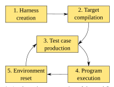

**Source:** *LibAFLGo: Evaluating and Advancing Directed Greybox Fuzzing* — [PDF](https://download.vusec.net/papers/libaflgo_eurosp25.pdf)

# LIBAFLGO: Evaluating and Advancing Directed Greybox Fuzzing

Elia Geretto<sup>∗</sup> , Andrea Jemmett<sup>∗</sup> , Cristiano Giuffrida and Herbert Bos *Vrije Universiteit Amsterdam, Amsterdam, the Netherlands* {*e.geretto, a.jemmett*}*@vu.nl,* {*giuffrida, herbertb*}*@cs.vu.nl*

*Abstract*—While greybox fuzzing is routinely applied in production environments with great success, *directed* greybox fuzzing has struggled to gain real-world adoption—despite the great (intuitive) promise and the many optimizations proposed in literature. In practice, directed fuzzers struggle for three critical issues. First, popular implementations build on and compare to ancient baselines, often derived from AFLGo. Unfortunately, none of the optimizations that are essential for performance in modern greybox fuzzers are available in these baselines. As a result, we find reported improvements in directed fuzzing are often only "imaginary" and do not lead to better performance on a modern baseline. Second, directed fuzzing evaluations commonly ignore or misinterpret important factors affecting fuzzing overhead—such as build times and timeouts. As design decisions now build on unreliable data, we find the directed fuzzers perform worse than expected in practice. Third, while almost all directed fuzzers rely on (expensive) analysis stacks, such as pointsto and reachability analysis components, they often opt for very different implementations. Since these implementations have their own unique benefits and drawbacks, we find performance differences of directed fuzzers are frequently due to these components rather than the proposed directed fuzzing optimization.

In this paper, we investigate the practical impact of these issues by means of an analysis and evaluation of a representative set of popular directed greybox fuzzers. As a way forward, we then present LIBAFLGO, a modular directed fuzzing framework that addresses all three issues and allows one to directly compare different directed fuzzing policies on top of a modern fuzzing stack. Our experimental results on state-of-the-art directed fuzzing policies provide two main insights. First, the original AFLGo policies outperform more recent directed fuzzing policies when testing on a modern fuzzing stack. Second, none of the directed fuzzing policies can favorably compete with (nondirected) LibAFL, which scored better overall performance across benchmarks. As such, the quest for efficient directed fuzzing policies must continue.

*Index Terms*—fuzzing, directed fuzzing, guidelines

## 1. Introduction

Greybox fuzzing, which relies on feedback from lightweight instrumentation to guide the exploration of the target program, has a pivotal role in vulnerability finding. As a consequence, the research community has directed tremendous efforts toward optimizing the efficiency of modern greybox fuzzing frameworks. With success: as production tools such as AFL++ [10] and LibAFL [11] adopted a host of powerful optimizations, their proficiency at finding bugs has far outgrown that of their simpler predecessors, such as AFL [38]. Essential optimizations such as CMPLOG, derived from RedQueen [10], MOPT [25], and the widespread use of in-process fuzzing, are good examples.

While greybox fuzzing in general is a huge success in real-world testing [33], [2], this is not the case for *directed* greybox fuzzing—using lightweight instrumentation feedback to purposefully force a fuzzer to focus on preselected regions of the target program which are more likely to contain bugs. Directed (greybox) fuzzing, as pioneered in AFLGo [4], intuitively holds great promise—homing in on error-prone code has the potential to minimize the execution of uninteresting code paths. However, it is rarely used in production, despite the plethora of improvements described in the literature [5], [39], [20], [36], [13], [9], [34], [16], [24], [14], [23].

In this paper, we show that there are three critical issues that cripple the realism and usefulness of directed fuzzers and their evaluations. We argue that these issues should be addressed for directed fuzzing to become practical in realworld fuzzing campaigns, or even competitive compared to nondirected fuzzing.

First, there is a problem with the choice of the baseline fuzzer. In particular, since AFLGo [4], the first directed fuzzer, branched off from what is arguably the most influential nondirected fuzzer, AFL [38], these two major fuzzing families have developed in virtual isolation. As a result, the powerful improvements in nondirected fuzzing are not even available in directed fuzzers. Indeed, many recent directed fuzzers are still based on AFLGo or compare directly with it in their evaluation, even though AFLGo does not integrate the vast majority of improvements of projects such as AFL++ and LibAFL. In addition, AFLGo still uses a fork server, which sets it further apart from real campaigns, where in-process fuzzing, popularized by LibFuzzer [1], is more common and also much faster. As a consequence, the interactions between in-process and directed fuzzing are hitherto not explored.

This is an issue, since the performance of a fuzzer is the result of a delicate balance between the benefits and the overheads of all its components, and an optimization that is useful in one scenario, for example in a slower

<sup>∗</sup>*Both authors contributed equally to the paper.*

fuzzer, may well be detrimental at higher speeds. Ignoring significant improvements in nondirected fuzzing may lead to "imaginary" improvements—where a directed fuzzer removes an inefficiency which, in a more realistic scenario with modern fuzzing components, would not exist. At this point, the gap between directed and nondirected fuzzing is so wide that the settings in which the community commonly evaluates directed fuzzers is hardly representative of real fuzzing campaigns. As a result, the data produced in such evaluations is of little use for those considering the adoption of newer directed fuzzing techniques. As we will show in our evaluation, the recent popularity of pruningbased directed fuzzers in the fuzzing literature [13], [36] is likely a consequence of this phenomenon. The only way to paint a more realistic picture is to build on a baseline that is as recent and optimal as possible.

Second, we identify issues concerning the methodology for evaluation of the fuzzer performance—in particular, the erroneous omission of essential contributions to the overhead in the performance numbers, and the improper handling of censored data, i.e., when the value of observations may be only partially known, e.g., due to an observation timeout. The most glaring example of the former is the omission of build times from evaluations. Since most directed fuzzers require a (lengthy) recompilation after a new target is selected, the time between the selection and reaching of a target includes the build time. Thus, omitting it from the evaluation "hides" part of the overhead. As a consequence of this way of evaluation, recent directed fuzzers have added a lot of analysis load to the compilation phase, for instance in the form of points-to analysis, that may incur long build times. The evaluation of whether the benefits of these analyses outweigh the time it takes to perform them is often lacking.

Improper handling of censored data, in turn, stems from timeouts that occur during time-to-exposure (TTE) measurements. In fuzzing, the correct use of statistical techniques is critical for drawing scientifically sound conclusions [18], [30]. However, directed fuzzing presents a unique challenge because experiments that measure TTE, typically used as a measure of success for directed fuzzers, frequently result in timeouts that give rise to *censored data*. The improper handling of such data, either by omitting unknown values from the analysis or by improperly replacing them with arbitrary values, leads to a misrepresentation of the experimental results.

Finally, while the base for the implementation of the fuzzers itself is fairly consistent, usually AFLGo, there is a lot of variation in the analysis stack—the components used in the compilation/analysis phase. These components, such as points-to and reachability analysis, are crucial for the performance of directed fuzzing. However, there are many implementations to choose from—some based on source code, others on intermediate representations, with different views of the program etc. Since each of these implementations yields unique benefits and drawbacks, the performance differences in the evaluation may well be due to the quality of the analysis components rather than that of a directed fuzzing optimization.

In this paper, we first investigate the impact of these issues by evaluating recent directed fuzzing policies from the most representative solutions in the literature. As a way forward, and to allow for better evaluation of



Figure 1: A schematic representation of the workflow of a fuzzer.

directed fuzzers with state-of-the-art components, we then present LIBAFLGO, a modular directed greybox fuzzing framework that addresses all three issues. In particular, it uses state-of-the-art fuzzing components from LibAFL [11] as a common, modern, baseline. It features an optimized building phase, so that the build times for each of the approaches can be considered in a proper evaluation. Finally, it relies on shared analysis frameworks, with the same view of the program, eliminating the variance in the compilation phase. Surprisingly, our experiments show not only that the original AFLGo policies outperform more recent directed fuzzing policies when evaluated on a modern fuzzing stack, but also that none of the directed fuzzing policies favorably compete with a modern nondirected fuzzer such as LibAFL, which scored better overall performance across benchmarks.

In summary, we make the following contributions:

- We thoroughly analyze the issues that affect directed greybox fuzzing prototypes and evaluations.
- We implement LIBAFLGO, a modern directed greybox fuzzing framework which addresses these issues and use it to implement a set of representative state-of-the-art directed fuzzers on a modern baseline.
- We evaluate the performance of these fuzzers in realistic settings and show (a) that the original AFLGo policies outperform more recent solutions, and (b) that none of the directed fuzzers performs as well as a modern nondirected fuzzer across the board.
- We will open-source LIBAFLGO and actively seek mainline inclusion in LibAFL to ease development of new directed fuzzers and move the field forward.

## 2. Background

We briefly discuss nondirected and directed greybox fuzzing, highlighting modern reusable optimizations that are often unacknowledged in directed fuzzing, where systems implement their own, loosely related versions, or lack them completely.

#### 2.1. Phases in Fuzzing

As illustrated in Figure 1, fuzzing starts with the creation of a harness—the code that allows the fuzzer to run the target program. This phase can range from a few minutes, when fuzzing a program that accepts inputs from a file, to multiple hours, when aiming at a specific function taking complex inputs in a binary 5 target. The second phase, the compilation of the harness, 6 is optional, but usually present even for binary targets 7 when the compilation of a small amount of harness code is 8 still necessary. However, it takes much longer for source-9 based fuzzers which rebuild the whole target program. The third phase, the beginning of the actual fuzzing loop, includes all steps for the production of a new test case 13 either through generation from a grammar, or mutation from an existing corpus. In the latter case, it includes test case selection, power scheduling, and processing of the results after an execution (e.g., coverage traces). The length depends mostly on the fuzzer and its configuration, and is largely independent of the target program. The fourth phase concerns the execution of the target program with the new test case as input-including all instrumentation (e.g., for code coverage or fault detection). The length is dependent on the target program and the amount of analysis/instrumentation. The last phase is the reset of the environment to restore it to the state prior to the execution of the previous test case. For instance, a fork in case of AFL's [38] fork server, a snapshot restore operation as in Nyx [31], or a manual reset with in-process fuzzing.

#### 2.2. Directed Fuzzing

Directed (greybox) fuzzing, which was first proposed by AFLGo [4], directs the fuzzer to specific regions of interest within a program. The ability to specify a few targets within a program has various concrete applications, such as patch testing in CI, or testing code regions that are more likely to contain bugs.

Directed fuzzing can be subdivided in three broad categories: distance-based [4], [5], [20], [9], [16], [24], [23], pruning-based [13], [36], and mutation-based [39], [14]. We illustrate the difference in a simplified example in Listing 1. The first two approaches share a phase where the compiler uses static analysis to estimate the reachability of the target from every point in the program. In our example, only line 11 cannot reach the target. After this first step, a distance-based fuzzer establishes a distance measure for each reachable location in the program and injects the related function calls (in orange). Upon executing the test case, it aggregates the various distances along the execution path to calculate a distance value for the test case. The goal, then, is to minimize the distance value. In contrast, a pruning-based fuzzer uses the reachability information to decide which locations in the program definitely cannot reach the target and injects marker instrumentation accordingly (in purple). Upon reaching these locations, the fuzzer aborts the execution and starts a new one. Finally, a mutation-based directed fuzzer will try to infer the characteristics of test cases that reach the target through the observation of the test cases themselves. Observing test cases that satisfy the condition at line 9, it may infer that n > 42. It will then modify its mutation operators to execute only test cases that are more likely to reach the target.

```
void func1(int n) {
    __record_distance(2);
    if (n < 82) {
        __record_distance(1); func2();
    } else {
        __record_distance(1); func3();
    }
    if (n > 42) {
        __record_target(); target();
    } else {
        __unreachable(); not_target();
    }
}
```

Listing 1: Difference between distance-based (in orange) and pruning-based (in blue) directed fuzzing instrumentations. Target instrumentation (in red) is shared by both.

#### 2.3. Optimizations Missing in Directed Fuzzers

While relatively few optimizations proposed in academic papers have seen adoption in production-ready tools such as AFL++ [10] and LibAFL [11], some have and a few are even considered essential in modern fuzzing. Probably the best examples of such ubiquitous optimizations are: CMPLOG (derived from RedQueen [3]), and MOPT [25]. Often directed fuzzers do not reuse those optimizations as some systems implement their own, loosely related version (e.g., [9], [14], [23]); unfortunately those alternative components have not been compared in isolation against their nondirected counterparts.

**2.3.1. CMPLOG.** exploits the correspondence between input and state, as values in the input are likely to be loaded into variables, especially in parsers. Much like dynamic taint analysis, this property allows the fuzzer to identify, albeit with limited precision, which parts of the input correspond to specific variables that the program checks in comparison operations, simply by observing the correspondence of their values. For instance, if the input contains a value Oxdeadbeef, and the program compares a variable with that value to the value 0xaabbccdd during execution, it is likely that the variable originated in those input bytes. Under CMPLOG, the mutation operator will thus replace the sequence with Oxaabbccdd to quickly satisfy the comparison and improve coverage. As directed fuzzers also benefit from exploring the program more easily, the optimization would be just as useful here except that it is not available.

**2.3.2. MOPT.** is a mutation operator scheduling algorithm which favors mutations operators that are more likely to produce interesting test cases. In detail, the algorithm receives as input how often each mutation operator was selected and how often it generated interesting test cases; it then uses the particle-swarm algorithm to estimate the best division of time between the mutation operators to maximize the number of interesting test cases. This algorithm is lightweight enough to be run repeatedly while fuzzing, ensuring that the distribution is adapted to both the program under test and the current phase of the campaign. While "interesting" in nondirected fuzzing means additional coverage, directed fuzzing could use the exact same algorithm by using the distance to the target.

## 3. Issues in Directed Fuzzing Studies

In this section, we discuss in detail the issues we identified in our analysis and formulate recommendations to address them. We have limited our survey to what we consider "true" directed greybox fuzzers (and competitors): those that allow the user to specify a target position in the program. This characteristic makes them usable for the applications normally advertised for directed fuzzing, such as patch testing. This decision excludes works such as SAVIOR [6], ParmeSan [28] and UAFuzz [27], which autonomously define their targets and can be considered nondirected, although not exclusively coverage-guided. In addition, we focus only critical directed fuzzing issues that are not already covered in existing literature on benchmarking in *non*directed fuzzing [18], [26], [30].

### 3.1. Choice of Fuzzing Baseline

As shown in the "Prototype base" column in Table 1, most of the literature on directed fuzzing derives from either AFL [38] or AFLGo [4]. AFLGo itself was originally developed as a fork of AFL, so the projects share most of their code, but was then maintained independently. Both projects are now unmaintained and have not received significant updates for several years. It is likely that the authors of the papers in Table 1 selected either AFL or AFLGo as a base for their prototype to minimize the implementation effort while maintaining scientific validity. This allowed them to evaluate the main contribution of their work, the directed fuzzing components, keeping the remainder of the code the same. At first glance, this seems to be the right thing to do.

The problem with the reuse of AFL-derived core components is that directed fuzzers miss out on important advances in modern nondirected fuzzers, such as AFL++ [10] or LibAFL [11], which have not been backported to either AFL or AFLGo. This is problematic because the performance of a fuzzer depends on achieving a good balance between the various phases of the fuzzing process, as described in Section 2.1. The effectiveness of a new optimization depends greatly on how the balance between the phases shifts: the same optimization may be effective in one setting, and counter-effective in another.

In order to further clarify this concept, we explore how modern optimizations and sanitizers (i.e., instrumentationbased bug detection tools) could interact with directed fuzzing components in the test case production, program execution, and environment reset phases.

*Phase 3 - Test case production.* Both distance-based and mutation-based directed fuzzers introduce changes in this phase: the former by selecting test cases to mutate that are closer to the target, the latter by generating mutants that are more likely to reach the target. Both approaches aim at reducing the number of executions required to reach a specific target. However, modern *non*directed fuzzers, already perform well-established optimizations, notably CMPLOG and MOPT, which serve a similar purpose: reducing the number of executions required to explore new portions of the program.

The directed fuzzing literature has proposed techniques based on similar principles (e.g., [9], [14], [23]), but these have not been compared directly with their undirected counterpart and have not seen widespread adoption. As a result, existing work has neglected the interaction between such optimizations and the techniques employed by directed fuzzers. While it is unlikely that their improvements will simply sum up, their costs definitely will. For example, if CMPLOG already "solves" a condition which we also target with directed policies, we pay the cost of both techniques when only one of them would have been sufficient.

Optimizations acting on the number of executions aside, there are many implementation tweaks, such as the use of vector instructions, which make producing test cases faster, but that are missing from the older fuzzers on which directed fuzzers build. Having a slower base fuzzer provides "better" results in a directed fuzzing evaluation, simply because the additional overhead introduced by the analysis or instrumentation represents a smaller portion of a complete execution, but these benefits may disappear with a faster baseline.

Observation 1: Each directed-fuzzing optimization should strive to reuse the best core components available, enabling a fair and representative comparison with a modern baseline.

*Phase 4 - Program execution.* Unlike distance-based directed fuzzers which insert the (usually lightweight) instrumentation needed for distance calculation, pruningbased approaches aim to improve the fuzzer throughput by cutting off executions as early as possible. While pruning does make the execution faster, to the point of recovering the cost of the pruning instrumentation, the gain depends on the "weight" of this phase in a single execution. This in turn depends on the detection instrumentation that is enabled, as most of the overhead comes from the use of sanitizers, e.g., AddressSanitizer (ASAN) [32]. In production, practitioners deploy sanitizers whenever possible, as finding subtle bugs without them is excessively hard. However, this is not reflected in the literature: sanitizers are commonly omitted, typically for implementation-specific compatibility reasons. The omission strongly reduces the value of the evaluations to the point of making it impossible to assess the quality of a directed fuzzing technique. In particular, it may bias the evaluation, in this case toward lightweight techniques, as higher overheads have more impact in a faster running fuzzer.

Observation 2: Each optimization should be built by preserving compatibility with sanitizers when the objective is finding bugs.

*Phase 5 - Environment reset.* While directed fuzzers usually do not directly modify this phase of the fuzzing process, it is one of the most relevant towards their overall performance. The technique to manage and reset the fuzzing environment usually adds a fixed amount of time to each single execution and determines the maximum speed at which the fuzzer can run. Again, a fuzzer running at lower speeds makes heavyweight techniques "look good", because their overhead takes up a smaller portion of each execution. As shown in the "Env. reset" column in Table 1, all the directed fuzzers we considered use a relatively slow fork server to reset their environment. This technique, pioneered by AFL, has been reused in AFLGo, pushing all

TABLE 1: Summary of the prototype features across the papers considered. The "Compile time analyses" and the "Analysis stack" columns refer exclusively to compile time analyses. The "Build impact" column contains an educated guess of the compile time analysis impact on the total build time. \*WindRanger reports AFL as a base in the paper, but the artifact is based on AFLGo.

| Name            | Conference | Open source | Prototype base | Env. reset  | Compile time analyses                      | Build impact | Analysis stack |
|-----------------|------------|-------------|----------------|-------------|--------------------------------------------|--------------|----------------|
| AFLGo [4]       | CCS '17    | Yes         | AFL            | fork server | distance                                   | minimal      | LLVM           |
| Hawkeye [5]     | CCS '18    | No          | AFL reimpl.    | fork server | points-to, distance                        | significant  | LLVM, SVF      |
| FuzzGuard [39]  | USENIX '20 | No          | AFLGo          | fork server | pre-domination                             | minimal      | LLVM           |
| CAFL [20]       | USENIX '21 | No          | AFL            | fork server | distance                                   | minimal      | LLVM           |
| WindRanger [9]  | ICSE '22   | Yes         | AFLGo*         | fork server | points-to, distance                        | significant  | LLVM, SVF      |
| Beacon [13]     | S&P '22    | Yes         | AFLGo, AFL++   | fork server | points-to, reachability, precondition      | significant  | LLVM, SVF      |
| MC2<br>[34]     | CCS '22    | Partial     | -              | fork server | -                                          | minimal      | -              |
| SieveFuzz [36]  | ACSAC '22  | Yes         | AFL++          | fork server | points-to, reachability                    | significant  | LLVM, SVF      |
| DAFL [16]       | USENIX '23 | Yes         | AFL            | fork server | points-to, reachability, dataflow distance | significant  | sparrow        |
| SelectFuzz [24] | USENIX '23 | Yes         | AFLGo          | fork server | points-to, reachability, distance          | significant  | LLVM, SVF      |
| Halo [14]       | S&P '24    | No          | AFL++          | fork server |                                            | minimal      | -              |
| DeepGo [23]     | NDSS '24   | No          | AFLGo          | fork server | distance, sibling branches                 | minimal      | LLVM           |

TABLE 2: Summary of the TTE-based experiments across the papers considered. The "Baseline" column considers only other directed fuzzers. Multiple values in the "Timeout" and "Repetitions" columns refer to different experiments in the papers. \*SelectFuzz could be applying the Mann-Whitney U test incorrectly as the p-values are not reported pairwise in the paper.

| Name            | Baseline                                  | Timeout  | Repetitions | Timeout handling | Aggregation | Effect size    | Statistical test |
|-----------------|-------------------------------------------|----------|-------------|------------------|-------------|----------------|------------------|
| AFLGo [4]       | -                                         | 8h       | 20          | upper bound      | mean        | Vargha-Delaney | Mann-Whitney U   |
| Hawkeye [5]     | AFLGo                                     | 8h, 4h   | 20, 8       | upper bound      | mean        | Vargha-Delaney | -                |
| FuzzGuard [39]  | AFLGo                                     | 200h     | 1           | upper bound      | -           | -              | -                |
| CAFL [20]       | AFLGo                                     | 16h, 33h | 3           | excluded         | mean        | -              | -                |
| WindRanger [9]  | AFLGo                                     | 24h, 8h  | 10, 20      | not present      | mean        | Vargha-Delaney | Mann-Whitney U   |
| Beacon [13]     | AFLGo                                     | 120h     | 10          | excluded         | mean        | -              | Mann-Whitney U   |
| MC2<br>[34]     | AFLGo                                     | 6h       | 20          | upper bound      | mean        | -              | Mann-Whitney U   |
| SieveFuzz [36]  | AFLGo, Beacon                             | 24h      | 10          | excluded         | mean        | Vargha-Delaney | -                |
| DAFL [16]       | AFLGo, WindRanger, Beacon                 | 24h      | 40          | excluded         | median      | -              | -                |
| SelectFuzz [24] | AFLGo, Beacon                             | 24h      | 5           | unclear          | mean        | -              | Mann-Whitney U*  |
| Halo [14]       | AFLGo, WindRanger, Beacon, Se<br>lectFuzz | 24h      | 10          | excluded         | mean        | -              | Mann-Whitney U   |
| DeepGo [23]     | AFLGo, WindRanger, Beacon                 | 24h      | 5           | upper bound + 1h | mean        | Vargha-Delaney | Mann-Whitney U   |

successors to adopt it, to ease implementation, minimize setup time, and ensure comparability of the results.

However, whenever there is a tradeoff between setup time and speed, practitioners usually pick performance: in runs that last longer than a few minutes, a faster fuzzer will always recover the additional setup time. In particular, projects such as OSS-Fuzz [33] and FuzzBench [26] highlight that practitioners will go the extra mile to write harnesses for in-process fuzzing whenever possible, even if doing so is significant effort. The harness executes in a loop, running the code under test and resetting the state of the process. As the reset code is customized for the program under test and runs exclusively the operations required, with virtually no overhead, this is always faster than a generic solution such as a fork server.

However, resetting the environment through a harness, also imposes a strong limitation: the harness should always run top to bottom and without entering weird states, as may arise due undefined behavior or prematurely terminated executions. This means that (a) cutting executions short, as pruning-based directed fuzzers do, is not possible, and (b) sanitizers are *essential* to ensure consistency. When a technique violates these requirements, it also forfeits the performance benefits of harness-based resets. A downgrade to snapshot-based reset methods is justified only when the target itself is incompatible with harnesses, such as when it is stateful or heavily multithreaded. The only way to paint a realistic picture is thus to always use the fastest reset method that is compatible with the technique being evaluated and the context of application.

In summary, the choice for fork servers in recent directed fuzzing solutions has created a significant gap because newer techniques, while proven to work with snapshot-based reset methods, are not even tested in combination with harness-based in-process fuzzing—the most commonly used environment reset method in practice.

Observation 3: Each optimization should be built by striving for speed: it should use the fastest reset method compatible, optimized as much as possible.

Some recent fuzzers, such as Beacon [13], Sieve-Fuzz [36], and Halo [14], do base their prototype on AFL++ [10], a modern nondirected fuzzer, in an effort to avoid some of the issues we described. However, they still use AFLGo-based directed fuzzers as a baseline for their evaluation, as Table 2 shows. This is also problematic because comparing two different fuzzing stacks prevents us from drawing meaningful conclusions about the usefulness of the directed fuzzing optimizations, as it unclear whether improvements are due to the optimizations presented or the more advanced fuzzing stack.

Observation 4: The fuzzers used as baseline in the evaluation should also follow the recommendations of Observations 1, 2, and 3.

#### 3.2. Methodology for Evaluation

Directed fuzzing presents unique challenges for evaluations because the guidelines provided by the nondirected

fuzzing literature [18], [26], [30] do not directly apply. Indeed the effectiveness of a directed fuzzing technique is commonly established by measuring the time-to-exposure (TTE) for a preselected target/bug, while these guidelines address experiments that target coverage-over-time or bugsover-time metrics. Examining how the results of TTE experiments are presented in the directed fuzzing literature, we identified two issues that may lead to misinterpretation of the performance of a system. Observations 5 and 7, along with our own experimental evaluations, align with and reinforce findings from concurrent research [17].

3.2.1. Missing build times. The first issue we identify is that build times for directed fuzzing techniques are commonly not considered in TTE experiments. The problem with this practice is that it allows to move to the compilation phase some of the overhead that other solutions have to deal with at runtime, making it effectively disappear. This is problematic because most directed fuzzers require a recompilation for each new target selected, effectively making the compilation phase part of the time needed to reach that bug. As an example, suppose a fuzzer requires 2 hours to build a large program due to complex interprocedural analyses. If a specific target could be reached with a nondirected fuzzer in a 1-hour run, it is evident that, whatever the benefit brought by the directed fuzzer, it will be nullified by its build times.

In order to assess the impact of this issue, we show a summary of the analyses run at compile time by the solutions considered in column "Compile time analyses" in Table 1, as well as an estimate of the impact these analyses have on the build times in the "Build impact column". It is evident that, out of the 6 papers that we believe use techniques that significantly impact build times, such as points-to and data-flow analyses, only 2 of them, Beacon [13] and DAFL [16], attempt to evaluate their impact. In order to provide an accurate assessment, it is also necessary to consider software of various sizes, including large projects such as php. In particular, relying on predefined fuzzing test suites, such as FuzzBench [26] or MAGMA [12], guarantees fairness in the evaluation.

Observation 5: Build times should be included in all TTE experiments and evaluated across software projects with various sizes.

One common reason we identify for the omission of build time evaluations is that compilation pipelines are not optimized for speed or memory usage. As an example, the original implementation of AFLGo relies on external programs and temporary files for distance computation. As build times are commonly not evaluated, this issue affects most of the later prototypes as well, where operations that can be easily performed in the compiler process are offloaded to external scripts. As a consequence, when taking build times into account, it is necessary that both the prototype under evaluation and the baseline have reasonably optimized compilation pipelines.

Observation 6: In order to properly assess build times in TTE experiments, both the new prototype and the baseline should have an optimized compilation pipeline.

3.2.2. Timeout handling. Randomness plays a large role in fuzzing. As such, in order to draw scientifically sound conclusions, an experiment has to be repeated multiple times and its varying results need to be analyzed with statistical tools. TTE experiments are no exception to this, but present, again, a unique challenge because they can result in timeouts if they do not complete in the allocated time budget. TTE experiments thus produce results known as *Type I censored data* in survival analysis, meaning that, for some of the observations, we know only that their value is above the timeout threshold [19].

As we show in the "Timeout handling" column in Table 2, the two most common methods for handling censored data in the literature are dropping all the repetitions of benchmarks that contains even a single timeout, or assigning the timeout value to all experiments that time out. The former solution, while sound, is very extreme and may favor techniques that run better in smaller, faster software, that has less risk of incurring timeouts. The latter is conceptually incorrect and presents two pitfalls. The first one is relying on the filler values to analyze data: a common mistake, as shown in the "Aggregation" column, is to aggregate data using the mean, as happens in three of the papers. Indeed, the mean would be calculated including values that are effectively unknown. The second pitfall is to rely on the ordering of the filler data, which is also unknown. This is the case when performing aggregation using the median, showing the effect size with Vargha-Delaney A12, and performing the Mann-Whitney U statistical test.

This is less problematic because these methods may still provide the correct result when used with filler data, depending on their construction: the median, for example, will be calculated correctly if the timeouts are less than 50% of all observations. However, to avoid these pitfalls altogether, survival analysis offers tools that are better suited for the handling of censored data [17]. As proposed in MAGMA [12], TTE experiments can be better represented plotting a survivability function constructed with the Kaplan-Meier estimator [15].

In addition we argue that, when data is presented in tabular form, providing the median survival time, i.e., the time for which the survival probability function first drops to 50%, with confidence intervals is the most suitable solution because it is well defined in the presence of censored data. With regards to the statistical test, we recommend using the logrank statistical test, which does not assume that the complete ordering of the observations is known. With regards to the effect size, instead, we recommend performing a Cox proportional hazards regression analysis [7], which allows to collect information on the effect size using its hazard ratio.

Observation 7: The results of experiments observing time-to-exposure (TTE), should be analyzed using techniques suitable for handling censored data, such as the Kaplan-Meier estimator, the logrank statistical test, and the hazard ratio.

## 3.3. Choice of Analysis Stack

As shown in Table 1, directed fuzzers commonly build on some kind of interprocedural reachability analysis to understand if there is a path that leads to the target from a specific point in the program. This information serves as the basis for distance measurements or for pruning. Such reachability analysis is nontrivial as it requires taking into account indirect edges, and is commonly offloaded to a separate module, such as SVF [37], some other existing solution [16], or a home-grown analysis. We present a summary of the components used in such phase in the "Analysis stack" column in Table 1. The level of abstraction at which the module operates differs from solution to solution. For instance, SVF is based on LLVM IR, while DAFL [16] employs a source-based framework. The variance in such modules, or in their often unreported versions and configurations, easily leads to significant differences in the results, which in turn influence the overall performance of a directed fuzzer. This variance should thus be eliminated.

Observation 8: Analysis modules that support (but are not part of) the optimization under evaluation, should remain constant across all evaluated solutions.

## 4. Design

To address the development and evaluation challenges outlined in Section 3, we used our Observations as guidance to develop LIBAFLGO: a fuzzing library which builds on the work done by the LibAFL [11] project to obtain a uniform, reliable platform on which to build new directed fuzzers and to evaluate them against the state of the art in both directed and nondirected fuzzers.

### 4.1. Fuzzing Baseline

In order to satisfy Observation 1 and reuse the best core components available, we have decided to base our work on LibAFL. Indeed, it is currently the best performing, actively maintained, fuzzing library according to independent benchmarks, such as FuzzBench [26]. This guarantees that any evaluation will be closer to a real fuzzing scenario. In addition, LibAFL's model of separate, replaceable modules for each core component makes it easier to keep our implementations up to date and allows easy integration of the latest advances in the state of the art of nondirected fuzzing—including CMPLOG, MOPT, and possible future optimizations.

To satify Observation 2, we ensured that our implementations, like LibAFL, are compatible with sanitizers, such as AddressSanitizer. This also ensures that LIBAFLGO retains one of the main requirements for in-process fuzzing.

Furthermore, using LibAFL we satisfy Observation 3 because it supports in-process fuzzing, which allowed us to design high performance prototypes. In addition to adopting the fastest reset technique available, we ensured compatibility with the highest optimization levels available in our compiler. Commonly, directed fuzzers, in particular AFLGo and its successors, have issues with higher optimization levels because their target selection system, based on *(file, line)* pairs, relies on debug information. Unfortunately, debug information is not very reliable under higher optimization levels. We solved this issue by devolving target selection from the instrumentation. In particular, to guarantee the preservation of target locations, the instrumentation associates the list of *(file, line)* pairs

to the corresponding basic blocks *before* running the optimization pipeline—modifying only the target basic blocks. The distance-tracing instrumentation, present in all basic blocks in the program, will then be injected only at the very end, after link-time optimization. In this way, all possible optimizations that do not interfere with the target locations execute normally, while the targets are preserved.

Finally, we satisfy Observation 4 regarding the quality of the baseline used by following LibAFL's framework structure. Indeed, the ability of combining reusable modules to compose fuzzers ensures that our prototypes run different code only for their differentiating features.

### 4.2. Build Optimization

To satisfy Observation 6 and make the evaluation on build times fair, it is necessary to optimize the implementation of the components that run at build time. Commonly, directed fuzzers that have a significant impact on build time first run an interprocedural analysis for distance or reachability calculation and then an instrumentation pass to inject distance recording or pruning callbacks.

Among these two phases, the most expensive is the analysis because directed fuzzing requires, by definition, a full view of the control flow graph in order to establish the distance or the reachability of the target from all locations in the program. This implies that the distance analysis has to be interprocedural and execute after the program has been fully linked. In other words, it cannot be conducted on compilation units in isolation. Additionally, the analysis stack often performs auxiliary analyses to further refine and enhance the control flow graph representation for reachability. These commonly include a points-to analysis to resolve indirect edges. Indirect edges are prevalent in C and especially C++ programs. Omitting them in the analysis frequently leads to control flow graphs with many small connected components—thwarting the effectiveness of any reachability analysis.

One of the most efficient ways to run an interprocedural analysis that considers the whole program is to do so as part of the link-time optimization (LTO) pipeline. LIBAFLGO therefore runs both the analysis and the instrumentation phase at the very end of the LTO pipeline, implementing them as a linker plugin. To the best of our knowledge, LIBAFLGO is the first directed fuzzer prototype to do so. As a result, it is also the first framework where build times can reasonably be considered.

Moreover, our implementation performs all analysis in memory, without disk interactions or temporary files to avoid slowing down the build process. Temporary files are commonly used in prototypes that do not rely on LTO (such as AFLGo and its descendants), but this slows down the build process enormously. LIBAFLGO's choice imposes a requirement on the program under test to support LTO, but this is commonly the case for actively maintained projects. An additional requirement in the analysis phase is that our prototype should fit in the available RAM during linking. We believe that this is a reasonable requirement because the alternative, using large temporary files, would require such long build times that the technique would be ineffective.

### 4.3. Analysis Stack

To satisfy Observation 8 and make the analysis stacks uniform across our framework, we agree with the majority of the literature: for pointer analysis, SVF [37] is the right tool as it is the best maintained and LLVM no longer provides such functionality. In addition, it can be easily integrated in LLVM plugins, which are arguably the best way to optimize build times. By making LIBAFLGO open source, we allow authors to verify which configuration was used in our evaluation and also to adjust it to their needs. This also allows for the evaluation of analysis algorithms which should, however, be conducted separately from those of the directed fuzzing optimizations.

## 5. Existing Fuzzers on LIBAFLGO

To evaluate the impact of the issues described earlier, we reimplemented a representative set of existing directed fuzzing policies in LIBAFLGO. In this section, we describe the solutions considered and motivate the selection.

### 5.1. Reimplemented Solutions

Among the directed fuzzers discussed in Section 3, we chose to reimplement three solutions that arguably provide a good representation of the state of the art: AFLGo, Hawkeye, and DAFL.

5.1.1. AFLGo. We selected AFLGo because it effectively represents the simplest implementation of a directed fuzzer that was proven to be effective. In addition, AFLGo does not rely on auxiliary analyses, reducing its build time impact to a minimum. We reimplemented the original approach by changing both the instrumentation and the fuzzer code, but preserved all the original functionality. The main difference is that we moved the entire compilation pipeline in a single linker plugin that runs at LTO time. This guarantees the fastest possible build times. As opposed to the original AFLGo, the instrumentation is based on callbacks, similarly to how the LLVM SanitizerCoverage instrumentation operates. This may make the execution slightly slower, but guarantees compatibility with sanitizers and limits the size of the generated binary.

5.1.2. Hawkeye. We selected Hawkeye because it is the first fuzzer to rely on a points-to analysis, while introducing a new distance metric that represents an improvement over the one used by AFLGo. This allows us to evaluate both the importance of distance metrics and points-to analysis in our modern fuzzing environment. We excluded from the implementation the "adaptive" mutation algorithm presented in the original paper as it would have conflicted with MOPT. The latter is preferable, because the original algorithm performs a static power allocation based on magic constants without adapting to the program under test, as MOPT does. Our substitution reinforces the "adaptive mutation" concept and should provide better performance [25]. As the original implementation of the fuzzer is not available and was based on an older version of SVF, we decided to base the pointer analysis on the current AndersenWaveDiff module [21]. As for the AFLGo instrumentation, we moved the pointer analysis to the LTO plugin to guarantee the best results.

5.1.3. DAFL. Finally, we selected DAFL because it is one of the most recent open source distance-based directed fuzzers proposed in the literature. It adopts dataflowbased techniques and selective instrumentation, which are also employed in the similar WindRanger and SelectFuzz. Among the three, we chose DAFL because its evaluation reports improvements over WindRanger. SelectFuzz is concurrent work, but uses a similar approach. Following Observation 8, we reimplemented DAFL using LLVM and SVF as an analysis stack in place of the original source-based framework. DAFL's core idea is to calculate distances on the Def-Use Graph (DUG) after applying *thin slicing* [35]. Unfortunately, the slicing rules were originally devised to be applied at source level on a Java-like language, so they do not immediately translate to LLVM IR. For this reason, we approximated thin slicing by applying normal slicing on LLVM IR after heavily optimizing it. This structurally ignores most data dependencies through (trivial) pointer dereferences, as required by thin slicing, because those are aggressively removed by optimizations. Finally, to improve the accuracy of the DUG, DAFL uses the same pointer analysis as Hawkeye.

#### 5.2. Motivation of Selected Fuzzers

Our selection clearly represents the distinct and interesting design solutions in our scope, while deliberately excluding directed fuzzers outside of it, as motivated below.

In line with Observation 3, we exclude from our framework all pruning-based directed fuzzers, as they rely on significantly slower snapshot-based reset techniques. We also had to exclude MC<sup>2</sup> [34] as its Monte Carlo executions enter, by definition, weird states that make it incompatible with our faster in-process design since the state of the process cannot be reset with a harness. To demonstrate the soundness of this choice, we will show in Section 6 how the raw speed achievable with in-process fuzzing far outweighs the benefits of these techniques.

In addition, we could not include mutation-based directed fuzzers: FuzzGuard is not open source and not compatible with our hardware. Halo acts exclusively on mutation operators, entering in direct conflict with MOPT, one of most effective nondirected fuzzing optimizations. We leave the evaluation of this technique against MOPT as future work, when Halo is released open source.

Finally, we excluded CAFL [20], as its interface is different from all the other fuzzers evaluated, allowing the specification of target sequences that are generated based on tool reports. While this approach is valuable, it would be unfair to compare it directly to others in the literature because we would have to provide CAFL with additional information on the targets, giving it an unfair advantage.

## 6. Evaluation

To understand the impact of the issues we identified in this paper, we evaluated 5 different fuzzers (LibAFL, Beacon, and our re-implementations dubbed LibAFLGo, LibHawkeye and LibDAFL). We use LibAFL as a modern fuzzing baseline in accordance with Observation 4. In our evaluation, we will answer the following questions:

TABLE 3: Benchmarks included in MAGMA.

| Project    | Test harness                                            | In-process                                                                                                                                                                                                                                                                                                                                                                                                                                                                                                                                                                                                                                                                                                                                                                                                                                                                                                                                                                                                                                                                                                                                                                                                                                                                                                                                                                                                                                                                                                                                                                                                                                                                                        |
|------------|---------------------------------------------------------|---------------------------------------------------------------------------------------------------------------------------------------------------------------------------------------------------------------------------------------------------------------------------------------------------------------------------------------------------------------------------------------------------------------------------------------------------------------------------------------------------------------------------------------------------------------------------------------------------------------------------------------------------------------------------------------------------------------------------------------------------------------------------------------------------------------------------------------------------------------------------------------------------------------------------------------------------------------------------------------------------------------------------------------------------------------------------------------------------------------------------------------------------------------------------------------------------------------------------------------------------------------------------------------------------------------------------------------------------------------------------------------------------------------------------------------------------------------------------------------------------------------------------------------------------------------------------------------------------------------------------------------------------------------------------------------------------|
| libpng     | libpng_read_fuzzer                                      | ✓                                                                                                                                                                                                                                                                                                                                                                                                                                                                                                                                                                                                                                                                                                                                                                                                                                                                                                                                                                                                                                                                                                                                                                                                                                                                                                                                                                                                                                                                                                                                                                                                                                                                                                 |
| libsndfile | sndfile_fuzzer                                          | ✓                                                                                                                                                                                                                                                                                                                                                                                                                                                                                                                                                                                                                                                                                                                                                                                                                                                                                                                                                                                                                                                                                                                                                                                                                                                                                                                                                                                                                                                                                                                                                                                                                                                                                                 |
| libtiff    | tiff_read_rgba_fuzzer<br>tiffcp                         | ✓                                                                                                                                                                                                                                                                                                                                                                                                                                                                                                                                                                                                                                                                                                                                                                                                                                                                                                                                                                                                                                                                                                                                                                                                                                                                                                                                                                                                                                                                                                                                                                                                                                                                                                 |
| libxm12    | libxml2_xml_read_mem xmllint                            | ✓                                                                                                                                                                                                                                                                                                                                                                                                                                                                                                                                                                                                                                                                                                                                                                                                                                                                                                                                                                                                                                                                                                                                                                                                                                                                                                                                                                                                                                                                                                                                                                                                                                                                                                 |
| lua        | lua                                                     |                                                                                                                                                                                                                                                                                                                                                                                                                                                                                                                                                                                                                                                                                                                                                                                                                                                                                                                                                                                                                                                                                                                                                                                                                                                                                                                                                                                                                                                                                                                                                                                                                                                                                                   |
| openssl    | asn1<br>asn1parse<br>bignum<br>client<br>server<br>x509 | \frac{\frac{\frac{\frac{\frac{\frac{\frac{\frac{\frac{\frac{\frac{\frac{\frac{\frac{\frac{\frac{\frac{\frac{\frac{\frac{\frac{\frac{\frac{\frac{\frac{\frac{\frac{\frac{\frac{\frac{\frac{\frac{\frac{\frac{\frac{\frac{\frac{\frac{\frac{\frac{\frac{\frac{\frac{\frac{\frac{\frac{\frac{\frac{\frac{\frac{\frac{\frac{\frac{\frac{\frac{\frac{\frac{\frac{\frac{\frac{\frac{\frac{\frac{\frac{\frac{\frac{\frac{\frac{\frac{\frac{\frac{\frac{\frac{\frac{\frac{\frac{\frac{\frac{\frac{\frac{\frac{\frac{\frac{\frac{\frac{\frac{\frac{\frac{\frac{\frac{\frac{\frac{\frac{\frac{\frac{\frac{\frac{\frac{\frac{\frac{\frac{\frac{\frac{\frac{\frac{\frac{\frac{\frac{\frac{\frac{\frac{\frac{\frac{\frac{\frac{\frac{\frac{\frac{\frac{\frac{\frac{\frac{\frac{\frac{\frac{\frac{\frac{\frac{\frac{\frac{\frac{\frac{\frac{\frac{\frac{\frac{\frac{\frac{\frac{\frac{\frac{\frac{\frac{\frac{\frac{\frac{\frac{\frac{\frac{\frac{\frac{\frac{\frac{\frac{\frac{\frac{\frac{\frac{\frac{\frac{\frac{\frac{\frac{\frac{\frac{\frac{\frac{\frac{\frac{\frac{\frac{\frac{\frac{\frac{\frac{\frac{\frac{\frac{\frac{\frac{\frac{\frac{\frac{\frac{\frac{\frac{\frac{\frac{\frac{\frac{\frac{\frac{\frac{\frac{\frac{\frac{\frac{\frac{\frac{\frac{\frac{\frac{\frac{\frac{\frac{\frac{\frac{\frac{\frac{\frac{\frac{\frac{\frac{\frac{\frac{\frac{\frac{\frac{\frac{\frac{\frac{\frac{\frac{\frac{\frac{\frac{\frac{\frac{\frac{\frac{\frac{\frac{\frac{\frac{\frac{\frac{\frac{\frac{\frac{\frac{\frac{\frac{\frac{\frac{\frac{\frac{\frac{\frac{\frac{\frac{\frac{\frac{\frac{\frac{\frac{\frac}}}}}}}}{\frac{\frac{\frac{\frac{\frac{\frac{\frac{\frac{\frac}}}}}}}}}}}}}}}}}}}}}}}}}}}}}}}}}}}} |
| php        | json<br>exif<br>parser<br>unserialize                   | √<br>√<br>√                                                                                                                                                                                                                                                                                                                                                                                                                                                                                                                                                                                                                                                                                                                                                                                                                                                                                                                                                                                                                                                                                                                                                                                                                                                                                                                                                                                                                                                                                                                                                                                                                                                                                       |
| poppler    | pdf_fuzzer<br>pdfimages<br>pdftoppm                     | <b>√</b>                                                                                                                                                                                                                                                                                                                                                                                                                                                                                                                                                                                                                                                                                                                                                                                                                                                                                                                                                                                                                                                                                                                                                                                                                                                                                                                                                                                                                                                                                                                                                                                                                                                                                          |
| sqlite3    | sqlite3_fuzz                                            | <b>√</b>                                                                                                                                                                                                                                                                                                                                                                                                                                                                                                                                                                                                                                                                                                                                                                                                                                                                                                                                                                                                                                                                                                                                                                                                                                                                                                                                                                                                                                                                                                                                                                                                                                                                                          |

- Q1 Does directed fuzzing outperform nondirected fuzzing, given a modern analysis and in-process fuzzing stack?
- **Q2** Is the performance reported for directed greybox fuzzers in the literature realistic in practice?
- Q3 Is the cost of heavyweight (pointer) analysis at build time recovered by the improved runtime performance when compared to in-process fuzzers?

### 6.1. Benchmark Suite

For meaningful evaluation, we require a benchmark suite of real-world programs with real bugs, across a range of binary sizes and build times and representative complexity (e.g., in the ratio of indirect call sites). Instead of selecting an ad-hoc set of programs as previously done in the literature, we decided to rely on the well-established MAGMA [12] dataset. In this section, we will describe it and motivate our choice comparing it to the dataset used in DAFL [16], the most recent work we reimplemented.

MAGMA contains *frontports* of real bugs that occurred in a dataset of 9 open-source projects. Such projects are chosen from the Google OSS-Fuzz supported programs, which are actively maintained. Each one of these bugs is tagged separately and is thus clearly identifiable, making it easier to measure time to exposure (TTE).

Table 4 shows MAGMA's benchmark evaluates fuzzers using diverse binaries, with sizes spanning 1.2–77.2 MB (median 22.4 MB) including real-world applications like openssl and php. DAFL's benchmark uses smaller binaries (median 2.4 MB, max 12.8 MB), highlighting MAGMA's improved scalability testing and revealing lengthy builds (hours) for large binaries—absent in DAFL's smaller targets. Moreover, MAGMA's indirect call complexity mirrors realistic software, with 12–3059 sites (median 1661, 1.8% of calls) versus DAFL's 44–2768 sites (median 713, 4.6%). While DAFL emphasizes relative

density, MAGMA's absolute counts better reflect real-world challenges. C++ binaries like poppler demonstrate how pervasive indirect calls affect fuzzing.

Finally, MAGMA's inclusion of projects like php highlights build-time impacts on CI pipelines. As Table 7 shows, php builds take minutes with LibAFLGo versus hours for complex-analysis fuzzers, proving lightweight methods enable practical CI integration.

#### **6.2.** Methodology

Each target project in MAGMA can have multiple harness programs, but only a subset of these is suitable for in-process fuzzing. MAGMA provides shims to allow fork-based fuzzers to work with harnesses designed for in-process fuzzing, but not the other way around. As shown in Table 3, only lua lacks a suitable harness and hence we excluded it from our evaluation.

To avoid unnecessary noise from other bugs, we execute our experiments one bug at a time, using the respective patch provided in MAGMA. As patches can span multiple lines and some fuzzers, namely DAFL and Beacon, only support a single line as target, we select (only) the first line that calls the MAGMA canary.

We first explore which bugs are reachable from which harness to avoid unnecessary but costly experiments with directed fuzzers. In particular, MAGMA does not provide information on whether a harness is able to reach a specific bug, leaving us with 138 harness-bug pairs that we would need to test individually for each fuzzer (Table 5). However, as different harnesses exercise different parts of the code base, many of these pairs associate a harness with a bug unreachable from it. To filter out these pairs, we executed a preliminary campaign with LibAFL, the base for all our prototypes, on each harness with all the project's bugs compiled in, and selected all bugs that could be reached in this analysis for our full evaluation.

This procedure is sound because directed fuzzers do not improve the exploration capabilities of fuzzers, they simply prioritize some code region over others. If given enough resources to reach saturation, a nondirected fuzzer is able to reach all code regions an equivalent directed fuzzer would be able to target. To guarantee saturation is reached, we set a 7 days timeout for this preliminary analysis, while the timeout in our full evaluation is set to 1 day. We also repeated the experiment 10 times and kept bugs reached in any of the runs. This allowed us to reduce the number of harness-bug pairs to test to 40. Only two bugs, SSL001 and SSL002 were reachable through multiple harnesses.

All fuzzing campaigns were seeded with the corpus provided by MAGMA, except for sqlite3 where we noticed that the corpus did not comprise SQL statements (the expected format of its test harness), but rather scripts of sqlite3's test suite to execute SQL statements. As the original source code of sqlite3 also contains some databases containing further SQL statements used in testing, we extract these statements and use those as seeds, ensuring the fuzzers are properly seeded with the correct format. We run all evaluations on machines with AMD Ryzen Threadripper 2990WX and 128 GB of RAM. All further experiments have a set time limit of 24 hours and are repeated 16 times to account for randomness, as prescribed

TABLE 4: Statistics of the MAGMA and DAFL datasets computed on the LLVM IR.

| Dataset       |            | Size (MB)   |              |              | Call Sites     |                 |          | Indirect Call Sites |              | ICS/CS         |
|---------------|------------|-------------|--------------|--------------|----------------|-----------------|----------|---------------------|--------------|----------------|
|               | Min        | Median      | Max          | Min          | Median         | Max             | Min      | Median              | Max          |                |
| MAGMA<br>DAFL | 1.2<br>1.0 | 22.4<br>2.4 | 77.2<br>12.8 | 3816<br>4799 | 98185<br>15585 | 263282<br>35466 | 12<br>44 | 1661<br>713         | 3059<br>2768 | 1.84%<br>4.61% |

TABLE 5: B<sup>T</sup> is the total number of available bugs in MAGMA, each associated with a *project*. B<sup>M</sup> is the number of bugs reachable from each *harness*, limited to those MAGMA classifies as supporting in-process fuzzers. B<sup>L</sup> are reachable bugs according to our 7 days campaigns with LibAFL.

|            |                | BT  | BM | BL |
|------------|----------------|-----|----|----|
| libpng     | libpng_read_f  | 7   | 4  | 4  |
| libsndfile | sndfile_fuzzer | 18  | 0  | 8  |
| libtiff    | tiff_read_rgb  | 14  | 6  | 5  |
| libxml2    | libxml2_xml_r  | 17  | 7  | 3  |
|            | asn1           | 20  | 1  | 2  |
|            | client         | 20  | 1  | 1  |
| openssl    | server         | 20  | 3  | 2  |
|            | x509           | 20  | 2  | 2  |
| php        | exif           | 16  | 3  | 3  |
| poppler    | pdf_fuzzer     | 22  | 8  | 5  |
| sqlite3    | sqlite3_fuzz   | 20  | 8  | 5  |
| Total      |                | 138 | 43 | 40 |

by literature's best practices [18]. Each fuzzer runs within its own Linux container, with a single CPU core exclusively assigned to it, and simultaneous multithreading disabled.

MAGMA uses hard-coded compiler options to disable all optimizations (i.e., -O0). Following Observation 3, we tried experimenting with more aggressive optimization levels (i.e., -O3), well-supported by LIBAFLGO, but this broke MAGMA's bug detection functionality. To work around this issue, we run the evaluation with compiler optimizations disabled, in accordance with settings already present in MAGMA. To measure the impact of this choice, we evaluated LibAFL on targets compiled with and without optimizations. The average performance penalty for running without compiler optimizations is 0.74×, as shown in Table 6.

We run Beacon in its default configuration, paired with AFLGo. It is the only fuzzer in our evaluation that, being pruning-based, uses a fork server. We preferred it over SieveFuzz, also pruning-based, due to SieveFuzz's high memory usage. Beacon uses necessary data preconditions and reachability analysis on the CFG to decide which execution paths to preempt. To improve the accuracy of the CFG, Beacon uses SVF and we make sure to use the same version as the other fuzzers for reachability. The precondition inference component instead, is tightly integrated with an older version of SVF. In this case, we use the version of SVF originally used by Beacon. As this version is quite old, it does not support AddressSanitizer. We therefore disable AddressSanitizer for Beacon. While this gives an obvious advantage to Beacon, we will show that it is negligible compared to the performance of the other fuzzers. Note that this does not affect our ability to measure precise TTEs as this relies on MAGMA's canaries.

Since we are compiling the targets with optimizations disabled, we cannot rely on compiler optimizations to

TABLE 6: Performance penalty / improvement in terms of executions per second for LibAFL when compiling the target without optimizations vs. aggressive optimizations (∆O0) and without AddressSanitizer stack instrumentation vs. full instrumentation (∆NoStack).

|                       |        | ∆O0  | ∆NoStack |
|-----------------------|--------|------|----------|
|                       | PNG001 | 0.63 | 0.96     |
|                       | PNG003 | 0.56 | 0.93     |
| libpng_read_fuzzer    | PNG006 | 0.93 | 1.06     |
|                       | PNG007 | 0.63 | 1.02     |
|                       | SND001 | 0.66 | 0.75     |
|                       | SND005 | 0.80 | 0.97     |
|                       | SND006 | 0.73 | 1.00     |
|                       | SND007 | 0.77 | 1.15     |
| sndfile_fuzzer        | SND016 | 0.73 | 0.98     |
|                       | SND017 | 0.88 | 1.24     |
|                       | SND020 | 0.79 | 1.08     |
|                       | SND024 | 0.75 | 1.12     |
|                       | TIF002 | 0.75 | 1.05     |
|                       | TIF007 | 0.67 | 0.98     |
| tiff_read_rgba_fuzzer | TIF008 | 0.82 | 1.03     |
|                       | TIF012 | 1.06 | 1.16     |
|                       | TIF014 | 0.76 | 1.03     |
|                       | XML003 | 1.03 | 1.07     |
| libxml2_xml_read_memo | XML009 | 1.01 | 1.05     |
|                       | XML017 | 0.86 | 0.97     |
|                       | SSL001 | 0.66 | 1.14     |
| asn1                  | SSL003 | 0.74 | 1.12     |
| client                | SSL002 | 0.59 | 1.10     |
|                       | SSL002 | 0.64 | 1.12     |
| server                | SSL020 | 0.65 | 1.10     |
|                       | SSL001 | 0.73 | 1.08     |
| x509                  | SSL009 | 0.72 | 1.08     |
|                       | PHP004 | 0.79 | 1.06     |
| exif                  | PHP009 | 0.63 | 1.11     |
|                       | PHP011 | 0.74 | 0.98     |
|                       | PDF010 | 0.45 | 1.02     |
|                       | PDF011 | 0.67 | 1.05     |
| pdf_fuzzer            | PDF016 | 0.61 | 1.20     |
|                       | PDF018 | 0.63 | 1.11     |
|                       | PDF021 | 0.65 | 1.08     |
|                       | SQL002 | 0.85 | 1.19     |
|                       | SQL012 | 0.84 | 1.14     |
| sqlite3_fuzz          | SQL014 | 0.78 | 1.14     |
|                       | SQL018 | 0.73 | 1.06     |
|                       | SQL020 | 0.85 | 1.15     |
| Mean                  |        | 0.74 | 1.07     |

implement the approximation of DAFL's static analysis component described in Section 5.1. Therefore, when instrumenting targets with DAFL, we implement two compilation steps: first we compile the target with aggressive optimizations (i.e., -O3), execute the static analysis component, export the results to disk, and then apply the results on code produced with a second compilation step with optimizations disabled. When measuring build times, though, we take into account only the first compilation step, including the execution of the static analysis component, but we ignore the second compilation step.

Another limitation of external tooling is that SVF is

TABLE 7: Build times. Benchmarks that could not be compiled for a certain fuzzer are marked as n/a. The time for LibDAFL is measured up to the end of static analysis.

|        | LibAFL | LibAFLGo | LibHawkeye | LibDAFL | Beacon |
|--------|--------|----------|------------|---------|--------|
| PDF010 | 63 s   | 78 s     | 61 m       | 14 m    | 11 h   |
| PDF011 | 64 s   | 80 s     | 61 m       | 14 m    | 11 h   |
| PDF016 | 62 s   | 81 s     | 61 m       | 15 m    | 11 h   |
| PDF018 | 61 s   | 79 s     | 61 m       | 14 m    | 11 h   |
| PDF021 | 62 s   | 79 s     | 61 m       | 14 m    | 11 h   |
| PHP004 | 2.5 m  | 6.0 m    | n/a        | 3.9 h   | n/a    |
| PHP009 | 2.4 m  | 5.9 m    | n/a        | 3.6 h   | n/a    |
| PHP011 | 2.5 m  | 5.9 m    | n/a        | 3.4 h   | n/a    |
| PNG001 | 17 s   | 20 s     | 22 s       | 28 s    | 92 s   |
| PNG003 | 17 s   | 20 s     | 24 s       | 27 s    | 88 s   |
| PNG006 | 17 s   | 19 s     | 24 s       | 27 s    | 83 s   |
| PNG007 | 19 s   | 19 s     | 24 s       | 29 s    | 1.8 m  |
| SND001 | 53 s   | 53 s     | 76 s       | 74 s    | 7.1 m  |
| SND005 | 61 s   | 54 s     | 77 s       | 75 s    | 6.7 m  |
| SND006 | 53 s   | 53 s     | 75 s       | 81 s    | 7.1 m  |
| SND007 | 53 s   | 53 s     | 72 s       | 74 s    | 6.2 m  |
| SND016 | 54 s   | 57 s     | 72 s       | 82 s    | 7.4 m  |
| SND017 | 60 s   | 56 s     | 76 s       | 81 s    | 7.2 m  |
| SND020 | 53 s   | 56 s     | 72 s       | 76 s    | 7.1 m  |
| SND024 | 61 s   | 53 s     | 71 s       | 75 s    | 6.3 m  |
| SQL002 | 37 s   | 72 s     | 2.1 h      | 9.2 m   | 94 m   |
| SQL012 | 40 s   | 74 s     | 2.1 h      | 9.6 m   | 97 m   |
| SQL014 | 39 s   | 75 s     | 2.1 h      | 9.2 m   | 95 m   |
| SQL018 | 41 s   | 73 s     | 2.1 h      | 8.7 m   | 92 m   |
| SQL020 | 40 s   | 74 s     | 2.1 h      | 9.1 m   | 94 m   |
| SSL001 | 14 s   | 52 s     | 2.1 h      | 44 m    | 40 h   |
| SSL002 | 14 s   | 53 s     | 2.1 h      | 49 m    | n/a    |
| SSL003 | 14 s   | 52 s     | 2.0 h      | 46 m    | 36 h   |
| SSL009 | 14 s   | 51 s     | 2.1 h      | 44 m    | 35 h   |
| SSL020 | 14 s   | 52 s     | 2.0 h      | 45 m    | n/a    |
| TIF002 | 35 s   | 55 s     | 3.1 m      | 3.4 m   | 6.6 m  |
| TIF007 | 32 s   | 53 s     | 3.0 m      | 3.3 m   | 7.2 m  |
| TIF008 | 32 s   | 53 s     | 3.2 m      | 3.3 m   | 7.2 m  |
| TIF012 | 35 s   | 53 s     | 3.1 m      | 3.3 m   | 7.4 m  |
| TIF014 | 31 s   | 52 s     | 3.1 m      | 3.3 m   | 7.1 m  |
| XML003 | 40 s   | 70 s     | 9.7 m      | 7.7 m   | 2.1 h  |
| XML009 | 39 s   | 70 s     | 9.7 m      | 7.0 m   | 2.1 h  |
| XML017 | 44 s   | 68 s     | 9.4 m      | 7.7 m   | 2.1 h  |

incompatible with AddressSanitizer's stack instrumentation, due to the pointer arithmetic instructions that AddressSanitizer produces and inserts into the code. More specifically, SVF does not support ptrtoint and inttoptr LLVM IR instructions. Because of this we had to disable AddressSanitizer's stack instrumentation for all fuzzers that use AddressSanitizer in our evaluation (i.e., all but Beacon). This reduces the performance penalty of using AddressSanitizer, so we estimated the performance impact of this setting with an experiment on LibAFL. In this case, we compile all targets without compiler optimizations and patch LibAFL with AddressSanitizer without stack instrumentation against LibAFL with full AddressSanitizer. The mean performance improvement when disabling AddressSanitizer stack instrumentation is 1.07× (Table 6).

## 6.3. Directed vs. Nondirected

Table 10 reports the results of our experiments, taking into account build times in accordance with Observation 5. It shows, following Observation 7, the median survival time calculated using the Kaplan-Meier estimator, and the proportion of repetitions in which each bug was found. We additionally incorporate a *speedup* column, based on the median, to facilitate enhanced interpretation of survival times. The column incorporates statistical significance thresholds (p-value < 0.05) computed from the Cox proportional hazards model. Looking at this column, we can reply to Q1 by observing how directed

TABLE 8: Hazard ratio when comparing LIBAFLGO against the other directed fuzzers considered. Highlights correspond to statistically significant entries (p-value < 0.05). Cases where neither fuzzer could ever trigger the bug are marked as n/r; cases where the model is not applicable are marked as n/a. The timings include the build times listed in Table 7. Bugs reachable from multiple harnesses are marked with \*.

|         | LibHawkeye | LibDAFL | Beacon |
|---------|------------|---------|--------|
| PDF010  | 3.53       | 15.12   | n/a    |
| PDF011  | n/r        | n/r     | n/r    |
| PDF016  | n/a        | n/a     | n/a    |
| PDF018  | 0.65       | n/a     | n/a    |
| PDF021  | 0.11       | n/a     | n/a    |
| PHP004  | n/a        | n/a     | n/a    |
| PHP009  | n/a        | n/a     | n/a    |
| PHP011  | n/a        | n/a     | n/a    |
| PNG001  | 3.36       | n/a     | 6.70   |
| PNG003  | 1.97       | n/a     | n/a    |
| PNG006  | n/a        | n/a     | n/a    |
| PNG007  | 26.33      | n/a     | 32.44  |
| SND001  | 0.69       | 0.14    | n/a    |
| SND005  | 7.85       | 0.36    | 1.24   |
| SND006  | 0.02       | 6.66    | n/a    |
| SND007  | 3.49       | 0.47    | n/a    |
| SND016  | n/a        | n/a     | n/a    |
| SND017  | 1.41       | n/a     | 25.89  |
| SND020  | 1.98       | 0.60    | n/a    |
| SND024  | 2.64       | 0.57    | n/a    |
| SQL002  | n/a        | 60.48   | n/a    |
| SQL012  | n/r        | n/r     | n/r    |
| SQL014  | n/a        | n/a     | n/a    |
| SQL018  | n/a        | n/a     | n/a    |
| SQL020  | n/a        | n/a     | n/a    |
| SSL001* | n/r        | n/r     | n/r    |
| SSL001* | 2.32       | 33.86   | n/a    |
| SSL002* | n/a        | n/a     | n/a    |
| SSL002* | n/a        | n/a     | n/a    |
| SSL003  | n/a        | n/a     | n/a    |
| SSL009  | n/r        | n/r     | n/r    |
| SSL020  | 1.07       | 1.63    | n/a    |
| TIF002  | 1.42       | n/a     | n/a    |
| TIF007  | n/a        | n/a     | n/a    |
| TIF008  | 1.85       | n/a     | n/a    |
| TIF012  | 3.12       | n/a     | n/a    |
| TIF014  | 2.59       | n/a     | n/a    |
| XML003  | 0.74       | 26.55   | n/a    |
| XML009  | 2.09       | n/a     | n/a    |
| XML017  | n/a        | n/a     | n/a    |

fuzzers mostly exhibit detrimental performance compared to our nondirected configuration.

LibAFLGo, our state-of-the-art reimplementation of AFLGo, augments the median survival time in a statistically significant manner only in 1 case, while it makes the survival time worse in 6. However, examining the TTEs, half of the cases with negative results are due to the limited duration required to trigger the corresponding bug, (e.g., PNG003). Despite the negligible disparity in build time between LibAFL and LibAFLGo (Table 7), if the TTE is very small, a slight increase in build time is enough to generate statistically significant negative results. We believe that this observation can be generalized: with inprocess fuzzing, the discovery times are significantly lower than with fork servers, so many bugs are likely to be highly sensitive to build times. Nevertheless, we argue that such small differences have little impact when the tool is used in a real campaign. Significant differences, amounting to several hours, are present only in two benchmarks:

TABLE 9: Hazard ratio when comparing LibAFL against the directed fuzzers considered. Highlights correspond to statistically significant entries (p-value < 0.05). Cases where neither fuzzer could ever trigger the bug are marked as n/r; cases where the model is not applicable are marked as n/a. The timings include the build times listed in Table 7. Bugs reachable from multiple harnesses are marked with \*.

|         | LibAFLGo | LibHawkeye | LibDAFL | Beacon |
|---------|----------|------------|---------|--------|
| PDF010  | 1.63     | n/a        | 20.82   | n/a    |
| PDF011  | n/r      | n/r        | n/r     | n/r    |
| PDF016  | 2.60     | n/a        | n/a     | n/a    |
| PDF018  | 1.18     | 0.83       | n/a     | n/a    |
| PDF021  | 2.04     | 0.23       | n/a     | n/a    |
| PHP004  | 1.36     | n/a        | n/a     | n/a    |
| PHP009  | 2.21     | n/a        | n/a     | n/a    |
| PHP011  | n/a      | n/a        | n/a     | n/a    |
| PNG001  | 1.40     | 4.90       | n/a     | 9.50   |
| PNG003  | 5.89     | n/a        | n/a     | n/a    |
| PNG006  | n/a      | n/a        | n/a     | n/a    |
| PNG007  | 0.77     | 23.92      | n/a     | 15.47  |
| SND001  | 1.83     | 1.33       | 0.20    | n/a    |
| SND005  | 0.63     | 6.49       | n/a     | 0.43   |
| SND006  | 4.28     | 0.04       | 20.55   | n/a    |
| SND007  | 0.44     | 1.69       | 0.25    | n/a    |
| SND016  | 2.12     | n/a        | n/a     | n/a    |
| SND017  | 1.52     | 2.62       | n/a     | 32.44  |
| SND020  | 1.05     | 2.00       | 0.97    | n/a    |
| SND024  | 0.45     | 1.34       | 0.32    | n/a    |
| SQL002  | 2.06     | n/a        | n/a     | n/a    |
| SQL012  | n/r      | n/r        | n/r     | n/r    |
| SQL014  | 1.02     | 17.61      | n/a     | n/a    |
| SQL018  | 1.99     | n/a        | n/a     | n/a    |
| SQL020  | 0.25     | n/a        | n/a     | n/a    |
| SSL001* | 2.31     | 4.83       | 46.47   | n/a    |
| SSL001* | n/r      | n/r        | n/r     | n/r    |
| SSL002* | n/a      | n/a        | n/a     | n/a    |
| SSL002* | 2.12     | n/a        | n/a     | n/a    |
| SSL003  | n/a      | n/a        | n/a     | n/a    |
| SSL009  | n/a      | n/a        | n/a     | n/a    |
| SSL020  | 0.48     | 0.31       | 0.72    | n/a    |
| TIF002  | 0.69     | 0.97       | n/a     | n/a    |
| TIF007  | 2.24     | n/a        | n/a     | n/a    |
| TIF008  | 0.56     | 1.10       | n/a     | n/a    |
| TIF012  | 1.11     | 4.42       | n/a     | n/a    |
| TIF014  | 0.78     | 2.27       | n/a     | n/a    |
| XML003  | 1.15     | 0.81       | 47.09   | n/a    |
| XML009  | 1.18     | 2.22       | n/a     | n/a    |
| XML017  | n/a      | n/a        | n/a     | n/a    |

SND006 and SSL001, both of which are negative results. In this case, we believe that AFLGo heuristics are simply leading the fuzzer astray. In answer to Q1, we conclude that on a diverse test suite neither a reimplementation of AFLGo on a modern stack, nor any of the more recent directed greybox fuzzers, outperforms a modern nondirected fuzzer.

In reply to Q2 and Q3, we now consider LibHawkeye and LibDAFL, as they apply complex compile-time analyses. The large increase in build times, in all bugs apart from PNG\* and SND\*, severely hurts their performance: sometimes they introduce an overhead of several hours for a bug that is found in minutes (e.g., SQL002). From their speedups, it is evident how the majority of positive results are for SND\* bugs, i.e., on a small project that takes little time to build. This proves that, while these directed fuzzing techniques work, they are not able to compensate for their build cost on large projects (Q3). There is one instance that escapes this pattern: SSL020 for LibHawkeye. In this case, LibAFL takes several hours to find the bug, giving the LibHawkeye heuristics enough time to recuperate their

cost. As this is an exception, we conclude that, contrary to what the literature reports, fuzzers with heavy build-time analyses struggle on large projects, but see more success in smaller projects that can be built quickly (Q2).

Beacon, the only pruning-based fuzzer included in our evaluation, struggles to build large projects, such as PHP and SSL, and incurs timeouts in more than 50% of the experiments—precluding the calculation of the median survival probability entirely. In the few cases where it is possible, the only statistically significant results are negative. Even when not considering build times (see Table 11 in Appendix), Beacon is able to outperform LibAFL only in one instance, in SND005, while it statistically significantly underperforms in 4 others. This shows that sacrificing the in-process harness for pruning techniques is not convenient because they often cannot cover the performance loss.

Table 9 provides the hazard ratios for this experiment, when they could be estimated with the Cox proportional hazards model [7]—in accordance with Observation 7. This model is not applicable to experiments where the data is *separated*, i.e., when one fuzzer always finds the bug and the other one never does. The value of the hazard ratio represents the relationship between the two Kaplan-Meier survival curves: if HR > 1 the LibAFL curve is lower, so better performing, while if HR < 1, the same is true for the directed fuzzer considered. The higher the number, the further apart the two curves are and so the higher the advantage produced by the technique. Overall, the behavior matches the observations made on Table 10, despite the good performance reported in the literature (Q2).

#### 6.4. Directed Fuzzer Comparison

Apart from the data in Table 10, we aid the comparison among directed fuzzers with Table 8, which shows the hazard ratios and p-values obtained comparing LibAFLGo to the other directed fuzzers in the test suite, with the same caveats reported for Table 9. Given the similarity of LibAFLGo with LibAFL described in the previous section, the patterns are similar: both LibHawkeye and LibDAFL remain burdened by their long build times. This means that, when the Cox model can be applied, LibAFLGo is able to beat LibHawkeye in 9 instances, while performing worse only in 2. LibDAFL, instead, produces negative results for 5 bugs, while generating positive ones for 3, all belonging to libsndfile. While success in SND\* bugs can be simply attributed to the fact that the library can be built quickly with all fuzzers, PDF021 represents the only case in which LibHawkeye outperforms all other prototypes: this bug appears difficult to reach as all other fuzzers have at most 12% recall for it. LibHawkeye instead is able to reach 44% recall, providing significantly improved performance. We attribute this to the fact that PDF\* bugs belong to the poppler project, which is implemented in C++ and thus is likely to contain a significant amount of indirect edges in its control flow graph. As a result, the points-to analysis by LibHawkeye is beneficial.

In this comparison, Beacon again does not appear capable of producing statistically significant positive results. All the runs in our experiment time out for at least 50% of the bugs and, when the bugs are reached, this happens significantly later than the competition. These results can be attributed to two features of pruning-based fuzzers: first,

other fuzzers considered. Alongside the TTE we report its 95% confidence interval. Highlights represent statistically significant entries (i.e., p-value < 0.05) according to the speedup and the p-value obtained from the Cox proportional hazards model (Table 9). For the TTE, cases where the fuzzer could not compile the benchmark are marked as n/a. For the speedup, cases where the TTE for either fuzzer is not available are marked as n/a. The timings include the build times, as reported in Table 7. Entries are sorted by bug and harness name; bugs reachable from multiple harnesses are marked with \*. TABLE 10: Median survival times (TTE), recall (percentage of trials where the bug could be triggered) and speedup in terms of TTE when comparing LibAFL against the

|         | LibAFL                            | ر ا    | Li                                 | LibAFLGo |               | Lik                            | LibHawkeye |                | ]<br>                           | JbDAFL |                |                               | Beacon |               |
|---------|-----------------------------------|--------|------------------------------------|----------|---------------|--------------------------------|------------|----------------|---------------------------------|--------|----------------|-------------------------------|--------|---------------|
|         | TTE                               | Recall | TTE                                | Recall   | Speedup       | TTE                            | Recall     | Speedup        | TTE                             | Recall | Speedup        | TTE                           | Recall | Speedup       |
| PDF010  | 15 <sup>+11</sup> m               | 1.00   | 18 <sup>+14</sup> <sub>-11</sub> m | 1.00     | 0.83×         | 68 <sup>+11</sup> m            | 1.00       | 0.22×          | 24 h                            | 0.50   | 0.01×          | n/r                           | 0.00   | n/a           |
| PDF011  | n/r                               | 0.00   | n/r                                | 0.00     | n/a           | n/r                            | 0.00       | n/a            | n/r                             | 0.00   | n/a            | n/r                           | 0.00   | n/a           |
| PDF016  | $2.5^{+0.7}_{-0.6}\mathrm{m}$     | 1.00   | $3.9^{+1.2}_{-0.8} \mathrm{m}$     | 1.00     | 0.66×         | $62  \mathrm{m}$               | 1.00       | $0.04 \times$  | $3.6^{+6.2}_{-1.7}\mathrm{h}$   | 0.88   | $0.01 \times$  | n/r                           | 0.00   | n/a           |
| PDF018  | 20 h                              | 0.50   | 21h                                | 0.50     | $0.97 \times$ | 14 h                           | 0.56       | $1.43 \times$  | 14 m                            | 1.00   | $87.21 \times$ | n/r                           | 0.00   | n/a           |
| PDF021  | n/r                               | 0.12   | n/r                                | 90.0     | n/a           | n/r                            | 4.0        | n/a            | n/r                             | 0.00   | n/a            | n/r                           | 0.00   | n/a           |
| PHP004  | $10^{+7}_{-6} \mathrm{m}$         | 1.00   | $^{18^{+7}_{-8}}_{-8}$ m           | 1.00     | $0.58 \times$ | n/a                            | n/a        | n/a            | n/r                             | 0.25   | n/a            | n/a                           | n/a    | n/a           |
| PHP009  | $6.2^{+3.1}_{-2.9}\mathrm{m}$     | 1.00   | $8.9^{+6.8}_{-1.2}  \mathrm{m}$    | 1.00     | $0.70 \times$ | n/a                            | n/a        | n/a            | $3.8^{+0.2}_{-0.1}\mathrm{h}$   | 1.00   | $0.03 \times$  | n/a                           | n/a    | n/a           |
| PHP011  | $2.7\mathrm{m}$                   | 1.00   | 6.0 m                              | 1.00     | $0.44 \times$ | n/a                            | n/a        | n/a            | $3.4\mathrm{h}$                 | 1.00   | $0.01 \times$  | n/a                           | n/a    | n/a           |
| PNG001  | $12^{+10}_{-3}  \mathrm{h}$       | 0.75   | 18h                                | 0.62     | 0.66×         | n/r                            | 0.25       | n/a            | n/r                             | 0.00   | n/a            | n/r                           | 0.12   | n/a           |
| PNG003  | 27 s                              | 1.00   | 30s                                | 1.00     | ×06.0         | $34 \mathrm{s}$                | 1.00       | $0.79 \times$  | 37 s                            | 1.00   | $0.73 \times$  | 98s                           | 1.00   | $0.28 \times$ |
| PNG006  | 27 s                              | 1.00   | 29s                                | 1.00     | $0.93 \times$ | $34 \mathrm{s}$                | 1.00       | $0.79 \times$  | 37 s                            | 1.00   | $0.74 \times$  | n/r                           | 0.00   | n/a           |
| PNG007  | $^{12^{+43}_{-3}}_{-3}\mathrm{m}$ | 1.00   | $15^{+24}_{-9} \mathrm{m}$         | 1.00     | $0.83 \times$ | n/r                            | 0.25       | n/a            | n/r                             | 0.00   | n/a            | $^{11^{+3}_{-7}}\mathrm{h}$   | 0.81   | $0.02 \times$ |
| SND001  | $1.7^{+0.3}_{-0.4}\mathrm{m}$     | 1.00   | $2.0^{+0.6}_{-0.7}\mathrm{m}$      | 1.00     | $0.87 \times$ | $1.9^{+0.3}_{-0.2}\mathrm{m}$  | 1.00       | $0.93 \times$  | 84s                             | 1.00   | $1.22\times$   | 13 m                          | 1.00   | $0.14 \times$ |
| SND005  | $8.3^{+4.7}_{-6.2} \mathrm{m}$    | 1.00   | $99^{+115}_{-25}$ s                | 1.00     | $5.01 \times$ | $45^{+71}_{-16}  \mathrm{m}$   | 1.00       | $0.18 \times$  | 85 s                            | 1.00   | $5.86 \times$  | $8.2\mathrm{m}$               | 1.00   | $1.01 \times$ |
| SND006  | $25^{+43}_{-16} \mathrm{m}$       | 1.00   | $2.5^{+2.2}_{-2.1}\mathrm{h}$      | 0.94     | $0.17 \times$ | $2.3\mathrm{m}$                | 1.00       | $10.81 \times$ | n/r                             | 0.38   | n/a            | n/r                           | 0.00   | n/a           |
| SND007  | $5.0\mathrm{m}$                   | 1.00   | $3.5^{+1.2}_{-1.5}  \mathrm{m}$    | 1.00     | $1.42 \times$ | $6.6^{+9.8}_{-1.9}\mathrm{m}$  | 1.00       | $0.76 \times$  | $1.9^{+1.0}_{-0.2}  \mathrm{m}$ | 1.00   | $2.65 \times$  | n/r                           | 0.00   | n/a           |
| SND016  | n/r                               | 0.25   | n/r                                | 0.12     | n/a           | n/r                            | 0.00       | n/a            | n/r                             | 0.00   | n/a            | n/r                           | 0.00   | n/a           |
| SND017  | $2.3^{+2.2}_{-0.2}\mathrm{m}$     | 1.00   | $3.3^{+1.2}_{-0.9} \mathrm{m}$     | 1.00     | $0.71 \times$ | $5.6^{+3.7}_{-0.9}\mathrm{m}$  | 1.00       | $0.42 \times$  | n/r                             | 0.00   | n/a            | $35^{+3}_{-12} \mathrm{m}$    | 1.00   | $0.07 \times$ |
| SND020  | 63 s                              | 1.00   | 718                                | 1.00     | $0.89 \times$ | $1.7\mathrm{m}$                | 1.00       | $0.62 \times$  | 86 s                            | 1.00   | $0.73 \times$  | $7.6\mathrm{m}$               | 1.00   | $0.14 \times$ |
| SND024  | $3.4^{+6.0}_{-0.8} \mathrm{m}$    | 1.00   | $3.0^{+1.2}_{-1.0} \mathrm{m}$     | 1.00     | $1.10 \times$ | $5.0^{+5.3}_{-2.9} \mathrm{m}$ | 1.00       | $0.67 \times$  | $2.3\mathrm{m}$                 | 1.00   | $1.43 \times$  | n/r                           | 0.00   | n/a           |
| SQL002  | $3.0^{+0.5}_{-0.5}\mathrm{m}$     | 1.00   | $3.5^{+3.8}_{-1.4} \mathrm{m}$     | 1.00     | $0.83 \times$ | $2.2^{+0.1}_{-0.1}\mathrm{h}$  | 1.00       | $0.02 \times$  | n/r                             | 0.38   | n/a            | n/r                           | 0.00   | n/a           |
| SQL012  | n/r                               | 0.00   | n/r                                | 0.00     | n/a           | n/r                            | 0.00       | n/a            | n/r                             | 0.00   | n/a            | n/r                           | 0.00   | n/a           |
| SQL014  | 18 <sup>+33</sup> m               | 1.00   | $26^{+18}_{-6}$ m                  | 1.00     | $0.67 \times$ | $2.9^{+0.8}_{-0.8}\mathrm{h}$  | 1.00       | $0.10 \times$  | n/r                             | 0.00   | n/a            | n/r                           | 0.00   | n/a           |
| SQL018  | $71^{+55}_{-10}  \mathrm{s}$      | 1.00   | $2.0^{+0.5}_{-0.2}  \mathrm{m}$    | 1.00     | $0.58 \times$ | $2.1\mathrm{h}$                | 1.00       | $0.01 \times$  | $8.9\mathrm{m}$                 | 1.00   | $0.13 \times$  | n/r                           | 0.00   | n/a           |
| SQL020  | n/r                               | 0.12   | n/r                                | 0.44     | n/a           | n/r                            | 90.0       | n/a            | n/r                             | 0.00   | n/a            | n/r                           | 0.00   | n/a           |
| SSL001* | $5.3^{+2.5}_{-2.0}\mathrm{h}$     | 1.00   | $8.5^{+6.7}_{-4.2}\mathrm{h}$      | 0.94     | $0.62 \times$ | 15 h                           | 0.62       | $0.36 \times$  | n/r                             | 90.0   | n/a            | n/r                           | 0.00   | n/a           |
| SSL001* | n/r                               | 0.00   | n/r                                | 0.00     | n/a           | n/r                            | 0.00       | n/a            | n/r                             | 0.00   | n/a            | n/r                           | 0.00   | n/a           |
| SST002* | 54 s                              | 1.00   | 93s                                | 1.00     | $0.58 \times$ | $2.1\mathrm{h}$                | 1.00       | $0.01 \times$  | 49 m                            | 1.00   | $0.02 \times$  | n/a                           | n/a    | n/a           |
| SST002* | 99 <sup>+5</sup> s                | 1.00   | $2.3\mathrm{m}$                    | 1.00     | $0.72 \times$ | $2.1\mathrm{h}$                | 00.        | $0.01 \times$  | $50\mathrm{m}$                  | 1.00   | $0.03 \times$  | n/a                           | n/a    | n/a           |
| SST003  | 54 s                              | 1.00   | 97s                                | 1.00     | 0.56×         | $2.0\mathrm{h}$                | 1.00       | $0.01 \times$  | 47 m                            | 1.00   | $0.02 \times$  | n/r                           | 0.00   | n/a           |
| SST009  | n/r                               | 0.12   | n/r                                | 0.00     | n/a           | n/r                            | 0.00       | n/a            | n/r                             | 0.00   | n/a            | n/r                           | 0.00   | n/a           |
| SSL020  | $9.9^{+9.5}_{-5.0}\mathrm{h}$     | 0.94   | $2.1^{+4.8}_{-1.0}\mathrm{h}$      | 0.94     | $4.65 \times$ | $5.0^{+2.4}_{-2.8}\mathrm{h}$  | 1.00       | $1.98 \times$  | $7.4^{+2.8}_{-2.5}\mathrm{h}$   | 1.00   | $1.34 \times$  | n/a                           | n/a    | n/a           |
| TIF002  | n/r                               | 0.44   | 23 h                               | 0.50     | n/a           | n/r                            | 0.38       | n/a            | n/r                             | 0.00   | n/a            | n/r                           | 0.00   | n/a           |
| TIF007  | 42 s                              | 1.00   | 68s                                | 0.00     | $0.62 \times$ | 3.3 m                          | 0.00       | $0.21 \times$  | 3.5 m                           | 0.94   | $0.20 \times$  | n/r                           | 0.00   | n/a           |
| TIFOO8  | n/r                               | 0.31   | 21h                                | 0.50     | n/a           | n/r                            | 0.31       | n/a            | n/r                             | 0.00   | n/a            | n/r                           | 0.00   | n/a           |
| TIF012  | 8.3 <sup>+1.7</sup> m             | 1.00   | 7.8 <sup>+4.2</sup> m              | 1.00     | $1.07 \times$ | $39^{+32}_{-34} \text{ m}$     | 1.00       | $0.21 \times$  | n/r                             | 0.00   | n/a            | n/r                           | 0.00   | n/a           |
| TIF014  | $12^{+25}_{-5} \mathrm{m}$        | 1.00   | $11^{+15}_{-5}$ m                  | 1.00     | $1.12 \times$ | $30^{+88}_{-14} \text{ m}$     | 0.94       | $0.41 \times$  | n/r                             | 0.12   | n/a            | n/r                           | 0.00   | n/a           |
| XML003  | $14^{+11}_{-5}$ m                 | 1.00   | $16^{+15}_{-9} \mathrm{m}$         | 1.00     | $0.90 \times$ | $16^{+6}_{-3}$ m               | 1.00       | $0.86 \times$  | $20\mathrm{h}$                  | 0.50   | $0.01 \times$  | $9.4^{+5.9}_{-2.2}$ h         | 1.00   | $0.03 \times$ |
| KWL009  | $12^{+20}_{-5} \mathrm{m}$        | 1.00   | $15^{+3}_{-8}  \mathrm{m}$         | 1.00     | $0.76 \times$ | $^{29^{+19}_{-15}}_{-15}$ m    | 1.00       | $0.40 \times$  | n/r                             | 0.00   | n/a            | $4.2^{+0.8}_{-0.1}\mathrm{h}$ | 1.00   | $0.05 \times$ |
| XML017  | 54 s                              | 1.00   | 78s                                | 1.00     | ×69.0         | $9.6  \mathrm{m}$              | 1.00       | 0.09×          | $8.0\mathrm{m}$                 | 1.00   | $0.11 \times$  | $2.1\mathrm{h}$               | 1.00   | $0.01 \times$ |

the requirement of using a fork server which, together with the long build times, slows down the discovery process; second, the possibility of overpruning, eliminating essential parts of the program necessary to reach the target. This latter observation justifies the high number of experiments for which the fuzzer is never able to reach the bug and matches the findings in [36]. Still, we believe pruningbased directed fuzzing is likely to shine in contexts where harness-based fuzzing cannot be implemented.

In further answer to Q2, we conclude that the reported performance of directed greybox fuzzers in the literature does not accurately reflect the actual performance in practice, when evaluated rigorously, in a modern environment.

With respect to Q3, we additionally observe that the performance claims of fuzzers with heavy build time analyses hold up only when considering small projects with short build times. In the case of larger projects, lightweight build analyses are more likely to provide better results. In addition, we observe that distance-based fuzzers with in-process harnesses improve their performance so much that fork server-based techniques cannot keep up.

### 6.5. Takeaways

In conclusion, we make three observations. First, performance for directed fuzzers reported in the literature is not an accurate reflection of their performance in practice (Q2). Second, while on small projects with short build times directed fuzzers (such as LibDAFL) may have an advantage, the original AFLGo reimplemented on a modern stack outperforms its more recent counterparts, due to its lightweight nature (Q3). Third, and most surprising, we find that, overall, nondirected fuzzing (LibAFL) outperforms all directed greybox fuzzers, even given a similar state-of-the-art analysis and fuzzing stack (Q1). Its performance is on par with the best directed fuzzers, while offering more flexibility—it requires no recompilation for each new target and can even test multiple targets at the same time without performance loss.

Our evaluation indicates that future research could benefit from expanding the focus beyond run time alone by exploring a balance between compile- and run-time analyses. In particular, efforts to accelerate compile-time processing may lead to more efficient fuzzing by allowing the incorporation of more precise, albeit computationally demanding, analyses—provided their additional overhead is compensated by a reduction in run time. Adjusting the evaluation methodology to account for these factors is expected to incentivize solutions that optimally distribute the computational workload across both phases.

We identify another interesting research direction in adapting undirected optimization techniques to directed fuzzers. In this work, we preserved the original logic of each optimization as much as possible, but directed fuzzers have access to additional feedback, i.e., distance and target reachability, that could be exploited. As an example, in our prototypes MOPT takes distance into account indirectly, as part of the general feedback loop, but it is unaware of whether the target has been reached. Integrating that information directly in the MOPT algorithm, similarly to how Hawkeye does with its mutation algorithm, could improve mutation scheduling performance.

## 7. Related Work

The classification presented in Section 2, which divides directed fuzzers in distance-based, pruning-based, and mutation-based, has a single exception: MC<sup>2</sup> [34]. This fuzzer first establishes a path to reach the target and then enforces it on all executions while attempting to generate a test case that satisfies all conditions on that path. While this could be considered an extreme take on pruning, the fact that this fuzzer purposely deviates executions from their intended flow makes it unique in the directed fuzzing context. The only other work to adopt a similar approach is T-Fuzz [29] which is, however, a nondirected fuzzer.

Various efforts in the literature discuss fuzzing evaluations, targeting two main goals: devising a comprehensive benchmarking suite [8], [26], [12], [22] and improving evaluation practices [18], [26], [30]. None of these efforts discuss the unique challenges posed by directed fuzzing and offer solutions to address them, as done in this paper.

Multiple authors categorize their solutions as directed (greybox) fuzzers because they define targets that are then used to direct the fuzzing process [28], [6], [27]. We have not included them in our analysis because these techniques are orthogonal to directed fuzzing policies themselves: their effectiveness depends mostly on how they define their targets, not in how they reach them. For this reason, these solutions can typically be reimplemented on top of a different directed fuzzing stack, which was instead the focus of our analysis.

## 8. Conclusion

We analyzed the causes of the (under)performance of directed greybox fuzzers in realistic settings and identified 3 critical issues: improper baselines, improper evaluation methodologies, and lack of common performant analysis stacks. These issues hurt performance, but also prevent developers from meaningfully evaluating and thus improving their directed fuzzing designs. In particular, some directed fuzzers (e.g., those based on pruning), are not competitive for in-process fuzzing, others do not outperform even the original AFLGo reimplemented on a modern framework, and no directed fuzzer currently beats performant nondirected fuzzers across the board. Our directed fuzzing framework, LIBAFLGO, avoids these issues, enabling a fair comparative evaluation of directed fuzzing policies, and providing an impetus to future research.

## Acknowledgments

We would like to thank the reviewers for their feedback. This work was supported by EZK through the AVR "Memo" project, by NWO through project "INTERSECT", and by the European Union's Horizon Europe programme under grant agreement No. 101120962 ("Rescale").

## References

- [1] "libFuzzer," https://llvm.org/docs/LibFuzzer.html.
- [2] "syzkaller," https://github.com/google/syzkaller.
- [3] C. Aschermann, S. Schumilo, T. Blazytko, R. Gawlik, and T. Holz, "Redqueen: Fuzzing with input-to-state correspondence," in *Proceedings of the 2019 Network and Distributed System Security Symposium (NDSS)*, vol. 19, 2019, pp. 1–15.

- [4] M. Bohme, V.-T. Pham, M.-D. Nguyen, and A. Roychoudhury, ¨ "Directed greybox fuzzing," in *Proceedings of the 2017 ACM SIGSAC Conference on Computer and Communications Security*, ser. CCS '17. New York, NY, USA: Association for Computing Machinery, 2017, p. 2329–2344. [Online]. Available: https://doi.org/10.1145/3133956.3134020
- [5] H. Chen, Y. Xue, Y. Li, B. Chen, X. Xie, X. Wu, and Y. Liu, "Hawkeye: Towards a desired directed grey-box fuzzer," in *Proceedings of the 2018 ACM SIGSAC Conference on Computer and Communications Security*, ser. CCS '18. New York, NY, USA: Association for Computing Machinery, 2018, p. 2095–2108. [Online]. Available: https://doi.org/10.1145/3243734.3243849
- [6] Y. Chen, P. Li, J. Xu, S. Guo, R. Zhou, Y. Zhang, T. Wei, and L. Lu, "Savior: Towards bug-driven hybrid testing," in *2020 IEEE Symposium on Security and Privacy (SP)*, 2020, pp. 1580–1596.
- [7] D. R. Cox, "Regression models and life-tables (with discussion)," *Journal of the Royal Statistical Society: Series B (Methodological)*, vol. 34, no. 2, pp. 187–220, 1972.
- [8] B. Dolan-Gavitt, P. Hulin, E. Kirda, T. Leek, A. Mambretti, W. Robertson, F. Ulrich, and R. Whelan, "Lava: Large-scale automated vulnerability addition," in *2016 IEEE Symposium on Security and Privacy (SP)*, 2016, pp. 110–121.
- [9] Z. Du, Y. Li, Y. Liu, and B. Mao, "Windranger: a directed greybox fuzzer driven by deviation basic blocks," in *Proceedings of the 44th International Conference on Software Engineering*, ser. ICSE '22. New York, NY, USA: Association for Computing Machinery, 2022, p. 2440–2451. [Online]. Available: https://doi.org/10.1145/3510003.3510197
- [10] A. Fioraldi, D. Maier, H. Eißfeldt, and M. Heuse, "AFL++: Combining incremental steps of fuzzing research," in *14th USENIX Workshop on Offensive Technologies (WOOT 20)*. USENIX Association, Aug. 2020. [Online]. Available: https: //www.usenix.org/conference/woot20/presentation/fioraldi
- [11] A. Fioraldi, D. Maier, D. Zhang, and D. Balzarotti, "LibAFL: A Framework to Build Modular and Reusable Fuzzers," in *Proceedings of the 29th ACM conference on Computer and communications security (CCS)*, ser. CCS '22. ACM, November 2022.
- [12] A. Hazimeh, A. Herrera, and M. Payer, "Magma: A groundtruth fuzzing benchmark," *Proc. ACM Meas. Anal. Comput. Syst.*, vol. 4, no. 3, nov 2020. [Online]. Available: https: //doi.org/10.1145/3428334
- [13] H. Huang, Y. Guo, Q. Shi, P. Yao, R. Wu, and C. Zhang, "Beacon: Directed grey-box fuzzing with provable path pruning," in *2022 IEEE Symposium on Security and Privacy (SP)*. IEEE, 2022.
- [14] H. Huang, A. Zhou, M. Payer, and C. Zhang, "Everything is good for something: Counterexample-guided directed fuzzing via likely invariant inference," in *2024 IEEE Symposium on Security and Privacy (SP)*. IEEE Computer Society, 2024, pp. 142–142.
- [15] E. L. Kaplan and P. Meier, "Nonparametric estimation from incomplete observations," *Journal of the American Statistical Association*, vol. 53, no. 282, pp. 457–481, 1958.
- [16] T. E. Kim, J. Choi, K. Heo, and S. K. Cha, "DAFL: Directed grey-box fuzzing guided by data dependency," in *32nd USENIX Security Symposium (USENIX Security 23)*. Anaheim, CA: USENIX Association, Aug. 2023, pp. 4931– 4948. [Online]. Available: https://www.usenix.org/conference/ usenixsecurity23/presentation/kim-tae-eun
- [17] T. E. Kim, J. Choi, S. Im, K. Heo, and S. K. Cha, "Evaluating directed fuzzers: Are we heading in the right direction?" *Proc. ACM Softw. Eng.*, vol. 1, no. FSE, Jul. 2024. [Online]. Available: https://doi.org/10.1145/3643741
- [18] G. Klees, A. Ruef, B. Cooper, S. Wei, and M. Hicks, "Evaluating fuzz testing," in *Proceedings of the 2018 ACM SIGSAC Conference on Computer and Communications Security*, ser. CCS '18. New York, NY, USA: Association for Computing Machinery, 2018, p. 2123–2138. [Online]. Available: https://doi.org/10.1145/3243734.3243804
- [19] J. P. Klein and M. L. Moeschberger, *Survival Analysis: Techniques for Censored and Truncated Data*, 2nd ed. New York: Springer, 2003.

- [20] G. Lee, W. Shim, and B. Lee, "Constraint-guided directed greybox fuzzing," in *30th USENIX Security Symposium (USENIX Security 21)*. USENIX Association, Aug. 2021, pp. 3559– 3576. [Online]. Available: https://www.usenix.org/conference/ usenixsecurity21/presentation/lee-gwangmu
- [21] Y. Lei and Y. Sui, "Fast and precise handling of positive weight cycles for field-sensitive pointer analysis," in *Static Analysis*, B.- Y. E. Chang, Ed. Cham: Springer International Publishing, 2019, pp. 27–47.
- [22] Y. Li, S. Ji, Y. Chen, S. Liang, W.-H. Lee, Y. Chen, C. Lyu, C. Wu, R. Beyah, P. Cheng, K. Lu, and T. Wang, "UNIFUZZ: A holistic and pragmatic Metrics-Driven platform for evaluating fuzzers," in *30th USENIX Security Symposium (USENIX Security 21)*. USENIX Association, Aug. 2021, pp. 2777–2794. [Online]. Available: https://www.usenix.org/conference/ usenixsecurity21/presentation/li-yuwei
- [23] P. Lin, P. Wang, X. Zhou, W. Xie, G. Zhang, and K. Lu, "Deepgo: Predictive directed greybox fuzzing," in *31st Annual Network and Distributed System Security Symposium (NDSS)*, 2024.
- [24] C. Luo, W. Meng, and P. Li, "Selectfuzz: Efficient directed fuzzing with selective path exploration," in *2023 IEEE Symposium on Security and Privacy (SP)*. IEEE, 2023, pp. 2693–2707.
- [25] C. Lyu, S. Ji, C. Zhang, Y. Li, W.-H. Lee, Y. Song, and R. Beyah, "MOPT: Optimized mutation scheduling for fuzzers," in *28th USENIX Security Symposium (USENIX Security 19)*. Santa Clara, CA: USENIX Association, Aug. 2019, pp. 1949–1966. [Online]. Available: https://www.usenix.org/conference/ usenixsecurity19/presentation/lyu
- [26] J. Metzman, L. Szekeres, L. Maurice Romain Simon, R. Trevelin Sprabery, and A. Arya, "FuzzBench: An Open Fuzzer Benchmarking Platform and Service," in *Proceedings of the 29th ACM Joint Meeting on European Software Engineering Conference and Symposium on the Foundations of Software Engineering*, ser. ESEC/FSE 2021. New York, NY, USA: Association for Computing Machinery, 2021, p. 1393–1403. [Online]. Available: https://doi.org/10.1145/3468264.3473932
- [27] M.-D. Nguyen, S. Bardin, R. Bonichon, R. Groz, and M. Lemerre, "Binary-level directed fuzzing for Use-After-Free vulnerabilities," in *23rd International Symposium on Research in Attacks, Intrusions and Defenses (RAID 2020)*. San Sebastian: USENIX Association, Oct. 2020, pp. 47–62. [Online]. Available: https://www.usenix.org/conference/raid2020/presentation/nguyen
- [28] S. Osterlund, K. Razavi, H. Bos, and C. Giuffrida, "ParmeSan: ¨ Sanitizer-guided greybox fuzzing," in *29th USENIX Security Symposium (USENIX Security 20)*. USENIX Association, Aug. 2020, pp. 2289–2306. [Online]. Available: https://www.usenix.org/ conference/usenixsecurity20/presentation/osterlund
- [29] H. Peng, Y. Shoshitaishvili, and M. Payer, "T-fuzz: Fuzzing by program transformation," in *2018 IEEE Symposium on Security and Privacy (SP)*, 2018, pp. 697–710.
- [30] M. Schloegel, N. Bars, N. Schiller, L. Bernhard, T. Scharnowski, A. Crump, A. Ale-Ebrahim, N. Bissantz, M. Muench, and T. Holz, "Sok: Prudent evaluation practices for fuzzing," in *2024 IEEE Symposium on Security and Privacy (SP)*. Los Alamitos, CA, USA: IEEE Computer Society, may 2024, pp. 140–140. [Online]. Available: https://doi.ieeecomputersociety.org/10.1109/ SP54263.2024.00137
- [31] S. Schumilo, C. Aschermann, A. Abbasi, S. Worner, and T. Holz, ¨ "Nyx: Greybox hypervisor fuzzing using fast snapshots and affine types," in *30th USENIX Security Symposium (USENIX Security 21)*. USENIX Association, Aug. 2021, pp. 2597– 2614. [Online]. Available: https://www.usenix.org/conference/ usenixsecurity21/presentation/schumilo
- [32] K. Serebryany, D. Bruening, A. Potapenko, and D. Vyukov, "AddressSanitizer: A fast address sanity checker," in *2012 USENIX Annual Technical Conference (USENIX ATC 12)*. Boston, MA: USENIX Association, Jun. 2012, pp. 309– 318. [Online]. Available: https://www.usenix.org/conference/atc12/ technical-sessions/presentation/serebryany
- [33] K. Serebryany, "OSS-Fuzz google's continuous fuzzing service for open source software." Vancouver, BC: USENIX Association, Aug. 2017.

- [34] A. Shah, D. She, S. Sadhu, K. Singal, P. Coffman, and S. Jana, "Mc2: Rigorous and efficient directed greybox fuzzing," in *Proceedings of the 2022 ACM SIGSAC Conference on Computer and Communications Security*, ser. CCS '22. New York, NY, USA: Association for Computing Machinery, 2022, p. 2595–2609. [Online]. Available: https://doi.org/10.1145/3548606.3560648
- [35] M. Sridharan, S. J. Fink, and R. Bodik, "Thin slicing," in *Proceedings of the 28th ACM SIGPLAN Conference on Programming Language Design and Implementation*. San Diego California USA: ACM, Jun. 2007, pp. 112–122.
- [36] P. Srivastava, S. Nagy, M. Hicks, A. Bianchi, and M. Payer, "One fuzz doesn't fit all: Optimizing directed fuzzing via target-tailored program state restriction," in *Proceedings of the 38th Annual Computer Security Applications Conference*, ser. ACSAC '22. New York, NY, USA: Association for Computing Machinery, 2022, p. 388–399. [Online]. Available: https://doi.org/10.1145/3564625.3564643
- [37] Y. Sui and J. Xue, "Svf: interprocedural static value-flow analysis in llvm," in *Proceedings of the 25th International Conference on Compiler Construction*, ser. CC 2016. New York, NY, USA: Association for Computing Machinery, 2016, p. 265–266. [Online]. Available: https://doi.org/10.1145/2892208.2892235
- [38] M. Zalewski, "American fuzzy lop," 2013.
- [39] P. Zong, T. Lv, D. Wang, Z. Deng, R. Liang, and K. Chen, "FuzzGuard: Filtering out unreachable inputs in directed grey-box fuzzing through deep learning," in *29th USENIX Security Symposium (USENIX Security 20)*. USENIX Association, Aug. 2020, pp. 2255–2269. [Online]. Available: https://www.usenix.org/ conference/usenixsecurity20/presentation/zong

## Appendix A. Data Availability

Upon acceptance, we plan to make LIBAFLGO publicly available in a GitHub repository. In addition, we plan to seek mainline inclusion in LibAFL so that both the academic community and practitioners will have a well maintained directed fuzzing baseline they can build on. Finally, we are open to provide the disaggregated data of all our experiments, the ones that were used to produce the tables in this paper, upon request.

TABLE 11: Median survival times (TTE), recall (percentage of trials where the bug could be triggered) and speedup in terms of TTE when comparing LibAFL against the other fuzzers considered. Alongside the TTE we report its 95% confidence interval. Highlights represent statistically significant entries (i.e., p-value < 0.05) according to the speedup and the p-value obtained from the Cox proportional hazards model (Table 12). For the TTE, cases where the fuzzer could not compile the benchmark are marked as n/a, the timings do n/a; cases where the TTE could not be computed are marked as n/r. For the speedup, cases where the TTE for either fuzzer is not available are marked as n/a. The timings do not include the build times. Entries are sorted by bug and harness name; bugs reachable from multiple harnesses are marked with \*.

|           | LibAFL                         | i.     | L                              | LibAFLGo |               | Lib                             | LibHawkeye |                |                                 | LibDAFL |                  |                               | Beacon |               |
|-----------|--------------------------------|--------|--------------------------------|----------|---------------|---------------------------------|------------|----------------|---------------------------------|---------|------------------|-------------------------------|--------|---------------|
|           | TTE                            | Recall | TTE                            | Recall   | Speedup       | TTE                             | Recall     | Speedup        | TTE                             | Recall  | Speedup          | TTE                           | Recall | Speedup       |
| PDF010    | $14^{+11}_{-9} \text{ m}$      | 1.00   | $17^{+14}_{-11} \mathrm{m}$    | 1.00     | 0.83×         | $7.1_{-26}^{+11.1}$ m           | 1.00       | 1.96×          | 24 h                            | 0.50    | $0.01 \times$    | n/r                           | 0.00   | n/a           |
| PDF011    | n/r                            | 0.00   | n/r                            | 0.00     | n/a           | n/r                             | 0.00       | n/a            | n/r                             | 0.00    | n/a              | n/r                           | 0.00   | n/a           |
| PDF016    | $90^{+40}_{-35}$ s             | 1.00   | $2.5^{+1.2}_{-0.8}\mathrm{m}$  | 1.00     | $0.60 \times$ | $70^{+15}_{-15}$ s              | 1.00       | $1.29 \times$  | $3.4^{+6.2}_{-2.1} \mathrm{h}$  | 0.88    | $0.01 \times$    | n/r                           | 0.00   | n/a           |
| PDF018    | $20\mathrm{h}$                 | 0.50   | $21\mathrm{h}$                 | 0.50     | $0.97 \times$ | $13h^{-}$                       | 0.56       | $1.54 \times$  | 20s                             | 1.00    | $3632.75 \times$ | n/r                           | 0.00   | n/a           |
| PDF021    | n/r                            | 0.12   | n/r                            | 90.0     | n/a           | n/r                             | 0.44       | n/a            | n/r                             | 0.00    | n/a              | n/r                           | 0.00   | n/a           |
| PHP 004   | $7.7^{+7.2}_{-4.6}\mathrm{m}$  | 1.00   | $12^{+5}_{-4}\mathrm{m}$       | 1.00     | $0.66 \times$ | n/a                             | n/a        | n/a            | n/r                             | 0.25    | n/a              | n/a                           | n/a    | n/a           |
| PHP 009   | $3.8^{+3.1}_{-2.9} \mathrm{m}$ | 1.00   | $3.0^{+6.8}_{-1.2} \mathrm{m}$ | 1.00     | $1.28\times$  | n/a                             | n/a        | n/a            | $9.9^{+13.4}_{-4.3} \mathrm{m}$ | 1.00    | 0.39×            | n/a                           | n/a    | n/a           |
| PHP 011   | $10\mathrm{s}$                 | 1.00   | 10s                            | 1.00     | $1.00 \times$ | n/a                             | n/a        | n/a            | $55^{+35}_{-35}$ s              | 1.00    | $0.18 \times$    | n/a                           | n/a    | n/a           |
| PNG001    | $12^{+10}_{-2}  \mathrm{h}$    | 0.75   | 18h                            | 0.62     | $0.66 \times$ | n/r                             | 0.25       | n/a            | n/r                             | 0.00    | n/a              | n/r                           | 0.12   | n/a           |
| PNG003    | $10\mathrm{s}$                 | 1.00   | 10s                            | 1.00     | $1.00 \times$ | 10s                             | 1.00       | $1.00 \times$  | 10s                             | 1.00    | $1.00 \times$    | 10s                           | 1.00   | $1.00 \times$ |
| PNG006    | $10\mathrm{s}$                 | 1.00   | 10s                            | 1.00     | $1.00 \times$ | 10s                             | 1.00       | $1.00 \times$  | 10s                             | 1.00    | $1.00 \times$    | n/r                           | 0.00   | n/a           |
| PNG007    | $12^{+43}_{-3} \mathrm{m}$     | 1.00   | $14^{+24}_{-10}\mathrm{m}$     | 1.00     | $0.82 \times$ | n/r                             | 0.25       | n/a            | n/r                             | 0.00    | n/a              | $^{11^{+3}_{-6}}\mathrm{h}$   | 0.81   | $0.02 \times$ |
| SND001    | $50^{+20}_{-30} \mathrm{s}$    | 1.00   | $65^{+35}_{-35}$ s             | 1.00     | $0.77 \times$ | $35^{+20}_{-10}\mathrm{s}$      | 1.00       | $1.43 \times$  | 10s                             | 1.00    | $5.00 \times$    | $5.6\mathrm{m}$               | 1.00   | $0.15 \times$ |
| SND005    | $7.2^{+4.7}_{-6.2}\mathrm{m}$  | 1.00   | $^{45^{+115}_{-25}}_{-25}$ s   | 1.00     | $9.67 \times$ | $44^{+71}_{-16}\mathrm{m}$      | 1.00       | $0.17 \times$  | 10s                             | 1.00    | $43.50 \times$   | 80s                           | 1.00   | $4.83\times$  |
| SND006    | $24^{+43}_{-16}  \mathrm{m}$   | 1.00   | $2.5^{+2.2}_{-1.8}\mathrm{h}$  | 0.94     | $0.16 \times$ | 65 s                            | 1.00       | $22.46 \times$ | n/r                             | 0.38    | n/a              | n/r                           | 0.00   | n/a           |
| SND007    | $4.2\mathrm{m}$                | 1.00   | $2.7^{+1.2}_{-0.8}\mathrm{m}$  | 1.00     | $1.56 \times$ | $5.4^{+9.8}_{-1.8}  \mathrm{m}$ | 1.00       | $0.77 \times$  | $40^{+60}_{-15}$ s              | 1.00    | $6.25\times$     | n/r                           | 0.00   | n/a           |
| SND 0 1 6 | n/r                            | 0.25   | n/r                            | 0.12     | n/a           | n/r                             | 0.00       | n/a            | n/r                             | 0.00    | n/a              | n/r                           | 0.00   | n/a           |
| SND017    | $80^{+150}_{-10}$ s            | 1.00   | $2.3^{+1.2}_{-0.9} \mathrm{m}$ | 1.00     | $0.57 \times$ | $4.3^{+3.7}_{-0.9} \mathrm{m}$  | 1.00       | $0.31 \times$  | n/r                             | 0.00    | n/a              | $28^{+3}_{-12} \mathrm{m}$    | 1.00   | $0.05 \times$ |
| SND020    | $10\mathrm{s}$                 | 1.00   | 15s                            | 1.00     | $0.67 \times$ | 30s                             | 1.00       | $0.33 \times$  | 10s                             | 1.00    | $1.00 \times$    | 30s                           | 1.00   | $0.33 \times$ |
| SND 024   | $2.3^{+6.0}_{-0.8}\mathrm{m}$  | 1.00   | $2.2^{+1.2}_{-1.0} \mathrm{m}$ | 1.00     | $1.08 \times$ | $3.8^{+5.3}_{-2.8} \mathrm{m}$  | 1.00       | $0.61 \times$  | 65s                             | 1.00    | $2.15 \times$    | n/r                           | 0.00   | n/a           |
| SQL002    | $2.3^{+0.5}_{-0.5}\mathrm{m}$  | 1.00   | $2.3^{+3.1}_{-1.4} \mathrm{m}$ | 1.00     | $1.00 \times$ | $5.2^{+8.6}_{-4.2} \mathrm{m}$  | 1.00       | $0.45 \times$  | n/r                             | 0.38    | n/a              | n/r                           | 0.00   | n/a           |
| SQL012    | n/r                            | 0.00   | n/r                            | 0.00     | n/a           | n/r                             | 0.00       | n/a            | n/r                             | 0.00    | n/a              | n/r                           | 0.00   | n/a           |
| SQL014    | $17^{+33}_{-11}  \mathrm{m}$   | 1.00   | $25^{+18}_{-5}  \mathrm{m}$    | 1.00     | $0.67 \times$ | $51^{+69}_{-45}  \mathrm{m}$    | 1.00       | $0.33 \times$  | n/r                             | 0.00    | n/a              | n/r                           | 0.00   | n/a           |
| SQL018    | $30^{+55}_{-10} \mathrm{s}$    | 1.00   | $50^{+30}_{-15}\mathrm{s}$     | 1.00     | $0.60 \times$ | $30^{+5}_{-5}$ s                | 1.00       | $1.00 \times$  | 10s                             | 1.00    | $3.00 \times$    | n/r                           | 0.00   | n/a           |
| SQL020    | n/r                            | 0.12   | n/r                            | 0.44     | n/a           | n/r                             | 90.0       | n/a            | n/r                             | 0.00    | n/a              | n/r                           | 0.00   | n/a           |
| SSL001*   | $5.3^{+2.5}_{-2.1}\mathrm{h}$  | 1.00   | $8.5^{+6.7}_{-4.2}\mathrm{h}$  | 0.94     | $0.62 \times$ | 13h                             | 0.62       | $0.42 \times$  | n/r                             | 90.0    | n/a              | n/r                           | 0.00   | n/a           |
| SSL001*   | n/r                            | 0.00   | n/r                            | 0.00     | n/a           | n/r                             | 0.00       | n/a            | n/r                             | 0.00    | n/a              | n/r                           | 0.00   | n/a           |
| SST005*   | 40 s                           | 1.00   | 40s                            | 1.00     | $1.00 \times$ | 40s                             | 1.00       | $1.00 \times$  | 25 s                            | 1.00    | $1.60 \times$    | n/a                           | n/a    | n/a           |
| SSL002*   | $85^{+5}_{-5}$ s               | 1.00   | 85s                            | 1.00     | $1.00 \times$ | $70^{+3}_{-5}$ s                | 1.00       | $1.21 \times$  | $50^{+5}_{-5}$ s                | 1.00    | $1.70 \times$    | n/a                           | n/a    | n/a           |
| SST003    | 40 s                           | 1.00   | 45 s                           | 1.00     | 0.89×         | 806                             | 1.00       | 0.44×          | 65 s                            | 1.00    | $0.62 \times$    | n/r                           | 0.00   | n/a           |
| SST009    | n/r                            | 0.12   | n/r                            | 0.00     | n/a           | n/r                             | 0.00       | n/a            | n/r                             | 0.00    | n/a              | n/r                           | 0.00   | n/a           |
| SSL020    | $9.9^{+9.5}_{-5.9}\mathrm{h}$  | 0.94   | $2.1^{+4.8}_{-1.0}\mathrm{h}$  | 0.94     | $4.68 \times$ | $3.0^{+2.4}_{-2.8}\mathrm{h}$   | 1.00       | $3.34 \times$  | $6.6^{+2.8}_{-2.2}\mathrm{h}$   | 1.00    | $1.49 \times$    | n/a                           | n/a    | n/a           |
| TIF002    | n/r                            | 0.44   | 23 h                           | 0.50     | n/a           | n/r                             | 0.38       | n/a            | n/r                             | 0.00    | n/a              | n/r                           | 0.00   | n/a           |
| TIF007    | $10  \mathrm{s}$               | 1.00   | 15s                            | 1.00     | 0.67×         | 15s                             | 1.00       | 0.67×          | 15s                             | 0.94    | 0.67×            | n/r                           | 0.00   | n/a           |
| TIF008    | n/r                            | 0.31   | $^{21}\mathrm{h}$              | 0.50     | n/a           | n/r                             | 0.31       | n/a            | n/r                             | 0.00    | n/a              | n/r                           | 0.00   | n/a           |
| TIF012    | 7.8 <sup>+1.8</sup> m          | 1.00   | $6.9^{+4.2}_{-4.2}$ m          | 1.00     | $1.12 \times$ | $36^{+52}_{-34}  \mathrm{m}$    | 1.00       | $0.22 \times$  | n/r                             | 0.00    | n/a              | n/r                           | 0.00   | n/a           |
| TIF014    | $12^{+25}_{-6} \mathrm{m}$     | 1.00   | $9.8^{+11.7}_{-5.4}$ m         | 1.00     | $1.17 \times$ | $26^{+88}_{-17}  \mathrm{m}$    | 0.94       | $0.43 \times$  | n/r                             | 0.12    | n/a              | n/r                           | 0.00   | n/a           |
| XML003    | $14^{+11}_{-3} \mathrm{m}$     | 1.00   | $^{14^{+14}_{-9}}\mathrm{m}$   | 1.00     | $0.93 \times$ | $6.8^{+6.2}_{-2.5} \mathrm{m}$  | 1.00       | $2.00 \times$  | $20\mathrm{h}$                  | 0.50    | $0.01 \times$    | $7.4^{+5.9}_{-2.2}\mathrm{h}$ | 1.00   | $0.03 \times$ |
| 600TWX    | $^{11^{+20}_{-5}}\mathrm{m}$   | 1.00   | $^{14^{+3}_{-8}\mathrm{m}}$    | 1.00     | $0.78 \times$ | $^{19^{+18}_{-15}\mathrm{m}}$   | 1.00       | $0.57 \times$  | n/r                             | 0.00    | n/a              | $2.1^{+0.8}_{-0.1}\mathrm{h}$ | 1.00   | 0.09×         |
| XML 017   | $10\mathrm{s}$                 | 1.00   | 10s                            | 1.00     | $1.00 \times$ | 10s                             | 1.00       | 1.00×          | 20s                             | 1.00    | $0.50 \times$    | 30s                           | 1.00   | $0.33\times$  |

TABLE 12: Hazard ratio and its corresponding p-value when comparing LibAFL against each of the considered directed fuzzers. Highlights correspond to statistically significant entries (i.e., p-value < 0.05). Cases where neither fuzzer could ever trigger the bug are marked as n/r; cases where the model is not applicable are marked as n/a. The timings do not include the build times. Entries are sorted by bug and harness name; bugs reachable from multiple harnesses are marked with \*.

|         |      | LibAFLGo |       | LibHawkeye |       | LibDAFL |       | Beacon  |
|---------|------|----------|-------|------------|-------|---------|-------|---------|
|         | HR   | p-value  | HR    | p-value    | HR    | p-value | HR    | p-value |
| PDF010  | 1.62 | 0.214    | 0.55  | 0.113      | 19.38 | 0.000   | n/a   | n/a     |
| PDF011  | n/r  | n/r      | n/r   | n/r        | n/r   | n/r     | n/r   | n/r     |
| PDF016  | 2.42 | 0.024    | 0.76  | 0.444      | n/a   | n/a     | n/a   | n/a     |
| PDF018  | 1.18 | 0.735    | 0.81  | 0.658      | n/a   | n/a     | n/a   | n/a     |
| PDF021  | 2.04 | 0.560    | 0.23  | 0.066      | n/a   | n/a     | n/a   | n/a     |
| PHP004  | 1.16 | 0.676    | n/a   | n/a        | 24.10 | 0.000   | n/a   | n/a     |
| PHP009  | 1.60 | 0.212    | n/a   | n/a        | 2.67  | 0.012   | n/a   | n/a     |
| PHP011  | 1.11 | 0.767    | n/a   | n/a        | 9.70  | 0.000   | n/a   | n/a     |
| PNG001  | 1.40 | 0.437    | 4.90  | 0.007      | n/a   | n/a     | 9.50  | 0.003   |
| PNG003  | 1.52 | 0.247    | 1.17  | 0.662      | 0.81  | 0.568   | 1.52  | 0.247   |
| PNG006  | 1.00 | 1.000    | 1.00  | 1.000      | 1.00  | 1.000   | n/a   | n/a     |
| PNG007  | 0.77 | 0.460    | 23.92 | 0.000      | n/a   | n/a     | 15.47 | 0.000   |
| SND001  | 1.83 | 0.113    | 0.81  | 0.560      | 0.02  | 0.000   | n/a   | n/a     |
| SND005  | 0.64 | 0.217    | 6.25  | 0.000      | n/a   | n/a     | 0.20  | 0.003   |
| SND006  | 4.28 | 0.002    | 0.04  | 0.000      | 20.44 | 0.000   | n/a   | n/a     |
| SND007  | 0.44 | 0.039    | 1.60  | 0.205      | 0.23  | 0.000   | n/a   | n/a     |
| SND016  | 2.12 | 0.386    | n/a   | n/a        | n/a   | n/a     | n/a   | n/a     |
| SND017  | 1.52 | 0.258    | 2.23  | 0.035      | n/a   | n/a     | 20.34 | 0.000   |
| SND020  | 0.91 | 0.788    | 1.43  | 0.326      | 0.26  | 0.003   | 0.95  | 0.898   |
| SND024  | 0.46 | 0.059    | 1.27  | 0.516      | 0.30  | 0.004   | n/a   | n/a     |
| SQL002  | 1.75 | 0.167    | 2.78  | 0.020      | n/a   | n/a     | n/a   | n/a     |
| SQL012  | n/r  | n/r      | n/r   | n/r        | n/r   | n/r     | n/r   | n/r     |
| SQL014  | 1.02 | 0.954    | 2.12  | 0.057      | n/a   | n/a     | n/a   | n/a     |
| SQL018  | 1.16 | 0.681    | 0.85  | 0.673      | n/a   | n/a     | n/a   | n/a     |
| SQL020  | 0.25 | 0.086    | 2.14  | 0.535      | n/a   | n/a     | n/a   | n/a     |
| SSL001* | 2.31 | 0.035    | 3.23  | 0.006      | 46.47 | 0.000   | n/a   | n/a     |
| SSL001* | n/r  | n/r      | n/r   | n/r        | n/r   | n/r     | n/r   | n/r     |
| SSL002* | 0.74 | 0.415    | 0.65  | 0.236      | n/a   | n/a     | n/a   | n/a     |
| SSL002* | 0.56 | 0.129    | 0.53  | 0.083      | 0.04  | 0.000   | n/a   | n/a     |
| SSL003  | n/a  | n/a      | n/a   | n/a        | n/a   | n/a     | n/a   | n/a     |
| SSL009  | n/a  | n/a      | n/a   | n/a        | n/a   | n/a     | n/a   | n/a     |
| SSL020  | 0.48 | 0.051    | 0.23  | 0.001      | 0.63  | 0.210   | n/a   | n/a     |
| TIF002  | 0.69 | 0.475    | 0.97  | 0.961      | n/a   | n/a     | n/a   | n/a     |
| TIF007  | 0.93 | 0.847    | 0.86  | 0.683      | 1.56  | 0.234   | n/a   | n/a     |
| TIF008  | 0.56 | 0.309    | 1.10  | 0.875      | n/a   | n/a     | n/a   | n/a     |
| TIF012  | 1.09 | 0.806    | 3.51  | 0.007      | n/a   | n/a     | n/a   | n/a     |
| TIF014  | 0.77 | 0.486    | 2.10  | 0.058      | n/a   | n/a     | n/a   | n/a     |
| XML003  | 1.15 | 0.701    | 0.42  | 0.023      | 46.01 | 0.000   | 49.73 | 0.000   |
| XML009  | 1.13 | 0.732    | 1.68  | 0.182      | n/a   | n/a     | 47.09 | 0.000   |
| XML017  | 1.00 | 1.000    | 0.80  | 0.530      | 7.09  | 0.000   | n/a   | n/a     |

TABLE 13: p-values for the hazard ratios reported in Table 8. Highlights correspond to statistically significant entries (p-value < 0.05). Cases where neither fuzzer could ever trigger the bug are marked as n/r; cases where the model is not applicable are marked as n/a. The timings include the build times listed in Table 7. Bugs reachable from multiple harnesses are marked with \*.

|         | LibHawkeye | LibDAFL | Beacon |
|---------|------------|---------|--------|
| PDF010  | 0.001      | 0.000   | n/a    |
| PDF011  | n/r        | n/r     | n/r    |
| PDF016  | n/a        | n/a     | n/a    |
| PDF018  | 0.377      | n/a     | n/a    |
| PDF021  | 0.042      | n/a     | n/a    |
| PHP004  | n/a        | n/a     | n/a    |
| PHP009  | n/a        | n/a     | n/a    |
| PHP011  | n/a        | n/a     | n/a    |
| PNG001  | 0.042      | n/a     | 0.014  |
| PNG003  | 0.073      | n/a     | n/a    |
| PNG006  | n/a        | n/a     | n/a    |
| PNG007  | 0.000      | n/a     | 0.000  |
| SND001  | 0.335      | 0.001   | n/a    |
| SND005  | 0.000      | 0.035   | 0.594  |
| SND006  | 0.000      | 0.000   | n/a    |
| SND007  | 0.002      | 0.043   | n/a    |
| SND016  | n/a        | n/a     | n/a    |
| SND017  | 0.355      | n/a     | 0.000  |
| SND020  | 0.065      | 0.245   | n/a    |
| SND024  | 0.024      | 0.130   | n/a    |
| SQL002  | n/a        | 0.000   | n/a    |
| SQL012  | n/r        | n/r     | n/r    |
| SQL014  | n/a        | n/a     | n/a    |
| SQL018  | n/a        | n/a     | n/a    |
| SQL020  | n/a        | n/a     | n/a    |
| SSL001* | n/r        | n/r     | n/r    |
| SSL001* | 0.041      | 0.001   | n/a    |
| SSL002* | n/a        | n/a     | n/a    |
| SSL002* | n/a        | n/a     | n/a    |
| SSL003  | n/a        | n/a     | n/a    |
| SSL009  | n/r        | n/r     | n/r    |
| SSL020  | 0.846      | 0.177   | n/a    |
| TIF002  | 0.518      | n/a     | n/a    |
| TIF007  | n/a        | n/a     | n/a    |
| TIF008  | 0.281      | n/a     | n/a    |
| TIF012  | 0.006      | n/a     | n/a    |
| TIF014  | 0.020      | n/a     | n/a    |
| XML003  | 0.432      | 0.000   | n/a    |
| XML009  | 0.056      | n/a     | n/a    |
| XML017  | n/a        | n/a     | n/a    |

TABLE 14: p-values for the hazard ratios reported in Table 9. Hazard ratio when comparing LibAFL against the directed fuzzers considered. Highlights correspond to statistically significant entries (p-value < 0.05). Cases where neither fuzzer could ever trigger the bug are marked as n/r; cases where the model is not applicable are marked as n/a. The timings include the build times listed in Table 7. Bugs reachable from multiple harnesses are marked with \*.

|         | LibAFLGo | LibHawkeye | LibDAFL | Beacon |
|---------|----------|------------|---------|--------|
| PDF010  | 0.207    | n/a        | 0.000   | n/a    |
| PDF011  | n/r      | n/r        | n/r     | n/r    |
| PDF016  | 0.016    | n/a        | n/a     | n/a    |
| PDF018  | 0.735    | 0.693      | n/a     | n/a    |
| PDF021  | 0.560    | 0.066      | n/a     | n/a    |
| PHP004  | 0.405    | n/a        | n/a     | n/a    |
| PHP009  | 0.040    | n/a        | n/a     | n/a    |
| PHP011  | n/a      | n/a        | n/a     | n/a    |
| PNG001  | 0.437    | 0.007      | n/a     | 0.003  |
| PNG003  | 0.000    | n/a        | n/a     | n/a    |
| PNG006  | n/a      | n/a        | n/a     | n/a    |
| PNG007  | 0.460    | 0.000      | n/a     | 0.000  |
| SND001  | 0.113    | 0.424      | 0.003   | n/a    |
| SND005  | 0.204    | 0.000      | n/a     | 0.064  |
| SND006  | 0.002    | 0.000      | 0.000   | n/a    |
| SND007  | 0.039    | 0.158      | 0.001   | n/a    |
| SND016  | 0.386    | n/a        | n/a     | n/a    |
| SND017  | 0.258    | 0.014      | n/a     | 0.000  |
| SND020  | 0.888    | 0.061      | 0.935   | n/a    |
| SND024  | 0.054    | 0.426      | 0.006   | n/a    |
| SQL002  | 0.081    | n/a        | n/a     | n/a    |
| SQL012  | n/r      | n/r        | n/r     | n/r    |
| SQL014  | 0.954    | 0.000      | n/a     | n/a    |
| SQL018  | 0.063    | n/a        | n/a     | n/a    |
| SQL020  | 0.086    | n/a        | n/a     | n/a    |
| SSL001* | 0.035    | 0.000      | 0.000   | n/a    |
| SSL001* | n/r      | n/r        | n/r     | n/r    |
| SSL002* | n/a      | n/a        | n/a     | n/a    |
| SSL002* | 0.051    | n/a        | n/a     | n/a    |
| SSL003  | n/a      | n/a        | n/a     | n/a    |
| SSL009  | n/a      | n/a        | n/a     | n/a    |
| SSL020  | 0.051    | 0.008      | 0.365   | n/a    |
| TIF002  | 0.475    | 0.961      | n/a     | n/a    |
| TIF007  | 0.030    | n/a        | n/a     | n/a    |
| TIF008  | 0.309    | 0.875      | n/a     | n/a    |
| TIF012  | 0.765    | 0.002      | n/a     | n/a    |
| TIF014  | 0.505    | 0.036      | n/a     | n/a    |
| XML003  | 0.696    | 0.565      | 0.000   | n/a    |
| XML009  | 0.649    | 0.038      | n/a     | n/a    |
| XML017  | n/a      | n/a        | n/a     | n/a    |