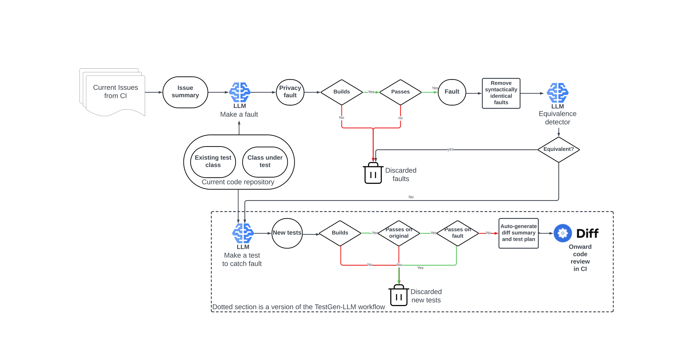
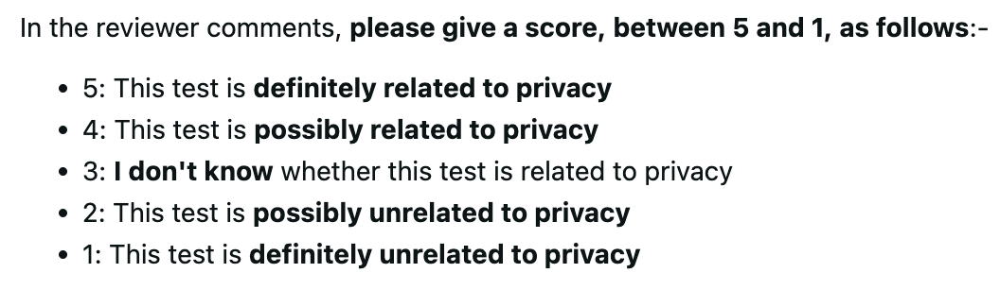

**Source:** *Mutation-Guided LLM-based Test Generation at Meta* — [PDF](https://arxiv.org/pdf/2501.12862) · [arXiv](https://arxiv.org/abs/2501.12862)

# Mutation-Guided LLM-based Test Generation at Meta

DOI: [10.1145/3663529.3663839](https://doi.org/10.1145/3663529.3663839)fsecomp24industry-p37-pISBN: 979-8-4007-0658-5/24/07Conference: Companion Proceedings of the 33rd ACM International Conference on the Foundations of Software Engineering; 23 – 27, 2025; Trondheim, NorwayCompanion Proceedings of the 33rd ACM International Conference on the Foundations of Software Engineering (FSE Companion ’25), 23 – 27, 2025, Trondheim, NorwayCCS: Software and its engineering Software testing and debugging

Christopher Foster  Affiliation: Product Compliance and Privacy team, Meta Platforms, Menlo Park, USA ,  Abhishek Gulati  Affiliation: Product Compliance and Privacy team, Meta Platforms, Menlo Park, USA ,  Mark Harman   Affiliation: Product Compliance and Privacy team, Meta Platforms, London, UK ,  Inna Harper   Affiliation: Developer Infrastructure team, Meta Platforms, London, UK ,  Ke Mao   Affiliation: WhatsApp team, Meta Platforms, London, UK ,  Jillian Ritchey  Affiliation: Messenger team, Meta Platforms, New York, USA ,  Hervé Robert  Affiliation: Product Compliance and Privacy team, Meta Platforms, Menlo Park, USA and  Shubho Sengupta   Affiliation: FAIR, Meta Platforms, Menlo Park, USA

© , 2024

###### Abstract.

This paper11 1 Author order is alphabetical. The corresponding author is Mark Harman. describes Meta’s ACH system for mutation-guided LLM-based test generation. ACH generates relatively few mutants (aka simulated faults), compared to traditional mutation testing. Instead, it focuses on generating currently undetected faults that are specific to an issue of concern. From these currently uncaught faults, ACH generates tests that can catch them, thereby ‘killing’ the mutants and consequently hardening the platform against regressions. We use privacy concerns to illustrate our approach, but ACH can harden code against any type of regression. In total, ACH was applied to 10,795 Android Kotlin classes in 7 software platforms deployed by Meta, from which it generated 9,095 mutants and 571 privacy-hardening test cases. ACH also deploys an LLM-based equivalent mutant detection agent that achieves a precision of 0.79 and a recall of 0.47 (rising to 0.95 and 0.96 with simple pre-processing). ACH was used by Messenger and WhatsApp test-a-thons where engineers accepted 73% of its tests, judging 36% to privacy relevant. We conclude that ACH hardens code against specific concerns and that, even when its tests do not directly tackle the specific concern, engineers find them useful for their other benefits.

###### Keywords: 

Unit Testing, Automated Test Generation, Large Language Models, LLMs. 

## 1\. Introduction

In this paper, we report on Meta’s deployment of ACH22 2 ACH (Automated Compliance Hardener) is so-named because it is an automated test generation tool that ‘hardens’ compliance with respect to chosen issues of concern., an agentic LLM-based tool for generating tests to target specific classes of faults. The paper focuses on automated privacy hardening: the problem of automatically generating unit tests to reduce the risk of future regressions with respect to privacy issues. However, the approach can be applied to any issue and is not confined solely to tackling privacy issues. The paper reports results from the deployment of ACH at Meta between 28th October 2024 and 31st December 2024.

Although there has been a great deal of recent attention on LLM-based test generation ([Alshahwan et al., 2024a](https://arxiv.org/html/2501.12862#bib.bib4); [Ryan et al., 2024](https://arxiv.org/html/2501.12862#bib.bib53); [Chen et al., 2024](https://arxiv.org/html/2501.12862#bib.bib19); [Schäfer et al., 2023](https://arxiv.org/html/2501.12862#bib.bib54); [Liu et al., 2024](https://arxiv.org/html/2501.12862#bib.bib40)), there has been little work on developing tests for specific classes of fault. Many companies have exposure to specific high impact faults related to important issues such as security, integrity, and privacy. The importance of such issues makes it equally important to have test generation techniques that can target these specific classes of faults.

Organizations typically collect data about bugs found during development. This provides a rich source of information with which to guide test generation. The challenge, therefore, is to find a way to generate tests that target specific issues on the basis of this information. We believe mutation testing holds the key: our key insight is to construct mutants that denote faults that are both relevant to the issue of concern and also currently not caught (unkilled) by any existing test case, and to use these as prompts to LLM-based test generation. This results in an overall agenetic LLM-based workflow, in which agents essentially generate problem-specific ‘super bugs’ and the tests that can catch them.

At Meta, we have developed and deployed just such an approach and tool, ACH, for automated unit test generation. ACH’s workflow is based on the principle of Assured LLM-based Software Engineering ([Alshahwan et al., 2024c](https://arxiv.org/html/2501.12862#bib.bib8)). In Assured LLMSE, the goal is not merely to use language models to tackle software engineering challenges, but to automatically generate software engineering artifacts that come with assurances. In the case of ACH, the artifacts are tests and they come with the following assurances:

  1. (1) Buildable: The proposed new tests build, so are free from syntax errors and missing dependencies; 
  2. (2) Valid Regression Tests: The tests pass and do so consistently, so they are non-flaky ([Harman and O’Hearn, 2018](https://arxiv.org/html/2501.12862#bib.bib27)) regression tests; 
  3. (3) Hardening: The new tests catch faults that no existing test can catch; 
  4. (4) Relevant: Many of the new tests are closely coupled to the issue of concern; 
  5. (5) Fashion Following: Most of the new tests respect the coding style used by the existing tests available for the class under test; they are ‘fashion followers’ ([Alshahwan et al., 2024a](https://arxiv.org/html/2501.12862#bib.bib4)). 

The first three assurances are boolean in nature; they are unequivocal guarantees made by ACH about the tests it proposes to the engineer. The fourth and fifth are more aspirational and probabilistic in nature, reflecting the underlying (LLM) technology used to construct tests. The degree to which tests are relevant and ‘fashion follow’ the existing tests is an inherently non-boolean and subjective attribute. As such, while the boolean criteria are provided as verifiable guarantees that ACH promises to meet, the two more probabilistic assurances are best assessed through the standard code review process routinely undertaken by engineers. Finally, when it finds that a newly-generated test adds coverage, ACH also measures coverage achieved, including the result in the assurances provided to the engineer reviewing the test.

The newly generated tests need not extend coverage, since they may find faults simply by covering existing lines of code in some new way; the same path with different data, for example. It is well known ([Chekam et al., 2017](https://arxiv.org/html/2501.12862#bib.bib18)) that mutation testing has this property, allowing mutation testing to claim superiority over structural coverage test adequacy criteria such as line coverage. As shown in Section [6](https://arxiv.org/html/2501.12862#S6 "6. The Importance of Mutation Testing ‣ Mutation-Guided LLM-based Test Generation at Meta"), our findings further underscore the importance of mutation testing in ‘going beyond’ purely structural test adequacy criteria.

The paper focuses on privacy hardening, but we believe that our approach will find many applications to software testing, more generally. It combines existing well-known and widely-studied approaches to mutation testing, assured LLMSE, and test generation. However, this new combination allows it to tackle a wide range of other problems. The potential reach and impact of this approach derives from the fact that it answers a fundamental question for automated software test generation:

> How can we automatically transform vague, incomplete and even contradictory textual narratives about software concerns, into unit tests that guard against bugs that, if introduced, may yield field failures that manifest these concerns?

This fundamental nature makes the approach very widely applicable: we can use it in any situation where we have a way to capture, even in the most vague of textual descriptions, concerns we have about potential issues our systems will face. Furthermore, because ACH generates simulated faults as an intermediate stage in generating tests, we can use the distributions of simulated fault prevalence over the code base as a proxy for the risk exposure of individual system components to the issue under test. Finally, through simulation ([Ahlgren et al., 2021b](https://arxiv.org/html/2501.12862#bib.bib3)), we can further assess the likely impact (or severity) of such faults, were they to manifest as field failures.

There are four primary contributions of the paper:

Empirical results: We report results from the application of ACH to 7 real world software platforms deployed by Meta. In total, ACH generated 4,660 candidate mutants (simulated privacy faults) that it ‘believed’ to be potentially killable from 10,795 classes under test. From these candidates, ACH was able to generate an additional 571 unit tests. Of these 571 tests, 277 would have been discarded had we chosen to focus solely on the line coverage test adequacy criterion, underlining the importance of mutation testing over such coverage.

Deployment Experience: We report both qualitative and quantitative outcomes from the development, deployment and evaluation of ACH at Meta in 2024. Overall, the tests automatically generated by ACH achieved an acceptance rate of 73% from the engineers who reviewed them, with 36% being judged privacy relevant.

Equivalent Mutant Detection: We present an evaluation of the ACH equivalent mutant detection agent’s ability to detect equivalent mutants, which yields precision and recall of 0.79 and 0.47 respectively. The figure for precision and recall rises to 0.95 and 0.96 respectively, when the agent is combined with simple pre-processing.

Lessons from Industrial Application: We detail the lessons learned, and open problems and research challenges raised by this application of Assured LLMSE to mutation-based test generation.

## 2\. The ACH System

Figure [1](https://arxiv.org/html/2501.12862#S2.F1 "Figure 1 ‣ 2. The ACH System ‣ Mutation-Guided LLM-based Test Generation at Meta") presents the overall architectural pipeline of the ACH System. ACH starts with free from text about an issue of concern. This textual input could come from one or more of a variety of sources, including (but not limited to):

  1. (1) Previous faults found in development; 
  2. (2) User requirements; 
  3. (3) System technical constraints; 
  4. (4) Concerns raised by engineers, managers or organizational leadership about undesirable system behaviours; 
  5. (5) Regulatory requirements set by legislative bodies and compliance enforcement organizations. 

This is the sense in which ACH is a ‘compliance hardener’: it improves (‘hardens’) the ability of the deployed regression test infrastructure to detect regressions that might lead to non-compliance with respect to the issue of concern.

 

Figure 1. Top level architecture of the principal ACH components. The dotted section denotes a (slightly modified) version of the TestGen-LLM tool, on which we previously reported ([Alshahwan et al., 2024a](https://arxiv.org/html/2501.12862#bib.bib4)). The workflow preceding this, shown above in the figure, is the additional agenetic workflow for generating candidate faults to drive the generation of tests. Solid rectangles denote components that are fully automated but entirely rule-based (and therefore do not use LLMs).

The results presented in this paper were obtained by using privacy hardening concerns from previous faults found in development. The single language model Llama 3.1 70Bn ([Meta, 2024](https://arxiv.org/html/2501.12862#bib.bib43)) was used in all the agents reported on. The prompts used by the three LLM agents from Figure [1](https://arxiv.org/html/2501.12862#S2.F1 "Figure 1 ‣ 2. The ACH System ‣ Mutation-Guided LLM-based Test Generation at Meta") can be found in Table [1](https://arxiv.org/html/2501.12862#S2.T1 "Table 1 ‣ 2. The ACH System ‣ Mutation-Guided LLM-based Test Generation at Meta").

Table 1. The three simple prompts used in the architecture diagram in Figure [1](https://arxiv.org/html/2501.12862#S2.F1 "Figure 1 ‣ 2. The ACH System ‣ Mutation-Guided LLM-based Test Generation at Meta") 

Agent name |  Prompt Template, in which { \(\cdots\) } denotes a parameter to the template  
---|---  
Make a fault |  CONTEXT: {context_about_concern} INSTRUCTION: Here is a Kotlin class and a test class with some unit tests for the class under test ‘‘‘{class_under_test}‘‘‘. ‘‘‘{existing_test_class}‘‘‘. Write a new version of the class under test in which each method is replaced by a new version of that method that contains a typical bug that introduces a privacy violation similar to {diff}. Delimit the mutated part using the comment-pair ‘// MUTANT <START>‘ and ‘// MUTANT <END>‘   
Equivalence detector |  I’m going to show you two slightly different versions of a Kotlin class. Here is the first version of the Kotlin class:‘‘‘class_version1‘‘‘. Here is the second version of the Kotlin class:‘‘‘class_version2‘‘‘. INSTRUCTION: If the first version of the class will always do exactly the same thing as the second version of the class, just respond with ‘{yes}‘. However, if the two versions of the class are not equivalent, respond with ‘{no}‘, and give an explanation of how execution of the first version can produce a different behaviour to execution of the second version.  
Make a test to catch fault |  What follows is two versions of a Kotlin class under test. An original correct class and a mutated version of that class that contains one mutant per method, each of which represents a bug. Each bug is delimited by the comment-pair ‘// MUTANT <START>‘ and ‘// MUTANT <END>‘. The original class and its mutant are followed by a test class that contains unit tests for the original correct class under test. This is the original version of the class under test:‘‘‘{original_class}‘‘‘. This is the mutated version of the class under test:‘‘‘{mutated_class}‘‘‘. Here is the existing test class:‘‘‘{existing_test_class}‘‘‘. Write an extended version of the test class that contains extra test cases that will fail on the mutant version of the class, but would pass on the correct version.

 

Our focus is the development, deployment and evaluation of mutation-guided agenetic workflows. We have not yet felt the need to extend to more sophisticated prompting, nor to use fine-tuning, nor to exploit language model ensembles ([Alshahwan et al., 2024a](https://arxiv.org/html/2501.12862#bib.bib4)), all of which would improve on the results we report. Therefore, our results denote only a baseline against which to measure futures developments. Nevertheless, despite these limitations, we believe the results clearly highlight the potential for significant advances in test generation; its applicability and effectiveness. We would be interested and excited to collaborate with the wider research community, and hope this paper stimulates further work in this area.

In the ACH workflow depicted in Figure [1](https://arxiv.org/html/2501.12862#S2.F1 "Figure 1 ‣ 2. The ACH System ‣ Mutation-Guided LLM-based Test Generation at Meta"), the issue summary generates prompts that stimulate another LLM-based agent to generate faults; walking the code base, using existing tests, classes under test, and the summary as prompt ingredients. The prompts instruct the LLM to generate simulated faults (aka mutants ([Jia and Harman, 2011](https://arxiv.org/html/2501.12862#bib.bib36))). There is no guarantee that these mutants will change the code under test, because it may not be relevant to the issue being hardened.

However, even when the fault generator does change the syntax, it may not change the semantics; the mutants could be equivalent mutants ([Harman et al., 2014](https://arxiv.org/html/2501.12862#bib.bib28)). To tackle this equivalent mutant problem, ACH uses a further agent, the Equivalence Detector agent. This Equivalence Detector agent uses the LLM-as-judge approach ([Gu et al., 2024](https://arxiv.org/html/2501.12862#bib.bib25); [Zheng et al., 2023](https://arxiv.org/html/2501.12862#bib.bib64)). The judge is instructed to determine whether the mutant is equivalent to the original class under test. Although the underlying problem of mutant equivalence is undecidable ([Jia and Harman, 2011](https://arxiv.org/html/2501.12862#bib.bib36)), we found that this approach was surprisingly effective due to the properties of the mutants so-generated (Section [5](https://arxiv.org/html/2501.12862#S5 "5. The Equivalent Mutant Problem ‣ Mutation-Guided LLM-based Test Generation at Meta") contains details).

The faults generated by the initial phase of the workflow are used to generate prompts for test generation. The test generation phase shown in a dotted box is a slightly modified version of the previously published TestGen-LLM tool ([Alshahwan et al., 2024a](https://arxiv.org/html/2501.12862#bib.bib4)).

## 3\. Results from Meta’s ACH Deployment

We applied ACH to the 7 Meta platforms Aloha, Facebook Feed, Instagram, Messenger, Oculus, Wearables, and WhatsApp. Facebook Feed and Instagram are social media platforms. WhatsApp and Messenger are messaging platforms. Oculus is a set of virtual reality headsets. Wearables are platforms for augmented reality glasses and wrist controllers. We also included ‘cross-app’ software products that provide features affecting more than one of these platforms.

Table [2](https://arxiv.org/html/2501.12862#S3.T2 "Table 2 ‣ 3. Results from Meta’s ACH Deployment ‣ Mutation-Guided LLM-based Test Generation at Meta") presents top level summary statistics for the application of ACH to these platforms. Once a mutant is found that builds and passes, the workflow terminates33 3 This decision was motivated by the use case: we first want to establish whether a test is relevant. When we find a test that is relevant, we can choose to focus in on the code it tests, hoping that adjacent code will also have a higher likelihood of relevance. for the current class under test. The number of candidate mutants reported in Table [2](https://arxiv.org/html/2501.12862#S3.T2 "Table 2 ‣ 3. Results from Meta’s ACH Deployment ‣ Mutation-Guided LLM-based Test Generation at Meta") is therefore bounded above by the number of classes under test.

By contrast with traditional rule-based mutation testing tools ([Coles et al., 2016](https://arxiv.org/html/2501.12862#bib.bib20); [Jia and Harman, 2008](https://arxiv.org/html/2501.12862#bib.bib34); [Schuler and Zeller, 2009](https://arxiv.org/html/2501.12862#bib.bib55); [Just, 2014](https://arxiv.org/html/2501.12862#bib.bib38)), ACH generates relatively few, highly specific mutants, by design. Furthermore, the generated mutants have a higher probability of relevance to the issue of concern than can be achieved by rule-based approaches.

As can be seen from Table [2](https://arxiv.org/html/2501.12862#S3.T2 "Table 2 ‣ 3. Results from Meta’s ACH Deployment ‣ Mutation-Guided LLM-based Test Generation at Meta"), ACH generates 9,095 mutants that build and pass from 10,795 classes under test. Although the language model approach generates fewer and more specific mutants than rule-based approaches, we found that it also generates more equivalent mutants. For example, as Table [2](https://arxiv.org/html/2501.12862#S3.T2 "Table 2 ‣ 3. Results from Meta’s ACH Deployment ‣ Mutation-Guided LLM-based Test Generation at Meta") reveals, 25% of the mutants generated are trivially syntactically equivalent. This contrasts with overall equivalent mutant generation rates that are typically around 10% to 15% for rule-based approaches ([Papadakis et al., 2015](https://arxiv.org/html/2501.12862#bib.bib46); [Harman et al., 2014](https://arxiv.org/html/2501.12862#bib.bib28)). Fortunately, as revealed in Section [5](https://arxiv.org/html/2501.12862#S5 "5. The Equivalent Mutant Problem ‣ Mutation-Guided LLM-based Test Generation at Meta"), the equivalent mutant problem is relatively unimportant for our use case.

Table 2.  Meta platforms used to evaluate ACH and the numbers of simulated privacy faults ‘believed’ non-equivalent by the equivalence detector agent from Figure [1](https://arxiv.org/html/2501.12862#S2.F1 "Figure 1 ‣ 2. The ACH System ‣ Mutation-Guided LLM-based Test Generation at Meta"). Percentages in the final four columns are distributions of ACH’s equivalence ‘belief’ over mutants that build and pass, while those in the fourth column report the percentage of all mutants that build and pass.  

<table id="S3.T2.6" class="ltx_tabular ltx_centering ltx_align_middle">
<tbody class="ltx_tbody">
<tr id="S3.T2.6.1" class="ltx_tr">
<td id="S3.T2.6.1.1" class="ltx_td ltx_align_left ltx_border_l ltx_border_r ltx_border_t">Platform</td>
<td id="S3.T2.6.1.2" class="ltx_td ltx_align_right ltx_border_r ltx_border_t">Number of</td>
<td id="S3.T2.6.1.3" class="ltx_td ltx_align_right ltx_border_r ltx_border_t">Number of</td>
<td id="S3.T2.6.1.4" class="ltx_td ltx_align_right ltx_border_rr ltx_border_t">Number of</td>
<td id="S3.T2.6.1.5" class="ltx_td ltx_align_center ltx_border_r ltx_border_t" colspan="4">Number of mutants that build and pass and …</td></tr>
<tr id="S3.T2.6.2" class="ltx_tr">
<td id="S3.T2.6.2.1" class="ltx_td ltx_border_l ltx_border_r"></td>
<td id="S3.T2.6.2.2" class="ltx_td ltx_align_right ltx_border_r">classes</td>
<td id="S3.T2.6.2.3" class="ltx_td ltx_align_right ltx_border_r">mutants</td>
<td id="S3.T2.6.2.4" class="ltx_td ltx_align_right ltx_border_rr">mutants</td>
<td id="S3.T2.6.2.5" class="ltx_td ltx_align_right ltx_border_r">are</td>
<td id="S3.T2.6.2.6" class="ltx_td ltx_align_right ltx_border_r">the agent</td>
<td id="S3.T2.6.2.7" class="ltx_td ltx_align_right ltx_border_r">for which</td>
<td id="S3.T2.6.2.8" class="ltx_td ltx_align_right ltx_border_r">the agent</td></tr>
<tr id="S3.T2.6.3" class="ltx_tr">
<td id="S3.T2.6.3.1" class="ltx_td ltx_border_l ltx_border_r"></td>
<td id="S3.T2.6.3.2" class="ltx_td ltx_align_right ltx_border_r">under test</td>
<td id="S3.T2.6.3.3" class="ltx_td ltx_align_right ltx_border_r">generated</td>
<td id="S3.T2.6.3.4" class="ltx_td ltx_align_right ltx_border_rr">generated</td>
<td id="S3.T2.6.3.5" class="ltx_td ltx_align_right ltx_border_r">syntactically</td>
<td id="S3.T2.6.3.6" class="ltx_td ltx_align_right ltx_border_r">believes</td>
<td id="S3.T2.6.3.7" class="ltx_td ltx_align_right ltx_border_r">the agent</td>
<td id="S3.T2.6.3.8" class="ltx_td ltx_align_right ltx_border_r">believes</td></tr>
<tr id="S3.T2.6.4" class="ltx_tr">
<td id="S3.T2.6.4.1" class="ltx_td ltx_border_l ltx_border_r"></td>
<td id="S3.T2.6.4.2" class="ltx_td ltx_border_r"></td>
<td id="S3.T2.6.4.3" class="ltx_td ltx_align_right ltx_border_r">in total</td>
<td id="S3.T2.6.4.4" class="ltx_td ltx_align_right ltx_border_rr">that build</td>
<td id="S3.T2.6.4.5" class="ltx_td ltx_align_right ltx_border_r">identical</td>
<td id="S3.T2.6.4.6" class="ltx_td ltx_align_right ltx_border_r">to be</td>
<td id="S3.T2.6.4.7" class="ltx_td ltx_align_right ltx_border_r">gives no</td>
<td id="S3.T2.6.4.8" class="ltx_td ltx_align_right ltx_border_r">to be non-</td></tr>
<tr id="S3.T2.6.5" class="ltx_tr">
<td id="S3.T2.6.5.1" class="ltx_td ltx_border_l ltx_border_r"></td>
<td id="S3.T2.6.5.2" class="ltx_td ltx_border_r"></td>
<td id="S3.T2.6.5.3" class="ltx_td ltx_border_r"></td>
<td id="S3.T2.6.5.4" class="ltx_td ltx_align_right ltx_border_rr">and pass</td>
<td id="S3.T2.6.5.5" class="ltx_td ltx_border_r"></td>
<td id="S3.T2.6.5.6" class="ltx_td ltx_align_right ltx_border_r">equivalent</td>
<td id="S3.T2.6.5.7" class="ltx_td ltx_align_right ltx_border_r">answer</td>
<td id="S3.T2.6.5.8" class="ltx_td ltx_align_right ltx_border_r">equivalent</td></tr>
<tr id="S3.T2.6.6" class="ltx_tr">
<td id="S3.T2.6.6.1" class="ltx_td ltx_align_left ltx_border_l ltx_border_r ltx_border_t">Facebook Feed</td>
<td id="S3.T2.6.6.2" class="ltx_td ltx_align_right ltx_border_r ltx_border_t">346</td>
<td id="S3.T2.6.6.3" class="ltx_td ltx_align_right ltx_border_r ltx_border_t">1,097</td>
<td id="S3.T2.6.6.4" class="ltx_td ltx_align_right ltx_border_rr ltx_border_t">252 (23%)</td>
<td id="S3.T2.6.6.5" class="ltx_td ltx_align_right ltx_border_r ltx_border_t">50 (20%)</td>
<td id="S3.T2.6.6.6" class="ltx_td ltx_align_right ltx_border_r ltx_border_t">19 (7.5%)</td>
<td id="S3.T2.6.6.7" class="ltx_td ltx_align_right ltx_border_r ltx_border_t">19 (7.5%)</td>
<td id="S3.T2.6.6.8" class="ltx_td ltx_align_right ltx_border_r ltx_border_t">164 (65%)</td></tr>
<tr id="S3.T2.6.7" class="ltx_tr">
<td id="S3.T2.6.7.1" class="ltx_td ltx_align_left ltx_border_l ltx_border_r">Messenger</td>
<td id="S3.T2.6.7.2" class="ltx_td ltx_align_right ltx_border_r">3,339</td>
<td id="S3.T2.6.7.3" class="ltx_td ltx_align_right ltx_border_r">9,185</td>
<td id="S3.T2.6.7.4" class="ltx_td ltx_align_right ltx_border_rr">2,922 (32%)</td>
<td id="S3.T2.6.7.5" class="ltx_td ltx_align_right ltx_border_r">742 (25%)</td>
<td id="S3.T2.6.7.6" class="ltx_td ltx_align_right ltx_border_r">384 (13%)</td>
<td id="S3.T2.6.7.7" class="ltx_td ltx_align_right ltx_border_r">401 (14%)</td>
<td id="S3.T2.6.7.8" class="ltx_td ltx_align_right ltx_border_r">1,395 (48%)</td></tr>
<tr id="S3.T2.6.8" class="ltx_tr">
<td id="S3.T2.6.8.1" class="ltx_td ltx_align_left ltx_border_l ltx_border_r">Instagram</td>
<td id="S3.T2.6.8.2" class="ltx_td ltx_align_right ltx_border_r">1,691</td>
<td id="S3.T2.6.8.3" class="ltx_td ltx_align_right ltx_border_r">5,199</td>
<td id="S3.T2.6.8.4" class="ltx_td ltx_align_right ltx_border_rr">1,381 (27%)</td>
<td id="S3.T2.6.8.5" class="ltx_td ltx_align_right ltx_border_r">277 (20%)</td>
<td id="S3.T2.6.8.6" class="ltx_td ltx_align_right ltx_border_r">154 (11%)</td>
<td id="S3.T2.6.8.7" class="ltx_td ltx_align_right ltx_border_r">208 (15%)</td>
<td id="S3.T2.6.8.8" class="ltx_td ltx_align_right ltx_border_r">742 (54%)</td></tr>
<tr id="S3.T2.6.9" class="ltx_tr">
<td id="S3.T2.6.9.1" class="ltx_td ltx_align_left ltx_border_l ltx_border_r">Aloha</td>
<td id="S3.T2.6.9.2" class="ltx_td ltx_align_right ltx_border_r">175</td>
<td id="S3.T2.6.9.3" class="ltx_td ltx_align_right ltx_border_r">576</td>
<td id="S3.T2.6.9.4" class="ltx_td ltx_align_right ltx_border_rr">144 (25%)</td>
<td id="S3.T2.6.9.5" class="ltx_td ltx_align_right ltx_border_r">32 (22%)</td>
<td id="S3.T2.6.9.6" class="ltx_td ltx_align_right ltx_border_r">16 (11%)</td>
<td id="S3.T2.6.9.7" class="ltx_td ltx_align_right ltx_border_r">6 (4%)</td>
<td id="S3.T2.6.9.8" class="ltx_td ltx_align_right ltx_border_r">90 (63%)</td></tr>
<tr id="S3.T2.6.10" class="ltx_tr">
<td id="S3.T2.6.10.1" class="ltx_td ltx_align_left ltx_border_l ltx_border_r">Wearables</td>
<td id="S3.T2.6.10.2" class="ltx_td ltx_align_right ltx_border_r">2,841</td>
<td id="S3.T2.6.10.3" class="ltx_td ltx_align_right ltx_border_r">8,592</td>
<td id="S3.T2.6.10.4" class="ltx_td ltx_align_right ltx_border_rr">2,468 (29%)</td>
<td id="S3.T2.6.10.5" class="ltx_td ltx_align_right ltx_border_r">621 (25%)</td>
<td id="S3.T2.6.10.6" class="ltx_td ltx_align_right ltx_border_r">207 (8%)</td>
<td id="S3.T2.6.10.7" class="ltx_td ltx_align_right ltx_border_r">326 (13%)</td>
<td id="S3.T2.6.10.8" class="ltx_td ltx_align_right ltx_border_r">1,314 (53%)</td></tr>
<tr id="S3.T2.6.11" class="ltx_tr">
<td id="S3.T2.6.11.1" class="ltx_td ltx_align_left ltx_border_l ltx_border_r">Cross-app</td>
<td id="S3.T2.6.11.2" class="ltx_td ltx_align_right ltx_border_r">805</td>
<td id="S3.T2.6.11.3" class="ltx_td ltx_align_right ltx_border_r">1,819</td>
<td id="S3.T2.6.11.4" class="ltx_td ltx_align_right ltx_border_rr">562 (31%)</td>
<td id="S3.T2.6.11.5" class="ltx_td ltx_align_right ltx_border_r">146 (26%)</td>
<td id="S3.T2.6.11.6" class="ltx_td ltx_align_right ltx_border_r">64 (11%)</td>
<td id="S3.T2.6.11.7" class="ltx_td ltx_align_right ltx_border_r">82 (15%)</td>
<td id="S3.T2.6.11.8" class="ltx_td ltx_align_right ltx_border_r">270 (48%)</td></tr>
<tr id="S3.T2.6.12" class="ltx_tr">
<td id="S3.T2.6.12.1" class="ltx_td ltx_align_left ltx_border_l ltx_border_r">Oculus</td>
<td id="S3.T2.6.12.2" class="ltx_td ltx_align_right ltx_border_r">325</td>
<td id="S3.T2.6.12.3" class="ltx_td ltx_align_right ltx_border_r">997</td>
<td id="S3.T2.6.12.4" class="ltx_td ltx_align_right ltx_border_rr">279 (28%)</td>
<td id="S3.T2.6.12.5" class="ltx_td ltx_align_right ltx_border_r">96 (34%)</td>
<td id="S3.T2.6.12.6" class="ltx_td ltx_align_right ltx_border_r">17 (6%)</td>
<td id="S3.T2.6.12.7" class="ltx_td ltx_align_right ltx_border_r">16 (6%)</td>
<td id="S3.T2.6.12.8" class="ltx_td ltx_align_right ltx_border_r">150 (54%)</td></tr>
<tr id="S3.T2.6.13" class="ltx_tr">
<td id="S3.T2.6.13.1" class="ltx_td ltx_align_left ltx_border_l ltx_border_r">WhatsApp</td>
<td id="S3.T2.6.13.2" class="ltx_td ltx_align_right ltx_border_r">1,273</td>
<td id="S3.T2.6.13.3" class="ltx_td ltx_align_right ltx_border_r">4,212</td>
<td id="S3.T2.6.13.4" class="ltx_td ltx_align_right ltx_border_rr">1,087 (26%)</td>
<td id="S3.T2.6.13.5" class="ltx_td ltx_align_right ltx_border_r">282 (26%)</td>
<td id="S3.T2.6.13.6" class="ltx_td ltx_align_right ltx_border_r">155 (14%)</td>
<td id="S3.T2.6.13.7" class="ltx_td ltx_align_right ltx_border_r">115 (11%)</td>
<td id="S3.T2.6.13.8" class="ltx_td ltx_align_right ltx_border_r">535 (49%)</td></tr>
<tr id="S3.T2.6.14" class="ltx_tr">
<td id="S3.T2.6.14.1" class="ltx_td ltx_align_left ltx_border_bb ltx_border_l ltx_border_r ltx_border_tt">Totals</td>
<td id="S3.T2.6.14.2" class="ltx_td ltx_align_right ltx_border_bb ltx_border_r ltx_border_tt">10,795</td>
<td id="S3.T2.6.14.3" class="ltx_td ltx_align_right ltx_border_bb ltx_border_r ltx_border_tt">31,677</td>
<td id="S3.T2.6.14.4" class="ltx_td ltx_align_right ltx_border_bb ltx_border_rr ltx_border_tt">9,095 (29%)</td>
<td id="S3.T2.6.14.5" class="ltx_td ltx_align_right ltx_border_bb ltx_border_r ltx_border_tt">2,246 (25%)</td>
<td id="S3.T2.6.14.6" class="ltx_td ltx_align_right ltx_border_bb ltx_border_r ltx_border_tt">1,016 (11%)</td>
<td id="S3.T2.6.14.7" class="ltx_td ltx_align_right ltx_border_bb ltx_border_r ltx_border_tt">1,173 (13%)</td>
<td id="S3.T2.6.14.8" class="ltx_td ltx_align_right ltx_border_bb ltx_border_r ltx_border_tt">4,660 (51%)</td></tr>
</tbody>
</table>

 

Of the 9,095 mutants that build and pass, 4,660 (51%) were deemed to be non-equivalent by the workflow, and thus become the subject of each of the prompts used for test generation. The test generation phase uses similar prompts to those reported previously ([Alshahwan et al., 2024a](https://arxiv.org/html/2501.12862#bib.bib4)), but based on covering the mutant rather than covering uncovered lines.

## 4\. Engineers’ Evaluation of ACH

We followed the tried-and-tested formula ([Alshahwan et al., 2024a](https://arxiv.org/html/2501.12862#bib.bib4)) for the deployment of a new software testing technology at Meta, starting with initial trials and moving onto to test-a-thons led by engineers, thereby evaluating initial deployment.

### 4.1. Initial Trial

At Meta, a code change submitted to the Continuous Integration (CI) system is called a ‘diff’ (short for differential). In order to get initial feedback from engineers on the tests generated by the first version of ACH, we used it to generate 30 new test cases, submitting each as a separate diff for review. The generated tests were recommended to engineers in the same way as any other code modification, such as those created by human engineers. That is, ACH submits tests, as diffs, through the normal review process. The ACH diff summary explains the kind of fault caught by the test case giving, as a specific example, the mutant that ACH has already determined to be killed by the test case.

We wanted to obtain broad coverage of Meta’s platforms, so included messaging apps like WhatsApp and Messenger, traditional social media platforms such as Facebook Feed, as well as hardware technologies such as Oculus and Wearable Computing, and also code that spanned over multiple apps.

Table [3](https://arxiv.org/html/2501.12862#S4.T3 "Table 3 ‣ 4.1. Initial Trial ‣ 4. Engineers’ Evaluation of ACH ‣ Mutation-Guided LLM-based Test Generation at Meta") presents details of these 30 diffs. As can be seen, the overall acceptance rate is 90% accepted of those submitted (27 of 30), and 93% of all diffs reviewed (27 of 29). Initial results for acceptance rate were deemed to be highly encouraging, so we proceeded to build out the Minimal Viable Product (MVP) and use it in the test-a-thons reported in Section [4.2](https://arxiv.org/html/2501.12862#S4.SS2 "4.2. Experience from Privacy Test-a-thons ‣ 4. Engineers’ Evaluation of ACH ‣ Mutation-Guided LLM-based Test Generation at Meta").

The primary feedback from developers who reviewed these 30 diffs was as follows. Engineers reported that

  1. (1) Many of the tests added coverage, which they computed themselves manually. They asked that coverage information be automatically computed and reported in the diff summaries, as well as the faults found. 
  2. (2) Some of the tests were relevant to privacy, and could be useful in hardening against future privacy regressions. They also felt that having the specific example faults was very helpful in understanding the behavior of the tests. 
  3. (3) Even for those which were not clearly related to privacy, the tests seemed to be adding value by tackling corner cases or adding coverage. 

Table 3. Results from initial trial ACH deployment on 6 platforms and cross-app products to gauge developers’ reactions, gain feedback and guide development. 

<table id="S4.T3.4" class="ltx_tabular ltx_centering ltx_guessed_headers ltx_align_middle">
<tbody class="ltx_tbody">
<tr id="S4.T3.4.1" class="ltx_tr">
<th id="S4.T3.4.1.1" class="ltx_td ltx_align_left ltx_th ltx_th_row ltx_border_l ltx_border_r ltx_border_t">Platform</th>
<td id="S4.T3.4.1.2" class="ltx_td ltx_align_right ltx_border_r ltx_border_t">Number</td>
<td id="S4.T3.4.1.3" class="ltx_td ltx_align_center ltx_border_r ltx_border_t" colspan="4">Status after human review is …</td></tr>
<tr id="S4.T3.4.2" class="ltx_tr">
<th id="S4.T3.4.2.1" class="ltx_td ltx_th ltx_th_row ltx_border_l ltx_border_r"></th>
<td id="S4.T3.4.2.2" class="ltx_td ltx_align_right ltx_border_r">of tests</td>
<td id="S4.T3.4.2.3" class="ltx_td ltx_align_right ltx_border_r">Accepted</td>
<td id="S4.T3.4.2.4" class="ltx_td ltx_align_right ltx_border_r">Accepted</td>
<td id="S4.T3.4.2.5" class="ltx_td ltx_align_right ltx_border_r">Rejected</td>
<td id="S4.T3.4.2.6" class="ltx_td ltx_align_right ltx_border_r">Not</td></tr>
<tr id="S4.T3.4.3" class="ltx_tr">
<th id="S4.T3.4.3.1" class="ltx_td ltx_th ltx_th_row ltx_border_l ltx_border_r"></th>
<td id="S4.T3.4.3.2" class="ltx_td ltx_border_r"></td>
<td id="S4.T3.4.3.3" class="ltx_td ltx_align_right ltx_border_r">‘as is’ by</td>
<td id="S4.T3.4.3.4" class="ltx_td ltx_align_right ltx_border_r">with</td>
<td id="S4.T3.4.3.5" class="ltx_td ltx_align_right ltx_border_r">by the</td>
<td id="S4.T3.4.3.6" class="ltx_td ltx_align_right ltx_border_r">reviewed</td></tr>
<tr id="S4.T3.4.4" class="ltx_tr">
<th id="S4.T3.4.4.1" class="ltx_td ltx_th ltx_th_row ltx_border_l ltx_border_r"></th>
<td id="S4.T3.4.4.2" class="ltx_td ltx_border_r"></td>
<td id="S4.T3.4.4.3" class="ltx_td ltx_align_right ltx_border_r">the</td>
<td id="S4.T3.4.4.4" class="ltx_td ltx_align_right ltx_border_r">simple</td>
<td id="S4.T3.4.4.5" class="ltx_td ltx_align_right ltx_border_r">engineer</td>
<td id="S4.T3.4.4.6" class="ltx_td ltx_border_r"></td></tr>
<tr id="S4.T3.4.5" class="ltx_tr">
<th id="S4.T3.4.5.1" class="ltx_td ltx_th ltx_th_row ltx_border_l ltx_border_r"></th>
<td id="S4.T3.4.5.2" class="ltx_td ltx_border_r"></td>
<td id="S4.T3.4.5.3" class="ltx_td ltx_align_right ltx_border_r">engineer</td>
<td id="S4.T3.4.5.4" class="ltx_td ltx_align_right ltx_border_r">changes</td>
<td id="S4.T3.4.5.5" class="ltx_td ltx_border_r"></td>
<td id="S4.T3.4.5.6" class="ltx_td ltx_border_r"></td></tr>
<tr id="S4.T3.4.6" class="ltx_tr">
<th id="S4.T3.4.6.1" class="ltx_td ltx_align_left ltx_th ltx_th_row ltx_border_l ltx_border_r ltx_border_t">FB Feed</th>
<td id="S4.T3.4.6.2" class="ltx_td ltx_align_right ltx_border_r ltx_border_t">4</td>
<td id="S4.T3.4.6.3" class="ltx_td ltx_align_right ltx_border_r ltx_border_t">4</td>
<td id="S4.T3.4.6.4" class="ltx_td ltx_align_right ltx_border_r ltx_border_t">0</td>
<td id="S4.T3.4.6.5" class="ltx_td ltx_align_right ltx_border_r ltx_border_t">0</td>
<td id="S4.T3.4.6.6" class="ltx_td ltx_align_right ltx_border_r ltx_border_t">0</td></tr>
<tr id="S4.T3.4.7" class="ltx_tr">
<th id="S4.T3.4.7.1" class="ltx_td ltx_align_left ltx_th ltx_th_row ltx_border_l ltx_border_r ltx_border_t">Messenger</th>
<td id="S4.T3.4.7.2" class="ltx_td ltx_align_right ltx_border_r ltx_border_t">12</td>
<td id="S4.T3.4.7.3" class="ltx_td ltx_align_right ltx_border_r ltx_border_t">8</td>
<td id="S4.T3.4.7.4" class="ltx_td ltx_align_right ltx_border_r ltx_border_t">3</td>
<td id="S4.T3.4.7.5" class="ltx_td ltx_align_right ltx_border_r ltx_border_t">1</td>
<td id="S4.T3.4.7.6" class="ltx_td ltx_align_right ltx_border_r ltx_border_t">0</td></tr>
<tr id="S4.T3.4.8" class="ltx_tr">
<th id="S4.T3.4.8.1" class="ltx_td ltx_align_left ltx_th ltx_th_row ltx_border_l ltx_border_r ltx_border_t">Aloha</th>
<td id="S4.T3.4.8.2" class="ltx_td ltx_align_right ltx_border_r ltx_border_t">2</td>
<td id="S4.T3.4.8.3" class="ltx_td ltx_align_right ltx_border_r ltx_border_t">2</td>
<td id="S4.T3.4.8.4" class="ltx_td ltx_align_right ltx_border_r ltx_border_t">0</td>
<td id="S4.T3.4.8.5" class="ltx_td ltx_align_right ltx_border_r ltx_border_t">0</td>
<td id="S4.T3.4.8.6" class="ltx_td ltx_align_right ltx_border_r ltx_border_t">0</td></tr>
<tr id="S4.T3.4.9" class="ltx_tr">
<th id="S4.T3.4.9.1" class="ltx_td ltx_align_left ltx_th ltx_th_row ltx_border_l ltx_border_r ltx_border_t">Wearables</th>
<td id="S4.T3.4.9.2" class="ltx_td ltx_align_right ltx_border_r ltx_border_t">3</td>
<td id="S4.T3.4.9.3" class="ltx_td ltx_align_right ltx_border_r ltx_border_t">1</td>
<td id="S4.T3.4.9.4" class="ltx_td ltx_align_right ltx_border_r ltx_border_t">0</td>
<td id="S4.T3.4.9.5" class="ltx_td ltx_align_right ltx_border_r ltx_border_t">1</td>
<td id="S4.T3.4.9.6" class="ltx_td ltx_align_right ltx_border_r ltx_border_t">1</td></tr>
<tr id="S4.T3.4.10" class="ltx_tr">
<th id="S4.T3.4.10.1" class="ltx_td ltx_align_left ltx_th ltx_th_row ltx_border_l ltx_border_r ltx_border_t">Cross-app</th>
<td id="S4.T3.4.10.2" class="ltx_td ltx_align_right ltx_border_r ltx_border_t">2</td>
<td id="S4.T3.4.10.3" class="ltx_td ltx_align_right ltx_border_r ltx_border_t">2</td>
<td id="S4.T3.4.10.4" class="ltx_td ltx_align_right ltx_border_r ltx_border_t">0</td>
<td id="S4.T3.4.10.5" class="ltx_td ltx_align_right ltx_border_r ltx_border_t">0</td>
<td id="S4.T3.4.10.6" class="ltx_td ltx_align_right ltx_border_r ltx_border_t">0</td></tr>
<tr id="S4.T3.4.11" class="ltx_tr">
<th id="S4.T3.4.11.1" class="ltx_td ltx_align_left ltx_th ltx_th_row ltx_border_l ltx_border_r ltx_border_t">Oculus</th>
<td id="S4.T3.4.11.2" class="ltx_td ltx_align_right ltx_border_r ltx_border_t">3</td>
<td id="S4.T3.4.11.3" class="ltx_td ltx_align_right ltx_border_r ltx_border_t">3</td>
<td id="S4.T3.4.11.4" class="ltx_td ltx_align_right ltx_border_r ltx_border_t">0</td>
<td id="S4.T3.4.11.5" class="ltx_td ltx_align_right ltx_border_r ltx_border_t">0</td>
<td id="S4.T3.4.11.6" class="ltx_td ltx_align_right ltx_border_r ltx_border_t">0</td></tr>
<tr id="S4.T3.4.12" class="ltx_tr">
<th id="S4.T3.4.12.1" class="ltx_td ltx_align_left ltx_th ltx_th_row ltx_border_l ltx_border_r ltx_border_t">WhatsApp</th>
<td id="S4.T3.4.12.2" class="ltx_td ltx_align_right ltx_border_r ltx_border_t">4</td>
<td id="S4.T3.4.12.3" class="ltx_td ltx_align_right ltx_border_r ltx_border_t">3</td>
<td id="S4.T3.4.12.4" class="ltx_td ltx_align_right ltx_border_r ltx_border_t">1</td>
<td id="S4.T3.4.12.5" class="ltx_td ltx_align_right ltx_border_r ltx_border_t">0</td>
<td id="S4.T3.4.12.6" class="ltx_td ltx_align_right ltx_border_r ltx_border_t">0</td></tr>
<tr id="S4.T3.4.13" class="ltx_tr">
<th id="S4.T3.4.13.1" class="ltx_td ltx_align_left ltx_th ltx_th_row ltx_border_b ltx_border_l ltx_border_r ltx_border_tt">Totals</th>
<td id="S4.T3.4.13.2" class="ltx_td ltx_align_right ltx_border_b ltx_border_r ltx_border_tt">30</td>
<td id="S4.T3.4.13.3" class="ltx_td ltx_align_right ltx_border_b ltx_border_r ltx_border_tt">23</td>
<td id="S4.T3.4.13.4" class="ltx_td ltx_align_right ltx_border_b ltx_border_r ltx_border_tt">4</td>
<td id="S4.T3.4.13.5" class="ltx_td ltx_align_right ltx_border_b ltx_border_r ltx_border_tt">2</td>
<td id="S4.T3.4.13.6" class="ltx_td ltx_align_right ltx_border_b ltx_border_r ltx_border_tt">1</td></tr>
</tbody>
</table>

 

### 4.2. Experience from Privacy Test-a-thons

In the week of 9th December 2024, we conducted two test-a-thons, focusing on the application of ACH to Meta’s two messaging platforms: WhatsApp and Messenger.

As with the initial trial, test cases were submitted as diffs into the normal continuous integration review process. However, the diff summary additionally claimed additional coverage, for those tests that did add coverage as well as finding currently uncatchable faults. The engineers participating in the test-a-thons reviewed the diffs for usefulness in the normal way they would any other diff, ultimately determining whether the diff is accepted, and thus lands into production.

In order to evaluate the privacy relevance of each test, we additionally asked the software engineers to give each a score on a Likert scale ([Jebb et al., 2021](https://arxiv.org/html/2501.12862#bib.bib33)). Figure [2](https://arxiv.org/html/2501.12862#S4.F2 "Figure 2 ‣ 4.2. Experience from Privacy Test-a-thons ‣ 4. Engineers’ Evaluation of ACH ‣ Mutation-Guided LLM-based Test Generation at Meta") is a screen capture of the exact instructions given to the engineers regarding this privacy relevance scoring procedure.

 

Figure 2. Likert scale instructions given to code reviewers to score test cases according to their privacy relevance. 

Procedure for Messenger two-phase test-a-thon: The Messenger test-a-thon was conducted in two phases. The same 6 reviewers were used for both the first and the second phase. All Messenger reviewers had strong expertise in testing, and (at least a) basic experience with privacy engineering.

In the first phase, 50 generated tests were selected from a randomly selected pool of 60 tests. All 60 were prescreened manually and, as a result, 10 were excluded because they concerned only faults relating to Null Pointer Exceptions, two of which improved coverage, and eight of which did not. These were excluded because we initially (wrongly, as it turned out) thought that such exception-catching tests would be rejected by engineers due to being irrelevant to privacy. However, the pre-screening approach was abandoned based on experience from this first phase: Engineers proved ready to accept tests, even when they were not directly relevant, because they perceived other benefits. Therefore, in the second phase, a further 50 tests were selected at random, without pre-screening.

Procedure for the WhatsApp test-a-thon: In the WhatsApp test-a-thon, 72 tests44 4 The decision to use 72 tests was based on the initial request from the 6 engineers that they could reasonably review 12 tests; this number being deemed large enough for calibration, yet small enough to avoid reviewer overload. were selected randomly from a pool of 120 available and allocated to 6 engineers to review. No pre-screening was performed. All 6 engineers had a background in both privacy engineering and software testing and, as such, were well-placed with relevant expertise and highly calibrated in their expectations about privacy concerns.

Having completed the reviews of the initial 72 tests allocated, several of the engineers requested additional tests to review, having found the experience sufficiently rewarding. Additional tests were therefore allocated at random from the remaining pool of 48 available. Therefore, in total, 91 WhatsApp tests were reviewed for usefulness, and 90 were reviewed for relevance.

Results from the test-a-thons: Table [4](https://arxiv.org/html/2501.12862#S4.T4 "Table 4 ‣ 4.2. Experience from Privacy Test-a-thons ‣ 4. Engineers’ Evaluation of ACH ‣ Mutation-Guided LLM-based Test Generation at Meta") presents summary statistics for the two test-a-thons. The upper table gives the number of tests reviewed for usefulness and for privacy relevance and, of these, the number that were accepted and rejected for usefulness, and scored for relevance. The lower table gives the proportions of tests reviewed for usefulness that were accepted and rejected, and the proportion of those reviewed for relevance that fall into each of the five categories of the Likert scale on which relevance was assessed by the software engineers. Percentages are rounded to the nearest whole number percentage point, and so may not quite total 100% due to rounding.

Table 4. Results from WhatsApp and Messenger Test-a-thons, where ACH was deployed and evaluated in December 2024. 

<table id="S4.T4.4" class="ltx_tabular ltx_centering ltx_align_middle">
<tbody class="ltx_tbody">
<tr id="S4.T4.4.1" class="ltx_tr">
<td id="S4.T4.4.1.1" class="ltx_td ltx_border_ll ltx_border_r ltx_border_tt"></td>
<td id="S4.T4.4.1.2" class="ltx_td ltx_align_right ltx_border_r ltx_border_tt">total number</td>
<td id="S4.T4.4.1.3" class="ltx_td ltx_align_center ltx_border_rr ltx_border_tt" colspan="2">total number</td>
<td id="S4.T4.4.1.4" class="ltx_td ltx_border_rr ltx_border_tt"></td>
<td id="S4.T4.4.1.5" class="ltx_td ltx_align_left ltx_border_r ltx_border_tt">total number</td>
<td id="S4.T4.4.1.6" class="ltx_td ltx_border_rr ltx_border_tt" colspan="5"></td></tr>
<tr id="S4.T4.4.2" class="ltx_tr">
<td id="S4.T4.4.2.1" class="ltx_td ltx_border_ll ltx_border_r"></td>
<td id="S4.T4.4.2.2" class="ltx_td ltx_align_right ltx_border_r">of tests</td>
<td id="S4.T4.4.2.3" class="ltx_td ltx_align_center ltx_border_rr" colspan="2">of tests</td>
<td id="S4.T4.4.2.4" class="ltx_td ltx_border_rr"></td>
<td id="S4.T4.4.2.5" class="ltx_td ltx_align_left ltx_border_r">of tests</td>
<td id="S4.T4.4.2.6" class="ltx_td ltx_align_center ltx_border_rr" colspan="5">privacy relevance</td></tr>
<tr id="S4.T4.4.3" class="ltx_tr">
<td id="S4.T4.4.3.1" class="ltx_td ltx_border_ll ltx_border_r"></td>
<td id="S4.T4.4.3.2" class="ltx_td ltx_align_right ltx_border_r">reviewed</td>
<td id="S4.T4.4.3.3" class="ltx_td ltx_align_center ltx_border_rr" colspan="2">that were …</td>
<td id="S4.T4.4.3.4" class="ltx_td ltx_border_rr"></td>
<td id="S4.T4.4.3.5" class="ltx_td ltx_align_left ltx_border_r">reviewed</td>
<td id="S4.T4.4.3.6" class="ltx_td ltx_align_center ltx_border_rr" colspan="5">scored at level …</td></tr>
<tr id="S4.T4.4.4" class="ltx_tr">
<td id="S4.T4.4.4.1" class="ltx_td ltx_align_left ltx_border_ll ltx_border_r">Test-a-thon</td>
<td id="S4.T4.4.4.2" class="ltx_td ltx_align_right ltx_border_r">for usefulness</td>
<td id="S4.T4.4.4.3" class="ltx_td ltx_align_right ltx_border_r">accepted</td>
<td id="S4.T4.4.4.4" class="ltx_td ltx_align_right ltx_border_rr">rejected</td>
<td id="S4.T4.4.4.5" class="ltx_td ltx_border_rr"></td>
<td id="S4.T4.4.4.6" class="ltx_td ltx_align_left ltx_border_r">for relevance</td>
<td id="S4.T4.4.4.7" class="ltx_td ltx_align_right ltx_border_r"> 5</td>
<td id="S4.T4.4.4.8" class="ltx_td ltx_align_right ltx_border_r"> 4</td>
<td id="S4.T4.4.4.9" class="ltx_td ltx_align_right ltx_border_r"> 3</td>
<td id="S4.T4.4.4.10" class="ltx_td ltx_align_right ltx_border_r"> 2</td>
<td id="S4.T4.4.4.11" class="ltx_td ltx_align_right ltx_border_rr"> 1</td></tr>
<tr id="S4.T4.4.5" class="ltx_tr">
<td id="S4.T4.4.5.1" class="ltx_td ltx_align_left ltx_border_ll ltx_border_r ltx_border_t">WhatsApp</td>
<td id="S4.T4.4.5.2" class="ltx_td ltx_align_right ltx_border_r ltx_border_t">91</td>
<td id="S4.T4.4.5.3" class="ltx_td ltx_align_right ltx_border_r ltx_border_t">50</td>
<td id="S4.T4.4.5.4" class="ltx_td ltx_align_right ltx_border_rr ltx_border_t">41</td>
<td id="S4.T4.4.5.5" class="ltx_td ltx_border_rr ltx_border_t"></td>
<td id="S4.T4.4.5.6" class="ltx_td ltx_align_left ltx_border_r ltx_border_t">90</td>
<td id="S4.T4.4.5.7" class="ltx_td ltx_align_right ltx_border_r ltx_border_t">6</td>
<td id="S4.T4.4.5.8" class="ltx_td ltx_align_right ltx_border_r ltx_border_t">29</td>
<td id="S4.T4.4.5.9" class="ltx_td ltx_align_right ltx_border_r ltx_border_t">8</td>
<td id="S4.T4.4.5.10" class="ltx_td ltx_align_right ltx_border_r ltx_border_t">24</td>
<td id="S4.T4.4.5.11" class="ltx_td ltx_align_right ltx_border_rr ltx_border_t">23</td></tr>
<tr id="S4.T4.4.6" class="ltx_tr">
<td id="S4.T4.4.6.1" class="ltx_td ltx_align_left ltx_border_ll ltx_border_r">Messenger Phase 1 (pre-screened)</td>
<td id="S4.T4.4.6.2" class="ltx_td ltx_align_right ltx_border_r">50</td>
<td id="S4.T4.4.6.3" class="ltx_td ltx_align_right ltx_border_r">47</td>
<td id="S4.T4.4.6.4" class="ltx_td ltx_align_right ltx_border_rr">3</td>
<td id="S4.T4.4.6.5" class="ltx_td ltx_border_rr"></td>
<td id="S4.T4.4.6.6" class="ltx_td ltx_align_left ltx_border_r">44</td>
<td id="S4.T4.4.6.7" class="ltx_td ltx_align_right ltx_border_r">5</td>
<td id="S4.T4.4.6.8" class="ltx_td ltx_align_right ltx_border_r">8</td>
<td id="S4.T4.4.6.9" class="ltx_td ltx_align_right ltx_border_r">5</td>
<td id="S4.T4.4.6.10" class="ltx_td ltx_align_right ltx_border_r">4</td>
<td id="S4.T4.4.6.11" class="ltx_td ltx_align_right ltx_border_rr">22</td></tr>
<tr id="S4.T4.4.7" class="ltx_tr">
<td id="S4.T4.4.7.1" class="ltx_td ltx_align_left ltx_border_ll ltx_border_r">Messenger Phase 2 (not pre-screened)</td>
<td id="S4.T4.4.7.2" class="ltx_td ltx_align_right ltx_border_r">50</td>
<td id="S4.T4.4.7.3" class="ltx_td ltx_align_right ltx_border_r">43</td>
<td id="S4.T4.4.7.4" class="ltx_td ltx_align_right ltx_border_rr">7</td>
<td id="S4.T4.4.7.5" class="ltx_td ltx_border_rr"></td>
<td id="S4.T4.4.7.6" class="ltx_td ltx_align_left ltx_border_r">41</td>
<td id="S4.T4.4.7.7" class="ltx_td ltx_align_right ltx_border_r">4</td>
<td id="S4.T4.4.7.8" class="ltx_td ltx_align_right ltx_border_r">11</td>
<td id="S4.T4.4.7.9" class="ltx_td ltx_align_right ltx_border_r">0</td>
<td id="S4.T4.4.7.10" class="ltx_td ltx_align_right ltx_border_r">7</td>
<td id="S4.T4.4.7.11" class="ltx_td ltx_align_right ltx_border_rr">19</td></tr>
<tr id="S4.T4.4.8" class="ltx_tr">
<td id="S4.T4.4.8.1" class="ltx_td ltx_align_left ltx_border_ll ltx_border_r ltx_border_t">Overall Total</td>
<td id="S4.T4.4.8.2" class="ltx_td ltx_align_right ltx_border_r ltx_border_t">191</td>
<td id="S4.T4.4.8.3" class="ltx_td ltx_align_right ltx_border_r ltx_border_t">140</td>
<td id="S4.T4.4.8.4" class="ltx_td ltx_align_right ltx_border_rr ltx_border_t">51</td>
<td id="S4.T4.4.8.5" class="ltx_td ltx_border_rr ltx_border_t"></td>
<td id="S4.T4.4.8.6" class="ltx_td ltx_align_left ltx_border_r ltx_border_t">175</td>
<td id="S4.T4.4.8.7" class="ltx_td ltx_align_right ltx_border_r ltx_border_t">15</td>
<td id="S4.T4.4.8.8" class="ltx_td ltx_align_right ltx_border_r ltx_border_t">48</td>
<td id="S4.T4.4.8.9" class="ltx_td ltx_align_right ltx_border_r ltx_border_t">13</td>
<td id="S4.T4.4.8.10" class="ltx_td ltx_align_right ltx_border_r ltx_border_t">35</td>
<td id="S4.T4.4.8.11" class="ltx_td ltx_align_right ltx_border_rr ltx_border_t">64</td></tr>
<tr id="S4.T4.4.9" class="ltx_tr">
<td id="S4.T4.4.9.1" class="ltx_td ltx_align_left ltx_border_tt" colspan="11">Proportions of tests in each category for usefulness and relevance :-</td></tr>
<tr id="S4.T4.4.10" class="ltx_tr">
<td id="S4.T4.4.10.1" class="ltx_td ltx_align_left ltx_border_ll ltx_border_r ltx_border_tt">Over all test-a-thons</td>
<td id="S4.T4.4.10.2" class="ltx_td ltx_border_r ltx_border_tt"></td>
<td id="S4.T4.4.10.3" class="ltx_td ltx_align_right ltx_border_r ltx_border_tt">73%</td>
<td id="S4.T4.4.10.4" class="ltx_td ltx_align_right ltx_border_rr ltx_border_tt">27%</td>
<td id="S4.T4.4.10.5" class="ltx_td ltx_border_rr ltx_border_tt"></td>
<td id="S4.T4.4.10.6" class="ltx_td ltx_border_r ltx_border_tt"></td>
<td id="S4.T4.4.10.7" class="ltx_td ltx_align_right ltx_border_r ltx_border_tt">9%</td>
<td id="S4.T4.4.10.8" class="ltx_td ltx_align_right ltx_border_r ltx_border_tt">27%</td>
<td id="S4.T4.4.10.9" class="ltx_td ltx_align_right ltx_border_r ltx_border_tt">7%</td>
<td id="S4.T4.4.10.10" class="ltx_td ltx_align_right ltx_border_r ltx_border_tt">20%</td>
<td id="S4.T4.4.10.11" class="ltx_td ltx_align_right ltx_border_rr ltx_border_tt">37%</td></tr>
<tr id="S4.T4.4.11" class="ltx_tr">
<td id="S4.T4.4.11.1" class="ltx_td ltx_align_left ltx_border_ll ltx_border_r ltx_border_tt">WhatsApp</td>
<td id="S4.T4.4.11.2" class="ltx_td ltx_border_r ltx_border_tt"></td>
<td id="S4.T4.4.11.3" class="ltx_td ltx_align_right ltx_border_r ltx_border_tt">56%</td>
<td id="S4.T4.4.11.4" class="ltx_td ltx_align_right ltx_border_rr ltx_border_tt">44%</td>
<td id="S4.T4.4.11.5" class="ltx_td ltx_border_rr ltx_border_tt"></td>
<td id="S4.T4.4.11.6" class="ltx_td ltx_border_r ltx_border_tt"></td>
<td id="S4.T4.4.11.7" class="ltx_td ltx_align_right ltx_border_r ltx_border_tt">7%</td>
<td id="S4.T4.4.11.8" class="ltx_td ltx_align_right ltx_border_r ltx_border_tt">32%</td>
<td id="S4.T4.4.11.9" class="ltx_td ltx_align_right ltx_border_r ltx_border_tt">9%</td>
<td id="S4.T4.4.11.10" class="ltx_td ltx_align_right ltx_border_r ltx_border_tt">26%</td>
<td id="S4.T4.4.11.11" class="ltx_td ltx_align_right ltx_border_rr ltx_border_tt">26%</td></tr>
<tr id="S4.T4.4.12" class="ltx_tr">
<td id="S4.T4.4.12.1" class="ltx_td ltx_align_left ltx_border_ll ltx_border_r">Messenger Phases 1 and 2</td>
<td id="S4.T4.4.12.2" class="ltx_td ltx_border_r"></td>
<td id="S4.T4.4.12.3" class="ltx_td ltx_align_right ltx_border_r">90%</td>
<td id="S4.T4.4.12.4" class="ltx_td ltx_align_right ltx_border_rr">10%</td>
<td id="S4.T4.4.12.5" class="ltx_td ltx_border_rr"></td>
<td id="S4.T4.4.12.6" class="ltx_td ltx_border_r"></td>
<td id="S4.T4.4.12.7" class="ltx_td ltx_align_right ltx_border_r">11%</td>
<td id="S4.T4.4.12.8" class="ltx_td ltx_align_right ltx_border_r">22%</td>
<td id="S4.T4.4.12.9" class="ltx_td ltx_align_right ltx_border_r">6%</td>
<td id="S4.T4.4.12.10" class="ltx_td ltx_align_right ltx_border_r">13%</td>
<td id="S4.T4.4.12.11" class="ltx_td ltx_align_right ltx_border_rr">48%</td></tr>
<tr id="S4.T4.4.13" class="ltx_tr">
<td id="S4.T4.4.13.1" class="ltx_td ltx_align_left ltx_border_ll ltx_border_r ltx_border_t">Messenger Phase 1 alone</td>
<td id="S4.T4.4.13.2" class="ltx_td ltx_border_r ltx_border_t"></td>
<td id="S4.T4.4.13.3" class="ltx_td ltx_align_right ltx_border_r ltx_border_t">94%</td>
<td id="S4.T4.4.13.4" class="ltx_td ltx_align_right ltx_border_rr ltx_border_t">6%</td>
<td id="S4.T4.4.13.5" class="ltx_td ltx_border_rr ltx_border_t"></td>
<td id="S4.T4.4.13.6" class="ltx_td ltx_border_r ltx_border_t"></td>
<td id="S4.T4.4.13.7" class="ltx_td ltx_align_right ltx_border_r ltx_border_t">11%</td>
<td id="S4.T4.4.13.8" class="ltx_td ltx_align_right ltx_border_r ltx_border_t">18%</td>
<td id="S4.T4.4.13.9" class="ltx_td ltx_align_right ltx_border_r ltx_border_t">11%</td>
<td id="S4.T4.4.13.10" class="ltx_td ltx_align_right ltx_border_r ltx_border_t">9%</td>
<td id="S4.T4.4.13.11" class="ltx_td ltx_align_right ltx_border_rr ltx_border_t">50%</td></tr>
<tr id="S4.T4.4.14" class="ltx_tr">
<td id="S4.T4.4.14.1" class="ltx_td ltx_align_left ltx_border_bb ltx_border_ll ltx_border_r">Messenger Phase 2 alone</td>
<td id="S4.T4.4.14.2" class="ltx_td ltx_border_bb ltx_border_r"></td>
<td id="S4.T4.4.14.3" class="ltx_td ltx_align_right ltx_border_bb ltx_border_r">86%</td>
<td id="S4.T4.4.14.4" class="ltx_td ltx_align_right ltx_border_bb ltx_border_rr">14%</td>
<td id="S4.T4.4.14.5" class="ltx_td ltx_border_bb ltx_border_rr"></td>
<td id="S4.T4.4.14.6" class="ltx_td ltx_border_bb ltx_border_r"></td>
<td id="S4.T4.4.14.7" class="ltx_td ltx_align_right ltx_border_bb ltx_border_r">10%</td>
<td id="S4.T4.4.14.8" class="ltx_td ltx_align_right ltx_border_bb ltx_border_r">27%</td>
<td id="S4.T4.4.14.9" class="ltx_td ltx_align_right ltx_border_bb ltx_border_r">0%</td>
<td id="S4.T4.4.14.10" class="ltx_td ltx_align_right ltx_border_bb ltx_border_r">17%</td>
<td id="S4.T4.4.14.11" class="ltx_td ltx_align_right ltx_border_bb ltx_border_rr">46%</td></tr>
</tbody>
</table>

 

As Table [4](https://arxiv.org/html/2501.12862#S4.T4 "Table 4 ‣ 4.2. Experience from Privacy Test-a-thons ‣ 4. Engineers’ Evaluation of ACH ‣ Mutation-Guided LLM-based Test Generation at Meta") reveals, the overall acceptance rate was 73%. This is very similar to acceptance rates from previous test-a-thons that focused exclusively on elevating coverage ([Alshahwan et al., 2024a](https://arxiv.org/html/2501.12862#bib.bib4)). Overall, about one third of the tests deemed definitely irrelevant to privacy. This makes it all the more interesting that the rejection rate is much lower than this, at 27%. Indeed, only approximately 36% were deemed to be either possibly or definitely related to privacy. We therefore observe that the engineers are very willing to accept tests which may not be relevant to their current concern, when they are found useful for other reasons.

In looking at the individual comments left by the engineers on each of the 191 tests that were reviewed for usefulness, we observe, more anecdotally, that the engineers were likely to accept tests for two primary reasons:

  1. (1) They add line or branch coverage of non-trivial code 
  2. (2) They covered a tricky corner case, such as handling special values, even when this failed to add coverage 

Tests that were rejected tended not to add coverage, or to add coverage only of trivial code, such as one-line behavioral functions. Tests were also rejected if they were written in a style that was deemed to be unsuitable, such as using a deprecated API, something that was also observed in previous work ([Alshahwan et al., 2024a](https://arxiv.org/html/2501.12862#bib.bib4)).

In terms of the relevance of the tests, we believe that the finding that 36% are deemed relevant to privacy is a positive overall outcome. This is because we devoted so little of the overall process to weeding out tests that could be automatically determined to be irrelevant. As such, the result for relevance can be considered a baseline for comparison with future work. We believe that with additional static analysis, and further LLM-as-judge agents in the overall workflow, it could be considerably improved.

We also noticed that the comments about relevance for tests scored 4 and 2 were often quite similar, indicating uncertainty, and the belief that the test may be relevant to privacy, but the engineer was not certain. Therefore, an upper bound on those potentially relevant to privacy is approximately two thirds of those tests assessed. Given the 73% acceptance rate, we conclude that ACH adds privacy hardening in about one third of the cases, and does not cause unnecessary developer friction in considering the remaining cases.

There is an interesting difference in the relevance score between the two phases of the Messenger test-a-thon results reported in Table [4](https://arxiv.org/html/2501.12862#S4.T4 "Table 4 ‣ 4.2. Experience from Privacy Test-a-thons ‣ 4. Engineers’ Evaluation of ACH ‣ Mutation-Guided LLM-based Test Generation at Meta"). In the first phase, the engineers stated that they were unsure in 10% of the cases, but this percentage dropped to zero in the second phase. This apparent growing scoring ‘confidence’ indicates a potential ‘learning effect’, which has been seen in similar empirical studies of software engineers during multiphase trials ([Dolado et al., 2003](https://arxiv.org/html/2501.12862#bib.bib22)).

Finally, looking at the differences between the acceptance rates and relevance assessments for WhatsApp and Messenger, we also see interesting differences. WhatsApp engineers rated the tests to be at least as relevant to privacy (39% for WhatsApp vs. 33% for Messenger), yet accepted fewer tests (56% WhatsApp vs. 89% for messenger). All tests that were acceptable for usefulness were landed into production. We believe that the different acceptance rates may simply denote different cultures between different teams; deciding to land a test into production is an inherently subjective judgment and may be influenced by team culture.

## 5\. The Equivalent Mutant Problem

All approaches to mutation testing need to tackle the problem of equivalent mutants ([Jia and Harman, 2011](https://arxiv.org/html/2501.12862#bib.bib36)): the mutant may be syntactically different to the original program, but we cannot guarantee it will be semantically different, because the underlying program equivalence problem is undecidable ([Harman et al., 2014](https://arxiv.org/html/2501.12862#bib.bib28); [van Hijfte and Oprescu, 2021](https://arxiv.org/html/2501.12862#bib.bib60)).

There are a number of techniques in the literature that can weed out some of the equivalent mutants ([Madeyski et al., 2013](https://arxiv.org/html/2501.12862#bib.bib41)). However, the undecidability of the problem means that some equivalent mutants will inevitably remain, so engineers and automated test generators may waste time trying to kill (unkillable) equivalent mutants.

### 5.1. Equivalent Mutants Have no Impact on ACH

For the application of mutation-guided test generation, the equivalent mutant problem has no direct impact on engineers. Our workflow requires only that engineers review test cases, not mutants. The only scenario in which an engineer might consider looking at a mutant, would be to see an example of the kind of faults that can be caught by the test case they are reviewing. By construction, such mutants are non-equivalent, so the engineer will never see an equivalent mutant. This relegates the equivalent mutant problem to a relatively subordinate position in our overall use case for mutation testing.

Nevertheless, it would be inefficient to generate many equivalent mutants, because ACH would waste computational resources trying to kill the unkillable. We therefore incorporate, into the agentic workflow, an LLM-based agent that checks for mutant equivalence. The remainder of this section reports on the evaluation of the effectiveness of this agent.

### 5.2. Detecting Equivalent Mutants

To evaluate the performance of the equivalence detector agent from Figure [1](https://arxiv.org/html/2501.12862#S2.F1 "Figure 1 ‣ 2. The ACH System ‣ Mutation-Guided LLM-based Test Generation at Meta"), we performed a manual study on a random selection of mutants drawn from the four platforms with the most mutants available. The purpose of this manual analysis is to answer the research question:

> How good is the Equivalence Detector Agent?

We must manually analyze mutants to answer this research question, because it requires a ground truth for equivalence. However, it is important to underline that it is never necessary for a practicing software engineer to manually evaluate any mutant.

For each of the four platforms, we attempted to sample 100 mutants that would still build and pass on the original code. The actual number manually analyzed for each sample was slightly different to the intended 100, because some code may have changed since the mutants were constructed. This is the Mutant Relevance Problem ([Ojdanic et al., 2023](https://arxiv.org/html/2501.12862#bib.bib44)): previously generated mutants may no longer be relevant when the code changes after they were constructed.

Mutant relevance does not impact the deployment of ACH, since ACH generates mutants on the fly, discarding them once tests have been generated from them. However, it did have a minor impact on our mutant sampling to evaluate the research question: Since we cannot be sure mutants in changed code remain valid at manual inspection time, we discarded them from the human analysis sample.

In our evaluation of equivalence detection, we are concerned only with so-called ‘weak’ mutation testing, not ‘strong’ mutation testing ([Jia and Harman, 2011](https://arxiv.org/html/2501.12862#bib.bib36)). That is, because ACH is a unit test generation technology, we do not need to consider failed error propagation ([Androutsopoulos et al., 2014](https://arxiv.org/html/2501.12862#bib.bib10)), which would be required for strong mutation testing. Failed error propagation is the situation in which mutant execution changes the local computation state, yet this change is always masked along every path to an observable output. In weak mutation testing, the mutant is non-equivalent if the local state is changed, irrespective of the whether the change propagates. Manually detecting failed error propagation is a highly labor-intensive process, so we are fortunate that it is not required.

Table [5](https://arxiv.org/html/2501.12862#S5.T5 "Table 5 ‣ 5.2. Detecting Equivalent Mutants ‣ 5. The Equivalent Mutant Problem ‣ Mutation-Guided LLM-based Test Generation at Meta") describes the types of mutant, based on our manual analysis. In this analysis, the terms ‘deletion’ and ‘injection’ each refer to semantic changes where the sole change is, respectively, the addition of values or the removal of values. The term ‘Injection and deletion’ refers to cases where the semantics are changed by an independent combination of addition and removal. The category ‘other’ covers cases where the change is more nuanced. For example replacing one variable name with another, which could be counted as a deletion and an injection, but where the two are not independent.

In Table [5](https://arxiv.org/html/2501.12862#S5.T5 "Table 5 ‣ 5.2. Detecting Equivalent Mutants ‣ 5. The Equivalent Mutant Problem ‣ Mutation-Guided LLM-based Test Generation at Meta"), the column ‘equivalence is not obvious’ counts the number of cases where the human assessor had to think noticeably longer about whether the mutant was equivalent. For all other cases, the decision was obvious. As Table [5](https://arxiv.org/html/2501.12862#S5.T5 "Table 5 ‣ 5.2. Detecting Equivalent Mutants ‣ 5. The Equivalent Mutant Problem ‣ Mutation-Guided LLM-based Test Generation at Meta") reveals, the decision is ‘obvious’ for a surprisingly large number of mutants.

Table 5. Number of mutants of different semantic types generated. We used human analysis to determine ground truth equivalence, and the different types of semantic transformation used to generate a mutants. 

<table id="S5.T5.2" class="ltx_tabular ltx_centering ltx_guessed_headers ltx_align_middle">
<tbody class="ltx_tbody">
<tr id="S5.T5.2.1" class="ltx_tr">
<th id="S5.T5.2.1.1" class="ltx_td ltx_th ltx_th_row ltx_border_l ltx_border_r ltx_border_tt"></th>
<th id="S5.T5.2.1.2" class="ltx_td ltx_th ltx_th_row ltx_border_r ltx_border_tt"></th>
<td id="S5.T5.2.1.3" class="ltx_td ltx_align_center ltx_border_tt" colspan="3">mutant equivalence</td>
<td id="S5.T5.2.1.4" class="ltx_td ltx_align_center ltx_border_l ltx_border_r ltx_border_tt" colspan="5">semantic type of mutation transformation</td></tr>
<tr id="S5.T5.2.2" class="ltx_tr">
<th id="S5.T5.2.2.1" class="ltx_td ltx_align_left ltx_th ltx_th_row ltx_border_l ltx_border_r">Platform</th>
<th id="S5.T5.2.2.2" class="ltx_td ltx_align_right ltx_th ltx_th_row ltx_border_r">Total</th>
<td id="S5.T5.2.2.3" class="ltx_td ltx_align_right ltx_border_r">Ground</td>
<td id="S5.T5.2.2.4" class="ltx_td ltx_align_right ltx_border_r">LLM agent</td>
<td id="S5.T5.2.2.5" class="ltx_td ltx_align_right ltx_border_r">Equivalence</td>
<td id="S5.T5.2.2.6" class="ltx_td ltx_align_right ltx_border_r">Deletion</td>
<td id="S5.T5.2.2.7" class="ltx_td ltx_align_right ltx_border_r">Injection</td>
<td id="S5.T5.2.2.8" class="ltx_td ltx_align_right ltx_border_r">Deletion</td>
<td id="S5.T5.2.2.9" class="ltx_td ltx_align_right ltx_border_r">Misleading</td>
<td id="S5.T5.2.2.10" class="ltx_td ltx_align_right ltx_border_r">Other</td></tr>
<tr id="S5.T5.2.3" class="ltx_tr">
<th id="S5.T5.2.3.1" class="ltx_td ltx_th ltx_th_row ltx_border_l ltx_border_r"></th>
<th id="S5.T5.2.3.2" class="ltx_td ltx_align_right ltx_th ltx_th_row ltx_border_r">mutants</th>
<td id="S5.T5.2.3.3" class="ltx_td ltx_align_right ltx_border_r">truth</td>
<td id="S5.T5.2.3.4" class="ltx_td ltx_align_right ltx_border_r">claims</td>
<td id="S5.T5.2.3.5" class="ltx_td ltx_align_right ltx_border_r">is not</td>
<td id="S5.T5.2.3.6" class="ltx_td ltx_border_r"></td>
<td id="S5.T5.2.3.7" class="ltx_td ltx_border_r"></td>
<td id="S5.T5.2.3.8" class="ltx_td ltx_align_right ltx_border_r">and</td>
<td id="S5.T5.2.3.9" class="ltx_td ltx_align_right ltx_border_r">comment</td>
<td id="S5.T5.2.3.10" class="ltx_td ltx_border_r"></td></tr>
<tr id="S5.T5.2.4" class="ltx_tr">
<th id="S5.T5.2.4.1" class="ltx_td ltx_th ltx_th_row ltx_border_l ltx_border_r"></th>
<th id="S5.T5.2.4.2" class="ltx_td ltx_align_right ltx_th ltx_th_row ltx_border_r">analyzed</th>
<td id="S5.T5.2.4.3" class="ltx_td ltx_align_right ltx_border_r">equivalent</td>
<td id="S5.T5.2.4.4" class="ltx_td ltx_align_right ltx_border_r">equivalence</td>
<td id="S5.T5.2.4.5" class="ltx_td ltx_align_right ltx_border_r">obvious</td>
<td id="S5.T5.2.4.6" class="ltx_td ltx_border_r"></td>
<td id="S5.T5.2.4.7" class="ltx_td ltx_border_r"></td>
<td id="S5.T5.2.4.8" class="ltx_td ltx_align_right ltx_border_r">injection</td>
<td id="S5.T5.2.4.9" class="ltx_td ltx_border_r"></td>
<td id="S5.T5.2.4.10" class="ltx_td ltx_border_r"></td></tr>
<tr id="S5.T5.2.5" class="ltx_tr">
<th id="S5.T5.2.5.1" class="ltx_td ltx_align_left ltx_th ltx_th_row ltx_border_l ltx_border_r ltx_border_t">Messenger</th>
<th id="S5.T5.2.5.2" class="ltx_td ltx_align_right ltx_th ltx_th_row ltx_border_r ltx_border_t">91</th>
<td id="S5.T5.2.5.3" class="ltx_td ltx_align_right ltx_border_r ltx_border_t">38 (42%)</td>
<td id="S5.T5.2.5.4" class="ltx_td ltx_align_right ltx_border_r ltx_border_t">27 (30%)</td>
<td id="S5.T5.2.5.5" class="ltx_td ltx_align_right ltx_border_r ltx_border_t">2 (2%)</td>
<td id="S5.T5.2.5.6" class="ltx_td ltx_align_right ltx_border_r ltx_border_t">23 (25%)</td>
<td id="S5.T5.2.5.7" class="ltx_td ltx_align_right ltx_border_r ltx_border_t">32 (35%)</td>
<td id="S5.T5.2.5.8" class="ltx_td ltx_align_right ltx_border_r ltx_border_t">19 (21%)</td>
<td id="S5.T5.2.5.9" class="ltx_td ltx_align_right ltx_border_r ltx_border_t">11 (12%)</td>
<td id="S5.T5.2.5.10" class="ltx_td ltx_align_right ltx_border_r ltx_border_t">6 (7%)</td></tr>
<tr id="S5.T5.2.6" class="ltx_tr">
<th id="S5.T5.2.6.1" class="ltx_td ltx_align_left ltx_th ltx_th_row ltx_border_l ltx_border_r">Wearables</th>
<th id="S5.T5.2.6.2" class="ltx_td ltx_align_right ltx_th ltx_th_row ltx_border_r">101</th>
<td id="S5.T5.2.6.3" class="ltx_td ltx_align_right ltx_border_r">32 (32%)</td>
<td id="S5.T5.2.6.4" class="ltx_td ltx_align_right ltx_border_r">11 (12%)</td>
<td id="S5.T5.2.6.5" class="ltx_td ltx_align_right ltx_border_r">3 (3%)</td>
<td id="S5.T5.2.6.6" class="ltx_td ltx_align_right ltx_border_r">26 (26%)</td>
<td id="S5.T5.2.6.7" class="ltx_td ltx_align_right ltx_border_r">24 (24%)</td>
<td id="S5.T5.2.6.8" class="ltx_td ltx_align_right ltx_border_r">20 (20%)</td>
<td id="S5.T5.2.6.9" class="ltx_td ltx_align_right ltx_border_r">24 (24%)</td>
<td id="S5.T5.2.6.10" class="ltx_td ltx_align_right ltx_border_r">7 (7%)</td></tr>
<tr id="S5.T5.2.7" class="ltx_tr">
<th id="S5.T5.2.7.1" class="ltx_td ltx_align_left ltx_th ltx_th_row ltx_border_l ltx_border_r">WhatsApp</th>
<th id="S5.T5.2.7.2" class="ltx_td ltx_align_right ltx_th ltx_th_row ltx_border_r">99</th>
<td id="S5.T5.2.7.3" class="ltx_td ltx_align_right ltx_border_r">30 (30%)</td>
<td id="S5.T5.2.7.4" class="ltx_td ltx_align_right ltx_border_r">16 (16%)</td>
<td id="S5.T5.2.7.5" class="ltx_td ltx_align_right ltx_border_r">3 (3%)</td>
<td id="S5.T5.2.7.6" class="ltx_td ltx_align_right ltx_border_r">29 (29%)</td>
<td id="S5.T5.2.7.7" class="ltx_td ltx_align_right ltx_border_r">26 (26%)</td>
<td id="S5.T5.2.7.8" class="ltx_td ltx_align_right ltx_border_r">16 (16%)</td>
<td id="S5.T5.2.7.9" class="ltx_td ltx_align_right ltx_border_r">26 (26%)</td>
<td id="S5.T5.2.7.10" class="ltx_td ltx_align_right ltx_border_r">2 (2%)</td></tr>
<tr id="S5.T5.2.8" class="ltx_tr">
<th id="S5.T5.2.8.1" class="ltx_td ltx_align_left ltx_th ltx_th_row ltx_border_l ltx_border_r">Instagram</th>
<th id="S5.T5.2.8.2" class="ltx_td ltx_align_right ltx_th ltx_th_row ltx_border_r">90</th>
<td id="S5.T5.2.8.3" class="ltx_td ltx_align_right ltx_border_r">37 (41%)</td>
<td id="S5.T5.2.8.4" class="ltx_td ltx_align_right ltx_border_r">12 (13%)</td>
<td id="S5.T5.2.8.5" class="ltx_td ltx_align_right ltx_border_r">2 (2%)</td>
<td id="S5.T5.2.8.6" class="ltx_td ltx_align_right ltx_border_r">27 (30%)</td>
<td id="S5.T5.2.8.7" class="ltx_td ltx_align_right ltx_border_r">14 (16%)</td>
<td id="S5.T5.2.8.8" class="ltx_td ltx_align_right ltx_border_r">11 (12%)</td>
<td id="S5.T5.2.8.9" class="ltx_td ltx_align_right ltx_border_r">32 (36%)</td>
<td id="S5.T5.2.8.10" class="ltx_td ltx_align_right ltx_border_r">6 (7%)</td></tr>
<tr id="S5.T5.2.9" class="ltx_tr">
<th id="S5.T5.2.9.1" class="ltx_td ltx_align_left ltx_th ltx_th_row ltx_border_bb ltx_border_l ltx_border_r ltx_border_tt">Overall Totals</th>
<th id="S5.T5.2.9.2" class="ltx_td ltx_align_right ltx_th ltx_th_row ltx_border_bb ltx_border_r ltx_border_tt">381</th>
<td id="S5.T5.2.9.3" class="ltx_td ltx_align_right ltx_border_bb ltx_border_r ltx_border_tt">137 (36%)</td>
<td id="S5.T5.2.9.4" class="ltx_td ltx_align_right ltx_border_bb ltx_border_r ltx_border_tt">66 (17%)</td>
<td id="S5.T5.2.9.5" class="ltx_td ltx_align_right ltx_border_bb ltx_border_r ltx_border_tt">10 (2.6%)</td>
<td id="S5.T5.2.9.6" class="ltx_td ltx_align_right ltx_border_bb ltx_border_r ltx_border_tt">105 (28%)</td>
<td id="S5.T5.2.9.7" class="ltx_td ltx_align_right ltx_border_bb ltx_border_r ltx_border_tt">96 (25%)</td>
<td id="S5.T5.2.9.8" class="ltx_td ltx_align_right ltx_border_bb ltx_border_r ltx_border_tt">66 (17%)</td>
<td id="S5.T5.2.9.9" class="ltx_td ltx_align_right ltx_border_bb ltx_border_r ltx_border_tt">93 (24%)</td>
<td id="S5.T5.2.9.10" class="ltx_td ltx_align_right ltx_border_bb ltx_border_r ltx_border_tt">21 (6%)</td></tr>
</tbody>
</table>

 

The category ‘Misleading comment’ is perhaps the most interesting category. These are cases where the mutant is clearly equivalent, because all the mutant generation agent has done is to insert comments; no executable code has been added. An example of such a misleading injected comment is: “// Introduce a bug by not checking if the user is inactivated before resetting their custom reactions”. Since language models are text-based predictive technologies that currently do not specifically distinguish executable code from comments, such misleading comments are clearly problematic. They can easily mislead the equivalence detector agent into predicting that a mutant is not equivalent, when it clearly is equivalent.

The reason that this category is so interesting, is that ACH could simply strip out any comments added when constructing a mutant before submitting it to the equivalence detector agent. This simple pre-processing step would render all cases of misleading comments syntactically identical. They would then be automatically discarded without even needing to consult the Equivalence Detector Agent. Based on the evaluation reported here, we decided to incorporate this pre-processor into ACH’s workflow.

### 5.3. Equivalence Detector Precision and Recall

Table [6](https://arxiv.org/html/2501.12862#S5.T6 "Table 6 ‣ 5.3. Equivalence Detector Precision and Recall ‣ 5. The Equivalent Mutant Problem ‣ Mutation-Guided LLM-based Test Generation at Meta") reports the overall precision and recall of the equivalence detector agent. The detailed results for each platform are shown in Table [7](https://arxiv.org/html/2501.12862#S5.T7 "Table 7 ‣ 5.3. Equivalence Detector Precision and Recall ‣ 5. The Equivalent Mutant Problem ‣ Mutation-Guided LLM-based Test Generation at Meta"). As Table [6](https://arxiv.org/html/2501.12862#S5.T6 "Table 6 ‣ 5.3. Equivalence Detector Precision and Recall ‣ 5. The Equivalent Mutant Problem ‣ Mutation-Guided LLM-based Test Generation at Meta") reveals, when we consider ‘unsure’ as the same as ‘equivalent’, the precision is good, at 0.79 over all platforms studied. However, recall is relatively low, at 0.47. If we wanted even greater precision we could treat ‘unsure’ as ‘non-equivalent’, since this gives precision of 0.97 (and a recall of 0.44).

Based on this precision and recall, we can have high confidence that, when the detector determines a mutant to be equivalent, it is very likely to be correct. However, it weeds out only approximately half of the equivalent mutants. High precision means ACH will not discard many non-equivalent mutants. Not losing mutants means not losing the tests that ACH might generate from them. By contrast, higher recall would merely save some computational resource.

As such, high precision is generally more valuable than high recall for our use case, because we are prepared to spend computational resources to automatically generate good unit tests. However, the lower the recall, the more often ACH will inefficiently seek to ‘kill the unkillable’, so we still want the highest recall achievable without reducing precision.

As Table [2](https://arxiv.org/html/2501.12862#S3.T2 "Table 2 ‣ 3. Results from Meta’s ACH Deployment ‣ Mutation-Guided LLM-based Test Generation at Meta") shows, approximately 25% of all mutants are trivially equivalent, being syntactically identical to the original. Furthermore, Table [5](https://arxiv.org/html/2501.12862#S5.T5 "Table 5 ‣ 5.2. Detecting Equivalent Mutants ‣ 5. The Equivalent Mutant Problem ‣ Mutation-Guided LLM-based Test Generation at Meta") reveals that 61% of all equivalent mutants are almost trivially equivalent, because they contain only a single ‘misleading’ comment. Syntactically identical mutants are removed by a simple lexical comparison, while a simple pre-processing transformation to remove comments would remove the ‘misleading comments’ category. Therefore, we can combine the LLM-based detector with a simple rule based pre-processor to yield an overall precision and recall of 0.95 and 0.96 respectively (See Table [6](https://arxiv.org/html/2501.12862#S5.T6 "Table 6 ‣ 5.3. Equivalence Detector Precision and Recall ‣ 5. The Equivalent Mutant Problem ‣ Mutation-Guided LLM-based Test Generation at Meta")).

These figures for precision and recall are surprisingly high, given that the underlying problem is undecidable. However, we cannot claim that these surprisingly good results arise because the mutant equivalence detector agent is excellent at determining program equivalence. Rather, they are more reflection of the kind of mutants the detector needs to judge for equivalence. That is, the mutant generation agent tends to make changes that either obviously introduce semantic changes, or are obviously equivalent (such as those that only change comments).

Table 6. Precision & recall for the equivalence detector agent 

<table id="S5.T6.2" class="ltx_tabular ltx_centering ltx_align_middle">
<tbody class="ltx_tbody">
<tr id="S5.T6.2.1" class="ltx_tr">
<td id="S5.T6.2.1.1" class="ltx_td ltx_align_center ltx_border_l ltx_border_r ltx_border_t" colspan="6">when unsure is simply not counted</td></tr>
<tr id="S5.T6.2.2" class="ltx_tr">
<td id="S5.T6.2.2.1" class="ltx_td ltx_align_right ltx_border_l ltx_border_r">TP</td>
<td id="S5.T6.2.2.2" class="ltx_td ltx_align_right ltx_border_r">FP</td>
<td id="S5.T6.2.2.3" class="ltx_td ltx_align_right ltx_border_r">TN</td>
<td id="S5.T6.2.2.4" class="ltx_td ltx_align_right ltx_border_rr">FN</td>
<td id="S5.T6.2.2.5" class="ltx_td ltx_align_right ltx_border_r">Precision</td>
<td id="S5.T6.2.2.6" class="ltx_td ltx_align_right ltx_border_r">Recall</td></tr>
<tr id="S5.T6.2.3" class="ltx_tr">
<td id="S5.T6.2.3.1" class="ltx_td ltx_align_right ltx_border_l ltx_border_r">56</td>
<td id="S5.T6.2.3.2" class="ltx_td ltx_align_right ltx_border_r">2</td>
<td id="S5.T6.2.3.3" class="ltx_td ltx_align_right ltx_border_r">205</td>
<td id="S5.T6.2.3.4" class="ltx_td ltx_align_right ltx_border_rr">72</td>
<td id="S5.T6.2.3.5" class="ltx_td ltx_align_right ltx_border_r">0.97</td>
<td id="S5.T6.2.3.6" class="ltx_td ltx_align_right ltx_border_r">0.44</td></tr>
<tr id="S5.T6.2.4" class="ltx_tr">
<td id="S5.T6.2.4.1" class="ltx_td ltx_align_center ltx_border_l ltx_border_r ltx_border_ttt" colspan="6">with unsure counted as equivalent</td></tr>
<tr id="S5.T6.2.5" class="ltx_tr">
<td id="S5.T6.2.5.1" class="ltx_td ltx_align_right ltx_border_l ltx_border_r">TP</td>
<td id="S5.T6.2.5.2" class="ltx_td ltx_align_right ltx_border_r">FP</td>
<td id="S5.T6.2.5.3" class="ltx_td ltx_align_right ltx_border_r">TN</td>
<td id="S5.T6.2.5.4" class="ltx_td ltx_align_right ltx_border_rr">FN</td>
<td id="S5.T6.2.5.5" class="ltx_td ltx_align_right ltx_border_r">Precision</td>
<td id="S5.T6.2.5.6" class="ltx_td ltx_align_right ltx_border_r">Recall</td></tr>
<tr id="S5.T6.2.6" class="ltx_tr">
<td id="S5.T6.2.6.1" class="ltx_td ltx_align_right ltx_border_l ltx_border_r">65</td>
<td id="S5.T6.2.6.2" class="ltx_td ltx_align_right ltx_border_r">17</td>
<td id="S5.T6.2.6.3" class="ltx_td ltx_align_right ltx_border_r">205</td>
<td id="S5.T6.2.6.4" class="ltx_td ltx_align_right ltx_border_rr">72</td>
<td id="S5.T6.2.6.5" class="ltx_td ltx_align_right ltx_border_r">0.79</td>
<td id="S5.T6.2.6.6" class="ltx_td ltx_align_right ltx_border_r">0.47</td></tr>
<tr id="S5.T6.2.7" class="ltx_tr">
<td id="S5.T6.2.7.1" class="ltx_td ltx_align_center ltx_border_l ltx_border_r ltx_border_ttt" colspan="6">with identical code counted as equivalent</td></tr>
<tr id="S5.T6.2.8" class="ltx_tr">
<td id="S5.T6.2.8.1" class="ltx_td ltx_align_right ltx_border_l ltx_border_r">TP</td>
<td id="S5.T6.2.8.2" class="ltx_td ltx_align_right ltx_border_r">FP</td>
<td id="S5.T6.2.8.3" class="ltx_td ltx_align_right ltx_border_r">TN</td>
<td id="S5.T6.2.8.4" class="ltx_td ltx_align_right ltx_border_rr">FN</td>
<td id="S5.T6.2.8.5" class="ltx_td ltx_align_right ltx_border_r">Precision</td>
<td id="S5.T6.2.8.6" class="ltx_td ltx_align_right ltx_border_r">Recall</td></tr>
<tr id="S5.T6.2.9" class="ltx_tr">
<td id="S5.T6.2.9.1" class="ltx_td ltx_align_right ltx_border_l ltx_border_r">161</td>
<td id="S5.T6.2.9.2" class="ltx_td ltx_align_right ltx_border_r">17</td>
<td id="S5.T6.2.9.3" class="ltx_td ltx_align_right ltx_border_r">205</td>
<td id="S5.T6.2.9.4" class="ltx_td ltx_align_right ltx_border_rr">72</td>
<td id="S5.T6.2.9.5" class="ltx_td ltx_align_right ltx_border_r">0.90</td>
<td id="S5.T6.2.9.6" class="ltx_td ltx_align_right ltx_border_r">0.69</td></tr>
<tr id="S5.T6.2.10" class="ltx_tr">
<td id="S5.T6.2.10.1" class="ltx_td ltx_align_center ltx_border_l ltx_border_r ltx_border_ttt" colspan="6">with the stripping of all added comments</td></tr>
<tr id="S5.T6.2.11" class="ltx_tr">
<td id="S5.T6.2.11.1" class="ltx_td ltx_align_right ltx_border_l ltx_border_r">TP</td>
<td id="S5.T6.2.11.2" class="ltx_td ltx_align_right ltx_border_r">FP</td>
<td id="S5.T6.2.11.3" class="ltx_td ltx_align_right ltx_border_r">TN</td>
<td id="S5.T6.2.11.4" class="ltx_td ltx_align_right ltx_border_rr">FN</td>
<td id="S5.T6.2.11.5" class="ltx_td ltx_align_right ltx_border_r">Precision</td>
<td id="S5.T6.2.11.6" class="ltx_td ltx_align_right ltx_border_r">Recall</td></tr>
<tr id="S5.T6.2.12" class="ltx_tr">
<td id="S5.T6.2.12.1" class="ltx_td ltx_align_right ltx_border_b ltx_border_l ltx_border_r">183</td>
<td id="S5.T6.2.12.2" class="ltx_td ltx_align_right ltx_border_b ltx_border_r">9</td>
<td id="S5.T6.2.12.3" class="ltx_td ltx_align_right ltx_border_b ltx_border_r">251</td>
<td id="S5.T6.2.12.4" class="ltx_td ltx_align_right ltx_border_b ltx_border_rr">8</td>
<td id="S5.T6.2.12.5" class="ltx_td ltx_align_right ltx_border_b ltx_border_r">0.95</td>
<td id="S5.T6.2.12.6" class="ltx_td ltx_align_right ltx_border_b ltx_border_r">0.96</td></tr>
</tbody>
</table>

  Table 7. Precision (Prec.) and Recall achieved by the equivalence detector agent for the four platforms with most mutants 

<table id="S5.T7.2" class="ltx_tabular ltx_centering ltx_guessed_headers ltx_align_middle">
<thead class="ltx_thead">
<tr id="S5.T7.2.1" class="ltx_tr">
<th id="S5.T7.2.1.1" class="ltx_td ltx_align_center ltx_th ltx_th_column ltx_border_ll ltx_border_rrr ltx_border_t" colspan="6">Messenger Mutants</th>
<th id="S5.T7.2.1.2" class="ltx_td ltx_align_center ltx_th ltx_th_column ltx_border_rrr ltx_border_t" colspan="6">Wearables Mutants</th>
<th id="S5.T7.2.1.3" class="ltx_td ltx_align_center ltx_th ltx_th_column ltx_border_rrr ltx_border_t" colspan="6">WhatsApp Mutants</th>
<th id="S5.T7.2.1.4" class="ltx_td ltx_align_center ltx_th ltx_th_column ltx_border_rr ltx_border_t" colspan="6">Instagram Mutants</th></tr>
</thead>
<tbody class="ltx_tbody">
<tr id="S5.T7.2.2" class="ltx_tr">
<td id="S5.T7.2.2.1" class="ltx_td ltx_align_center ltx_border_ll ltx_border_rr ltx_border_tt" colspan="24">When the agent is ‘unsure’, this is simply not counted in determining precision and recall</td></tr>
<tr id="S5.T7.2.3" class="ltx_tr">
<td id="S5.T7.2.3.1" class="ltx_td ltx_align_right ltx_border_ll ltx_border_r">TP</td>
<td id="S5.T7.2.3.2" class="ltx_td ltx_align_right ltx_border_r">FP</td>
<td id="S5.T7.2.3.3" class="ltx_td ltx_align_right ltx_border_r">TN</td>
<td id="S5.T7.2.3.4" class="ltx_td ltx_align_right ltx_border_rr">FN</td>
<td id="S5.T7.2.3.5" class="ltx_td ltx_align_right ltx_border_r">Prec.</td>
<td id="S5.T7.2.3.6" class="ltx_td ltx_align_right ltx_border_rrr">Recall</td>
<td id="S5.T7.2.3.7" class="ltx_td ltx_align_right ltx_border_r">TP</td>
<td id="S5.T7.2.3.8" class="ltx_td ltx_align_right ltx_border_r">FP</td>
<td id="S5.T7.2.3.9" class="ltx_td ltx_align_right ltx_border_r">TN</td>
<td id="S5.T7.2.3.10" class="ltx_td ltx_align_right ltx_border_rr">FN</td>
<td id="S5.T7.2.3.11" class="ltx_td ltx_align_right ltx_border_r">Prec.</td>
<td id="S5.T7.2.3.12" class="ltx_td ltx_align_right ltx_border_rrr">Recall</td>
<td id="S5.T7.2.3.13" class="ltx_td ltx_align_right ltx_border_r">TP</td>
<td id="S5.T7.2.3.14" class="ltx_td ltx_align_right ltx_border_r">FP</td>
<td id="S5.T7.2.3.15" class="ltx_td ltx_align_right ltx_border_r">TN</td>
<td id="S5.T7.2.3.16" class="ltx_td ltx_align_right ltx_border_rr">FN</td>
<td id="S5.T7.2.3.17" class="ltx_td ltx_align_right ltx_border_r">Prec.</td>
<td id="S5.T7.2.3.18" class="ltx_td ltx_align_right ltx_border_rrr">Recall</td>
<td id="S5.T7.2.3.19" class="ltx_td ltx_align_right ltx_border_r">TP</td>
<td id="S5.T7.2.3.20" class="ltx_td ltx_align_right ltx_border_r">FP</td>
<td id="S5.T7.2.3.21" class="ltx_td ltx_align_right ltx_border_r">TN</td>
<td id="S5.T7.2.3.22" class="ltx_td ltx_align_right ltx_border_rr">FN</td>
<td id="S5.T7.2.3.23" class="ltx_td ltx_align_right ltx_border_r">Prec.</td>
<td id="S5.T7.2.3.24" class="ltx_td ltx_align_right ltx_border_rr">Recall</td></tr>
<tr id="S5.T7.2.4" class="ltx_tr">
<td id="S5.T7.2.4.1" class="ltx_td ltx_align_right ltx_border_ll ltx_border_r">17</td>
<td id="S5.T7.2.4.2" class="ltx_td ltx_align_right ltx_border_r">2</td>
<td id="S5.T7.2.4.3" class="ltx_td ltx_align_right ltx_border_r">50</td>
<td id="S5.T7.2.4.4" class="ltx_td ltx_align_right ltx_border_rr">19</td>
<td id="S5.T7.2.4.5" class="ltx_td ltx_align_right ltx_border_r">0.89</td>
<td id="S5.T7.2.4.6" class="ltx_td ltx_align_right ltx_border_rrr">0.47</td>
<td id="S5.T7.2.4.7" class="ltx_td ltx_align_right ltx_border_r">11</td>
<td id="S5.T7.2.4.8" class="ltx_td ltx_align_right ltx_border_r">0</td>
<td id="S5.T7.2.4.9" class="ltx_td ltx_align_right ltx_border_r">55</td>
<td id="S5.T7.2.4.10" class="ltx_td ltx_align_right ltx_border_rr">18</td>
<td id="S5.T7.2.4.11" class="ltx_td ltx_align_right ltx_border_r">1.0</td>
<td id="S5.T7.2.4.12" class="ltx_td ltx_align_right ltx_border_rrr">0.38</td>
<td id="S5.T7.2.4.13" class="ltx_td ltx_align_right ltx_border_r">16</td>
<td id="S5.T7.2.4.14" class="ltx_td ltx_align_right ltx_border_r">0</td>
<td id="S5.T7.2.4.15" class="ltx_td ltx_align_right ltx_border_r">51</td>
<td id="S5.T7.2.4.16" class="ltx_td ltx_align_right ltx_border_rr">11</td>
<td id="S5.T7.2.4.17" class="ltx_td ltx_align_right ltx_border_r">1.0</td>
<td id="S5.T7.2.4.18" class="ltx_td ltx_align_right ltx_border_rrr">0.59</td>
<td id="S5.T7.2.4.19" class="ltx_td ltx_align_right ltx_border_r">12</td>
<td id="S5.T7.2.4.20" class="ltx_td ltx_align_right ltx_border_r">0</td>
<td id="S5.T7.2.4.21" class="ltx_td ltx_align_right ltx_border_r">49</td>
<td id="S5.T7.2.4.22" class="ltx_td ltx_align_right ltx_border_rr">24</td>
<td id="S5.T7.2.4.23" class="ltx_td ltx_align_right ltx_border_r">1.0</td>
<td id="S5.T7.2.4.24" class="ltx_td ltx_align_right ltx_border_rr">0.33</td></tr>
<tr id="S5.T7.2.5" class="ltx_tr">
<td id="S5.T7.2.5.1" class="ltx_td ltx_align_center ltx_border_ll ltx_border_rr ltx_border_ttt" colspan="24">When the agent is ‘unsure’, this is counted as if it had determined the mutant to be equivalent</td></tr>
<tr id="S5.T7.2.6" class="ltx_tr">
<td id="S5.T7.2.6.1" class="ltx_td ltx_align_right ltx_border_ll ltx_border_r">TP</td>
<td id="S5.T7.2.6.2" class="ltx_td ltx_align_right ltx_border_r">FP</td>
<td id="S5.T7.2.6.3" class="ltx_td ltx_align_right ltx_border_r">TN</td>
<td id="S5.T7.2.6.4" class="ltx_td ltx_align_right ltx_border_rr">FN</td>
<td id="S5.T7.2.6.5" class="ltx_td ltx_align_right ltx_border_r">Prec.</td>
<td id="S5.T7.2.6.6" class="ltx_td ltx_align_right ltx_border_rrr">Recall</td>
<td id="S5.T7.2.6.7" class="ltx_td ltx_align_right ltx_border_r">TP</td>
<td id="S5.T7.2.6.8" class="ltx_td ltx_align_right ltx_border_r">FP</td>
<td id="S5.T7.2.6.9" class="ltx_td ltx_align_right ltx_border_r">TN</td>
<td id="S5.T7.2.6.10" class="ltx_td ltx_align_right ltx_border_rr">FN</td>
<td id="S5.T7.2.6.11" class="ltx_td ltx_align_right ltx_border_r">Prec.</td>
<td id="S5.T7.2.6.12" class="ltx_td ltx_align_right ltx_border_rrr">Recall</td>
<td id="S5.T7.2.6.13" class="ltx_td ltx_align_right ltx_border_r">TP</td>
<td id="S5.T7.2.6.14" class="ltx_td ltx_align_right ltx_border_r">FP</td>
<td id="S5.T7.2.6.15" class="ltx_td ltx_align_right ltx_border_r">TN</td>
<td id="S5.T7.2.6.16" class="ltx_td ltx_align_right ltx_border_rr">FN</td>
<td id="S5.T7.2.6.17" class="ltx_td ltx_align_right ltx_border_r">Prec.</td>
<td id="S5.T7.2.6.18" class="ltx_td ltx_align_right ltx_border_rrr">Recall</td>
<td id="S5.T7.2.6.19" class="ltx_td ltx_align_right ltx_border_r">TP</td>
<td id="S5.T7.2.6.20" class="ltx_td ltx_align_right ltx_border_r">FP</td>
<td id="S5.T7.2.6.21" class="ltx_td ltx_align_right ltx_border_r">TN</td>
<td id="S5.T7.2.6.22" class="ltx_td ltx_align_right ltx_border_rr">FN</td>
<td id="S5.T7.2.6.23" class="ltx_td ltx_align_right ltx_border_r">Prec.</td>
<td id="S5.T7.2.6.24" class="ltx_td ltx_align_right ltx_border_rr">Recall</td></tr>
<tr id="S5.T7.2.7" class="ltx_tr">
<td id="S5.T7.2.7.1" class="ltx_td ltx_align_right ltx_border_ll ltx_border_r">19</td>
<td id="S5.T7.2.7.2" class="ltx_td ltx_align_right ltx_border_r">3</td>
<td id="S5.T7.2.7.3" class="ltx_td ltx_align_right ltx_border_r">50</td>
<td id="S5.T7.2.7.4" class="ltx_td ltx_align_right ltx_border_rr">19</td>
<td id="S5.T7.2.7.5" class="ltx_td ltx_align_right ltx_border_r">0.86</td>
<td id="S5.T7.2.7.6" class="ltx_td ltx_align_right ltx_border_rrr">0.50</td>
<td id="S5.T7.2.7.7" class="ltx_td ltx_align_right ltx_border_r">14</td>
<td id="S5.T7.2.7.8" class="ltx_td ltx_align_right ltx_border_r">1</td>
<td id="S5.T7.2.7.9" class="ltx_td ltx_align_right ltx_border_r">55</td>
<td id="S5.T7.2.7.10" class="ltx_td ltx_align_right ltx_border_rr">18</td>
<td id="S5.T7.2.7.11" class="ltx_td ltx_align_right ltx_border_r">0.93</td>
<td id="S5.T7.2.7.12" class="ltx_td ltx_align_right ltx_border_rrr">0.50</td>
<td id="S5.T7.2.7.13" class="ltx_td ltx_align_right ltx_border_r">19</td>
<td id="S5.T7.2.7.14" class="ltx_td ltx_align_right ltx_border_r">9</td>
<td id="S5.T7.2.7.15" class="ltx_td ltx_align_right ltx_border_r">51</td>
<td id="S5.T7.2.7.16" class="ltx_td ltx_align_right ltx_border_rr">11</td>
<td id="S5.T7.2.7.17" class="ltx_td ltx_align_right ltx_border_r">0.68</td>
<td id="S5.T7.2.7.18" class="ltx_td ltx_align_right ltx_border_rrr">0.63</td>
<td id="S5.T7.2.7.19" class="ltx_td ltx_align_right ltx_border_r">13</td>
<td id="S5.T7.2.7.20" class="ltx_td ltx_align_right ltx_border_r">4</td>
<td id="S5.T7.2.7.21" class="ltx_td ltx_align_right ltx_border_r">49</td>
<td id="S5.T7.2.7.22" class="ltx_td ltx_align_right ltx_border_rr">24</td>
<td id="S5.T7.2.7.23" class="ltx_td ltx_align_right ltx_border_r">0.76</td>
<td id="S5.T7.2.7.24" class="ltx_td ltx_align_right ltx_border_rr">0.35</td></tr>
<tr id="S5.T7.2.8" class="ltx_tr">
<td id="S5.T7.2.8.1" class="ltx_td ltx_align_center ltx_border_ll ltx_border_rr ltx_border_ttt" colspan="24">When we include mutants that are syntactically identical in the numbers counted as determined to be equivalent</td></tr>
<tr id="S5.T7.2.9" class="ltx_tr">
<td id="S5.T7.2.9.1" class="ltx_td ltx_align_right ltx_border_ll ltx_border_r">TP</td>
<td id="S5.T7.2.9.2" class="ltx_td ltx_align_right ltx_border_r">FP</td>
<td id="S5.T7.2.9.3" class="ltx_td ltx_align_right ltx_border_r">TN</td>
<td id="S5.T7.2.9.4" class="ltx_td ltx_align_right ltx_border_rr">FN</td>
<td id="S5.T7.2.9.5" class="ltx_td ltx_align_right ltx_border_r">Prec.</td>
<td id="S5.T7.2.9.6" class="ltx_td ltx_align_right ltx_border_rrr">Recall</td>
<td id="S5.T7.2.9.7" class="ltx_td ltx_align_right ltx_border_r">TP</td>
<td id="S5.T7.2.9.8" class="ltx_td ltx_align_right ltx_border_r">FP</td>
<td id="S5.T7.2.9.9" class="ltx_td ltx_align_right ltx_border_r">TN</td>
<td id="S5.T7.2.9.10" class="ltx_td ltx_align_right ltx_border_rr">FN</td>
<td id="S5.T7.2.9.11" class="ltx_td ltx_align_right ltx_border_r">Prec.</td>
<td id="S5.T7.2.9.12" class="ltx_td ltx_align_right ltx_border_rrr">Recall</td>
<td id="S5.T7.2.9.13" class="ltx_td ltx_align_right ltx_border_r">TP</td>
<td id="S5.T7.2.9.14" class="ltx_td ltx_align_right ltx_border_r">FP</td>
<td id="S5.T7.2.9.15" class="ltx_td ltx_align_right ltx_border_r">TN</td>
<td id="S5.T7.2.9.16" class="ltx_td ltx_align_right ltx_border_rr">FN</td>
<td id="S5.T7.2.9.17" class="ltx_td ltx_align_right ltx_border_r">Prec.</td>
<td id="S5.T7.2.9.18" class="ltx_td ltx_align_right ltx_border_rrr">Recall</td>
<td id="S5.T7.2.9.19" class="ltx_td ltx_align_right ltx_border_r">TP</td>
<td id="S5.T7.2.9.20" class="ltx_td ltx_align_right ltx_border_r">FP</td>
<td id="S5.T7.2.9.21" class="ltx_td ltx_align_right ltx_border_r">TN</td>
<td id="S5.T7.2.9.22" class="ltx_td ltx_align_right ltx_border_rr">FN</td>
<td id="S5.T7.2.9.23" class="ltx_td ltx_align_right ltx_border_r">Prec.</td>
<td id="S5.T7.2.9.24" class="ltx_td ltx_align_right ltx_border_rr">Recall</td></tr>
<tr id="S5.T7.2.10" class="ltx_tr">
<td id="S5.T7.2.10.1" class="ltx_td ltx_align_right ltx_border_ll ltx_border_r">41</td>
<td id="S5.T7.2.10.2" class="ltx_td ltx_align_right ltx_border_r">3</td>
<td id="S5.T7.2.10.3" class="ltx_td ltx_align_right ltx_border_r">50</td>
<td id="S5.T7.2.10.4" class="ltx_td ltx_align_right ltx_border_rr">19</td>
<td id="S5.T7.2.10.5" class="ltx_td ltx_align_right ltx_border_r">0.93</td>
<td id="S5.T7.2.10.6" class="ltx_td ltx_align_right ltx_border_rrr">0.58</td>
<td id="S5.T7.2.10.7" class="ltx_td ltx_align_right ltx_border_r">42</td>
<td id="S5.T7.2.10.8" class="ltx_td ltx_align_right ltx_border_r">1</td>
<td id="S5.T7.2.10.9" class="ltx_td ltx_align_right ltx_border_r">55</td>
<td id="S5.T7.2.10.10" class="ltx_td ltx_align_right ltx_border_rr">18</td>
<td id="S5.T7.2.10.11" class="ltx_td ltx_align_right ltx_border_r">0.98</td>
<td id="S5.T7.2.10.12" class="ltx_td ltx_align_right ltx_border_rrr">0.70</td>
<td id="S5.T7.2.10.13" class="ltx_td ltx_align_right ltx_border_r">47</td>
<td id="S5.T7.2.10.14" class="ltx_td ltx_align_right ltx_border_r">9</td>
<td id="S5.T7.2.10.15" class="ltx_td ltx_align_right ltx_border_r">51</td>
<td id="S5.T7.2.10.16" class="ltx_td ltx_align_right ltx_border_rr">11</td>
<td id="S5.T7.2.10.17" class="ltx_td ltx_align_right ltx_border_r">0.84</td>
<td id="S5.T7.2.10.18" class="ltx_td ltx_align_right ltx_border_rrr">0.81</td>
<td id="S5.T7.2.10.19" class="ltx_td ltx_align_right ltx_border_r">31</td>
<td id="S5.T7.2.10.20" class="ltx_td ltx_align_right ltx_border_r">4</td>
<td id="S5.T7.2.10.21" class="ltx_td ltx_align_right ltx_border_r">49</td>
<td id="S5.T7.2.10.22" class="ltx_td ltx_align_right ltx_border_rr">24</td>
<td id="S5.T7.2.10.23" class="ltx_td ltx_align_right ltx_border_r">0.86</td>
<td id="S5.T7.2.10.24" class="ltx_td ltx_align_right ltx_border_rr">0.56</td></tr>
<tr id="S5.T7.2.11" class="ltx_tr">
<td id="S5.T7.2.11.1" class="ltx_td ltx_align_center ltx_border_ll ltx_border_rr ltx_border_ttt" colspan="24">When we additionally include, as determined to be equivalent, those mutants that are syntactically identical after stripping any comments added by the generation agent</td></tr>
<tr id="S5.T7.2.12" class="ltx_tr">
<td id="S5.T7.2.12.1" class="ltx_td ltx_align_right ltx_border_ll ltx_border_r">TP</td>
<td id="S5.T7.2.12.2" class="ltx_td ltx_align_right ltx_border_r">FP</td>
<td id="S5.T7.2.12.3" class="ltx_td ltx_align_right ltx_border_r">TN</td>
<td id="S5.T7.2.12.4" class="ltx_td ltx_align_right ltx_border_rr">FN</td>
<td id="S5.T7.2.12.5" class="ltx_td ltx_align_right ltx_border_r">Prec.</td>
<td id="S5.T7.2.12.6" class="ltx_td ltx_align_right ltx_border_rrr">Recall</td>
<td id="S5.T7.2.12.7" class="ltx_td ltx_align_right ltx_border_r">TP</td>
<td id="S5.T7.2.12.8" class="ltx_td ltx_align_right ltx_border_r">FP</td>
<td id="S5.T7.2.12.9" class="ltx_td ltx_align_right ltx_border_r">TN</td>
<td id="S5.T7.2.12.10" class="ltx_td ltx_align_right ltx_border_rr">FN</td>
<td id="S5.T7.2.12.11" class="ltx_td ltx_align_right ltx_border_r">Prec.</td>
<td id="S5.T7.2.12.12" class="ltx_td ltx_align_right ltx_border_rrr">Recall</td>
<td id="S5.T7.2.12.13" class="ltx_td ltx_align_right ltx_border_r">TP</td>
<td id="S5.T7.2.12.14" class="ltx_td ltx_align_right ltx_border_r">FP</td>
<td id="S5.T7.2.12.15" class="ltx_td ltx_align_right ltx_border_r">TN</td>
<td id="S5.T7.2.12.16" class="ltx_td ltx_align_right ltx_border_rr">FN</td>
<td id="S5.T7.2.12.17" class="ltx_td ltx_align_right ltx_border_r">Prec.</td>
<td id="S5.T7.2.12.18" class="ltx_td ltx_align_right ltx_border_rrr">Recall</td>
<td id="S5.T7.2.12.19" class="ltx_td ltx_align_right ltx_border_r">TP</td>
<td id="S5.T7.2.12.20" class="ltx_td ltx_align_right ltx_border_r">FP</td>
<td id="S5.T7.2.12.21" class="ltx_td ltx_align_right ltx_border_r">TN</td>
<td id="S5.T7.2.12.22" class="ltx_td ltx_align_right ltx_border_rr">FN</td>
<td id="S5.T7.2.12.23" class="ltx_td ltx_align_right ltx_border_r">Prec.</td>
<td id="S5.T7.2.12.24" class="ltx_td ltx_align_right ltx_border_rr">Recall</td></tr>
<tr id="S5.T7.2.13" class="ltx_tr">
<td id="S5.T7.2.13.1" class="ltx_td ltx_align_right ltx_border_b ltx_border_ll ltx_border_r">41</td>
<td id="S5.T7.2.13.2" class="ltx_td ltx_align_right ltx_border_b ltx_border_r">3</td>
<td id="S5.T7.2.13.3" class="ltx_td ltx_align_right ltx_border_b ltx_border_r">67</td>
<td id="S5.T7.2.13.4" class="ltx_td ltx_align_right ltx_border_b ltx_border_rr">2</td>
<td id="S5.T7.2.13.5" class="ltx_td ltx_align_right ltx_border_b ltx_border_r">0.93</td>
<td id="S5.T7.2.13.6" class="ltx_td ltx_align_right ltx_border_b ltx_border_rrr">0.95</td>
<td id="S5.T7.2.13.7" class="ltx_td ltx_align_right ltx_border_b ltx_border_r">42</td>
<td id="S5.T7.2.13.8" class="ltx_td ltx_align_right ltx_border_b ltx_border_r">1</td>
<td id="S5.T7.2.13.9" class="ltx_td ltx_align_right ltx_border_b ltx_border_r">69</td>
<td id="S5.T7.2.13.10" class="ltx_td ltx_align_right ltx_border_b ltx_border_rr">4</td>
<td id="S5.T7.2.13.11" class="ltx_td ltx_align_right ltx_border_b ltx_border_r">0.93</td>
<td id="S5.T7.2.13.12" class="ltx_td ltx_align_right ltx_border_b ltx_border_rrr">0.91</td>
<td id="S5.T7.2.13.13" class="ltx_td ltx_align_right ltx_border_b ltx_border_r">47</td>
<td id="S5.T7.2.13.14" class="ltx_td ltx_align_right ltx_border_b ltx_border_r">1</td>
<td id="S5.T7.2.13.15" class="ltx_td ltx_align_right ltx_border_b ltx_border_r">66</td>
<td id="S5.T7.2.13.16" class="ltx_td ltx_align_right ltx_border_b ltx_border_rr">0</td>
<td id="S5.T7.2.13.17" class="ltx_td ltx_align_right ltx_border_b ltx_border_r">0.99</td>
<td id="S5.T7.2.13.18" class="ltx_td ltx_align_right ltx_border_b ltx_border_rrr">1.0</td>
<td id="S5.T7.2.13.19" class="ltx_td ltx_align_right ltx_border_b ltx_border_r">53</td>
<td id="S5.T7.2.13.20" class="ltx_td ltx_align_right ltx_border_b ltx_border_r">4</td>
<td id="S5.T7.2.13.21" class="ltx_td ltx_align_right ltx_border_b ltx_border_r">49</td>
<td id="S5.T7.2.13.22" class="ltx_td ltx_align_right ltx_border_b ltx_border_rr">2</td>
<td id="S5.T7.2.13.23" class="ltx_td ltx_align_right ltx_border_b ltx_border_r">0.93</td>
<td id="S5.T7.2.13.24" class="ltx_td ltx_align_right ltx_border_b ltx_border_rr">0.96</td></tr>
</tbody>
</table>

 

## 6\. The Importance of Mutation Testing

It is well known in the literature on testing, both theoretically and empirically, that mutation adequacy criteria outperform traditional structural criteria, such as line coverage and branch coverage ([Chekam et al., 2017](https://arxiv.org/html/2501.12862#bib.bib18); [Papadakis et al., 2019](https://arxiv.org/html/2501.12862#bib.bib47)). In this section, we present results that further underline these previous research findings with direct experience from the deployment of mutation testing on large scale industrial systems.

Table [8](https://arxiv.org/html/2501.12862#S6.T8 "Table 8 ‣ 6. The Importance of Mutation Testing ‣ Mutation-Guided LLM-based Test Generation at Meta") reports line coverage results for the tests that kill non-equivalent mutants. For Messenger, Instagram, Wearables and WhatsApp the ‘likely actual’ number is based on the ground truth equivalent proportion for these platforms in Table [5](https://arxiv.org/html/2501.12862#S5.T5 "Table 5 ‣ 5.2. Detecting Equivalent Mutants ‣ 5. The Equivalent Mutant Problem ‣ Mutation-Guided LLM-based Test Generation at Meta"). For the other platforms, it is based on the overall average ground truth proportion over all four platforms. The final three columns show the results for TestGen-LLM ([Alshahwan et al., 2024a](https://arxiv.org/html/2501.12862#bib.bib4)) generated tests, as proportions for comparison with the corresponding proportions for ACH generated tests. TestGen-LLM does not target specific faults, but merely attempts to generate tests that will acquire extra coverage.

As Table [8](https://arxiv.org/html/2501.12862#S6.T8 "Table 8 ‣ 6. The Importance of Mutation Testing ‣ Mutation-Guided LLM-based Test Generation at Meta") shows, a large proportion (49%) of test cases that uniquely additionally kill a mutant, do not also add line coverage. Clearly, these tests have value, since they catch faults that would otherwise go undetected. However, if we were to judge test cases solely on the basis of the coverage they add, then such valuable test cases would be wrongly discarded.

The results in Table [8](https://arxiv.org/html/2501.12862#S6.T8 "Table 8 ‣ 6. The Importance of Mutation Testing ‣ Mutation-Guided LLM-based Test Generation at Meta") also reveal that, although TestGen-LLM generates tests for a higher proportion of classes compared to ACH (32% vs. 5.3%), it nevertheless, succeeds in killing a far smaller proportion of mutants (2.4% vs 15%). This is because ACH specifically targets the mutants, whereas TestGen-LLM does not.

From these results, we conclude that targeting mutants can also elevate coverage, but targeting coverage will be inadequate to kill mutants. Although this is already known from the research literature ([Papadakis et al., 2019](https://arxiv.org/html/2501.12862#bib.bib47); [Chekam et al., 2017](https://arxiv.org/html/2501.12862#bib.bib18)), that literature is based on laboratory controlled experiments with non-industrial systems. Our findings thus augment the existing literature and add weight to claims for the importance of mutation testing, based on industrial practice and experience.

It is also worth noting that 70% of the mutants left unkilled by TestGen-LLM reside in classes that do not have any TestGen-LLM test, let alone one that kills the mutant. Combined with the high proportion (51%) of ACH tests that do also raise coverage, we conclude that Mutation-Guided LLM-based Test Generation has attractive side benefits on coverage.

Specifically, we may be able to adapt our ACH approach to target coverage using mutants: Suppose we generate many mutants, of all different kinds, and at all different levels of abstraction, for a given method under test. We can then use each as a prompt to an LLM. In this way, mutants play a role similar to Retrieval Augmented Generation (RAG). Given our results and the fact that RAG is known to improve LLM performance on other Software Engineering tasks ([Fan et al., 2023](https://arxiv.org/html/2501.12862#bib.bib23)), we believe mutation-as-RAG for coverage is likely to prove attractive for coverage as well as for targeting specific faults.

Table 8. The numbers of tests that add coverage as well as detecting mutated faults. This gives an upper bound on the number of faults we might miss by merely targeting new coverage alone. Approximately half of all tests generated, although finding faults missed by all existing tests, do not add line coverage. Had we used coverage as our sole test adequacy criterion, the platforms would thus have continued to be vulnerable to regressions denoted by up to approximately half of the faults.  

Platform | Number of | Number of | %age | %age | Number | %age | %age | %age  
---|---|---|---|---|---|---|---|---  
| (believed; | mutant- | of classes | mutant | (%age) | Classes | TestGen- | unkilled  
| likely actual) | killing | with a | kill rate | of tests | with a | LLM kill | mutants  
| non-equivalent | tests | mutant- | on (believed; | that do | TestGen- | rate on | with no  
| mutants |  | killing | likely actual) | not add | LLM test | (believed; | TestGen-  
|  |  | test |  | coverage |  | likely actual) | LLM test  
Facebook Feed | 164; 133 | 15 | 4.3% | 9%; 11% | 9 (60%) | 33% | 3.0%; 3.7% | 71%  
Messenger | 1,395; 1,155 | 196 | 5.9% | 14%; 17% | 84 (43%) | 31% | 2.0%; 2.4% | 71%  
Instagram | 742; 687 | 122 | 7.2% | 16%; 18% | 77 (55%) | 27% | 2.9%; 3.1% | 74%  
Aloha | 90; 74 | 9 | 5.1% | 10%; 12% | 4 (44%) | 27% | 1.0%; 1.2% | 76%  
Wearables | 1,314; 1,007 | 45 | 1.6% | 3%; 4% | 32 (71%) | 31% | 1.9%; 2.5% | 70%  
Cross-app | 270; 275 | 35 | 4.3% | 13%; 13% | 20 (57%) | 28% | 2.8% 2.7% | 75%  
Oculus | 150; 121 | 14 | 4.3% | 9%; 12% | 3 (21%) | 35% | 4.9%; 6.1% | 70%  
WhatsApp | 535; 445 | 135 | 10.6% | 25%; 30% | 48 (36%) | 44% | 3.5%; 4.2% | 55%  
Totals | 4,660; 3,897 | 571 | 5.3% | 12%, 15% | 277 (49%) | 32% | 2.0%; 2.4% | 70%

 

## 7\. Related Work

Given the strong empirical evidence for the predictability of code ([Hindle et al., 2012](https://arxiv.org/html/2501.12862#bib.bib29); [Barr et al., 2014](https://arxiv.org/html/2501.12862#bib.bib11); [Gabel and Su, 2010](https://arxiv.org/html/2501.12862#bib.bib24)), it is unsurprising that predictive language models have proved effective at generating usable code. As a result, LLMs now play a code-generation role in a significant number of applications across the spectrum of software engineering activity ([Fan et al., 2023](https://arxiv.org/html/2501.12862#bib.bib23)).

Software engineers’ acceptance rates for LLM-generated code have been widely studied. For example, researchers at Google focussed on factors that may influence trust in AI-powered code completions ([Brown et al., 2024](https://arxiv.org/html/2501.12862#bib.bib14)), while it was recently reported that Copilot had an acceptance rate of approximately 30% ([Speed, 2023](https://arxiv.org/html/2501.12862#bib.bib56)).

However, such studies concern the code completion use case, which does not come with any assurances (the code completions may not even compile). By contrast, ACH uses Assured LLM-Based Software Engineering (Assured LLMSE) ([Alshahwan et al., 2024c](https://arxiv.org/html/2501.12862#bib.bib8)). That is, ACH provides assurances about the semantics and usefulness of the tests it proposes. Its proposals are also whole compilable code units (not merely completion fragments), and it is deployed on-demand (to generate tests targeting classes of faults of particular interest), rather than opportunistically (to suggest code completions). The fact that ACH provides these assurances, and its different deployment route, mean that we can expect a higher overall acceptance rate from ACH, than we would for code completion technologies.

While code completions are deployed directly into the IDE in real time (online), ACH is an offline technology that proposes code updates in exactly the same way that engineers would propose them: through Continuous Integration (CI) and standard code review. This has the advantage that the decision to accept machine-generated code has an audit trail, which is missing for LLM-based code completions. By contrast, LLM-based code completion suggestions accepted by engineers are attributed to the engineer by the CI audit trail; details of the LLM’s role in constructing production code through completion suggestions is thus unavailable.

There is already a considerable body of literature on LLMSE ([Fan et al., 2023](https://arxiv.org/html/2501.12862#bib.bib23)). The subset of this literature devoted specifically to software testing is too large to survey in detail here. Instead, we refer readers to recent surveys ([Wang et al., 2023](https://arxiv.org/html/2501.12862#bib.bib62); [Fan et al., 2023](https://arxiv.org/html/2501.12862#bib.bib23)). In this section, we focus specifically on the application of LLMs to mutation testing.

Traditionally ([Jia and Harman, 2011](https://arxiv.org/html/2501.12862#bib.bib36)), mutation testing techniques have used sets of pre-defined rule-based operators to construct mutants. However, it has been widely observed ([Richter and Wehrheim, 2022](https://arxiv.org/html/2501.12862#bib.bib52); [Jimenez et al., 2018](https://arxiv.org/html/2501.12862#bib.bib37)) that such pre-defined rule-based mutation operators are ill-suited to the task of generating realistic faults. This has led researchers to consider ways to make more realistic mutants ([Jia and Harman, 2009](https://arxiv.org/html/2501.12862#bib.bib35)), a problem to which language models have recently been applied ([Tip et al., 2024](https://arxiv.org/html/2501.12862#bib.bib58); [Wang et al., 2024](https://arxiv.org/html/2501.12862#bib.bib61)). ACH represents an extension of this direction that additionally seeks to generate a set of faults, relevant to a chosen issue of concern.

Mutation testing has also been used as a way to evaluate language models themselves ([Li and Shin, 2024](https://arxiv.org/html/2501.12862#bib.bib39)) and to mutate compiler inputs to test compilers ([Italiano and Cummins, 2025](https://arxiv.org/html/2501.12862#bib.bib32)). In this work, the desirable property of mutants is the way that they generate near neighborhoods of programs that are similar to the program that they mutate, both syntactically and semantically. This allows researchers to explore properties of language models when applied to code, such as their ability to ‘understand’ the code. This ‘near neighborhood’ property has also been used in combination with language models ([Brownlee et al., 2023](https://arxiv.org/html/2501.12862#bib.bib15)) to generate mutants to help improve other software engineering technologies, such as Genetic Improvement ([Petke et al., 2018](https://arxiv.org/html/2501.12862#bib.bib48)).

The equivalent mutant problem has been widely studied ([Jia and Harman, 2011](https://arxiv.org/html/2501.12862#bib.bib36); [Madeyski et al., 2013](https://arxiv.org/html/2501.12862#bib.bib41)), and we are not the first to consider using language models to tackle it. Tian et al. ([Tian et al., 2024](https://arxiv.org/html/2501.12862#bib.bib57)) recently studied the use of language models to detect equivalent mutants for traditional rule-based mutation testing operators on MutantBench. MutantBench ([van Hijfte and Oprescu, 2021](https://arxiv.org/html/2501.12862#bib.bib60)) is a set of mutant-original-code pairs, written in C/C++ and Java, introduced in 2021 by van Hijfte and Oprescu. Tian et al. found that LLM-based equivalence detection outperformed traditional non-LLM-based equivalence detection by 35% for F1 score (the harmonic mean of precision and recall). In particular, they highlighted the high-performance of fine-tuned embeddings.

All the previous work on LLMs for mutation testing has concerned benchmark problems and empirical analysis under laboratory conditions. The present paper is the first to report the deployment of LLM-based mutation testing at scale in industry. Non-LLM-based mutation testing has previously been evaluated in industrial application settings, at Meta ([Beller et al., 2021](https://arxiv.org/html/2501.12862#bib.bib13)) and at Google ([Petrović et al., 2021](https://arxiv.org/html/2501.12862#bib.bib50); [Petrović and Ivanković, 2018](https://arxiv.org/html/2501.12862#bib.bib49); [Petrovic et al., 2018](https://arxiv.org/html/2501.12862#bib.bib51)). However, in both these previous industrial deployments, there was no attempt to automatically generate tests to kill the mutants. The challenging task of constructing tests to kill mutants was left to engineers, who also therefore had to contend with the equivalent mutant problem. Unlike these previous industrial deployments, ACH is also the first to automatically generate tests to kill mutants; a problem which has been studied in the research literature ([Carlos et al., 2014](https://arxiv.org/html/2501.12862#bib.bib17); [Harman et al., 2011](https://arxiv.org/html/2501.12862#bib.bib26)), but not previously deployed at scale in industry.

The work on ACH reported here, follows a succession of automated analysis and testing work deployed at Meta. Our initial focus was end-to-end test generation tools such as Sapienz ([Alshahwan et al., 2018](https://arxiv.org/html/2501.12862#bib.bib6); [Mao et al., 2016](https://arxiv.org/html/2501.12862#bib.bib42)), and static analysis tools such as Infer ([Calcagno et al., 2015](https://arxiv.org/html/2501.12862#bib.bib16)), followed by simulation-based test generation for testing interacting user communities ([Ahlgren et al., 2021a](https://arxiv.org/html/2501.12862#bib.bib2); [Tuli et al., 2023](https://arxiv.org/html/2501.12862#bib.bib59); [Ahlgren et al., 2021b](https://arxiv.org/html/2501.12862#bib.bib3)). While much of this previous work has been concerned with system level testing, we have also worked on unit level test generation techniques using observations ([Alshahwan et al., 2024b](https://arxiv.org/html/2501.12862#bib.bib9)) and language models ([Alshahwan et al., 2024a](https://arxiv.org/html/2501.12862#bib.bib4)). However, this previous unit test generation work was based on the sole objective of increasing coverage, which meant it could not target specific classes of faults as ACH does.

## 8\. Open Problems

We outline directions for future work, hoping to stimulate the research community with new open research questions.

Mutant Equivalence: we found that the simulated privacy faults generated by language models tend to be bimodal, with the consequence that equivalent mutants are surprisingly easy to detect (See Section [5](https://arxiv.org/html/2501.12862#S5 "5. The Equivalent Mutant Problem ‣ Mutation-Guided LLM-based Test Generation at Meta")). It is possible that these results are merely specific to Kotlin, to Android, to Meta, or to simulated privacy faults.

However, there is nothing in our approach that suggests that the results would fail to generalize. If they were to generalize, this would be an important finding for the mutation testing research agenda, given the significant impediment to deployment hitherto posed by mutant equivalence.

Mutant Relevance: We have been able to generate specific mutants that capture similar faulty behaviors as those previously witnessed. However, in some cases, anecdotally, looking at the faults generated, it seemed that the mutant was related to the general class of fault simulated, but was not an example of the specific instance. One difficulty here is that we have no way to consistently and reliably measure problem similarity or relevance.

More research is needed to define what it means for one fault to be similar to another. We also need approaches that use such similarity metrics to guide agenetic LLM workflows, e.g., with fine-tuning, prompt engineering, re-prompting, and/or Chain-of-Thought, to ensure that the mutants generated are relevant to the original fault.

Detecting existing faults: our approach hardens against future regressions. This means that the current version of the system under the test is used as the regression oracle ([Alshahwan et al., 2023](https://arxiv.org/html/2501.12862#bib.bib7)): a test is deemed to pass after some change if the test behaves the same before and after the change. This allows us to protect against future regressions, but it cannot detect existing faults residing in the code base. To do this requires us to tackle the well known Oracle problem ([Barr et al., 2015](https://arxiv.org/html/2501.12862#bib.bib12)).

It would be very exciting if an approach can be found to infer oracles for Targeted LLM-based Mutation-Guided Test Generation. Such an advance would be highly impactful because it would allow us to search for existing classes of faults. Although there has been much previous work on oracle inference ([Tuli et al., 2023](https://arxiv.org/html/2501.12862#bib.bib59); [Ibrahimzada et al., 2022](https://arxiv.org/html/2501.12862#bib.bib31); [Oliveira et al., 2014](https://arxiv.org/html/2501.12862#bib.bib45); [Zhang et al., 2014](https://arxiv.org/html/2501.12862#bib.bib63)), we need higher precision to avoid wasting engineers’ time on false positives. Generating faults/tests for specific issues of concern, as ACH does, may help oracle generation.

## 9\. Conclusions

Mutation testing has been the subject of research for five decades ([Howden, 1985](https://arxiv.org/html/2501.12862#bib.bib30); [DeMillo et al., 1978](https://arxiv.org/html/2501.12862#bib.bib21); [Jia and Harman, 2011](https://arxiv.org/html/2501.12862#bib.bib36); [Papadakis et al., 2019](https://arxiv.org/html/2501.12862#bib.bib47)), so has clearly retained intellectual appeal and researchers’ curiosity. Despite this, it has proved challenging to deploy mutation testing in industry ([Beller et al., 2021](https://arxiv.org/html/2501.12862#bib.bib13); [Alshahwan et al., 2023](https://arxiv.org/html/2501.12862#bib.bib7); [Alshahwan et al., 2019](https://arxiv.org/html/2501.12862#bib.bib5)).

Traditionally, mutants have been constructed using simple rule-based approaches in order to assess test suites, largely written by humans. However, software engineers need automatically generated tests, that are relevant to a specific pressing concern; their time would be better spent articulating these pressing concerns, rather than trying to construct test cases that should, instead, be generated by a machine. Fortunately, two crucial recent advances, drawn together in ACH, make this possible: Automated test generation to kill generated mutants, coupled with language models’ ability to generate highly-relevant mutants. In particular, we found that LLMs help us to overcome existing barriers ([Beller et al., 2021](https://arxiv.org/html/2501.12862#bib.bib13)) to deployment of mutation testing. Specifically, they

  1. (1) Allow us to generate highly realistic faults, using their ability to convert text (the concern or issue) into code (simulated faults from which we generate tests); 
  2. (2) Provide an additional agent to weed out equivalent mutants, which is especially powerful when combined with simple static analyses as a pre-processing step; 
  3. (3) Provide a way to automatically generate unit tests to kill the mutants. 

This paper presented results from deployment of ACH at Meta. Neither LLM-based test generation, nor LLM-based mutant generation is new, but this paper is the first to report on their combined deployment on large scale industrial systems. We believe this form of automated test generation is highly aligned with modern software development and deployment. It supports software engineers who must contend with many competing and conflicting concerns, often expressed in natural language in vague, incomplete and even contradictory ways. Our results also suggest Mutation-as-RAG will prove impactful in optimizing for structural coverage criteria.

## ACKNOWLEDGMENTS

We would like to thank the Meta’s Llama team and leadership of the Fundamental Artificial Intelligence Research (FAIR), Developer Infrastructure (DevInfra) and Product Compliance and Privacy teams for supporting this work and the Meta Software Engineers who so freely and kindly gave of their time, experience, and expertise in reviewing the tests automatically generated by ACH.

## References

  * Ahlgren et al. (2021a) John Ahlgren, Maria Eugenia Berezin, Kinga Bojarczuk, Elena Dulskyte, Inna Dvortsova, Johann George, Natalija Gucevska, Mark Harman, Maria Lomeli, Erik Meijer, Silvia Sapora, and Justin Spahr-Summers. 2021a.  Testing Web Enabled Simulation at Scale Using Metamorphic Testing. In _International Conference on Software Engineering (ICSE) Software Engineering in Practice (SEIP) track_. Virtual. 
  * Ahlgren et al. (2021b) John Ahlgren, Kinga Bojarczuk, Sophia Drossopoulou, Inna Dvortsova, Johann George, Natalija Gucevska, Mark Harman, Maria Lomeli, Simon Lucas, Erik Meijer, Steve Omohundro, Rubmary Rojas, Silvia Sapora, Jie M. Zhang, and Norm Zhou. 2021b.  Facebook’s Cyber–Cyber and Cyber–Physical Digital Twins (keynote paper). In _25th International Conference on Evaluation and Assessment in Software Engineering (EASE 2021)_. Virtual. 
  * Alshahwan et al. (2024a) Nadia Alshahwan, Jubin Chheda, Anastasia Finegenova, Mark Harman, Alexandru Marginean, Shubho Sengupta, and Eddy Wang. 2024a.  Automated unit test improvement using Large Language Models at Meta. In _ACM International Conference on the Foundations of Software Engineering (FSE 2024)_ (Porto de Galinhas, Brazil, Brazil). 
  * Alshahwan et al. (2019) Nadia Alshahwan, Andrea Ciancone, Mark Harman, Yue Jia, Ke Mao, Alexandru Marginean, Alexander Mols, Hila Peleg, Federica Sarro, and Ilya Zorin. 2019.  Some challenges for software testing research (keynote paper). In _Proceedings of the 28th ACM SIGSOFT International Symposium on Software Testing and Analysis (ISSTA 2019), Beijing, China, July 15-19, 2019_ , Dongmei Zhang and Anders Møller (Eds.). ACM, 1–3. 
  * Alshahwan et al. (2018) Nadia Alshahwan, Xinbo Gao, Mark Harman, Yue Jia, Ke Mao, Alexander Mols, Taijin Tei, and Ilya Zorin. 2018.  Deploying Search Based Software Engineering with Sapienz at Facebook (keynote paper). In _\(10^{th}\) International Symposium on Search Based Software Engineering (SSBSE 2018)_. Montpellier, France, 3–45.  Springer LNCS 11036. 
  * Alshahwan et al. (2023) Nadia Alshahwan, Mark Harman, and Alexandru Marginean. 2023.  Software Testing Research Challenges: An Industrial Perspective (keynote paper). In _2023 IEEE Conference on Software Testing, Verification and Validation (ICST 2023)_. IEEE, 1–10. 
  * Alshahwan et al. (2024c) Nadia Alshahwan, Mark Harman, Alexandru Marginean, Shubho Sengupta, and Eddy Wang. 2024c.  Assured LLM-Based Software Engineering (keynote paper). In _\(2^{nd.}\) ICSE workshop on Interoperability and Robustness of Neural Software Engineering (InteNSE)_ (Lisbon, Portugal). 
  * Alshahwan et al. (2024b) Nadia Alshahwan, Mark Harman, Alexandru Marginean, and Eddy Wang. 2024b.  Observation-based unit test generation at Meta. In _Foundations of Software Engineering (FSE 2024)_. 
  * Androutsopoulos et al. (2014) Kelly Androutsopoulos, David Clark, Haitao Dan, Mark Harman, and Robert Hierons. 2014.  An Analysis of the Relationship between Conditional Entropy and Failed Error Propagation in Software Testing. In _\(36^{th}\) International Conference on Software Engineering (ICSE 2014)_. Hyderabad, India, 573–583. 
  * Barr et al. (2014) Earl T. Barr, Yuriy Brun, Premkumar Devanbu, Mark Harman, and Federica Sarro. 2014.  The Plastic Surgery Hypothesis. In _\(22^{nd}\) ACM SIGSOFT International Symposium on the Foundations of Software Engineering (FSE 2014)_. Hong Kong, China, 306–317. 
  * Barr et al. (2015) Earl T. Barr, Mark Harman, Phil McMinn, Muzammil Shahbaz, and Shin Yoo. 2015.  The Oracle Problem in Software Testing: A Survey.  _IEEE Transactions on Software Engineering_ 41, 5 (May 2015), 507–525. 
  * Beller et al. (2021) Moritz Beller, Chu-Pan Wong, Johannes Bader, Andrew Scott, Mateusz Machalica, Satish Chandra, and Erik Meijer. 2021.  What it would take to use mutation testing in industry—a study at Facebook. In _2021 IEEE/ACM 43rd International Conference on Software Engineering: Software Engineering in Practice (ICSE-SEIP)_. IEEE, 268–277. 
  * Brown et al. (2024) Adam Brown, Sarah D’Angelo, Ambar Murillo, Ciera Jaspan, and Collin Green. 2024.  Identifying the Factors that Influence Trust in AI Code Completion. In _1st ACM International Conference on AI-powered Software (AIware 2024)_ (Porto de Galinhas, Brazil). 
  * Brownlee et al. (2023) Alexander Brownlee, James Callan, Karine Even-Mendoza, Alina Geiger, Carol Hanna, Justyna Petke, Federica Sarro, and Dominik Sobania. 2023.  Enhancing genetic improvement mutations using large language models. In _International Symposium on Search Based Software Engineering_. Springer, 153–159. 
  * Calcagno et al. (2015) C. Calcagno, D. Distefano, J. Dubreil, D. Gabi, P. Hooimeijer, M. Luca, P. W. O’Hearn, I. Papakonstantinou, J. Purbrick, and D. Rodriguez. 2015.  Moving Fast with Software Verification. In _NASA Formal Methods - 7th International Symposium_. 3–11. 
  * Carlos et al. (2014) Francisco Carlos, Mike Papadakis, Vinícius Durelli, and Eduardo Márcio Delamaro. 2014.  Test data generation techniques for mutation testing: A systematic mapping. In _Workshop on Experimental Software Engineering (ESELAW’14)_. 
  * Chekam et al. (2017) Thierry Titcheu Chekam, Mike Papadakis, Yves Le Traon, and Mark Harman. 2017.  An empirical study on mutation, statement and branch coverage fault revelation that avoids the unreliable clean program assumption. In _Proceedings of the 39th International Conference on Software Engineering, ICSE 2017, Buenos Aires, Argentina, May 20-28, 2017_. 597–608. 
  * Chen et al. (2024) Yinghao Chen, Zehao Hu, Chen Zhi, Junxiao Han, Shuiguang Deng, and Jianwei Yin. 2024.  Chatunitest: A framework for LLM-based test generation. In _Companion Proceedings of the 32nd ACM International Conference on the Foundations of Software Engineering_. 572–576. 
  * Coles et al. (2016) Henry Coles, Thomas Laurent, Christopher Henard, Mike Papadakis, and Anthony Ventresque. 2016.  Pit: a practical mutation testing tool for Java. In _Proceedings of the 25th international symposium on software testing and analysis_. 449–452. 
  * DeMillo et al. (1978) Richard A. DeMillo, Richard J. Lipton, and Frederick G. Sayward. 1978.  Hints on test data selection: Help for the practical programmer.  _IEEE Computer_ 11 (1978), 31–41. 
  * Dolado et al. (2003) José Javier Dolado, Mark Harman, Mari Carmen Otero, and Lin Hu. 2003.  An empirical investigation of the influence of a type of side effects on program comprehension.  _IEEE Transactions on Software Engineering_ 29, 7 (2003), 665–670. 
  * Fan et al. (2023) Angela Fan, Beliz Gokkaya, Mitya Lyubarskiy, Mark Harman, Shubho Sengupta, Shin Yoo, and Jie Zhang. 2023.  Large Language Models for Software Engineering: Survey and Open Problems. In _ICSE Future of Software Engineering (FoSE 2023)_. 
  * Gabel and Su (2010) Mark Gabel and Zhendong Su. 2010.  A Study of the Uniqueness of Source Code. In _FSE_. 147–156. 
  * Gu et al. (2024) Jiawei Gu, Xuhui Jiang, Zhichao Shi, Hexiang Tan, Xuehao Zhai, Chengjin Xu, Wei Li, Yinghan Shen, Shengjie Ma, Honghao Liu, et al. 2024\.  A Survey on LLM-as-a-Judge.  _arXiv preprint arXiv:2411.15594_ (2024). 
  * Harman et al. (2011) Mark Harman, Yue Jia, and William B. Langdon. 2011.  Strong Higher Order Mutation-Based Test Data Generation. In _\(8^{th}\) European Software Engineering Conference and the ACM SIGSOFT Symposium on the Foundations of Software Engineering (ESEC/FSE ’11)_ (Szeged, Hungary). ACM, New York, NY, USA, 212–222. 
  * Harman and O’Hearn (2018) Mark Harman and Peter O’Hearn. 2018.  From Start-ups to Scale-ups: Opportunities and Open Problems for Static and Dynamic Program Analysis (keynote paper). In _\(18^{th}\) IEEE International Working Conference on Source Code Analysis and Manipulation (SCAM 2018)_. Madrid, Spain, 1–23. 
  * Harman et al. (2014) Mark Harman, Xiangjuan Yao, and Yue Jia. 2014.  A Study of Equivalent and Stubborn Mutation Operators Using Human Analysis of Equivalence. In _\(36^{th}\) International Conference on Software Engineering (ICSE 2014)_. Hyderabad, India, 919–930. 
  * Hindle et al. (2012) Abram Hindle, Earl Barr, Zhendong Su, Prem Devanbu, and Mark Gabel. 2012.  On the Naturalness of Software. In _International Conference on Software Engineering (ICSE 2012)_. Zurich, Switzerland. 
  * Howden (1985) William E. Howden. 1985.  Theory and Practice of Functional Testing.  _IEEE Software_ 2, 5 (Sept. 1985), 6–17. 
  * Ibrahimzada et al. (2022) Ali Reza Ibrahimzada, Yigit Varli, Dilara Tekinoglu, and Reyhaneh Jabbarvand. 2022.  Perfect is the enemy of test oracle. In _Proceedings of the 30th ACM Joint European Software Engineering Conference and Symposium on the Foundations of Software Engineering_. 70–81. 
  * Italiano and Cummins (2025) Davide Italiano and Chris Cummins. 2025.  Finding missed code size optimizations in compilers using LLMs. In _Compiler Construction_.  To appear. 
  * Jebb et al. (2021) Andrew T Jebb, Vincent Ng, and Louis Tay. 2021.  A review of key Likert scale development advances: 1995–2019.  _Frontiers in psychology_ 12, 637547 (2021). 
  * Jia and Harman (2008) Yue Jia and Mark Harman. 2008.  Milu: A Customizable, Runtime-Optimized Higher Order Mutation Testing Tool for the Full C Language. In _\(3^{rd}\) Testing Academia and Industry Conference - Practice and Research Techniques (TAIC PART’08)_. Windsor, UK, 94–98. 
  * Jia and Harman (2009) Yue Jia and Mark Harman. 2009.  Higher Order Mutation Testing.  _Journal of Information and Software Technology_ 51, 10 (2009), 1379–1393. 
  * Jia and Harman (2011) Yue Jia and Mark Harman. 2011.  An Analysis and Survey of the Development of Mutation Testing.  _IEEE Transactions on Software Engineering_ 37, 5 (September–October 2011), 649 – 678. 
  * Jimenez et al. (2018) Matthieu Jimenez, Thierry Titcheu Chekam, Maxime Cordy, Mike Papadakis, Marinos Kintis, Yves Le Traon, and Mark Harman. 2018.  Are mutants really natural?: a study on how "naturalness" helps mutant selection. In _Proceedings of the 12th ACM/IEEE International Symposium on Empirical Software Engineering and Measurement, ESEM 2018, Oulu, Finland, October 11-12, 2018_ , Markku Oivo, Daniel Méndez Fernández, and Audris Mockus (Eds.). ACM, 3:1–3:10. 
  * Just (2014) René Just. 2014.  The Major mutation framework: Efficient and scalable mutation analysis for Java. In _Proceedings of the 2014 international symposium on software testing and analysis_. 433–436. 
  * Li and Shin (2024) Ziyu Li and Donghwan Shin. 2024.  Mutation-based consistency testing for evaluating the code understanding capability of LLMs. In _Proceedings of the IEEE/ACM 3rd International Conference on AI Engineering-Software Engineering for AI_. 150–159. 
  * Liu et al. (2024) Kaibo Liu, Yiyang Liu, Zhenpeng Chen, Jie M Zhang, Yudong Han, Yun Ma, Ge Li, and Gang Huang. 2024.  LLM-Powered Test Case Generation for Detecting Tricky Bugs.  _arXiv preprint arXiv:2404.10304_ (2024). 
  * Madeyski et al. (2013) Lech Madeyski, Wojciech Orzeszyna, Richard Torkar, and Mariusz Jozala. 2013.  Overcoming the equivalent mutant problem: A systematic literature review and a comparative experiment of second order mutation.  _IEEE Transactions on Software Engineering_ 40, 1 (2013), 23–42. 
  * Mao et al. (2016) Ke Mao, Mark Harman, and Yue Jia. 2016.  Sapienz: Multi-objective Automated Testing for Android Applications. In _International Symposium on Software Testing and Analysis (ISSTA 2016)_. 94–105. 
  * Meta (2024) Meta. 2024.  Introducing Llama 3.1: Our most capable models to date.  <https://ai.meta.com/blog/meta-llama-3-1/>
  * Ojdanic et al. (2023) Milos Ojdanic, Mike Papadakis, and Mark Harman. 2023.  Keeping mutation test suites consistent and relevant with long-standing mutants. In _Proceedings of the 31st ACM Joint European Software Engineering Conference and Symposium on the Foundations of Software Engineering_. 2067–2071. 
  * Oliveira et al. (2014) Rafael AP Oliveira, Upulee Kanewala, and Paulo A Nardi. 2014.  Automated test oracles: State of the art, taxonomies, and trends.  _Advances in computers_ 95 (2014), 113–199. 
  * Papadakis et al. (2015) Mike Papadakis, Yue Jia, Mark Harman, and Yves Le Traon. 2015.  Trivial Compiler Equivalence: A Large Scale Empirical Study of a Simple, Fast and Effective Equivalent Mutant Detection Technique. In _\(37^{th}\) International Conference on Software Engineering (ICSE 2015)_. Florence, Italy, 936–946. 
  * Papadakis et al. (2019) Mike Papadakis, Marinos Kintis, Jie Zhang, Yue Jia, Yves Le Traon, and Mark Harman. 2019.  Mutation Testing Advances: An Analysis and Survey.  _Advances in Computers_ 112 (2019), 275–378. 
  * Petke et al. (2018) Justyna Petke, Saemundur O. Haraldsson, Mark Harman, William B. Langdon, David R. White, and John R. Woodward. 2018.  Genetic Improvement of Software: a Comprehensive Survey.  _IEEE Transactions on Evolutionary Computation_ 22, 3 (June 2018), 415–432. 
  * Petrović and Ivanković (2018) Goran Petrović and Marko Ivanković. 2018.  State of mutation testing at Google. In _Proceedings of the 40th international conference on software engineering: Software engineering in practice_. 163–171. 
  * Petrović et al. (2021) Goran Petrović, Marko Ivanković, Gordon Fraser, and René Just. 2021.  Practical mutation testing at scale: A view from Google.  _IEEE Transactions on Software Engineering_ 48, 10 (2021), 3900–3912. 
  * Petrovic et al. (2018) Goran Petrovic, Marko Ivankovic, Bob Kurtz, Paul Ammann, and René Just. 2018.  An industrial application of mutation testing: Lessons, challenges, and research directions. In _2018 IEEE International Conference on Software Testing, Verification and Validation Workshops (ICSTW)_. IEEE, 47–53. 
  * Richter and Wehrheim (2022) Cedric Richter and Heike Wehrheim. 2022.  Learning realistic mutations: Bug creation for neural bug detectors. In _2022 IEEE Conference on Software Testing, Verification and Validation (ICST)_. IEEE, 162–173. 
  * Ryan et al. (2024) Gabriel Ryan, Siddhartha Jain, Mingyue Shang, Shiqi Wang, Xiaofei Ma, Murali Krishna Ramanathan, and Baishakhi Ray. 2024.  Code-aware prompting: A study of coverage-guided test generation in regression setting using LLM.  _Proceedings of the ACM on Conference on Foundations of Software Engineering_ 1, FSE (2024), 951–971. 
  * Schäfer et al. (2023) Max Schäfer, Sarah Nadi, Aryaz Eghbali, and Frank Tip. 2023.  An empirical evaluation of using large language models for automated unit test generation.  _IEEE Transactions on Software Engineering_ (2023). 
  * Schuler and Zeller (2009) David Schuler and Andreas Zeller. 2009.  Javalanche: efficient mutation testing for Java. In _\(7^{th}\) joint meeting of the European Software Engineering Conference and the ACM SIGSOFT International Symposium on Foundations of Software Engineering (ESEC/FSE 2009)_. 297–298. 
  * Speed (2023) Richard Speed. 2023.  GitHub: 30% of Copilot coding suggestions are accepted.  <https://www.itpro.com/technology/artificial-intelligence/github-30-of-copilot-coding-suggestions-are-accepted?utm_source=chatgpt.com>
  * Tian et al. (2024) Zhao Tian, Honglin Shu, Dong Wang, Xuejie Cao, Yasutaka Kamei, and Junjie Chen. 2024.  Large Language Models for Equivalent Mutant Detection: How Far Are We?. In _Proceedings of the 33rd ACM SIGSOFT International Symposium on Software Testing and Analysis_. 1733–1745. 
  * Tip et al. (2024) Frank Tip, Jonathan Bell, and Max Schäfer. 2024.  LLMorpheus: Mutation Testing using Large Language Models.  _arXiv preprint arXiv:2404.09952_ (2024). 
  * Tuli et al. (2023) Shreshth Tuli, Kinga Bojarczuk, Natalija Gucevska, Mark Harman, Xiao-Yu Wang, and Graham Wright. 2023.  Simulation-Driven Automated End-to-End Test and Oracle Inference. In _45th IEEE/ACM International Conference on Software Engineering: Software Engineering in Practice, SEIP@ICSE 2023, Melbourne, Australia, May 14-20, 2023_. IEEE, 122–133. 
  * van Hijfte and Oprescu (2021) Lars van Hijfte and Ana Oprescu. 2021.  Mutantbench: an equivalent mutant problem comparison framework. In _2021 IEEE International Conference on Software Testing, Verification and Validation Workshops (ICSTW)_. IEEE, 7–12. 
  * Wang et al. (2024) Bo Wang, Mingda Chen, Youfang Lin, Mike Papadakis, and Jie M Zhang. 2024.  An Exploratory Study on Using Large Language Models xfor Mutation Testing.  _arXiv preprint arXiv:2406.09843_ (2024). 
  * Wang et al. (2023) Junjie Wang, Yuchao Huang, Chunyang Chen, Zhe Liu, Song Wang, and Qing Wang. 2023.  Software Testing with Large Language Model: Survey, Landscape, and Vision.  arXiv:2307.07221. 
  * Zhang et al. (2014) Jie Zhang, Junjie Chen, Dan Hao, Yingfei Xiong, Bing Xie, Lu Zhang, and Hong Mei. 2014.  Search-based inference of polynomial metamorphic relations. In _ACM/IEEE International Conference on Automated Software Engineering (ASE’14)_ , Ivica Crnkovic, Marsha Chechik, and Paul Gruenbacher (Eds.). Vasteras, Sweden, 701–712. 
  * Zheng et al. (2023) Lianmin Zheng, Wei-Lin Chiang, Ying Sheng, Siyuan Zhuang, Zhanghao Wu, Yonghao Zhuang, Zi Lin, Zhuohan Li, Dacheng Li, Eric Xing, et al. 2023\.  Judging LLM-as-a-judge with MT-bench and chatbot arena.  _Advances in Neural Information Processing Systems (NeurIPS 2023)_ 36 (2023), 46595–46623. 

