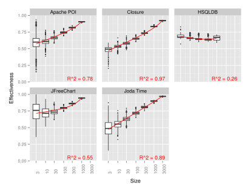
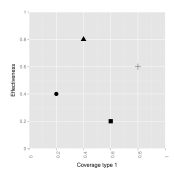
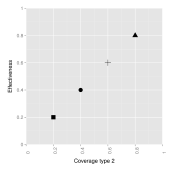

**Source:** *Coverage Is Not Strongly Correlated with Test Suite Effectiveness* — [PDF](https://www.cs.ubc.ca/~rtholmes/papers/icse_2014_inozemtseva.pdf)

# **Coverage Is Not Strongly Correlated with Test Suite Effectiveness**

Laura Inozemtseva and Reid Holmes School of Computer Science University of Waterloo Waterloo, ON, Canada {lminozem,rtholmes}@uwaterloo.ca

## ABSTRACT

The coverage of a test suite is often used as a proxy for its ability to detect faults. However, previous studies that investigated the correlation between code coverage and test suite effectiveness have failed to reach a consensus about the nature and strength of the relationship between these test suite characteristics. Moreover, many of the studies were done with small or synthetic programs, making it unclear whether their results generalize to larger programs, and some of the studies did not account for the confounding influence of test suite size. In addition, most of the studies were done with adequate suites, which are are rare in practice, so the results may not generalize to typical test suites.

We have extended these studies by evaluating the relationship between test suite size, coverage, and effectiveness for large Java programs. Our study is the largest to date in the literature: we generated 31,000 test suites for five systems consisting of up to 724,000 lines of source code. We measured the statement coverage, decision coverage, and modified condition coverage of these suites and used mutation testing to evaluate their fault detection effectiveness.

We found that there is a low to moderate correlation between coverage and effectiveness when the number of test cases in the suite is controlled for. In addition, we found that stronger forms of coverage do not provide greater insight into the effectiveness of the suite. Our results suggest that coverage, while useful for identifying under-tested parts of a program, should not be used as a quality target because it is not a good indicator of test suite effectiveness.

## Categories and Subject Descriptors

D.2.5 [Software Engineering]: Testing and Debugging; D.2.8 [Software Engineering]: Metrics—product metrics

## General Terms

Measurement

## Keywords

Coverage, test suite effectiveness, test suite quality

Permission to make digital or hard copies of all or part of this work for personal or classroom use is granted without fee provided that copies are not made or distributed for profit or commercial advantage and that copies bear this notice and the full citation on the first page. To copy otherwise, to republish, to post on servers or to redistribute to lists, requires prior specific permission and/or a fee.

*ICSE* '14, May 31–June 7, 2014, Hyderabad, India Copyright 14 ACM 978-1-4503-2756-5/14/05 ...\$15.00.

# 1. INTRODUCTION

Testing is an important part of producing high quality software, but its effectiveness depends on the quality of the test suite: some suites are better at detecting faults than others. Naturally, developers want their test suites to be good at exposing faults, necessitating a method for measuring the fault detection effectiveness of a test suite. Testing textbooks often recommend coverage as one of the metrics that can be used for this purpose (e.g., [29, 34]). This is intuitively appealing, since it is clear that a test suite cannot find bugs in code it never executes; it is also supported by studies that have found a relationship between code coverage and fault detection effectiveness [3, 6, 14–17, 24, 31, 39].

Unfortunately, these studies do not agree on the strength of the relationship between these test suite characteristics. In addition, three issues with the studies make it difficult to generalize their results. First, some of the studies did not control for the size of the suite. Since coverage is increased by adding code to existing test cases or by adding new test cases to the suite, the coverage of a test suite is correlated with its size. It is therefore not clear that coverage is related to effectiveness independently of the number of test cases in the suite. Second, all but one of the studies used small or synthetic programs, making it unclear that their results hold for the large programs typical of industry. Third, many of the studies only compared adequate suites; that is, suites that fully satisfied a particular coverage criterion. Since adequate test suites are rare in practice, the results of these studies may not generalize to more realistic test suites.

This paper presents a new study of the relationship between test suite size, coverage and effectiveness. We answer the following research questions for large Java programs:

Research Question 1. Is the effectiveness of a test suite correlated with the number of test cases in the suite?

Research Question 2. Is the effectiveness of a test suite correlated with its statement coverage, decision coverage and/or modified condition coverage when the number of test cases in the suite is ignored?

Research Question 3. Is the effectiveness of a test suite correlated with its statement coverage, decision coverage and/or modified condition coverage when the number of test cases in the suite is held constant?

The paper makes the following contributions:

• A comprehensive survey of previous studies that investigated the relationship between coverage and effectiveness (Section 2 and accompanying online material).

Table 1: Summary of the findings from previous studies.

| Citation | Languages         | Largest Program | Coverage Types                                 | Findings                                                                                                                             |
|----------|-------------------|-----------------|------------------------------------------------|--------------------------------------------------------------------------------------------------------------------------------------|
| [15, 16] | Pascal            | 78 SLOC         | All-use, decision                              | All-use related to effectiveness independently of size; decision is not; relationship is highly non-linear                           |
| [17]     | Fortran<br>Pascal | 78 SLOC         | All-use, mutation                              | Effectiveness improves with coverage but not until coverage reaches $80\%$ ; even then increase is small                             |
| [14]     | С                 | 5,905 SLOC      | All-use, decision                              | Effectiveness is correlated with both all-use and decision coverage; increase is small until high levels of coverage are reached     |
| [39]     | С                 | <2,310 SLOC     | Block                                          | Effectiveness is more highly correlated with block coverage than with size                                                           |
| [24]     | С                 | 512 SLOC        | All-use, decision                              | Effectiveness is correlated with both all-use and decision coverage; effectiveness increases more rapidly at high levels of coverage |
| [6]      | С                 | 4,512 SLOC      | Block, c-use, decision, p-use                  | Effectiveness is moderately correlated with all four coverage types; magnitude of the correlation depends on the nature of the tests |
| [3]      | С                 | 5,000 SLOC      | Block, c-use,<br>decision, p-use               | Effectiveness is correlated with all four coverage types; effectiveness rises steadily with coverage                                 |
| [31]     | C<br>C++          | 5,680 SLOC      | Block, c-use,<br>decision, p-use               | Effectiveness is correlated with all four coverage types but the correlations are not always strong                                  |
| [19, 37] | C<br>Java         | 72,490 SLOC     | AIMP, DBB,<br>decision, IMP,<br>PCC, statement | Effectiveness correlated with coverage; effectiveness correlated with size for large projects                                        |
| [5]      | С                 | 4,000 SLOC      | Block, c-use, decision, p-use                  | None of the four coverage types are related to effectiveness independently of size                                                   |
| [20]     | Java              | O(100,000) SLOC | Block, decision, path, statement               | Effectiveness correlated with coverage across many projects; influence of project size unclear                                       |

- Empirical evidence demonstrating that there is a low to moderate correlation between coverage and effectiveness when suite size is controlled for and that the type of coverage used has little effect on the strength of the relationship (Section 4).
- A discussion of the implications of these results for developers, researchers and standards bodies (Section 5).

#### 2. RELATED WORK

Most of the previous studies that investigated the link between test suite coverage and test suite effectiveness used the following general procedure:

- Created faulty versions of one or more programs by manually seeding faults, reintroducing previously fixed faults, or using a mutation tool.
- Created a large number of test suites by selecting from a pool of available test cases, either randomly or according to some algorithm, until the suite reached either a pre-specified size or a pre-specified coverage level.
- Measured the coverage of each suite in one or more ways, if suite size was fixed; measured the suite's size if its coverage was fixed.
- Determined the effectiveness of each suite as the fraction of faulty versions of the program that were detected by the suite.

Table 1 summarizes twelve studies that considered the

relationship between the coverage and the effectiveness of a test suite, ten of which used the general procedure just described. Eight of them found that at least one type of coverage has some correlation with effectiveness independently of size; however, not all studies found a strong correlation, and most found that the relationship was highly non-linear. In addition, some found that the relationship only appeared at very high levels of coverage. For brevity, the older studies from Table 1 are described more fully in accompanying materials<sup>1</sup>. In the remainder of this section, we discuss the three most recent studies.

At the time of writing, no other study considered any subject program larger than 5,905 SLOC<sup>2</sup>. However, a recent study by Gligoric et al. [19] and a subsequent master's thesis [37] partially addressed this issue by studying two large Java programs (JFreeChart and Joda Time) and two large C programs (SQLITE and YAFFS2) in addition to a number of small programs. The authors created test suites by sampling from the pool of test cases for each program. For the large programs, these test cases were manually written by developers; for the small programs, these test cases were automatically generated using various tools. Suites were created

http://linozemtseva.com/research/2014/icse/ coverage/

<sup>&</sup>lt;sup>2</sup>In this paper, source lines of code (SLOC) refers to executable lines of code, while lines of code (LOC) includes whitespace and comments.

in two ways. First, the authors specified a coverage level and selected tests until it was met; next, the authors specified a suite size and selected tests until it was met. They measured a number of coverage types: statement coverage, decision coverage, and more exotic measurements based on equivalent classes of covered statements (dynamic basic block coverage), program paths (intra-method and acyclic intra-method path coverage), and predicate states (predicate complete coverage). They evaluated the effectiveness of each suite using mutation testing. They found that the Kendall τ correlation (see Section 4.2) between coverage and mutation score ranged from 0.452 to 0.757 for the various coverage types and suite types when the size of the suite was not considered. When they tried to predict the mutation score using suite size alone, they found high correlations (between 0.585 and 0.958) for the four large programs with manually written test suites but fairly low correlations for the small programs with artificially generated test suites. This suggests that the correlation between coverage and effectiveness in real systems is largely due to the correlation between coverage and size; it also suggests that results from automatically generated and manually generated suites do not generalize to each other.

A study by Gopinath et al. [20] accepted to the same conference as the current paper did not use the aforementioned general procedure. The authors instead measured coverage and test suite effectiveness for a large number of open-source Java programs and computed a correlation across all programs. Specifically, they measured statement, block, decision and path coverage and used mutation testing to measure effectiveness. The authors measured these values for approximately 200 developer-generated test suites – the number varies by measurement – then generated a suite for each project with the Randoop tool [36] and repeated the measurements. The authors found that coverage is correlated with effectiveness across projects for all coverage types and for both developer-generated and automatically-generated suites, though the correlation was stronger for developerwritten suites. The authors found that including test suite size in their regression model did not improve the results; however, since coverage was already included in the model, it is not clear whether this is an accurate finding or a result of multicollinearity<sup>3</sup>.

As the above discussion shows, it is still not clear how test suite size, coverage and effectiveness are related. Most studies conclude that effectiveness is related to coverage, but there is little agreement about the strength and nature of the relationship.

## 3. METHODOLOGY

To answer our research questions, we followed the general procedure outlined in Section 2. This required us to select:

- 1. A set of subject programs (Section 3.2);
- 2. A method of generating faulty versions of the programs (Section 3.3);
- 3. A method of creating test suites (Section 3.4);
- 4. Coverage metrics (Section 3.5); and
- 5. An effectiveness metric (Section 3.6).

We then measured the coverage and effectiveness of the suites to evaluate the relationship between these characteristics.

# 3.1 Terminology

Before describing the methodology in detail, we precisely define three terms that will be used throughout the paper.

- Test case: one test in a suite of tests. A test case executes as a unit; it is either executed or not executed. In the JUnit testing framework, each method that starts with the word test (JUnit 3) or that is annotated with @Test (JUnit 4) is a test case. For this reason, we will use the terms test method and test case interchangeably.
- Test suite: a collection of test cases.
- Master suite: the whole test suite that was written by the developers of a subject program. For example, the master suite for Apache POI contains 1,415 test cases (test methods). The test suites that we create and evaluate are strict subsets of the master suite.

## 3.2 Subject Programs

We selected five subjects from a variety of application domains. The first, Apache POI [4], is an open source API for manipulating Microsoft documents. The second, Closure Compiler [7], is an open source JavaScript optimizing compiler. The third, HSQLDB [23], is an open source relational database management system. The fourth, JFreeChart [25], is an open source library for producing charts. The fifth, Joda Time [26], is an open source replacement for the Java Date and Time classes.

We used a number of criteria to select these projects. First, to help ensure the novelty and generalizability of our study, we required that the projects be reasonably large (on the order of 100,000 SLOC), written in Java, and actively developed. We also required that the projects have a fairly large number of test methods (on the order of 1,000) so that we would be able to generate reasonably sized random test suites. Finally, we required that the projects use Ant as a build system and JUnit as a test harness, allowing us to automate data collection.

The salient characteristics of our programs are summarized in Table 2. Program size was measured with SLOCCount [38]. Rows seven through ten provide information related to mutation testing and will be explained in Section 3.3.

## 3.3 Generating Faulty Programs

We used the open source tool PIT [35] to generate faulty versions of our programs. To describe PIT's operation, we must first give a brief description of mutation testing.

A mutant is a new version of a program that is created by making a small syntactic change to the original program. For example, a mutant could be created by modifying a constant, negating a branch condition, or removing a method call. The resulting mutant may produce the same output as the original program, in which case it is called an equivalent mutant. For example, if the equality test in the code snippet in Figure 1 were changed to if (index >= 10), the new program would be an equivalent mutant.

Mutation testing tools such as PIT generate a large number of mutants and run the program's test suite on each one. If the test suite fails when it is run on a given mutant, we say that the suite kills that mutant. A test suite's mutant coverage is then the fraction of non-equivalent mutants that it kills. Equivalent mutants are excluded because they cannot, by definition, be detected by a unit test.

If a mutant is not killed by a test suite, manual inspec-

<sup>3</sup>The amount of variation 'explained' by a variable will be less if it is correlated with a variable already included in the model than it would be otherwise.

| Property                     | Apache POI | Closure    | HSQLDB  | JFreeChart | Joda Time  |
|------------------------------|------------|------------|---------|------------|------------|
| Total Java SLOC              | 283,845    | 724,089    | 178,018 | 125,659    | 80,462     |
| Test SLOC                    | 68,932     | $93,\!528$ | 18,425  | 44,297     | $51,\!444$ |
| Number of test methods       | 1,415      | 7,947      | 628     | 1,764      | $3,\!857$  |
| Statement coverage (%)       | 67         | 76         | 27      | 54         | 91         |
| Decision coverage (%)        | 60         | 77         | 17      | 45         | 82         |
| MC coverage (%)              | 49         | 67         | 9       | 27         | 70         |
| Number of mutants            | 27,565     | 30,779     | 50,302  | 29,699     | 9,552      |
| Number of detected mutants   | 17,935     | 27,325     | 50,125  | 23,585     | 8,483      |
| Number of equivalent mutants | 9,630      | 3,454      | 177     | 6,114      | 1,069      |
| Equivalent mutants $(\%)$    | 35         | 11         | 0.4     | 21         | 11         |

```
int index = 0;
while (true) {
    index++;
    if (index == 10) {
        break;
    }
}
```

Figure 1: An example of how an equivalent mutant can be generated. Changing the operator == to >= will result in a mutant that cannot be detected by an automated test case.

tion is required to determine if it is equivalent or if it was simply missed by the suite<sup>4</sup>. This is a time-consuming and error-prone process, so studies that compare subsets of a test suite to the master suite often use a different approach: they assume that any mutant that cannot be detected by the master suite is equivalent. While this technique tends to overestimate the number of equivalent mutants, it is commonly applied because it allows the study of much larger programs.

Although the mutants generated by PIT simulate real faults, it is not self-evident that a suite's ability to kill mutants is a valid measurement of its ability to detect real faults. However, several previous and current studies support the use of this measurement [2,3,10,27]. Previous work has also shown that if a test suite detects a large number of simple faults, caused by a single incorrect line of source code, it will detect a large number of harder, multi-line faults [28,32]. This implies that if a test suite can kill a large proportion of mutants, it can also detect a large proportion of the more difficult faults in the software. The literature thus suggests that the mutant detection rate of a suite is a fairly good measurement of its fault detection ability. We will return to this issue in Sections 6 and 7.

We can now describe the remaining rows of Table 2. The seventh row shows how many mutants PIT generated for each project. The eighth row shows how many of those mutants could be detected by the suite. The ninth row shows how many of those mutants could not be detected by the entire test suite and were therefore assumed to be equivalent (i.e., row 7 is the sum of rows 8 and 9). The last row gives the equivalent mutants as a percentage of the total.

### 3.4 Generating Test Suites

For each subject program, we used Java's reflection API to identify all of the test methods in the program's master suite. We then generated new test suites of fixed size by randomly selecting a subset of these methods without replacement. More concretely, we created a JUnit suite by repeatedly using the TestSuite.addTest(Test t) method. Each suite was created as a JUnit suite so that the necessary set-up and tear-down code was run for each test method. Given this procedure for creating suites, in this paper the size of our random suites should always be understood as the number of test methods they contain, i.e., the number of times addTest was called.

We made 1,000 suites of each of the following sizes: 3 methods, 10 methods, 30 methods, 100 methods, and so on, up to the largest number following this pattern that was less than the total number of test methods. This resulted in a total of 31,000 test suites across the five subject systems. Comparing a large number of suites from the same project allows us to control for size; it also allows us to apply our results to the common research practice of comparing test suites generated for the same subject program using different test generation methodologies.

#### 3.5 Measuring Coverage

We used the open source tool CodeCover [8] to measure three types of coverage: statement, decision, and modified condition coverage. Statement coverage refers to the fraction of the executable statements in the program that are run by the test suite. It is relatively easy to satisfy, easy to understand and can be measured quickly, making it popular with developers. However, it is one of the weaker forms of coverage, since executing a line does not necessarily reveal an error in that line.

Decision coverage refers to the fraction of decisions (i.e., branches) in the program that are executed by its test suite. Decision coverage is somewhat harder to satisfy and measure than statement coverage.

Modified condition coverage (MCC) is the most difficult of these three to satisfy. For a test suite to be modified condition adequate, i.e., to have 100% modified condition coverage, the suite must include  $2^n$  test cases for every decision with n conditions<sup>5</sup> in it [22]. This form of coverage is not commonly used in practice; however, it is very similar to mod-

<sup>&</sup>lt;sup>4</sup>Manual inspection is required because automatically determining whether a mutant is equivalent is undecidable [33].

<sup>&</sup>lt;sup>5</sup>A condition is a boolean expression that cannot be decomposed into a simpler boolean expression. Decisions are composed of conditions and one or more boolean operators.

ified condition/decision coverage (MC/DC), which is widely used in the avionics industry. Specifically, Federal Aviation Administration standard DO-178B states that the most critical software in the aircraft must be tested with a suite that is modified condition/decision coverage adequate [22]. MC/DC is therefore one of the most stringent forms of coverage that is widely and regularly used in practice. Measuring modified condition coverage provides insight into whether stronger coverage types such as MCC and MC/DC provide practical benefits that outweigh the extra cost associated with writing enough tests to satisfy them.

We did not measure any type of dataflow coverage, since very few tools for Java can measure these types of coverage. One exception is Coverlipse [9], which can measure all-use coverage but can only be used as an Eclipse plugin. To the best of our knowledge, there are no open source coverage tools for Java that can measure other data flow coverage criteria or that can be used from the command line. Since developers use the tools they have, they are unlikely to use dataflow coverage metrics. Using the measurements that developers use, whether due to tool availability or legal requirements, means that our results will more accurately reflect current development practice. However, we plan to explore dataflow coverage in future work to determine if developers would benefit from using these coverage types instead.

### 3.6 Measuring Effectiveness

We used two effectiveness measurements in this study: the raw effectiveness measurement and the normalized effectiveness measurement. The raw kill score is the number of mutants a test suite detected divided by the total number of non-equivalent mutants that were generated for the subject program under test. The normalized effectiveness measurement is the number of mutants a test suite detected divided by the number of non-equivalent mutants it covers. A test suite covers a mutant if the mutant was made by altering a line of code that is executed by the test suite, implying that the test suite can potentially detect the mutant.

We included the normalized effectiveness measurement in order to compare test suites on a more even footing. Suppose we are comparing suite A, with 50% coverage, to suite B, with 60% coverage. Suite B will almost certainly have a higher raw effectiveness measurement, since it covers more code and will therefore almost certainly kill more mutants. However, if suite A kills 80% of the mutants that it covers, while suite B kills only 70% of the mutants that it covers, suite A is in some sense a better suite. The normalized effectiveness measurement captures this difference. Note that it is possible for the normalized effectiveness measurement to drop when a new test case is added to the suite if the test case covers a lot of code but kills few mutants.

It may be helpful to think of the normalized effectiveness measurement as a measure of depth: how thoroughly does the test suite exercise the code that it runs? The raw effectiveness measurement is a measure of breadth: how much code does the suite exercise?

Note that the number of non-equivalent mutants covered by a suite is the maximum number of mutants the suite could possibly detect, so the normalized effectiveness measurement ranges from 0 to 1. The raw effectiveness measurement, in general, does not reach 1, since most suites kill a small percentage of the non-equivalent mutants. However, note that the full test suite has both a normalized effectiveness measurement of 1 and a raw effectiveness measurement of 1, since we decided that any mutants it did not kill are equivalent.

#### 4. RESULTS

In this section, we quantitatively answer the three research questions posed in Section 1. As Section 3 explained, we collected the data to answer these questions by generating test suites of fixed size via random sampling; measuring their statement, decision and MCC coverage with CodeCover; and measuring their effectiveness with the mutation testing tool PIT.

#### 4.1 Is Size Correlated With Effectiveness?

Research Question 1 asked if the effectiveness of a test suite is influenced by the number of test methods it contains. This research question provides a "sanity check" that supports the use of the effectiveness metric. Figure 2 shows some of the data we collected to answer this question. In each subfigure, the x axis indicates suite size on a logarithmic scale while the y axis shows the range of normalized effectiveness values we computed. The red line on each plot was fit to the data with R's 1m function<sup>6</sup>. The adjusted  $r^2$  value for each regression line is shown in the bottom right corner of each plot. These values range from 0.26 to 0.97, implying that the correlation coefficient r ranges from 0.51 to 0.98. This indicates that there is a moderate to very high correlation between normalized effectiveness and size for these projects<sup>7</sup>. The results for the non-normalized effectiveness measurement are similar, with the  $r^2$  values ranging from 0.69 to 0.99, implying a high to very high correlation between non-normalized effectiveness and size. The figure for this measurement can be found online<sup>8</sup>.

Answer 1. Our results suggest that, for large Java programs, there is a moderate to very high correlation between the effectiveness of a test suite and the number of test methods it contains.

# 4.2 Is Coverage Correlated With Effectiveness When Size Is Ignored?

Research Question 2 asked if the effectiveness of a test suite is correlated with the coverage of the suite when we ignore the influence of suite size. Tables 3 and 4 show the Kendall  $\tau$  correlation coefficients we computed to answer this question; all coefficients are significant at the 99.9% level<sup>9</sup>. Table 3

<sup>6</sup>Size and the logarithm of size were used as the inputs.

 $^9 \rm Kendall's~\tau$  is similar to the more common Pearson coefficient but does not assume that the variables are linearly related or that they are normally distributed. Rather, it measures how well an arbitrary monotonic function could fit the data. A high correlation therefore means that we can predict the rank order of the suites' effectiveness values given the rank order of their coverage values, which in practice is nearly as useful as predicting an absolute effectiveness score. We used it instead of the Pearson coefficient to avoid introducing unnecessary assumptions about the distribution of the data.

<sup>&</sup>lt;sup>7</sup>Here we use the Guildford scale [21] for verbal description, in which correlations with absolute value less than 0.4 are described as "low", 0.4 to 0.7 as "moderate", 0.7 to 0.9 as "high", and over 0.9 as "very high".

<sup>8</sup>http://linozemtseva.com/research/2014/icse/ coverage/



Figure 2: Normalized effectiveness scores plotted against size for all subjects. Each box represents the 1000 suites of a given size that were created from a given master suite.

gives the correlation between the different coverage types and the normalized effectiveness measurement. Table 4 gives the correlation between the different coverage types and the non-normalized effectiveness measurement. For all projects but HSQLDB, we see a moderate to very high correlation between coverage and effectiveness when size is not taken into account. HSQLDB is an interesting exception: when the effectiveness measurement is normalized by the number of covered mutants, there is a low negative correlation between coverage and effectiveness. This means that the suites with higher coverage kill fewer mutants per unit of coverage; in other words, the suites with higher coverage contain test cases that run a lot of code but do not kill many mutants in that code. Of course, since the suites kill more mutants in total as they grow, there is a positive correlation between coverage and non-normalized effectiveness for HSQLDB.

Answer 2. Our results suggest that, for many large Java programs, there is a moderate to high correlation between the effectiveness and the coverage of a test suite when the influence of suite size is ignored. Research Question 3 explores whether this correlation is caused by the larger size of the suites with higher coverage.

# 4.3 Is Coverage Correlated With Effectiveness When Size Is Fixed?

Research Question 3 asked if the effectiveness of a test suite is correlated with its coverage when the number of test cases in the suite is controlled for. Figure 3 shows the data we collected to answer this question. Each panel shows

Table 3: The Kendall  $\tau$  correlation between normalized effectiveness and different types of coverage when suite size is ignored. All entries are significant at the 99.9% level.

| Project    | Statement | Decision | Mod. Cond. |
|------------|-----------|----------|------------|
| Apache POI | 0.75      | 0.76     | 0.77       |
| Closure    | 0.83      | 0.83     | 0.84       |
| HSQLDB     | -0.35     | -0.35    | -0.35      |
| JFreeChart | 0.50      | 0.53     | 0.53       |
| Joda Time  | 0.80      | 0.80     | 0.80       |

Table 4: The Kendall  $\tau$  correlation between non-normalized effectiveness and different types of coverage when suite size is ignored. All entries are significant at the 99.9% level.

| Project    | Statement | Decision | Mod. Cond. |
|------------|-----------|----------|------------|
| Apache POI | 0.94      | 0.94     | 0.94       |
| Closure    | 0.95      | 0.95     | 0.95       |
| HSQLDB     | 0.81      | 0.80     | 0.79       |
| JFreeChart | 0.91      | 0.95     | 0.92       |
| Joda Time  | 0.85      | 0.85     | 0.85       |

the results we obtained for one project and one suite size. The project name is given at the top of each column, while the suite size is given at the right of each row. Different coverage types are differentiated by colour. The bottom row is a margin plot that shows the results for all sizes, while the rightmost column is a margin plot that shows the results for


Figure 3: Normalized effectiveness scores (left axis) plotted against coverage (bottom axis) for all subjects. Rows show the results for one suite size; columns show the results for one project. N/A indicates that the project did not have enough test cases to fill in that frame.

all projects. The figure shows the results for the normalized effectiveness measurement; the non-normalized effectiveness measurements tend to be small and difficult to see at this size. The figure for the non-normalized effectiveness measurement can be found online with the other supplementary material.

We computed the Kendall τ correlation coefficient between effectiveness and coverage for each project, each suite size, each coverage type, and both effectiveness measures. Since this resulted in a great deal of data, we summarize the results here; the full dataset can be found on the same website as the figures.

Our results were mixed. Controlling for suite size always lowered the correlation between coverage and effectiveness. However, the magnitude of the change depended on the effectiveness measurement used. In general, the normalized effectiveness measurements had low correlations with coverage once size was controlled for while the non-normalized effectiveness measurements had moderate correlations with coverage once size was controlled for.

That said, the results varied by project. Joda Time was at one extreme: the correlation between coverage and effectiveness ranged from 0.80 to 0.85 when suite size was ignored, but dropped to essentially zero when suite size was controlled for. The same effect was seen for Closure when the normalized effectiveness measurement was used.

Apache POI fell at the other extreme. For this project, the correlation between coverage and the non-normalized effectiveness measurement was 0.94 when suite size was ignored, but dropped to a range of 0.46 to 0.85 when suite size was controlled for. While this is in some cases a large drop, a correlation in this range can provide useful information about the quality of a test suite.

A very interesting result is that, in general, the coverage type used did not have a strong impact on the results. This is true even though the effectiveness scores (y values) for each suite are the same for all three coverage types (x values). To clarify this, consider Figure 4. The figure shows two hypothetical graphs of effectiveness against coverage. In the top graph, coverage type 1 is not strongly correlated with effectiveness. In the bottom graph, coverage type 2 is strongly correlated with effectiveness even though the y-value of each point has not changed (e.g., the triangle is at y = 0.8 in both graphs). We do not see this difference between statement, decision, and MCC coverage, suggesting that the different types of coverage are measuring the same thing. We can confirm this intuition by measuring the correlation between different coverage types for each suite (Table 5). Given these high correlations, and given that the shape of the point clouds are similar for all three coverage measures (see Figure 3), we can conclude that the coverage type used has little effect on the relationship between coverage and effectiveness in this study.

Table 5: The Kendall τ and Pearson correlations between different types of coverage for all suites from all projects.

| Coverage Types     | Tau  | Pearson |
|--------------------|------|---------|
| Statement/Decision | 0.92 | 0.99    |
| Decision/MCC       | 0.91 | 0.98    |
| Statement/MCC      | 0.92 | 0.97    |

Answer 3. Our results suggest that, for large Java programs, the correlation between coverage and effectiveness drops when suite size is controlled for. After this drop, the correlation typically ranges from low to moderate, meaning it is not generally safe to assume that effectiveness is correlated with coverage. The correlation is stronger when the non-normalized effectiveness measurement is used. Additionally, the type of coverage used had little influence on the strength of the relationship.

## 5. DISCUSSION

The goal of this work was to determine if a test suite's coverage is correlated with its fault detection effectiveness when suite size is controlled for. We found that there is typically a moderate to high correlation between coverage and effectiveness when suite size is ignored, and that this drops to a low to moderate correlation when size is controlled. This result suggests that coverage alone is not a good predictor of test suite effectiveness; in many cases, the apparent relationship is largely due to the fact that high coverage suites contain more test cases. The results for Joda Time and Closure, in particular, demonstrate that it is not safe in general to assume that coverage is correlated with effectiveness. Interestingly, the suites for Joda Time and Closure are the largest and most comprehensive of the five suites we studied, which might indicate that the correlation becomes weaker as the suite improves.

In addition, we found that the type of coverage measured had little impact on the correlation between coverage and effectiveness. This is reinforced by the shape of the point clouds in Figure 3: for any one project and suite size, the





Figure 4: Hypothetical graphs of effectiveness against two coverage types for four test suites. The top graph shows a coverage type that is not correlated with effectiveness; the bottom graph shows a coverage type that is correlated with effectiveness.

clouds corresponding to the three coverage types are similar in shape and size. This, in combination with the high correlation between different coverage measurements, suggests that stronger coverage types provide little extra information about the quality of the suite.

Our findings have implications for developers, researchers, and standards bodies. Developers may wish to use this information to guide their use of coverage. While coverage measures are useful for identifying under-tested parts of a program, and low coverage may indicate that a test suite is inadequate, high coverage does not indicate that a test suite is effective. This means that using a fixed coverage value as a quality target is unlikely to produce an effective test suite. While members of the testing community have previously made this point [13, 30], it has been difficult to evaluate their suggestions due to a lack of studies that considered systems of the scale that we investigated. Additionally, it may be in the developer's best interest to use simpler coverage measures. These measures provide a similar amount of information about the suite's effectiveness but introduce less measurement overhead.

Researchers may wish to use this information to guide their tool-building. In particular, test generation techniques often attempt to maximize the coverage of the resulting suite; our results suggest that this may not be the best approach.

Finally, our results are pertinent to standards bodies that set requirements for software testing. The FAA standard DO-178B, mentioned earlier in this paper, requires the use of MC/DC adequate suites to ensure the quality of the resulting software; however, our results suggest that this requirement may increase expenses without necessarily increasing quality.

Of course, developers still want to measure the quality of their test suites, meaning they need a metric that does correlate with fault detection ability. While this is still an open problem, we currently feel that mutation score may be a good substitute for coverage in this context [27].

## 6. THREATS TO VALIDITY

In this section, we discuss the threats to the construct validity, internal validity, and external validity of our study.

## 6.1 Construct Validity

In our study we measured the size, coverage and effectiveness of random test suites. Size and coverage are straightforward to measure, but effectiveness is more nebulous, as we are attempting to predict the fault-detection ability of a suite that has never been used in practice. As we described in Section 3.3, previous and current work suggests that a suite's ability to kill mutants is a fairly good measurement of its ability to detect real faults [2, 3, 10, 27]. This suggests that, in the absence of equivalent mutants, this metric has high construct validity. Unfortunately, our treatment of equivalent mutants introduces a threat to the validity of this measurement. Recall that we assumed that any mutant that could not be detected by the program's entire test suite is equivalent. This means that we classified up to 35% of the generated mutants as equivalent (see the final row of Table 2). In theory, these mutants are a random subset of the entire set of mutants, so ignoring them should not affect our results. However, this may not be true. For example, if the developers frequently test for off-by-one errors, mutants that simulate this error will be detected more often and will be less likely to be classified as equivalent.

## 6.2 Internal Validity

Our conclusions about the relationship between size, coverage and effectiveness depend on our calculations of the Kendall τ correlation coefficient. This introduces a threat to the internal validity of the study. Kendall's original formula for τ assumes that there are no tied ranks in the data; that is, if the data were sorted, no two rows could be exchanged without destroying the sorted order. When ties do exist, two issues arise. First, since the original formula does not handle ties, a modified one must be used. We used the version proposed by Adler [1]. Second, ties make it difficult to compute the statistical significance of the correlation coefficient. It it possible to show that, in the absence of ties, τ is normally distributed, meaning we can use Z-scores to evaluate significance in the usual way. However, when ties are present, the distribution of τ changes in a way that depends on the number and nature of the ties. This can result in a non-normal distribution [18]. To determine the impact of ties on our calculations, we counted both the number of ties that occurred and the total number of comparisons done

to compute each τ . We found that ties rarely occurred: for the worst calculation, 4.6% of the comparisons resulted in a tie, but for most calculations this percentage was smaller by several orders of magnitude. Since there were so few ties, we have assumed that they had a negligible effect on the normal distribution.

Another threat to internal validity stems from the possibility of duplicate test suites: our results might be skewed if two or more suites contain the same subset of test methods. Fortunately, we can evaluate this threat using the information we collected about ties: since duplicate suites would naturally have identical coverage and effectiveness scores, the number of tied comparisons provides an upper bound on how many identical suites were compared. Since the number of ties was so low, the number of duplicate suites must be similarly low, and so we have ignored the small skew they may have introduced to avoid increasing the memory requirements of our study unnecessarily.

Since we have studied correlations, we cannot make any claims about the direction of causality.

## 6.3 External Validity

There are six main threats to the external validity of our study. First, previous work suggests that the relationship between size, coverage and effectiveness depends on the difficulty of detecting faults in the program [3]. Furthermore, some of the previous work was done with hand-seeded faults, which have been shown to be harder to detect than both mutants and real faults [2]. While this does not affect our results, it does make it harder to compare them with those of earlier studies.

Second, some of the previous studies found that a relationship between coverage and effectiveness did not appear until very high coverage levels were reached [14,17,24]. Since the coverage of our generated suites rarely reached very high values, it is possible that we missed the existence of such a relationship. That said, it is not clear that such a relationship would be useful in practice. It is very difficult to reach extremely high levels of coverage, so a relationship that does not appear until 90% coverage is reached is functionally equivalent to no relationship at all for most developers.

Third, in object-oriented systems, most faults are usually found in just a few of the system's components [12]. This means that the relationship between size, coverage and effectiveness may vary by class within the system. It is therefore possible that coverage is correlated with effectiveness in classes with specific characteristics, such as high churn. However, our conclusions still hold for the common practice of measuring the coverage of a program's entire test suite.

Fourth, there may be other features of a program or a suite that affect the relationship between coverage and effectiveness. For example, previous work suggests that the size of a class can affect the validity of object-oriented metrics [11]. While we controlled for the size of each test suite in this study, we did not control for the size of the class that each test method came from.

Fifth, as discussed in Section 3.2, our subjects had to meet certain inclusion criteria. This means that they are fairly similar, so our results may not generalize to programs that do not meet these criteria. We attempted to mitigate this threat by selecting programs from different application domains, thereby ensuring a certain amount of variety in the subjects. Unfortunately, it was difficult to find acceptable subjects; in particular, the requirement that the subjects have 1,000 test cases proved to be very difficult to satisfy. In practice, it seems that most open source projects do not have comprehensive test suites. This is supported by Gopinath et al.'s study [20], where only 729 of the 1,254 open source Java projects they initially considered, or 58%, had test suites at all, much less comprehensive suites.

Finally, while our subjects were considerably larger than the programs used in previous studies, they are still not large by industrial standards. Additionally, all of the projects were open source, so our results may not generalize to closed source systems.

## 7. FUTURE WORK

Our next step is to confirm our findings using real faults to eliminate this threat to validity. We will also explore dataflow coverage to determine if these coverage types are correlated with effectiveness.

It may also be helpful to perform a longitudinal study that considers how the coverage and effectiveness of a program's test suite change over time. By cross-referencing coverage information with bug reports, it might be possible to isolate those bugs that were covered by the test suite but were not immediately detected by it. Examining these bugs may provide insight into which bugs are the most difficult to detect and how we can improve our chances of detecting them.

# 8. CONCLUSION

In this paper, we studied the relationship between the number of methods in a program's test suite, the suite's statement, decision, and modified condition coverage, and the suite's mutant effectiveness measurement, both normalized and non-normalized. From the five large Java programs we studied, we drew the following conclusions:

- In general, there is a low to moderate correlation between the coverage of a test suite and its effectiveness when its size is controlled for.
- The strength of the relationship varies between software systems; it is therefore not generally safe to assume that effectiveness is strongly correlated with coverage.
- The type of coverage used had little impact on the strength of the correlation.

These results imply that high levels of coverage do not indicate that a test suite is effective. Consequently, using a fixed coverage value as a quality target is unlikely to produce an effective test suite. In addition, complex coverage measurements may not provide enough additional information about the suite to justify the higher cost of measuring and satisfying them.

## 9. REFERENCES

- [1] L. M. Adler. A modification of Kendall's tau for the case of arbitrary ties in both rankings. Journal of the American Statistical Association, 52(277), 1957.
- [2] J. H. Andrews, L. C. Briand, and Y. Labiche. Is mutation an appropriate tool for testing experiments? In Proc. of the Int'l Conf. on Soft. Eng., 2005.
- [3] J. H. Andrews, L. C. Briand, Y. Labiche, and A. S. Namin. Using mutation analysis for assessing and comparing testing coverage criteria. IEEE Transactions on Soft. Eng., 32(8), 2006.

- [4] Apache POI. http://poi.apache.org.
- [5] L. Briand and D. Pfahl. Using simulation for assessing the real impact of test coverage on defect coverage. In Proc. of the Int'l Symposium on Software Reliability Engineering, 1999.
- [6] X. Cai and M. R. Lyu. The effect of code coverage on fault detection under different testing profiles. In Proc. of the Int'l Workshop on Advances in Model-Based Testing, 2005.
- [7] Closure Compiler. https://code.google.com/p/closure-compiler/.
- [8] CodeCover. http://codecover.org/.
- [9] Coverlipse. http://coverlipse.sourceforge.net/.
- [10] M. Daran and P. Th´evenod-Fosse. Software error analysis: a real case study involving real faults and mutations. In Proc. of the Int'l Symposium on Software Testing and Analysis, 1996.
- [11] K. El Emam, S. Benlarbi, N. Goel, and S. N. Rai. The confounding effect of class size on the validity of object-oriented metrics. IEEE Transactions on Soft. Eng., 27(7), 2001.
- [12] N. E. Fenton and N. Ohlsson. Quantitative analysis of faults and failures in a complex software system. IEEE Transactions on Soft. Eng., 26(8), 2000.
- [13] M. Fowler. Test coverage. http: //martinfowler.com/bliki/TestCoverage.html, 2012.
- [14] P. G. Frankl and O. Iakounenko. Further empirical studies of test effectiveness. In Proc. of the Int'l Symposium on Foundations of Soft. Eng., 1998.
- [15] P. G. Frankl and S. N. Weiss. An experimental comparison of the effectiveness of the all-uses and all-edges adequacy criteria. In Proc. of the Symposium on Testing, Analysis, and Verification, 1991.
- [16] P. G. Frankl and S. N. Weiss. An experimental comparison of the effectiveness of branch testing and data flow testing. IEEE Transactions on Soft. Eng., 19(8), 1993.
- [17] P. G. Frankl, S. N. Weiss, and C. Hu. All-uses vs mutation testing: an experimental comparison of effectiveness. Journal of Systems and Software, 38(3), 1997.
- [18] J. D. Gibbons. Nonparametric Measures of Association. Sage Publications, 1993.
- [19] M. Gligoric, A. Groce, C. Zhang, R. Sharma, M. A. Alipour, and D. Marinov. Comparing non-adequate test suites using coverage criteria. In Proc. of the Int'l Symp. on Soft. Testing and Analysis, 2013.
- [20] R. Gopinath, C. Jenson, and A. Groce. Code coverage for suite evaluation by developers. In Proc. of the Int'l Conf. on Soft. Eng., 2014.
- [21] J. P. Guilford. Fundamental Statistics in Psychology and Education. McGraw-Hill, 1942.
- [22] K. Hayhurst, D. Veerhusen, J. Chilenski, and L. Rierson. A practical tutorial on modified condition/decision coverage. Technical report, NASA Langley Research Center, 2001.
- [23] HSQLDB. http://hsqldb.org.
- [24] M. Hutchins, H. Foster, T. Goradia, and T. Ostrand. Experiments of the effectiveness of dataflow- and controlflow-based test adequacy criteria. In Proc. of the

- Int'l Conf. on Soft. Eng., 1994.
- [25] JFreeChart. http://jfree.org/jfreechart.
- [26] Joda Time. http://joda-time.sourceforge.net.
- [27] R. Just, D. Jalali, L. Inozemtseva, M. D. Ernst, R. Holmes, and G. Fraser. Are mutants a valid substitute for real faults in software testing? Technical Report UW-CSE-14-02-02, University of Washington, March 2014.
- [28] K. Kapoor. Formal analysis of coupling hypothesis for logical faults. Innovations in Systems and Soft. Eng., 2(2), 2006.
- [29] E. Kit. Software Testing in the Real World: Improving the Process. ACM Press, 1995.
- [30] B. Marick. How to misuse code coverage. http://www. exampler.com/testing-com/writings/coverage.pdf, 1997.
- [31] A. S. Namin and J. H. Andrews. The influence of size and coverage on test suite effectiveness. In Proc. of the Int'l Symposium on Software Testing and Analysis, 2009.

- [32] A. J. Offutt. Investigations of the software testing coupling effect. ACM Transactions on Soft. Eng. and Methodology, 1(1), 1992.
- [33] A. J. Offutt and J. Pan. Detecting equivalent mutants and the feasible path problem. In Proc. of the Conf. on Computer Assurance, 1996.
- [34] W. Perry. Effective Methods for Software Testing. Wiley Publishing, 2006.
- [35] PIT. http://pitest.org/.
- [36] Randoop. https://code.google.com/p/randoop/.
- [37] R. Sharma. Guidelines for coverage-based comparisons of non-adequate test suites. Master's thesis, University of Illinois at Urbana-Champaign, 2013.
- [38] SLOCCount. http://dwheeler.com/sloccount.
- [39] W. E. Wong, J. R. Horgan, S. London, and A. P. Mathur. Effect of test set size and block coverage on the fault detection effectiveness. In Proc. of the Int'l Symposium on Software Reliability Engineering, 1994.