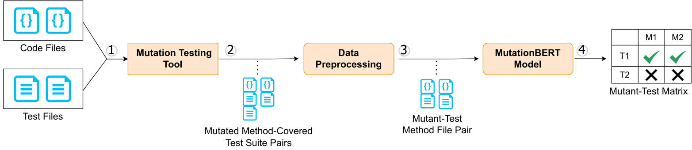
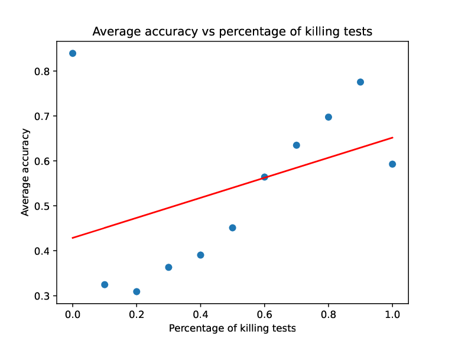
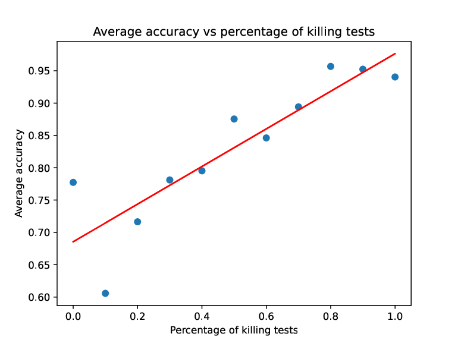

**Source:** *Contextual Predictive Mutation Testing* — [PDF](https://arxiv.org/pdf/2309.02389) · [arXiv](https://arxiv.org/abs/2309.02389)

# Contextual Predictive Mutation Testing

Conference: The 31st ACM Joint European Software Engineering Conference and Symposium on the Foundations of Software Engineering; 11 - 17 November, 2023; San Francisco, USAPrice: 15.00DOI: [10.1145/3611643.3616289](https://doi.org/10.1145/3611643.3616289)fse23main-p415-pISBN: 979-8-4007-0327-0/23/12Conference: Proceedings of the 31st ACM Joint European Software Engineering Conference and Symposium on the Foundations of Software Engineering; December 3–9, 2023; San Francisco, CA, USAProceedings of the 31st ACM Joint European Software Engineering Conference and Symposium on the Foundations of Software Engineering (ESEC/FSE ’23), December 3–9, 2023, San Francisco, CA, USACCS: Software and its engineering Dynamic analysisCCS: Software and its engineering Software testing and debugging

Kush Jain  Affiliation: Carnegie Mellon University, United States ,  Uri Alon  Affiliation: Carnegie Mellon University, United States ,  Alex Groce  Affiliation: Northern Arizona University, United States and  Claire Le Goues  Affiliation: Carnegie Mellon University, United States

Received 2023-07-27

###### Abstract.

Mutation testing is a powerful technique for assessing and improving test suite quality that artificially introduces bugs and checks whether the test suites catch them. However, it is also computationally expensive and thus does not scale to large systems and projects. One promising recent approach to tackling this scalability problem uses machine learning to predict whether the tests will detect the synthetic bugs, without actually running those tests. However, existing predictive mutation testing approaches still misclassify 33% of detection outcomes on a randomly sampled set of mutant-test suite pairs. We introduce MutationBERT, an approach for predictive mutation testing that simultaneously encodes the source method mutation and test method, capturing key _context_ in the input representation. Thanks to its higher precision, MutationBERT saves 33% of the time spent by a prior approach on checking/verifying live mutants. MutationBERT, also outperforms the state-of-the-art in both same project and cross project settings, with meaningful improvements in precision, recall, and F1 score. We validate our input representation, and aggregation approaches for lifting predictions from the test matrix level to the test suite level, finding similar improvements in performance. MutationBERT not only enhances the state-of-the-art in predictive mutation testing, but also presents practical benefits for real-world applications, both in saving developer time and finding hard to detect mutants.

###### Keywords: 

test oracles, code coverage, mutation analysis 

 Figure 1. An overview of our tool’s workflow, including source level mutation tool, preprocessing and model steps. Step \raisebox{-1pt} {1}⃝ provides source and test files to a mutation testing tool. In Step \raisebox{-1pt} {2}⃝, the mutation tool uses this information to generate both mutants and their correspondng covering tests. These mutated method-covered test pairs are preprocessed, tokenized, and formatted. In Step \raisebox{-1pt} {3}⃝, MutationBERT takes these inputs to produce (Step \raisebox{-1pt} {4}⃝) the full mutant-test matrix, the output of our model.

## 1\. Introduction

Mutation testing is a well established technique for evaluating test suite quality ([DeMillo et al., 1978](https://arxiv.org/html/2309.02389#bib.bib8); [Hamlet, 1977](https://arxiv.org/html/2309.02389#bib.bib13); [Jia and Harman, 2010](https://arxiv.org/html/2309.02389#bib.bib16)). Mutation testing works by introducing synthetic bugs based on a fixed set of rules (“mutation operators”), ranging from inverting conditional statements to changing unary and binary operators. The test suite is then run on each buggy code copy (also referred to as a “mutant” of the original program. If the test suite fails on a mutant, the mutant is considered “detected” (or “killed”; this is the desired outcome), otherwise the mutant is “undetected” (a “live” mutant).

Empirically, mutation testing has been shown to improve test suites in ways correlated with real world fault detection ([Just et al., 2014](https://arxiv.org/html/2309.02389#bib.bib18); [Papadakis et al., 2018](https://arxiv.org/html/2309.02389#bib.bib26)). However, one of its major limitations is its computational cost: test suites must be run on each mutant, in principle. Large-scale systems commonly have hundreds of thousands of mutants ([Groce et al., 2022](https://arxiv.org/html/2309.02389#bib.bib12); [Gopinath et al., 2015](https://arxiv.org/html/2309.02389#bib.bib10)), since mutants scale with size of the codebase and mutation operators considered. Myriad approaches, including weak mutation ([Howden, 1982](https://arxiv.org/html/2309.02389#bib.bib15)), meta mutation ([Untch et al., 1993](https://arxiv.org/html/2309.02389#bib.bib32)), mutation sampling ([Gopinath et al., 2015](https://arxiv.org/html/2309.02389#bib.bib10)), and mutant prioritization ([Kaufman et al., 2022](https://arxiv.org/html/2309.02389#bib.bib20)), have been proposed to tackle this computational cost. However, they typically require still intractably expensive instrumentation or static and dynamic analyses, and usually rely on some kind of random sampling, compromising their usefulness in practice. Mutation testing has begun to achieve industry adoption ([Beller et al., 2021](https://arxiv.org/html/2309.02389#bib.bib5); [Petrovic and Ivankovic, 2018](https://arxiv.org/html/2309.02389#bib.bib27)) at companies like Meta and Google, leveraging additional heuristics and idle compute time. However, current industrial practice is focused on identifying undetected mutants in newly committed code. This is, in essence, the tip of the iceberg; the vast underwater domain of undetected mutants (and, thus, test weaknesses) in existing code pre-dates the adoption of limited mutation analysis. Running all mutants on existing large codebases to surface these problems is still too expensive.

Research on Predictive Mutation Testing11 1 The first publication ([Zhang et al., 2016](https://arxiv.org/html/2309.02389#bib.bib37)) both named the problem “Predictive Mutation Testing” and introduced a model/approach to solve it named “PMT”. In general in this paper, we use “PMT” to refer to the problem of predicting whether a test/suite will detect a mutant, rather than the specific model proposed in that paper. ([Zhang et al., 2016](https://arxiv.org/html/2309.02389#bib.bib37); [Mao et al., 2019](https://arxiv.org/html/2309.02389#bib.bib23); [Kim et al., 2022](https://arxiv.org/html/2309.02389#bib.bib21)) takes a different approach to scalable mutation testing, using machine learning to predict whether a mutant will be detected or not _without actually running the tests._ The initial PMT work ([Zhang et al., 2016](https://arxiv.org/html/2309.02389#bib.bib37)) empirically demonstrated a correlation between static and dynamic code features and mutant detection, but falls short of practical utility ([Aghamohammadi and Mirian-Hosseinabadi, 2020](https://arxiv.org/html/2309.02389#bib.bib2)) in terms of actual F1 or accuracy of the resulting model. Seshat ([Kim et al., 2022](https://arxiv.org/html/2309.02389#bib.bib21)) improves on the original PMT model by using “natural language channels”, including the modified code (pre- and post-mutation), and keywords from the test method and source method name. This eliminates the expensive dynamic analyses from the PMT approach and provides more detailed prediction of which tests detect a mutant in particular (the mutant-test matrix). However, although Seshat outperforms the original PMT model, it still suffers from significant false postives, with a precision of 0.66 on our test set (Section [4](https://arxiv.org/html/2309.02389#S4 "4. Results and Analysis ‣ Contextual Predictive Mutation Testing")), costing valuable developer time.

We observe that there is significant additional _contextual_ information embedded in _both_ source and test code well beyond simply the mutated line and method names considered in prior work. By context, we mean both the method surrounding a modified line for a given mutant, as well as the body of the test method, in their entirety. This intuition is supported by the fact that code and test context are strongly correlated with how useful a mutant is (in terms of whether a mutant is redundant, equivalent, or trivial) ([Just et al., 2017](https://arxiv.org/html/2309.02389#bib.bib19)). In this paper, we build on this insight to enable effective and efficient contextual predictive mutation testing.

We introduce MutationBERT, a model for predictive mutation testing that takes as input the mutated source method and corresponding test method. MutationBERT learns the relationship between them to predict whether the test will fail on that modified method. To this end, we introduce a novel input representation that encodes each mutation as a token level diff applied to a source method, followed by the corresponding test. We then use a pretrained transformer ([Vaswani et al., 2017](https://arxiv.org/html/2309.02389#bib.bib33)) architecture to encode source and test methods, and further finetune it for our task.

A transformer maps a sequence of tokens to a contextual embedding that can subsequently be finetuned to downstream tasks. Transformers have been shown to be highly effective across a wide range of software engineering tasks, ranging from code completion to merge conflict resolution ([Wang et al., 2021](https://arxiv.org/html/2309.02389#bib.bib35); [Svyatkovskiy et al., 2022](https://arxiv.org/html/2309.02389#bib.bib31); [Ahmad et al., 2021](https://arxiv.org/html/2309.02389#bib.bib3); [Feng et al., 2020](https://arxiv.org/html/2309.02389#bib.bib9)). Their highly parallel architecture means that inference time is low, as compared to RNNs used in prior work in predictive mutation testing ([Kim et al., 2022](https://arxiv.org/html/2309.02389#bib.bib21)). To our knowledge, our work is the first to apply this recent advancement to this domain. As implied by the name, MutationBERT builds on recent advancements in pretrained code models by finetuning CodeBERT ([Feng et al., 2020](https://arxiv.org/html/2309.02389#bib.bib9)) for mutation testing. Due to having seen so much code, pretrained models have a better representation and understanding of source code syntax and semantics, and thus are better equipped for tackling source-intensive tasks such as mutation testing.

Like Seshat, MutationBERT requires no computationally expensive static or dynamic analysis, nor instrumentation, as MutationBERT operates entirely on source text. MutationBERT can also generate the full mutant-test matrix. Generating the full matrix is essential for many applications of mutation testing. For example, if a mutant is predicted to be detected by only a very small number of tests, the prediction can be confirmed by running just those tests. Mutants predicted to be undetected can similarly be checked by running the tests considered most likely (though still unlikely) to detect them. Importantly in practice, a developer who wants to add testing to cover an undetected mutant will certainly want to know which existing tests would be most likely to detect the mutant, since often the way to fix such a problem is to strengthen the oracle or extend the behavior of an existing test.

To summarize, our core contributions are as follows:

  * We perform an extensive empirical evaluation of predictive mutation testing tools, including our approach, MutationBERT, and Seshat. We measure both inference time and the runtime cost difference between both tools. We consider the tradeoff between precision and recall here and discuss its impact on the end user, finding that our higher precision saves 33% of the total time spent checking mutants. We also investigate the performance of both tools in detecting non-trivial mutants, finding MutationBERT has a 30% improvement in accuracy over Seshat. 
  * We introduce MutationBERT, the first (to our knowledge) predictive mutation testing model to incorporate source and test code context. MutationBERT can predict entire mutant-test matrices along with whether mutants are detected or undetected by test suites. We find that MutationBERT has a 8% improvement in F1 score when predicting test matrices, and over a 12% improvement in F1 score over Seshat (the state-of-the-art baseline) when predicting whether a mutant is detected or undetected by the entire test suite. While recall remains relatively stable, precision improves 25% between Seshat and MutationBERT, meaning that mutants labeled as undetected by MutationBERT are much less likely to be false postives. 
  * We perform an extensive analysis of the design decisions, including an examination of alternative input representations that leverage both source and test method context. We find that token-level diff is the most effective input representation for mutant prediction. 

We release our dataset, source code, and model checkpoints at <https://doi.org/10.5281/zenodo.7600371>, including detailed instructions on how to reproduce all of our results and use our model. We hope that this will enable the community to deploy our model and further build upon our work.

## 2\. Contextual Predictive Mutation Testing

⬇

1 public RegularTimePeriod next() {

2 Hour result;

3 - if (this.hour != LAST_HOUR_IN_DAY) {

4 + if (this.hour > LAST_HOUR_IN_DAY) {

5 result = new Hour(this.hour + 1, this.day);

6 }

7 ...

8 }

9

10 public void testNext() {

11 Hour h = new Hour(1, 12, 23, 2000);

12 h = (Hour) h.next();

13 assertEquals(2000, h.getYear());

14 ...

15 }-

(a) Motivating example

⬇

1 <CLS>

2 public RegularTimePeriod next() {

3 Hour result;

4 if (this.hour <BEFORE> != <AFTER> > <ENDDIFF>

5 LAST_HOUR_IN_DAY) {

6 result = new Hour(this.hour + 1, this.day);

7 }

8 ...

9 }

10 <SEP>

11 public void testNext() {

12 Hour h = new Hour(1, 12, 23, 2000);

13 h = (Hour) h.next();

14 assertEquals(2000, h.getYear());

15 ...

16 }

(b) Model encoding of example

Figure 2. A snippet of code from the popular JFreeChart Java project, where a mutation changing != to > is applied ([Figure 2(a)](https://arxiv.org/html/2309.02389#S2.F2.sf1 "In Figure 2 ‣ 2. Contextual Predictive Mutation Testing ‣ Contextual Predictive Mutation Testing")). The provided test fails to detect this mutant. [Figure 2(b)](https://arxiv.org/html/2309.02389#S2.F2.sf2 "In Figure 2 ‣ 2. Contextual Predictive Mutation Testing ‣ Contextual Predictive Mutation Testing") shows how we encode this mutant in our approach. Newly added special tokens are marked in brown. 

Figure [1](https://arxiv.org/html/2309.02389#S0.F1 "Figure 1 ‣ Contextual Predictive Mutation Testing") overviews the MutationBERT workflow. Our workflow takes a project and test suite as input, and uses a given source-level mutation testing tool (step \raisebox{-1pt} {1}⃝, Section [2.1](https://arxiv.org/html/2309.02389#S2.SS1 "2.1. \(Predictive\) Mutation testing ‣ 2. Contextual Predictive Mutation Testing ‣ Contextual Predictive Mutation Testing")) to generate a set of mutants and tests that cover them (step \raisebox{-1pt} {2}⃝). Most mutation testing tools provide coverage out of the box, as a way to prune uncovered mutants, which will always be undetected. We encode the method/test pairs in an input representation (step \raisebox{-1pt} {3}⃝, Section [2.2](https://arxiv.org/html/2309.02389#S2.SS2 "2.2. Input representation ‣ 2. Contextual Predictive Mutation Testing ‣ Contextual Predictive Mutation Testing")), to be passed as input to our trained model (step \raisebox{-1pt} {4}⃝, Section [2.3](https://arxiv.org/html/2309.02389#S2.SS3 "2.3. Model ‣ 2. Contextual Predictive Mutation Testing ‣ Contextual Predictive Mutation Testing")). The model predicts whether the test will detect or fail to detect the mutant (step \raisebox{-1pt} {5}⃝). Over all mutant-test pairs, these predictions comprise the mutant-test matrix for the program. This output can be optionally post-processed to aggregate predictions across the whole test suite. This produces for the user a set of mutants likely undetected by the test suite; these can be inspected directly, or ranked by existing mutant prioritization algorithms ([Kaufman et al., 2022](https://arxiv.org/html/2309.02389#bib.bib20); [Petrovic and Ivankovic, 2018](https://arxiv.org/html/2309.02389#bib.bib27); [Beller et al., 2021](https://arxiv.org/html/2309.02389#bib.bib5)). As the developer adds tests, more interesting mutants are identified, leading to better test suites over time.

As an illustrative example, consider [Figure 2(a)](https://arxiv.org/html/2309.02389#S2.F2.sf1 "In Figure 2 ‣ 2. Contextual Predictive Mutation Testing ‣ Contextual Predictive Mutation Testing"), which shows a (simplified) code and test snippet from JFreeChart.22 2 <https://github.com/jfree/jfreechart> The next() method returns the next hour for a given RegularTimePeriod. The testNext method checks that it works correctly for 23:00 on December 1st, 2000. Although this test method may look comprehensive, note that it does not fail if we change the != operator to > on line 3. A better test suite would include another method that includes a time that is not the last hour of a day, which would correctly fail on the mutated code. We will refer to this example throughout subsequent sections to clarify our contribution.

### 2.1. (Predictive) Mutation testing

Mutation testing ([DeMillo et al., 1978](https://arxiv.org/html/2309.02389#bib.bib8)) is the process of synthetically introducing faults into programs and measuring the effectiveness of tests in catching them. A set of program transformations, known as “mutation operators” take regular code and create buggy copies of it. These operators vary ([Just, 2014](https://arxiv.org/html/2309.02389#bib.bib17); [Groce et al., 2018](https://arxiv.org/html/2309.02389#bib.bib11); [Coles et al., 2016](https://arxiv.org/html/2309.02389#bib.bib7)), but some common operators include negating conditions (if (a) to if (!a)), replacing arithmetic operators (a + b to a - b), replacing relational operators (a < b to a > b), and flipping conditionals (a == b to a || b). Each time one of these rules is applied to a program, a new _mutant_ is created, each differing only slightly from the original program. The change in [Figure 2(a)](https://arxiv.org/html/2309.02389#S2.F2.sf1 "In Figure 2 ‣ 2. Contextual Predictive Mutation Testing ‣ Contextual Predictive Mutation Testing") creates one such mutant for the next() method.

Test adequacy is measured by running the entire test suite on each mutant; the goal is a test suite that detects all mutants, increasing confidence that the suite would detect unintentional bugs as well. The test suite corresponding to the single test testNext() in [Figure 2(a)](https://arxiv.org/html/2309.02389#S2.F2.sf1 "In Figure 2 ‣ 2. Contextual Predictive Mutation Testing ‣ Contextual Predictive Mutation Testing") does not detect the mutant; presenting this mutant to a developer would ideally motivate them to create the necessary additional tests. Mutation score, or the ratio of detected mutants to total mutants, provides a rough measure of test adequacy, outperforming code coverage in terms of correlation with real-world fault detection ([Just et al., 2014](https://arxiv.org/html/2309.02389#bib.bib18); [Papadakis et al., 2018](https://arxiv.org/html/2309.02389#bib.bib26)). Mutation testing has seen some industry adoption ([Petrovic and Ivankovic, 2018](https://arxiv.org/html/2309.02389#bib.bib27); [Beller et al., 2021](https://arxiv.org/html/2309.02389#bib.bib5)). Prominent recent uses at Facebook and Google apply it only to changed code at commit-time, which still requires large amounts of idle compute ([Petrovic et al., 2018](https://arxiv.org/html/2309.02389#bib.bib28)) because of the massive computational expense of running it over an entire codebase. Tackling this scalability problem ([Bokaei and Keyvanpour, 2019](https://arxiv.org/html/2309.02389#bib.bib6)) is the core motivation of our work.

Our approach is parametric with respect to existing source-level mutation testing tool and can integrate with existing approaches like Major ([Just, 2014](https://arxiv.org/html/2309.02389#bib.bib17)) and universalmutator ([Groce et al., 2018](https://arxiv.org/html/2309.02389#bib.bib11)). For our evaluation we use a set of mutants collected by Major ([Just, 2014](https://arxiv.org/html/2309.02389#bib.bib17)) on the Defects4J 2.0 dataset provided by [Kim et al. (2022)](https://arxiv.org/html/2309.02389#bib.bib21) with the Seshat experiments.

Techniques for Predictive mutation testing ([Zhang et al., 2016](https://arxiv.org/html/2309.02389#bib.bib37); [Mao et al., 2019](https://arxiv.org/html/2309.02389#bib.bib23); [Kim et al., 2022](https://arxiv.org/html/2309.02389#bib.bib21)) use machine learning to predict whether a test or a test suite will detect a mutant without actually running those tests. We provide more detailed comparison in Section [7](https://arxiv.org/html/2309.02389#S7 "7. Related Work ‣ Contextual Predictive Mutation Testing"). For the purposes of understanding our technique, however, note that one limitation of the first ML-based approach for mutation testing prediction ([Zhang et al., 2016](https://arxiv.org/html/2309.02389#bib.bib37)) is that its performance degrades significantly when it is not trained/evaluated on mutants that are not covered (executed) by any of the tests in the test suite ([Aghamohammadi and Mirian-Hosseinabadi, 2020](https://arxiv.org/html/2309.02389#bib.bib2)). Uncovered mutants are trivially undetected by a test suite, since a test cannot fail due to a bug on a line it does not execute. They are thus not interesting for the task of predictive mutation testing. As a result, our approach follows precedent set in subsequent work ([Kim et al., 2022](https://arxiv.org/html/2309.02389#bib.bib21)) and excludes uncovered mutants from the prediction task.

### 2.2. Input representation

Our goal is to train a model that predicts whether a given test will detect a given mutant. Concretely, a mutant is a typically small modification to a typically much larger code file. Prior efforts to represent code changes for the purpose of ML, fall into three main categories: defining a set of features related to the modification ([Kim et al., 2022](https://arxiv.org/html/2309.02389#bib.bib21); [Zhang et al., 2016](https://arxiv.org/html/2309.02389#bib.bib37)) representing the modification with a graph ([Ma et al., 2022](https://arxiv.org/html/2309.02389#bib.bib22); [Yasunaga and Liang, 2020](https://arxiv.org/html/2309.02389#bib.bib36); [Wang et al., 2020](https://arxiv.org/html/2309.02389#bib.bib34)) or representing the “before” and “after” of the modification with multiple embeddings ([Svyatkovskiy et al., 2022](https://arxiv.org/html/2309.02389#bib.bib31)).

For earlier PMT models ([Kim et al., 2022](https://arxiv.org/html/2309.02389#bib.bib21); [Zhang et al., 2016](https://arxiv.org/html/2309.02389#bib.bib37)) that did not use pretrained transformers, defining a set of features and aggregating them into a single vector made sense. However, to leverage the gains from using a pretrained model like CodeBERT ([Feng et al., 2020](https://arxiv.org/html/2309.02389#bib.bib9)), we need to represent our inputs in the same way as the pretrained model, making the feature-based approach unviable. Following best practices in pretrained transformers, we use the same input embeddings for encoding the mutated code and the tests.

Thus, we represent each mutant-test pair as a token level diff to MutationBERT, using the special tokens <BEFORE>, <AFTER> and <ENDDIFF>. For example, if the line ...if a == b:... is changed to ...if a != b:..., we encode it in the following manner: ...if a <BEFORE> == <AFTER> != <ENDDIFF> b:.... This encode diffs compactly, while preserving original code structure.

[Figure 2(b)](https://arxiv.org/html/2309.02389#S2.F2.sf2 "In Figure 2 ‣ 2. Contextual Predictive Mutation Testing ‣ Contextual Predictive Mutation Testing") shows how our model encodes the motivating example. We provide the model with the source method encoded as a token-level diff, followed by the test method. Our model then outputs whether such a mutant is detected or undetected. We follow CodeBERT ([Feng et al., 2020](https://arxiv.org/html/2309.02389#bib.bib9)) in their use of special tokens <CLS> and <SEP>. CodeBERT uses <CLS> and <SEP> to denote code and natural language input, using <CLS> token for downstream classification tasks (we discuss this in more detail in Section [2.3](https://arxiv.org/html/2309.02389#S2.SS3 "2.3. Model ‣ 2. Contextual Predictive Mutation Testing ‣ Contextual Predictive Mutation Testing")). Similarly, we separate code and test with the special <SEP> token. We take the hidden representation of the <CLS> token as the vector which we train the model to classify whether this mutant is detected or not.

### 2.3. Model

Our model can predict either the entire mutant-test matrix for a project, or whether a single mutant is detected by an entire test suite. Our model is a pre-trained CodeBERT model fine-tuned to the mutation testing task, with a novel input representation. CodeBERT ([Feng et al., 2020](https://arxiv.org/html/2309.02389#bib.bib9)) is a pretrained model that leverages the transformer architecture ([Vaswani et al., 2017](https://arxiv.org/html/2309.02389#bib.bib33)). It was trained to predict _masked_ tokens (code or natural language tokens replaced with <MASK>) for both source code and natural language. CodeBERT uses special <CLS> and <SEP> tokens to denote code and natural language, using the <CLS> token for classification in downstream tasks. CodeBERT was pretrained on a corpus of 6.4 million functions across seven different programming languages; large pretrained models like CodeBERT are applicable to a variety of downstream tasks ranging from code completion ([Feng et al., 2020](https://arxiv.org/html/2309.02389#bib.bib9)), to merge conflict resolution ([Svyatkovskiy et al., 2022](https://arxiv.org/html/2309.02389#bib.bib31)), and code summarization ([Ahmad et al., 2021](https://arxiv.org/html/2309.02389#bib.bib3)). To the best of our knowledge, we are the first to leverage pretrained models for the task of predictive mutation testing.

We formulate mutation analysis as a binary classification task to CodeBERT. We provide CodeBERT with both the source method encoded as a token level diff and the test method (Section [2.2](https://arxiv.org/html/2309.02389#S2.SS2 "2.2. Input representation ‣ 2. Contextual Predictive Mutation Testing ‣ Contextual Predictive Mutation Testing")). After feeding the input to CodeBERT, we pass the encoding of the <CLS> token through a linear layer, which is then used to make the final classification. The model is called for each mutant-test pair to construct the entire mutant-test matrix.

We use the probability output of the model to aggregate predictions across each mutant’s set of covered tests, and consider a mutant to be “detected” if the confidence of the model on at least _one_ of the tests is greater than 0.25:

\[\begin{aligned}
\text{(1)} &  & \mathtt{pred}_{M,T}=\begin{cases}\text{``detected''}&\left(max_{t\in T}MutationBERT\left(M,t\right)\right)>0.25\\
\text{``undetected''}&\text{otherwise}\end{cases} & 
\end{aligned}\]

 

where \(M\) corresponds to the mutant and \(T\) corresponds to the set of tests that cover the mutant. We chose 0.25 as our confidence threshold, as it was able to reduce the number of false positives when evaluated on our validation dataset, with a precision of 0.76, while not reducing the overall _F1_ score of 0.80.

## 3\. Experimental Setup

We compare MutationBERT with Seshat ([Kim et al., 2022](https://arxiv.org/html/2309.02389#bib.bib21)), the current state-of-the-art model for PMT, using the dataset from that paper. We ask the following research questions:

RQ1: Effectiveness: How well does MutationBERT perform in a _same project_ setting? In a _same project_ setting, a PMT model is trained on previous versions of a project, and then used to predict test matrices, unkilled mutants, or mutation scores for subsequent versions. We compare MutationBERT to Seshat on a within-project task, evaluating the models’ correctness when predicting test-mutant matrices and over the test suite- level aggregation.

RQ2: Generality: How well does MutationBERT perform in a _cross project_ setting? In a _cross project_ setting, a PMT model is trained using data from one project and then used to predict test-mutant behavior for a different project. This is much more difficult than the same project setting, but could be especially applicable when starting a new project, for example. We compare MutationBERT to Seshat on the cross-project task using the same metrics as the _same project_ task.

RQ3: Design Decisions: How do different input representations and aggregation approaches affect our final model? We analyze and compare several input representations as well as aggregation approaches to validate the design decisions underlying MutationBERT.

RQ4: Qualitative Analysis: What are causes of MutationBERT mispredictions? We manually examine 100 cases where our model misclassifies a mutant as detected or undetected to identify common reasons for failures and better understand limitations.

RQ5: Efficiency: How efficient is MutationBERT compared to prior work, and regular mutation testing? We address how MutationBERT compares to Seshat, and characterize the performance improvement it provides over regular mutation testing.

RQ6: Mutant Importance: How effective is MutationBERT at predicting difficult-to-detect mutants (that fail only a small number of tests)?

We address how MutationBERT compares to Seshat with regards to how many tests detect a given mutant, a proxy for mutant difficulty.

### 3.1. Baseline

We compare against the Seshat baseline ([Kim et al., 2022](https://arxiv.org/html/2309.02389#bib.bib21)). Seshat is a state-of-the-art model for mutation testing, which has been shown to outperform PMT ([Zhang et al., 2016](https://arxiv.org/html/2309.02389#bib.bib37)) by 0.14 to 0.45 _F1_ score depending on project. Similar to our model, Seshat has no overhead in static or dynamic analysis, operating entirely on source level features, unlike the prior model PMT, which requires both static and dynamic analysis to run. However, unlike our model, Seshat operates over a set of features: the source method name, the test method name, the mutated line before and after, and a one-hot encoding of the mutation operator. Seshat first encodes the source and test method names with a bidirectional GRU. It then concatinates the resulting embeddings with a one-hot encoding of the mutation operator to classify the mutant as detected or undetected by the test.

Like our model, Seshat outputs a confidence score for each mutant-test pair, which we aggregate to predict whether the mutant is detected or not by the entire test suite. We aggregate Seshat’s predictions across each mutant’s set of covered tests by comparing confidence to a threshold. We set this threshold to 0.10, which in our experiments produced the highest _F1_ score for Seshat in validation (Seshat does not mention a a threshold in their paper, so we perform the same optimization as we did for MutationBERT). We thus aggregate as follows:

\[\begin{aligned}
\text{(2)} &  & \mathtt{pred}_{M,T}=\begin{cases}\text{``detected''}&\left(max_{t\in T}Seshat\left(M,t\right)\right)>0.10\\
\text{``undetected''}&\text{otherwise}\end{cases} & 
\end{aligned}\]

 

where M corresponds to the mutant and T corresponds to the set of tests that cover the mutant.

### 3.2. Dataset

Table 1. Our dataset comprising of 6 Defects4J 2.0 projects. 

Project | Date | LOC | #tests  
---|---|---|---  
commons-lang | 2013-07-26 | 21,788 | 2,291  
jfreechart | 2010-02-09 | 96,382 | 2,193  
gson | 2017-05-31 | 7,826 | 1,029  
commons-cli | 2010-06-17 | 2,497 | 354  
jackson-core | 2019-01-06 | 25,218 | 573  
commons-csv | 2017-12-11 | 1,619 | 290

  Table 2. Tests, mutants and mutant-test pairs (pairs) for both same project and cross project settings, across training (train), validation (val), and test (test) sets. Note that mutant-test pairs only include tests that cover a given mutation. 

<table id="S3.T2.6" class="ltx_tabular ltx_centering ltx_guessed_headers ltx_align_middle">
<tbody class="ltx_tbody">
<tr id="S3.T2.6.1" class="ltx_tr">
<th id="S3.T2.6.1.1" class="ltx_td ltx_th ltx_th_row ltx_border_tt"></th>
<th id="S3.T2.6.1.2" class="ltx_td ltx_align_left ltx_th ltx_th_row ltx_border_r ltx_border_tt">Split</th>
<td id="S3.T2.6.1.3" class="ltx_td ltx_align_right ltx_border_tt">#tests</td>
<td id="S3.T2.6.1.4" class="ltx_td ltx_align_right ltx_border_tt">#mutants</td>
<td id="S3.T2.6.1.5" class="ltx_td ltx_align_right ltx_border_tt">#pairs</td></tr>
<tr id="S3.T2.6.2" class="ltx_tr">
<th id="S3.T2.6.2.1" class="ltx_td ltx_align_left ltx_th ltx_th_row ltx_border_t" rowspan="3">Same Project</th>
<th id="S3.T2.6.2.2" class="ltx_td ltx_align_left ltx_th ltx_th_row ltx_border_r ltx_border_t">train</th>
<td id="S3.T2.6.2.3" class="ltx_td ltx_align_right ltx_border_t">6,124</td>
<td id="S3.T2.6.2.4" class="ltx_td ltx_align_right ltx_border_t">68,702</td>
<td id="S3.T2.6.2.5" class="ltx_td ltx_align_right ltx_border_t">1,522,924</td></tr>
<tr id="S3.T2.6.3" class="ltx_tr">
<th id="S3.T2.6.3.1" class="ltx_td ltx_align_left ltx_th ltx_th_row ltx_border_r">val</th>
<td id="S3.T2.6.3.2" class="ltx_td ltx_align_right">5,644</td>
<td id="S3.T2.6.3.3" class="ltx_td ltx_align_right">8,688</td>
<td id="S3.T2.6.3.4" class="ltx_td ltx_align_right">197,527</td></tr>
<tr id="S3.T2.6.4" class="ltx_tr">
<th id="S3.T2.6.4.1" class="ltx_td ltx_align_left ltx_th ltx_th_row ltx_border_r">test</th>
<td id="S3.T2.6.4.2" class="ltx_td ltx_align_right">5,637</td>
<td id="S3.T2.6.4.3" class="ltx_td ltx_align_right">8,648</td>
<td id="S3.T2.6.4.4" class="ltx_td ltx_align_right">195,140</td></tr>
<tr id="S3.T2.6.5" class="ltx_tr">
<th id="S3.T2.6.5.1" class="ltx_td ltx_align_left ltx_th ltx_th_row ltx_border_bb ltx_border_tt" rowspan="3">Cross Project</th>
<th id="S3.T2.6.5.2" class="ltx_td ltx_align_left ltx_th ltx_th_row ltx_border_r ltx_border_tt">train</th>
<td id="S3.T2.6.5.3" class="ltx_td ltx_align_right ltx_border_tt">4,725</td>
<td id="S3.T2.6.5.4" class="ltx_td ltx_align_right ltx_border_tt">79,128</td>
<td id="S3.T2.6.5.5" class="ltx_td ltx_align_right ltx_border_tt">1,460,344</td></tr>
<tr id="S3.T2.6.6" class="ltx_tr">
<th id="S3.T2.6.6.1" class="ltx_td ltx_align_left ltx_th ltx_th_row ltx_border_r">val</th>
<td id="S3.T2.6.6.2" class="ltx_td ltx_align_right">1,171</td>
<td id="S3.T2.6.6.3" class="ltx_td ltx_align_right">5,427</td>
<td id="S3.T2.6.6.4" class="ltx_td ltx_align_right">402,296</td></tr>
<tr id="S3.T2.6.7" class="ltx_tr">
<th id="S3.T2.6.7.1" class="ltx_td ltx_align_left ltx_th ltx_th_row ltx_border_bb ltx_border_r">test</th>
<td id="S3.T2.6.7.2" class="ltx_td ltx_align_right ltx_border_bb">261</td>
<td id="S3.T2.6.7.3" class="ltx_td ltx_align_right ltx_border_bb">1,040</td>
<td id="S3.T2.6.7.4" class="ltx_td ltx_align_right ltx_border_bb">42,687</td></tr>
</tbody>
</table>

 

We reuse the dataset released with the Seshat experiments ([Kim et al., 2022](https://arxiv.org/html/2309.02389#bib.bib21)). This dataset consists of a full mutation analysis in Major ([Just, 2014](https://arxiv.org/html/2309.02389#bib.bib17)) of six large scale Java projects, with extensive testing, across multiple versions, taken from Defects4J v2.0.0 (statistics shown in [Table 1](https://arxiv.org/html/2309.02389#S3.T1 "In 3.2. Dataset ‣ 3. Experimental Setup ‣ Contextual Predictive Mutation Testing")). This dataset considers only mutants that are actually covered by some test, since uncovered mutants cannot be detected by a given test suite (and can be discarded with a simple coverage heuristic).

Note that the Seshat evaluation ([Kim et al., 2022](https://arxiv.org/html/2309.02389#bib.bib21)) analyzed the cross-version setting in detail, training models on previous versions of programs to predict matrices for subsequent versions. The models remain effective across versions many years apart. This is likely a function of the fact that code (and mutation behavior) is quite stable over time, as shown in the dataset description in [Kim et al. (2022)](https://arxiv.org/html/2309.02389#bib.bib21).

Thus, in the interest of space and computational effort, we restrict our attention to single versions per project for all RQs. We select the latest versions of the six projects in Defects4J 2.0 and perform a 80-10-10 split between train, validation and test sets. In the same project setting, we split by mutant-test suite pair. This is in contrast to the prior evaluation, that is, mutant-test pairs from the _same_ test suite must be part of the same subset. Practically, our envisioned application does not include a situation where a PMT model could be trained on data corresponding to whether half the tests in a given test suite detect a given mutant, and then used to predict the behavior of the other half. This explains why we reran Seshat (and why our numbers may not match those in the original paper). For the cross project setting, we split by project, where each project consists of a set of mutant-test suite pairs. We use the exact same splits for our model and for Seshat. [Table 2](https://arxiv.org/html/2309.02389#S3.T2 "In 3.2. Dataset ‣ 3. Experimental Setup ‣ Contextual Predictive Mutation Testing") shows statistics about our same project and cross project splits.

### 3.3. Preprocessing and Training

We use the pretrained RoBERTa tokenizer (BPE tokenizer ([Sennrich et al., 2016](https://arxiv.org/html/2309.02389#bib.bib30))) with vocabulary size of 50,000 tokens for all programming languages that is provided with CodeBERT. We finetune CodeBERT with context window size of 1024 tokens. Thus we only show MutationBERT the first 1024 tokens of the code and test if their combined length is longer than 1024 tokens. Such cases account for 14.6% of all mutant test pairs.

We follow the same steps that [Kim et al. (2022)](https://arxiv.org/html/2309.02389#bib.bib21) took to train Seshat. We train Seshat for 10 epochs, with a batch size of 512, and learning rate of 3e-3. We train MutationBERT for eight epochs with learning rate of 1e-5 and batch size of 64. We use a weighted loss function according to the distribution of detected and undetected mutant-test pairs. We use a linear warmup to 1000 steps, followed by a cosine annealing decay, in accordance with best practices for fine tuning transformers ([Popel and Bojar, 2018](https://arxiv.org/html/2309.02389#bib.bib29)). Both models’ loss functions converge using these settings. We fine-tuned our model on a Nvidia GeForce RTX 3080 for one week for a total of 115k steps.

### 3.4. Metrics and Settings

One way to use models for predictive mutation testing is to compute mutant-test matrices, which predict, for each mutant, whether each test passes or fails. In general, most tests pass on most mutants. That is, a test detecting a mutant is the minority class. In this setting, model _precision_ refers to how accurately mutants are identified as detected, while _recall_ refers to the proportion of detected mutants labeled correctly. In the mutant-test matrix setting 72% of mutant-test pairs are undetected. We care that our model is able to accurately predict the remaining 28% of detected mutants; the goal is to identify the few tests that detect each mutant.

Another way to use these models is to predict whether an entire test suite detects a particular mutant. Here, the majority class is detected mutants; 61% of mutants are detected. The core goal here is to accurately identify the undetected mutants, to guide developers to improve test suites. Therefore, we define precision and recall differently than in the the mutant-test matrix setting. In the test suite setting, model _precision_ refers to how accurately mutants are identified as _undetected_ , while recall refers to the proportion of _undetected_ mutants that are classified correctly. _Precision_ is thus important in understanding the potential cost of a PMT model in terms of time needed to either actual run the test suite to confirm its predictions, or time wasted by a developer inspecting an ultimately uninteresting mutant. _Recall_ is also important to overall model usefulness: if a model misses a large number of undetected mutants, key gaps in test suite quality could remain.

We report precision, recall and F1 score (which balances the two) for all models in the first three research questions. For RQ1 (same project) and RQ2 (cross project), we evaluate performance both on the base test set (195,140 mutant-test pairs). For efficacy of prediction over the entire test suite, we evaluate MutationBERT on the same dataset, aggregated at the test suite level (8648 test suites).

For RQ3, we evaluate different aggregation thresholds and input representation choices on the validation set consisting of 120,710 mutants, again reporting precision, recall, and F1 scores; we evaluate both mutant-test predictions and mutant-test suite predictions. Due to compute constaints associated with a larger context window, we use the smaller 512 token context window of CodeBERT and respective dataset to evaluate different thresholds and input representations.

For RQ4, to ensure a representative sample of misclassifications, we randomly select 100 examples where our model misclassifies a mutant as being detected or undetected. We manually examine each example and try to understand the cause of the misprediction. Finally, we bucket these mispredictions in a series of categories and discuss these in detail. We do this to inform a general assay of the limitations of our technique; we do not make strong claims about the generalizability of this qualitative assessment.

For RQ5, we run 1000 iterations of Seshat and MutationBERT, with a batch size of one, on a workstation with an Nvidia GeForce RTX 3080 GPU, with 100 warmup iterations. We report the average time taken over these 1000 iterations as the inference time for each model. To compute comparative time and speedups against regular mutation testing, we use numbers from previous work ([Kim et al., 2022](https://arxiv.org/html/2309.02389#bib.bib21)) in conjunction with our inference time numbers.

For RQ6, we report accuracy of Seshat and MutationBERT with respect to percentage of tests that kill a mutant. The goal is to measure whether MutationBERT is only correctly classifying "easy" to detect or "trivial" mutants where the majority of tests detect the given mutant or whether MutationBERT is capable of correctly classifying mutants that are more difficult to detect.

## 4\. Results and Analysis

Table 3. Comparison between Seshat and MutationBERT on both same project and cross project settings in terms of precision, recall and F1 score. In both same project and cross project settings, MutationBERT outperforms Seshat across all metrics, with an _F1_ score difference of 12% on the same project setting and _F1_ score difference of 28% on the cross project setting. 

<table id="S4.T3.6" class="ltx_tabular ltx_centering ltx_guessed_headers ltx_align_middle">
<thead class="ltx_thead">
<tr id="S4.T3.6.1" class="ltx_tr">
<th id="S4.T3.6.1.1" class="ltx_td ltx_align_left ltx_th ltx_th_column ltx_th_row ltx_border_r ltx_border_tt" rowspan="2">Setting</th>
<th id="S4.T3.6.1.2" class="ltx_td ltx_align_left ltx_th ltx_th_column ltx_th_row ltx_border_r ltx_border_tt" rowspan="2">Model</th>
<th id="S4.T3.6.1.3" class="ltx_td ltx_align_center ltx_th ltx_th_column ltx_border_l ltx_border_r ltx_border_tt" colspan="3">Mutant-Test Matrix</th>
<th id="S4.T3.6.1.4" class="ltx_td ltx_align_center ltx_th ltx_th_column ltx_border_l ltx_border_tt" colspan="3">Test Suite</th></tr>
<tr id="S4.T3.6.2" class="ltx_tr">
<th id="S4.T3.6.2.1" class="ltx_td ltx_align_right ltx_th ltx_th_column ltx_border_t">Precision</th>
<th id="S4.T3.6.2.2" class="ltx_td ltx_align_right ltx_th ltx_th_column ltx_border_t">Recall</th>
<th id="S4.T3.6.2.3" class="ltx_td ltx_align_right ltx_th ltx_th_column ltx_border_r ltx_border_t">F1</th>
<th id="S4.T3.6.2.4" class="ltx_td ltx_align_right ltx_th ltx_th_column ltx_border_t">Precision</th>
<th id="S4.T3.6.2.5" class="ltx_td ltx_align_right ltx_th ltx_th_column ltx_border_t">Recall</th>
<th id="S4.T3.6.2.6" class="ltx_td ltx_align_right ltx_th ltx_th_column ltx_border_t">F1</th></tr>
</thead>
<tbody class="ltx_tbody">
<tr id="S4.T3.6.3" class="ltx_tr">
<th id="S4.T3.6.3.1" class="ltx_td ltx_align_left ltx_th ltx_th_row ltx_border_r ltx_border_t" rowspan="2">Same Project</th>
<th id="S4.T3.6.3.2" class="ltx_td ltx_align_left ltx_th ltx_th_row ltx_border_r ltx_border_t">Seshat</th>
<td id="S4.T3.6.3.3" class="ltx_td ltx_align_right ltx_border_t">0.66</td>
<td id="S4.T3.6.3.4" class="ltx_td ltx_align_right ltx_border_t">0.68</td>
<td id="S4.T3.6.3.5" class="ltx_td ltx_align_right ltx_border_r ltx_border_t">0.67</td>
<td id="S4.T3.6.3.6" class="ltx_td ltx_align_right ltx_border_t">0.56</td>
<td id="S4.T3.6.3.7" class="ltx_td ltx_align_right ltx_border_t">0.82</td>
<td id="S4.T3.6.3.8" class="ltx_td ltx_align_right ltx_border_t">0.67</td></tr>
<tr id="S4.T3.6.4" class="ltx_tr">
<th id="S4.T3.6.4.1" class="ltx_td ltx_align_left ltx_th ltx_th_row ltx_border_r">MutationBERT</th>
<td id="S4.T3.6.4.2" class="ltx_td ltx_align_right">0.72</td>
<td id="S4.T3.6.4.3" class="ltx_td ltx_align_right">0.77</td>
<td id="S4.T3.6.4.4" class="ltx_td ltx_align_right ltx_border_r">0.75</td>
<td id="S4.T3.6.4.5" class="ltx_td ltx_align_right">0.81</td>
<td id="S4.T3.6.4.6" class="ltx_td ltx_align_right">0.78</td>
<td id="S4.T3.6.4.7" class="ltx_td ltx_align_right">0.79</td></tr>
<tr id="S4.T3.6.5" class="ltx_tr">
<th id="S4.T3.6.5.1" class="ltx_td ltx_align_left ltx_th ltx_th_row ltx_border_bb ltx_border_r ltx_border_t" rowspan="2">Cross Project</th>
<th id="S4.T3.6.5.2" class="ltx_td ltx_align_left ltx_th ltx_th_row ltx_border_r ltx_border_t">Seshat</th>
<td id="S4.T3.6.5.3" class="ltx_td ltx_align_right ltx_border_t">0.58</td>
<td id="S4.T3.6.5.4" class="ltx_td ltx_align_right ltx_border_t">0.29</td>
<td id="S4.T3.6.5.5" class="ltx_td ltx_align_right ltx_border_r ltx_border_t">0.38</td>
<td id="S4.T3.6.5.6" class="ltx_td ltx_align_right ltx_border_t">0.24</td>
<td id="S4.T3.6.5.7" class="ltx_td ltx_align_right ltx_border_t">0.39</td>
<td id="S4.T3.6.5.8" class="ltx_td ltx_align_right ltx_border_t">0.30</td></tr>
<tr id="S4.T3.6.6" class="ltx_tr">
<th id="S4.T3.6.6.1" class="ltx_td ltx_align_left ltx_th ltx_th_row ltx_border_bb ltx_border_r">MutationBERT</th>
<td id="S4.T3.6.6.2" class="ltx_td ltx_align_right ltx_border_bb">0.68</td>
<td id="S4.T3.6.6.3" class="ltx_td ltx_align_right ltx_border_bb">0.37</td>
<td id="S4.T3.6.6.4" class="ltx_td ltx_align_right ltx_border_bb ltx_border_r">0.48</td>
<td id="S4.T3.6.6.5" class="ltx_td ltx_align_right ltx_border_bb">0.52</td>
<td id="S4.T3.6.6.6" class="ltx_td ltx_align_right ltx_border_bb">0.65</td>
<td id="S4.T3.6.6.7" class="ltx_td ltx_align_right ltx_border_bb">0.58</td></tr>
</tbody>
</table>

 

We report results for all five RQs, and discuss their implications.

### 4.1. RQ1: Same Project Performance

[Table 3](https://arxiv.org/html/2309.02389#S4.T3 "In 4. Results and Analysis ‣ Contextual Predictive Mutation Testing") shows the results of MutationBERT and Seshat on the test set for the _same project_ setting. The center columns show results in predicting whether a test will detect a particular mutant, relevant to constructing the overall mutant-test matrix. MutationBERT outperforms Seshat across all metrics: MutationBERT’s _F1_ score is 0.75, compared to Seshat’s 0.67. Interestingly, MutationBERT and Seshat have similar precision (0.66 for Seshat vs 0.72 for MutationBERT); the models report similar numbers of false positives (cases where the models misclassify a test as detecting a mutant). However, MutationBERT has higher recall (0.77, versus 0.68), meaning that MutationBERT is more likely to correctly identify cases where a test detects a mutant.

When the predictions are aggregated into test suite level predictions (right-hand columns), recall that undetected mutants are the minority class, flipping the meaning of precision and recall (Section [3.4](https://arxiv.org/html/2309.02389#S3.SS4 "3.4. Metrics and Settings ‣ 3. Experimental Setup ‣ Contextual Predictive Mutation Testing")). Seshat and MutationBERT both find similar numbers of undetected mutants, but MutationBERT has much higher precision, 0.81, compared to Seshat’s 0.56. False positives are costly, as they cost developers valuable time examining mutants that are in reality detected by their test suite.

Another way of viewing these results is in terms of the difference between the mutation score estimated by a predictive mutation model, and the actual mutation score. Recall that mutation score is the true ratio of detected mutants to total mutants; empirically, mutation score provides a better measure of test adequacy than code coverage ([Just et al., 2014](https://arxiv.org/html/2309.02389#bib.bib18); [Papadakis et al., 2018](https://arxiv.org/html/2309.02389#bib.bib26)) and thus is useful (albeit usually expensive) to compute. The gold mutation score (true mutation score) on our test set is 0.59. Seshat estimates a mutation score of 0.40 over the entire dataset, an error of 0.19. MutationBERT computes a mutation score of 0.61, a difference of only 0.02 from the true answer. MutationBERT thus has much lower error in estimating mutation score on this dataset as compared to Seshat.

### 4.2. RQ2: Cross Project Performance

[Table 3](https://arxiv.org/html/2309.02389#S4.T3 "In 4. Results and Analysis ‣ Contextual Predictive Mutation Testing") also shows the _cross project_ setting (bottom rows), where a model is trained on one set of projects and evaluated on another. Again, MutationBERT outperforms Seshat (0.68 precision and 0.37 recall for MutationBERT and 0.58 precision and 0.29 recall for Seshat). That said, in the mutant-test predictions, both precision and recall drop significantly for both approaches; this suggests that training data containing project-specific vocabulary and methods contribute substantially to the same project performance. This is consistent with other results showing that projects have distinct vocabulary and style, making cross project prediction difficult for many tasks ([Hellendoorn and Devanbu, 2017](https://arxiv.org/html/2309.02389#bib.bib14); [Ahmed and Devanbu, 2023](https://arxiv.org/html/2309.02389#bib.bib4)). Precision continues to be quite a bit higher than recall in the cross project setting, for both models.

At the test suite level, we find that MutationBERT outperforms Seshat on all metrics. Precision is very low for both tools; Seshat and MutationBERT both misclassify a significant proportion of undetected mutants, however MutationBERT has a significantly higher precision. Recall is also low in the cross project setting, at 0.39 for Seshat and 0.65 for MutationBERT. However, this indicates that in a cross project setting MutationBERT is capable of finding more undetected mutants than Seshat.

On the cross project test set, the gold mutation score is 0.77. Seshat differs from this value significantly, with a mutation score of 0.63 (error of 0.14). MutationBERT is much closer, predicting a mutation score of 0.72 (error of 0.05).

### 4.3. RQ3: Input Representations and Aggregation Approaches

We proposed a new input representation for the mutation prediction problem. Here, we describe several alternatives that we then experimentally evaluate. We also describe alternative aggregation approaches. Then, we evaluate these alternatives (all on the validation set) to motivate the input representation and aggregation approaches in our final model.

⬇

- if (a == b)...

+ if (a != b)...-

(a) Example source mutation

⬇

<CLS>...if (a == b)...<SEP>...

<CLS>...if (a != b)...<SEP>...

(b) No Diff

⬇

<CLS>...if (a <BEFORE> == <AFTER> != <ENDDIFF> b)...<SEP>...

(c) Token Diff

⬇

<CLS>...<BEFORE> if (a == b) <AFTER> if (a != b) <ENDDIFF> ...<SEP>...

(d) Line Diff

Figure 3. Input representations for encoding mutations applied to source code. Each subfigure shows a different input representation on the same example of changing == to !=. Token diff and line diff were the best performing input representations and we chose to use token diff as the final input representation in MutationBERT.

#### 4.3.1. Input Representations

We outline various input representations that incorporate source and test context for our model. For all input representations, we separate method code and test code with a <CLS> token, which we use for classification.

No Diff (Binary Task): Our simplest approach is to directly apply the mutation and feed the model both the mutated version of the code and unmutated version of the code. For example, when changing == to != in ...if a == b:... we feed the model both ...if a == b:... and ...if a != b:... (Figure [3(b)](https://arxiv.org/html/2309.02389#S4.F3.sf2 "Figure 3\(b\) ‣ Figure 3 ‣ 4.3. RQ3: Input Representations and Aggregation Approaches ‣ 4. Results and Analysis ‣ Contextual Predictive Mutation Testing")).

Since we have likelihood scores for both the mutated and unmutated versions of the code, we try two modes of evaluation. Our first mode feeds the model the mutated code, and takes its prediction. Our second mode feeds the model both the mutated code and unmutated code and obtains its probability of being detected. Then it subtracts these two probabilities from each other (since we know the first datapoint is always undetected), and compares this difference against a dynamically set threshold. We try all thresholds between 0.01 and 0.99 in increments of 0.01 on the validation set, and select the best performing threshold.

Token Level Diff: We represent each mutation as a token level diff. For example if a line ...if a == b:... is changed to ...if a != b:..., we encode it in the following manner: ...if a <BEFORE> == <AFTER> != <ENDDIFF> b:... (Figure [3(c)](https://arxiv.org/html/2309.02389#S4.F3.sf3 "Figure 3\(c\) ‣ Figure 3 ‣ 4.3. RQ3: Input Representations and Aggregation Approaches ‣ 4. Results and Analysis ‣ Contextual Predictive Mutation Testing")). This allows for the most compact footprint in encoding the diffs, allowing our model to learn how certain diffs coupled with the surrounding code and test are correlated with a mutant being detected or not detected.

Line Level Diff: For line level diffs, we represent diffs in terms of change to source lines. This input representation is similar to token level diff. In our example, we encode the mutation as ...<BEFORE> if a == b: <AFTER> if a != b: <ENDDIFF> ... (Figure [3(d)](https://arxiv.org/html/2309.02389#S4.F3.sf4 "Figure 3\(d\) ‣ Figure 3 ‣ 4.3. RQ3: Input Representations and Aggregation Approaches ‣ 4. Results and Analysis ‣ Contextual Predictive Mutation Testing")). We hypothesize that this might perform better than token diff, as CodeBERT was pretrained for tasks such as next line prediction.

#### 4.3.2. Aggregation Approaches

We outline aggregation approaches that we tried for our test matrix model. Practically, this aggregation holds value, as undetected mutants (mutants not detected by the entire test suite) are ones of interest to developers, as they indicate testing inadequacy. Specifically, in order to use such a model, aggregate predictions need to be accurate, otherwise undetected mutants will be identified incorrectly.

Threshold Aggregation: We aggregate the predictions of both predictive mutation testing models by using various probability thresholds (0.1, 0.25, 0.5, 0.75 and 0.9). Specifically, we only label a test as detecting a mutant if the model predicts the test detects the mutant with probability above the defined threshold. We vary thresholds to observe their effect on precision, recall, and F1 score.

Learned Aggregation: We also tried learning an aggregation based off of the embeddings of the <CLS> token after CodeBERT encoding. We use a transformer with three layers to take these embeddings and aggregate them. We then use a linear layer to classify based off of this learned aggregate embedding whether the test suite detects or fails to detect the mutant. We evaluate this learned aggregation both using a weighted loss function (according to the data distribution) and using a normal loss function.

#### 4.3.3. Experimental Results

Table 4. Precision, recall and _F1_ scores of all models at predicting the mutant-test matrix on the validation set. Token diff and line diff are the best performing models, with an F1 score of 0.78. 

Model | Precision | Recall | F1  
---|---|---|---  
Seshat | 0.73 | 0.75 | 0.74  
Token Diff | 0.79 | 0.77 | 0.78  
Line Diff | 0.79 | 0.77 | 0.78  
No Diff (Normal) | 0.74 | 0.72 | 0.73  
No Diff (Threshold - 0.01) | 0.73 | 0.72 | 0.73

 

We evaluate input representations on our validation set for Defects4J 2.0. The data distribution is 72% undetected and 28% detected for test matrices. The _No Diff_ model requires two examples per mutant, making an even more unbalanced distribution (86% undetected, 14% detected). Therefore, in training these models, we use a weighted loss function that penalizes missclassfications of detected mutants more than undetected mutants. The weights are different for the _Token Diff_ and _Line Diff_ models and the _No Diff_ model.

Table [4](https://arxiv.org/html/2309.02389#S4.T4 "Table 4 ‣ 4.3.3. Experimental Results ‣ 4.3. RQ3: Input Representations and Aggregation Approaches ‣ 4. Results and Analysis ‣ Contextual Predictive Mutation Testing") compares our novel input representations against the baseline Seshat model. _Token Diff_ and _Line Diff_ perform almost identically, with approximately a 4% improvement in F1 score over baseline (we use the token diff model for our other results). Somewhat surprisingly, when the diff is not explicitly specified (in the _No Diff_ models), the model fails to reason about how code relates to tests passing or failing This is further supported by the thresholding (in the _No Diff_ models) having no effect on validation F1 score (regardless of what the threshold is from 0.01 to 0.99). We hypothesize that knowing the mutation applied is a key piece of context for accurate predictions. Both our token and line diff models have tokens that specify the start and end of the applied operator.

Table 5. Threshold and aggregation approaches, predicting test suites on the validation set. The best threshold for Seshat is 0.10; for MutationBERT, 0.25. We find that the transformer aggregation approaches have lower precision than the selected threshold approach, meaning more false positives. 

<table id="S4.T5.6" class="ltx_tabular ltx_centering ltx_guessed_headers ltx_align_middle">
<tbody class="ltx_tbody">
<tr id="S4.T5.6.1" class="ltx_tr">
<th id="S4.T5.6.1.1" class="ltx_td ltx_align_left ltx_th ltx_th_row ltx_border_r ltx_border_tt">Model</th>
<td id="S4.T5.6.1.2" class="ltx_td ltx_align_right ltx_border_tt">Threshold</td>
<td id="S4.T5.6.1.3" class="ltx_td ltx_align_right ltx_border_tt">Precision</td>
<td id="S4.T5.6.1.4" class="ltx_td ltx_align_right ltx_border_tt">Recall</td>
<td id="S4.T5.6.1.5" class="ltx_td ltx_align_right ltx_border_tt">F1</td></tr>
<tr id="S4.T5.6.2" class="ltx_tr">
<th id="S4.T5.6.2.1" class="ltx_td ltx_align_left ltx_th ltx_th_row ltx_border_r ltx_border_t" rowspan="5">Seshat</th>
<td id="S4.T5.6.2.2" class="ltx_td ltx_align_right ltx_border_t">0.10</td>
<td id="S4.T5.6.2.3" class="ltx_td ltx_align_right ltx_border_t">0.57</td>
<td id="S4.T5.6.2.4" class="ltx_td ltx_align_right ltx_border_t">0.83</td>
<td id="S4.T5.6.2.5" class="ltx_td ltx_align_right ltx_border_t">0.67</td></tr>
<tr id="S4.T5.6.3" class="ltx_tr">
<td id="S4.T5.6.3.1" class="ltx_td ltx_align_right">0.25</td>
<td id="S4.T5.6.3.2" class="ltx_td ltx_align_right">0.56</td>
<td id="S4.T5.6.3.3" class="ltx_td ltx_align_right">0.85</td>
<td id="S4.T5.6.3.4" class="ltx_td ltx_align_right">0.67</td></tr>
<tr id="S4.T5.6.4" class="ltx_tr">
<td id="S4.T5.6.4.1" class="ltx_td ltx_align_right">0.50</td>
<td id="S4.T5.6.4.2" class="ltx_td ltx_align_right">0.48</td>
<td id="S4.T5.6.4.3" class="ltx_td ltx_align_right">0.92</td>
<td id="S4.T5.6.4.4" class="ltx_td ltx_align_right">0.66</td></tr>
<tr id="S4.T5.6.5" class="ltx_tr">
<td id="S4.T5.6.5.1" class="ltx_td ltx_align_right">0.75</td>
<td id="S4.T5.6.5.2" class="ltx_td ltx_align_right">0.52</td>
<td id="S4.T5.6.5.3" class="ltx_td ltx_align_right">0.87</td>
<td id="S4.T5.6.5.4" class="ltx_td ltx_align_right">0.65</td></tr>
<tr id="S4.T5.6.6" class="ltx_tr">
<td id="S4.T5.6.6.1" class="ltx_td ltx_align_right">0.90</td>
<td id="S4.T5.6.6.2" class="ltx_td ltx_align_right">0.51</td>
<td id="S4.T5.6.6.3" class="ltx_td ltx_align_right">0.89</td>
<td id="S4.T5.6.6.4" class="ltx_td ltx_align_right">0.65</td></tr>
<tr id="S4.T5.6.7" class="ltx_tr">
<th id="S4.T5.6.7.1" class="ltx_td ltx_align_left ltx_th ltx_th_row ltx_border_r ltx_border_t" rowspan="5">MutationBERT</th>
<td id="S4.T5.6.7.2" class="ltx_td ltx_align_right ltx_border_t">0.10</td>
<td id="S4.T5.6.7.3" class="ltx_td ltx_align_right ltx_border_t">0.76</td>
<td id="S4.T5.6.7.4" class="ltx_td ltx_align_right ltx_border_t">0.84</td>
<td id="S4.T5.6.7.5" class="ltx_td ltx_align_right ltx_border_t">0.80</td></tr>
<tr id="S4.T5.6.8" class="ltx_tr">
<td id="S4.T5.6.8.1" class="ltx_td ltx_align_right">0.25</td>
<td id="S4.T5.6.8.2" class="ltx_td ltx_align_right">0.76</td>
<td id="S4.T5.6.8.3" class="ltx_td ltx_align_right">0.84</td>
<td id="S4.T5.6.8.4" class="ltx_td ltx_align_right">0.80</td></tr>
<tr id="S4.T5.6.9" class="ltx_tr">
<td id="S4.T5.6.9.1" class="ltx_td ltx_align_right">0.50</td>
<td id="S4.T5.6.9.2" class="ltx_td ltx_align_right">0.75</td>
<td id="S4.T5.6.9.3" class="ltx_td ltx_align_right">0.86</td>
<td id="S4.T5.6.9.4" class="ltx_td ltx_align_right">0.80</td></tr>
<tr id="S4.T5.6.10" class="ltx_tr">
<td id="S4.T5.6.10.1" class="ltx_td ltx_align_right">0.75</td>
<td id="S4.T5.6.10.2" class="ltx_td ltx_align_right">0.74</td>
<td id="S4.T5.6.10.3" class="ltx_td ltx_align_right">0.87</td>
<td id="S4.T5.6.10.4" class="ltx_td ltx_align_right">0.80</td></tr>
<tr id="S4.T5.6.11" class="ltx_tr">
<td id="S4.T5.6.11.1" class="ltx_td ltx_align_right">0.90</td>
<td id="S4.T5.6.11.2" class="ltx_td ltx_align_right">0.73</td>
<td id="S4.T5.6.11.3" class="ltx_td ltx_align_right">0.88</td>
<td id="S4.T5.6.11.4" class="ltx_td ltx_align_right">0.80</td></tr>
<tr id="S4.T5.6.12" class="ltx_tr">
<th id="S4.T5.6.12.1" class="ltx_td ltx_align_left ltx_th ltx_th_row ltx_border_r ltx_border_t">trans (weighted)</th>
<td id="S4.T5.6.12.2" class="ltx_td ltx_align_right ltx_border_t">N/A</td>
<td id="S4.T5.6.12.3" class="ltx_td ltx_align_right ltx_border_t">0.75</td>
<td id="S4.T5.6.12.4" class="ltx_td ltx_align_right ltx_border_t">0.85</td>
<td id="S4.T5.6.12.5" class="ltx_td ltx_align_right ltx_border_t">0.80</td></tr>
<tr id="S4.T5.6.13" class="ltx_tr">
<th id="S4.T5.6.13.1" class="ltx_td ltx_align_left ltx_th ltx_th_row ltx_border_bb ltx_border_r">trans (unweighted)</th>
<td id="S4.T5.6.13.2" class="ltx_td ltx_align_right ltx_border_bb">N/A</td>
<td id="S4.T5.6.13.3" class="ltx_td ltx_align_right ltx_border_bb">0.75</td>
<td id="S4.T5.6.13.4" class="ltx_td ltx_align_right ltx_border_bb">0.85</td>
<td id="S4.T5.6.13.5" class="ltx_td ltx_align_right ltx_border_bb">0.80</td></tr>
</tbody>
</table>

 

We similarly evaluate aggregation strategies on the validation set, at the test suite level (the goal of the aggregation strategies is to predict over test suites). Table [5](https://arxiv.org/html/2309.02389#S4.T5 "Table 5 ‣ 4.3.3. Experimental Results ‣ 4.3. RQ3: Input Representations and Aggregation Approaches ‣ 4. Results and Analysis ‣ Contextual Predictive Mutation Testing") shows results of all aggregation strategies we tried on the validation set.

We find that even with the small change in F1 score between the two models for test matrix prediction, there is significant change in F1 score when it is aggregated at the test suite level. This is due to the compounding effect of errors, as an error in any one of the tests in the test matrix can cause the whole suite to be labeled incorrectly, making even a small difference in F1 score equate to large differences in the aggregated matrix.

To select thresholds, we use the validation set and the F1 score followed by precision. Precision is more important than recall here, because the cost of a false postive is high. Specifically, a false positive means that a developer will see a mutant that is supposed to indicate test inadequacy when in reality their tests are adequate. We find that the best threshold for Seshat is 0.10 and the best threshold for MutationBERT is 0.25.

### 4.4. RQ4: Tool Misclassifications

Table 6. Reasons MutationBERT incorrectly classifies mutants. In 71/100 cases, MutationBERT lacks sufficient context, while in the remaining 29/100 cases MutationBERT misses a contextual clue. 

<table id="S4.T6.6" class="ltx_tabular ltx_centering ltx_guessed_headers ltx_align_middle">
<thead class="ltx_thead">
<tr id="S4.T6.6.1" class="ltx_tr">
<th id="S4.T6.6.1.1" class="ltx_td ltx_align_left ltx_th ltx_th_column ltx_border_tt">Category</th>
<th id="S4.T6.6.1.2" class="ltx_td ltx_align_left ltx_th ltx_th_column ltx_border_r ltx_border_tt">Case</th>
<th id="S4.T6.6.1.3" class="ltx_td ltx_align_right ltx_th ltx_th_column ltx_border_tt">Count</th></tr>
</thead>
<tbody class="ltx_tbody">
<tr id="S4.T6.6.2" class="ltx_tr">
<td id="S4.T6.6.2.1" class="ltx_td ltx_align_left ltx_border_t" rowspan="3">Not enough context</td>
<td id="S4.T6.6.2.2" class="ltx_td ltx_align_left ltx_border_r ltx_border_t">Helper test method</td>
<td id="S4.T6.6.2.3" class="ltx_td ltx_align_right ltx_border_t">44</td></tr>
<tr id="S4.T6.6.3" class="ltx_tr">
<td id="S4.T6.6.3.1" class="ltx_td ltx_align_left ltx_border_r">Method</td>
<td id="S4.T6.6.3.2" class="ltx_td ltx_align_right">24</td></tr>
<tr id="S4.T6.6.4" class="ltx_tr">
<td id="S4.T6.6.4.1" class="ltx_td ltx_align_left ltx_border_r">Class</td>
<td id="S4.T6.6.4.2" class="ltx_td ltx_align_right">3</td></tr>
<tr id="S4.T6.6.5" class="ltx_tr">
<td id="S4.T6.6.5.1" class="ltx_td ltx_align_left ltx_border_bb ltx_border_t" rowspan="2">Missed clue</td>
<td id="S4.T6.6.5.2" class="ltx_td ltx_align_left ltx_border_r ltx_border_t">Code</td>
<td id="S4.T6.6.5.3" class="ltx_td ltx_align_right ltx_border_t">22</td></tr>
<tr id="S4.T6.6.6" class="ltx_tr">
<td id="S4.T6.6.6.1" class="ltx_td ltx_align_left ltx_border_bb ltx_border_r">Method name</td>
<td id="S4.T6.6.6.2" class="ltx_td ltx_align_right ltx_border_bb">7</td></tr>
</tbody>
</table>

 

To understand our model’s limitations, we examined 100 randomly sampled examples of MutationBERT misclassifications from our validation set. We categorize causes of failures in Table [6](https://arxiv.org/html/2309.02389#S4.T6 "Table 6 ‣ 4.4. RQ4: Tool Misclassifications ‣ 4. Results and Analysis ‣ Contextual Predictive Mutation Testing"). Upon inspection, we classified each example into two high-level buckets: _Not enough context_ and _Missed clue_. _Not enough context_ refers to cases where the model was missing context that even a human would need to classify the case correctly. The large majority of our examples (71/100) fell under this bucket. The second category consists of _Missed clue_ s, where the model missed some crucial clue to mutant behavior (29/100).

We were able to subdivide the high-level buckets into common subcategories. For _Not enough context_ these are _Helper test method_ , _Method_ and _Class_. _Helper test method_ refers to cases where the test method consists primarily of invocations to another method. One example is as follows:

⬇

public void testJava2DToValue() {

checkPointsToValue(edge, plotArea);

this.axis.setRange(0.5, 10);

checkPointsToValue(edge, plotArea);

...

}

  

Test method testJava2DToValue invokes helper method checkPointsToValue multiple times. Without the helper method code, MutationBERT lacks the context (or even knowledge of relevant test assertions) to make an accurate prediction on any mutant.

The _Method_ category refers to the model lacking necessary source context. For example:

⬇

public <T> TypeAdapter<T> create(...)

public void testDeserializeNullField() throws IOException {

Truck truck = truckAdapter.fromJson(...);

...

}

  

This example shows a test that invokes the fromJson method, which then invokes create. Without the code for fromJson, MutationBERT cannot reason about how a mutant in create would affect a test calling fromJson.

Finally _Class_ refers to cases where the constructor of a class is mutated, but the test invokes a subclass and thus is missing the subclass constructor context. The following example shows this:

⬇

public StrokeMap()

public void testCloning() {

PiePlot p1 = new PiePlot();

...

}

  

In this example, testCloning is invoking the constructor of PiePlot, which is a subclass of StrokeMap. Without seeing the constructor of PiePlot, MutationBERT cannot understand how mutants to the StrokeMap constructor affect the test.

_Missed clue_ is divided into _Code_ and _Method name_. _Code_ refers to cases where the model missed a context clue in the source code that indicated that mutant detetion. For example:

⬇

1 public boolean hasNext() throws IOException {

2 ...

3 - return p != PEEKED_END_OBJECT

4 - && p != PEEKED_END_ARRAY;

5 + return true && p != PEEKED_END_ARRAY;

6 }

7

8 public void testDoubleArrayDeserialization() {

9 double[] values = gson.fromJson(...)

10 assertEquals(0.0, values[0]);

11 ...

12 }+

  

In this example, the mutant on line 3, replaces the object check with true, but the test is only for arrays. Thus, the mutant will not be detected by the provided test, since the object check is not being tested. MutationBERT misses the correlation between the object check and the test asserts all looking at arrays.

Finally, _Method name_ refers to cases where the model fails to detect an important context clue in the method name. For example:

⬇

1 public BufferedImage createBufferedImage(..., ChartRenderingInfo info) {

2 ...

3 - if (info != null) {

4 + if (true) {

5 info.setRenderingSource(...);

6 }

7 }

8

9 public void testDrawWithNullInfo()-

  

This example shows a mutant that replaces a null check on info with true. Since the test is a case where info is null, on the mutated code, there will be a null pointer dereference. Thus a NullPointerException will be thrown and the mutant will be killed. MutationBERT fails to see the correlation between the test name and the mutant applied.

### 4.5. RQ5: Efficiency

Table 7. Time to run Major, MutationBERT, and Seshat, over all mutants (center columns), or incorporating a confirmation check before presenting unkilled mutants to the user (right-hand columns). 

<table id="S4.T7.6" class="ltx_tabular ltx_guessed_headers ltx_align_middle">
<thead class="ltx_thead">
<tr id="S4.T7.6.1" class="ltx_tr">
<th id="S4.T7.6.1.1" class="ltx_td ltx_th ltx_th_column ltx_th_row ltx_border_r ltx_border_tt"></th>
<th id="S4.T7.6.1.2" class="ltx_td ltx_th ltx_th_column ltx_th_row ltx_border_r ltx_border_tt"></th>
<th id="S4.T7.6.1.3" class="ltx_td ltx_align_center ltx_th ltx_th_column ltx_border_l ltx_border_r ltx_border_tt" colspan="2">No Checking</th>
<th id="S4.T7.6.1.4" class="ltx_td ltx_align_center ltx_th ltx_th_column ltx_border_l ltx_border_tt" colspan="2">Checking</th></tr>
<tr id="S4.T7.6.2" class="ltx_tr">
<th id="S4.T7.6.2.1" class="ltx_td ltx_align_left ltx_th ltx_th_column ltx_th_row ltx_border_r">Project</th>
<th id="S4.T7.6.2.2" class="ltx_td ltx_align_right ltx_th ltx_th_column ltx_th_row ltx_border_r">Major (s)</th>
<th id="S4.T7.6.2.3" class="ltx_td ltx_align_right ltx_th ltx_th_column ltx_border_t">MutationBERT (s)</th>
<th id="S4.T7.6.2.4" class="ltx_td ltx_align_right ltx_th ltx_th_column ltx_border_r ltx_border_t">Seshat (s)</th>
<th id="S4.T7.6.2.5" class="ltx_td ltx_align_right ltx_th ltx_th_column ltx_border_t">MutationBERT (s)</th>
<th id="S4.T7.6.2.6" class="ltx_td ltx_align_right ltx_th ltx_th_column ltx_border_t">Seshat (s)</th></tr>
</thead>
<tbody class="ltx_tbody">
<tr id="S4.T7.6.3" class="ltx_tr">
<th id="S4.T7.6.3.1" class="ltx_td ltx_align_left ltx_th ltx_th_row ltx_border_r ltx_border_t">commons-lang</th>
<th id="S4.T7.6.3.2" class="ltx_td ltx_align_right ltx_th ltx_th_row ltx_border_r ltx_border_t">12,924</th>
<td id="S4.T7.6.3.3" class="ltx_td ltx_align_right ltx_border_t">748</td>
<td id="S4.T7.6.3.4" class="ltx_td ltx_align_right ltx_border_r ltx_border_t">374</td>
<td id="S4.T7.6.3.5" class="ltx_td ltx_align_right ltx_border_t">3324</td>
<td id="S4.T7.6.3.6" class="ltx_td ltx_align_right ltx_border_t">5767</td></tr>
<tr id="S4.T7.6.4" class="ltx_tr">
<th id="S4.T7.6.4.1" class="ltx_td ltx_align_left ltx_th ltx_th_row ltx_border_r">jfreechart</th>
<th id="S4.T7.6.4.2" class="ltx_td ltx_align_right ltx_th ltx_th_row ltx_border_r">64,719</th>
<td id="S4.T7.6.4.3" class="ltx_td ltx_align_right">1424</td>
<td id="S4.T7.6.4.4" class="ltx_td ltx_align_right ltx_border_r">712</td>
<td id="S4.T7.6.4.5" class="ltx_td ltx_align_right">18458</td>
<td id="S4.T7.6.4.6" class="ltx_td ltx_align_right">23838</td></tr>
<tr id="S4.T7.6.5" class="ltx_tr">
<th id="S4.T7.6.5.1" class="ltx_td ltx_align_left ltx_th ltx_th_row ltx_border_r">gson</th>
<th id="S4.T7.6.5.2" class="ltx_td ltx_align_right ltx_th ltx_th_row ltx_border_r">16,738</th>
<td id="S4.T7.6.5.3" class="ltx_td ltx_align_right">150</td>
<td id="S4.T7.6.5.4" class="ltx_td ltx_align_right ltx_border_r">75</td>
<td id="S4.T7.6.5.5" class="ltx_td ltx_align_right">6136</td>
<td id="S4.T7.6.5.6" class="ltx_td ltx_align_right">8611</td></tr>
<tr id="S4.T7.6.6" class="ltx_tr">
<th id="S4.T7.6.6.1" class="ltx_td ltx_align_left ltx_th ltx_th_row ltx_border_r">commons-cli</th>
<th id="S4.T7.6.6.2" class="ltx_td ltx_align_right ltx_th ltx_th_row ltx_border_r">1,290</th>
<td id="S4.T7.6.6.3" class="ltx_td ltx_align_right">53</td>
<td id="S4.T7.6.6.4" class="ltx_td ltx_align_right ltx_border_r">26</td>
<td id="S4.T7.6.6.5" class="ltx_td ltx_align_right">542</td>
<td id="S4.T7.6.6.6" class="ltx_td ltx_align_right">841</td></tr>
<tr id="S4.T7.6.7" class="ltx_tr">
<th id="S4.T7.6.7.1" class="ltx_td ltx_align_left ltx_th ltx_th_row ltx_border_r">jackson-core</th>
<th id="S4.T7.6.7.2" class="ltx_td ltx_align_right ltx_th ltx_th_row ltx_border_r">113,343</th>
<td id="S4.T7.6.7.3" class="ltx_td ltx_align_right">809</td>
<td id="S4.T7.6.7.4" class="ltx_td ltx_align_right ltx_border_r">405</td>
<td id="S4.T7.6.7.5" class="ltx_td ltx_align_right">33035</td>
<td id="S4.T7.6.7.6" class="ltx_td ltx_align_right">52231</td></tr>
<tr id="S4.T7.6.8" class="ltx_tr">
<th id="S4.T7.6.8.1" class="ltx_td ltx_align_left ltx_th ltx_th_row ltx_border_bb ltx_border_r">commons-csv</th>
<th id="S4.T7.6.8.2" class="ltx_td ltx_align_right ltx_th ltx_th_row ltx_border_bb ltx_border_r">5,289</th>
<td id="S4.T7.6.8.3" class="ltx_td ltx_align_right ltx_border_bb">36</td>
<td id="S4.T7.6.8.4" class="ltx_td ltx_align_right ltx_border_bb ltx_border_r">18</td>
<td id="S4.T7.6.8.5" class="ltx_td ltx_align_right ltx_border_bb">1458</td>
<td id="S4.T7.6.8.6" class="ltx_td ltx_align_right ltx_border_bb">2550</td></tr>
</tbody>
</table>

 

Finally, we discuss the efficiency and performance benefits of MutationBERT as compared to Major or Seshat. [Table 7](https://arxiv.org/html/2309.02389#S4.T7 "In 4.5. RQ5: Efficiency ‣ 4. Results and Analysis ‣ Contextual Predictive Mutation Testing") shows time to run each tool, including Major, for all mutants in a project (center column), and time to run including a confirmatory check for the predictive techniques (right-hand columns).

Seshat and MutationBERT have comparable inference time in our experiments: 34 ms for MutationBERT and 17 ms for Seshat. In terms of practical impact on a user interested in per-mutant prediction, the difference between 17 and 34 ms is negligible. Meanwhile, as [Table 7](https://arxiv.org/html/2309.02389#S4.T7 "In 4.5. RQ5: Efficiency ‣ 4. Results and Analysis ‣ Contextual Predictive Mutation Testing") shows, the time required to compute a full mutation score for a given project is the same order of magnitude (10s of minutes), while both an order-of-magnitude faster than Major.

However, despite being slower than Seshat on a per-prediction basis, MutationBERT still offers significant computational savings for the end-user aiming to improve a test suite (the original goal of mutation testing, and consistent with its use at companies like Google and Meta). In this setting, the user receives a list of undetected mutants to inspect and use to create new tests. A practical application for predictive mutation testing should include a _check_ of each predicted-undetected mutant before presenting the list to the developer to filter incorrect predictions; this ensures that the tool is presenting truly actionable information and saves the developer time and frustration in confirming the tool’s results. The right-hand-side of [Table 7](https://arxiv.org/html/2309.02389#S4.T7 "In 4.5. RQ5: Efficiency ‣ 4. Results and Analysis ‣ Contextual Predictive Mutation Testing") shows that because MutationBERT has higher precision than Seshat (and similar recall), its predictions can be verified and thus put to use by the developer much more quickly.

### 4.6. RQ6: Mutant Importance

 (a) Accuracy vs. percentage of killing mutants for Seshat

 (b) Accuracy vs. percentage of killing mutants for MutationBERT

Figure 4. Accuracy vs. percentage of killing mutants for Seshat and MutationBERT 

[Figure 4](https://arxiv.org/html/2309.02389#S4.F4 "In 4.6. RQ6: Mutant Importance ‣ 4. Results and Analysis ‣ Contextual Predictive Mutation Testing") shows model accuracy of both Seshat and MutationBERT with respect to percentage of detecting tests in a given mutant’s test suite. Mutants with a high proportion of detecting tests are likely to be trivial, while mutants with few detecting tests are more likely to be interesting. We compare MutationBERT to Seshat in detecting trivial vs hard to detect mutants by reporting model accuracy as a function of percentage of detecting tests. Mutants that are killed by all tests are trivial, and we hypothesize they are easier for models to detect, while mutants with fewer detecting tests are more likely to be interesting and more difficult for models to detect.

As expected, both approaches are less accurate at detecting mutants that fail fewer tests. Importantly, however, MutationBERT outperforms Seshat considerably on harder-to-detect mutants (those failing 1%-20% of the test suite), by 30%. Although Seshat is slightly more accurate at classifying mutants that fail no tests at all (0.82 accuracy vs. 0.78), MutationBERT’s _overall_ accuracy is higher, by 17%. Overall, MutationBERT is more accurate than prior work in predicting mutant behavior, especially the hard-to-detect cases.

## 5\. Discussion

Practically, MutationBERT is useful for both of the core end user tasks in mutation testing: 1) as a more complete measure of testing adaquacy (computing mutation score) ([Gopinath et al., 2015](https://arxiv.org/html/2309.02389#bib.bib10); [Offutt et al., 1996](https://arxiv.org/html/2309.02389#bib.bib24)) and 2) to identify undetected mutants that indicate potential inadequacies in existing testing efforts ([Beller et al., 2021](https://arxiv.org/html/2309.02389#bib.bib5); [Petrovic and Ivankovic, 2018](https://arxiv.org/html/2309.02389#bib.bib27)).

In the classical sense, mutation testing serves to evaluate test suite quality ([DeMillo et al., 1978](https://arxiv.org/html/2309.02389#bib.bib8); [Hamlet, 1977](https://arxiv.org/html/2309.02389#bib.bib13); [Jia and Harman, 2010](https://arxiv.org/html/2309.02389#bib.bib16)). Mutation score, or the proportion of detected mutants to total mutants, provides a powerful measure of how well tested, including in terms of actual oracle strength, a given piece of code is. MutationBERT drastically reduces the amount of time needed to compute mutation score, taking approximately 30 ms per mutant test pair, substantially lower than the actual cost of executing a test (and compiling mutants). The error rate of MutationBERT is also low, with MutationBERT having below a 5% error in predicting mutation score for both same and cross project settings, substantially lower than Seshat. Further note that as [Table 7](https://arxiv.org/html/2309.02389#S4.T7 "In 4.5. RQ5: Efficiency ‣ 4. Results and Analysis ‣ Contextual Predictive Mutation Testing") shows, it is plausible that using MutationBERT to approximate mutation score will be faster (in our data, about twice as fast) as even approximating score by sampling as few as 10% of mutants. Sampling 10% of mutants is likely to be no more accurate than MutationBERT ([Gopinath et al., 2015](https://arxiv.org/html/2309.02389#bib.bib10)), and additionally provides _no_ data on mutants not sampled, while our approach provides a good approximation of the result for all mutants.

More recently, companies like Google ([Petrovic and Ivankovic, 2018](https://arxiv.org/html/2309.02389#bib.bib27)) and Facebook ([Beller et al., 2021](https://arxiv.org/html/2309.02389#bib.bib5)) use mutation testing to pinpoint undetected mutants that reveal issues with test adaquacy. MutationBERT substantially saves time here, as unlike Seshat, it still achieves over 60% accuracy in predicting hard to detect mutants. When shown a set of undetected mutants, a developer would be able to trust MutationBERT’s output. Even verifying the output of all mutants classified as undetected by MutationBERT first saves 71% of time when compared to regular mutation testing, significantly more than Seshat’s 57% time savings. We note that with very high actual mutation scores (where examining unkilled mutants is most useful), the time required to discover \(n\) undetected mutants using MutationBERT is likely to be _much_ better than with Seshat or traditional mutation testing.

## 6\. Limitations and Threats

Limitations: MutationBERT depends on GPU availablity to efficiently make predictions. On a CPU, MutationBERT takes 84 milliseconds per prediction, or 12 mutant-test pairs per second (a far cry from the 29 mutant-test pairs per second on a GPU). Note that both these CPU and GPU times are theoretical worst cases, since these times were computed using a batch size of one. Many current CI pipelines are largely CPU-based, potentially compromising practical utility. However, cloud providers increasingly provide GPU access; recently, GitHub actions announced plans to do the same for CI.33 3 <https://github.com/github/roadmap/issues/505> Indeed, GPUs are becoming more broadly accessible, including via idle GPU time or services like Google Colab. Future testing approaches or any ML for SE applications are thus increasingly realistic to deploy in practice.

Threats to Validity: The main internal threat to validity is our implementation of MutationBERT. We used widely available and popular libraries such as PyTorch and Pandas for managing data and building the model to help mitigate this threat. We release our models and implementation for inspection and extension by others.

The external threats to validity lie in our dataset of mutants and tests. We reused the data produced by prior work on a large dataset (Defects4J) that has been used and validated in many other studies in software engineering. Since this dataset is sourced from multiple different projects, the results are more likely to generalize.

Finally, threats to construct validity lie primarily in our evaluation metrics. We report widely used metrics in machine learning, i.e., precision, recall and F1 score. We also practically discuss how these metrics translate to the real world use case.

## 7\. Related Work

Several approaches have been proposed to tackle the computational cost of mutant execution, including weak-mutation, meta-mutation, mutation-sampling, and mutant prioritization. Offutt et. al ([Offutt et al., 1996](https://arxiv.org/html/2309.02389#bib.bib24)) propose reducing the set of mutation operators in order to prune the seach space of mutants. [Gopinath et al. (2015)](https://arxiv.org/html/2309.02389#bib.bib10) demonstrate that with a small fraction of mutants randomly sampled, one can easily approximate mutation score. Meta mutation ([Untch et al., 1993](https://arxiv.org/html/2309.02389#bib.bib32)) combines multiple mutants into one larger combined mutant and executes the test on this combined mutant. Kaufman et. al ([Kaufman et al., 2022](https://arxiv.org/html/2309.02389#bib.bib20)) focus on computing the probability that mutants advance the adequacy (in terms of dominating mutants) of a given test suite.

Google ([Petrovic and Ivankovic, 2018](https://arxiv.org/html/2309.02389#bib.bib27)) and Meta ([Beller et al., 2021](https://arxiv.org/html/2309.02389#bib.bib5)) apply mutation testing _only_ to changed code at commit-time, and display undetected mutants as part of code review. Developers can quickly identify potential testing gaps before code reaches production. Google further uses heuristics ([Petrovic and Ivankovic, 2018](https://arxiv.org/html/2309.02389#bib.bib27)) to avoid mutating arid lines (lines that when mutated create unproductive mutants, such as logging statements), while Meta uses a learned targeted set of mutation operators ([Beller et al., 2021](https://arxiv.org/html/2309.02389#bib.bib5)). However, even this more narrow application (just to changed code in a commit, restricted to one mutant-per-line or a small set of operators) is expensive, requiring large amounts of idle compute ([Petrovic et al., 2018](https://arxiv.org/html/2309.02389#bib.bib28)).

Approaches to reducing the cost of mutation analysis were categorized as do smarter, do faster, and do fewer by Offutt et al. ([Offutt and Untch, 2001](https://arxiv.org/html/2309.02389#bib.bib25)). The do smarter approaches include space-time trade-offs, weak mutation analysis, and parallelization of mutation analysis. The do faster approaches include mutant schema generation and other methods to make mutants run faster. Finally, do fewer approaches include selective mutation and mutant sampling.

Recently, Predictive Mutation Testing ([Zhang et al., 2016](https://arxiv.org/html/2309.02389#bib.bib37)) proposed a new means of tackling these problems through the use of machine learning. PMT defines a set of features and uses these to predict whether a given mutant is detected or not by the test suite. It is thus a “do fewer” approach in one sense, but also a “do faster” approach in that it reduces the runtime for a mutant from that for test execution to the much cheaper ML inference; it is arguably also a “do smarter” approach in trading off a training run for future savings. The original PMT approach requires costly instrumentation to collect features. Seshat ([Kim et al., 2022](https://arxiv.org/html/2309.02389#bib.bib21)) achives higher accuracy with lower overhead by exclusively using information about the source code and mutation itself (source method, test method, and mutated line).

Similar to Seshat, we also exclusively use information about the source code and mutation itself; however we exploit CodeBERT (a model pre-trained on source code) over the context of both the source and test methods along with a representation of the mutation applied. We find that this additional context is helpful in predicting the outcome of whether a mutant is detected or undetected, in both same-project and cross-project settings.

## 8\. Conclusion

In this paper, we present MutationBERT, a tool for predicting both test matrices and aggregating these predictions. We perform an extensive evaluation of our model, finding that we save 33% of Seshat’s time if a developer were to verify all mutants that either model predicted as undetected. We also outperform Seshat, the state of the art model by 8% _F1_ score in predicting test matrices and 12% _F1_ score in predicting the aggregated test suite outcome. We also achieve similar performance in the cross project setting, outperforming Seshat by 10% _F1_ score in predicting test matrices and 28% _F1_ score in predicting test suites. Finally, we analyze cases where our model fails to classify the mutant as detected or undetected. From this analysis, we find that in the majority of cases where our model incorrectly classfies a test as detecting or failing to detect a mutant, it lacks sufficient context. This context often lies in test helper methods, or methods that are invoked by the test that invoke the source method. MutationBERT has a relatively limited context window of 1024 tokens, so incorporating this additional information would likely require using a large language model with larger context window sizes such as Codex.

## 9\. Data Availablity

We make all data, modeling checkpoints, and code publically available at <https://doi.org/10.5281/zenodo.7600371>. We include steps required to reproduce our results in the README file both from scratch and using our provided checkpoints. The scripts to run our preprocessing are under preprocessing; scripts to train our model are under runtime; and scripts to run our evaluation on the test set are under evaluation. Full information on how to run each of these scripts and setup the python environment to reproduce our results is available in README.md.

## 10\. Acknowledgements

We would like to thank the authors of Seshat for providing us with data and code for our baseline experiments. This work is supported in part by the US National Science Foundation, awards CCF-2129388 and CCF-1910067.

## References

  * Aghamohammadi and Mirian-Hosseinabadi (2020) Alireza Aghamohammadi and Seyed-Hassan Mirian-Hosseinabadi. 2020\.  The Threat to the Validity of Predictive Mutation Testing: The Impact of Uncovered Mutants.  _CoRR_ abs/2005.11532 (2020). 
  * Ahmad et al. (2021) Wasi Ahmad, Saikat Chakraborty, Baishakhi Ray, and Kai-Wei Chang. 2021.  Unified Pre-training for Program Understanding and Generation. In _North American Chapter of the Association for Computational Linguistics: Human Language Technologies_ _(NAACL-HLT ’21)_. 2655–2668. 
  * Ahmed and Devanbu (2023) Toufique Ahmed and Premkumar Devanbu. 2023.  Few-Shot Training LLMs for Project-Specific Code-Summarization. In _Automated Software Engineering_ _(ASE ’23)_. Article 177, 5 pages. 
  * Beller et al. (2021) Moritz Beller, Chu-Pan Wong, Johannes Bader, Andrew Scott, Mateusz Machalica, Satish Chandra, and Erik Meijer. 2021.  What It Would Take to Use Mutation Testing in Industry - A Study at Facebook. In _International Conference on Software Engineering: Software Engineering in Practice_ _(ICSE ’18)_. IEEE, 268–277. 
  * Bokaei and Keyvanpour (2019) N. N. Bokaei and M. R. Keyvanpour. 2019.  A Comparative Study of Whole Issues and Challenges in Mutation Testing. In _Conference on Knowledge Based Engineering and Innovation_ _(KBEI ’19)_. 745–754. 
  * Coles et al. (2016) Henry Coles, Thomas Laurent, Christopher Henard, Mike Papadakis, and Anthony Ventresque. 2016\.  PIT: A Practical Mutation Testing Tool for Java (Demo). In _International Symposium on Software Testing and Analysis_ _(ISSTA ’16)_. 449–452. 
  * DeMillo et al. (1978) R. A. DeMillo, R. J. Lipton, and F. G. Sayward. 1978\.  Hints on Test Data Selection: Help for the Practicing Programmer.  _IEEE Computer_ 11, 4 (Apr 1978), 34–41. 
  * Feng et al. (2020) Zhangyin Feng, Daya Guo, Duyu Tang, Nan Duan, Xiaocheng Feng, Ming Gong, Linjun Shou, Bing Qin, Ting Liu, Daxin Jiang, and Ming Zhou. 2020.  CodeBERT: A Pre-Trained Model for Programming and Natural Languages. In _Findings of the Association for Computational Linguistics: EMNLP_ _(EMNLP ’20)_. 1536–1547. 
  * Gopinath et al. (2015) Rahul Gopinath, Amin Alipour, Iftekhar Ahmed, Carlos Jensen, and Alex Groce. 2015.  How Hard Does Mutation Analysis Have to Be, Anyway?. In _Software Reliability Engineering_. 216–227. 
  * Groce et al. (2018) Alex Groce, Josie Holmes, Darko Marinov, August Shi, and Lingming Zhang. 2018.  An Extensible, Regular-Expression-Based Tool for Multi-Language Mutant Generation. In _International Conference on Software Engineering_ _(ICSE ’18)_. 25–28. 
  * Groce et al. (2022) Alex Groce, Kush Jain, Rijnard van Tonder, Goutamkumar Tulajappa Kalburgi, and Claire Le Goues. 2022\.  Looking for Lacunae in Bitcoin Core’s Fuzzing Efforts. In _International Conference on Software Engineering: Software Engineering in Practice_ _(ICSE ’22)_. 
  * Hamlet (1977) R.G. Hamlet. 1977\.  Testing Programs with the Aid of a Compiler.  _IEEE Transactions on Software Engineering_ SE-3, 4 (1977), 279–290. 
  * Hellendoorn and Devanbu (2017) Vincent J Hellendoorn and Premkumar Devanbu. 2017.  Are Deep Neural Networks the Best Choice for Modeling Source Code?. In _Joint Meeting of the European Software Engineering Conference and the Symposium on the Foundations of Software Engineering_ _(ESEC/FSE ’17)_. 763–773. 
  * Howden (1982) W.E. Howden. 1982\.  Weak Mutation Testing and Completeness of Test Sets.  _IEEE Transactions on Software Engineering_ SE-8, 4 (1982), 371–379. 
  * Jia and Harman (2010) Yue Jia and Mark Harman. 2010.  An analysis and survey of the development of mutation testing.  _IEEE Transactions on Software Engineering_ 37, 5 (2010), 649–678. 
  * Just (2014) René Just. 2014\.  The Major Mutation Framework: Efficient and Scalable Mutation Analysis for Java. In _International Symposium on Software Testing and Analysis_ _(ISSTA ’14)_. Association for Computing Machinery, 433–436. 
  * Just et al. (2014) René Just, Darioush Jalali, Laura Inozemtseva, Michael D Ernst, Reid Holmes, and Gordon Fraser. 2014.  Are Mutants a Valid Substitute for Real Faults in Software Testing?. In _Symposium on Foundations of Software Engineering_ _(FSE ’14)_. 654–665. 
  * Just et al. (2017) René Just, Bob Kurtz, and Paul Ammann. 2017.  Inferring Mutant Utility from Program Context. In _ACM SIGSOFT International Symposium on Software Testing and Analysis_ _(ISSTA ’17)_. 284–294. 
  * Kaufman et al. (2022) Samuel J. Kaufman, Ryan Featherman, Justin Alvin, Bob Kurtz, Paul Ammann, and René Just. 2022\.  Prioritizing Mutants to Guide Mutation Testing. In _International Conference on Software Engineering_ _(ICSE ’22)_. 
  * Kim et al. (2022) Jinhan Kim, Juyoung Jeon, Shin Hong, and Shin Yoo. 2022\.  Predictive Mutation Analysis via the Natural Language Channel in Source Code.  _ACM Transactions on Software Engineering Methodology_ 31, 4, Article 73 (2022). 
  * Ma et al. (2022) Wei Ma, Mengjie Zhao, Ezekiel Soremekun, Qiang Hu, Jie M. Zhang, Mike Papadakis, Maxime Cordy, Xiaofei Xie, and Yves Le Traon. 2022.  GraphCode2Vec: Generic Code Embedding via Lexical and Program Dependence Analyses. In _Mining Software Repositories_ _(MSR ’22)_. 524–536. 
  * Mao et al. (2019) Dongyu Mao, Lingchao Chen, and Lingming Zhang. 2019\.  An Extensive Study on Cross-Project Predictive Mutation Testing. In _Software Testing, Validation and Verification_ _(ICST ’19)_. 160–171. 
  * Offutt et al. (1996) A. Jefferson Offutt, Ammei Lee, Gregg Rothermel, Roland H. Untch, and Christian Zapf. 1996.  An Experimental Determination of Sufficient Mutant Operators.  _ACM Transactions on Software Engineering Methodology_ 5, 2 (1996), 99–118. 
  * Offutt and Untch (2001) A. Jefferson Offutt and Roland H. Untch. 2001.  Mutation 2000: Uniting the Orthogonal.  In _Mutation Testing for the New Century_. Springer, 34–44. 
  * Papadakis et al. (2018) Mike Papadakis, Donghwan Shin, Shin Yoo, and Doo-Hwan Bae. 2018\.  Are Mutation Scores Correlated with Real Fault Detection? A Large Scale Empirical Study on the Relationship between Mutants and Real Faults. In _International Conference on Software Engineering_ _(ICSE ’18)_. 537–548. 
  * Petrovic and Ivankovic (2018) Goran Petrovic and Marko Ivankovic. 2018.  State of Mutation Testing at Google. In _International Conference on Software Engineering: Software Engineering in Practice_ _(ICSE ’18)_. 163–171. 
  * Petrovic et al. (2018) Goran Petrovic, Marko Ivankovic, Bob Kurtz, Paul Ammann, and René Just. 2018.  An Industrial Application of Mutation Testing: Lessons, Challenges, and Research Directions. In _Software Testing, Verification and Validation Workshops_ _(ICSTW ’18)_. 47–53. 
  * Popel and Bojar (2018) Martin Popel and Ondrej Bojar. 2018.  Training Tips for the Transformer Model.  _CoRR_ abs/1804.00247 (2018). 
  * Sennrich et al. (2016) Rico Sennrich, Barry Haddow, and Alexandra Birch. 2016\.  Neural Machine Translation of Rare Words with Subword Units. In _Association for Computational Linguistics_ _(ACL ’16)_. 1715–1725. 
  * Svyatkovskiy et al. (2022) Alexey Svyatkovskiy, Sarah Fakhoury, Negar Ghorbani, Todd Mytkowicz, Elizabeth Dinella, Christian Bird, Jinu Jang, Neel Sundaresan, and Shuvendu K. Lahiri. 2022.  Program Merge Conflict Resolution via Neural Transformers. In _Symposium on the Foundations of Software Engineering_ _(FSE ’22)_. 822–833. 
  * Untch et al. (1993) Roland H. Untch, A. Jefferson Offutt, and Mary Jean Harrold. 1993.  Mutation Analysis Using Mutant Schemata.  _ACM SIGSOFT Software Engineering Notes_ 18, 3 (1993), 139–148. 
  * Vaswani et al. (2017) Ashish Vaswani, Noam Shazeer, Niki Parmar, Jakob Uszkoreit, Llion Jones, Aidan N. Gomez, Łukasz Kaiser, and Illia Polosukhin. 2017.  Attention is all you need.  _Advances in Neural Information Processing Systems_ 30 (2017). 
  * Wang et al. (2020) Wenhan Wang, Ge Li, Bo Ma, Xin Xia, and Zhi Jin. 2020.  Detecting Code Clones with Graph Neural Network and Flow-Augmented Abstract Syntax Tree.  _CoRR_ abs/2002.08653 (2020). 
  * Wang et al. (2021) Yue Wang, Weishi Wang, Shafiq Joty, and Steven C.H. Hoi. 2021\.  CodeT5: Identifier-aware Unified Pre-trained Encoder-Decoder Models for Code Understanding and Generation. In _Empirical Methods in Natural Language Processing_ _(EMNLP ’21)_. Association for Computational Linguistics, 8696–8708. 
  * Yasunaga and Liang (2020) Michihiro Yasunaga and Percy Liang. 2020.  Graph-Based, Self-Supervised Program Repair from Diagnostic Feedback. In _International Conference on Machine Learning_ _(ICML’20)_. Article 1001\. 
  * Zhang et al. (2016) Jie Zhang, Ziyi Wang, Lingming Zhang, Dan Hao, Lei Zang, Shiyang Cheng, and Lu Zhang. 2016.  Predictive Mutation Testing. In _International Symposium on Software Testing and Analysis_ _(ISSTA ’16)_. 342–353. 

