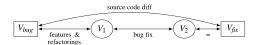
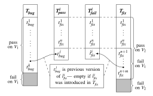
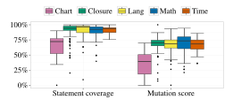
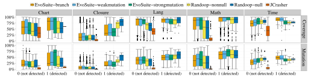
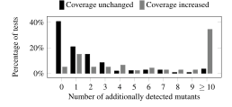
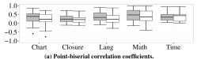
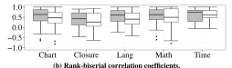
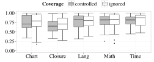

**Source:** *Are Mutants a Valid Substitute for Real Faults in Software Testing?* — [PDF](https://homes.cs.washington.edu/~mernst/pubs/mutation-effectiveness-fse2014.pdf)

# Are Mutants a Valid Substitute for Real Faults in Software Testing?

René Just<sup>†</sup>, Darioush Jalali<sup>†</sup>, Laura Inozemtseva<sup>\*</sup>, Michael D. Ernst<sup>†</sup>, Reid Holmes<sup>\*</sup>, and Gordon Fraser<sup>‡</sup> †University of Washington Seattle, WA, USA {rjust, darioush, mernst} @cs.washington.edu

\*University of Waterloo Waterloo, ON, Canada {lminozem, rtholmes} @uwaterloo.ca

\*University of Sheffield Sheffield, UK gordon.fraser@sheffield.ac.uk

#### **ABSTRACT**

A good test suite is one that detects real faults. Because the set of faults in a program is usually unknowable, this definition is not useful to practitioners who are creating test suites, nor to researchers who are creating and evaluating tools that generate test suites. In place of real faults, testing research often uses mutants, which are artificial faults — each one a simple syntactic variation — that are systematically seeded throughout the program under test. Mutation analysis is appealing because large numbers of mutants can be automatically-generated and used to compensate for low quantities or the absence of known real faults.

Unfortunately, there is little experimental evidence to support the use of mutants as a replacement for real faults. This paper investigates whether mutants are indeed a valid substitute for real faults, i.e., whether a test suite's ability to detect mutants is correlated with its ability to detect real faults that developers have fixed. Unlike prior studies, these investigations also explicitly consider the conflating effects of code coverage on the mutant detection rate.

Our experiments used 357 real faults in 5 open-source applications that comprise a total of 321,000 lines of code. Furthermore, our experiments used both developer-written and automaticallygenerated test suites. The results show a statistically significant correlation between mutant detection and real fault detection, independently of code coverage. The results also give concrete suggestions on how to improve mutation analysis and reveal some inherent limitations

#### **Categories and Subject Descriptors**

D.2.5 [Software Engineering]: Testing and Debugging

#### **General Terms**

Experimentation, Measurement

#### **Keywords**

Test effectiveness, real faults, mutation analysis, code coverage

Permission to make digital or hard copies of all or part of this work for personal or classroom use is granted without fee provided that copies are not made or distributed for profit or commercial advantage and that copies bear this notice and the full citation on the first page. Copyrights for components of this work owned by others than ACM must be honored. Abstracting with credit is permitted. To copy otherwise, or republish, to post on servers or to redistribute to lists, requires prior specific permission and/or a fee. Request permissions from Permissions@acm.org

FSE'14, November 16-21, 2014, Hong Kong, China Copyright 2014 ACM 978-1-4503-3056-5/14/11...\$15.00 http://dx.doi.org/10.1145/2635868.2635929

#### 1. INTRODUCTION

Both industrial software developers and software engineering researchers are interested in measuring test suite effectiveness. While developers want to know whether their test suites have a good chance of detecting faults, researchers want to be able to compare different testing or debugging techniques. Ideally, one would directly measure the number of faults a test suite can detect in a program. Unfortunately, the faults in a program are unknown a priori, so a proxy measurement must be used instead.

A well-established proxy measurement for test suite effectiveness in testing research is the mutation score, which measures a test suite's ability to distinguish a program under test, the original version, from many small syntactic variations, called mutants. Specifically, the mutation score is the percentage of mutants that a test suite can distinguish from the original version. Mutants are created by systematically injecting small artificial faults into the program under test, using well-defined mutation operators. Examples of such mutation operators are replacing arithmetic or relational operators, modifying branch conditions, or deleting state-

Mutation analysis is often used in software testing and debugging research. More concretely, it is commonly used in the following use cases (e.g., [3, 13, 18, 19, 35, 37–39]):

**Test suite evaluation** The most common use of mutation analysis is to evaluate and compare (generated) test suites. Generally, a test suite that has a higher mutation score is assumed to detect more real faults than a test suite that has a lower mutation score.

**Test suite selection** Suppose two unrelated test suites  $T_1$  and  $T_2$ exist that have the same mutation score and  $|T_1| < |T_2|$ . In the context of test suite selection,  $T_1$  is a preferable test suite as it has fewer tests than  $T_2$  but the same mutation score.

**Test suite minimization** A mutation-based test suite minimization approach reduces a test suite T to  $T \setminus \{t\}$  for every test  $t \in T$ for which removing t does not decrease the mutation score of T.

**Test suite generation** A mutation-based test generation (or augmentation) approach aims at generating a test suite with a high mutation score. In this context, a test generation approach augments a test suite T with a test t only if t increases the mutation score of T.

Fault localization A fault localization technique that precisely identifies the root cause of an artificial fault, i.e., the mutated code location, is assumed to also be effective for real faults.

These uses of mutation analysis rely on the assumption that mutants are a valid substitute for real faults. Unfortunately, there is little experimental evidence supporting this assumption, as discussed in greater detail in Section 4. To the best of our knowledge, only three previous studies have explored the relationship between mutants and real faults [1, 8, 27]. Our work differs from these previous studies in four main aspects. (1) Our study considers subject programs that are orders of magnitude larger. (2) Our study considers real faults rather than hand-seeded faults. (3) Our study uses developer-written and automatically-generated test suites. (4) Our study considers the conflating effects of code coverage when studying the correlation between mutant detection and real fault detection. A higher mutant detection and real fault detection rate could both be caused by higher code coverage, thus it is important to control this variable when measuring the correlation.

Specifically, this paper extends previous work and explores the relationship between mutants and real faults using 5 large Java programs, 357 real faults, and 230,000 mutants. It aims to confirm or refute the hypothesis that mutants are a valid substitute for real faults in software testing by answering the following questions:

RESEARCH QUESTION 1. *Are real faults coupled to mutants generated by commonly used mutation operators?*

The existence of the *coupling effect* [9] is a fundamental assumption underlying mutation analysis. A complex fault is *coupled* to a set of simple faults if a test that detects all the simple faults also detects the complex fault. Prior research empirically showed the existence of the coupling effect between simple and complex mutants [17,28], but it is unclear whether real faults are coupled to simple mutants derived from commonly used mutation operators [18, 26, 29]. Therefore, this paper investigates whether this coupling effect exists. In addition, it studies the numbers of mutants coupled to each of the real faults as well as their underlying mutation operators.

RESEARCH QUESTION 2. *What types of real faults are not coupled to mutants?*

The coupling effect may not hold for every real fault. Therefore, this paper investigates what types of real faults are not coupled to any of the generated mutants. Additionally, this paper sheds light on whether the absence of the coupling effect indicates a weakness of the set of commonly applied mutation operators or an inherent limitation of mutation analysis.

RESEARCH QUESTION 3. *Is mutant detection correlated with real fault detection?*

Since mutation analysis is commonly used to evaluate and compare (generated) test suites, this paper also addresses the question of whether a test suite's ability to detect mutants is correlated with its ability to detect real faults.

In summary, the contributions of this paper are as follows:

- A new set of 357 developer-fixed and manually-verified real faults and corresponding test suites from 5 programs.
- The largest study to date of whether mutants are a valid substitute for real faults using 357 real faults, 230,000 mutants, and developer-written and automatically-generated tests.
- An investigation of the coupling effect between real faults and the mutants that are generated by commonly used mutation operators. The results show the existence of a coupling effect for 73% of real faults.
- Concrete suggestions for improving mutation analysis (10% of real faults require a new or stronger mutation operator), and identification of its inherent limitations (17% of real faults are not coupled to mutants).
- An analysis of whether mutant detection is correlated with real fault detection. The results show a statistically significant correlation that is stronger than the correlation between statement coverage and real fault detection.

Table 1: Investigated subject programs.

Program size (KLOC), test suite size (Test KLOC), and the number of JUnit tests (Tests) are reported for the most recent version. LOC refers to non-comment, non-blank lines of code and was measured with sloccount (http://www.dwheeler.com/sloccount).

|         | Program          | KLOC | Test KLOC | Tests  |
|---------|------------------|------|-----------|--------|
| Chart   | JFreeChart       | 96   | 50        | 2,205  |
| Closure | Closure Compiler | 90   | 83        | 7,927  |
| Math    | Commons Math     | 85   | 19        | 3,602  |
| Time    | Joda-Time        | 28   | 53        | 4,130  |
| Lang    | Commons Lang     | 22   | 6         | 2,245  |
| Total   |                  | 321  | 211       | 20,109 |

The remainder of this paper is structured as follows. Section 2 describes our methodology and the experiments we performed to answer our research questions. Section 3 presents and discusses the results. Section 4 reviews related work, and Section 5 concludes.

## 2. METHODOLOGY

Our goal was to test the assumption that mutants are a valid substitute for real faults by conducting a study with real faults, using both developer-written and automatically-generated test suites. To accomplish this, we performed the following high-level steps:

- 1. Located and isolated real faults that have been previously found and fixed by analyzing the subject programs' version control and bug tracking systems (Section 2.2).
- 2. Obtained developer-written test suites for both the faulty and the fixed program version for each real fault (Section 2.3).
- 3. Automatically generated test suites for the fixed program version for each real fault (Section 2.4).
- 4. Generated mutants and performed mutation analysis for all fixed program versions (Section 2.5).
- 5. Conducted experiments using the real faults, mutants, and the test suites to answer our research questions (Section 2.6).

## 2.1 Subject Programs

Table 1 lists the 5 subject programs we used in our experiments. These programs satisfy the following desiderata:

- 1. Each program has a version control and bug tracking system, enabling us to locate and isolate real faults.
- 2. Each program is released with a comprehensive test suite, enabling us to experiment with developer-written test suites in addition to automatically-generated ones.

## 2.2 Locating and Isolating Real Faults

We obtained real faults from each subject program's version control system by identifying commits that corrected a failure in the program's source code. Ideally, we would have obtained, for each real fault, two source code versions *Vbug* and *Vfix* which differ by only the bug fix. Unfortunately, developers do not always minimize their commits. Therefore, we had to locate and isolate the fix for the real fault in a bug-fixing commit.

We first examined the version control and bug tracking system of each program for indications of a bug fix (Section 2.2.1). We refer to a revision that indicates a bug fix as a *candidate revision*. For each candidate revision, we tried to reproduce the fault with an existing test (Section 2.2.2). Finally, we reviewed each reproducible fault to ensure that it is isolated, i.e., the bug-fixing commit does not include irrelevant code changes (Section 2.2.3). We discarded any fault that could not be reproduced and isolated. Table 2 summarizes the results of each step in which we discarded candidate revision pairs.

Table 2: Number of candidate revisions, compilable revisions, and reproducible and isolated faults for each subject program.

|         | Candidate revisions | Compilable revisions | Reproducible faults | Isolated<br>faults |
|---------|---------------------|----------------------|---------------------|--------------------|
| Chart   | 80                  | 62                   | 28                  | 26                 |
| Closure | 316                 | 227                  | 179                 | 133                |
| Math    | 435                 | 304                  | 132                 | 106                |
| Time    | 75                  | 57                   | 29                  | 27                 |
| Lang    | 273                 | 186                  | 69                  | 65                 |
| Total   | 1179                | 836                  | 437                 | 357                |

#### 2.2.1 Candidate Revisions for Bug-Fixing Commits

We developed a script to determine revisions that a developer marked as a bug fix. This script mines the version control system for explicit mentions of a bug fix, such as a bug identifier from the subject program's bug tracking system.

Let  $rev_{fix}$  be a revision marked as a bug fix. We assume that the previous revision in the version control system,  $rev_{bug}$ , was faulty (later steps validate this assumption). Overall, we identified 1,179 candidate revision pairs  $\langle rev_{bug}, rev_{fix} \rangle$ .

#### 2.2.2 Discarding Non-reproducible Faults

A candidate revision pair obtained in the previous step is not suitable for our experiments if we cannot reproduce the real fault. Let V be the source code version of a revision rev, and let T be the corresponding test suite. The fault of a candidate revision pair  $\langle rev_{bug}, rev_{fix} \rangle$  is reproducible if a test exists in  $T_{fix}$  that passes on  $V_{fix}$  but fails on  $V_{bug}$  due to the existence of the fault.

In some cases, test suite  $T_{fix}$  does not run on  $V_{bug}$ . If necessary, we fixed build-system-related configuration issues and trivial errors such as imports of non-existent classes. However, we did not attempt to fix compilation errors requiring non-trivial changes, which would necessitate deeper knowledge about the program. 836 out of 1,179 revision pairs remained after discarding candidate revision pairs with unresolvable compilation errors.

After fixing trivial compilation errors, we discarded version pairs for which the fault was not reproducible. A fault might not be reproducible for three reasons. (1) The source code diff is empty — the difference between  $rev_{bug}$  and  $rev_{fix}$  was only to tests, configuration, or documentation. (2) No test in  $T_{fix}$  passes on  $V_{fix}$  but fails on  $V_{bug}$ . (3) None of the tests in  $T_{fix}$  that fail on  $V_{bug}$  exposes the real fault. We manually inspected each test of  $T_{fix}$  that failed on  $V_{bug}$  while passing on  $V_{fix}$  to determine whether its failure was caused by the real fault. Examples of failing tests that do not expose a real fault include dependent tests [42] or non-deterministic tests. The overall number of reproducible candidate revision pairs was 437.

#### 2.2.3 Discarding Non-isolated Faults

Since developers do not always minimize their commits, the source code of  $V_{bug}$  and  $V_{fix}$  might differ by both features and the bug fix. We ensured that all bug fixes were isolated for the purposes of our study. Isolation is important because unrelated changes could affect the outcome of generated tests or could affect the coverage and mutation score. Other benefits of isolation include improved backward-compatibility of tests and the ability to focus our experiments on a smaller amount of modified code.

For each of the 437 reproducible candidate revision pairs, we manually reviewed the bug fix (the source code diff between  $V_{bug}$  and  $V_{fix}$ ) to verify that it was isolated and related to the real fault. We divided a non-isolated bug fix into two diffs, one that represents the bug fix and one that represents features and refactorings. We discarded a candidate revision pair if we could not isolate the bug



Figure 1: Obtaining source code versions  $V_1$  and  $V_2$ .

 $V_1$  and  $V_2$  differ by only a bug fix.  $V_{bug}$  and  $V_{fix}$  are the source code versions of two consecutive revisions in a subject program's version control system.



Figure 2: Relationship between the *i*-th obtained test suite pair  $\langle T^i_{pass}, T^i_{fail} \rangle$  and the developer-written test suites  $T_{bug}$  and  $T_{fix}$ .  $T_{bug}$  and  $T_{fix}$  are derived from a subject program's version control system.  $\hat{t}^i_{fix}$  is the *i*-th triggering test in  $T_{fix}$ , and  $t^j_{bug}$  is the previous version of that test.

fix part of the diff. The result of this step was two source code versions  $V_1$  and  $V_2$  such that  $V_1$  and  $V_2$  differ by exactly a bug fix — no features were added and no refactorings were applied. To ensure consistency, the review process was performed twice by different authors, with a third author resolving disagreements. Different authors reviewed different diffs to avoid introducing a systematic bias.

Figure 1 visualizes the relationship between the source code versions  $V_1$  and  $V_2$ , and how they are obtained from the source code versions of a candidate revision pair.  $V_2$  is equal to the version  $V_{fix}$ , and the difference between  $V_1$  and  $V_2$  is the bug fix. Note that  $V_1$  is obtained by re-introducing the real fault into  $V_2$  — that is, applying the inverse bug-fixing diff. Overall, we obtained 357 version pairs  $\langle V_1, V_2 \rangle$  for which we could isolate the bug fix.

#### 2.3 Obtaining Developer-written Test Suites

Section 2.2 described how we obtained 357 suitable version pairs  $\langle V_1, V_2 \rangle$ . This section describes how we obtained two related test suites  $T_{pass}$  and  $T_{fail}$  made up of developer-written tests.  $T_{pass}$  and  $T_{fail}$  differ by exactly one test,  $T_{pass}$  passes on  $V_1$ , and  $T_{fail}$  fails on  $V_1$  because of the real fault.

Since  $T_{pass}$  and  $T_{fail}$  differ by exactly one test related to the real fault, the pairs  $\langle T_{pass}, T_{fail} \rangle$  enable us to study the coupling effect between real faults and mutants, and whether the effect exists independently of code coverage. These test suite pairs also reflect common and recommended practice. The developer's starting point is the faulty source code version  $V_1$  and a corresponding test suite  $T_{pass}$ , which passes on  $V_1$ . Upon discovering a previously-unknown fault in  $V_1$ , a developer augments test suite  $T_{pass}$  to expose this fault. The resulting test suite  $T_{fail}$  fails on  $V_1$  but passes on the fixed source code version  $V_2$ .  $T_{pass}$  might be augmented by modifying an existing test (e.g., adding stronger assertions) or by adding a new test.



Figure 3: Statement coverage ratios and mutation scores of the test suites  $T_{pass}$  for each subject program.

We cannot directly use the existing developer-written test suites  $T_{bug}$  and  $T_{fix}$  as  $T_{pass}$  and  $T_{fail}$ , because not all tests pass on each committed version and because the developer may have committed changes to the tests that are irrelevant to the fault. Therefore, we created the test suites  $T_{pass}$  and  $T_{fail}$  based on  $T_{bug}$  and  $T_{fix}$ , as we now describe.

Recall that for each pair  $\langle V_1, V_2 \rangle$ , one or more tests expose the real fault in  $V_1$  while passing on  $V_2$  — we refer to such a test as a *triggering test*,  $\hat{t}$ . Let m be the number of triggering tests for a version pair; then  $\hat{t}^i$  denotes the i-th triggering test  $(1 \le i \le m)$ . Figure 2 visualizes how we obtained, for each real fault, m pairs of test suites  $\langle T^i_{pass}, T^i_{fail} \rangle$  with the following properties:

- $T_{pass}^i$  passes on  $V_1$  and  $V_2$ .
- $T_{fail}^i$  fails on  $V_1$  but passes on  $V_2$ .
- $T_{pass}^{i}$  and  $T_{fail}^{i}$  differ by exactly one modified or added test.

In order to fairly compare the effectiveness of  $T_{pass}$  and  $T_{fail}$ , they must not contain irrelevant differences. Therefore,  $T_{pass}$  is derived from  $T_{fix}$ . If  $T_{pass}$  were derived from  $T_{bug}$  instead, two possible problems could arise. First,  $V_1$  might include features (compared to  $V_{bug}$ , as described in Section 2.2), and  $T_{fix}$  might include corresponding feature tests. Second, tests unrelated to the real fault might have been added, changed, or removed in  $T_{fix}$ .

In summary, we applied the following steps to obtain all pairs  $\langle T_{pass}, T_{fail} \rangle$  using the developer-written test suites  $T_{bug}$  and  $T_{fix}$ :

- 1. Manually fixed all classpath- and configuration-related test failures in  $T_{bug}$  and  $T_{fix}$  to ensure that all failures indicate genuine faults.
- 2. Excluded all tests from  $T_{bug}$  that fail on  $V_1$ , and excluded all tests from  $T_{fix}$  that fail on  $V_2$ .
- 3. Determined all triggering tests  $\hat{t}_{fix}^i$  in  $T_{fix}$ .
- 4. Created one test suite pair  $\langle T_{pass}^i, T_{fail}^i \rangle$  for each  $\hat{t}_{fix}^i \in T_{fix}$  (as visualized in Figure 2).

Overall, we obtained 480 test suite pairs  $\langle T_{pass}, T_{fail} \rangle$  in this step. Figure 3 summarizes the statement coverage ratios and mutation scores for all test suites  $T_{pass}$  measured for classes modified by the bug fix. The high degree of statement coverage achieved by  $T_{pass}$  allowed us to obtain 258 test suite pairs for which coverage did not increase and 222 test suite pairs for which it did.

In 80% of the cases,  $T_{fix}$  contained exactly one triggering test; developers usually augment a test suite by adding or strengthening one test to expose the fault. For the remaining cases, each triggering test exposes the real fault differently. For example, a developer might add two tests for a boundary condition bug fix — one test to check the maximum and one test to check the minimum value.

Table 3: Characteristics of generated test suites.

Test suites gives the total number of test suites that passed on  $V_2$  and the percentage of test suites that detected a real fault  $(T_{fail})$ . The KLOC and Tests columns report the mean and standard deviation of lines of code and number of JUnit tests for all test suites. Detected faults shows how many distinct real faults the test suites detected out of the number of program versions for which at least one suitable test suite could be generated.

|          | Test s<br>Total | suites $T_{fail}$ | KLOC          | Tests                    | Detected faults |
|----------|-----------------|-------------------|---------------|--------------------------|-----------------|
| EvoSuite | 28,318          | 22.3%             | 10±49         | 68±133                   | 182/354         |
| -branch  | 10,133          | 21.1%             | $2\pm7$       | $21 \pm 24$              | 156/352         |
| -weak    | 9,420           | 21.8%             | $3\pm8$       | $24 \pm 27$              | 158/352         |
| -strong  | 8,765           | 24.1%             | $26 \pm 86$   | $171 \pm 202$            | 152/350         |
| Randoop  | 3,387           | 18.0%             | 212±132       | $6,929\pm9,923$          | 90/326          |
| -nonnull | 1,690           | 17.3%             | $200 \pm 124$ | $6,113\pm9,012$          | 78/316          |
| -null    | 1,697           | 18.7%             | $224 \pm 138$ | $7,\!747\!\pm\!10,\!698$ | 84/319          |
| JCrasher | 3,436           | 0.6%              | 543±561       | 47,928±48,174            | 2/350           |
| Total    | 35,141          | 19.7%             | 335±995       | 1,066±5,599              | 198/357         |

#### 2.4 Automatically Generating Test Suites

We used three test generation tools for our study: EvoSuite [12], Randoop [31], and JCrasher [6]. We attempted to use DSDCrasher [7] instead of JCrasher, but found that it relies on the static analysis tool ESC/Java2. This tool does not work with Java 1.5 and higher, making it impossible to use DSDCrasher for this study.

Unlike Randoop and JCrasher, EvoSuite aims to satisfy one of three possible criteria — branch coverage, weak mutation testing, or strong mutation testing. We generated tests for each of the criteria. We also selected two different configurations for Randoop, one that allows null values as inputs (Randoop-null) and one that does not (Randoop-nonnull). For each fixed program version  $V_2$ , we generated 30 test suites with EvoSuite for each of the selected criteria, 6 test suites for each configuration of Randoop, and 10 test suites with JCrasher. Each test generation tool was guided to create tests only for classes modified by the bug fix.

Each of the test generation tools might produce tests that do not compile or do not run without errors. Additionally, tests might sporadically fail due to the use of non-deterministic APIs such as time of day or random number generators. A test suite that (sporadically) fails is not suitable for our study. We automatically repaired uncompilable and failing test suites using the following workflow:

- 1. Removed all tests that cause compilation errors.
- 2. Removed all tests that fail during execution on  $V_2$ .
- 3. Iteratively removed all non-deterministic tests; we assumed that a test suite does not include any further non-deterministic tests once it passed 5 times in a row.

The final output of this process was generated test suites that pass on  $V_2$ . Repairing a test suite resulted in approximately 2% of cases in an empty test suite, when all tests failed and had to be removed. Therefore, for all tools used to generate tests, the number of suitable test suites, which pass on  $V_2$ , is smaller than the total number of generated test suites. Table 3 summarizes the characteristics of all generated test suites that pass on  $V_2$ . Note that unlike EvoSuite and Randoop, JCrasher does not capture program behavior for regression testing but rather aims at crashing a program with an unexpected exception, explaining the low real fault detection rate.

We executed each generated test suite  $\tilde{T}$  on  $V_1$ . If it passed  $(\tilde{T}_{pass})$ , it did not detect the real fault. If it failed  $(\tilde{T}_{fail})$ , we verified that the failing tests are valid triggering tests, i.e., they do not fail due to build system or configuration issues. Overall, the test generation tools created 35,141 test suites that detect 198 of the 357 real faults.



Figure 4: Statement coverage ratios and mutation scores of the generated test suites for each subject program.

The vertical axis shows the statement coverage ratio (Coverage) and the mutation score (Mutation). The horizontal axis shows the real fault detection rate.

Figure 4 gives the statement coverage ratios and mutation scores for all generated test suites grouped by subject program, test generation tool/configuration, and real fault detection rate.

#### 2.5 Mutation Analysis

We used the Major mutation framework [20,21] to create the mutant versions and to perform the mutation analysis. Major provides the following set of mutation operators: *Replace constants, Replace operators, Modify branch conditions*, and *Delete statements*. This set, suggested in the literature on mutation analysis [18,24,26,29], is commonly used and includes the mutation operators used by previous studies [1,8].

Major only mutated classes of the source code version  $V_2$  that were modified by the bug fix. This reduces the number of mutants irrelevant to the fault — differences in the mutation score would be washed out otherwise.

For each of the developer-written and automatically-generated test suites, Major computed mutation coverage and mutation score. A test is said to cover a mutant if it reaches and executes the mutated code. A test detects a mutant if the test outcome indicates a fault — a test assertion fails or the test causes an exception in the mutant.

We did not eliminate equivalent mutants, which means that the reported mutation scores might be underestimated. This is, however, not a concern for our study because we do not interpret absolute mutation scores. Moreover, the set of equivalent mutants is identical for any two test suites used in a comparison.

#### 2.6 Experiments

As described in Section 1, the goal of our study was to answer three research questions:

- 1. Are real faults coupled to mutants generated by commonly used mutation operators?
- 2. What types of real faults are not coupled to mutants?
- 3. Is mutant detection correlated with real fault detection?

After explaining why and how we controlled for code coverage, this section explains how we answered these three questions.

#### 2.6.1 Controlling for Code Coverage

Structural code coverage is a widely-used measure of test suite effectiveness. Differences in coverage often dominate other aspects of test suite effectiveness, and a test suite that achieves higher coverage usually detects more mutants and faults for that reason alone [16]. More specifically, if test suite  $T_x$  covers more code than  $T_y$ , then  $T_x$  is likely to have a higher overall mutation score, even if  $T_y$  does a better job in testing a smaller portion of the program.

Furthermore, no developer would use a complex, time-consuming

test suite metric such as the mutation score unless simpler ones such as structural code coverage ratios had exhausted their usefulness.

To account for these facts, we performed our experiments in two ways. First, we ignored code coverage and simply determined the mutation score for each test suite using all mutants. Second, we controlled for coverage and determined the mutation score using only mutants in code covered by both test suites.

For the related test suite pairs  $\langle T_{pass}, T_{fail} \rangle$ ,  $T_{pass}$  and  $T_{fail}$  may have the same code coverage:  $T_{pass}$  and  $T_{fail}$  cover the same code if the triggering test in  $T_{fail}$  does not increase code coverage.

For the automatically-generated test suites, it is highly unlikely that  $\tilde{T}_{pass}$  and  $\tilde{T}_{fail}$  have the same coverage because they were independently generated. Therefore, we had to control for coverage when using the automatically-generated test suites. We did this by only considering the intersection of mutants covered by both test suites. This means that a pair of generated test suites was discarded if the intersection was the empty set.

We include the first, questionable methodology for comparison with prior research that does not control for coverage. The second methodology controls for coverage. It better answers whether use of mutation analysis is profitable, under the assumption that a developer is already using the industry-standard coverage metric. Our experiments use Cobertura [5] to compute statement coverage over the classes modified by the bug fix.

# 2.6.2 Are Real Faults Coupled to Mutants Generated by Commonly Used Mutation Operators?

The test suites  $T_{pass}$  and  $T_{fail}$  model how a developer usually augments a test suite.  $T_{fail}$  is a better suite — it detects a fault that  $T_{pass}$  does not. If mutants are a valid substitute for real faults, then any test suite  $T_{fail}$  that has a higher real fault detection rate than  $T_{pass}$  should have a higher mutation score as well. In other words, each real fault should be coupled to at least one mutant. For each test suite pair  $\langle T_{pass}, T_{fail} \rangle$ , we studied the following questions:

- Does  $T_{fail}$  have a higher mutation score than  $T_{pass}$ ?
- Does  $T_{fail}$  have a higher statement coverage than  $T_{pass}$ ?
- Is the difference between  $T_{pass}$  and  $T_{fail}$  a new test?

Based on the observations, we performed three analyses. (1) We used the Chi-square test to determine whether there is a significant association between the measured variables *mutation score increased*, *statement coverage increased*, and *test added*. (2) We determined the number of real faults coupled to at least one of the generated mutants. (3) We measured the sensitivity of the mutation score with respect to the detection of a single real fault — the increase in the number of detected mutants between  $T_{pass}$  and  $T_{fail}$ . We also determined the mutation operators that generated the mutants additionally detected by  $T_{fail}$ . Section 3.1 discusses the results.

# 2.6.3 What Types of Real Faults Are Not Coupled to Mutants?

Some of the real faults are not coupled to any of the generated mutants, i.e., the set of mutants detected by  $T_{pass}$  is equal to the set of mutants detected by  $T_{fail}$ . We manually investigated each such fault. This qualitative study reveals how the set of commonly used mutation operators should be improved. Moreover, this study shows what types of real faults are not coupled to any mutants and therefore reveals general limitations of mutation analysis. Section 3.2 discusses the results.

# 2.6.4 Is Mutant Detection Correlated with Real Fault Detection?

We conducted two experiments to investigate whether a test suite's mutation score is correlated with its real fault detection rate. Calculating the correlation requires larger numbers of test suites per fault, and thus we used the automatically-generated test suites. We analyzed the entire pool of test suites derived from all test generation tools to investigate whether the mutation score is generally a good metric to compare the effectiveness of arbitrary test suites. The experiments consider 194 real faults for which we could generate at least one test suite that detects the real fault and at least one test suite that does not.

We determined the strength of the correlation between mutation score and real fault detection. Since real fault detection is a dichotomous variable, we computed the point-biserial and rank-biserial correlation coefficients. In addition, we investigated whether the correlation is significantly stronger than the correlation between statement coverage and real fault detection.

While we cannot directly calculate the correlation between mutation score and real fault detection independently of code coverage, we can still determine whether there is a statistically significant difference in the mutation score between  $\tilde{T}_{pass}$  and  $\tilde{T}_{fail}$  when coverage is fixed. Calculating the correlation coefficient independently of code coverage would require fixed coverage over all test suites. In contrast, testing whether the mutation score differs significantly requires only fixed coverage between pairs of test suites.

For each real fault, we compared the mutation scores of  $\tilde{T}_{pass}$  and  $\tilde{T}_{fail}$ . Since the differences in mutation score were not normally distributed (evaluated by the Kolmogorov-Smirnov test), a non-parametric statistical test was required. Using the Wilcoxon signed-rank test, we tested whether the mutation scores of  $\tilde{T}_{fail}$  are significantly higher than the mutation scores of  $\tilde{T}_{pass}$ , independently of code coverage. Additionally, we measured the  $\hat{A}_{12}$  effect sizes for the mutation score differences. Section 3.3 discusses the results.

#### 3. RESULTS

Section 2 described our methodology and analyses. This section answers the posed research questions. Recall that we used 357 real faults, 480 test suite pairs  $\langle T_{pass}, T_{fail} \rangle$  made up of developer-written tests, and 35,141 automatically-generated test suites which may  $(\tilde{T}_{fail})$  or may not  $(\tilde{T}_{pass})$  detect a real fault.

# 3.1 Are Real Faults Coupled to Mutants Generated by Commonly Used Mutation Operators?

Considering all test suite pairs  $\langle T_{pass}, T_{fail} \rangle$ , the mutation score of  $T_{fail}$  increased compared to  $T_{pass}$  for 362 out of 480 pairs (75%). Statement coverage increased for only 222 out of 480 pairs (46%).

The mutation score of  $T_{fail}$  increased for 153 out of 258 pairs (59%) for which statement coverage did not increase. The mutation score of  $T_{fail}$  increased for 209 out of 222 pairs (94%) for which



Figure 5: Effect of triggering tests on mutant detection.

The bars represent 480 triggering tests. 258 triggering tests did not increase statement coverage (unchanged), and each one detects 2 new mutants on average. 222 triggering tests increased statement coverage, and each one detects 28 new mutants on average.

statement coverage increased. The Chi-square test showed a significant association between *mutation score increased* and *statement coverage increased* ( $\chi^2(1) = 78.13, N = 480, p < 0.001$ ), hence we considered the influence of statement coverage throughout our analyses. In contrast, there was no significant association between *mutation score increased* and *test added*.

In addition to determining whether the mutation score increased, we also measured the sensitivity of the mutation score with respect to the detection of a single real fault, i.e., the number of mutants additionally detected by the triggering test. Figure 5 visualizes the number of additionally detected mutants when coverage did not increase (unchanged) and when it did. For triggering tests that did not increase statement coverage (black bars), two characteristics can be observed. First, 40% of these triggering tests did not detect any additional mutants. Second, 45% of these triggering tests detected only 1–3 additional mutants, suggesting that the number of mutants that are coupled to a real fault is small when accounting for the conflating effects of code coverage.

Figure 5 also illustrates these conflating effects of code coverage on the mutation score: 35% of triggering tests that increased statement coverage (gray bars) detected 10 or more additional mutants. In contrast, this ratio was only 3% for triggering tests that did not increase statement coverage.

We also investigated the underlying mutation operators of the mutants that are coupled to real faults when statement coverage did not increase. We found that real faults were more often coupled to mutants generated by the *conditional operator replacement*, relational operator replacement, and statement deletion mutation operators. A possible explanation is that some of these mutants cannot be detected by tests that only satisfy statement coverage. Conditional and relational operator replacement mutants are frequently generated within conditional statements, and numerous statement deletion mutants only omit side effects — detecting those mutants requires more thorough testing. None of these three mutation operators is known to generate a disproportionate number of equivalent mutants [40], hence they should always be employed during mutation analysis.

73% of real faults are coupled to the mutants generated by commonly used mutation operators. When controlling for code coverage, on average 2 mutants are coupled to a single real fault, and the conditional operator replacement, relational operator replacement, and statement deletion mutants are more often coupled to real faults than other mutants.

Table 4: Number of real faults not coupled to mutants generated by commonly used mutation operators.

Numbers categorized by reason: weak implementation of a mutation operator, missing mutation operator, or no appropriate mutation operator exists.

|         | Weak<br>operator | Missing<br>operator | No such<br>operator | Total |
|---------|------------------|---------------------|---------------------|-------|
| Chart   | 5                | 1                   | 2                   | 8     |
| Closure | 11               | 2                   | 18                  | 31    |
| Math    | 4                | 4                   | 30                  | 38    |
| Time    | 2                | 0                   | 5                   | 7     |
| Lang    | 3                | 0                   | 8                   | 11    |
| Total   | 25               | 7                   | 63                  | 95    |

### 3.2 What Types of Real Faults Are Not Coupled to Mutants?

For 95 out of 357 real faults (27%), none of the triggering tests detected any additional mutants. We manually reviewed each such fault to investigate whether this indicates a general limitation of mutation analysis. Table 4 summarizes the results, which fell into three categories: cases where a mutation operator should be strengthened, cases where a new mutation operator should be introduced, and cases where no obvious mutation operator can generate mutants that are coupled to the real fault. In the latter case, results derived from mutation analysis do not generalize to those real faults.

*Real faults requiring stronger mutation operators (25)*

- *Statement deletion (12)*: The statement deletion operator is usually not implemented for statements that manipulate the control flow. We surmise that this is due to technical challenges in the context of Java — removing return or break/continue statements changes the control flow and may lead to uninitialized variables or unreachable code errors. Figure 6a gives an example.
- *Argument swapping (6)*: Arguments to a method call that have the same type can be swapped without causing typechecking errors. Argument swapping represents a special case of swapping identifiers, which is not a commonly-used mutation operator [29]. Figure 6b shows an example.
- *Argument omission (5)*: Method overloading is error-prone when two methods differ in one extra argument — a developer might inadvertently call the method that requires fewer arguments. Figure 6c gives an example. Generating mutants for this type of fault requires a generalization of a suggested classbased mutation operator, which addresses method overloading to a certain extent [25].
- *Similar library method called (2)*: Existing mutation operators replace one method call by another only for calls to getter and setter methods. It would be both unfeasible and largely unproductive to replace every method call with every possible alternative that type-checks. Nonetheless, the method call replacement operator should be extended to substitute calls to methods with related semantics — in particular library method calls for string operations. Figure 6d shows an example in which the fault is caused by using the wrong one of two similar library methods (indexOf instead of lastIndexOf).

#### *Real faults requiring new mutation operators (7)*

• *Omit chaining method call (4)*: A developer might forget to call a method whose return type is equal to (or a subtype of) its argument type. Figure 6e gives an example in which a string needs to be escaped. A new mutation operator could

```
}
+ return false;
  }
  case 4: {
    char ch = str . charAt (0) ;
                      (a) Lang-365 fix
- Partial newPartial = new Partial ( iChronology ,
    newTypes , newValues );
+ Partial newPartial = new Partial ( newTypes ,
    newValues , iChronology );
                       (b) Time-88 fix
- return solve (min , max );
+ return solve (f , min , max );
                      (c) Math-369 fix
- int indexOfDot = namespace . indexOf ( '. ');
+ int indexOfDot = namespace . lastIndexOf ( '. ');
                     (d) Closure-747 fix
- return ... + toolTipText + ...;
+ return ... + ImageMapUtilities . htmlEscape (
    toolTipText ) + ...;
                      (e) Chart-591 fix
- return chromosomes . iterator () ;
+ return getChromosomes () . iterator () ;
                      (f) Math-779 fix
- FastMath . pow (2 * FastMath .PI , -dim / 2)
+ FastMath . pow (2 * FastMath .PI , -0.5 * dim )
                      (g) Math-929 fix
```

Figure 6: Snippets of real faults that require stronger or new mutation operators.

replace such a method call with its argument, provided that the mutated code type-checks.

- *Direct access of field (2)*: When a class includes non-trivial getter or setter methods for a field (e.g., further side effects or post-processing), an object that accesses the field directly might cause an error. Figure 6f shows an example in which post-processing of the field chromosomes is required before the method iterator() should be invoked. A new mutation operator could replace calls to non-trivial getter and setter methods with a direct access to the field.
- *Type conversions (1)*: Wrong assumptions about implicit type conversions and missing casts in arithmetic expressions can cause unexpected behavior. Figure 6g shows an example where the division should be performed on floating point numbers rather than integers (the replacement of the division by multiplication is unrelated to the real fault). A new mutation operator could replace a floating-point constant by an exact integer equivalent (e.g., replace 2.0 by 2), remove explicit casts, or manipulate operator precedence.

#### *Real faults not coupled to mutants (63)*

- *Algorithm modification or simplification (37)*: Most of the real faults not coupled to mutants were due to incorrect algorithms. The bug fix was to re-implement or modify the algorithm.
- *Code deletion (7)*: Faults caused by extra code that has to be deleted are not coupled to mutants. A bug fix that only removes special handling code also falls into this category — Figure 7a gives an example.

- Similar method called (5): Another common mistake is calling a wrong but related method within the program, which might either return wrong data or omit side-effects. Figure 7b shows an example of calling a wrong method. Note that this type of fault can be represented by mutants for well-known library methods. However, without deeper knowledge about the relation between methods in a program, replacing every identifier and method call with all alternatives would result in an unmanageable number of mutants.
- Context sensitivity (4): Mutation analysis is context insensitive, while bugs can be context sensitive. Suppose the access of a field that might be null is extracted to a utility method that includes a null check. A developer might forget to replace an instance of the field access with a call to this utility method. This rather subtle fault cannot be represented with mutants since it would require inlining the utility method (without the null check) for every call. Figure 7c gives an example of this type of fault. The fault is that this.startData might be null this condition is checked in getCategoryCount(). However, other tests directly or indirectly detect all mutants in getCategoryCount(), hence a test that exposes the fault does not detect any additional mutants.
- Violation of pre/post conditions or invariants (3): Some real
  faults were caused by the misuse of libraries. For example, the
  Java library makes assumptions about the hashCode and equals
  methods of objects that are used as keys to a HashMap. Yet, a
  violation of this assumption cannot be generally simulated
  with mutants. Figure 7d gives an example of such a fault.
- Numerical analysis errors (4): Real faults caused by overflows, underflows, and improper handling of NaN values are difficult to simulate with mutants, and hence also represent a general limitation. Figure 7e shows an example of a nontrivial case of this type of fault.
- Specific literal replacements (3): Literal replacement is a commonly used mutation operator that replaces a literal with a well-defined default (e.g., an integer with 0 or a string with the empty string). However, the real fault might only be exposed with a specific replacement. For example, a map might contain a wrong value that is only accessible with a specific key. The literal replacement operator cannot generally simulate such a specific replacement. Figure 7f demonstrates an example that involves Unicode characters.

27% of real faults are not coupled to the mutants generated by commonly used mutation operators. The set of commonly used mutation operators should be enhanced. However, 17% of real faults, mostly involving algorithmic changes or code deletion, are not coupled to any mutants.

# 3.3 Is Mutant Detection Correlated with Real Fault Detection?

Section 3.1 provided evidence that mutants and real faults are coupled, but the question remains whether a test suite's mutation score is correlated with its real fault detection rate and whether mutation score is a good predictor of fault-finding effectiveness.

Figure 8 summarizes the point-biserial and rank-biserial correlation coefficients between the mutation score and real fault detection rate for each subject program. Both correlation coefficients lead to the same conclusion: the correlation is positive, usually strong or moderate, indicating that mutation score is indeed correlated with real fault detection. Unsurprisingly, real faults that are not coupled to mutants show a negligible or even negative correlation. For reference Figure 8 also includes the results for statement coverage.

```
if (childType.isDict()) {
    ...
- } else if (n.getJSType != null &&
- parent.isAssign()) {
- return;
} ...
```

#### (a) Closure-810 fix

```
- return getPct((Comparable<?>) v);
+ return getCumPct((Comparable<?>) v);
```

#### (b) Math-337 fix

```
- if (categoryKeys.length != this.startData[0].
    length)
+ if (categoryKeys.length != getCategoryCount())
```

#### (c) Chart-834 fix

```
- lookupMap = new HashMap < CharSequence,
```

#### (d) Lang-882 fix<sup>a</sup>

<sup>a</sup>The result of comparing two CharSequence objects is undefined—the bug fix uses String to alleviate this issue.

```
- if (u * v == 0)

+ if ((u == 0) || (v == 0))

(e) Math-238 fix

- {"\u00CB", "Ê"},

+ {"\u00CB", "Ê"},

+ {"\u00CB", "Ë"},
```

(f) Lang-658 fix

Figure 7: Snippets of real faults not coupled to mutants.

Mutation score vs. real fault detection rate

Statement coverage vs. real fault detection rate





Figure 8: Correlation coefficients for each subject program.

The differences between the correlation coefficients (of mutation score and statement coverage) are significant (Wilcoxon signed-rank test) for all subject programs (p < 0.05) except Time (p > 0.2).

The correlation between mutation score and real fault detection rate is conflated with the influence of statement coverage, but the Wilcoxon signed-rank test showed that the correlation coefficient between mutation score and real fault detection rate is significantly higher than the correlation coefficient between statement coverage and real fault detection rate for all subject programs except Time.

Further investigating the influence of statement coverage, Table 5 summarizes the comparison of the mutation scores between all test

Table 5: Comparison of mutation scores between  $\tilde{T}_{pass}$  and  $\tilde{T}_{fail}$ . Significant gives the number of real faults for which  $\tilde{T}_{fail}$  has a significantly higher mutation score (Wilcoxon signed-rank test, significance level 0.05).

| Program | Coverage controlled |                     | Coverage ignored |                     |
|---------|---------------------|---------------------|------------------|---------------------|
|         | Significant         | Avg. $\hat{A}_{12}$ | Significant      | Avg. $\hat{A}_{12}$ |
| Chart   | 21/22               | 0.74                | 21/22            | 0.74                |
| Closure | 27/32               | 0.66                | 30/32            | 0.71                |
| Math    | 76/80               | 0.79                | 80/80            | 0.81                |
| Time    | 18/18               | 0.81                | 17/18            | 0.81                |
| Lang    | 40/42               | 0.77                | 39/42            | 0.78                |



Figure 9:  $\hat{A}_{12}$  effect sizes for mutation score differences between  $\tilde{T}_{pass}$  and  $\tilde{T}_{fail}$  for each subject program.

suites  $\tilde{T}_{pass}$  and  $\tilde{T}_{fail}$  for each real fault when coverage is controlled or ignored (not controlled). In addition to the number of real faults for which the mutation score of  $\tilde{T}_{fail}$  is significantly higher, the table shows the average  $\hat{A}_{12}$  effect size.

Figure 9 summarizes the  $\hat{A}_{12}$  effect sizes. In our scenario the value of  $\hat{A}_{12}$  is an estimation of the probability that a test suite with a higher real fault detection rate has a higher mutation score as well, where a value  $\hat{A}_{12}=1$  means that the mutation score increased for all observations. An effect size of  $\hat{A}_{12}\geq 0.71$  is typically interpreted as large. As expected, the effect size is greater if statement coverage is ignored (not controlled), but the average effect size remains large for all subject programs except for Closure when coverage is controlled.

Mutant detection is positively correlated with real fault detection, independently of code coverage. This correlation is stronger than the correlation between statement coverage and real fault detection.

#### 3.4 Threats to validity

Our evaluation uses only 5 subject programs, all written in Java. Other programs might have different characteristics. Moreover, all 5 subject programs are well-tested (see Figure 3). This may limit the applicability of the results to programs that are not well-tested (e.g., programs under development). However, we do not feel this is a major threat, since mutation analysis is typically only used as an advanced metric. For example, if a test suite covers only 20% of the source code, developers are likely to focus on improving code coverage before they focus on improving the mutation score.

Another threat to validity is the possibility of a bias in our fault sample. We located the real faults by automatically linking bug identifiers from the bug tracking system to the version control revisions that resolved them. Previous work suggests that this approach does not produce an unbiased sample of real faults [2]. In particular, the authors found that not all faults are mentioned in the bug tracking system and that not all bug-fixing commits can be identified automatically. In addition, they found that process metrics such as the experience of the developer affect the likelihood that a link will be created between the issue and the commit that fixes it. However, this

Table 6: Comparison of studies that explored the relationship between mutants and real faults.

LOC gives the total number of lines of code of the studied programs that contained real faults. Test suites gives the type of used test suites (*gen*=generated, *dev*=developer-written). Mutation operators refers to: *Rc*=Replace constants, *Ri*=Replace identifiers, *Ro*=Replace operators, *Nbc*=Negate branch conditions, *Ds*=Delete statements, *Mbc*=Modify branch conditions (note that *Mbc* subsumes *Nbc* [23]).

|              | Real<br>faults | LOC     | Tests<br>suites | Mutation operators | Mutants evaluated | Coverage controlled |
|--------------|----------------|---------|-----------------|--------------------|-------------------|---------------------|
| [8]          | 12             | 1,000   | gen             | Rc,Ri,Ro           | 1%                | no                  |
| [1]          | 38             | 5,905   | gen             | Rc, Ro, Nbc, Ds    | 10%               | no                  |
| [27]         | 38             | 5,905   | gen             | Rc,Ri,Ro,Nbc,Ds    | 10%               | no                  |
| Our<br>study | 357            | 321,000 | gen<br>dev      | Rc,Ro,Mbc,Ds       | 100%              | yes                 |

threat is unlikely to impact our results for the following two reasons. First, while we may suffer false negatives (i.e., missed faults), our dataset is unlikely to be skewed towards certain *types* of faults, such as off-by-one errors. Bachmann et al. did not find a relationship between the type of a fault and the likelihood that the fault is linked to a commit [2]. Second, recent evidence suggests that the size of bug datasets influences the accuracy of research studies more than the bias of bug datasets [33]. The severity of the bias threat is therefore reduced by the fact that we used a large number of real faults in our study.

We focused on identifying faults that have an unquestionably undesirable effect and that can be triggered with an automated test. It is possible that our results — the correlation between the mutant detection and real fault detection — do not generalize to faults that do not match these criteria. However, we argue that reproducibility of faults is desirable and characteristic of common practice.

A final threat is that we did not use class-level mutation operators, such as those in Kim and Offutt's studies [25,30]. We did not consider them in our study for two reasons. First, class-level mutation operators are neither implemented in modern Java mutation tools such as Major, Javalanche, and PIT, nor are they commonly used in experiments involving mutants. We therefore argue that using the set of traditional mutation operators improves comparability and also generalizability — the set of traditional mutation operators is applicable to many programming languages. In addition, our qualitative study addresses this threat and shows whether and how mutation analysis could benefit from adding improved or specialized versions of class-level mutation operators.

#### 4. RELATED WORK

This section discusses previous studies that explored the relationship between mutants and real faults. It also discusses commonly used artifacts that provide faulty program versions and research areas that rely on the existence of a correlation between the mutation score and real fault detection rate.

# 4.1 Studies That Explored the Relationship Between Mutants and Real Faults

We are only aware of three previous studies that investigated the relationship between mutants and real faults, which are summarized in Table 6.

Duran and Thévenod-Fosse [8] performed the first such study. They found that, when their subject program was exercised with generated test suites, the errors (incorrect internal state) and failures (incorrect output) produced by mutants were similar to those produced by real faults. However, this study was limited in scope as it

considered a single 1,000 line C program and evaluated only 1% of the generated mutants. Finally, this study only used generated test suites and did not control for code coverage.

Andrews et al. [1] were the next to explore the relationship between mutants, hand-seeded faults, and real faults. They found that hand-seeded faults are not a good substitute for real faults, but that mutants are. In particular, they found that there is no practically significant difference between the mutation score and the real fault detection rate. However, this study was also limited in scope since only one of the eight studied programs (Space) contained real faults. Space is written in C and contains 5,905 lines of code. Additionally, the study considered only 10% of the generated mutants, used automatically-generated test cases, and did not control for code coverage.

Namin and Kakarla [27] later replicated the work of Andrews et al. [1], used a different mutation testing tool (Proteum), and came to a different conclusion: they found that the correlation between the mutation score and the real fault detection rate for Space was weak. They also extended the work to five Java classes from the standard library, ranging from 197 to 895 lines of code. Faults were hand-seeded by graduate students, and the authors found that the correlation was considerably stronger.

To the best of our knowledge, our study is the first to undertake experimental evaluation of the relationship between mutants and real faults at such a scale in terms of number of real faults, number of mutants, subject program size, subject program diversity, and the use of developer-written and automatically-generated test suites. In addition, our study is the first to consider the conflating effects of code coverage on the mutation score and the first to explore real faults in object-oriented programs.

# 4.2 Commonly Used Artifacts

Many research papers use programs from the Siemens benchmark suite [15] or the software-artifact infrastructure repository (SIR) [10] in their evaluation. More precisely, Google Scholar lists approximately 1,400 papers that used programs from the Siemens benchmark suite, and SIR's usage information website [36] lists more than 500 papers that reference SIR.

The Siemens benchmark suite consists of 7 C programs varying between 141 and 512 lines of code, and all faults were manually seeded. The authors described their manually-seeded faults as follows [15]: "The faults are mostly changes to single lines of code, but a few involve multiple changes. Many of the faults take the form of simple mutations or missing code." Thus, our results likely hold for these faults, which are essentially mutants.

SIR provides 81 subjects written in Java, C, C++, and C#. According to the SIR meta data, 36 of these subjects come with real faults. The median size of those 36 subjects is 120 lines of code, and 35 of them are written in Java. SIR was not suitable for our study due to the small program sizes and the absence of comprehensive developer-written test suites. Therefore, we developed a fault database that provides 357 real faults for 5 large open-source programs, which feature comprehensive test suites [22].

## 4.3 Software Testing Research Using Mutants

The assumption that mutant detection is well correlated with real fault detection underpins many studies and techniques in several areas in software testing research.

Mutation analysis is an integral part of mutation-based test generation approaches, which automatically generate tests that can distinguish mutant versions of a program from the original version (e.g., [13, 14, 32, 41]). However, studies in this area have not evaluated whether the generated test suites can detect real faults.

Test suite minimization and prioritization approaches are often evaluated with mutants to ensure that they do not decrease (or they minimally decrease) the mutation score of the test suite (e.g., [11, 34]). Prior studies, however, left open the question whether and how well those approaches maintain real fault effectiveness.

To evaluate an algorithm for fault localization or automatic program repair, one must know where the faults in the program are. Mutants are valuable for this reason and commonly used (e.g., [4, 19]). Yet, it is unclear whether those algorithms evaluated on mutants perform equally well on real faults.

Our qualitative and quantitative studies show to what extent research using mutants generalizes to real faults. Our studies also reveal inherent limitations of mutation analysis that should be kept in mind when drawing conclusions based on mutants.

# 5. CONCLUSION

Mutants are intended to be used as practical replacements for real faults in software testing research. This is valid only if a test suite's mutation score is correlated with its real fault detection rate. Our study empirically confirms that such a correlation generally exists by examining 357 real faults on 5 large, open-source programs using developer-written and automatically-generated tests. Furthermore, our study shows that the set of commonly used mutation operators [18, 26, 29] should be enhanced, and it also reveals some inherent limitations of mutation analysis.

Investigating the coupling effect between real faults and the mutants generated by commonly used mutation operators, our results show that the coupling effect exists for 73% of the real faults, but the number of mutants coupled to a single real fault is small when code coverage is controlled. Moreover, conditional operator replacement, relational operator replacement, and statement deletion mutants are more often coupled to real faults than other mutants.

By analyzing the 27% of real faults that were not coupled to the generated mutants, we identified ways to improve mutation analysis by strengthening or introducing new mutation operators. We also discovered that 17% of faults are not coupled to any mutants, which reveals a fundamental limitation of mutation analysis.

Furthermore, our experiments found a statistically significant correlation between mutant detection and real fault detection. This correlation exists even if code coverage is controlled, and this correlation is stronger than the correlation between statement coverage and real fault detection.

The results presented in this paper have practical implications for several areas in software testing. First, the results show that test suites that detect more mutants have a higher real fault detection rate, independently of code coverage. This suggests that mutants can be used as a substitute for real faults when comparing (generated) test suites. Second, the results also suggest that a test suite's mutation score is a better predictor of its real fault detection rate than code coverage. Thus, the mutation-based approach to automatically generating test suites is promising. Third, test suite selection, minimization, and prioritization techniques evaluated on mutants might lead to a reduced real fault detection rate of the test suite, even if the mutation score does not decrease.

## 6. ACKNOWLEDGMENTS

This material is based on research sponsored by DARPA under agreement number FA8750-12-2-0107. The U.S. Government is authorized to reproduce and distribute reprints for Governmental purposes notwithstanding any copyright notation thereon.

Some of the computations in this work were performed using the facilities of the Shared Hierarchical Academic Research Computing Network (SHARCNET: www.sharcnet.ca).

# 7. REFERENCES

- [1] J. H. Andrews, L. C. Briand, and Y. Labiche. Is mutation an appropriate tool for testing experiments? In *Proceedings of the International Conference on Software Engineering (ICSE)*, 2005.
- [2] A. Bachmann, C. Bird, F. Rahman, P. Devanbu, and A. Bernstein. The missing links: bugs and bug-fix commits. In *Proceedings of the International Symposium on Foundations of Software Engineering (FSE)*, pages 97–106, 2010.
- [3] B. Baudry, F. Fleurey, and Y. L. Traon. Improving test suites for efficient fault localization. In *Proceedings of the International Conference on Software Engineering (ICSE)*, 2006.
- [4] A. Carzaniga, A. Gorla, A. Mattavelli, N. Perino, and M. Pezze. Automatic recovery from runtime failures. In *Proceedings of the International Conference on Software Engineering (ICSE)*, pages 782–791, 2013.
- [5] Cobertura. The official web site of the Cobertura project, Accessed Jan 28, 2014. http://cobertura.sourceforge.net.
- [6] C. Csallner and Y. Smaragdakis. JCrasher: an automatic robustness tester for Java. *Software: Practice and Experience*, 34(11):1025–1050, 2004.
- [7] C. Csallner and Y. Smaragdakis. DSD-Crasher: A hybrid analysis tool for bug finding. In *Proceedings of the International Symposium on Software Testing and Analysis (ISSTA)*, pages 245–254, 2006.
- [8] M. Daran and P. Thévenod-Fosse. Software error analysis: A real case study involving real faults and mutations. In *Proceedings of the International Symposium on Software Testing and Analysis (ISSTA)*, 1996.
- [9] R. DeMillo, R. Lipton, and F. Sayward. Hints on test data selection: Help for the practicing programmer. *IEEE Computer*, 4(11):34–41, 1978.
- [10] H. Do, S. Elbaum, and G. Rothermel. Supporting controlled experimentation with testing techniques: An infrastructure and its potential impact. *Empirical Software Engineering (ESEM)*, 10(4):405–435, 2005.
- [11] S. Elbaum, A. G. Malishevsky, and G. Rothermel. Test case prioritization: A family of empirical studies. *IEEE Transactions on Software Engineering (TSE)*, 28(2):159–182, 2002.
- [12] G. Fraser and A. Arcuri. EvoSuite: Automatic test suite generation for object-oriented software. In *Proceedings of the International Symposium on Foundations of Software Engineering (FSE)*, pages 416–419, 2011.
- [13] G. Fraser and A. Zeller. Mutation-driven generation of unit tests and oracles. *IEEE Transactions on Software Engineering (TSE)*, 28(2):278–292, 2012.
- [14] M. Harman, Y. Jia, and W. B. Langdon. Strong higher order mutation-based test data generation. In *Proceedings of the 19th ACM SIGSOFT symposium and the 13th European conference on Foundations of software engineering*, ESEC/FSE '11, pages 212–222. ACM, 2011.
- [15] M. Hutchins, H. Foster, T. Goradia, and T. Ostrand. Experiments of the effectiveness of dataflow- and controlflow-based test adequacy criteria. In *Proceedings of the International Conference on Software Engineering (ICSE)*, pages 191–200, 1994.
- [16] L. Inozemtseva and R. Holmes. Coverage is not strongly correlated with test suite effectiveness. In *Proceedings of the*

- *International Conference on Software Engineering (ICSE)*, pages 435–445, 2014.
- [17] Y. Jia and M. Harman. Higher order mutation testing. *Information and Software Technology*, 51(10):1379–1393, 2009.
- [18] Y. Jia and M. Harman. An analysis and survey of the development of mutation testing. *IEEE Transactions on Software Engineering (TSE)*, 37(5):649–678, 2011.
- [19] J. A. Jones and M. J. Harrold. Empirical evaluation of the tarantula automatic fault-localization technique. In *Proceedings of the International Conference on Automated Software Engineering (ASE)*, pages 273–282, 2005.
- [20] R. Just. The major mutation framework: Efficient and scalable mutation analysis for java. In *Proceedings of the International Symposium on Software Testing and Analysis (ISSTA)*, pages 433–436, 2014.
- [21] R. Just, M. D. Ernst, and G. Fraser. Efficient mutation analysis by propagating and partitioning infected execution states. In *Proceedings of the International Symposium on Software Testing and Analysis (ISSTA)*, pages 315–326, 2014.
- [22] R. Just, D. Jalali, and M. D. Ernst. Defects4J: A Database of existing faults to enable controlled testing studies for Java programs. In *Proceedings of the International Symposium on Software Testing and Analysis (ISSTA)*, pages 437–440, 2014.
- [23] R. Just, G. M. Kapfhammer, and F. Schweiggert. Do redundant mutants affect the effectiveness and efficiency of mutation analysis? In *Proceedings of the International Workshop on Mutation Analysis (Mutation)*, pages 720–725, 2012.
- [24] R. Just, G. M. Kapfhammer, and F. Schweiggert. Using non-redundant mutation operators and test suite prioritization to achieve efficient and scalable mutation analysis. In *Proceedings of the International Symposium on Software Reliability Engineering (ISSRE)*, pages 11–20, 2012.
- [25] S. Kim, J. A. Clark, and J. A. McDermid. Class mutation: Mutation testing for object-oriented programs. In *Proceedings of the Net. Object Days Conference on Object-Oriented Software Systems*, pages 9–12, 2000.
- [26] A. Namin, J. Andrews, and D. Murdoch. Sufficient mutation operators for measuring test effectiveness. In *Proceedings of the International Conference on Software Engineering (ICSE)*, pages 351–360, 2008.
- [27] A. S. Namin and S. Kakarla. The use of mutation in testing experiments and its sensitivity to external threats. In *Proceedings of the International Symposium on Software Testing and Analysis (ISSTA)*, pages 342–352, 2011.
- [28] A. J. Offutt. Investigations of the software testing coupling effect. *ACM Transactions on Software Engineering and Methodology (TOSEM)*, 1(1):5–20, 1992.
- [29] A. J. Offutt, A. Lee, G. Rothermel, R. H. Untch, and C. Zapf. An experimental determination of sufficient mutant operators. *ACM Transactions on Software Engineering and Methodology (TOSEM)*, 5(2):99–118, 1996.
- [30] J. Offutt, Y.-S. Ma, and Y.-R. Kwon. The class-level mutants of MuJava. In *Proceedings of the International Workshop on Automation of Software Test (AST)*, pages 78–84, 2006.
- [31] C. Pacheco, S. K. Lahiri, M. D. Ernst, and T. Ball. Feedback-directed random test generation. In *Proceedings of the International Conference on Software Engineering (ICSE)*, pages 75–84, 2007.
- [32] M. Papadakis and N. Malevris. Automatic mutation test case

- generation via dynamic symbolic execution. In *Software reliability engineering (ISSRE), 2010 IEEE 21st international symposium on*, pages 121–130. IEEE, 2010.
- [33] F. Rahman, D. Posnett, I. Herraiz, and P. Devanbu. Sample size vs. bias in defect prediction. In *Proceedings of the Joint Meeting of the European Software Engineering Conference and the Symposium on the Foundations of Software Engineering (ESEC/FSE)*, pages 147–157, 2013.
- [34] G. Rothermel, M. Harrold, J. Ostrin, and C. Hong. An empirical study of the effects of minimization on the fault detection capabilities of test suites. In *Proceedings of the International Conference on Software Maintenance (ICSM)*, pages 34–43, 1998.
- [35] G. Rothermel, R. H. Untch, C. Chu, and M. J. Harrold. Prioritizing test cases for regression testing. *IEEE Transactions on Software Engineering (TSE)*, 27(10):929–948, 2001.
- [36] SIR: Software-artifact Infrastructure Repository. SIR usage information, Accessed Mar 4, 2014. http://sir.unl.edu/portal/usage.php.
- [37] B. H. Smith and L. Williams. On guiding the augmentation of an automated test suite via mutation analysis. *Empirical Software Engineering (ESEM)*, 14(3):341–369, 2009.

- [38] K. Taneja and T. Xie. Diffgen: Automated regression unit-test generation. In *Proceedings of the International Conference on Automated Software Engineering (ASE)*, 2008.
- [39] M. Whalen, G. Gay, D. You, M. P. E. Heimdahl, and M. Staats. Observable modified condition/decision coverage. In *Proceedings of the International Conference on Software Engineering (ICSE)*, 2013.
- [40] X. Yao, M. Harman, and Y. Jia. A study of equivalent and stubborn mutation operators using human analysis of equivalence. In *Proceedings of the International Conference on Software Engineering (ICSE)*, pages 919–930, 2014.
- [41] L. Zhang, T. Xie, L. Zhang, N. Tillmann, J. de Halleux, and H. Mei. Test generation via dynamic symbolic execution for mutation testing. In *Proceedings of the International Conference on Software Maintenance (ICSM)*, pages 1–10, 2010.
- [42] S. Zhang, D. Jalali, J. Wuttke, K. Mu¸slu, W. Lam, M. D. Ernst, and D. Notkin. Empirically revisiting the test independence assumption. In *Proceedings of the International Symposium on Software Testing and Analysis (ISSTA)*, pages 385–396, 2014.