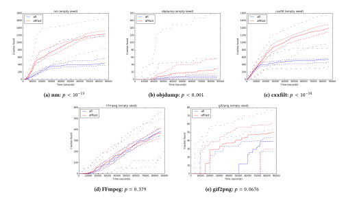
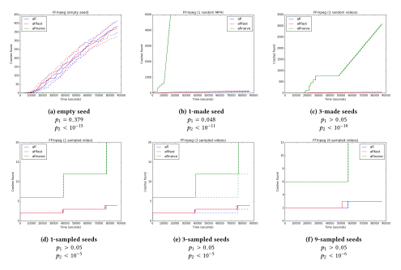
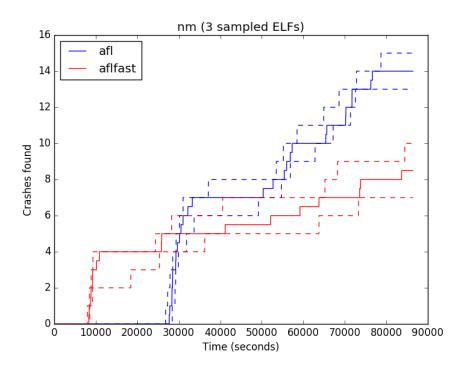
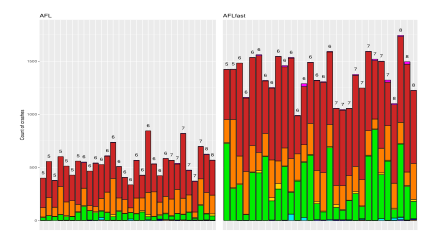

**Source:** *Evaluating Fuzz Testing* — [PDF](https://arxiv.org/pdf/1808.09700) · [arXiv](https://arxiv.org/abs/1808.09700)

# Evaluating Fuzz Testing

George Klees, Andrew Ruef, Benji Cooper University of Maryland

Shiyi Wei University of Texas at Dallas

Michael Hicks University of Maryland

# ABSTRACT

Fuzz testing has enjoyed great success at discovering security critical bugs in real software. Recently, researchers have devoted significant effort to devising new fuzzing techniques, strategies, and algorithms. Such new ideas are primarily evaluated experimentally so an important question is: What experimental setup is needed to produce trustworthy results? We surveyed the recent research literature and assessed the experimental evaluations carried out by 32 fuzzing papers. We found problems in every evaluation we considered. We then performed our own extensive experimental evaluation using an existing fuzzer. Our results showed that the general problems we found in existing experimental evaluations can indeed translate to actual wrong or misleading assessments. We conclude with some guidelines that we hope will help improve experimental evaluations of fuzz testing algorithms, making reported results more robust.

# CCS CONCEPTS

• Security and privacy → Software and application security;

# KEYWORDS

fuzzing, evaluation, security

### ACM Reference Format:

George Klees, Andrew Ruef, Benji Cooper, Shiyi Wei, and Michael Hicks. 2018. Evaluating Fuzz Testing. In 2018 ACM SIGSAC Conference on Computer and Communications Security (CCS '18), October 15–19, 2018, Toronto, ON, Canada. ACM, New York, NY, USA, [16](#page-15-0) pages. [https://doi.org/10.1145/](https://doi.org/10.1145/3243734.3243804) [3243734.3243804](https://doi.org/10.1145/3243734.3243804)

# 1 INTRODUCTION

A fuzz tester (or fuzzer) is a tool that iteratively and randomly generates inputs with which it tests a target program. Despite appearing "naive" when compared to more sophisticated tools involving SMT solvers, symbolic execution, and static analysis, fuzzers are surprisingly effective. For example, the popular fuzzer AFL has been used to find hundreds of bugs in popular programs [\[1\]](#page-14-0). Comparing AFL head-to-head with the symbolic executor angr, AFL found 76% more bugs (68 vs. 16) in the same corpus over a 24-hour period [\[50\]](#page-15-1). The success of fuzzers has made them a popular topic of research.

Permission to make digital or hard copies of all or part of this work for personal or classroom use is granted without fee provided that copies are not made or distributed for profit or commercial advantage and that copies bear this notice and the full citation on the first page. Copyrights for components of this work owned by others than the author(s) must be honored. Abstracting with credit is permitted. To copy otherwise, or republish, to post on servers or to redistribute to lists, requires prior specific permission and/or a fee. Request permissions from permissions@acm.org.

CCS '18, October 15–19, 2018, Toronto, ON, Canada

© 2018 Copyright held by the owner/author(s). Publication rights licensed to ACM. ACM ISBN 978-1-4503-5693-0/18/10. . . \$15.00 <https://doi.org/10.1145/3243734.3243804>

Why do we think fuzzers work? While inspiration for new ideas may be drawn from mathematical analysis, fuzzers are primarily evaluated experimentally. When a researcher develops a new fuzzer algorithm (call it A), they must empirically demonstrate that it provides an advantage over the status quo. To do this, they must choose:

- a compelling baseline fuzzer B to compare against;
- a sample of target programs—the benchmark suite;
- a performance metric to measure when A and B are run on the benchmark suite; ideally, this is the number of (possibly exploitable) bugs identified by crashing inputs;
- a meaningful set of configuration parameters, e.g., the seed file (or files) to start fuzzing with, and the timeout (i.e., the duration) of a fuzzing run.

An evaluation should also account for the fundamentally random nature of fuzzing: Each fuzzing run on a target program may produce different results than the last due to the use of randomness. As such, an evaluation should measure sufficiently many trials to sample the overall distribution that represents the fuzzer's performance, using a statistical test [\[38\]](#page-15-2) to determine that A's measured improvement over B is real, rather than due to chance.

Failure to perform one of these steps, or failing to follow recommended practice when carrying it out, could lead to misleading or incorrect conclusions. Such conclusions waste time for practitioners, who might profit more from using alternative methods or configurations. They also waste the time of researchers, who make overly strong assumptions based on an arbitrary tuning of evaluation parameters.

We examined 32 recently published papers on fuzz testing (see Table [1\)](#page-4-0) located by perusing top-conference proceedings and other quality venues, and studied their experimental evaluations. We found that no fuzz testing evaluation carries out all of the above steps properly (though some get close). This is bad news in theory, and after carrying out more than 50000 CPU hours of experiments, we believe it is bad news in practice, too. Using AFLFast [\[6\]](#page-14-1) (as A) and AFL (as baseline B), we carried out a variety of tests of their performance. We chose AFLFast as it was a recent advance over the state of the art; its code was publicly available; and we were confident in our ability to rerun the experiments described by the authors in their own evaluation and expand these experiments by varying parameters that the original experimenters did not. This choice was also driven by the importance of AFL in the literature: 14 out of 32 papers we examined used AFL as a baseline in their evaluation. We targeted three binutils programs (nm, objdump, and cxxfilt) and two image processing programs (gif2png and FFmpeg) used in prior fuzzing evaluations [\[9,](#page-14-2) [44,](#page-15-3) [45,](#page-15-4) [55,](#page-15-5) [58\]](#page-15-6). We found that experiments that deviate from the above recipe could easily lead one to draw incorrect conclusions, for these reasons:

Fuzzing performance under the same configuration can vary substantially from run to run. Thus, comparing single runs, as nearly  $\frac{3}{5}$  of the examined papers seem to, does not give a full picture. For example, on nm, one AFL run found just over 1200 crashing inputs while one AFLFast run found around 800. Yet, comparing the median of 30 runs tells a different story: 400 crashes for AFL and closer to 1250 for AFLFast. Comparing averages is still not enough, though: We found that in some cases, via a statistical test, that an apparent difference in performance was not statistically significant.

Fuzzing performance can vary over the course of a run. This means that short timeouts (of less than 5 or 6 hours, as used by 11 papers) may paint a misleading picture. For example, when using the empty seed, AFL found no crashes in gif2png after 13 hours, while AFLFast had found nearly 40. But after 24 hours AFL had found 39 and AFLFast had found 52. When using a non-empty seed set, on nm AFL outperformed AFLFast at 6 hours, with statistical significance, but after 24 hours the trend reversed.

We similarly found *substantial performance variations based on the seeds used*; e.g., with an empty seed AFLFast found more than 1000 crashes in *nm* but with a small non-empty seed it found only 24, which was statistically indistinguishable from the 23 found by AFL. And yet, most papers treated the choice of seed casually, apparently assuming that any seed would work equally well, without providing particulars.

Turning to measures of performance, 14 out of 32 papers we examined used code coverage to assess fuzzing effectiveness. Covering more code intuitively correlates with finding more bugs [19, 30] and so would seem to be worth doing. But the correlation may be weak [28], so directly measuring the number of bugs found is preferred. Yet only about  $\frac{1}{4}$  of papers used this direct measure. Most papers instead counted the number of crashing inputs found, and then applied a heuristic procedure in an attempt to de-duplicate inputs that trigger the same bug (retaining a "unique" input for that bug). The two most popular heuristics were AFL's coverage profile (used by 7 papers) and (fuzzy) stack hashes [36] (used by 7 papers). Unfortunately, there is reason to believe these de-duplication heuristics are ineffective.

In an additional experiment we computed a portion of ground truth. We applied all patches to *cxxfilt* from the version we fuzzed up until the present. We grouped together all inputs that a particular patch caused to now gracefully exit [11], confirming that the patch represented a single conceptual bugfix. We found that all 57,142 crashing inputs deemed "unique" by coverage profiles were addressed by 9 distinct patches. This represents a dramatic overcounting of the number of bugs. Ultimately, while AFLFast found many more "unique" crashing inputs than AFL, it only had a slightly higher likelihood of finding more unique bugs in a given run.

Stack hashes did better, but still over-counted bugs. Instead of the bug mapping to, say 500 AFL coverage-unique crashes in a given trial, it would map to about 46 stack hashes, on average. Stack hashes were also subject to false negatives: roughly 16% of hashes for crashes from one bug were shared by crashes from another bug. In five cases, a distinct bug was found by only one crash, and that crash had a non-unique hash, meaning that evidence of a distinct bug would have been dropped by "de-duplication."

This experiment, the most substantial of its kind, suggests that reliance on heuristics for evaluating performance is unwise. A better approach is to measure against ground truth directly by assessing fuzzers against known bugs, as we did above, or by using a synthetic suite such as CGC [14] or LAVA [16], as done by 6 papers we examined. (8 other papers considered ground truth in part, but often as "case studies" alongside general claims made using inputs de-duplicated by stack hashes or coverage profiles.)

Overall, fuzzing performance may vary with the target program, so it is important to evaluate on a diverse, representative benchmark suite. In our experiments, we found that AFLFast performed generally better than AFL on binutils programs (basically matching its originally published result, when using an empty seed), but did not provide a statistically significant advantage on the image processing programs. Had these programs been included in its evaluation, readers might have drawn more nuanced conclusions about its advantages. In general, few papers use a common, diverse benchmark suite; about 6 used CGC or LAVA-M, and 2 discussed the methodology in collecting real-world programs, while the rest used a few handpicked programs, with little overlap in these choices among papers. The median number of real-world programs used in the evaluation was 7, and the most commonly used programs (binutils) were shared by only four papers (and no overlap when versions are considered). As a result, individual evaluations may present misleading conclusions internally, and results are hard to compare across papers.

Our study (outlined in Section 3) suggests that meaningful scientific progress on fuzzing requires that claims of algorithmic improvements be supported by more solid evidence. Every evaluation in the 32 papers we looked at lacks some important aspect in this regard. In this paper we propose some clear guidelines to which future papers' evaluations should adhere. In particular, researchers should perform multiple trials and use statistical tests (Section 4); they should evaluate different seeds (Section 5), and should consider longer ( $\geq$  24 hour vs. 5 hour) timeouts (Section 6); and they should evaluate bug-finding performance using ground truth rather than heuristics such as "unique crashes" (Section 7). Finally, we argue for the establishment and adoption of a good fuzzing benchmark, and sketch what it might look like. The practice of hand selecting a few particular targets, and varying them from paper to paper, is problematic (Section 8). A well-designed and agreed-upon benchmark would address this problem. We also identify other problems that our results suggest are worth studying, including the establishment of better de-duplication heuristics (a topic of recent interest [42, 51]), and the use of algorithmic ideas from related areas, such as SAT solving.

### 2 BACKGROUND

There are many different dynamic analyses that can be described as "fuzzing." A unifying feature of fuzzers is that they operate on, and produce, concrete inputs. Otherwise, fuzzers might be instantiated with many different design choices and many different parameter settings. In this section, we outline the basics of how fuzzers work, and then touch on the advances of 32 recently published papers which form the core of our study on fuzzing evaluations.

### Core fuzzing algorithm:

```
corpus ← initSeedCorpus()
queue ← ∅
observations ← ∅
while ¬isDone(observations,queue) do
   candidate ← choose(queue, observations)
   mutated ← mutate(candidate,observations)
   observation ← eval(mutated)
   if isInteresting(observation,observations) then
      queue ← queue ∪ mutated
      observations ← observations ∪ observation
   end if
end while
```

parameterized by functions:

- initSeedCorpus: Initialize a new seed corpus.
- isDone: Determine if the fuzzing should stop or not based on progress toward a goal, or a timeout.
- choose: Choose at least one candidate seed from the queue for mutation.
- mutate: From at least one seed and any observations made about the program so far, produce a new candidate seed.
- eval: Evaluate a seed on the program to produce an observation.
- isInteresting: Determine if the observations produced from an evaluation on a mutated seed indicate that the input should be preserved or not.

Figure 1: Fuzzing, in a nutshell

# 2.1 Fuzzing Procedure

Most modern fuzzers follow the procedure outlined in Figure [1.](#page-2-0) The process begins by choosing a corpus of "seed" inputs with which to test the target program. The fuzzer then repeatedly mutates these inputs and evaluates the program under test. If the result produces "interesting" behavior, the fuzzer keeps the mutated input for future use and records what was observed. Eventually the fuzzer stops, either due to reaching a particular goal (e.g., finding a certain sort of bug) or reaching a timeout.

Different fuzzers record different observations when running the program under test. In a "black box" fuzzer, a single observation is made: whether the program crashed. In "gray box" fuzzing, observations also consist of intermediate information about the execution, for example, the branches taken during execution as determined by pairs of basic block identifiers executed directly in sequence. "White box" fuzzers can make observations and modifications by exploiting the semantics of application source (or binary) code, possibly involving sophisticated reasoning. Gathering additional observations adds overhead. Different fuzzers make different choices, hoping to trade higher overhead for better bug-finding effectiveness.

Usually, the ultimate goal of a fuzzer is to generate an input that causes the program to crash. In some fuzzer configurations, isDone checks the queue to see if there have been any crashes, and if there have been, it breaks the loop. Other fuzzer configurations seek to collect as many different crashes as they can, and so will not

stop after the first crash. For example, by default, libfuzzer [\[34\]](#page-15-16) will stop when it discovers a crash, while AFL will continue and attempt to discover different crashes. Other types of observations are also desirable, such as longer running times that could indicate the presence of algorithmic complexity vulnerabilities [\[41\]](#page-15-17). In any of these cases, the output from the fuzzer is some concrete input(s) and configurations that can be used from outside of the fuzzer to reproduce the observation. This allows software developers to confirm, reproduce, and debug issues.

# <span id="page-2-1"></span>2.2 Recent Advances in Fuzzing

The effectiveness of fuzz testing has made it an active area of research. Performing a literature search we found 32 papers published between 2012 and 2018 that propose and study improvements to various parts of the core fuzzing algorithm; 25 out of 32 papers we examined were published since 2016. To find these papers, we started from 10 high-impact fuzzing papers published in top security venues. Then we chased citations to and from these papers. As a sanity check, we also did a keyword search of titles and abstracts of the papers published since 2012. Finally, we judged the relevance based on target domain and proposed advance, filtering papers that did not fit.

Table [1](#page-4-0) lists these papers in chronological order. Here we briefly summarize the topics of these papers, organized by the part of the fuzzing procedure they most prominently aim to improve. Ultimately, our interest is in how these papers evaluate their claimed improvements, as discussed more in the next section.

initSeedCorpus. Skyfire [\[53\]](#page-15-18) and Orthrus [\[49\]](#page-15-19) propose to improve the initial seed selection by running an up-front analysis on the program to bootstrap information both for creating the corpus and assisting the mutators. QuickFuzz [\[20,](#page-15-20) [21\]](#page-15-21) allows seed generation through the use of grammars that specify the structure of valid, or interesting, inputs. DIFUZE performs an up-front static analysis to identify the structure of inputs to device drivers prior to fuzzing [\[13\]](#page-15-22).

mutate. SYMFUZZ [\[9\]](#page-14-2) uses a symbolic executor to determine the number of bits of a seed to mutate. Several other works change mutate to be aware of taint-level observations about the program behavior, specifically mutating inputs that are used by the program [\[8,](#page-14-3) [10,](#page-15-23) [33,](#page-15-24) [44\]](#page-15-3). Where other fuzzers use pre-defined data mutation strategies like bit flipping or rand replacement, MutaGen uses fragments of the program under test that parse or manipulate the input as mutators through dynamic slicing [\[29\]](#page-15-25). SDF uses properties of the seeds themselves to guide mutation [\[35\]](#page-15-26). Sometimes, a grammar is used to guide mutation [\[23,](#page-15-27) [57\]](#page-15-28). Chizpurfle's [\[27\]](#page-15-29) mutator exploits knowledge of Java-level language constructs to assist in-process fuzzing of Android system services.

eval. Driller [\[50\]](#page-15-1) and MAYHEM [\[8\]](#page-14-3) observe that some conditional guards in the program are difficult to satisfy via brute force guessing, and so (occasionally) invoke a symbolic executor during the eval phase to get past them. S2F also makes use of a symbolic executor during eval [\[58\]](#page-15-6). Other work focuses on increasing the speed of eval by making changes to the operating system [\[56\]](#page-15-30) or using different low level primitives to observe the effect of executions [\[23,](#page-15-27) [25,](#page-15-31) [47\]](#page-15-32). T-Fuzz [\[39\]](#page-15-33) will transform the program to remove checks on the input that prevent new code from being reached. MEDS [\[24\]](#page-15-34) performs finer grained run time analysis to detect errors during fuzzing.

isInteresting. While most papers focus on the crashes, some work changes observation to consider different classes of program behavior as interesting, e.g., longer running time [\[41\]](#page-15-17), or differential behavior [\[40\]](#page-15-35). Steelix [\[33\]](#page-15-24) and Angora [\[10\]](#page-15-23) instrument the program so that finer grained information about progress towards satisfying a condition is exposed through observation. Dowser and VUzzer [\[22,](#page-15-36) [44\]](#page-15-3) uses a static analysis to assign different rewards to program points based on either a likely-hood estimation that traveling through that point will result in a vulnerability, or for reaching a deeper point in the CFG.

choose. Several works select the next input candidate based on whether it reaches particular areas of the program [\[5,](#page-14-4) [6,](#page-14-1) [32,](#page-15-37) [44\]](#page-15-3). Other work explores different algorithms for selecting candidate seeds [\[45,](#page-15-4) [55\]](#page-15-5).

# <span id="page-3-0"></span>3 OVERVIEW AND EXPERIMENTAL SETUP

Our interest in this paper is assessing the existing research practice of experimentally evaluating fuzz testing algorithms. As mentioned in the introduction, evaluating a fuzz testing algorithm A requires several steps: (a) choosing a baseline algorithm B against which to compare; (b) choosing a representative set of target programs to test; (c) choosing how to measure A's vs. B's performance, ideally as bugs found; (d) filling in algorithm parameters, such as how seed files are chosen and how long the algorithm should run; and (e) carrying out multiple runs for both A and B and statistically comparing their performance.

Research papers on fuzz testing differ substantially in how they carry out these steps. For each of the 32 papers introduced in Section [2.2,](#page-2-1) Table [1](#page-4-0) indicates what benchmark programs were used for evaluation; the baseline fuzzer used for comparison; the number of trials carried out per configuration; whether variance in performance was considered; how crashing inputs were mapped to bugs (if at all); whether code coverage was measured to judge performance; how seed files were chosen; and what timeout was used per trial (i.e., how long the fuzzer was allowed to run). Explanations for each cell in the table are given in the caption; a blank cell means that the paper's evaluation did not mention this item.

For example, the AFLFast [\[6\]](#page-14-1) row in Table [1](#page-4-0) shows that the AFLFast's evaluation used 6 real-world programs as benchmarks (column 2); used AFL as the baseline fuzzer (column 3); ran each experiment 8 times (column 4) without reporting any variance (column 5); measured and reported crashes, but also conducted manual triage to obtain ground truth (column 6); did not measure code coverage (column 7); used an empty file as the lone input seed (column 8); and set 6 hours and 24 hours as timeouts for different experiments (column 9).

Which of these evaluations are "good" and which are not, in the sense that they obtain evidence that supports the claimed technical advance? In the following sections we assess evaluations both theoretically and empirically, carrying out experiments that demonstrate how poor choices can lead to misleading or incorrect conclusions about an algorithm's fitness. In some cases, we believe it is still an open question as to the "best" choice for an evaluation, but in other cases it is clear that a particular approach should be

taken (or, at least, certain naive approaches should not be taken). Overall, we feel that every existing evaluation is lacking in some important way.

We conclude this section with a description of the setup for our own experiments.

Fuzzers. For our experiments we use AFL (with standard configuration parameters) 2.43b as our baseline B, and AFLFast [\[6\]](#page-14-1) as our "advanced" algorithm A. We used the AFLFast version from July 2017 (cloned from Github) that was based on AFL version 2.43b. Note that these are more recent versions than those used in Böhme et al's original paper [\[6\]](#page-14-1). Some, but not all, ideas from the original AFLFast were incorporated into AFL by version 2.43b. This is not an issue for us since our goal is not to reproduce AFLFast's results, but rather to use it as a representative "advanced" fuzzer for purposes of considering (in)validity of approaches to empirically evaluating fuzzers. (We note, also, that AFL served as the baseline for 14/32 papers we looked at, so using it in our experiments speaks directly to those evaluations that used it.) We chose it and AFL because they are open source, easy to build, and easily comparable. We also occasionally consider a configuration we call AFLNaive, which is AFL with coverage tracking turned off (using option -n), effectively turning AFL into a black box fuzzer.

Benchmark programs. We used the following benchmark programs in our experiments: nm, objdump, cxxfilt (all from binutils-2.26), gif2png, and FFmpeg. All of these programs were obtained from recent evaluations of fuzzing techniques. FFmpeg-n0.5.10 was used in FuzzSim [\[55\]](#page-15-5). binutils-2.26 was the subject of the AFLFast evaluation [\[6\]](#page-14-1), and only the three programs listed above had discoverable bugs. gif2png-2.5.8 was tested by VUzzer [\[44\]](#page-15-3).[1](#page-3-1) We do not claim that this is a complete benchmark suite; in fact, we think that a deriving a good benchmark suite is an open problem. We simply use these programs to demonstrate how testing on different targets might lead one to draw different conclusions.

Performance measure. For our experiments we measured the number of "unique" crashes a fuzzer can induce over some period of time, where uniqueness is determined by AFL's notion of coverage. In particular, two crashing inputs are considered the same if they have the same (edge) coverage profile. Though this measure is not uncommon, it has its problems; Section [7](#page-8-0) discusses why, in detail.

Platform and configuration. Our experiments were conducted on three machines. Machines I and II are equipped with twelve 2.9GHz Intel Xenon CPUs (each with 2 logical cores) and 48GB RAM running Ubuntu 16.04. Machine III has twenty-four 2.4GHz CPUs and 110GB RAM running Red Hat Enterprise Linux Server 7.4. To account for possible variations between these systems, each benchmark program was always tested on the same machine, for all fuzzer combinations. Our testing script took advantage of all the CPUs on the system to run as many trials in parallel as possible. One testing subprocess was spawned per CPU and confined to it through CPU affinity. Every trial was allowed to run for 24 hours, and we generally measured at least 30 trials per configuration. We also considered a variety of seed files, including the empty file,

<span id="page-3-1"></span><sup>1</sup>Different versions of FFmpeg and gif2png were assessed by other papers [\[9,](#page-14-2) [45,](#page-15-4) [58\]](#page-15-6), and likewise for binutils [\[5,](#page-14-4) [32,](#page-15-37) [40\]](#page-15-35).

<span id="page-4-0"></span>

| paper           | benchmarks      | baseline | trials | variance | crash   | coverage | seed  | timeout |
|-----------------|-----------------|----------|--------|----------|---------|----------|-------|---------|
| MAYHEM[8]       | R(29)           |          |        |          | G       | ?        | N     | -       |
| FuzzSim[55]     | R(101)          | B        | 100    | C        | S       |          | R/M   | 10D     |
| Dowser[22]      | R(7)            | O        | ?      |          | O       |          | N     | 8H      |
| COVERSET[45]    | R(10)           | O        |        |          | S, G*   | ?        | R     | 12H     |
| SYMFUZZ[9]      | R(8)            | A, B, Z  |        |          | S       |          | M     | 1H      |
| MutaGen[29]     | R(8)            | R, Z     |        |          | S       | L        | V     | 24H     |
| SDF[35]         | R(1)            | Z, O     |        |          | O       |          | V     | 5D      |
| Driller[50]     | C(126)          | A        |        |          | G       | L, E     | N     | 24H     |
| QuickFuzz-1[20] | R(?)            |          | 10     |          | ?       |          | G     | -       |
| AFLFast[6]      | R(6)            | A        | 8      |          | C, G*   |          | E     | 6H, 24H |
| SeededFuzz[54]  | R(5)            | O        |        |          | M       | O        | G, R  | 2H      |
| [57]            | R(2)            | A, O     |        |          |         | L, E     | V     | 2H      |
| AFLGo[5]        | R(?)            | A, O     | 20     |          | S       | L        | V/E   | 8H, 24H |
| VUzzer[44]      | C(63), L, R(10) | A        |        |          | G, S, O |          | N     | 6H, 24H |
| SlowFuzz[41]    | R(10)           | O        | 100    |          | -       |          | R/M/N |         |
| Steelix[33]     | C(17), L, R(5)  | A, V, O  |        |          | C, G    | L, E, M  | N     | 5H      |
| Skyfire[53]     | R(4)            | O        |        |          | ?       | L, M     | R, G  | LONG    |
| kAFL[47]        | R(3)            | O        | 5      |          | C, G*   |          | V     | 4D, 12D |
| DIFUZE[13]      | R(7)            | O        |        |          | G*      |          | G     | 5H      |
| Orthrus[49]     | G(4), R(2)      | A, L, O  | 80     | C        | S, G*   |          | V     | >7D     |
| Chizpurfle[27]  | R(1)            | O        |        |          | G*      |          | G     | -       |
| VDF[25]         | R(18)           |          |        |          | C       | E        | V     | 30D     |
| QuickFuzz-2[21] | R(?)            | O        | 10     |          | G*      |          | G, M  |         |
| IMF[23]         | R(1)            | O        |        |          | G*      | O        | G     | 24H     |
| [59]            | S(?)            | O        | 5      |          | G       |          | G     | 24H     |
| NEZHA[40]       | R(6)            | A, L, O  | 100    |          | O       |          | R     |         |
| [56]            | G(10)           | A, L     |        |          |         |          | V     | 5M      |
| S2F[58]         | L, R(8)         | A, O     |        |          | G       | O        | N     | 5H, 24H |
| FairFuzz[32]    | R(9)            | A        | 20     | C        |         | E        | V/M   | 24H     |
| Angora[10]      | L, R(8)         | A, V, O  | 5      |          | G, C    | L, E     | N     | 5H      |
| T-Fuzz[39]      | C(296), L, R(4) | A, O     | 3      |          | C, G*   |          | N     | 24H     |
| MEDS[24]        | S(2), R(12)     | O        | 10     |          | C       |          | N     | 6H      |

Table 1: Summary of past fuzzing evaluation. Blank cell means that the paper's evaluation did not mention this item; - means it was not relevant; ? means the element was mentioned but with insufficient detail to be clear about it. Benchmarks: R means real-world programs, C means CGC data-set, L means LAVA-M benchmark, S means programs with manually injected bugs, G means Google fuzzer test suite. Baseline: A means AFL, B means BFF [\[3\]](#page-14-5), L means libfuzzer [\[34\]](#page-15-16), R means Radamsa [\[43\]](#page-15-40), Z means Zzuf [\[60\]](#page-15-41), V means VUzzer [\[44\]](#page-15-3) O means other baseline used by no more than 1 paper. Trials: number of trials. Variance: C means confidence intervals. Crash: S means stack hash used to group related crashes during triage, O means other tools/methods used for triage, C means coverage profile used to distinguish crashes, G means crashes triaged according to ground truth, G\* means manual efforts partially obtained ground truth for triaging. Coverage: L means line/instruction/basic-block coverage, M means method coverage, E means control-flow edge or branch coverage, O means other coverage information. Seed: R means randomly sampled seeds, M means manually constructed seeds, G means automatically generated seed, N means non-empty seed(s) but it was not clear if the seed corpus was valid, V means the paper assumes the existence of valid seed(s) but it was not clear how the seed corpus was obtained, E means empty seeds, / means different seeds were used in different programs, but only one kind of seeds in one program. Timeout: times reported in minutes (M), hours (H) and/or days (D).

randomly selected files of the right type, and manually-generated (but well-formed) files.

# <span id="page-4-1"></span>4 STATISTICALLY SOUND COMPARISONS

All modern fuzzing algorithms fundamentally employ randomness when performing testing, most notably when performing mutations, but sometimes in other ways too. As such, it is not sufficient to simply run fuzzer A and baseline B once each and compare their performance. Rather, both A and B should be run for many trials, and differences in performance between them should be judged.

Perhaps surprisingly, Table [1](#page-4-0) shows that most (17 out of 32) fuzzing papers we considered make no mention of the number of trials performed. Based on context clues, our interpretation is that they each did one trial. One possible justification is that the randomness "evens out;" i.e., if you run long enough, the random choices will converge and the fuzzer will find the same number of crashing inputs. It is clear from our experiments that this is not true—fuzzing performance can vary dramatically from run to run.

Consider the results presented in Figure [2,](#page-5-0) which graphs the cumulative number of crashes (the Y axis) we found over time (the X axis) by AFL (blue), and AFLFast (red), each starting with an

<span id="page-5-0"></span>

Figure 2: Crashes found over time (empty seed). Solid line is median; dashed lines are confidence intervals, and max/min.

empty seed. In each plot, the solid line represents the median result from 30 runs while the dashed lines represent the maximum and minimum observed results, and the lower and upper bounds of 95% confidence intervals for a median [\[12\]](#page-15-42). (The outermost dashed lines are max/min, the inner ones are the CIs.)

It should be clear from the highly varying performance on these plots that considering only a single run could lead to the wrong conclusion. For example, suppose the single run on FFmpeg for AFL turned out to be its maximum, topping out at 550 crashes, while the single run on AFLFast turned out to be its minimum, topping out at only 150 crashes (Figure [2d\)](#page-5-0). Just comparing these two results, we might believe that AFLFast provides no advantage over AFL. Or we might have observed AFLFast's maximum and AFL's minimum, and concluded the opposite.

Performing multiple trials and reporting averages is better, but not considering variance is also problematic. In Table [1,](#page-4-0) we can see that 12 out of the 15 papers that did consider multiple trials did not characterize the performance variance (they have a blank box in the variance column). Instead, each of them compared the "average" performance (we assume: arithmetic mean) of A and B when drawing conclusions, except for Dowser [\[22\]](#page-15-36) that reported median, and two [\[20,](#page-15-20) [59\]](#page-15-39) that did not mention how the "average" was calculated.

The problem is that with a high enough variance, a difference in averages may not be statistically significant. A solution is to use a statistical test [\[38\]](#page-15-2). Such a test indicates the likelihood that a difference in performance is real, rather than due to chance. Arcuri and Briand [\[2\]](#page-14-6) suggest that for randomized testing algorithms (like fuzzers), one should use the Mann Whitney U-test to determine the stochastic ranking ofAand B, i.e., whether the outcomes of the trials in A's data sample are more likely to be larger than outcomes in B's. Mann Whitney is non parametric in that it makes no assumption about the distribution of a randomized algorithm's performance; by contrast, the standard t-test assumes a normal distribution.

Returning to our experiments, we can see where simply comparing averages may yield wrong conclusions. For example, for gif2png, after 24 hours AFLFast finds a median of 51 crashes while for AFL it is 39 (a difference of 12). But performing the Mann Whitney test yields a <sup>p</sup> value of greater than <sup>0</sup>.05, suggesting the difference may not be statistically significant, even on the evidence of thirty 24-hour trials. For FFmpeg, AFLFast's median is 369.5 crashes while AFL's is 382.5, also a difference of about 12 crashes, this time favoring AFL. Likewise, Mann Whitney deems the difference insignificant. On the other hand, for nm the advantage of AFLFast over AFL is extremely unlikely to occur by chance.

The three papers in Table [1](#page-4-0) with "C" in the variance column come the closest to the best practice by at least presenting confidence intervals along with averages. But even here they stop short of statistically comparing the performance of their approach against the baseline; they leave it to the reader to visually judge this difference. This is helpful but not as conclusive as a (easy to perform) statistical test.

Discussion. While our recommendation to use statistical tests should be uncontroversial, there can be further debate on the best

<span id="page-6-1"></span>

Figure 3: FFmpeg results with different seeds. Solid line is median result; dashed lines are confidence intervals. p1 and p2 are the p-values for the statistical tests of AFL vs. AFLFast and AFL vs. AFLNaive, respectively.

choice of test. In particular, two viable alternatives are the permutation test [\[17\]](#page-15-43) and bootstrap-based tests [\[7\]](#page-14-7). These tests work by treating the measured data as a kind of stand-in for the overall population, systematically comparing permutations and re-samples of measured data to create rankings with confidence intervals. Whether such methods are more or less appropriate than Mann Whitney is unclear to us, so we follow Arcuri and Briand [\[2\]](#page-14-6).

Determining that the median performance of fuzzer A is greater than fuzzer B is paramount, but a related question concerns effect size. Just because A is likely to be better than B doesn't tell us how much better it is. We have been implicitly answering this question by looking at the difference of the measured medians. Statistical methods could also be used to determine the likelihood that this difference represents the true difference. Arcuri and Briand suggest Vargha and Delaney's Aˆ 12 statistics [\[52\]](#page-15-44) (which employ elements of the Mann Whitney calculation). Bootstrap methods can also be employed here.

# <span id="page-6-0"></span>5 SEED SELECTION

Recall from Figure [1](#page-2-0) that prior to iteratively selecting and testing inputs, the fuzzer must choose an initial corpus of seed inputs. Most (27 out of 32, per Section [2.2\)](#page-2-1) recent papers focus on improving the main fuzzing loop. As shown in column seed in Table [1,](#page-4-0) most papers (30/32) used a non-empty seed corpus (entries with G, R, M, V, or N). A popular view is that a seed should be well-formed ("valid") and small—such seeds may drive the program to execute more of its intended logic quickly, rather than cause it to terminate at its parsing/well-formedness tests [\[31,](#page-15-45) [44,](#page-15-3) [45,](#page-15-4) [53\]](#page-15-18). And yet, many times the details of the particular seeds used were not given. Entry 'V' appears 9 times, indicating a valid seed corpus was used, but providing no details. Entry 'N' appears 10 times, indicating a non-empty seed, but again with no details as to its content. Two papers [\[5,](#page-14-4) [6\]](#page-14-1) opted to use an empty seed (entry 'E'). When we asked them about it, they pointed out that using an empty seed is an easy way to baseline a significant variable in the input configuration. Other papers used manually or algorithmically constructed seeds, or randomly sampled ones.

It may be that the details of the initial seed corpus are unimportant; e.g., that no matter which seeds are used, algorithmic improvements will be reflected. But it's also possible that there is a strong and/or surprising interaction between seed format and algorithm choice which could add nuance to the results [\[37\]](#page-15-46). And indeed, this is what our results suggest.

We tested FFmpeg with different seeds including the empty seed, samples of existing video files ("sampled" seeds) and randomlygenerated videos ("made" seeds). For the sampled seeds, videos

<span id="page-7-2"></span>

|                  | empty |                | 1.    | -made          |
|------------------|-------|----------------|-------|----------------|
| FFmpeg, AFLNaive | 0     | $(< 10^{-15})$ | 5000  | $(< 10^{-11})$ |
| FFmpeg, AFL      | 382.5 |                | 102   |                |
| FFmpeg, AFLFast  | 369.5 | (=0.379)       | 129   | (< 0.05)       |
| nm, AFL          | 448   |                | 23    |                |
| nm, AFLFast      | 1239  | $(< 10^{-13})$ | 24    | (=0.830)       |
| objdump, AFL     | 6.5   |                | 5     |                |
| objdump, AFLFast | 29    | $(< 10^{-3})$  | 6     | $(< 10^{-2})$  |
| cxxfilt, AFL     | 540.5 |                | 572.5 |                |
| cxxfilt, AFLFast | 1400  | $(< 10^{-10})$ | 1364  | $(< 10^{-10})$ |

**Table 2:** Crashes found with different seeds. Median number of crashes at the 24-hour timeout.

were drawn from the FFmpeg samples website.<sup>2</sup> Four samples each were taken from the AVI, MP4, MPEG1, and MPEG2 sub-directories, and then the files were filtered out to only include those less than 1 MiB, AFL's maximum seed size, leaving 9-sampled seeds total. This set was further pared down to the smallest of the video files to produce 3-sampled and 1-sampled seeds. For the made seeds, we generated video and GIF files by creating 48 random video frames with videogen (a tool included with FFmpeg), 12 seconds of audio with audiogen (also included), and stitching all of them together with FFmpeg into 3-made MP4, MPG, and AVI files, each at 4 fps. The 1-made seed is the generated MP4 file. We also tested nm, objdump, and cxxfilt using the empty seed, and a 1-made seed. For nm and objdump, the 1-made seed was generated by compiling a hello-world C program. The 1-made seed of cxxfilt was generated as a file with 16 random characters, chosen from the set of letters (uppercase and lowercase), digits 0-9, and the underscore, which is the standard alphabet of mangled C++ names.

Results with these different seed choices for *FFmpeg* are shown in Figure 3. One clear trend is that for AFL and AFLFast, the empty seed yields far more crashing inputs than any set of valid, nonempty ones. On the other hand, for AFLNaive the trend is reversed. Among the experiments with non-empty seeds, performance also varies. For example, Figure 3(b) and Figure 3(d) show very different performance with a single, valid seed (constructed two different ways). The former finds around 100 crashes for AFL and AFLFast after 24 hours, while the latter finds less than 5.

The top part of Table 2 zooms in on the data from Figure 3(a) and (b) at the 24-hour mark. The first column indicates the target program and fuzzer used; the second column ("**empty**") indicates the median number of crashes found when using an empty seed; and the last column ("**1-made**") indicates the median number of crashes found when using a valid seed. The parenthetical in the last two columns is the *p*-value for the statistical test of whether the difference of AFLFast or AFLNaive performance from AFL is real, or due to chance. For AFL and AFLFast, an empty seed produces hundreds of crashing inputs, while for AFLNaive, it produces none. However, if we use 1-made or 3-made seeds, AFLNaive found significantly more crashes than AFL and AFLFast (5000 vs. 102/129).

The remainder of Table 2 reproduces the results of the AFLFast evaluation [6] in the **empty** column, but then reconsiders it with a

valid seed in the **1-made** column. Similar to the conclusion made by the AFLFast paper, AFLFast is superior to AFL in crash finding ability when using the empty seed (with statistical significance). However, when using 1-made seeds, AFLFast is not quite as good: it no longer outperforms AFL on *nm*, and both AFL and AFLFast generally find fewer crashes.

In sum, it is clear that a fuzzer's performance on the same program can be very different depending on what seed is used. Even valid, but different seeds can induce very different behavior. Assuming that an evaluation is meant to show that fuzzer *A* is superior to fuzzer *B* in general, our results suggest that it is prudent to consider a variety of seeds when evaluating an algorithm. Papers should be specific about how the seeds were collected, and better still to make available the actual seeds used. We also feel that the empty seed should be considered, despite its use contravening conventional wisdom. In a sense, it is the most general choice, since an empty file can serve as the input of any file-processing program. If a fuzzer does well with the empty seed across a variety of programs, perhaps it will also do well with the empty seed on programs not yet tested. And it takes a significant variable (i.e., which file to use as the seed) out of the vast configuration space.

#### <span id="page-7-0"></span>6 TIMEOUTS

Another important question is how long to run a fuzzer on a particular target. The last column of Table 1 shows that prior experiments of fuzzers have set very different timeouts. These generally range from 1 hour to days and weeks. Common choices were 24 hours (10 papers) and 5 or 6 hours (7 papers). We observe that recent papers that used LAVA as the benchmark suite chose 5 hours as the timeout, possibly because the same choice was made in the original LAVA paper [16]. Six papers ran fuzzers for more than one day.

Most papers we considered reported the timeout without justification. The implication is that beyond a certain threshold, more running time is not needed as the distinction between algorithms will be clear. However, we found that relative performance between algorithms can change over time, and that terminating an experiment too quickly might yield an incomplete result. As an example, AFLFast's evaluation shows that AFL found no bugs in objdump after six hours [6], but running AFL longer seems to tell a different story, as shown in Figure 2b. After six hours, both AFL and AFLFast start to find crashes at a reasonable clip. Running AFL on gif2png shows another interesting result in Figure 2e. The median number of crashes found by AFL was 0 even after 13 hours, but with only 7 more hours, it found 40 crashes. Because bugs often reside in certain parts of the program, fuzzing detects the bugs only when these parts are eventually explored. Figure 4 presents the results of AFL and AFLFast running with three sampled seeds on nm. After 6 hours none of the AFL runs found any bugs in nm, while the median number of crashes found by AFLFast was 4; Mann Whitney says that this difference is significant. But at 24 hours, the trend is reversed: AFL has found 14 crashes and AFLFast only 8. Again, this difference is significant.

What is a reasonable timeout to consider? Shorter timeouts are convenient from a practical perspective, since they require fewer

<span id="page-7-1"></span> $<sup>^2</sup> http://samples.ffmpeg.org\\$ 

<span id="page-7-3"></span> $<sup>^3</sup>$ [56] is an outlier that we do not count here: it uses 5-minute timeout because its evaluation focuses on test generation rate instead of bug finding ability.

<span id="page-8-1"></span>

Figure 4: nm with three sampled seeds. At 6 hours: AFLFast is superior to AFL with  $p < 10^{-13}$ . At 24 hours: AFL is superior to AFLFast with p = 0.000105.

overall hardware resources. Shorter times might be more useful in certain real-world scenarios, e.g., as part of an overnight run during the normal development process. On the other hand, longer runs might illuminate more general performance trends, as our experiments showed. Particular algorithms might also be better with longer running times; e.g., they could start slow but then accelerate their bug-finding ability as more tests are generated. For example, Skyfire took several days before its better performance (over AFL) became clear [53].

We believe that evaluations should include plots, as we have been (e.g., in Figure 4), that depict performance over time. These runs should consider at least a 24 hour timeout; performance for shorter times can easily be extracted from such longer runs.

Discussion. In addition to noting performance at particular times (e.g., crash counts at 5, 8 and 24 hours), one could also report area under curve (AUC) as a less punctuated performance measure. For example, a fuzzer that found one crash per second for five seconds would have an AUC of 12.5 crash-seconds whereas a fuzzer that found five crashes too, but all between seconds 4 and 5, would have an AUC of 2.5 crash-seconds. These measures intuitively reflect that finding crashes earlier and over time is preferred to finding a late burst. On the other hand, this measure might prefer a steady crash finder that peaks at 5 crashes to one that finds 10 at the last gasp; aren't more crashes better? As such, AUC measures are not a substitute for time-based performance plots.

### <span id="page-8-0"></span>7 PERFORMANCE MEASURES

So far, we have focused on measuring fuzzer performance using "unique" crashes found, which is to say, inputs that induce a "unique" crash (defined shortly). As crashes are symptoms of potentially serious bugs, measuring a fuzzer according to the number of crashing inputs it produces seems natural. But bugs and crashing inputs are not the same thing: Many different inputs could trigger the same bug. For example, a buffer overrun will likely cause a crash no matter what the input data consists of so long as that data's size exceeds the buffer's length. As such, simply counting crashing inputs as a measure of performance could be misleading: fuzzer A

could find more crashes than fuzzer B but find the same or fewer actual bugs.

As such, many papers employ some strategy to *de-duplicate* (or *triage*) crashes, so as to map them to unique bugs. There are two popular automated heuristics for doing this: using AFL's notion of *coverage profile*, and using *stack hashes*. In Table 1, these are marked 'C' (7 papers) and 'S' (7 papers) in the **crash** column. There are four papers using other tools/methods for triage, marked 'O'. For example, VUzzer additionally used a tool called !Exploitable to assess the exploitability of a crash caused by a bug [44]. Crashes that have a low likelihood of being turned into an attack could be discounted by a user, so showing that a fuzzer finds more dangerous bugs is advantageous. The de-duplication strategy used in our experiments corresponds to 'C'.

Unfortunately, as we show experimentally in this section, these de-duplication heuristics are actually poor at clustering crashing inputs according to their root cause.

Several papers do consider some form of ground truth. Six papers use it as their main performance measure, marked 'G' in the table. By virtue of their choice of benchmark programs, they are able to map crashing inputs to their root cause perfectly. Eight other papers, marked 'G\*' in the table, make some effort to triage crashes to identify their root cause, but do so imperfectly. Typically, such triage is done as a 'case study' and is often neither well founded nor complete—ground truth is not used as the overall (numeric) performance measure.

In the next three subsections we discuss performance measures in detail, showing why using heuristics rather than actual ground truth to compare fuzzer performance can lead to misleading or wrong conclusions. In lieu of measuring bugs directly, nearly half of the papers we examined consider a fuzzer's ability to execute ("cover") significant parts of a target program. This measurement is potentially more generalizable than bug counts, but is not a substitute for it; we discuss it at the end of the section.

### 7.1 Ground Truth: Bugs Found

The ultimate measure of a fuzzer is the number of distinct bugs that it finds. If fuzzer *A* generally finds more bugs than baseline *B* then we can view it as more effective. A key question is: What is a (distinct) bug? This is a subjective question with no easy answer.

We imagine that a developer will ultimately use a crashing input to debug and fix the target program so that the crash no longer occurs. That fix will probably not be specific to the input, but will generalize. For example, a bugfix might consist of a length check to stop a buffer overrun from occurring—this will work for all inputs that are too long. As a result, if target p crashes when given input I, but no longer crashes when the bugfix is applied, then we can associate I with the bug addressed by the fix [11]. Moreover, if inputs  $I_1$  and  $I_2$  both induce a crash on p, but both no longer do so once the bugfix is applied, we know that both *identify the same bug* (assuming the fix is suitably "minimal" [26]).

When running on target programs with known bugs, we have direct access to ground truth. Such programs might be older versions with bugs that have since been fixed, or they might be synthetic programs or programs with synthetically introduced bugs. Considering the former category, we are aware of no prior work that uses old

```
int main ( int argc , char * argv []) {
  if ( argc >= 2) {
    char b = argv [1][0];
    if (b == 'a ') crash ();
    else crash ();
  }
  return 0;
}
```

Figure 5: How coverage-based deduplication can overcount

programs and their corresponding fixes to completely triage crashes according to ground truth. In the latter category, nine papers use synthetic suites in order to determine ground truth. The most popular suites are CGC (Cyber Grand Challenge) [\[14\]](#page-15-12) and LAVA-M [\[16\]](#page-15-13); we discuss these more in the next section. For both, bugs have been injected into the original programs in a way that triggering a particular bug produces a telltale sign (like a particular error message) before the program crashes. As such, it is immediately apparent which bug is triggered by the fuzzer's generated input. If that bug was triggered before, the input can be discarded. Two other papers used hand-selected programs with manually injected vulnerabilities.

# <span id="page-9-4"></span>7.2 AFL Coverage Profile

When ground truth is not available, researchers commonly employ heuristic methods de-duplicate crashing inputs. The approach taken by AFL, and used by 7 papers in Table [1](#page-4-0) (marked 'C'), is to consider inputs that have the same code coverage profile as equivalent. AFL will consider a crash "unique" if the edge coverage for that crash either contains an edge not seen in any previous crash, or, is missing an edge that is otherwise in all previously observed crashes.[4](#page-9-0)

Classifying duplicate inputs based on coverage profile makes sense: it seems plausible that two different bugs would have different coverage representations. On the other hand, it is easy to imagine a single bug that can be triggered by runs with different coverage profiles. For example, suppose the function crash in the program in Figure [5](#page-9-1) will segfault unconditionally. Though there is but a single bug in the program, two classes of input will be treated as distinct: those starting with an 'a' and those that do not.

Assessing against ground truth. How often does this happen in practice? We examined the crashing inputs our fuzzing runs generated for cxxfilt using AFL and AFLFast. Years of development activity have occurred on this code since the version we fuzzed was released, so (most of) the bugs that our fuzzing found have been patched. We used git to identify commits that change source files used to compile cxxfilt. Then, we built every version of cxxfilt for each of those commits. This produced 812 different versions of cxxfilt. Then, we ran every crashing input (57,142 of them) on each

different version of cxxfilt, recording whether or not that version crashed. If not, we consider the input to have been a manifestation of a bug fixed by that program version.

To help ensure that our triaging results are trustworthy, we took two additional steps. First, we ensured that non-crashing behavior was not incidental. Memory errors and other bug categories uncovered by fuzzing may not always cause a crash when triggered. For example, an out-of-bounds array read will only crash the program if unmapped memory is accessed. Thus it is possible that a commit could change some aspect of the program that eliminates a crash without actually fixing the bug. To address this issue, we compiled each cxxfilt version with Address Sanitizer and Undefined Behavior Sanitizer (ASAN and UBSAN) [\[48\]](#page-15-48), which adds dynamic checks for various errors including memory errors. We considered the presence of an ASAN/UBSAN error report as a "crash."

Second, we ensured that each bug-fixing commit corresponds to a single bugfix, rather than several. To do so, we manually inspected every commit that converted a crashing input to a non-crashing one, judging whether we believed multiple distinct bugs were being fixed (based on principles we developed previously [\[26\]](#page-15-47)). If so, we manually split the commit into smaller ones, one per fix. In our experiments, we only had to do this once, to a commit that imported a batch of changes from the libiberty fork of cxxfilt into the main trunk.[5](#page-9-2) We looked at the individual libiberty commits that made up this batch to help us determine how to split it up. Ultimately we broke it into five distinct bug-fixing commits.

Our final methodology produced 9 distinct bug-fixing commits, leaving a small number of inputs that still crash the current version of cxxfilt. Figure [6](#page-10-0) organizes these results. Each bar in the graph represents a 24-hour fuzzing trial carried out by either AFL or AFLFast.[6](#page-9-3) For each of these, the magnitude of the bar on the y axis is the total number of "unique" (according to coverage profile) crash-inducing inputs, while the bar is segmented by which of these inputs is grouped with a bug fix discovered by our ground truth analysis. Above each bar is the total number of bugs discovered by that run (which is the number of compartments in each bar). The runs are ordered by the number of unique bugs found in the run.

We can see that there is at best a weak correlation between the number of bugs found during a run and the number of crashing inputs found in a run. Such a correlation would imply a stronger upward trend of crash counts when moving left to right. We can also see that AFLFast generally found many more "unique" crashing inputs than AFL but the number of bugs found per run is only slightly higher. Mann Whitney finds that the difference in crashes is statistically significant, with a p-value of 10−10, but the difference in bugs is not (but is close)—the <sup>p</sup>-value is <sup>0</sup>.066.

Discussion. Despite the steps we took to ensure our triage matches ground truth, we may still have inflated or reduced actual bug counts. As an example of the former, we note that ASAN/UBSAN is not guaranteed to catch all memory safety violations, so we may have attributed an incidental change to a bugfix. We found a few cases where we couldn't explain why a commit fixed a crash, and so did not associate the commit with a bug. On the other hand, we

<span id="page-9-0"></span><sup>4</sup>AFL also provides a utility, afl-cmin, which can be run offline to "prune" a corpus of inputs into a minimal corpus. Specifically, the afl-cmin algorithm keeps inputs that contain edges not contained by any other inputs trace. This is different than the AFL on-line algorithm, which also retains inputs missing edges that other inputs' traces have. Only one prior paper that we know of, Angora [\[10\]](#page-15-23), ran afl-cmin on the final set of inputs produced by AFL; the rest relied only on the on-line algorithm, as we do.

<span id="page-9-2"></span><sup>5</sup><https://github.com/gcc-mirror/gcc/tree/master/libiberty>

<span id="page-9-3"></span><sup>6</sup>We show each trial's data individually, rather than collecting it all together, because AFL's coverage-based metric was applied to each trial run, not all runs together.

<span id="page-10-0"></span>

Figure 6: Crashes with unique bugs found per run for *cxxfilt*. Each bar represents an independent run of either AFL or AFL fast. The height of the bar is the count of crashing inputs discovered during that run. Each bar is divided by color, clustering inputs with other inputs that share the same root cause. Number of unique bugs is indicated above each bar.

might have failed to differentiate multiple bugfixes in a single commit, either by mistake or in the eyes of an observer whose judgment differs from our own. In any case, the magnitude of the difference between our counts and "unique crashes" means that the top-level result—that "unique crashes" massively overcount the number of true bugs—would hold even if the counts changed a little.

Had we used ground truth measure in all of our experiments, it might have changed the character of the results in Sections 4-6. For example, the performance variations within a configuration due to randomness (e.g., Figure 2) may not be as stark when counting bugs rather than "unique" crashing inputs. In this case, our advice of carrying out multiple trials is even more important, as small performance differences between fuzzers A and B may require many trials to discern. It may be that performance differences due to varying a seed (Figure 3) may also not be as stark-this would be true if one seed found hundreds of crashes and another found far fewer, but in the end all crashes corresponded to the same bug. There may also be less performance variation over time when bugs, rather than crashes, are counted (Figure 4). On the other hand, it is also possible that we would find more variation over time, and/or with different seeds, rather than less. In either case, we believe our results in Sections 4-6 raise sufficient concern that our advice to test with longer timeouts and a variety of seeds (including the empty seed) should be followed unless and until experimental results with ground truth data shed more light on the situation.

### 7.3 Stack hashes

Another common, heuristic de-duplication technique is stack hashing [36]. Seven papers we considered use this technique (marked 'S' in Table 1). The idea is the following. Suppose that our buffer

overrun bug is in a function deep inside a larger program, e.g., in a library routine. Assuming that the overrun induces a segfault immediately, the crash will always occur at the same place in the program. More generally, the crash might depend on some additional program context; e.g., the overrun buffer might only be undersized when it is created in a particular calling function. In that case, we might look at the *call stack*, and not just the program counter, to map a crash to a particular bug. To ignore spurious variation, we focus on return addresses normalized to their source code location. Since the part of the stack closest to the top is perhaps the most relevant, we might only associate the most recent N stack frames with the triggering of a particular bug. (N is often chosen to be between 3 and 5.) These frames could be hashed for quick comparison to prior bugs—a *stack hash*.

Stack hashing will work as long as relevant context is unique, and still on-stack at the time of crash. But it is easy to see situations where this does not hold—stack hashing can end up both undercounting or overcounting true bugs. Consider the code in Figure 7, which has a bug in the format function that corrupts a string s, which ultimately causes the output function to crash (when s is passed to it, innocently, by the prepare function). The format function is called separately by functions f and g.

Suppose we fuzz this program and generate inputs that induce two crashes, one starting with the call from  ${\tt f}$  and the other starting with the call from  ${\tt g}$ . Setting N to the top 3 frames, the stack hash will correctly recognize that these two inputs correspond to the same bug, since only format, prepare and output will be on the stack. Setting N to 5, however, would treat the inputs as distinct crashes, since now one stack contains  ${\tt f}$  and the other contains  ${\tt g}$ . On the other hand, suppose this program had another buggy

```
void f () { ... format ( s1 ); ... }
void g () { ... format ( s2 ); ... }
void format ( char * s) {
  // bug: corrupt s
  prepare (s );
}
void prepare ( char *s) {
  output (s );
}
void output ( char * s) {
  // failure manifests
}
```

Figure 7: How stack hashing can over- and undercount bugs

<span id="page-11-1"></span>Table 3: Stack hashing results for cxxfilt. The first column specifies the label we assign based testing progressive versions of cxxfilt. The second column specifies the number of distinct stack hashes among the inputs assigned to the ground truth label. The third column counts how many of the stack hashes from the second column appear only with those inputs grouped by the label in the first column, while the fourth column counts how many stack hashes appear in other labels. The final column counts the number of distinct inputs in a label.

| Bug     | # Hashes | Matches | False Matches | Input count |  |
|---------|----------|---------|---------------|-------------|--|
| A       | 9        | 2       | 7             | 228         |  |
| B       | 362      | 343     | 19            | 31,103      |  |
| C       | 24       | 21      | 3             | 106         |  |
| D       | 159      | 119     | 40            | 12,672      |  |
| E       | 15       | 4       | 11            | 12,118      |  |
| F       | 15       | 1       | 14            | 232         |  |
| G       | 2        | 0       | 2             | 2           |  |
| H       | 1        | 1       | 0             | 568         |  |
| I       | 4        | 4       | 0             | 10          |  |
| unfixed | 28       | 12      | 16            | 98          |  |
| unknown | 4        | 0       | 4             | 4           |  |

function that also corrupts s prior to passing it to prepare. Setting N to 2 would improperly conflate crashes due to that bug and ones due the buggy format, since only the last two functions on the stack would be considered.

Assessing against ground truth. We measured the effectiveness of stack hashing by comparing its determinations against the labels for bugs that we identified in the prior experiment. Our implementation of stack hashing uses Address Sanitizer to produce a stack trace for each crashing input to cxxfilt, and chooses N as the top 3 entries on the stack for hashing.

Our analysis discovered that stack hashing is far more effective at deduplicating inputs than coverage profiles, but would still overcount the number of bugs discovered. Table [3](#page-11-1) shows the results of the comparison of stack hashing to the labels we identified. As an example, consider label B, which represents 31,103 inputs

(column 5). Of those inputs, 362 distinct stack hashes were produced (column 2). If the stack hash metric was the only knowledge we had about the distribution of bugs in cxxfilt, we would claim to have discovered two orders of magnitude more bugs than we actually did. On the other hand, stack hashing seems to do very well for label H: one hash matched all 568 inputs. In sum, across all runs, 595 hashes corresponded to 9 bugs, an inflation of 66×, as compared to 57,044 coverage profile-unique inputs for 9 bugs, an inflation of 6339×. [7](#page-11-2) 4 crashing inputs were each associated with their own "fixing" commit, but when we inspected the respective code changes we could not see why the changes should fix a crash. As such, we have listed these inputs in Table [3](#page-11-1) as "unknown." ASAN/UBSAN does not detect all possible undefined behaviors, so it may be that a code or data layout change between compilations or some other form of non-determinism is suppressing the crashing behavior. A compiler bug is also a possibility. We are continuing to investigate.

While stack hashing does not overcount bugs nearly as much as AFL coverage profiles, it has the serious problem that hashes are not unique. For example, only 343 of those for label B matched only inputs associated with B (column 3). The remaining 19 also matched some other crashing input (column 4). As such, these other inputs would be wrongly discarded if stack hashing had been used for de-duplication. Indeed, for label G, there is no unique hash (there is a 0 in column 3)—it only falsely matches. Overall, about 16% of hashes were non-unique.[8](#page-11-3) As such, stack hashing-based deduplication would have discarded these bugs.

Discussion. Table [3](#page-11-1) shows another interesting trend also evident, but less precisely, in Figure [6.](#page-10-0) Some bugs are triggered by a very small number of inputs, while others by a very large number. Bugs G and I each correspond to only 2 or 10 inputs, while bugs B, D, and E correspond to more than 10K inputs. Prior fuzzing studies have found similar bug distributions [\[11\]](#page-15-11). While Table [3](#page-11-1) combines all inputs from all trials, considering each trial individually (as per Figure [6\)](#page-10-0) we find that no single run found all 9 bugs; all runs found bugs B, D, E, but no run found more than 5 additional bugs.

An important open question is whether the trends we observe here with cxxfilt hold for other target programs. To answer this question would require more "ground truth" analysis of the flavor we have carried out here. Assuming they do hold, we draw two tentative conclusions. First, the trends reinforce the problem with bug heuristics: in the presence of "rare" inputs, the difference between finding 100 crashing inputs and 101 (an apparently insignificant difference) could represent finding 1 or 2 unique bugs (a significant one). Second, fuzzers might benefit from an algorithmic trick employed by SAT solvers: randomly "reboot" the search process [\[46\]](#page-15-49) by discarding some of the current state and starting again with the initial seed, thus simulating the effect of running separate trials. The challenge would be to figure out what fuzzer state to retain across reboots so as to retain important knowledge but avoid getting stuck in a local minimum.

<span id="page-11-2"></span><sup>7</sup>The table tabulates crashing inputs across all trials put together: if instead you consider the stack hashes taken on a per-run basis (as in Figure [6\)](#page-10-0), the results will be somewhat different, but the overall trends should remain the same.

<span id="page-11-3"></span><sup>8</sup>This value was computed by summing the total distinct number of hashes that show up in more than one row (a lower bound of the total in column 4) and dividing by the total of distinct hashes overall (a lower bound of the total in column 2).

Related Work. Recent work by van Tonder et al. [\[51\]](#page-15-15) also experimentally assesses the efficacy of stack hashing and coverage profiles against ground truth. Like us, they defined ground truth as single conceptual bugs corrected by a particular code patch. They compared how well coverage profiles and stack hashes approximate this ground truth. Like us, they found that both tended to overcount the number of true bugs. As they consider different patches and target programs, their study is complementary to ours. However, their set of crashing inputs was generated via mutations to an initial known crashing input, rather than via a normal fuzzing process. As such, their numbers do not characterize the impact of poor deduplication strategies in typical fuzzing use-cases, as ours do.

Pham et al. [\[42\]](#page-15-14) also studied how stack hashes, for N = 1 and N = ∞, can over- and under-count bugs identified through symbolic execution. Their interest was a comparison against their own deduplication technique, and so their study did not comprehensively consider ground truth.

# 7.4 Code Coverage

Fuzzers are run to find bugs in programs. A fuzzer that runs for a long period of time and finds no bugs would be seen as unsuccessful by its user. It seems logical to evaluate a fuzzer based on the number of bugs that fuzzer finds. However, just because a fuzzer does not find a bug may not tell us the whole story about the fuzzer's efficacy. Perhaps its algorithm is sound but there are few or no bugs to find, and the fuzzer has merely gotten unlucky.

One solution is to instead (or also) measure the improvement in code coverage made by fuzzer A over baseline B. Greybox fuzzers already aim to optimize coverage as part of the isInteresting function, so surely showing an improved code coverage would indicate an improvement in fuzzing. This makes sense. To find a crash at a particular point in the program, that point in the program would need to execute. Prior studies of test suite effectiveness also suggest that higher coverage correlates with bug finding effectiveness [\[19,](#page-15-7) [30\]](#page-15-8). Nearly half of the papers we considered measured code coverage; FairFuzz only evaluated performance using code (branch) coverage [\[32\]](#page-15-37).

However, there is no fundamental reason that maximizing code coverage is directly connected to finding bugs. While the general efficacy of coverage-guided fuzzers over black box ones implies that there's a strong correlation, particular algorithms may eschew higher coverage to focus on other signs that a bug may be present. For example, AFLGo [\[5\]](#page-14-4) does not aim to increase coverage globally, but rather aims to focus on particular, possibly error-prone points in the program. Even if we assume that coverage and bug finding are correlated, that correlation may be weak [\[28\]](#page-15-9). As such, a substantial improvement in coverage may yield merely a negligible improvement in bug finding effectiveness.

In short, we believe that code coverage makes sense as a secondary measure, but that ground truth, according to bugs discovered, should always be primary.

# <span id="page-12-0"></span>8 TARGET PROGRAMS

We would like to establish that one fuzzing algorithm is generally better than another, i.e., in its ability to find bugs in any target program drawn from a (large) population. Claims of generality are usually made by testing the fuzzer on a benchmark suite that purports to represent the population. The idea is that good performance on the suite should translate to good performance on the population. How should we choose such a benchmark suite?

Recent published works have considered a wide variety of benchmark programs. Broadly, these fall into two categories, as shown in the second column in Table [1:](#page-4-0) real programs and artificial programs (or bugs). Examples of the former include the Google fuzzer test suite ("G") [\[18\]](#page-15-50) and ad hoc selections of real programs ("R"). The latter comprises CGC ("C") [\[14\]](#page-15-12), LAVA-M ("L") [\[16\]](#page-15-13), and handselected programs with synthetically injected bugs ("S"). Some papers' benchmarks drew from both categories (e.g., VUzzer [\[44\]](#page-15-3) and Steelix [\[33\]](#page-15-24)). As we discuss below, no existing benchmark choice is entirely satisfying, thus leaving open the important question of developing a good fuzzing benchmark.

# 8.1 Real programs

According to Table [1,](#page-4-0) nearly all papers used some real-world programs in their evaluations. Two of these papers [\[49,](#page-15-19) [56\]](#page-15-30) used the Google Fuzzer Test suite [\[18\]](#page-15-50), a set of real-world programs and libraries coupled with harnesses to focus fuzzing on a set of known bugs. The others evaluated on a hand selected set of real-world programs.

We see two problems with the way that real programs have been used as fuzzing targets. First, most papers consider only a small number of target programs without clear justification of their representativeness. The median number of programs, per Table [1,](#page-4-0) is seven. Sometimes a small count is justified; e.g., IMF was designed specifically to fuzz OS kernels, so its evaluation on a single "program," the MacOS kernel, is still interesting. On the other hand, most fuzzers aim to apply to a larger population (e.g., all file processing programs), so 7 would seem to be a small number. A positive outlier was FuzzSim, which used a large set of programs (more than 100) and explained the methodology for collecting them.

As evidence of the threat posed by a small number of insufficiently general targets, consider the experimental results reported in Figure [2,](#page-5-0) which match the results of Böhme et al [\[6\]](#page-14-1). The first row of the figure shows results for nm, objdump and cxxfilt, which were the three programs in which Böhme et al found crashes.[9](#page-12-1) Focusing our attention on these programs suggests that AFLFast is uniformly superior to AFL in crash finding ability. However, if we look at the second row of the figure, the story is not as clear. For both FFmpeg and gif2png, two programs used in other fuzzing evaluations, the Mann Whitney U test shows no statistical difference between AFL and AFLFast. Including these programs in our assessment weakens any claim that AFLFast is an improvement over AFL.

The second problem we see with the use of real programs to date is that few papers use the same targets, at the same versions. As such, it is hard to make even informal comparisons across different papers. One overlapping set of targets were binutils programs, used in several evaluations [\[5,](#page-14-4) [6,](#page-14-1) [10,](#page-15-23) [32\]](#page-15-37). Multiple papers also considered FFmpeg and gif2png [\[9,](#page-14-2) [44,](#page-15-3) [45,](#page-15-4) [55,](#page-15-5) [58\]](#page-15-6). However, none used the

<span id="page-12-1"></span><sup>9</sup> Figure 6 of their paper presents a similar series of plots. The differences in their plots and ours are the following: they plot the results on log scale for the Y axis; they consider six-hour trials rather than 24-hour trials; and they do not plot median and confidence intervals computed over 30+ runs, but rather plot the mean of 8 runs. They also use different versions of AFL and AFLFast.

same versions. For example, the versions of *binutils* were different in these papers: AFLFast [6] and AFLGo [5] used 2.26; FairFuzz [32] used 2.28; Angora [10] used 2.29.

The use of Google Fuzzer Suite would seem to address both issues: it comprises 25 programs with known bugs, and is defined independently of any given fuzzer. On the other hand, it was designed as a kind of regression suite, not necessarily representative of fuzzing "in the wild;" the provided harnesses and seeds mostly intend that fuzzers should find the targeted bugs within a few seconds to a few minutes.

### 8.2 Suites of artificial programs (or bugs)

Real programs are fickle in that the likelihood that bugs are present depends on many factors. For example, programs under active development may well have more bugs than those that are relatively stable (just responding to bug reports). In a sense, we do not care about any particular set of programs, but rather a representative set of programming (anti)patterns in which bugs are likely to crop up. Such patterns could be injected artificially. There are two popular suites that do this: CGC, and LAVA-M.

The CGC suite comprises 296 buggy programs produced as part of DARPA's Cyber Grand Challenge [14]. This suite was specifically designed to evaluate bug finding tools like fuzz testers—the suite's programs perform realistic functions and are seeded with exploitable bugs. LAVA (which stands for Large-scale Automated Vulnerability Addition) is a tool for injecting bugs into known programs [16]. The tool is designed to add crashing, input-determinate bugs along feasible paths. The LAVA authors used the tool to create the LAVA-M suite, which comprises four bug-injected *coreutils* programs: *base64*, *md5sum*, *uniq*, and *who*. Unlike the CGC programs, which have very few injected bugs, the LAVA-M programs have many: on the order of a few dozen each for the first three, and more than 2000 for *who*. For both suites, if a fuzzer triggers a bug, there is a telltale sign indicating which one it is, which is very useful for understanding how many bugs are found from the total possible.

CGC and LAVA-M have gained popularity as the benchmark choices for evaluating fuzzers since their introduction. Within the past two years, CGC and LAVA-M have been used for evaluating 4 and 5 fuzzers, respectively. VUzzer [44], Steelix [33], and T-Fuzz [39] used both benchmarks in their evaluation. However, sometimes the CGC benchmark was subset: Driller [50], VUzzer [44], and Steelix [33] were evaluated on 126, 63, and 17 out of the 296 programs, respectively.

While CGC programs are hand-designed to simulate reality, this simulation may be imperfect: Performing well on the CGC programs may fail to generalize to actual programs. For example, the average size of the CGC cqe-challenge programs was (only) 1774 lines of code, and many programs use telnet-style, text-based protocols. Likewise, LAVA-M injected bugs may not sufficiently resemble those found "in the wild." The incentives and circumstances behind real-world software development may fail to translate to synthetic benchmarks which were specifically designed to be insecure. The LAVA authors write that, "A significant chunk of future work for LAVA involves making the generated corpora look more like the bugs that are found in real programs." Indeed, in recent experiments [15], they also have shown that relatively simple techniques

can effectively find all of the LAVA-M bugs, which follow a simple pattern. We are aware of no study that independently assesses the extent to which these suites can be considered "real" or "general."

### 8.3 Toward a Fuzzing Benchmark Suite

Our assessment leads us to believe that there is a real need for a solid, independently defined benchmark suite, e.g., a DaCapo [4] or SPEC<sup>10</sup> for fuzz testing. This is a big enough task that we do not presume to take it on in this paper. It should be a community effort. That said, we do have some ideas about what the result of that effort might look like.

First, we believe the suite should have a selection of programs with clear indicators of when particular bugs are found, either because bugs are synthetically introduced (as in LAVA-M and CGC) or because they were previously discovered in older versions (as in our ground truth assessment in Section 7.2). Clear knowledge of ground truth avoids overcounting inputs that correspond to the same bug, and allows for assessing a tool's false positives and false negatives. We lean toward using real programs with known bugs simply because their ecological validity is more assured.

Second, the suite should be large enough (both in number of programs, and those programs' sizes) to represent the overall target population. How many programs is the right number? This is an open question. CGC comprises  $\sim 300$  small programs; Google Fuzzer Suite has 25; most papers used around 7. Our feeling is that 7 is too small, but it might depend on which 7 are chosen. Perhaps 25 is closer to the right number.

Finally, the testing methodology should build in some defense against overfitting. If a static benchmark suite comes into common use, tools may start to employ heuristics and strategies that are not of fundamental advantage, but apply disproportionately to the benchmark programs. One way to deal with this problem is to have a fixed standard suite and an "evolvable" part that changes relatively frequently. One way to support the latter is to set up a fuzzing competition, similar to long-running series of SAT solving competitions. 11 One effort in this direction is Rode0day, a recurring bug finding competition. 12 Since the target programs would not be known to fuzzing researchers in advance, they should be incentivized to develop general, reusable techniques. Each competition's suite could be rolled into the static benchmark, at least in part, to make the suite even more robust. One challenge is to regularly develop new targets that are ecologically valid. For example, Rode0day uses automated bug insertion techniques to which a tool could overfit (the issue discussed above for LAVA).

### 9 CONCLUSIONS AND FUTURE WORK

Fuzz testing is a promising technology that has been used to uncover many important bugs and security vulnerabilities. This promise has prompted a growing number of researchers to develop new fuzz testing algorithms. The evidence that such algorithms work is primarily experimental, so it is important that it comes from a well-founded experimental methodology. In particular, a researcher should run their algorithm *A* on a general set of target programs,

<span id="page-13-0"></span><sup>10</sup> https://www.spec.org/benchmarks.html

<span id="page-13-1"></span><sup>11</sup> http://www.satcompetition.org/

<span id="page-13-2"></span><sup>12</sup>https://rode0day.mit.edu/

using a meaningful set of configuration parameters, including the set of input seeds and duration (timeout), and compare against the performance of a baseline algorithm B run under the same conditions, where performance is defined as the number of (distinct) bugs found. A and B must be run enough times that the inherent randomness of fuzzing is accounted for and performance can be judged via a statistical test.

In this paper, we surveyed 32 recent papers and analyzed their experimental methodologies. We found that no paper completely follows the methodology we have outlined above. Moreover, results of experiments we carried out using AFLFast [\[6\]](#page-14-1) (as A) and AFL [\[1\]](#page-14-0) (as B) illustrate why not following this methodology can lead to misleading or weakened conclusions. We found that

- Most papers failed to perform multiple runs, and those that did failed to account for varying performance by using a statistical test. This is a problem because our experiments showed that run-to-run performance can vary substantially.
- Many papers measured fuzzer performance not by counting distinct bugs, but instead by counting "unique crashes" using heuristics such as AFL's coverage measure and stack hashes. This is a problem because experiments we carried out showed that the heuristics can dramatically over-count the number of bugs, and indeed may suppress bugs by wrongly grouping crashing inputs. This means that apparent improvements may be modest or illusory. Many papers made some consideration of root causes, but often as a "case study" rather than a performance assessment.
- Many papers used short timeouts, without justification. Our experiments showed that longer timeouts may be needed to paint a complete picture of an algorithm's performance.
- Many papers did not carefully consider the impact of seed choices on algorithmic improvements. Our experiments showed that performance can vary substantially depending on what seeds are used. In particular, two different non-empty inputs need not produce similar performance, and the empty seed can work better than one might expect.
- Papers varied widely on their choice of target programs. A growing number are using synthetic suites CGC and/or LAVA-M, which have the advantage that they are defined independently of a given algorithm, and bugs found by fuzzing them can be reliably counted (no crash de-duplication strategy is needed). Other papers often picked small, disjoint sets of programs, making it difficult to compare results across papers. Our experiments showed AFLFast performs well on the targets it was originally assessed against, but performed no better than AFL on two targets used by other papers.

Ultimately, our experiments roughly matched the positive results of the original AFLFast paper [\[6\]](#page-14-1), but by expanding the scope of the evaluation to different seeds, longer timeouts, and different target programs, evidence of AFLFast's superiority, at least for the versions we tested, was weakened. The fact that heuristic crash deduplication strategies are of questionable value further weakens our confidence in claims of improvement. We believe the same could be said of many prior papers—all suffer from problems in their evaluation to some degree. As such, a key conclusion of this paper

is that the fuzzing community needs to start carrying out more rigorous experiments in order to draw more reliable conclusions.

Specifically, we recommend that fuzz testing evaluations should have the following elements:

- multiple trials with statistical tests to distinguish distributions;
- a range of benchmark target programs with known bugs (e.g., LAVA-M, CGC, or old programs with bug fixes);
- measurement of performance in terms of known bugs, rather than heuristics based on AFL coverage profiles or stack hashes; block or edge coverage can be used as a secondary measure;
- a consideration of various (well documented) seed choices including empty seed;
- timeouts of at least 24 hours, or else justification for less, with performance plotted over time.

We see (at least) three important lines of future work. First, we believe there is a pressing need for well-designed, well-assessed benchmark suite, as described at the end of the last section. Second, and related, it would be worthwhile to carry out a larger study of the value of crash de-duplication methods on the results of realistic fuzzing runs, and potentially develop new methods that work better, for assisting with triage and assessing fuzzing when ground truth is not known. Recent work shows promise [\[42,](#page-15-14) [51\]](#page-15-15). Finally, it would be interesting to explore enhancements to the fuzzing algorithm inspired by the observation that no single fuzzing run found all true bugs in cxxfilt; ideas from other search algorithms, like SAT solving "reboots" [\[46\]](#page-15-49), might be brought to bear.

Acknowledgments. We thank Marcel Böhme and Abhik Roychoudhury for their help with AFLFast. We thank the anonymous reviewers, Michelle Mazurek, Cornelius Aschermann, Luis Pina, Jeff Foster, Ian Sweet, the participants of the ISSISP'18 summer school, and our shepherd Mathias Payer for helpful comments and suggestions on drafts of this work. This research was supported in part by the National Science Foundation grants CNS-1563722 and CNS-1314857, and DARPA under contracts FA8750-15-2-0104 and FA8750-16-C-0022, and a Google Research Award.

# REFERENCES

- <span id="page-14-0"></span>[1] AFL 2018. American Fuzzing Lop (AFL). [http://lcamtuf.coredump.cx/afl/.](http://lcamtuf.coredump.cx/afl/)
- <span id="page-14-6"></span>[2] Andrea Arcuri and Lionel Briand. 2011. A Practical Guide for Using Statistical Tests to Assess Randomized Algorithms in Software Engineering. In International Conference on Software Engineering (ICSE).
- <span id="page-14-5"></span>[3] BFF 2018. CERT Basic Fuzzing Framework (BFF). [https://github.com/CERTCC/](https://github.com/CERTCC/certfuzz) [certfuzz.](https://github.com/CERTCC/certfuzz)
- <span id="page-14-8"></span>[4] Stephen M. Blackburn, Robin Garner, Chris Hoffmann, Asjad M. Khang, Kathryn S. McKinley, Rotem Bentzur, Amer Diwan, Daniel Feinberg, Daniel Frampton, Samuel Z. Guyer, Martin Hirzel, Antony Hosking, Maria Jump, Han Lee, J. Eliot B. Moss, Aashish Phansalkar, Darko Stefanović, Thomas VanDrunen, Daniel von Dincklage, and Ben Wiedermann. 2006. The DaCapo Benchmarks: Java Benchmarking Development and Analysis. In ACM SIGPLAN Conference on Objectoriented Programming Systems, Languages, and Applications (OOPSLA).
- <span id="page-14-4"></span>[5] Marcel Böhme, Van-Thuan Pham, Manh-Dung Nguyen, and Abhik Roychoudhury. 2017. Directed Greybox Fuzzing. In ACM SIGSAC Conference on Computer and Communications Security (CCS).
- <span id="page-14-1"></span>[6] Marcel Böhme, Van-Thuan Pham, and Abhik Roychoudhury. 2016. Coveragebased Greybox Fuzzing As Markov Chain. In ACM SIGSAC Conference on Computer and Communications Security (CCS).
- <span id="page-14-7"></span>[7] Guillaume Calmettes, Gordon B. Drummond, and Sarah L. Vowler. 2012. Making due with what we have: use your bootstraps. Journal of Physiology 590, 15 (2012).
- <span id="page-14-3"></span>[8] Sang Kil Cha, Thanassis Avgerinos, Alexandre Rebert, and David Brumley. 2012. Unleashing Mayhem on Binary Code. In IEEE Symposium on Security and Privacy (S&P).
- <span id="page-14-2"></span>[9] Sang Kil Cha, Maverick Woo, and David Brumley. 2015. Program-Adaptive Mutational Fuzzing. In IEEE Symposium on Security and Privacy (S&P).

- <span id="page-15-23"></span><span id="page-15-0"></span>[10] Peng Chen and Hao Chen. 2018. Angora: Efficient Fuzzing by Principled Search. In IEEE Symposium on Security and Privacy (S&P).
- <span id="page-15-11"></span>[11] Yang Chen, Alex Groce, Chaoqiang Zhang, Weng-Keen Wong, Xiaoli Fern, Eric Eide, and John Regehr. 2013. Taming Compiler Fuzzers. In ACM SIGPLAN Conference on Programming Language Design and Implementation (PLDI).
- <span id="page-15-42"></span>[12] ConfIntv 2018. Confidence Intervals for a Median. [http://www.ucl.ac.uk/](http://www.ucl.ac.uk/ich/short-courses-events/about-stats-courses/stats-rm/Chapter_8_Content/confidence_interval_single_median) [ich/short-courses-events/about-stats-courses/stats-rm/Chapter\\_8\\_Content/](http://www.ucl.ac.uk/ich/short-courses-events/about-stats-courses/stats-rm/Chapter_8_Content/confidence_interval_single_median) [confidence\\_interval\\_single\\_median.](http://www.ucl.ac.uk/ich/short-courses-events/about-stats-courses/stats-rm/Chapter_8_Content/confidence_interval_single_median)
- <span id="page-15-22"></span>[13] Jake Corina, Aravind Machiry, Christopher Salls, Yan Shoshitaishvili, Shuang Hao, Christopher Kruegel, and Giovanni Vigna. 2017. DIFUZE: Interface Aware Fuzzing for Kernel Drivers. In ACM SIGSAC Conference on Computer and Communications Security (CCS).
- <span id="page-15-12"></span>[14] DARPA CGC 2018. Darpa Cyber Grand Challenge (CGC) Binaries. [https://github.](https://github.com/CyberGrandChallenge/) [com/CyberGrandChallenge/.](https://github.com/CyberGrandChallenge/)
- <span id="page-15-51"></span>[15] Brendan Dolan-Gavitt. 2018. Of Bugs and Baselines. [http://moyix.blogspot.com/](http://moyix.blogspot.com/2018/03/of-bugs-and-baselines.html) [2018/03/of-bugs-and-baselines.html.](http://moyix.blogspot.com/2018/03/of-bugs-and-baselines.html)
- <span id="page-15-13"></span>[16] Brendan Dolan-Gavitt, Patrick Hulin, Engin Kirda, Tim Leek, Andrea Mambretti, William K. Robertson, Frederick Ulrich, and Ryan Whelan. 2016. LAVA: Large-Scale Automated Vulnerability Addition. In IEEE Symposium on Security and Privacy (S&P).
- <span id="page-15-43"></span>[17] Gordon B. Drummond and Sarah L. Vowler. 2012. Different tests for a difference: how do we research? British Journal of Pharmacology 165, 5 (2012).
- <span id="page-15-50"></span>[18] FuzzerTestSuite 2018. Fuzzer Test Suite. [https://github.com/google/](https://github.com/google/fuzzer-test-suite) [fuzzer-test-suite.](https://github.com/google/fuzzer-test-suite)
- <span id="page-15-7"></span>[19] Rahul Gopinath, Carlos Jensen, and Alex Groce. 2014. Code Coverage for Suite Evaluation by Developers. In International Conference on Software Engineering (ICSE).
- <span id="page-15-20"></span>[20] Gustavo Grieco, Martín Ceresa, and Pablo Buiras. 2016. QuickFuzz: an automatic random fuzzer for common file formats. In International Symposium on Haskell.
- <span id="page-15-21"></span>[21] Gustavo Grieco, Martn Ceresa, Agustn Mista, and Pablo Buiras. 2017. QuickFuzz Testing for Fun and Profit. J. Syst. Softw. (2017).
- <span id="page-15-36"></span>[22] Istvan Haller, Asia Slowinska, Matthias Neugschwandtner, and Herbert Bos. 2013. Dowsing for Overflows: A Guided Fuzzer to Find Buffer Boundary Violations. In USENIX Security Symposium.
- <span id="page-15-27"></span>[23] HyungSeok Han and Sang Kil Cha. 2017. IMF: Inferred Model-based Fuzzer. In ACM SIGSAC Conference on Computer and Communications Security (CCS).
- <span id="page-15-34"></span>[24] Wookhyun Han, Byunggill Joe, Byoungyoung Lee, Chengyu Song, and Insik Shin. 2018. Enhancing Memory Error Detection for Large-Scale Applications and Fuzz Testing. In Network and Distributed System Security Symposium (NDSS).
- <span id="page-15-31"></span>[25] Andrew Henderson, Heng Yin, Guang Jin, Hao Han, and Hongmei Deng. 2017. VDF: Targeted Evolutionary Fuzz Testing of Virtual Devices. In Research in Attacks, Intrusions, and Defenses (RAID).
- <span id="page-15-47"></span>[26] Michael Hicks. 2015. What is a bug? [http://www.pl-enthusiast.net/2015/09/08/](http://www.pl-enthusiast.net/2015/09/08/what-is-a-bug/) [what-is-a-bug/.](http://www.pl-enthusiast.net/2015/09/08/what-is-a-bug/)
- <span id="page-15-29"></span>[27] Antonio Ken Iannillo, Roberto Natella, Domenico Cotroneo, and Cristina Nita-Rotaru. 2017. Chizpurfle: A Gray-Box Android Fuzzer for Vendor Service Customizations. In IEEE International Symposium on Software Reliability Engineering (ISSRE).
- <span id="page-15-9"></span>[28] Laura Inozemtseva and Reid Holmes. 2014. Coverage is Not Strongly Correlated with Test Suite Effectiveness. In International Conference on Software Engineering (ICSE).
- <span id="page-15-25"></span>[29] Ulf Kargén and Nahid Shahmehri. 2015. Turning Programs Against Each Other: High Coverage Fuzz-testing Using Binary-code Mutation and Dynamic Slicing. In Foundations of Software Engineering (FSE).
- <span id="page-15-8"></span>[30] P. S. Kochhar, F. Thung, and D. Lo. 2015. Code coverage and test suite effectiveness: Empirical study with real bugs in large systems. In IEEE International Conference on Software Analysis, Evolution, and Reengineering (SANER).
- <span id="page-15-45"></span>[31] lcamtuf. 2018. AFL quick start guide. [http://lcamtuf.coredump.cx/afl/](http://lcamtuf.coredump.cx/afl/QuickStartGuide.txt) [QuickStartGuide.txt.](http://lcamtuf.coredump.cx/afl/QuickStartGuide.txt)
- <span id="page-15-37"></span>[32] Caroline Lemieux and Koushik Sen. 2018. FairFuzz: A Targeted Mutation Strategy for Increasing Greybox Fuzz Testing Coverage. IEEE/ACM International Conference on Automated Software Engineering.
- <span id="page-15-24"></span>[33] Yuekang Li, Bihuan Chen, Mahinthan Chandramohan, Shang-Wei Lin, Yang Liu, and Alwen Tiu. 2017. Steelix: program-state based binary fuzzing. In Foundations of Software Engineering (FSE).
- <span id="page-15-16"></span>[34] libFuzzer 2018. libFuzzer. [https://llvm.org/docs/LibFuzzer.html.](https://llvm.org/docs/LibFuzzer.html)
- <span id="page-15-26"></span>[35] Ying-Dar Lin, Feng-Ze Liao, Shih-Kun Huang, and Yuan-Cheng Lai. 2015. Browser fuzzing by scheduled mutation and generation of document object models. In International Carnahan Conference on Security Technology.

- <span id="page-15-10"></span>[36] David Molnar, Xue Cong Li, and David A. Wagner. 2009. Dynamic Test Generation to Find Integer Bugs in x86 Binary Linux Programs. In USENIX Security Symposium.
- <span id="page-15-46"></span>[37] Todd Mytkowicz, Amer Diwan, Matthias Hauswirth, and Peter F. Sweeney. 2009. Producing Wrong Data Without Doing Anything Obviously Wrong!. In International Conference on Architectural Support for Programming Languages and Operating Systems (ASPLOS).
- <span id="page-15-2"></span>[38] R. Lyman Ott and Micheal T. Longnecker. 2006. Introduction to Statistical Methods and Data Analysis (with CD-ROM).
- <span id="page-15-33"></span>[39] Hui Peng, Yan Shoshitaishvili, and Mathias Payer. 2018. T-Fuzz: fuzzing by program transformation. In IEEE Symposium on Security and Privacy (S&P).
- <span id="page-15-35"></span>[40] Theofilos Petsios, Adrian Tang, Salvatore J. Stolfo, Angelos D. Keromytis, and Suman Jana. 2017. NEZHA: Efficient Domain-Independent Differential Testing. In IEEE Symposium on Security and Privacy (S&P).
- <span id="page-15-17"></span>[41] Theofilos Petsios, Jason Zhao, Angelos D. Keromytis, and Suman Jana. 2017. SlowFuzz: Automated Domain-Independent Detection of Algorithmic Complexity Vulnerabilities. In ACM SIGSAC Conference on Computer and Communications Security (CCS).
- <span id="page-15-14"></span>[42] Van-Thuan Pham, Sakaar Khurana, Subhajit Roy, and Abhik Roychoudhury. 2017. Bucketing Failing Tests via Symbolic Analysis. In International Conference on Fundeamental Approaches to Software Engineering (FASE).
- <span id="page-15-40"></span>[43] Radamsa 2018. Radamsa. [https://github.com/aoh/radamsa.](https://github.com/aoh/radamsa)
- <span id="page-15-3"></span>[44] Sanjay Rawat, Vivek Jain, Ashish Kumar, Lucian Cojocar, Cristiano Giuffrida, and Herbert Bos. 2017. Vuzzer: Application-aware evolutionary fuzzing. In NDSS.
- <span id="page-15-4"></span>[45] Alexandre Rebert, Sang Kil Cha, Thanassis Avgerinos, Jonathan Foote, David Warren, Gustavo Grieco, and David Brumley. 2014. Optimizing Seed Selection for Fuzzing. In USENIX Security Symposium.
- <span id="page-15-49"></span>[46] Vadim Ryvchin and Ofer Strichman. 2008. Local Restarts. In International Conference on Theory and Applications of Satisfiability Testing (SAT).
- <span id="page-15-32"></span>[47] Sergej Schumilo, Cornelius Aschermann, Robert Gawlik, Sebastian Schinzel, and Thorsten Holz. 2017. kAFL: Hardware-Assisted Feedback Fuzzing for OS Kernels. In USENIX Security Symposium.
- <span id="page-15-48"></span>[48] Konstantin Serebryany, Derek Bruening, Alexander Potapenko, and Dmitriy Vyukov. 2012. AddressSanitizer: A Fast Address Sanity Checker.. In USENIX Annual Technical Conference.
- <span id="page-15-19"></span>[49] Bhargava Shastry, Markus Leutner, Tobias Fiebig, Kashyap Thimmaraju, Fabian Yamaguchi, Konrad Rieck, Stefan Schmid, Jean-Pierre Seifert, and Anja Feldmann. 2017. Static Program Analysis as a Fuzzing Aid. In Research in Attacks, Intrusions, and Defenses (RAID).
- <span id="page-15-1"></span>[50] Nick Stephens, John Grosen, Christopher Salls, Andrew Dutcher, Ruoyu Wang, Jacopo Corbetta, Yan Shoshitaishvili, Christopher Kruegel, and Giovanni Vigna. 2016. Driller: Augmenting Fuzzing Through Selective Symbolic Execution.. In Network and Distributed System Security Symposium (NDSS).
- <span id="page-15-15"></span>[51] Rijnard van Tonder, John Kotheimer, and Claire Le Goues. 2018. Semantic Crash Bucketing. In IEEE International Conference on Automated Software Engineering (ASE).
- <span id="page-15-44"></span>[52] András Vargha and Harold D. Delaney. 2000. A Critique and Improvement of the CL Common Language Effect Size Statistics of McGraw and Wong. Journal of Educational and Behavioral Statistics 25, 2 (2000).
- <span id="page-15-18"></span>[53] Junjie Wang, Bihuan Chen, Lei Wei, and Yang Liu. 2017. Skyfire: Data-Driven Seed Generation for Fuzzing. In IEEE Symposium on Security and Privacy (S&P).
- <span id="page-15-38"></span>[54] Weiguang Wang, Hao Sun, and Qingkai Zeng. 2016. SeededFuzz: Selecting and Generating Seeds for Directed Fuzzing. In International Symposium on Theoretical Aspects of Software Engineering (TASE).
- <span id="page-15-5"></span>[55] Maverick Woo, Sang Kil Cha, Samantha Gottlieb, and David Brumley. 2013. Scheduling Black-box Mutational Fuzzing. In ACM SIGSAC Conference on Computer and Communications Security (CCS).
- <span id="page-15-30"></span>[56] Wen Xu, Sanidhya Kashyap, Changwoo Min, and Taesoo Kim. 2017. Designing New Operating Primitives to Improve Fuzzing Performance. In ACM SIGSAC Conference on Computer and Communications Security (CCS).
- <span id="page-15-28"></span>[57] Hyunguk Yoo and Taeshik Shon. 2016. Grammar-based adaptive fuzzing: Evaluation on SCADA modbus protocol. In IEEE International Conference on Smart Grid Communications.
- <span id="page-15-6"></span>[58] Bin Zhang, Jiaxi Ye, Chao Feng, and Chaojing Tang. 2017. S2F: Discover Hard-to-Reach Vulnerabilities by Semi-Symbolic Fuzz Testing. In International Conference on Computational Intelligence and Security.
- <span id="page-15-39"></span>[59] L. Zhang and V. L. L. Thing. 2017. A hybrid symbolic execution assisted fuzzing method. In IEEE Region 10 Conference (TENCON).
- <span id="page-15-41"></span>[60] Zzuf 2018. Zzuf. [http://caca.zoy.org/wiki/zzuf.](http://caca.zoy.org/wiki/zzuf)