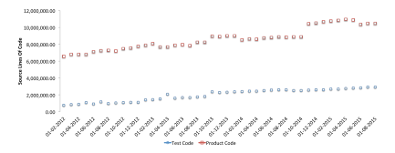
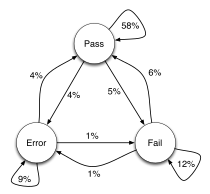
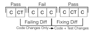
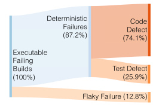
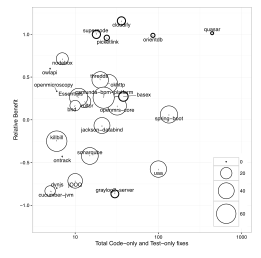
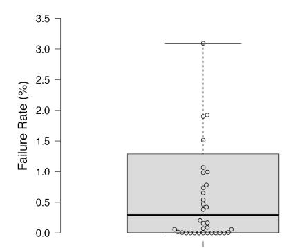

**Source:** *Measuring the Cost of Regression Testing in Practice: A Study of Java Projects Using Continuous Integration* — [PDF](https://www.cs.ubc.ca/~rtholmes/papers/fse_2017_labuschange.pdf)

# **Measuring the Cost of Regression Testing in Practice: A Study of Java Projects using Continuous Integration**

Adriaan Labuschagne University of Waterloo Waterloo, ON, Canada alabusch@uwaterloo.ca

Laura Inozemtseva University of Waterloo Waterloo, ON, Canada lminozem@uwaterloo.ca

Reid Holmes University of British Columbia Vancouver, BC, Canada rtholmes@cs.ubc.ca

#### **ABSTRACT**

Software defects cost time and money to diagnose and fix. Consequently, developers use a variety of techniques to avoid introducing defects into their systems. These techniques have their own costs: the benefit of using a technique must outweigh the cost of using it.

In this paper we investigate the costs and benefits of automated regression testing in practice. Specifically, we studied 61 projects that use Travis CI, a cloud-based continuous integration tool, in order to examine real test failures that were encountered by the developers of those projects. We determined how developers resolved the failures they encountered and used this to classify the failures as being caused by a flaky test, by a bug in the system under test, or by a broken or obsolete test. We consider test failures caused by bugs represent a benefit of the suite, while failures caused by broken or obsolete tests represent test suite maintenance costs.

We found that 18% of test suite executions fail and that 13% of these failures are flaky. Of the non-flaky failures, only 74% were caused by a bug in the system under test; the remaining 26% were due to incorrect or obsolete tests. In addition, we found that, in the failed builds, only 0.38% of the test case executions failed and 64% of failed builds contained more than one failed test.

Our findings contribute to a wider understanding of the unforeseen costs that can impact the overall cost effectiveness of regression testing in practice. They can also inform research into test case selection techniques, as we have provided an approximate empirical bound on the practical value that could be extracted from such techniques. This appears to be large, as over 99% of the test case executions could have been eliminated with a perfect oracle.

# **CCS CONCEPTS**

• **Software and its engineering** → **Software testing and debugging**; *Software verification and validation*; Software libraries and repositories;

#### **KEYWORDS**

Regression testing, test economics, flaky tests

Permission to make digital or hard copies of all or part of this work for personal or classroom use is granted without fee provided that copies are not made or distributed for profit or commercial advantage and that copies bear this notice and the full citation on the first page. Copyrights for components of this work owned by others than the author(s) must be honored. Abstracting with credit is permitted. To copy otherwise, or republish, to post on servers or to redistribute to lists, requires prior specific permission and/or a fee. Request permissions from permissions@acm.org.

*ESEC/FSE'17, September 4–8, 2017, Paderborn, Germany* © 2017 Copyright held by the owner/author(s). Publication rights licensed to Associ-

ation for Computing Machinery. ACM ISBN 978-1-4503-5105-8/17/09. . . \$15.00 <https://doi.org/10.1145/3106237.3106288>

#### **ACM Reference format:**

Adriaan Labuschagne, Laura Inozemtseva, and Reid Holmes. 2017. Measuring the Cost of Regression Testing in Practice: A Study of Java Projects using Continuous Integration. In *Proceedings of 2017 11th Joint Meeting of the European Software Engineering Conference and the ACM SIGSOFT Symposium on the Foundations of Software Engineering, Paderborn, Germany, September 4–8, 2017 (ESEC/FSE'17),* [10](#page-9-0) pages. <https://doi.org/10.1145/3106237.3106288>

#### **1 INTRODUCTION**

Software defects cost developers time and money. Among other things, bugs can discourage new customers from adopting a product and can drive away existing customers. Many techniques exist for avoiding the introduction of bugs and for quickly identifying bugs once they have been introduced. Unfortunately, these techniques have their own costs, so developers must carefully assess each technique's cost effectiveness before deciding whether and to what extent to adopt it.

Automated regression testing is one technique for fault detection that has seen wide adoption [[2,](#page-9-1) [4](#page-9-2)]. This technique involves regularly executing a suite of tests to determine if recent changes to the software have negatively impacted existing functionality. Regression testing can be costly: developers must write, maintain, and regularly execute their test suite as the code evolves. Kasurinen et al. conducted a survey of industrial developers that found that the development expenses and maintenance costs associated with automated testing were a major impediment to adoption [\[6](#page-9-3)]. One of their participants stated:

> Developing that kind of test automation system is almost as huge an effort as building the actual project.

They also saw some organizations decreasing their regression testing investments due to test suite maintenance costs.

The costs of automated regression testing are only worth incurring if the use of this technique provides adequate compensatory benefits. In particular, the suite must detect enough faults that the developers feel their investment in the suite is justified. Previous studies have considered the cost-effectiveness of automated regression testing, as we will discuss further in Section [2.](#page-1-0) However, these studies share a common limitation: they were conducted by mining software repositories. Repository mining allows one to see how the test suite changes over time, which gives some indication of the development and maintenance cost of the suite. However, it does not allow one to measure the benefits in terms of detected faults.

To better understand the cost-benefit tradeoff, we examined the build history of 61 open source systems that use the TravisCI[1](#page-0-0)

1<https://travis-ci.org/>

continuous integration service. When a test suite failed, we attempted to determine whether the failure was caused by a nondeterministic test, by a fault in the system under test, or by an obsolete or incorrect test. We consider that a detected fault represents a benefit of the suite while an obsolete or incorrect test represents a suite maintenance cost. Determining the number of suite failures that belong to each group therefore provides some insight into the costs and benefits of the test suite. Section [3](#page-2-0) describes our procedure in detail.

Specifically, we asked the following research questions:

- **RQ1** What proportion of test suite executions are non-deterministic, or *flaky*?
- **RQ2** Once these flaky test suite executions are accounted for, what proportion of test suite failures represent a maintenance cost and what proportion represent a benefit?
- **RQ3** Why do tests usually require maintenance, and can maintenance costs be reduced?
- **RQ4** What proportion of test case executions detect a fault?

Our answers can be summarized as follows:

- **A1** 18% of test suite executions failed; the remaining 82% passed. 13% of the failures were flaky.
- **A2** Defects in the test suite itself were the cause of 26% of nonflaky failures. Defects in the system under test were the cause of 74% of non-flaky failures.
- **A3** There were a number of reasons for test suite maintenance. Some of the maintenance could have been avoided through the use of better testing processes.
- **A4** An individual test case that was run as part of a build that failed had only a 0.38% chance of failing. This establishes a useful bound for test suite reduction: a perfect reduction technique could reduce the number of test executions by over 99% and still detect the same number of faults. 64% of failed builds contained more than one failed test.

Our findings are described in depth in Section [4](#page-5-0). Following the presentation of results, Section [5](#page-8-0) presents threats to validity and describes our replication dataset. Finally, Section [6](#page-9-4) concludes.

# **2 RELATED WORK**

Previous work has considered the cost-benefit tradeoff of automated regression testing. We first discuss studies that used repository mining to measure the cost of maintaining a regression test suite. Next, we discuss studies that captured test outputs, but were not able to use this information to measure the costs and benefits of regression testing. Finally, we briefly discuss studies that attempted to decrease the costs of regression testing by reducing the amount of time required to execute the suites. These particular studies of test selection and prioritization relate to our fourth research question.

#### **2.1 Measuring Test Suite Maintenance**

Seven previous studies have considered test suite maintenance costs by exploring how test suites evolve over time. Zaidman et al. [[15\]](#page-9-5) examined how developers evolve their test suites along with the test code and whether testing effort varied by the project schedule. They found both close synchronous evolution as well as separate,

stepwise evolution but failed to find any increase in testing effort before a major release.

Pinto et al. [[11\]](#page-9-6) studied test evolution and found that 30% of the changes made to test suites were modifications, 15% were test additions, and 56% were test deletions.

Marsavina et al. [[9\]](#page-9-7) studied the co-evolution of production and test code. They found that test code changes made up between 6% and 47% of all code changes for the projects they studied.

Beller and Zaidman [\[1](#page-9-8)] found that tests and production code have some tendency to change together, but that tests were not changed every time the system under test was changed and vice versa.

Kasurinen et al. [\[6](#page-9-3)] conducted a survey of industrial developers that, among other findings, identified development expenses and maintenance costs as the main obstacles to adopting automated testing. In fact, one company that experimented with automated testing eventually removed the test suite due to the cost of maintaining it. This indicates that maintenance is perceived as very expensive, and in at least one case, the cost was high enough that developers could not justify using automated regression testing.

Grechanik et al. [\[3](#page-9-9)] estimated that the costs associated with maintaining and evolving test scripts are \$50 million to \$120 million per year. They also showed that even simple changes could result in 30% to 70% of test scripts needing maintenance, a process that could take hours or days and caused interruption to continuous integration systems. While developers in the study saw the benefits of the automated test suite, the maintenance burden often caused them to throw away their tests and start from scratch, often with faulty logic due to time pressures.

Herzig et al. [\[4\]](#page-9-2) developed a test selection tool called THEO that selects tests to be executed if the probable cost of executing the test is lower than the probable cost of skipping the test. To calculate these costs, THEO uses the past defect detection rate for each test case (i.e., the true positive rate) and the past false alarm rate of a test case (i.e., the false positive rate). These probabilities can then be used along with data such as machine costs, number of engineers, and inspection costs in order to estimate the cost of skipping or executing a test. An evaluation of the system using historical data from Microsoft projects allowed 35% to 50% of tests to be skipped while only letting 0.2% to 13% of defects escape. In Section [4](#page-5-0) we show that, in our dataset, a perfect test selection technique would execute less than 0.38% of tests.

All seven of these studies share the same limitation: as they were performed retroactively by mining software repositories, the execution results of the suites are unknown. This means we cannot measure the benefit provided by the test suites in terms of the number of faults detected. We also cannot know the impact of flaky tests on these results, since these can only be validated by repeatedly executing the same test. Without this information, we do not have a complete picture of the cost-benefit tradeoff.

## **2.2 Capturing Test Outputs**

Three previous studies have managed to capture test outputs. Anderson et al. [[5](#page-9-10)] provided insight into Microsoft Dynamix AX R2, a large industrial project. This project comprised over 5.5 million lines of product source code and over 4.8 million lines of regression

test code. The authors reported that running the regression suite resulted in a 9% test case failure rate during each execution of the test suite.

Memon and Soffa [[10\]](#page-9-11) found that 74% of all tests failed between successive releases of a single industrial product, suggesting that test failures are relatively common. Beller et al. [[1\]](#page-9-8) report that 65% of IDE-based JUnit test runs fail.

Vasilescu et al. [[14](#page-9-12)] explored the relationship between Travis CI build results (success or failure) and the way the build was started (i.e., direct commit from a developer with write access to the repository or a pull request). The authors found that builds started by pull requests are more likely to fail than those started by direct commits. They also found that, although 92% of the projects they studied are configured to use Travis CI, only 42% actually do; we observed the same behaviour, as we will describe in Section [3](#page-2-0).

Unfortunately, while these studies captured test execution results, it is not clear what proportion of the observed failures occurred because of faults and what proportion occurred because the tests required maintenance. Additionally, developers in these studies may have been using test driven development methodologies which would further influence the test failure rates. It is therefore hard to draw conclusions about the amount of developer time devoted to test maintenance—and thus the cost-benefit ratio of regression testing—from these studies.

#### **2.3 Reducing Suite Execution Time**

A number of studies have attempted to reduce the cost of regression testing by reducing the cost of *executing* the suite. The basic assumption is that re-running all the tests every time is too expensive, and some way of reducing this cost is required. As an example, Rosenblum and Weyuker [\[12\]](#page-9-13) proposed the use of test coverage information to predict the cost-effectiveness of regression testing strategies.

Elbaum et al. [\[2](#page-9-1)] used test suite[2](#page-2-1) selection at the pre-submit stage and test suite prioritization at the post-submit stage to increase the cost-effectiveness of testing. During the pre-submit phase i.e., before code was pushed to the central repository—suites that failed during a pre-determined failure window were selected to be executed, the basic intuition being that recent failures are likely to predict future failures. New tests and tests that had been skipped more than a set number of times were also selected during this phase. During the post-submit testing phase, the authors attempted to avoid skipping test suites and thus prioritized rather than selected test suites using the same criteria used during the pre-submit phase. This strategy ensured that all test suites were executed during the post-submit phase while running the suites that were most likely to fail first, thereby shortening the feedback loop.

Anderson et al. [\[5](#page-9-10)] developed two test prioritization techniques that used test result history. The first technique, *most common failures*, is based on the intuition that tests that failed the most in the past are the most likely to fail in the future. The second technique, *failures by association*, attempts to use association rule mining to improve on the first technique. The authors found that the techniques had similar performance when predicting future failures

and that both worked better when a small window of recent executions was used, rather than the entire historical dataset.

Most test suite reduction techniques use coverage to detect redundant tests. This leads to a loss in fault detection ability because fully overlapping coverage does not necessarily mean the tests will always fail under the same circumstances [\[8\]](#page-9-14). To address this issue, Koochakzadeh and Garousi [[7](#page-9-15)] developed a test reduction tool that brings a human tester into the loop. Their tool identifies potentially redundant tests using coverage analysis, then lets testers inspect these tests to identify the true positives that can be removed from the suite. Using this technique they were able to remove eleven of the 82 tests in their subject system without affecting the suite's mutation score. In contrast, the coverage based approach identified 52 tests as redundant and reduced the mutation score by 31%.

Rothermel et al. [\[13](#page-9-16)] studied how the granularity of test suites influenced the cost-effectiveness of regression testing. They concluded that typical regression testing techniques usually do not lose fault detection capability when operating on coarse-grained test suites, but they do tend to save test execution time.

While the information produced by these studies sheds light on the costs of regression testing, they are concerned only with the cost of *executing* the test suite, while we focus on the cost of *maintaining* the suite. In addition, like other studies that we have discussed, the ones above do not measure the benefits of regression testing in terms of faults detected. However, these studies are relevant to our final research question, which asks what proportion of test case executions are truly necessary.

#### **3 METHOD**

We began our study by identifying a large set of mature Java-based projects that use the Travis infrastructure to execute their tests in the cloud. While cloud-based systems do not prevent developers from running and fixing their tests locally, they encourage deferring test execution to external services. This means that the execution history of a test suite, which is lost when the suite is run locally, is captured by the cloud-based system. This history enables us to observe the test failures that developers actually encountered as they worked on their systems.

We selected subject programs by querying the GitHub Archive[3](#page-2-2) for Java projects that received more than 1,000 push events between 2012 and 2014; this time frame was chosen based on Travis support for Java, which began in February 2012. The query returned 685 projects; of these, 421 projects had Travis accounts. We were able to successfully clone 402 of these projects from GitHub. As the focus of our analysis was on regression testing, we eliminated early-stage projects that were less than three years old. This resulted in 362 projects. Of these projects, only 101 actively used Travis to execute their test suites; the other 261 projects had signed up for the service but did not use it. Unfortunately, several of these remaining projects did not configure Travis correctly or did not examine the Travis output, resulting in long stretches of broken builds. Other projects almost never experienced a failure, possibly because the developers were testing their code locally before pushing to Travis. If this is the case, the test suite execution results have been lost, meaning we cannot assess the costs and benefits of the

2Note that test suites, not test cases, are being selected and/or ordered in this study.

3<https://www.githubarchive.org/>

Figure 1: Growth of production source code and test source code over the study period. At the start of the study period, test code accounted for only 10.8% of all code, but by the end of the study period this had increased to 21.9% (2.9 MLOC). Writing and maintaining this amount of test code represents a significant investment that must be carefully considered given finite developer resources.

suite. To account for these two extremes, we removed the 20% of the projects that had the most errors and failures and the 20% that had the fewest errors and failures, resulting in a **final set of 61 projects**.

Table 1: Size and percentage increase (in terms of SLOC) of the production and test code over the two year study period for the 61 subject systems.

|                 | Code       | Test      |
|-----------------|------------|-----------|
| # Lines of Code | 10,479,380 | 2,942,473 |
| % Increase      | 59.1       | 267.8     |

Having identified these 61 projects, we examined the total size and churn in the test suites and production code of these systems to determine how large the testing effort was. The aggregate results for the size of the production code and test code are shown in Table 1. This table shows that although the proportion of product code is greater than test code, the test code grew faster than production code: the proportion of test code grew from 10.8% to 21.9% (see Figure 1) during the study period. In total, the test code for our systems totalled over 2.9 million SLOC4. While SLOC is an imperfect measure of development effort, the results still show that these 61 development teams spent considerable time and effort creating and evolving their test suites.

Our next step was to gather information about the development history of these projects. When using the Travis infrastructure, each time a developer pushes a change or opens a pull request, Travis downloads the change, builds the project, and executes its test suite; this process is called a *build*. Travis stores the state of every build, which can have one of the following five values:

- Pass: The build was successfully compiled and all tests in the test suite passed.
- Error: The build failed before test execution began, i.e., there
  was a compilation or configuration error.
- Fail: The build was successfully compiled, but one or more test assertions failed or encountered an unexpected runtime exception.
- Cancel: A developer manually terminated the build while it was running.
- Started: The build was started but has not yet finished.

Table 2 summarizes the number and proportion of builds with each state in our dataset5. Note that the build frequently does not pass: 33% of builds have a state other than 'pass'. If these projects made only one build per day (every day of the year), their products would spend more than 17 weeks in non-passing states. This is problematic because resolving build failures takes time away from other active development tasks and thus represents a cost that must be factored into the effort required to build real software systems.

Table 2: Aggregated build results for 61 open source Java projects that use Travis and the state of 106,738 build executions from those projects.

| State   | Builds (#) | Builds (%) |
|---------|------------|------------|
| Pass    | 71,303     | 66.8       |
| Fail    | 19,640     | 18.4       |
| Error   | 15,437     | 14.5       |
| Cancel  | 354        | 0.3        |
| Started | 4          | 0.0        |
| Total   | 106,738    | 100.0      |

&lt;sup>5Started and cancelled builds are byproducts of the way Travis stages builds and are hereafter elided from our discussion.

&lt;sup>4Calculated using non-comment source lines (NCSL) using cloc https://github.com/

In this study, we were interested in whether resolving a build failure required fixing a fault in the system under test or maintaining the test suite itself. In other words, we were interested in cases where the build transitions from 'fail' to 'pass'. However, we wanted to ensure the build failure was not the result of a flaky test, as in this case the changes made by the developer are not the reason the build returned to the 'pass' state. To determine how non-flaky build failures were resolved, we performed the following three steps:

- (1) Determined which commits were associated with each build;
- (2) For transitions from the fail to the pass state, determined whether test code, system under test code, or both were changed in the commit(s) that fixed the build; and
- (3) Reran the failing builds to determine which ones were nondeterministic and should be excluded from the analysis.

We discuss these three steps in turn.

# 3.1 Identifying Commits Associated with a Build

In addition to storing build state, Travis stores the branch and SHA of the head commit associated with each build. Travis builds a project and executes its tests every time a developer pushes a change or opens a GitHub pull request. This means that a Travis build consists of a set of one or more commits; for example, a pull request can be composed of three commits that comprise a single build. We examined the git repository for each build to determine which commits were part of the Travis build. Unfortunately, not all commits associated with each build could be recovered from the project repository. There are two reasons for this:

- (1) The build was associated with a pull request. Travis creates a new build every time a pull request is created or updated. The commits associated with these builds, however, are never present in the repository, even if the pull request is merged, as the builds are run against the merge commit between the pull request and the up-stream branch, which does not exist in the master repository.
- (2) History rewrites. If a developer rewrites history, the build(s) that were triggered by the rewritten commits will no longer be traceable to a commit in the repository.

Ultimately, 70,447 of the 106,738 builds executed by Travis (66%) had associated commits in the project version control repositories. The remainder of our analyses are on these 70,447 builds.

#### 3.2 Categorizing Failure-Resolving Changes

Figure 2 shows how the builds we analyzed transitioned between their various states. The data show that the build continues to pass only 58% of the time and systems stay in the Pass state for an average of 5.6 builds before transitioning to a Fail or Error state. Error states are fixed more quickly, persisting for an average of 2.6 builds, while Fail states persist for an average of 2.9 builds.

Note that, as it does not make sense to compare arbitrary commits to each other in a distributed version control system, we had to carefully consider the flow of changes between branches. For instance, if a project has been split into three concurrent branches A, B, and C, it only makes sense to compare adjacent changes in A

to each other and adjacent changes in B to each other. Also, if only one commit is ever made to C, there is no other change to compare it to. Consequently, the number of transitions between builds differs from the number of builds throughout the paper.

We next discuss transitions grouped by their start state.

Figure 2: Summary of the transitions between build states in our dataset. Each transition is caused by one or more commits. Pass→Pass persisted for an average of 5.6 builds, Error→Error persisted for 2.6 builds, while Fail→Fail persisted for 2.9 builds.

 $Pass \rightarrow \star$ . The largest proportion of changes in this category were changes where the test suite passed before and after a change. This occurred as a result of changes to non-code resources (e.g., documentation) or changes to code resources (production and/or test) that did not introduce failures or errors. Builds transitioned into error states when changes were made to either the build infrastructure itself, for instance by changing a configuration file, or when the system could no longer be compiled, which was often caused by missing dependencies. While we expected newly introduced failures to be caused by failure-inducing changes to code resources, we also saw a large proportion of commits that seemed to be failing for no reason at all; further examination of these changes showed that these failure transitions were being caused by flaky tests (see Section 3.3).

 $Fail \rightarrow \star$ . The largest proportion of changes to failing builds did not resolve the failure; once a build failed this state persisted for an average of 2.9 builds. Most systems persisting in failing states seemed to continue to fail because developers were making multiple unrelated changes to the system. While in some cases it seemed that they were aware that these changes were larger and that the build would continue to fail, in other cases they seemed to be disparate changes that happened by chance while the build was already failing. While failing builds sometimes transitioned into error states, primarily through adding new unresolved dependencies, the failures were usually resolved to a passing state by fixing the test failures

*Error* →⋆*.* Builds stayed in error states for the shortest period of time: 2.6 builds on average. While error states often took a few tries to resolve, mainly by committing changes to configuration files, build scripts, and code dependencies, once these were resolved the build was able to transition back to a passing state. Transitions from the error state to fail state usually corresponded to added dependencies that allowed the code to be compiled so the test suite could run (and fail).

*Key Build Transitions.* We noted above that once a build fails it remains in the failing state for an average of 2.9 builds. When a build fails for a prolonged period of time, it could be because the developers are not heeding the failures, for instance if they are landing a diverse set of changes. We therefore chose to focus our investigation on failures that lasted for exactly one build (i.e., Pass → Fail → Pass). Our analysis does not consider all Fail → Pass transitions due to the difficulty in reasoning about the diversity of changes made to a system that remained in Fail or Error states for prolonged periods of time. This also reduced the number of builds that needed to be re-executed to identify flaky tests (see Section [3.3\)](#page-5-1), making the study more tractable. We identified a total of 1,381 such build tuples. Each Pass → Fail → Pass instance comprised three builds by definition and each build contained an average of 5.2 commits (15.6 commits per tuple). Figure [3](#page-6-0) shows a triple matching this pattern that consists of three builds and eight commits.

#### **3.3 Eliminating Flaky Builds**

Having identified these 1,381 build tuples, we used the Travis API to rerun the failed build for each of the Pass → Fail → Pass tuples three times. We created three GitHub repositories for each project, each on a separate account, and connected each of these accounts to Travis CI. We then created a branch at the commit associated with each of the failed builds. The branches were then pushed to each of the GitHub repositories, triggering three identical builds for each branch on Travis CI. To ensure that a build is triggered when a branch is pushed, we removed the branch whitelist and blacklist sections from the Travis configuration file. We also removed the deploy and notification hooks from the configuration file to avoid disturbing the original developers.

Unfortunately, in many cases all three re-executions resulted in error builds. We found that this usually happened when dependencies were no longer available or when builds required features no longer supported by Travis CI; these builds amounted to 32% of the re-executions we tried and were discarded. This decreased our 1,381 transitions to a **final dataset of 935 build tuples** that could be re-executed and reliably analyzed.

#### **4 RESULTS**

In this section, we answer the research questions defined in Section [1.](#page-0-1)

#### **4.1 RQ1: What Proportion of Tests are Flaky?**

If all three re-executions of a build failed (see Section [3.3\)](#page-5-1), we considered the build to be a non-flaky (deterministic) failure. We also considered three passes to be non-flaky, despite a pass being different from the original failure. Only re-executions that included at

least two different results were classified as flaky (e.g., fail, fail, pass, or pass, pass, fail). 120 of the 935 failures were not consistent according to this categorization and were removed from subsequent analyses. Note that executing builds three times establishes only a lower bound on flakiness; executing the builds more times may have led other builds to be classified as non-deterministic. However, as we were using the Travis infrastructure, running the builds many more times would have exceeded rate limits and placing this burden on their infrastructure could have raised ethical concerns.

Answer to Research Question 1. *12.8% of the failing builds in the dataset (120 of 935) failed non-deterministically.*

## **4.2 RQ2: How Often are Test Failures Beneficial?**

Having identified 815 deterministic build failures, we addressed our second research question: which of these failures represent a cost of regression testing, and which represent a benefit? For example, in Figure [3](#page-6-0), a developer made three consecutive code-only commits to their passing system. In doing so, they introduced a fault that caused a test failure, i.e., a transition to the Fail state. To determine the cause of the failure, we diff the last commit of the Pass build against the last commit of the Fail build. In this case, only source code files were changed, meaning that the cause of the test failure was a source code change. The developer then performed three commits that were executed together to return the build to the Pass state; since we cannot determine which commit fixed the fault, we label this as a code+test fix.

Table [3](#page-6-1) describes all of the possible transitions between three builds that Pass → Fail → Pass. The builds have been grouped by the kind of resource changes that resolved the test failure. From this table we can see that 58.7% of non-flaky Fail builds are resolved with source code changes alone, 19.3% are resolved by fixing tests alone, and 22.0% are fixed by a combination of source and test changes.

We consider the three categories of failing builds that were resolved by code fixes alone (58.7%) as a positive indication that the test failure identified a source code defect. We make this determination because the developer resolved the failure by only changing the source code; that is, the failing test was correct, and the fix was to modify the code to make the test pass in future builds.

In contrast, the three categories of failing builds resolved by test fixes alone (19.3%) represent a cost for the developer: the fault was resolved by maintaining the suite itself. These changes acknowledge that the test itself was faulty or obsolete; typical remediation of these failures requires either modifying the test or removing it altogether. We do not claim that fixing these failing tests could not provide a benefit in the future by detecting faults; however, the maintenance cost for these tests must be considered when modelling the overall cost of the testing strategy.

To gain insight into the 22.0% of builds that were resolved with both source and test code changes, we examined the proportion of each change that was made to the source code and the test code to fix the build. For these 263 builds, we observed that on average 30% of lines changed were in test files, while the remainder were in source code files. As we considered fixing failing builds by

Table 3: Categorization of how non-flaky builds transition between Pass  $\rightarrow$  Fail  $\rightarrow$  Pass. The left-hand-side of  $\rightarrow$  denotes the resources that changed to cause the test failure. The right-hand-side of  $\rightarrow$  denotes the resources that were changed to resolve the test failure.

| Fix Type    | Resources Changed                 | %           |
|-------------|-----------------------------------|-------------|
| Code fixes  | $Code \rightarrow Code$           | 43.8        |
|             | $Test \rightarrow Code$           | 2.9         |
|             | $Code+Test \rightarrow Code$      | 12.0        |
|             | $*\rightarrow Code$               | <b>58.7</b> |
| Test fixes  | $Code \rightarrow Test$           | 6.0         |
|             | $Test \rightarrow Test$           | 3.8         |
|             | $Code+Test \rightarrow Test$      | 9.5         |
|             | $* \rightarrow Test$              | 19.3        |
| Mixed fixes | $Code \rightarrow Code+Test$      | 8.4         |
|             | $Test \rightarrow Code+Test$      | 1.6         |
|             | $Code+Test \rightarrow Code+Test$ | 12.0        |
|             | $*\rightarrow Code+Test$          | 22.0        |

Figure 3: As developers work on their systems their commits often change the state of the build. Each box represents a commit; builds are often not run on every commit but instead on blocks of commits. A C label on a commit means the code under test was changed; a T label means the test code was changed. The figure shows a failure caused by a code change that was resolved by changing both code and test files.

changing the source code beneficial, we classify 70% (15.4% of all changes) of the mixed builds as fixing defects and the remainder (6.6% of all changes) as test maintenance. While splitting test and code changes in this way is not optimal, it consistently captures the proportion of changes made to both kinds of files.

Figure 4 summarizes the proportion of failing builds that are resolved by fixing faults and by maintaining tests.

Answer to Research Question 2. In the systems under study, 25.9% of deterministic test suite failures represented a cost of regression testing: the test suite had to be maintained to return it to a Pass state. 74.1% of deterministic failures detected real faults and therefore represented a benefit of regression testing.

#### 4.3 RQ3: What Leads to Test Maintenance?

Given the answer to the previous research question, it is natural to wonder what kinds of test maintenance were done. To answer this question, we identified tests that required maintenance disproportionately often. Our first step was to identify pass/fail behaviour

Figure 4: The categorization of test failures in practice for our 935 executable failing builds. Ultimately, one quarter of non-flaky failures did not find defects in the code under test and represent failures that required developer effort to investigate and resolve without improving the overall quality of the code under test.

of individual test cases. To do this, we parsed the test logs of our Pass  $\rightarrow$  Fail  $\rightarrow$  Pass tuples. Unfortunately, parsing test logs is a difficult process prone to project-specific noise and one-time errors; due to this we were only able to parse the logs for 40 of the 61 projects.

Given the list of individual test cases that passed and failed in each build, we assigned each individual test case a score: the number of times it failed and caused a code-only fix minus the number of times it failed and caused a test-only fix. A positive number indicates that the test found bugs in the code under test on more occasions than it required maintenance. A negative number is the opposite: the test required maintenance more often than it found bugs.

Figure 5 shows the average scores obtained for the tests of 28 projects. The projects apache/pdfbox and apache/jackrabbit-oak are elided for clarity, the first as it has a score of 39.25, and the second because its tests experienced 2,416 code and test fixes. Ten projects where the sum of test-only and code-only fixes is smaller than five were removed to reduce clutter. The size of the bubbles indicates the portion of test failures that were resolved by a mixture of code and test changes. This can be seen as the portion of test fixes where there is some doubt as to whether the fix is a return on investment or a maintenance cost. On the x-axis, we plot the sum of all test failures that were resolved by code or test changes alone on a logarithmic scale; this indicates the number of data points we have for each project.

From the figure we can see that, on average, the tests of nine projects require maintenance more often than they find bugs. It is therefore possible that these test suites add very little value or even represent a loss for the projects. We also notice that the difference between code-only fixes and test-only fixes for most projects is small, ranging from -0.87 (graylog2-server) to 1.16 (cloudify). This is due in part to the fact that 85% of tests that fail only fail

once and 97% fail two times or fewer. There are, however, tests that seem to provide a large return on investment: 24 tests have a score of 5 or higher. Some tests are costly to maintain: 609 tests have a score of -1 and 4 tests a score of -2.

Table 4: Manually inspected tests as well as an example of a broken build and the change that fixed the test. The Break and Fix entries are hyperlinks to the original Travis-CI test suite execution output.

| Test 1: ProvisioningTests.canC Break: cloudfoundry//40103431              |              |  |
|------------------------------------------------------------------------------|--------------|--|
| Test 2: PackageAPITest.delete Break: BaseXdb//1093013                     | Fix: 1093360 |  |
| Test 3: SchedulerServiceTest.saveTask Break: openmrs//31049916 Fix: 31125642 |              |  |
| Test 4: FTIndexQueryTest.testFTTest Break: BaseXdb//1787079 Fix: 1792995     |              |  |
| Test 5: FNClientTest.clientClose Break: BaseXdb//1434048 Fix: 1434164        |              |  |
| Test 6: JavaFuncTest.staticMethod Break: BaseXdb//848008 Fix: 850290      |              |  |
| Test 7: CommandTest Break: BaseXdb//759351                                | Fix: 759996  |  |
|                                                                              |              |  |

Figure 5: Average difference between the number of code fixes and the number of test fixes. The radius of the bubbles represents the relative size of code+test fixes compared to all fixes. The sum of all code fixes and test fixes for a project is plotted on the x-axis on a logarithmic scale.

To understand the causes of maintenance, we qualitatively studied the failures associated with seven of the 'least valuable' tests. These tests are listed in Table 4. One of the tests experienced a test-only fix twice, the remaining six experienced only one test-only fix, and none of the tests experienced mixed or code-only fixes.

Two of the tests failed due to unintended interaction between tests. The first test (Test 1) depended on an @after method that did not function correctly. The test deleted the user with email address JO@FOO. COM from the database, but failed because the users's email address was in lower case in the database. This test used to work since MySQL, by default, is not case sensitive, but stopped working when the test was run on Postgres, which is case sensitive by default. The second test (Test 2) was fixed by re-initializing the context between tests. The breaking change removed the re-initialization code and the fix reverted the change.

The developers for one of the tests (Test 3) were aware that their test was non-deterministic. After the second failure of this test the developers disabled it.

One test (Test 4) was too difficult to analyze and we could not determine whether it was non-deterministic. Another test (Test 5) as well as the four others that failed with it are an example of new tests being added to the suite that failed on the first execution. They were fixed by changing constants.

Of the last two tests, the first is an example of a functional change resulting in test suite maintenance (Test 6) and the second is an accident where changes were applied before they were ready (Test 7).

From these tests, we can see that test failures that lead to maintenance occur for a diverse set of reasons. These include tests that fail because of interaction between tests, non-deterministic tests, new tests failing immediately after creation, tests failing after a change in functionality, and an accident where changes were merged before they were ready. This reveals that test code maintenance is not necessarily tied to product code evolution. Ensuring that tests do not depend on assumptions (e.g., Test 1) and do not depend on other tests (e.g., Test 2) may reduce the frequency of test maintenance. The prevalence of flaky tests and the developer discussions around them stand out as major costs in automated testing and hinder empirical studies of test results as it is hard to automatically distinguish between deterministic and non-deterministic failures.

Answer to Research Question 3. Tests need to be maintained for a variety of reasons. In some cases, such as when the tests depend on invalid assumptions or other tests, the maintenance costs could be avoided via the use of better development processes.

# 4.4 RQ4: How Often Do Individual Tests Expose Faults?

The log parsing technique described in the previous section allowed us to count the number of tests that passed and failed on each build to establish the percentage of tests that failed in failing builds. Figure 6 shows the proportion of test failures from the 40 projects and 586 Pass  $\rightarrow$  Fail  $\rightarrow$  Pass test suite executions for which we could parse the results. From this set, the average test failure rate was 0.38%. This is *not* the global test case failure rate, but the test case failure rate within the builds that had at least one test failure.

**Figure 6: Proportion of test cases that fail for the 40 projects we were able to parse individual-test results for across the failing build of 586 tuples. Three data points (16.9%, 8.7% and 4.1%) have been elided for clarity. The average project failure rate was 0.38%.**

This number is helpful for understanding the potential effectiveness of test selection approaches because it establishes the absolute minimum fraction of tests a selection approach could execute. That is, if a test selection approach *only* executed tests from builds that would fail, and then *only* executed the failing tests, the approach would have to execute an average of 0.38% of the test suite.

In addition, we found that 64% of failed builds contain more than one failed test. These failures usually have the same root cause and therefore all the failed tests were not necessary to find the fault. Test selection strategies typically use coverage overlap to determine whether a test is redundant or not, but this alone can be inaccurate [[8](#page-9-14)]. By only considering a test case redundant if all past failures occurred with other tests the false positive rate could be reduced. On the other hand, if a test has failed alone it would indicate that it is not redundant even if does have complete coverage overlap with another test.

Answer to Research Question 4. *In the failed builds under study, only 0.38% of test case executions failed. 64% of failed builds contained more than one failed test.*

# **5 DISCUSSION**

In this section we discuss threats to the validity of our empirical study. We then describe the replication dataset.

#### **5.1 Threats to Validity**

The dataset developed for this study has several limitations, most notably to external validity. While it presents a diverse set of 61 projects, they were all Java-based projects that used the Travis continuous integration platform. In the process of trying to find representative projects, we also filtered out projects that we believed to be unusual, but whose test-inducing behaviour may have been interesting. That said, the set of projects was diverse and contained test suites that were being actively maintained and executed. In addition, although we believe removing projects with few test failures removed projects where tests are run locally, it is still possible that some test suite executions were not captured in the Travis history.

Our goal was to measure how often a test suite failure indicated that test suite maintenance was necessary. Though it seems reasonable to assume that, if only the test code was changed to fix a test failure, the developers were maintaining the test, it is possible that we misclassified some of the test failures. However, examining each change manually would have been infeasible, and feel our approach is an adequate approximation. We believe our approach to be a reasonable lower bound on test maintenance. Additionally, in the code fixes category, some of the Code+Test changes could have involved test edits that were related to test maintenance made by the developer before the tests failed (for example, because they knew their code changes would have caused failures once the tests were executed). In terms of internal validity, these analyses may be overly conservative as we could have excluded some test changes that could have been classified as maintenance.

Our results for the flaky analysis were also limited: while we found that 12.8% of the tuples we examined were flaky, we examined only builds that failed when the developer originally executed them. It is possible for builds to pass by chance, and thus some of the passing builds we did not re-execute could have been flaky as well.

A threat to construct validity is our use of a proxy metric for cost. The "cost" of test suite maintenance can be measured in time, dollars, lines of code changed, or various other units, but we have limited ourselves to counting the number of times the suite was maintained. This suggests that all changes to the suite are equally taxing, which is naturally not the case. However, the scope of our study and the variety of projects studied makes it impossible to objectively assign an exact cost to every test failure and maintenance activity we observed. Likewise, the "cost" of a bug can be represented by hours taken to fix the bug, money lost due to the bug, number of lines changed, and so on; deriving the 'true' dollar value for these costs was also impractical.

#### **5.2 Replication Package**

The data underlying this paper represent an oracle consisting of code changes and test failures that arose in practice. This dataset is valuable because it augments past studies on industrial code for which the full data could not be released (e.g., [[2,](#page-9-1) [4](#page-9-2), [5\]](#page-9-10)). It also provides crucial information into the dynamic outcomes of test executions that cannot be recovered from mining studies alone (e.g., [[1](#page-9-8), [9,](#page-9-7) [11](#page-9-6)]).

The data includes a database image of the build results of 225,860 Travis builds run by 493 projects (some projects not studied in this paper are included). Build results include the build state, timestamps, and, for builds whose logs we could parse, the test identifiers of failed tests.

These data represent the largest open collection of practical test failures and will prove valuable for many future studies that want to evaluate their approaches on real data by, for instance, measuring how many actual failures would be missed by a test selection approach, or how effective a test selection approach is relative to a known 'best case'. The full replication package for this study can be found and contributed to online.[6](#page-8-2)

6 <https://github.com/rtholmes/RealTestFailures/>

#### **6 CONCLUSION**

Regression testing is widely used and widely studied. Despite this, it is not always clear that the benefits of having fewer faults in the program are outweighed by the cost of writing, maintaining, and executing regression tests. Previous studies that attempted to quantify these tradeoffs were not able to measure the benefits of fault detection due to their use of repository mining. To address this limitation, we studied 61 Java-based projects that use Travis CI. We found that 18% of test suite executions fail and that 13% of these failures are flaky. Of the non-flaky failures, only 74% were caused by a bug in the system under test; the remaining 26% were due to incorrect or obsolete tests. In addition, we found that, in the failed builds, only 0.38% of the test case executions failed and 64% of failed builds contained more than one failed test. Our findings contribute to a wider understanding of the unforeseen costs that can impact the overall cost effectiveness of regression testing in practice. They can also inform research into test case selection techniques, as we have provided an approximate empirical bound on the practical value that could be extracted from such techniques.

### **REFERENCES**

- [1] Moritz Beller, Georgios Gousios, Annibale Panichella, and Andy Zaidman. 2015. When, How, and Why Developers (Do Not) Test in Their IDEs. In *Proceedings of the European Software Engineering Conference held jointly with the Symposium on Foundations of Software Engineering (ESEC/FSE)*. 179–190.
- [2] Sebastian Elbaum, Gregg Rothermel, and John Penix. 2014. Techniques for Improving Regression Testing in Continuous Integration Development Environments. In *Proceedings of the International Symposium on Foundations of Software Engineering (FSE)*. 235–245.
- [3] Mark Grechanik, Qing Xie, and Chen Fu. 2009. Maintaining and Evolving GUIdirected Test Scripts. In *Proceedings of the International Conference on Software*

- *Engineering (ICSE)*. 408–418.
- [4] Kim Herzig, Michaela Greiler, Jacek Czerwonka, and Brendan Murphy. 2015. The Art of Testing Less Without Sacrificing Quality. In *Proceedings of the International Conference on Software Engineering (ICSE)*. 483–493.
- [5] Saeed Salem Jeff Anderson and Hyunsook Do. 2014. Improving the Effectiveness of Test Suite Through Mining Historical Data. In *Proceedings of the Working Conference on Mining Software Repositories (MSR)*. 142–151.
- [6] Jussi Kasurinen, Ossi Taipale, and Kari Smolander. 2010. Software Test Automation in Practice: Empirical Observations. *Advances in Software Engineering* (2010).
- [7] Negar Koochakzadeh and Vahid Garousi. 2010. A Tester-Assisted Methodology for Test Redundancy Detection. *Advances in Software Engineering* (2010).
- [8] Negar Koochakzadeh, Vahid Garousi, and Frank Maurer. 2009. Test Redundancy Measurement Based on Coverage Information: Evaluations and Lessons Learned. In *Proceedings of the International Conference on Software Testing Verification and Validation (ICST)*. 220–229.
- [9] Cosmin Marsavina, Daniela Romano, and Andy Zaidman. 2014. Studying Fine-Grained Co-Evolution Patterns of Production and Test Code. In *Proceedings of the International Working Conference on Source Code Analysis and Manipulation (SCAM)*. 195–204.
- [10] Atif M Memon and Mary Lou Soffa. 2003. Regression Testing of GUIs. *SIGSOFT Software Engineering Notes* 28, 5 (2003), 118–127.
- [11] Leandro Sales Pinto, Saurabh Sinha, and Alessandro Orso. 2012. Understanding Myths and Realities of Test-Suite Evolution. In *Proceedings of the Symposium on the Foundations of Software Engineering (FSE)*.
- [12] David Rosenblum and Elaine Weyuker. 1997. Using Coverage Information to Predict the Cost-Effectiveness of Regression Testing Strategies. *Transactions on Software Engineering (TSE)* 23:3 (1997), 146–156.
- [13] Gregg Rothermel, Sebastian Elbaum, Alexey Malishevsky, Praveen Kallakuri, and Brian Davia. 2002. The Impact of Test Suite Granularity on the Costeffectiveness of Regression Testing. In *Proceedings of the International Conference on Software Engineering (ICSE)*. 130–140.
- [14] Bogdan Vasilescu, Stef Van Schuylenburg, Jules Wulms, Alexander Serebrenik, and Mark GJ van den Brand. 2015. Continuous Integration in a Social-Coding World: Empirical Evidence From GitHub.\*\* Updated version with corrections\*\*. *arXiv preprint arXiv:1512.01862* (2015).
- [15] Andy Zaidman, Bart Van Rompaey, Serge Demeyer, and Arie van Deursen. 2008. Mining Software Repositories to Study Co-Evolution of Production & Test Code. In *Proceedings of the International Conference on Software Testing Verification, and Validation (ICST)*. 220–229.