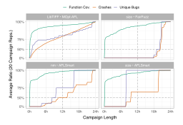
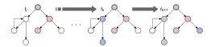
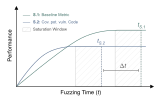
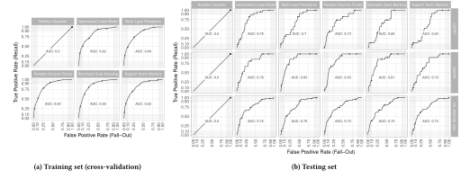
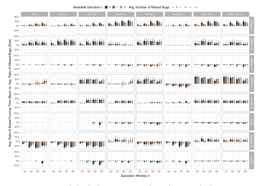
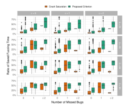
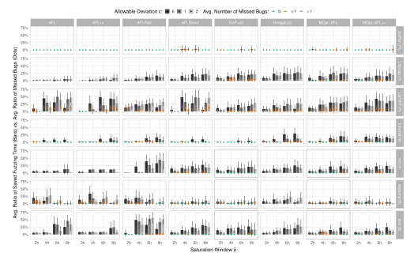
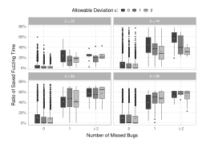

**Source:** *Green Fuzzing: A Saturation-Based Stopping Criterion using Vulnerability Prediction* — [PDF](https://mboehme.github.io/paper/ISSTA23-green.pdf)

# Green Fuzzing: A Saturation-based Stopping Criterion using Vulnerability Prediction

Stephan Lipp Technical University of Munich Germany

Alexander Pretschner Technical University of Munich Germany

Daniel Elsner Technical University of Munich Germany

Marcel Böhme MPI-SP, Germany Monash University, Australia

Severin Kacianka Technical University of Munich Germany

Sebastian Banescu Technical University of Munich Germany

# ABSTRACT

Fuzzing is a widely used automated testing technique that uses random inputs to provoke program crashes indicating security breaches. A difficult but important question is when to stop a fuzzing campaign. Usually, a campaign is terminated when the number of crashes and/or covered code elements has not increased over a certain period of time. To avoid premature termination when a ramp-up time is needed before vulnerabilities are reached, code coverage is often preferred over crash count to decide when to terminate a campaign. However, a campaign might only increase the coverage on non-security-critical code or repeatedly trigger the same crashes. For these reasons, both code coverage and crash count tend to overestimate the fuzzing effectiveness, unnecessarily increasing the duration and thus the cost of the testing process.

The present paper explores the tradeoff between the amount of saved fuzzing time and number of missed bugs when stopping campaigns based on the saturation of covered, potentially vulnerable functions rather than triggered crashes or regular function coverage. In a large-scale empirical evaluation of 30 open-source C programs with a total of 240 security bugs and 1,280 fuzzing campaigns, we first show that binary classification models trained on software with known vulnerabilities (CVEs), using lightweight machine learning features derived from findings of static application security testing tools and proven software metrics, can reliably predict (potentially) vulnerable functions. Second, we show that our proposed stopping criterion terminates 24-hour fuzzing campaigns 6–12 hours earlier than the saturation of crashes and regular function coverage while missing (on average) fewer than 0.5 out of 12.5 contained bugs.

# CCS CONCEPTS

• Security and privacy → Software security engineering.

# KEYWORDS

fuzzing, stopping criterion, empirical study

Permission to make digital or hard copies of all or part of this work for personal or classroom use is granted without fee provided that copies are not made or distributed for profit or commercial advantage and that copies bear this notice and the full citation on the first page. Copyrights for components of this work owned by others than the author(s) must be honored. Abstracting with credit is permitted. To copy otherwise, or republish, to post on servers or to redistribute to lists, requires prior specific permission and/or a fee. Request permissions from permissions@acm.org.

ISSTA '23, July 17–21, 2023, Seattle, WA, USA

© 2023 Copyright held by the owner/author(s). Publication rights licensed to ACM. ACM ISBN 979-8-4007-0221-1/23/07. . . \$15.00 <https://doi.org/10.1145/3597926.3598043>

### ACM Reference Format:

Stephan Lipp, Daniel Elsner, Severin Kacianka, Alexander Pretschner, Marcel Böhme, and Sebastian Banescu. 2023. Green Fuzzing: A Saturation-based Stopping Criterion using Vulnerability Prediction. In Proceedings of the 32nd ACM SIGSOFT International Symposium on Software Testing and Analysis (ISSTA '23), July 17–21, 2023, Seattle, WA, USA. ACM, New York, NY, USA, [13](#page-12-0) pages. <https://doi.org/10.1145/3597926.3598043>

# 1 INTRODUCTION

Context. Fuzz testing, aka fuzzing [\[51,](#page-12-1) [57\]](#page-12-2), is a dynamic security testing technique with great success over the past decade in finding software vulnerabilities [\[61\]](#page-12-3), especially in programs written in a bug-prone programming language like C. For instance, Google performs fuzzing at a very large scale (100 k+ CPU cores) on their continuous fuzzing platform OSS-Fuzz [\[66\]](#page-12-4) to secure widespread open-source projects. OSS-Fuzz has reported over 40.5 k bugs in 650 codebases within the last seven years [\[10\]](#page-11-0). The idea of fuzzing is simple: generate numerous random inputs (mechanized by socalled fuzzers), feed them into a target program, and then observe whether it crashes. Certain program crashes enable the execution of malicious code, leakage of sensitive data, or provocation of denialof-service, and are therefore considered security vulnerabilities.

A barely studied area in fuzzing involves criteria that allow for a more informed decision about when to stop a specific fuzzer execution on a target program (i.e., fuzzing campaign). Since securityrelated software bugs are usually very sparse in programs [\[48,](#page-12-5) [60,](#page-12-6) [81\]](#page-12-7) and thus large parts of the fuzzing resources are wasted on non-security-critical source code, inaccurate stopping criteria can easily lead to unnecessarily lengthy campaigns [\[16\]](#page-11-1). Hence, better fuzzing stopping criteria would enable considerable time, hardware, and energy savings, as well as more effective scheduling of fuzzer ensembles [\[20\]](#page-11-2) when run with a fixed time or hardware budget. In summary, improving the stopping criteria would enhance the economically and environmentally[1](#page-0-0) sustainability of fuzzing.

State-of-Practice. A fuzzing campaign is usually stopped when no progress is observed over a certain period of time, measured by the number of triggered crashes or covered code elements (e.g., statements, basic blocks, or functions). To avoid premature termination of campaigns that need some time to reach vulnerable code, code coverage is often preferred in practice. However, both code coverage and crash count tend to overestimate the fuzzing effectiveness [\[39\]](#page-11-3) (as discussed in Section [2\)](#page-1-0). Consequently, a fuzzing campaign is kept alive even when it produces crashes with the same underlying

1 Initiative for sustainable digital infrastructure: <https://sdialliance.org/roadmap>

Figure 1: Examples of under- and overestimation of fuzzing effectiveness by crash count (top right and bottom left) and overestimation by regular function coverage (bottom right).

vulnerability or increases the coverage of non-security-critical code, respectively code that contains vulnerabilities that cannot be found via fuzzing in the first place. These expended time and hardware resources, if saved, could be invested in other security testing efforts (such as static application security testing or manual code inspections) to detect further vulnerabilities more efficiently [\[76\]](#page-12-8).

Hypothesis and Approach. This study hypothesizes that valuable time resources can be saved with a low risk of missing bugs by stopping fuzzing campaigns as soon as they stagnate on the potentially vulnerable code regions. Such regions contain at least one critical instruction that can cause a security violation if used improperly; for example, a call to the memcpy function.

The proposed strategy is implemented as follows: (1) before fuzzing, the target program is statically scanned for potentially vulnerable source code; (2) during fuzzing, the intersection between the potentially vulnerable code regions and those previously covered by the fuzz inputs is calculated; (3) the campaign is terminated if the set of covered potentially vulnerable code regions has not increased for a certain time period. Otherwise, the strategy returns to step 2 after a short timeout. So we are proposing a criterion with a better cost-effectiveness, defined as the amount of saved fuzzing time versus number of missed bugs, than saturation of crashes or regular code coverage.

Empirical Evaluation. This study explores the cost-effectiveness tradeoff of our approach for programs written in the C language. To this end, we first combine proven static vulnerability indicators (static application security testing (SAST) tools and software metrics) into a vulnerability prediction model using machine learning (ML), which identifies potentially vulnerable code at the function level. We thereby train and evaluate five different ML models—based on logistic regression, decision trees, and neural networks—on 22 open-source programs (44 k+ functions) with a total of 121 known vulnerable functions, extracted from Common Vulnerabilities and Exposures (CVE) reports. Second, we analyze the abovementioned

tradeoff in an empirical evaluation of eight subject programs (disjoint from the ML training set) with another 119 security bugs, eight state-of-the-art greybox fuzzers, and 20 campaign repetitions (i.e., 1,280 fuzzing campaigns), each running for 24 hours.

Contributions. This paper presents the following contributions:

- ⋆ We posit and validate our hypothesis that valuable resources can be saved while maintaining bug finding effectiveness by stopping fuzzing campaigns once they stagnate on the potentially vulnerable code.
- ⋆ We conduct an in-depth analysis of 25 vulnerability indicators (ML features) derived from SAST-tool findings and software metrics, showing that when combined via machine learning, the resulting model(s) can effectively discriminate between vulnerable and non-vulnerable functions (average ROC–AUC scores of ~0.8; see Section [5.1\)](#page-6-0).
- ⋆ We show in a large-scale empirical evaluation that when terminating 24-hour fuzzing campaigns based on the saturation of covered potentially vulnerable functions instead triggered crashes or regular function coverage, 6–12 hours of fuzzing can be saved, while missing fewer than 0.5 out of 12.5 bugs on average (see Section [5.2\)](#page-6-1).
- ⋆ We release all training and evaluation data, including the analysis script and machine-learned vulnerability prediction models to foster open science (see Section [10\)](#page-11-4).

# 2 MOTIVATION

Using the number of crashes as an indicator of fuzzing effectiveness is very prone to under- or overestimation [\[39\]](#page-11-3). Further, this can lead to missed bugs or unnecessarily long campaigns when used as a saturation-based stopping criterion. As code coverage reduces the risk of underestimation, it is often preferred in practice. However, code coverage also tends to overestimate the effectiveness of fuzzing campaigns because it assumes equal importance of each code location. Hereafter, we discuss the shortcomings of these two stopping criteria in concrete fuzzing campaigns and theoretically demonstrate how our approach mitigates them.

Saturation of Crashes. Crash saturation can be a good fuzzing stopping criterion if the course of the triggered crashes resembles that of the unique bugs. However, it becomes inaccurate when the fuzzing campaign (1) triggers crashes very late or (2) repeatedly generates crashes for the same underlying bug(s) in the code. Scenario (1) is evident in the top left graph of Fig. [1,](#page-1-1) where FairFuzz has not triggered a single crash for almost 18 hours. Here, the campaigns would be terminated prematurely, resulting in several bugs being overlooked. Scenario (2) is demonstrated in the bottom left graph, which shows that AFLSmart found all detectable bugs in nm within ~16 hours of fuzzing, while the number of crashes continued to increase for approximately seven hours thereafter. The large number of triggered crashes can create a false sense of fuzzing progress, leading to unnecessarily long campaigns when used as orientation to stop fuzzing.

Saturation of Code Coverage. Code coverage is therefore often used as a (complementary) measure to allow for a more informed decision about when to stop fuzzing. Returning to our size-FairFuzz example, we find that although the campaigns triggered no crashes

within the first ~18 hours of fuzzing, they constantly increased the function coverage until they reached the vulnerable parts of the program. Meanwhile, when nm was fuzzed with AFLSMART, the campaigns began to saturate on the same functions around the same time all detectable bugs were found, thus providing a more accurate feedback about their effectiveness. In summary, using code-coverage saturation as the stopping criterion for fuzzing campaigns can help avoid missing bugs and conserve fuzzing time.

However, as mentioned earlier, code coverage tends to overestimate the effectiveness of fuzzing. More specifically, a campaign that increases the code coverage is considered as very effective (and is consequently not terminated) even when no new security-critical parts in the program have been reached. For example, AFLSMART found all detectable bugs in size after ~7.5 hours of fuzzing, but the function coverage continuous to increase on seemingly non-security-critical functions for an additional ~11.5 hours. To terminate such lengthy fuzzing campaigns much earlier, we propose to check the coverage saturation of only the potentially vulnerable code regions (identified by static vulnerability indicators) instead of all code regions.

Figure 2: Visualization of our hypothesis at fuzzing time points  $t_j$ ,  $t_k$ , and  $t_{k+1}$ . The gray and blue nodes are newly covered code regions and the red-outlined nodes represent potentially vulnerable regions.

Saturation of Covered, Potentially Vulnerable Code. A simplified example of our hypothesis is illustrated in Fig. 2. The (newly) covered code regions in a control-flow- or call graph are shown at three different time points  $t_j$ ,  $t_k$  (with j < k), and  $t_{k+1}$  within a fuzzing campaign. In this example, the code coverage increased by two code regions from  $t_i$  to  $t_k$  and by one from  $t_k$  to  $t_{k+1}$ , indicating that the campaign remained active and should not be stopped. However, the coverage of the potentially vulnerable regions did not increase at any time point. At  $t_k$ , the fuzzing campaign appeared to quickly cover the last potentially vulnerable code region (which may not be reachable from the fuzz entry) but at  $t_{k+1}$  the campaign is moving in another direction, covering rather irrelevant code. Thus, if we use coverage of potentially vulnerable code rather than regular code coverage as a saturation-based stopping criterion, we may already end the fuzzing campaign at  $t_k$  or earlier, depending on the specified duration a campaign must stagnate before it should be terminated.

### 3 APPROACH

This section first describes our fuzzing stopping criterion, which is independent of the selected vulnerability prediction technique. Section 3.1 instantiates our criterion for a specific code granularity and Section 3.2 presents a concrete approach for predicting vulnerability that is based on machine learning (ML).

**Definition 1** (Fuzzing Proxy Measure). A proxy measure S is a quantitative approximation of the overall effectiveness of a fuzzing campaign in terms of bug finding. S(t) refers to the measured value after t time units in the campaign.

**Definition 2** (Saturation Window). A saturation window  $\delta$  denotes the time period during which the effectiveness of a fuzzing campaign (measured by a proxy metric S) must stagnate before the campaign is allowed to be terminated.

**Definition 3** (Saturation-based Stopping Criterion). The criterion employed to stop fuzzing campaigns can formally be defined as a triple  $(S, \delta, \epsilon)$ , in which

- S denotes the (proxy) measure for quantifying fuzzing effectiveness
- $\delta$  the saturation window, and
- $\epsilon$  the allowable deviation of S within  $\delta$ .

After  $t_k$  time units, a campaign is stopped if and only if  $t_k - t_j = \delta$ , where j < k and  $t_j$  denotes the time since the campaign began to stagnate, and  $S(t_k) - S(t_j) \le \epsilon$ .

Let c be a fuzzing campaign launched on a target program consisting of the code regions R (*i.e.*, statements, basic blocks, or functions). To check whether a region  $r \in R$  was covered within the first t time units of c, we define the function covered :  $R \times T \rightarrow \{true, false\}$ , which returns

$$\mathsf{covered}(r,t) \coloneqq \begin{cases} \mathit{true}, & \text{if } r \text{ was covered by at least one} \\ & \text{fuzz input within } t, \end{cases} \tag{1}$$
 
$$\mathit{false}, \quad \mathsf{otherwise}.$$

As our approach focuses on the covered code regions that are potentially vulnerable according to a (static) vulnerability prediction model  $M \in \mathcal{M}$ , we additionally define the function  $\mathsf{pot\_vuln}: R \times \mathcal{M} \to \{\mathit{true}, \mathit{false}\}$ . For a given code region  $r \in R$ , this function returns

$$\mathsf{pot\_vuln}(r,M) := \begin{cases} \mathit{true}, & \text{if } r \text{ contains one or more lines} \\ & \text{considered vuln. by } M, \\ \mathit{false}, & \text{otherwise.} \end{cases} \tag{2}$$

An example of a potentially vulnerable C instruction is an unguarded array access arr[i] with  $i \in \mathbb{N}_0$ , where a security-critical program crash (segmentation fault) may be triggered if i exceeds the array bounds, i.e.,  $i \ge len(arr)$ .

**Definition 4** (Coverage of Potentially Vulnerable Code). Given a vulnerability prediction model M, we define the coverage of potentially vulnerable codes as

$$S(t,M) := \frac{\mathbf{card}\big( \{\, r \mid r \in R \land \mathsf{covered}(r,t) \land \mathsf{pot\_vuln}(r,M) \,\} \big)}{\mathbf{card}\big( \{\, r \mid r \in R \land \mathsf{pot\_vuln}(r,M) \,\} \big)}$$

where  $card(\cdot)$  returns the cardinality of the set.

Definition 4 restricts the regular code coverage to only those covered code regions that were flagged as potentially vulnerable by the prediction model.

# 3.1 Function-Level Coverage

In general, the coverage granularity level (*i.e.*, statements, basic blocks, or functions) used for our saturation-based criterion to stop fuzzing campaigns mainly depends on the available ground truth data for training the vulnerability prediction models (discussed in Section 3.2). Here, we used a dataset built from CVE reports [44], which are validated descriptions of security bugs that have been found in the past. However, the accuracy of these descriptions varies immensely across different reports [58]. Whereas some reports pinpoint the exact vulnerable code line(s), others name only the affected function(s). For this reason, we chose the code granularity of functions in this study.

# 3.2 ML-based Vulnerability Prediction

3.2.1 Motivation. Different vulnerability indicators (such as SAST-tools and software metrics) are differently effective in finding security bugs [45, 69]. To combine these indicators into a single vulnerability prediction model that adequately leverages the strengths of each indicator, we adopt an ML-based approach. This way, the model automatically learns the effectiveness of each indicator and further its weight on the prediction from codebases with known vulnerabilities. This approach was selected because—especially in C programs—similar vulnerabilities to those found in the past are often re-introduced in the source code [1, 79]. Hence, indicators that have found known vulnerabilities are likely to also find new ones and should therefore have a stronger impact on the model's prediction.

3.2.2 Feature Engineering. The quality of the selected features greatly affects the performance of the final ML model [23]. Inspired by Pereira *et al.* [63], we use 25 function-level ML features that can semantically be grouped into software metric- and SAST-based feature classes. We thereby focused to compile a set of lightweight features that can be easily extracted from the source code using freely available tools, or already exist as test artifacts (*e.g.*, are generated whenever a software change is committed), yet are indicative enough to reliably predict vulnerable code.

**Software Metric Features.** In general, the features in this class can be statically computed from the source code.

HEURISTIC 1: The higher the code complexity of a function, the more difficult it is to understand, and hence the more likely it is to introduce vulnerabilities.

- Lines of code (LoC) in a function
- Cyclomatic complexity number of a function (absolute number and relative to LoC)

Cyclomatic *aka* McCabe code complexity [53] is computed as the number of possible linearly independent paths through the control-flow graph of a function. Various studies [24, 55, 69, 70] have thereby already shown that code complexity is a good indicator of vulnerable functions.

HEURISTIC 2: The more central a function is in terms of incoming and outgoing function calls, the larger the input and output space to be considered, and therefore the more prone the function is to vulnerabilities.

- Number of incoming calls of a function (both absolute and relative to LoC)
- Number of outgoing calls of a function (both absolute and relative to LoC)

The numbers of incoming and outgoing function calls can simply be calculated by counting the respective edges in the program's call graph. These metrics have already been successfully applied for defect prediction [80] and fault localization [78].

SAST-based Features. The tools used in this work include five state-of-the-art open-source static analyzers: CodeChecker [4], CodeQL [5], Cppcheck [6], Flawfinder [7], and Infer [9]). A recent study [45] confirmed that they are capable of finding C vulnerabilities in real-world programs, especially when used in combination. To reduce the likelihood of missing vulnerable functions, we additionally use a modified version2 of the (memory) error detector Additionally use a modified version3 [67]. Similar to Österlund *et al.* [82], we consider each instrumented code location (*i.e.*, function) as potentially vulnerable. We thereby chose AddressSanitizer because it covers the most common C vulnerabilities, such as buffer overflows, memory leaks, and freed memory usages.

HEURISTIC 3: The more lines in a function are flagged as potentially vulnerable by one or more SAST-tools, the more likely that function is to be actually vulnerable.

- Number of lines in a function flagged as potentially vulnerable by CodeChecker, CodeQL, Cppcheck, Flawfinder, Infer, and AddressSanitizer (both absolute and relative to LoC)
- Number of lines in a function flagged as potentially vulnerable by all SAST-tools (with/without ASAN; both absolute and relative to LoC)

Pereira *et al.* [63] employed in their work similar features to those above. Moreover, they show that using them in combination with software metrics leads to better prediction of vulnerable files than using only one of the two feature classes.

HEURISTIC 4: The likelihood of identifying a vulnerable function increases with the number of different SAST-tools that flag that function as problematic.

- Number of different SAST-tools (with/without ASAN) that flag a function as potentially vulnerable
- 3.2.3 Supervised Machine Learning. Different training algorithms exist that allow to create machine-learned classification models  $M \in \mathcal{M}$  that predict the probability of a binary output class  $C := \{A, B\}$  based on the probability distribution learned through the training dataset. Hereby, the actual classification is performed through the function predict :  $\mathcal{F} \times \mathcal{M} \times \mathbb{R}_{[0,1]} \to C$ , which for a given list of feature values  $F \in \mathcal{F}$ , prediction model  $M \in \mathcal{M}$ , and cutoff value  $\theta \in \mathbb{R}_{[0,1]}$  returns

$$\operatorname{predict}(F, M, \theta) := \begin{cases} A, & \text{if } M(F) \ge \theta, \\ B, & \text{otherwise.} \end{cases}$$
 (3)

&lt;sup>2https://github.com/tum-i4/llvm-project

&lt;sup>3ADDRESSANITIZER instruments the target program at compile-time with additional security checks (assertions) to enforce a program crash once a security-violating program state is encountered at runtime [71].

In this work, we selected the following five supervised classification algorithms/models supported in the caret R package [41]: Generalized linear model (GLM), multi-layer perceptron (MLP), random decision forest (RDF), gradient boosted machine (GBM), and support vector machine (SVM). Using these algorithms, we train the models on codebases with known vulnerabilities (CVEs) so that they later predict if a function is (potentially) vulnerable, i.e.  $C := \{vuln, non-vuln\}$ . Now, we can define pot\_vuln:  $\mathcal{F} \times \mathcal{M} \times \mathbb{R}_{[0,1]} \rightarrow \{true, false\}$  as follows:

$$pot\_vuln(F, M, \theta) := \left(predict(F, M, \theta) = vuln\right)$$
 (4)

The parameters F, M, and  $\theta$  introduce a certain degree of freedom in terms of configuration. This means, they can be fine-tuned towards a specific software project to reliably find potentially vulnerable functions, while flagging as few code as possible.

3.2.4 Application in Practice. First the vulnerability prediction model must be trained on a dataset with known vulnerabilities, preferably on older, vulnerable versions of the program(s) to be fuzzed. If no ground truth is available, the pre-trained models provided with this paper can be used at first. Next, the software metrics and SAST-tools must be extracted from/run on the target program to derive the respective feature values of each contained function. Prior to fuzzing, these values must be passed to the ML model with the selected cutoff to determine the potentially vulnerable functions. After that, the fuzzing campaign can be launched. In this process, the campaign is terminated if the coverage of the problematic functions stagnates over the specified time window, otherwise fuzzing continues, repeating this check at certain intervals.

# 4 EXPERIMENTAL SETUP

### 4.1 Research Questions

The proposed stopping criterion only works if the prediction model *reliably identifies* potentially vulnerable code regions. If vulnerable code is overlooked, the campaign is perceived to saturate earlier and will more likely to be terminated before bugs can be reached or triggered. If too much non-security-critical code is flagged, little to no time savings may be achieved. These considerations led to the following research questions:

- RQ.1 Vulnerability Prediction Performance. How effectively can machine-learned vulnerability prediction models identify vulnerable functions after being trained on known realworld security bugs using features derived from SAST-tool findings and software metrics?
- **RQ.2** Stopping Criterion Tradeoff. What is the tradeoff between the saved fuzzing time and missed security bugs when using coverage of potentially vulnerable functions instead of (a) crash count or (b) regular function coverage as a saturation-based stopping criterion?

# 4.2 Model Training and Testing

4.2.1 Subject Programs. For training and testing the vulnerability prediction models, we created two sets of real-world C programs containing a diverse set of well-documented vulnerabilities detectable via fuzzing. Here, we used the dataset provided by Lipp *et al.* [44], which consists of the Binutils suite and the

Table 1: Subjects for machine learning.

(a) Training set

| Subject    | Version   | LoC     | # Functions | # Vuln. Funcs. |
|------------|-----------|---------|-------------|----------------|
| Binutils 1 | 2.29      | 45,243  | 1,378       | 15             |
| FFmpeg     | n3.3.2    | 486,774 | 17,759      | 23             |
| Libpng     | 1.6.38    | 10,184  | 398         | 9              |
| OpenSSL    | 3.0.0     | 165,274 | 13,036      | 30             |
| PHP        | 8.0.0-dev | 101,531 | 4,759       | 8              |
| Poppler    | 0.88.0    | 61,081  | 4,458       | 20             |
| SQLite3    | 3.32.0    | 53,327  | 2,296       | 16             |
| Total      |           | 923,414 | 44,084      | 121            |

 $^{1}\,\mathrm{We}$  exclude nm, objdump, and size, as well as all shared functions in the other Binutils programs.

#### (b) Testing set

| Subject               | Version | LoC     | # Functions | # Vuln. Funcs. |  |
|-----------------------|---------|---------|-------------|----------------|--|
| LibTIFF               | 4.1.0   | 19,527  | 826         | 23             |  |
| Libxml2               | 2.9.10  | 85,466  | 2,982       | 21             |  |
| nm objdump size | 2.29    | 90,566  | 2,792       | 50             |  |
| Total                 |         | 195,561 | 6,600       | 94             |  |

video/audio processing tool FFmpeg (older versions with known bugs), as well as of subjects from the Magma dataset [36]. Magma utilizes a technique called *bug front-porting*, by which previously found vulnerabilities (*i.e.*, validated CVE reports) are reinserted into newer versions of the same program. These two sets, with a combined total of 215 functions affected by at least one vulnerability, are overviewed in Table 1.

- 4.2.2 Feature Elimination. To ensure the reliability and discriminative ability of the machine learning models, we omitted all redundant and uninformative features. To this end, we first identified pairs of highly correlated features (with Pearson's  $r \geq 0.8$ ) and then eliminated4 one from each pair [38]. We also excluded features with zero and near-zero variance, as they barely discriminate between vulnerable and non-vulnerable functions.
- 4.2.3 Training Control. Before training, we normalized each feature value between 0 and 1 (using a min-max scaler) to avoid distortions in training algorithms that utilize distance computations. Because our dataset is imbalanced (containing 121 vulnerable versus 43,963 non-vulnerable functions; see Table 1), we downsampled5 the feature data of the majority class such that both classes were equally prevalent in the training set. Following the best practices [12] in ML-based vulnerability prediction, we trained and evaluated the different models using 10-fold cross-validation over all functions in the training set. Each fold was stratified, meaning that both classes occurred in each fold with the same probability as in the original non-downsampled dataset. Furthermore, each cross-validation was conducted five times and averaged to provide a robust estimate of the models' performance.

&lt;sup>4The exact list of removed features can be found in the provided analysis script.

 $^5\mathrm{We}$  obtained nearly identical evaluation results after upsampling the dataset.

Table 2: Subjects for the tradeoff analysis.

| Subject | Version | LoC     | # Functions | # Crashes | # Bugs |
|---------|---------|---------|-------------|-----------|--------|
| Gif2png | 2.5.3   | 988     | 27          | 3,620     | 4      |
| JasPer  | 1.900.0 | 17,385  | 720         | 9,853     | 77     |
| Libpcap | 1.9.0   | 12,076  | 497         | 595       | 7      |
| LibTIFF | 4.1.0   | 19,527  | 826         | 17,701    | 7      |
| Libxml2 | 2.9.10  | 85,466  | 2,982       | 50,907    | 9      |
| nm      | 2.29    | 68,667  | 2,126       | 58        | 4      |
| objdump | 2.29    | 89,961  | 2,701       | 4,014     | 5      |
| size    | 2.29    | 68,115  | 2,101       | 77        | 6      |
| Total   |         | 362,185 | 11,980      | 86,825    | 119    |

- 4.2.4 Evaluation Metrics. To measure the effectiveness of the vulnerability prediction models, we use the true positive rate (TPR) aka recall and false positive rate (FPR)6 aka fall-out. TPR is the ratio of marked vulnerable functions to all vulnerable functions; that is, the model's reliability at detecting security bugs. FPR is the ratio of marked non-vulnerable functions to all non-vulnerable functions, which determines the model's tendency to falsely mark functions.
- 4.2.5 Infrastructure. All vulnerability prediction experiments were performed on a machine with an Intel(R) Core(TM) i7-6700 processor containing eight logical cores running at 3.4 GHz, with 16 GB main memory access and GNU/Linux Ubuntu 20.04 (64-bit) as operating system. Depending on the training algorithm, building the ML models in parallel on all cores took 30–120 seconds.

# 4.3 Tradeoff Analysis

- 4.3.1 Dataset. To explore the tradeoff between the saved fuzzing time and number of missed bugs, we selected the FuzzTastic dataset [46] because it provides extensive crash and code coverage data of multiple state-of-the-art fuzzers executed across several subject programs. To extend the number of security bugs, we also fuzzed LibTIFF and Libxml2 from Magma.
- 4.3.2 Subject Programs. Our extended FuzzTastic dataset contains various large open-source applications and libraries from different domains that are widely used in practice. For the included libraries, FuzzTastic uses the fuzz harnesses provided by OSS-Fuzz or Magma, respectively. Note that for our tradeoff analysis we only used those programs where at least one security bug could be triggered by the fuzzers, resulting in the eight subjects shown in Table 2. These programs are completely disjoint from those used for training the vulnerability prediction models.
- 4.3.3 Crash Deduplication. The launched fuzzing campaigns triggered a total of 86,825 program crashes. As this number is too large for manual deduplication, we approximated unique security bugs using ClusterFuzz's [3] approach: Two crashes are considered to have the same underlying vulnerability if the top  $N \in \mathbb{N}_0$  stack frames (irrespective of the function arguments) of the program execution trace are identical. After manually reviewing a random sample of ~50 crash traces, we found that N = 3 provides the most

accurate approximation of unique bugs. The automatic deduplication ultimately yielded 119 unique bugs (see Table 2).

- 4.3.4 Selected Models and Cutoffs. In practice, the machine learning models would be trained, optimized, and evaluated on older, vulnerable versions of the same program(s) as to be fuzzed later. The most effective model would then be selected for our stopping criterion. However, as our dataset contains relatively few vulnerabilities per program, we trained and applied the prediction models on different sets of programs. To evaluate our criterion under realistic conditions, we selected for each subject program the model plus cutoff value that found at least 90% of the bug-triggering and thus vulnerable functions, while also flagging the fewest functions reachable from the fuzz entry. We chose this detection rate threshold because it is a realistic value, as shown by our evaluation (see Section 5.1) and related studies [40, 54, 55].
- 4.3.5 Fuzzers, Seeds, and Campaign Length. Our dataset contains the crash and coverage data of eight state-of-the-art greybox fuzzers: AFL [2], AFLFAST [18], AFL++ [25], AFLSMART [64], FAIRFUZZ [42], HONGGFUZZ [8], MOPT-AFL [49], and MOPT-AFL++ [25]. All fuzzers have been published at top-tier research conferences and/or are widely used among practitioners (cf. their GitHub stars [14]). As for the initial seeds, we used a (non-empty) corpus provided by AFL's GitHub repository or the MAGMA suite, respectively. Furthermore, each {subject × fuzzer}-pair was executed for 24 hours with 20 campaign repetitions.

Figure 3: Approach of the tradeoff analysis.

4.3.6 Evaluation Metrics. We evaluate the ratio of (1) saved fuzzing time and (2) missed bugs (see Fig. 3) of our stopping criterion relative to the saturation of crashes and regular function coverage (baseline criteria) on the same fuzzing campaigns. For a given saturation window  $\delta$  (grey area) and allowable deviation  $\epsilon$  (zero in this example), we compute (1) by dividing  $\Delta t$  by the overall campaign length (24 hours). As for (2), we divide the number of bugs found between  $t_{S_1}$  and  $t_{S_2}$  by all bugs found in the respective subject program while generating the (extended) FuzzTastic dataset (see Table 2). We perform this analysis with  $\delta \in \{2 \text{ h, 4 h, 6 h, 8 h}\}$  and  $\epsilon \in \{0, 1, 2\}$  (i.e., the number of functions/crashes allowed to be exercised within  $\delta$ ). For both measures, we report the arithmetic means and standard deviations over 20 campaign repetitions to account for the randomness in fuzzing.

&lt;sup>6For our purposes, FPR is more appropriate than *precision* because the model's accuracy in terms of identifying vulnerable functions is less important than the actual number of flagged non-vulnerable functions. Given the relatively few vulnerable functions in our dataset, the FPR increases the more functions are flagged.

&lt;sup>7For this reachability analysis, we used the static analysis framework SVF [72].

Figure 4: Performance comparison of the machine-learned vulnerability prediction models. The dots indicate the cutoff values  $\theta \in \{0.1, 0.3, 0.5, 0.7, 0.9\}$ , with the highest  $\theta$  at the far left.

### 5 EVALUATION

# 5.1 RQ.1: Vulnerability Prediction Performance

**Interpretation.** Figures 4a and 4b show the evaluation results of the five machine-learned vulnerability prediction models in the form of receiver operating characteristic curves (ROCs). The baseline model randomly classifies functions based on the relative frequencies of vulnerable and non-vulnerable functions in our training set, *i.e.*,  $P(vuln) \approx 0.003$  and  $P(non-vuln) \approx 0.997$  (see Table 1). As a rule of thumb, the larger the area under the curve (AUC), the better the model's discrimination between vulnerable and non-vulnerable functions [37]. Note that in Fig. 4b, the Binutils subjects nm, objdump, and size are treated as one program because they share many functions.

Cross-validation Performance. As shown in Fig. 4a, the baseline model indicates insufficient discrimination between vulnerable and non-vulnerable functions (ROC–AUC = 0.5). Despite the small number of vulnerable functions in our dataset, most of them are missed when randomly flagging functions. In contrast, all machinelearned models outperform the random classification, achieving excellent discrimination scores (~0.84 on average). Interestingly, although the GBM yields the highest ROC–AUC score, the performance differences between these models are not statistically significant, suggesting that the selected machine learning features are robust with respect to different training algorithms.

Adjusting the cutoff value guides the models toward specific objectives. For example, when assigning a relatively low cutoff ( $\theta = 0.3$ ), all five machine-learned models achieve a true positive rate of 0.9 or higher, indicating that they effectively detect the vulnerable functions. For the same cutoff value, the false positive rate of all models, except the support vector machine, is less than 0.5, showing that when the number of vulnerable functions is small, roughly half of the models' findings are false positives. In other

words, only half of the functions ought to be tested to find nearly all the included security bugs.

**Testing-Set Performance.** Figure 4b shows that the effectiveness of the vulnerability prediction models is slightly reduced when applied on the testing-set programs. For nm, objdump, and size, the performance of the machine-learned models is very similar with ROC–AUC scores ranging from 0.74 to 0.76, confirming decent discrimination between vulnerable and non-vulnerable functions. The performance variations among the models are larger on Libxml2. Whereas MLP, RDF, and GBM achieve excellent ROC–AUC scores (0.81–0.85), GLM and SVM perform only moderately (ROC–AUC = 0.78 and 0.73, respectively). Similarly for LibTIFF, where GLM, MLP, and RDF reliably differentiate between vulnerable and non-vulnerable functions (ROC–AUC = 0.7–0.78) but GBM and SVM are rather ineffective, with ROC–AUC scores below the acceptable threshold of 0.7 [37].

Summary (RQ.1). Our machine-learned vulnerability prediction models accurately discriminate between vulnerable and nonvulnerable functions. During cross-validation on the training set, the models achieve (on average) a ROC-AUC score of 0.84. On the testing set, they are less effective with an average score of 0.75, yet capable of reliably identifying vulnerable functions, albeit at the cost of more false positives.

# 5.2 RQ.2: Stopping Criterion Tradeoffs

**Interpretation.** Figures 5 and 7 show the tradeoff results of our stopping criterion relative to the saturation of crashes and regular function coverage. For example, the LibTIFF-AFLFAST cell in Fig. 5 reads as follows: Using a saturation window of  $\delta=4$  h and an allowable deviation of  $\epsilon=0$  functions/crashes, our criterion terminates the fuzzing campaigns on average 12 hours (50 percentage points) earlier, while missing relative to the baseline criterion (*i.e.*,

&lt;sup>8Similarly low ROC-AUC scores were obtained in 50:50 random classification.

Figure 5: Tradeoff results of our stopping criterion relative to the saturation of crashes.

crash saturation) not more than one out of seven bugs. Note that *negative values* in this plot indicate additional time expenditures and further bugs found by our criterion. Furthermore, Figs. 6 and 8 show the time savings with respect to the number of missed bugs of our stopping criterion relative to the respective baseline. These two plots only consider the 1,020 (out of 1,280) fuzzing campaigns that triggered at least one bug.

Baseline: Crash Saturation. For the subjects Gif2png, JasPer, LibTIFF, and Libxml2, Fig. 5 shows that our stopping criterion terminates (on average) the fuzzing campaigns 6–12 hours earlier than the crash saturation criterion (time savings of 25%–50%), while missing on average about 0.5 bugs (4%). For MOPT-AFL and MOPT-AFL++ executed on LibTIFF, even time savings of up to 18 hours (75%) could be achieved. In contrast, on Libpcap, nm, and size, our criterion stops the campaigns around 2.4–4.8 hours (10%–20%) later than crash saturation, however, often finding one additional bug. Only on objdump, when fuzzed with AFL, AFL++, AFLFAST, and Honggfuzz, our criterion extends the time expenditures by roughly 6–12 hours (25%–50%).

As shown in Fig. 6, our stopping criterion is more cost-effective than crash saturation for most (10/12) of the  $\{\epsilon \times \delta\}$ -parameters studied. Across the different parameters and ranges of missed bugs, our criterion allows for 4.1 hours (17.2 percentage points) time savings when compared to crash saturation. Among the 1,020 bug-triggering campaigns stopped under our criterion, 84.2% miss zero bugs, 6.6% one, and 4.9% two or more bugs on average. Vice versa, one additional bug is found (on average) using our criterion in 4% of these campaigns and two or more in 0.3%.

**Summary (RQ.2-a).** Our stopping criterion is more cost-effective than the saturation of crashes, reducing (on average) the termination time by 4.1 hours (17.2 percentage points) in 24-hour fuzzing campaigns across the studied  $\{\epsilon \times \delta\}$ -parameters. Thereby, our criterion misses bugs in 11.5% of the 1,020 bug-triggering campaigns but also finds bugs that are missed by crash saturation in 4.3% of the same campaigns.

Figure 6: Fuzzing time savings with respect to the number of missed bugs of our stopping criterion relative to the saturation of crashes.

Baseline: Function Coverage Saturation. As shown in Fig.  $7^9$ , our stopping criterion terminates (on average) the campaigns 4.8–9.6 hours earlier than regular function-coverage saturation (time savings of 20%-40%) for many of the examined {subject × fuzzer}-pairs, while missing 0.2 bugs (2.7%). On some subjects—for example, the AFLFAST campaigns launched on size—our criterion saves up to 12 hours (50%) of the fuzzing time. In contrast, no real time savings could be achieved on JasPer. This is because JasPer, with 77 known security bugs, contains many vulnerable functions, which are also identified as such by the prediction model. The campaigns then continuously increase coverage of these problematic functions, which is why our criterion does not terminate them earlier.

Figure 8 displays the time savings with respect to the number of missed bugs over the range of studied  $\{\epsilon \times \delta\}$ -parameters. Across these parameters, our stopping criterion reduces the fuzzing time by 1.7 hours (7%) on average in campaigns where no bugs were missed. In campaigns where bugs are missed, average time savings of 9.6 hours (40.1%) could be achieved. Among the 1,020 campaigns stopped with our criterion, 94.3% miss zero bugs (on average), 4.6% one, and 1.1% two or more bugs compared to regular function-coverage saturation.

**Summary (RQ.2-b).** Our stopping criterion is more cost-effective than the saturation of regular function coverage, reducing (on average) the termination time by 4.8–9.6 hours in 24-hour fuzzing campaigns at the cost of missing 0.2 out of 7.4 contained bugs. Furthermore, across the examined range of  $\{\epsilon \times \delta\}$ -parameters, our criterion misses one or more bugs in only 5.7% of the 1,020 bug-triggering campaigns. In these campaigns, the average saving increased to 9.6 hours.

#### 6 DISCUSSION

ML-based Vulnerability Prediction. Depending on the training algorithm, the importance of the selected features and thus their impact on the final prediction can vary. Interestingly, the features derived from software metrics, such as the cyclomatic complexity number and number of incoming/outgoing function calls (both absolute and relative to lines of code), were in our setup often more predictive of vulnerable functions than the SAST-based features. This observation might be explained (at least partly) by the many false positives that even state-of-the-art SAST-tools output [45, 82]. Nonetheless, both feature classes were required for the best possible prediction in our evaluation. In general, the more effective the vulnerability prediction is, the more accurate is our criterion in deciding when to stop a fuzzing campaign.

Although the machine-learned vulnerability prediction models reliably detected (potentially) vulnerable functions in programs outside the training set, we recommend training such models on the same but older vulnerable versions of the codebase(s) later to be fuzzed. In our evaluation, the ROC–AUC scores where higher on the training set (cross-validation) than on the testing set, indicating that in-project training improves the prediction accuracy. If no ground truth is available, our *pre-trained models* can be used as a starting point with a conservative cutoff value of 0.3–0.5 to minimize the risk of overlooking vulnerable functions. As more data about bugs become available, the models and thus the accuracy of our stopping criterion can be *improved over time*, which is also not possible with the currently available criteria.

Saturation-based Fuzzing Stopping Criteria. Although saturation of crashes has proven to be a good stopping criterion for some of the examined fuzzing campaigns, we argue that coverage-based criteria are more reliable. Böhme and Falk [16] empirically found that each new bug discovery requires *exponentially* more fuzzing resources. Hence, with a fixed number of machines, bugs will be detected later and later via fuzzing over time. As a result, the crash saturation criterion becomes impractical at some point, because campaigns are very likely of being stopped too early. Here, coverage-based criteria are oftentimes the better choice, as they reflect the effectiveness/progress of a campaign more accurately.

Overall, using the machine-learned models to predict potentially vulnerable functions for our stopping criterion allowed terminating fuzzing campaigns substantially earlier than under typical stopping criteria (saturation of crashes or regular function coverage) with very few bugs missed. In a realistic setting, when the latest software builds are fuzzed overnight for 10 hours after each of the five workdays across hundreds of CPUs, a 50% time reduction saves 1,200 hours of fuzzing in one year, 2,400 hours in two years, 6,000 hours (~250 days) in five years.

One limitation of our approach is that fuzzing campaigns may be terminated too early, which in turn can lead to bugs being missed. This is the case when the campaign stagnates on the same potentially vulnerable code for too long before it actually manages to trigger a bug in the same or another vulnerable part of the program. This problem can be mitigated to some extent by using longer saturation time windows. Furthermore, overlooking a small number of security bugs can be an acceptable tradeoff for large time savings, because software testing generally *cannot prove the absence of* 

 $^9\mathrm{We}$ omitted Gif2png from this graph as both criteria yielded identical results.

Figure 7: Tradeoff results of our stopping criterion relative to the saturation of regular function coverage.

Figure 8: Fuzzing time savings with respect to the number of missed bugs of our stopping criterion relative to the saturation of regular function coverage.

bugs and will therefore always miss one or another vulnerability. Returning to the above example, additional fuzzing campaigns can be executed once or twice a month with a fixed time budget (e.g.,

24 or 48 hours) during weekends. This action would further reduce the likelihood of missing vulnerabilities while still saving a lot of time and hardware resources.

# 7 THREATS TO VALIDITY

**External Validity.** This threat category refers to the degree to which our results can be generalized to and across different programs, machine learning models for vulnerability prediction, and fuzzing tools outside of those in the present study.

To mitigate this threat, we evaluated our approach on 30 different real-world programs with a total of 240 security bugs. The programs were split into different sets to train and test the machine-learned models for vulnerability prediction, as well as to assess the tradeoffs of the proposed fuzzing stopping criterion. The vulnerability prediction models were built using five widely used supervised classification algorithms. In the tradeoff evaluation, we used eight different greybox fuzzers to demonstrate that our findings are not limited to one specific fuzzing tool.

**Internal Validity.** This threat category concerns the degree to which our study minimizes potential methodological mistakes.

As vulnerabilities are usually sparse in real-world software, our dataset for model training is rather imbalanced. To reduce the potential bias of over- or under-fitting the models to a specific output class, we applied the best practices also used in related studies, namely downsampling and repeated stratified cross-validation.

Furthermore, the large number of triggered program crashes provided by the (extended) FuzzTastic dataset forced us to mechanize the process of deduplicating crashes into unique security bugs. For this purpose, we applied a well-established heuristic from the fuzzing domain, in which crashes with the same top N stack trace (disregarding the function arguments) presumably have the same underlying vulnerability. To find the most accurate approximation, we determined N by manually analyzing a subset of randomly sampled stack traces of crashing program executions.

Finally, in all computations involving fuzzing data, we adhered to the guidelines of Klees et~al.~[39] and averaged the coverage and bug detection rates over multiple experiment repetitions to account for the inherent randomness of fuzzing. Specifically, 20 campaign repetitions were performed on each {subject  $\times$  fuzzer}-pair such as Google's FuzzBench service [56].

### 8 RELATED WORK

**ML-based Vulnerability Prediction.** Vulnerability prediction using machine learning is a very active research area, with numerous papers published each year [28, 30, 52].

Most of the existing studies on ML-based vulnerability prediction consider one specific class of features instead of several. Such studies usually adopt software metrics (such as complexity, code churn, and developer activity) [34, 54, 55, 59, 73], text mining [21, 73, 77], or static code analysis (e.g., data/control-flow and/or taint checking) [40, 62, 68]. Interestingly, some of these studies have also found that the comparably simple features can compete with and sometimes even outperform the more complex ones. According to these papers, the trained ML models detect around 70%-90% of the vulnerabilities included in their benchmark, which is similar to what we observe with our models. However, they differ from our work in that: (1) they predict the vulnerabilities at different code granularities (line-, function-, and file levels); (2) they train and evaluate the ML models on different datasets (artificial or real-world) with different quantities of labeled data (e.g., 100 or 100,000 data points); (3) they focus on specific vulnerability types (e.g., SQL injections or memory-related bugs); (4) they have different training objectives. Regrading point (4), most of the related works optimize the models for precision and recall, whereas we adopted the vulnerability extrapolation approach of Yamaguchi et al. [77] to reliably identify potentially vulnerable code while accepting a certain degree of false alarms. Hence, it is questionable whether the reported detection rates would be equally high for our setup and purposes or as good as the features we chose, respectively.

Pereira *et al.* [63] also employed software metrics and SAST-tool findings for binary (and multi-class) vulnerability prediction. For binary classification, they showed that using both, SAST-based and software metric features, results in higher detection rates than using only one of the two feature classes. We achieved equally high detection rates (90%) at a more fine-grained prediction (*i.e.*, function instead of file level). Interestingly, they also reported that the number of SAST flags per code region is only of limited use for predicting vulnerable code. Therefore, instead of two SAST-tools, we employ six state-of-the-art static analyzers (including CPPCHECK

and Flawfinder) and a modified version of AddressSanitizer to use the number of different tools that flag a function as problematic as an additional machine learning feature. Furthermore, we use seven different codebases to train and evaluate our models, while they use one (Mozilla project).

**Fuzzing Stopping Criteria.** The question of how to accurately quantify fuzzing effectiveness and thus when to stop a campaign is still an open challenge in fuzz testing [13]. Several studies [11, 19, 29, 32, 33, 35, 65, 74, 75] have evaluated new or existing code coverage variants to optimize or assess the effectiveness of test suites. However, none of these variants includes any heuristics that differentiate between potentially vulnerable and non-vulnerable code regions to provide a more accurate feedback about fuzzing effectiveness and thus a better fuzzing stopping criterion.

For comparing the effectiveness of fuzzers, Klees *et al.* [39] suggest a fixed time budget of at least 24 hours, as certain fuzzing techniques become more effective later in the campaign, *e.g.*, when more inputs are added to the queue. This suggestion has become an established guideline within the fuzzing community; accordingly, most of the recent fuzzer evaluations [22, 25–27, 36, 42, 43, 46, 49, 50, 64, 82] use timeouts between 24 hours and 7 days. Interestingly, Google's fuzzer evaluation platform Fuzzbench [56] uses timeouts of 23 hours. They justify their decision with the negligible differences in fuzzer rankings based on the code coverage achieved between experiments with 23 hour and those with 7 days timeouts, but the vast increase in hardware costs. Although this may give an indication of how long fuzzers should run for evaluation purposes, fixed time budgets oftentimes result in overly prolonged campaigns when launched to hunt security bugs in the wild.

To the best of our knowledge, only Böhme *et al.* [17] have attempted to address this problem. They employ various statistical estimators, including the Good-Turing estimator [15, 31], to quantify the residual risk (upper bound) of missing bugs in fuzzing campaigns, thus allowing for a more informed decision of when to stop them. In contrast to our fuzzer-agnostic approach, their stopping criterion is linked to the input generation approach implemented in the fuzzer. Specifically, their criterion must account for *adaptive bias*, which occurs in all fuzzing techniques that increase the probability of generating a bug-revealing input as the campaign progresses.

# 9 CONCLUSION

Fuzzing is very effective at finding security bugs, but also extremely time- and hardware-intensive. This is mainly because vulnerabilities are sparse and oftentimes hard to trigger/detect. Hence, stopping fuzzing campaigns based on the saturation of crashes (\$\neq\$ unique bugs) is likely to miss vulnerabilities. Furthermore, a campaign may appear effective in terms of code coverage and/or crash count and is therefore not terminated, although it only increases code coverage of non-security-critical program parts or repeatedly triggers the same crashes, respectively, resulting in *unnecessarily long campaigns*. Therefore, we propose to stop campaigns when they stagnate on the same *potentially vulnerable code regions, i.e.*, code that contains critical instructions that can cause a security violation if used improperly. Through a large-scale empirical evaluation, we

then show that (1) combining static vulnerability indicators (SAST-tools and software metrics) into a machine-learned vulnerability prediction model is *very effective* at identifying (potentially) vulnerable functions and (2) terminating fuzzing campaigns when they saturate on such identified potentially vulnerable functions allows for *substantial time savings* while incurring a *low risk of missing bugs*, compared to saturation of crashes and regular function coverage. Missing bugs can thereby be a permissible tradeoff, if parts of the time savings are invested in further testing efforts.

# 10 DATA AVAILABILITY STATEMENT

We release all training and evaluation data, including the analysis script and machine-learned vulnerability prediction models [47]. This material will allow replication of the study results and encourage further research on fuzzing stopping criteria.

#### ACKNOWLEDGMENTS

We would like to thank our colleagues Thomas Hutzelmann, Ana Petrovska, and Jan Wagener, along with the anonymous reviewers, for their valuable feedback.

#### REFERENCES

-  2022. 2022 0-day In-the-Wild Exploitation... so far. https://googleprojectzero. blogspot.com/2022/06/2022-0-day-in-wild-exploitationso-far.html. Accessed: 2022-10-21.
- [2] 2022. American Fuzzy Lop (AFL). https://lcamtuf.coredump.cx/afl/. Accessed: 2022-10-21.
- [3] 2022. ClusterFuzz. https://google.github.io/clusterfuzz/. Accessed: 2022-10-21.
- [4] 2022. CodeChecker. https://codechecker.readthedocs.io/en/latest/. Accessed: 2022-10-21.
-  $[5]\ \ 2022.\ CodeQL\ for\ Research.\ https://codeql.github.com/.\ Accessed:\ 2022-10-21.$
- [6] 2022. Cppcheck: A Tool for Static C/C++ Code Analysis. https://cppcheck.sourceforge.io/. Accessed: 2022-10-21.
- [7] 2022. Flawfinder. https://dwheeler.com/flawfinder/. Accessed: 2022-10-21.
- [8] 2022. Honggfuzz: Security-oriented Software Fuzzer. https://honggfuzz.dev/. Accessed: 2022-10-21.
- [9] 2022. Infer: A Tool to Detect Bugs in Java and C/C++/Objective-c Code. https://fbinfer.com/. Accessed: 2022-10-21.
- [10] 2022. OSS-Fuzz: Continuous Fuzzing for Open Source Software. https://github.com/google/oss-fuzz. Accessed: 2022-10-21.
- [11] James H. Andrews, Lionel C. Briand, Yvan Labiche, and Akbar Siami Namin. 2006. Using Mutation Analysis for Assessing and Comparing Testing Coverage Criteria. *IEEE Transactions on Software Engineering* 32 (2006), 608–624. Issue 8. https://doi.org/10.1109/TSE.2006.83
- [12] Daniel Arp, Erwin Quiring, Feargus Pendlebury, Alexander Warnecke, Fabio Pierazzi, Christian Wressnegger, Lorenzo Cavallaro, and Konrad Rieck. 2022. Dos and Don'ts of Machine Learning in Computer Security. Proceedings of the USENIX Security Symposium.
- [13] Marcel Boehme, Cristian Cadar, and Abhik Roychoudhury. 2021. Fuzzing: Challenges and Reflections. IEEE Software 38 (2021), 79–86. Issue 3. https://doi.org/10.1109/MS.2020.3016773
- [14] Hudson Borges and Marco Tulio Valente. 2018. What's in a Github Star? Understanding Repository Starring Practices in a Social Coding Platform. Journal of Systems and Software 146 (2018), 112–129. https://doi.org/10.1016/j.jss.2018.09.016
- [15] Marcel Böhme. 2018. STADS: Software Testing as Species Discovery. ACM Transactions on Software Engineering and Methodology 27 (4 2018), 1–52. Issue 2. https://doi.org/10.1145/3210309
- [16] Marcel Böhme and Brandon Falk. 2020. Fuzzing: On the Exponential Cost of Vulnerability Discovery. Proceedings of the Joint Meeting European Software Engineering Conference and Symposium on the Foundations of Software Engineering, 713–724. https://doi.org/10.1145/3368089.3409729
- [17] Marcel Böhme, Danushka Liyanage, and Valentin Wüstholz. 2021. Estimating Residual Risk in Greybox Fuzzing. Proceedings of the Joint Meeting on European Software Engineering Conference and Symposium on the Foundations of Software Engineering, 230–241. https://doi.org/10.1145/3468264.3468570
- [18] Marcel Böhme, Van-Thuan Pham, and Abhik Roychoudhury. 2019. Coverage-Based Greybox Fuzzing as Markov Chain. IEEE Transactions on Software Engineering 45 (5 2019), 489–506. Issue 5. https://doi.org/10.1109/TSE.2017.2785841

- [19] Marcel Böhme, László Szekeres, and Jonathan Metzman. 2022. On the Reliability of Coverage-based Fuzzer Benchmarking. Proceedings of the International Conference on Software Engineering, 1621–1633. https://doi.org/10.1145/3510003.3510230
- [20] Yuanliang Chen, Yu Jiang, Fuchen Ma, Jie Liang, Mingzhe Wang, Chijin Zhou, Hzuo Su, and Xun Jiao. 2018. EnFuzz: Ensemble Fuzzing with Seed Synchronization among Diverse Fuzzers.
- [21] Boris Chernis and Rakesh Verma. 2018. Machine Learning Methods for Software Vulnerability Detection. Proceedings of the International Workshop on Security and Privacy Analytics 2018-January. https://doi.org/10.1145/3180445.3180453
- [22] Jaeseung Choi, Joonun Jang, Choongwoo Han, and Sang Kil Cha. 2019. Grey-Box Concolic Testing on Binary Code. Proceedings of the International Conference on Software Engineering 2019-May, 736–747. https://doi.org/10.1109/ICSE.2019.0022
- [23] Pedro Domingos. 2012. A Few Useful Things to Know about Machine Learning. Issue 10. https://doi.org/10.1145/2347736.2347755
- [24] Xiaoning Du, Bihuan Chen, Yuekang Li, Jianmin Guo, Yaqin Zhou, Yang Liu, and Yu Jiang. 2019. Leopard: Identifying Vulnerable Code for Vulnerability Assessment Through Program Metrics. Proceedings of the International Conference on Software Engineering 2019-May, 60–71. https://doi.org/10.1109/ICSE.2019.00024
- [25] Andrea Fioraldi, Dominik Maier, Heiko Eißfeldt, and Marc Heuse. 2020. AFL++: Combining Incremental Steps of Fuzzing Research. Proceedings of the USENIX Workshop on Offensive Technologies.
- [26] Shuitao Gan, State Key, Mathematical Engineering, Advanced Computing, Usenix Security Symposium, Shuitao Gan, Chao Zhang, Peng Chen, Bodong Zhao, Xiaojun Qin, Dong Wu, and Zuoning Chen. 2020. Greyone: Data Flow Sensitive Fuzzing. Proceedings of the USENIX Security Symposium, 2577–2594. https://www.usenix.org/conference/usenixsecurity20/presentation/gan
- [27] Shuitao Gan, Chao Zhang, Xiaojun Qin, Xuwen Tu, Kang Li, Zhongyu Pei, and Zuoning Chen. 2018. CollAFL: Path Sensitive Fuzzing. Proceedings of the IEEE Symposium on Security and Privacy 2018-May, 679–696. https://doi.org/10.1109/ SP.2018.00040
- [28] Seyed Mohammad Ghaffarian and Hamid Reza Shahriari. 2017. Software Vulnerability Analysis and Discovery Using Machine-Learning and Data-Mining Techniques: A Survey. Comput. Surveys 50 (2017). Issue 4. https://doi.org/10.1145/3092566
- [29] Milos Gligoric, Alex Groce, Chaoqiang Zhang, Rohan Sharma, Mohammad Amin Alipour, and Darko Marinov. 2013. Comparing Non-adequate Test Suites Using Coverage Criteria. Proceedings of the International Symposium on Software Testing and Analysis, 302–313. https://doi.org/10.1145/2483760.2483769
- [30] Jie Gong, Xiao Hui Kuang, and Qiang Liu. 2017. Survey on Software Vulnerability Analysis Method Based on Machine Learning. Proceedings of the International Conference on Data Science in Cyberspace. https://doi.org/10.1109/DSC.2016.33
- [31] I. J. Good. 1953. The Population Frequencies of Species and the Estimation of Population Parameters. *Biometrika* 40 (1953). Issue 3/4. https://doi.org/10.2307/ 2333344
- [32] Rahul Gopinath, Carlos Jensen, and Alex Groce. 2014. Code Coverage for Suite Evaluation by Developers. Proceedings of the International Conference on Software Engineering, 72–82. https://doi.org/10.1145/2568225.2568278
- [33] Atul Gupta and Pankaj Jalote. 2008. An Approach for Experimentally Evaluating Effectiveness and Efficiency of Coverage Criteria for Software Testing. International Journal on Software Tools for Technology Transfer 10 (2008), 145–160. Issue 2. https://doi.org/10.1007/s10009-007-0059-5
- [34] Aakanshi Gupta, Bharti Suri, Vijay Kumar, and Pragyashree Jain. 2021. Extracting Rules for Vulnerabilities Detection with Static Metrics Using Machine Learning. International Journal of System Assurance Engineering and Management 12 (2021). Issue 1. https://doi.org/10.1007/s13198-020-01036-0
- [35] Mohammad Mahdi Hassan and James H. Andrews. 2013. Comparing multi-point stride coverage and dataflow coverage. Proceedings of the International Conference on Software Engineering, 172–181. https://doi.org/10.1109/ICSE.2013.6606563
- [36] Ahmad Hazimeh, Adrian Herrera, and Mathias Payer. 2021. Magma: A Ground-Truth Fuzzing Benchmark. Proceedings of the International Conference on Measurement and Modeling of Computer Systems 4 (2021), 81–82. Issue 3. https://doi.org/10.1145/3410220.3456276
- [37] David W. Hosmer, Stanley Lemeshow, and Rodney X. Sturdivant. 2013. Applied Logistic Regression: Third Edition. Vol. 398. 1–510 pages. https://doi.org/10.1002/ 9781118548387
- [38] Jirayus Jiarpakdee, Chakkrit Tantithamthavorn, and Ahmed E. Hassan. 2021. The Impact of Correlated Metrics on the Interpretation of Defect Models. IEEE Transactions on Software Engineering 47 (2021). Issue 2. https://doi.org/10.1109/ TSE.2019.2891758
- [39] George Klees, Andrew Ruef, Benji Cooper, Shiyi Wei, and Michael Hicks. 2018. Evaluating Fuzz Testing. Proceedings of the Conference on Computer and Communications Security, 2123–2138. https://doi.org/10.1145/3243734.3243804
- [40] Jorrit Kronjee, Arjen Hommersom, and Harald Vranken. 2018. Discovering Software Vulnerabilities Using Data-flow Analysis and Machine Learning. ACM International Conference Proceeding Series. https://doi.org/10.1145/3230833.3230856

- [41] Max Kuhn. 2008. Building Predictive Models in R Using the caret Package. Journal of Statistical Software 28 (2008). Issue 5. https://doi.org/10.18637/jss.v028.i05
- [42] Caroline Lemieux and Koushik Sen. 2018. FairFuzz: A Targeted Mutation Strategy for Increasing Greybox Fuzz Testing Coverage. Proceedings of the International Conference on Automated Software Engineering, 475–485. https://doi.org/10.1145/ 3238147.3238176
- [43] Yuwei Li, Shouling Ji, Yuan Chen, Sizhuang Liang, Wei-Han Lee, Yueyao Chen, Chenyang Lyu, Chunming Wu, Raheem Beyah, Peng Cheng, Kangjie Lu, and Ting Wang. 2020. UNIFUZZ: A Holistic and Pragmatic Metrics-Driven Platform for Evaluating Fuzzers. Proceedings of the USENIX Security Symposium (2020).
- [44] Stephan Lipp, Sebastian Banescu, and Alexander Pretschner. 2022. Artifacts for the ISSTA 2022 Paper: An Empirical Study on the Effectiveness of Static C Code Analyzers for Vulnerability Detection. https://doi.org/10.5281/zenodo.6600197
- [45] Stephan Lipp, Sebastian Banescu, and Alexander Pretschner. 2022. An Empirical Study on the Effectiveness of Static C Code Analyzers for Vulnerability Detection. Proceedings of the International Symposium on Software Testing and Analysis, 544– 555. https://doi.org/10.1145/3533767.3534380
- [46] Stephan Lipp, Daniel Elsner, Thomas Hutzelmann, Sebastian Banescu, Alexander Pretschner, and Marcel Böhme. 2022. FuzzTastic: A Fine-grained, Fuzzer-agnostic Coverage Analyzer. Companion Proceedings of the International Conference on Software Engineering, 75–79. https://doi.org/10.1145/3510454.3516847
- [47] Stephan Lipp, Daniel Elsner, Severin Kacianka, Alexander Pretschner, Marcel Böhme, and Sebastian Banescu. 2023. Artifacts for the Paper: "Green Fuzzing: A Saturation-based Stopping Criterion using Vulnerability Prediction". https://doi.org/10.5281/zenodo.7944722
- [48] Bingchang Liu, Guozhu Meng, Wei Zou, Qi Gong, Feng Li, Min Lin, Dandan Sun, Wei Huo, Chao Zhang, and Chao Zhang. 2020. A Large-scale Empirical Study on Vulnerability Distribution Within Projects and the Lessons Learned. Proceedings of the International Conference on Software Engineering, 1547–1559. https://doi.org/10.1145/3377811.3380923
- [49] Chenyang Lyu, Shouling Ji, Chao Zhang, Yuwei Li, Wei Han Lee, Yu Song, and Raheem Beyah. 2019. MOPT: Optimized Mutation Scheduling for Fuzzers. Proceedings of the USENIX Security Symposium.
- [50] Valentin J.M. Manes, Soomin Kim, and Sang Ki Cha. 2020. Ankou: Guiding Grey-box Fuzzing Towards Combinatorial Difference. Proceedings of the International Conference on Software Engineering, 1024–1036. https://doi.org/10.1145/3377811. 3380491
- [51] Valentin J. M. Manès, HyungSeok Han, Choongwoo Han, sang kil Cha, Manuel Egele, Edward J. Schwartz, and Maverick Woo. 2019. The Art, Science, and Engineering of Fuzzing: A Survey. *IEEE Transactions on Software Engineering* (2019), 2312–2331. https://doi.org/10.1109/TSE.2019.2946563
- [52] Tina Marjanov, Ivan Pashchenko, and Fabio Massacci. 2022. Machine Learning for Source Code Vulnerability Detection: What Works and What Isn't There Yet. *IEEE Security and Privacy* 20 (9 2022), 60–76. Issue 5. https://doi.org/10.1109/ MSFC.2022.3176058
- [53] Thomas J. McCabe. 1976. A Complexity Measure. IEEE Transactions on Software Engineering SE-2 (1976). Issue 4. https://doi.org/10.1109/TSE.1976.233837
- [54] Nadia Medeiros, Naghmeh Ivaki, Pedro Costa, and Marco Vieira. 2020. Vulnerable Code Detection Using Software Metrics and Machine Learning. IEEE Access 8 (2020). https://doi.org/10.1109/ACCESS.2020.3041181
- [55] Dongyu Meng, Michele Guerriero, Aravind MacHiry, Hojjat Aghakhani, Priyanka Bose, Andrea Continella, Christopher Kruegel, and Giovanni Vigna. 2021. Bran: Reduce Vulnerability Search Space in Large Open Source Repositories by Learning Bug Symptoms. Proceedings of the Asia Conference on Computer and Communications Security. https://doi.org/10.1145/3433210.3453115
- [56] Jonathan Metzman, László Szekeres, Laurent Simon, Read Sprabery, and Abhishek Arya. 2021. FuzzBench: An Open Fuzzer Benchmarking Platform and Service. Proceedings of the Joint Meeting on European Software Engineering Conference and Symposium on the Foundations of Software Engineering, 1393–1403. https: //doi.org/10.1145/3468264.3473932
- [57] Barton P. Miller, Louis Fredriksen, and Bryan So. 1990. An Empirical Study of the Reliability of Unix Utilities. Commun. ACM 33 (12 1990), 32–44. Issue 12. https://doi.org/10.1145/96267.96279
- [58] Dongliang Mu, Alejandro Cuevas, Limin Yang, Hang Hu, Xinyu Xing, Bing Mao, and Gang Wang. 2018. Understanding the Reproducibility of Crowd-reported Security Vulnerabilities. Proceedings of the USENIX Security Symposium, 919–936.
- [59] Nachiappan Nagappan, Andreas Zeller, Thomas Zimmermann, Kim Herzig, and Brendan Murphy. 2010. Change Bursts as Defect Predictors. Proceedings of the International Symposium on Software Reliability Engineering, 309–318. https://doi.org/10.1109/ISSRE.2010.25
- [60] Stephan Neuhaus, Thomas Zimmermann, Christian Holler, and Andreas Zeller. 2007. Predicting Vulnerable Software Components. Proceedings of the 14th ACM conference on Computer and communications security - CCS '07, 529. https://doi.org/10.1145/1315245.1315311
- [61] Mathias Payer. 2019. The Fuzzing Hype-train: How Random Testing Triggers Thousands of Crashes. IEEE Security and Privacy Magazine 17 (1 2019), 78–82. Issue 1. https://doi.org/10.1109/MSEC.2018.2889892

- [62] José D.Abruzzo Pereira, João R. Campos, and Marco Vieira. 2019. An Exploratory Study on Machine Learning to Combine Security Vulnerability Alerts from Static Analysis Tools. Proceedings of the Latin-American Symposium on Dependable Computing. https://doi.org/10.1109/LADC48089.2019.8995685
- [63] Jose D.Abruzzo Pereira, Joao R. Campos, and Marco Vieira. 2021. Machine Learning to Combine Static Analysis Alerts with Software Metrics to Detect Security Vulnerabilities: An Empirical Study. Proceedings of the European Dependable Computing Conference. https://doi.org/10.1109/EDCC53658.2021.00008
- [64] Van-Thuan Pham, Marcel Böhme, Andrew Edward Santosa, Alexandru Razvan Caciulescu, and Abhik Roychoudhury. 2020. Smart Greybox Fuzzing. IEEE Transactions on Software Engineering (2020), 1980–1997. https://doi.org/10.1109/ TSE.2019.2941681
- [65] David Schuler and Andreas Zeller. 2011. Assessing Oracle Quality with Checked Coverage. Proceedings of the International Conference on Software Testing, Verification, and Validation, 90–99. https://doi.org/10.1109/ICST.2011.32
- [66] Kostya Serebryany. 2017. OSS-Fuzz: Google's Continuous Fuzzing Service for Open-Source Software. USENIX Association, Vancouver, BC.
- [67] Konstantin Serebryany, Derek Bruening, Alexander Potapenko, and Dmitry Vyukov. 2019. AddressSanitizer: A Fast Address Sanity Checker. Proceedings of the USENIX Annual Technical Conference, 309–318. https://www.usenix.org/ conference/atcl2/technical-sessions/presentation/serebryany
- [68] Lwin Khin Shar, Lionel C. Briand, and Hee Beng Kuan Tan. 2015. Web Application Vulnerability Prediction Using Hybrid Program Analysis and Machine Learning. IEEE Transactions on Dependable and Secure Computing 12 (2015). Issue 6. https://doi.org/10.1109/TDSC.2014.2373377
- [69] Yonghee Shin, Andrew Meneely, Laurie Williams, and Jason A. Osborne. 2011. Evaluating Complexity, Code Churn, and Developer Activity Metrics as Indicators of Software Vulnerabilities. *IEEE Transactions on Software Engineering* 37 (11 2011), 772–787. Issue 6. https://doi.org/10.1109/TSE.2010.81
- [70] Yonghee Shin and Laurie Williams. 2008. An Empirical Model to Predict Security Vulnerabilities Using Code Complexity Metrics. Proceedings of the International Symposium on Empirical Software engineering and Measurement, 315. https://doi.org/10.1145/1414004.1414065
- [71] Dokyung Song, Julian Lettner, Prabhu Rajasekaran, Yeoul Na, Stijn Volckaert, Per Larsen, and Michael Franz. 2019. SoK: Sanitizing for Security. Proceedings of the IEEE Symposium on Security and Privacy 2019-May, 1275–1295. https://doi.org/10.1109/SP.2019.00010
- [72] Yulei Sui and Jingling Xue. 2016. SVF: Interprocedural Static Value-flow Analysis in LLVM. Proceedings of the International Conference on Compiler Construction. https://doi.org/10.1145/2892208.2892235
- [73] James Walden, Jeff Stuckman, and Riccardo Scandariato. 2014. Predicting Vulnerable Components: Software Metrics Vs Text Mining. Proceedings of the International Symposium on Software Reliability Engineering. https://doi.org/10.1109/ISSRE. 2014 32
- [74] Jinghan Wang, Yue Duan, Wei Song, Heng Yin, and Chengyu Song. 2019. Be Sensitive and Collaborative: Analyzing Impact of Coverage Metrics in Greybox Fuzzing. Proceedings of the International Symposium on Research in Attacks, Intrusions and Defenses (2019), 1–15.
- [75] Stewart N. Weiss. 1993. An Experimental Comparison of the Effectiveness of Branch Testing and Data Flow Testing. IEEE Transactions on Software Engineering 19 (1993), 774–787. Issue 8. https://doi.org/10.1109/32.238581
- [76] Jacob West. 2007. How I Learned to Stop Fuzzing and Find More Bugs. In DefCon Conference Presentation, Vol. 15.
- [77] Fabian Yamaguchi, Felix Lindner, and Konrad Rieck. 2011. Vulnerability Extrapolation: Assisted Discovery of Vulnerabilities Using Machine Learning. USENIX Workshop on Offensive Technologies.
- [78] Mengshi Zhang, Xia Li, Lingming Zhang, and Sarfraz Khurshid. 2017. Boosting Spectrum-based Fault Localization Using Pagerank. Proceedings of the International Symposium on Software Testing and Analysis, 261–272. https://doi.org/10.1145/3092703.3092731
- [79] Xiaogang Zhu and Marcel Böhme. 2021. Regression Greybox Fuzzing. Proceedings of the Conference on Computer and Communications Security, 2169–2182. https://doi.org/10.1145/3460120.3484596
- [80] Thomas Zimmermann and Nachiappan Nagappan. 2008. Predicting Defects Using Network Analysis on Dependency Graphs. Proceedings of the International Conference on Software Engineering, 531–540. https://doi.org/10.1145/1368088. 1368161
- [81] Thomas Zimmermann, Nachiappan Nagappan, and Laurie Williams. 2010. Searching for a Needle in a Haystack: Predicting Security Vulnerabilities for Windows Vista. Proceedings of the International Conference on Software Testing, Verification and Validation, 421–428. https://doi.org/10.1109/ICST.2010.32
- [82] Sebastian Österlund, Kaveh Razavi, Herbert Bos, and Cristiano Giuffrida. 2020. ParmeSan: Sanitizer-guided Greybox Fuzzing. Proceedings of the USENIX Security Symposium, 2289–2306.

Received 2023-02-16; accepted 2023-05-03