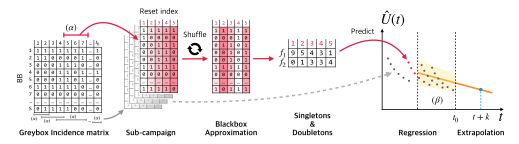
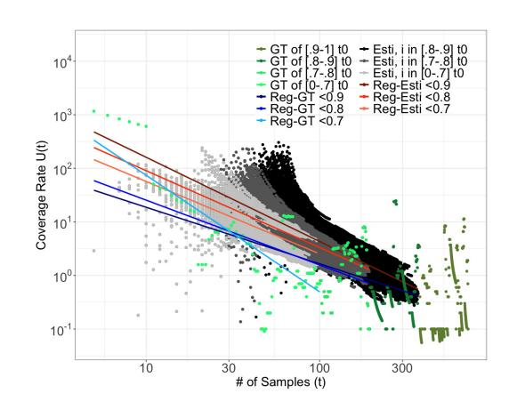
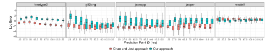
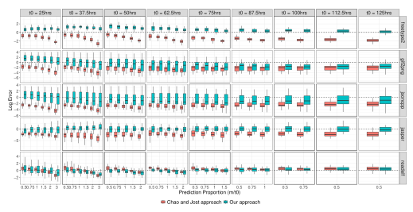
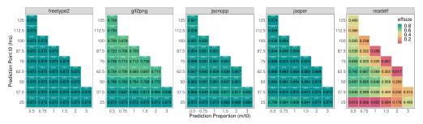
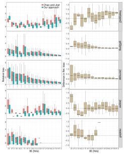
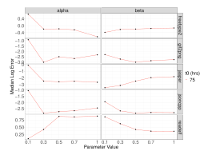

**Source:** *Extrapolating Coverage Rate in Greybox Fuzzing* — [PDF](https://mboehme.github.io/paper/ICSE24-predict.pdf)

## Extrapolating Coverage Rate in Greybox Fuzzing

Danushka Liyanage<sup>∗</sup> Monash University Australia

Chakkrit Tantithamthavorn Monash University Australia

Seongmin Lee<sup>∗</sup> MPI-SP Germany

Marcel Böhme MPI-SP Germany

## ABSTRACT

A fuzzer can literally run forever. However, as more resources are spent, the coverage rate continuously drops, and the utility of the fuzzer declines. To tackle this coverage-resource tradeo, we could introduce a policy to stop a campaign whenever the coverage rate drops below a certain threshold value, say 10 new branches covered per 15 minutes. During the campaign, can we predict the coverage rate at some point in the future? If so, how well can we predict the future coverage rate as the prediction horizon or the current campaign length increases? How can we tackle the statistical challenge of adaptive bias, which is inherent in greybox fuzzing (i.e., samples are not independent and identically distributed)?

In this paper, we i) evaluate existing statistical techniques to predict the coverage rate 𝑈 (𝑡0 + 𝑘) at any time 𝑡0 in the campaign after a period of 𝑘 units of time in the future and ii) develop a new extrapolation methodology that tackles the adaptive bias. We propose to eciently simulate a large number of blackbox campaigns from the collected coverage data, estimate the coverage rate for each of these blackbox campaigns and conduct a simple regression to extrapolate the coverage rate for the greybox campaign.

Our empirical evaluation using the Fuzztastic fuzzer benchmark demonstrates that our extrapolation methodology exhibits at least one order of magnitude lower error compared to the existing benchmark for 4 out of 5 experimental subjects we investigated. Notably, compared to the existing extrapolation methodology, our extrapolator excels in making long-term predictions, such as those extending up to three times the length of the current campaign.

## CCS CONCEPTS

• Software and its engineering → Software testing and debugging; • Security and privacy → Software security engineering.

## KEYWORDS

greybox fuzzing, extrapolation, coverage rate, adaptive bias, statistical method

<sup>∗</sup>Both authors contributed equally to this research.

Permission to make digital or hard copies of part or all of this work for personal or classroom use is granted without fee provided that copies are not made or distributed for prot or commercial advantage and that copies bear this notice and the full citation on the rst page. Copyrights for third-party components of this work must be honored. For all other uses, contact the owner/author(s).

ICSE '24, April 14–20, 2024, Lisbon, Portugal © 2024 Copyright held by the owner/author(s). ACM ISBN 979-8-4007-0217-4/24/04. https://doi.org/10.1145/3597503.3639198

## 1 INTRODUCTION

At the turn of the millennium, the late Mary-Jean Harrold drew a research roadmap for the software testing community of the future [13]. She highlighted the "development of techniques and tools for use in estimating, predicting, and performing testing on evolving software systems" as one of ve research pointers. While there has been some recent progress in the estimation of pertinent quantities in the testing process, we have yet to start exploring methodologies for prediction.

The rate at which new coverage is achieved is considered a fundamental measure of the eciency of a fuzzing campaign. A fuzzer is an automated software testing tool, and with increasing coverage, we mean the generation of inputs that cover new program elements, such as a branch or a statement. If the coverage rate drops below a certain threshold, the tester will abort the ongoing fuzzing campaign for the lack of progress. Terminating a fuzzing campaign early will help release computational resources and reduce the carbon footprint [17, 26]. If, throughout the campaign, the tester could accurately predict the coverage rate at some point in the future, they could conduct a cost-benet analysis to assess the resources required to achieve the targeted testing progress. Since fuzzing is a preliminary testing technique that constitutes sophisticated testing frameworks (e.g., a hybrid/ensemble fuzzing, an automated test case generation framework, etc.), such a prediction would allow the tester to adequately allocate resources (time and computing power) for the entire testing process in advance [29].

One of the most successful fuzzing techniques is called greybox fuzzing, which takes a mutation-based, coverage-guided approach. A greybox fuzzer is mutation-based because it uses a corpus of program inputs that are randomly mutated to slightly corrupt the seed le while preserving much of the unknown but required input format. A greybox fuzzer is coverage-guided because it adds generated inputs to the corpus that have been observed to increase coverage. The hope is that an input generated from a coverage-increasing input is itself more likely coverage-increasing. Since the probability of covering a specic program element changes in this process, the underlying distribution over these elements is not invariant. However, invariance is a key assumption in most statistical estimation and extrapolation methodologies. Hence, a key statistical challenge in the domain of greybox fuzzing is thus to tackle the resulting adaptive bias.

In this paper, we introduce a novel extrapolation methodology that allows us to predict the coverage rate 𝑈 (𝑡0 +𝑚𝑡0) in a greybox campaign of length 𝑡0 if the campaign length was extended 𝑚 more times while accounting for adaptive bias. We systematically select coverage data from sub-campaigns of the ongoing greybox campaign to bootstrap random blackbox campaigns. Conceptually, each blackbox campaign samples inputs from an invariant distribution. Since these blackbox campaigns are *not* subject to adaptive bias, they can be used for estimation. Collectively, the coverage rates estimated for the (overlapping) blackbox campaigns thus bootstrapped can be used for extrapolation by rendering the following empirical observation actionable. We observed that the *log-log plot* of the "blackbox" estimates against campaign length shows a straight line. We use this observation for linear regression and, ultimately, for extrapolation.

We evaluate our extrapolation methodology against an existing extrapolation methodology in biostatistics that does not account for adaptive bias on thirty-week-long fuzzing campaigns for each of the five programs from the Fuzztastic fuzzer evaluation benchmark. Regarding the coverage rate prediction accuracy directly, our extrapolator exhibits a lower error, at least one order of magnitude smaller than Chao and Jost's extrapolator for 4 out of 5 chosen subjects. Evaluation on the practical scenario, where one estimates the time to reach the target coverage rate, we find that the empirically observed coverage rate at the time predicted by our extrapolator is significantly closer to the target coverage rate than the existing extrapolation methodology for 3 out of 5 experimental subjects with moderate to large effect sizes. For significant improvement, our extrapolator achieves 35-77% closer to the target coverage rate than the baseline extrapolator.

*In summary*, this paper makes the following contributions:

- We introduce the problem of extrapolating coverage rate in automatic software testing, and specifically in greybox fuzzing, and evaluate Chao and Jost's state-of-the-art biostatistical extrapolation methodology [8] as the first means to tackle this problem.
- We develop a novel extrapolation methodology that tackles the adaptive bias problem in greybox fuzzing by constructing blackbox campaigns from the invariant average distribution of subcampaigns of the greybox campaign and conducting the extrapolation by regression to the corresponding "blackbox" estimates.
- We evaluate the effectiveness of our approach to tackling adaptive bias by comparing our extrapolation methodology against Chao and Jost's methodology on the greybox campaigns on multiple real-world software programs across different campaign lengths and prediction horizons.
- As our methodology is parameterized, we conduct an ablation study to evaluate the degree to which the estimator performance depends on the choice of parameter values.

**Open Science and Reproducibilty**. We make all our tools, data, and analysis scripts available at the following location:

https://doi.org/10.5281/zenodo.10575734

#### 2 PRELIMINARIES

#### 2.1 A Statistical Model for Fuzzing

Fuzzing is essentially a sampling process where inputs are sampled from the program's input space and result in a testing outcome. Similar to recent studies [2–4, 24], we can statistically formalize the fuzzing process as a stochastic process  $\mathcal{F} = \mathcal{F}(t)$  of length t where t test inputs are sampled with replacement from the space

of program inputs  $\mathcal{D}$ .

$$\mathcal{F} = \{X_n \mid X_n \in \mathcal{D}\}_{n=1}^t$$

We divide the input space  $\mathcal{D}$  into S individual, overlapping subdomains  $\{\mathcal{D}_i\}_{i=1}^S$  such that each subdomain corresponds to one of S coverage elements. An input  $X_n \in \mathcal{F}$  is said to cover a new coverage element  $\mathcal{D}_i$  if  $X_n \in \mathcal{D}_i$  and there does not exist a previously sampled input  $X_m \in \mathcal{F}$  such that m < n and  $X_m \in \mathcal{D}_i$  (i.e.,  $\mathcal{D}_i$  is sampled for the first time).

Since each input can cover one or more coverage elements, during fuzzing we collect coverage information as sampling unit-based incidence data and represent the sampling process within the Bernoulli Product model [7, 9]. In other words, a sampling unit  $X_n \in \mathcal{F}$  is a vector of binary variables  $W_n = \langle W_{n,1}, W_{n,2}, \ldots, W_{n,S} \rangle$  where  $W_{n,i} = 1$  if  $X_n$  covers  $\mathcal{D}_i$  and  $W_{n,i} = 0$  otherwise. The sampling unit-based incidence data can be represented as a matrix  $W = W_{t \times S} = \langle W_1, W_2, \ldots, W_t \rangle$  where t is the number of sampling units recorded during the campaign. The incidence frequency  $Y_i$  of a coverage element  $\mathcal{D}_i$  is the number of sampling units in which  $\mathcal{D}_i$  is covered, i.e.,  $Y_i = \sum_{n=1}^t W_{n,i}$ . A coverage element  $\mathcal{D}_i$  that has not been covered by any sampling unit will have an incidence frequency of zero; i.e.,  $Y_i = 0$ . In case of blackbox fuzzing,  $\mathcal{F}$  is a set of independent and identically distributed random variables. Thus, the probability distribution for  $X_n$  is

$$P(X_n = \mathbf{x_n}) = \prod_{i=1}^{S} \pi_i^{x_{n,i}} (1 - \pi_i)^{1 - x_{n,i}},$$

where where  $\pi_i$  is the probability that  $X_n$  covers  $\mathcal{D}_i$  and  $\mathbf{x}_n = \langle x_{n,1}, x_{n,2}, \dots, x_{n,S} \rangle$  is the vector of binary variables indicating whether  $X_n$  covers  $\mathcal{D}_i$  or not. The probability  $\pi_i$  is assumed to be constant among all randomly selected sampling units. Generally, the sum of all  $\pi_i$  values will *not* be equal to 1.

The marginal distribution for the incidence-based frequency  $Y_i$  for the i-th coverage element  $(1 \le i \le S)$  follows a binomial distribution characterized by t and the detection probability  $\pi_i$ :

$$P(Y_i = y_i) = \begin{pmatrix} t \\ y_i \end{pmatrix} \pi_i^{y_i} (1 - \pi_i)^{t - y_i}.$$

We denote the incidence frequency counts by  $(f_0, f_1, \ldots, f_t)$  given a set of samples, where  $f_k = \sum_{i=1}^S I(Y_i = k)$  is the number of elements covered in exactly k sampling units in the data  $(0 \le k \le t)$ . Here,  $f_1$  represents the number of singleton elements (those that are covered in only one sampling unit), and  $f_2$  represents the number of doubleton elements (those that are covered in exactly two sampling units). The unobservable zero frequency count  $f_0$  denotes the number of coverage elements that are not covered by any of the t sampling units. Then, the number of covered elements in the current campaign is  $S(t) = \sum_{i>0} f_i$ , and  $S(t) + f_0 = S$ .

#### 2.2 Estimation of Coverage Rate U(t)

In applied statistics, many estimators have been developed to quantify different aspects of the sampling process for the Bernoulli Product model [6, 7, 9]. In this paper, we are concerned with estimating and extrapolating the coverage rate (also known as the discovery rate in applied statistics).

The *coverage rate* U(t) is defined as the number of *new* elements covered at the (t + 1)-th sampling unit, i.e.,

$$U(t) = S(t+1) - S(t). (1)$$

The expected value of U(t) stands for the current testing efficiency of the fuzzing campaign: if the expected coverage rate U(t) is below a certain threshold, we might consider terminating the campaign. An estimator of U(t) has been proposed by Chao et al. [7]:

$$\hat{U}(t) = \frac{f_1}{t} \left[ \frac{(t-1)f_1}{(t-1)f_1 + 2f_2} \right] \lesssim \frac{f_1}{t}.$$
 (2)

The estimator  $\hat{U}(t)$  is parameterized only by the number of singletons  $f_1$  and doubletons  $f_2$ . We notice that the well-known Good-Turing estimator [25]  $\hat{\delta}(t) = \frac{f_1}{t}$  of the missing mass  $\delta(t)$  in the multinomial model (where subdomains  $D_i$  are non-overlapping, s.t.  $\sum_{i=1}^S \pi_i = 1$ ) provides an upper bound on  $\hat{U}(t)$ . In fact, we can see that  $\hat{U}(t) = \hat{\delta}(t)$  when  $f_2 = 0$  and  $\hat{U}(t) \approx \hat{\delta}(t)$  for  $t \gg 2$ . For greybox fuzzing, the Good-Turing estimator has previously been studied as an estimator of an upper bound on the residual risk that an errorless campaign still finds an error [3].

#### 2.3 Extrapolation of Coverage Rate U(t + k)

We are interested in predicting the future coverage rate  $\hat{U}(t+k)$  if we extended the ongoing fuzzing campaign of length t by k more sampling units [U(t+k) = S(t+k+1) - S(t+k)]. Although extrapolation has not been investigated within the domain of fuzzing, a baseline methodology for extrapolating sampling-unit-based incidence data can similarly be found in applied statistics developed by Chao and Jost [8]. This extrapolator can serve as a reference for developing extrapolation techniques in the context of fuzzing.

$$\hat{U}(t+k) = \hat{f}_0 \left[ 1 - \left( 1 - \frac{f_1}{t\hat{f}_0 + f_1} \right)^{k+1} \right]$$
 (3)

where the total number of uncovered (but coverable) elements  $\hat{f}_0$  can be estimated using the *Chao2* estimator [6]. Specifically,  $\hat{f}_0$  is computed as follows:

$$\hat{f_0} = \begin{cases} \frac{(t-1)}{t} \frac{f_1^2}{2f_2} & \text{if } f_2 > 0\\ \frac{(t-1)}{t} f_1 \frac{f_1 - 1}{2} & \text{if } f_2 = 0. \end{cases}$$

From Equations (2) and (3) note that  $\hat{U}(t) = \hat{U}(t+k)$  when k=0 and  $f_2 \neq 0$ .

#### 2.4 Effect of Adaptive Bias

The main statistical challenge in greybox fuzzing is adaptive bias: as coverage-increasing inputs are added as new seeds, the distribution  $\pi_i$  for  $i:1 \le i \le S$  changes throughout the fuzzing campaign. A simplifying assumption for the Bernoulli Product model—like in much of statistics and machine learning—is that the samples are independent and identically distributed (iid). In other words, the distribution remains invariant throughout the campaign. However, in greybox fuzzing, the outcome of one sample does have an impact on the outcome of the next sample (not independent). As a result, applying existing statistical estimators to greybox fuzzing yields

estimates that are *adaptively biased*: They may systematically overor under-estimate the true value for greybox campaigns.

In this paper, we evaluate Chao and Jost's extrapolation methodology [8] and develop a new methodology to extrapolate the coverage rate of a greybox campaign in the presence of adaptive bias.

### 3 EXTRAPOLATION IN THE PRESENCE OF ADAPTIVE BIAS

To address the adaptive bias in greybox fuzzing, we turn the following insight into an extrapolation methodology. In a greybox campaign, the adaptive bias exists as a change of distribution  $\{\pi_i\}_{i=1}^S$  over the coverage elements  $\mathcal{D}_i$  every time a coverage-increasing input is generated and added to the corpus. However, in a *local region* of the greybox campaign, the change of distribution is much smaller. If we could bootstrap random blackbox campaigns from the *invariant* average distribution for local regions, we can tackle adaptive bias for every such region. We propose to compute the estimate  $\hat{U}(t)$  for a large number of such bootstrapped blackbox campaigns and to leverage the approximately linear relationship between  $\log(t)$  and  $\log(\hat{U}(t))$  to extrapolate U by linear regression.

Figure 1 provides an overview of the proposed methodology. Given the incidence matrix of the greybox campaign, we can extract an arbitrary sub-campaign by subsetting the incidence matrix. The resulting incidence matrix is shuffled column-wise to sample the (invariant) average distribution over the coverage elements for this greybox sub-campaign. We call this procedure as blackbox approximation. The resulting random blackbox campaign has the same coverage profile as the original greybox coverage data, i.e., Y = Y'. In other words, if a coverage element i was covered  $Y_i = 10$ times in the greybox sub-campaign, it will also be covered  $Y_i' = 10$ times at the end of the resulting blackbox approximation. However, the blackbox approximation is not subject to adaptive bias. Using this procedure multiple times with coverage data from different (local) sub-campaigns of the (global) greybox campaign, we can produce estimates  $\hat{U}(t)$  for every resulting blackbox campaign. Finally, we describe the extrapolation technique that we propose to predict the coverage rate of the greybox fuzzing campaign in the future.

# 3.1 Bootstrapping Blackbox Campaigns from Local Regions of the Greybox Campaign

Algorithm 1 provides a more detailed procedural overview of our proposed extrapolation methodology. As input, it takes the incidence matrix  $W_{t_0 \times S}$  for a greybox fuzzing campaign of length  $t_0$  and the prediction horizon  $mt_0$ . In addition, it takes two parameters,  $\alpha$  and  $\beta$ , to control certain trade-offs of the methodology. As output, it produces the estimate  $\hat{U}(t_0 + mt_0)$  of the coverage rate predicted if  $mt_0$  more sampling units were taken.

For every i from 1 to  $t_0$ , we derive a greybox sub-campaign W' of length  $\Delta_{\alpha}=\alpha\log(i)$  that starts at index  $s_{\alpha}$  and ends at index  $e_{\alpha}=i$  of the greybox incidence matrix W (Line 1–7). Specifically,  $W'=W_{\Delta_{\alpha}\times S}=\langle W_{s_{\alpha}},...,W_i\rangle$  where  $s_{\alpha}=\lfloor i^{1-\alpha}\rfloor$ . The coverage profile Y' of this sub-campaign is defined as the cumulative sum of incidences for each coverage element i, i.e.,  $Y'_i=\sum_{j=1}^{\Delta_{\alpha}}W'_{i,j}$  for every  $i:1\leq i\leq S$ .



Figure 1: Overview of our extrapolation technique for the coverage rate of the greybox fuzzing campaign.

```
Algorithm 1: Extrapolating Cov. Rate for Greybox Campaigns
     Input : t_0 and m as prediction point and horizon
                    W = W_{t_0 \times S}: Incidence matrix of the greybox campaign
                    \alpha: Local region proportional window size
                    \beta: Linear regression proportional window size
 1 Time-Estimate Pairs \mathcal{U} = \emptyset
 2 for Time i \leftarrow 1 to t_0 do
            Region start s_{\alpha} \leftarrow \lfloor i^{1-\alpha} \rfloor
            Region end e_{\alpha} \leftarrow i
            if s_{\alpha} = e_{\alpha} then
 5
              continue
            Coverage data W' \leftarrow \langle W_{s_{\alpha}}, \cdots, W_{e_{\alpha}} \rangle // Campaign len. \alpha \log(i)
            Shuffled data W^B \leftarrow \text{shuffle}(W')
            for Index j \leftarrow 1 to e_{\alpha} - s_{\alpha} + 1 do
                   Coverage profile Y' \leftarrow \sum_{k=1}^{j} W_k^B // BB campaign of length j
 10
                  Singletons f_1 \leftarrow \sum_{k=1}^{S} I(Y_k' = 1)

Doubletons f_2 \leftarrow \sum_{k=1}^{S} I(Y_k' = 2)

Estimate \hat{U} \leftarrow \frac{f_1}{j} \left[ \frac{(j-1)f_1}{(j-1)f_1+2f_2} \right]
 12
                                                                                          // cf. Equation (2)
 13
                  \mathcal{U} \leftarrow \mathcal{U} \cup \{\langle s_{\alpha} + j - 1, \hat{U} \rangle\}
 14
15 Regression start s_{\beta} \leftarrow \lfloor t_0^{1-\beta} \rfloor
16 Regression end e_{\beta} \leftarrow t_0
17 Regression region \mathcal{U}' \leftarrow \mathcal{U}[s_{\beta}:e_{\beta}] // Pairs whose time \in [s_{\beta},e_{\beta}]
18 Model \mathcal{M} \leftarrow \text{LinearReg}(\log(t) \sim \log(U(t))), \ \forall \langle t, U(t) \rangle \in \mathcal{U}'
19 Estimate \hat{U}(t_0 + m \cdot t_0) \leftarrow \exp(\mathcal{M}(\log(t_0 + m \cdot t_0)))
     Output: \hat{U}(t_0 + m \cdot t_0) as our estimate.
```

The parameter  $\alpha$  controls the trade-off between tackling adaptive bias and the length of the blackbox campaign for which the estimate is computed. If  $\alpha$  gets larger, the length of the sub-campaign increases; having a longer blackbox campaign gives better estimates of the quantities of *the blackbox campaign*, but it also increases the adaptive bias in the greybox sub-campaign. On the other hand, if  $\alpha$  gets smaller, less data is used for the estimation, which makes the estimation less reliable.

We bootstrap a random blackbox campaign from this greybox sub-campaign by shuffling the order of sampling units in the incidence data (Line 8). Since this reordering does not change the cumulative sum of incidences, we can obtain a new incidence matrix  $W^B$  whose coverage profile is equivalent to that of the greybox

sub-campaign. However, by sampling from the "average distribution," the adaptive bias is eliminated within  $W^B$ . We refer to  $W^B$  as the *blackbox approximation* of W'. Blackbox approximation provides a hypothetical blackbox fuzzing campaign that is suitable for applying the statistical estimation techniques. Finally, we estimate the coverage rate  $\hat{U}$  for every data point j in the shuffled incidence matrix  $W^B$  (Line 9–14).

## 3.2 Extrapolation of Coverage Rate



Figure 2: The behavior of the empirically observed coverage rate U(t) (green dots) and estimated coverage rate  $\hat{U}(t)$  (grey dots) against the number of sampling units t generated in the log-log scale. Each red line and blue line represents the linear regression model fitted to the estimated coverage rate and empirically observed coverage rate with different ranges of data points, respectively.

Given the set  $\mathcal U$  constructed in Line 1–14 in Algorithm 1, we suggest to conduct a linear regression on  $\log(t) \sim \log(\hat U(t))$  and compute the extrapolation  $\hat U(t_0+mt_0)$  by applying the resulting model (Line 15–19). This method follows from the empirical observation that the coverage rate U(t) emerges approximately as a straight line in the log-log scale.

Figure 2 illustrates the behavior of the empirically observed coverage rate U(t) (green dots) and estimated coverage rate  $\hat{U}(t)$ 

(grey dots) obtained for a single AFL++ greybox campaign on the freetype2 program run for one week ( $t_0$ ) in log-log scale. We use the  $\alpha=0.3$  for the estimation. The darkness of the grey dots indicates which time i the estimates are computed from; the black dots are estimated from  $0.8t_0 < i < 0.9t_0$ , the dark grey dots are estimated from  $0.7t_0 < i < 0.8t_0$ , and the light grey dots are estimated from  $i < 0.7t_0$ . Similarly, the darkness of the green dots indicates the time t the empirical coverage rates come from.

From the figure, we can observe a decreasing, yet heavily scattered, trend of the empirical coverage rate and the linearly decreasing trend of the estimates in the log-log scale. The linear model fitted to each of the coverage rates further explains the trend. The blue-colored lines represent the linear regression model fitted to the empirical coverage rate, and the red-colored lines represent the linear regression model fitted to the estimates. The darkness of the lines indicates the range of data points used for the linear regression; the darkest, middle darkness, and lightest lines are fitted to the data points until  $0.9t_0$ ,  $0.8t_0$ , and  $0.7t_0$ , respectively. The resulting regression shows that, while the regression model for the empirical coverage rate may change its slope significantly due to the high variance of the empirically observed coverage rate, the regression model for the estimates is more stable. This is because the estimates are obtained from the blackbox approximation, which is not subject to adaptive bias. Thus, we choose to fit a linear model<sup>1</sup> to the estimates in  ${\cal U}$  instead of the empirical coverage rate in our extrapolation method.

Still, the coverage rate estimates in Figure 2 tend to have a higher variability when the number of sampling units t is small. The parameter  $\beta$  is designed to manage the trade-off between stability and accuracy of the regression from this variability. By choosing  $\beta$  closer to one (1), plentiful data is used for the regression model, which may result in a more accurate extrapolation. However, due to the high degree of variability at the early stages of the campaign, the regression model may not be stable. By choosing  $\beta$  closer to zero (0), it can avoid the variability at the early stages, yet the regression model has less data to learn the trend, which may result in poor extrapolation.

#### 4 EXPERIMENTAL SETUP

We aim to evaluate the performance of statistical estimation to predict the coverage rate of a greybox fuzzing campaign at a given time in the future, how our own extrapolation methodology can account for the adaptive bias in greybox fuzzing, and how parameters  $\alpha$  and  $\beta$  in Algorithm 1 impact the performance of our methodology.

#### 4.1 Research Questions

Our experiments seek to answer the following research questions:

**RQ1: Performance.** How does the performance of our methodology to extrapolate the coverage rate compare to the biostatistical extrapolator by Chao and Jost [8]?

We evaluate the performance of our extrapolator against the existing estimator (cf. Section 2.3). As parameters, we choose  $\alpha=0.11$  and  $\beta=0.5$ . We consider two perspectives:

- **1-A** For a given campaign length  $t_0$  and prediction horizon  $m \cdot t_0$ , how accurate is the coverage rate prediction of the existing versus our extrapolator if the campaign was extended by a period of  $m \cdot t_0$  sampling units? For a set of benchmark programs, we compare the performance of the extrapolators against the distribution of coverage rate empirically observed in the future.
- **1-B** For a given threshold coverage rate  $U_c$ , how accurate are the extrapolators in predicting the point in time when the coverage rate falls below  $U_c$ ? We evaluate the accuracy of the predicted time point by comparing the target coverage rate  $U_c$  against the actual coverage rate at the predicted time point. This evaluates the utility of our extrapolator in the context of assessing an extended campaign's coverage-resource tradeoff.

**RQ2: Sensitivity.** What is the impact of the choice of parameters  $\alpha$  and  $\beta$  on the performance of our extrapolator? Our methodology is parameterized to control certain trade-offs:

- $\alpha$  defines the width of the local region of the sub-campaigns for blackbox approximation (Sec. 3.1). We expect for large  $\alpha$  the adaptive bias has a stronger influence while for small  $\alpha$  the estimate will positively biased.
- $\beta$  represents the final proportion of the estimate  $\hat{U}^B(t)$  used in the linear regression model (Sec. 3.2). We expect the regression for large  $\beta$  to be unstable due to the scarcity of data, while for small  $\beta$ , it may suffer from small data size.

## 4.2 Experimental Data Generation

| Subject      | Project   | Version | LoC    | # BBs  |
|--------------|-----------|---------|--------|--------|
| ftfuzzer     | FreeType2 | 2.7     | 44,686 | 27,521 |
| gif2png      | Gift2png  | 2.5.3   | 988    | 700    |
| jsoncpp_fuzz | JsonCpp   | 1.8.4   | 7,251  | 5,938  |
| jasper       | JasPer    | 1.900.0 | 17,385 | 14,417 |
| readelf      | Binutils  | 2.29    | 22,347 | 18,578 |
| Total        |           |         | 92,657 | 67,154 |

Figure 3: Fuzztastic programs and their statistics.

4.2.1 Programs, Fuzzer, and Infrastructure. Figure 3 shows the five open-source C programs from the Fuzztastic fuzzer benchmarking platform [16] we used for our experiments. These programs or libraries cover a wide range of applications, including the processing of binary, movie, font, image, and JSON files. For the listed programs, Fuzztastic uses the provided command line options for the subject programs as fuzz harnesses and the initial seeds from AFL's GitHub repository.<sup>2</sup> We excluded ffmpeg due to its extremely high number of basic blocks.<sup>3</sup>

For each subject program, we ran 30 fuzzing campaigns, each lasting for one week (7 days), to address the randomness in the empirical evaluation. We used AFL++ fuzzer [11] (version: 2.64c; command line options: -m none), one of the most popular and widely used fuzzers today. It is also currently the best-performing

 $<sup>^1\</sup>mathrm{We}$  also attempt to fit a higher-order polynomial (orders ranging from 2 to 10) regression models, but the difference in the fitted models is negligible.

 $<sup>^2 {\</sup>tt https://github.com/google/AFL/tree/master/test cases}$ 

<sup>&</sup>lt;sup>3</sup>For our experiments, we found that the memory demand exhibits near-linear growth (8GB for every 50,000 basic blocks). The **ffmpeg** program has 432, 373 basic blocks preventing us from running the week-long campaigns.

fuzzer on Fuzzbench [21]. Each fuzzing campaign was run on one of four (4) virtual machines with 32x 2GHz x86\_64 CPU cores, 32 GB of RAM, and 200 GB of disk space each. All VMs were running in the Nectar Research Cloud.

4.2.2 Data transformation. We recorded the hit counts of basic blocks (BB) at 15-minute intervals for each week-long fuzzing campaign. We considered all the inputs generated within this time interval as a single sampling unit. In other words, the t-th sampling unit  $W_t = \langle W_{t,1}, W_{t,2}, \ldots, W_{t,S} \rangle$  is a boolean vector of length S that indicates whether the  $s^{\text{th}}$  BB was hit at least once during the t-th 15-minute interval. The final matrix  $W = \langle W_1, W_2, \cdots W_{t_0} \rangle$  corresponds to the incidence-based data model described in Section 2.

The incidence matrix W is used to calculate the incidence frequencies  $(f_1, f_2, ...)$ , which are necessary for performing extrapolations at different points in the campaign using both Chao and Jost's as well as our method. Yet, the number of singletons  $f_1$  (and doubletons  $f_2$ ) often becomes zero through the campaign due to the high sparsity of the data. With  $f_1 = 0$ , the outcome of both extrapolators becomes zero (0). To tackle this challenge, we add 1 to all the incidence frequencies  $(f_1, f_2, \dots)$  before performing any estimation/extrapolation. Regarding our extrapolator, the 'add-1' heuristic has less impact: in Equation 2, increasing incidence frequencies by 1 results in only a marginal increase in  $\hat{U}(t)$ . Additionally, this increase exponentially diminishes with the increase of the campaign length t. From our evaluation (Section 5), the 'add-1' heuristic reduces the bias of what the existing extrapolator would have been without the heuristic. It generally underestimates the coverage rate in our experiment with 'add-1', which would be amplified without 'add-1.'

4.2.3 Ground Truth and Extrapolation. We compute the ground truth (i.e., the estimand) for the prediction  $\hat{U}(t_0, k)$  from empirically observed coverage rate, i.e., using the cumulative matrix S of the greybox fuzzing campaign  $\mathcal{F}$ ;  $S(t) = \sum_{i=1}^{t} W_i$ . At an arbitrary evaluation point  $(t_0 + k)$  from the extrapolation point  $t_0$ , the difference  $S(t_0 + k + 1) - S(t_0 + k)$  represents the number of basic blocks (BBs) discovered within that sampling unit. Again, because of the sparsity of the data, a considerable number of sampling units may not discover any new BBs. In such cases, the difference  $S(t_0 + k + 1) - S(t_0 + k)$  becomes zero. Hence, we apply a moving average filter to smooth the empirical coverage rate [14]. We choose n = 5 consecutive raw empirical observations for both the left and right window sizes of the moving average filter. However, if none of the windows have any non-zero values, we extend the window size to the left and right until we find a non-zero value. Finally, to address the randomness from the shuffling in our algorithm, we conduct five repetitions of the extrapolation for each of the 30 fuzzing campaigns per subject program.

#### 4.3 Performance Measures

Evaluation matric. For RQ1.A and RQ2, we are given a campaign length  $t_0$  and prediction horizon  $mt_0$  and compare the performance of estimating  $U(t_0+mt_0)$ . To compare the estimator performance, we calculate the average difference in the log scale for a campaign involving a series of predictions  $\hat{U}(t_0+k)$  for the ground truth estimand  $U(t_0+k)$ , where  $1 \le k \le m \cdot t_0$ , at the prediction point  $t_0$ :

$$\bar{L}(t_0, m) = \frac{\sum_{k=1}^{mt_0} \left( \log(\hat{U}(t_0 + k)) - \log(U(t_0 + k)) \right)}{m \cdot t_0} \tag{4}$$

The  $log\ error$ , denoted as  $\bar{L}(t_0,m)$ , measures the difference in magnitude and solves a problem of scale. We observe that the empirical coverage rate distribution is highly skewed: Approximately 90% of the values fall within the range of [0,1] while a few but heavy outliers impact the error. However, in the log scale, the coverage rate distribution becomes more symmetric. Therefore, we choose the log scale to evaluate the performance of the extrapolators in both RQ1.A and RQ2.

We compute the log error  $\tilde{L}(t_0, m)$  from  $t_0$  to  $mt_0$  to indicate the performance for a single campaign because the ground truth  $U(t_0+k)$  (i.e., the empirically observed coverage rate) is itself subject to substantial variance—while the estimate  $\hat{U}(t_0+k)$  is not. For a given prediction point  $t_0$  and horizon  $k=m\cdot t_0$ , we report the distribution of the log error across all 30 fuzzing campaigns.

For RQ1.B, we are given a campaign length  $t_0$  and a threshold coverage rate  $U_c$  and compare the performance of estimating m such that  $\hat{U}(t_0 + \hat{m}t_0) = U_c$ . To evaluate the prediction performance of the estimator for  $\hat{m}$ , we compare the target coverage rate  $U_c$  against the observed coverage rate around the predicted time point  $t_0 + \hat{m}t_0$  within a fixed window w:

$$\bar{\Delta}(t_0, \hat{m}) = \left(\frac{\sum_{i=-w}^{w} U(t_0 + \hat{m}t_0 + i)}{2 \cdot w} - U_c\right) / U_c$$
 (5)

We compute the *relative bias*, denoted as  $\bar{\Delta}(t_0, \hat{m})$ , within a fixed window  $t \in [t_0 + \hat{m}t_0 - w, t_0 + \hat{m}t_0 + w]$  again because the ground truth U(t) (i.e., the empirically observed coverage rate) is itself subject to substantial variance. It represents how far the observed coverage rate around the predicted time point  $t_0 + \hat{m}t_0$  is from the target coverage rate  $U_c$  relative to  $U_c$ ; a value of v indicates that the observed coverage rate is (v + 1) times higher than the target coverage rate  $U_c$ . When selecting fuzzing trials for this evaluation, we only consider trials that contain at least one  $\hat{U}(t_0 + mt_0)$  for both extrapolators falling below  $U_c$ . If all coverage rate predictions  $\hat{U}(t_0 + \hat{m}t_0)$  of the extrapolator are below  $U_c$ , then we choose the  $\hat{m}$  that maximizes  $\hat{U}(t_0 + \hat{m}t_0)$ . Unlike the log error,  $\bar{L}$ , the relative bias  $\bar{\Delta}$  is computed in the linear scale as the number of observed coverage rates involved in the computation is small; thus, the impact of outliers is negligible. For a given prediction point  $t_0$  and threshold rate  $U_c$ , we report the distribution of the bias across all 30 fuzzing campaigns.

Significance. We perform a two-sided hypothesis test to check whether the median  $\bar{L}$  of our extrapolator significantly differs from that of Chao and Jost's extrapolator [8]. Since the normality of the obtained  $\bar{L}$  values cannot be guaranteed for the limited number of data points, we use the Wilcoxon sign-ranked test, a non-parametric equivalent of the t-test:

- **H0**: There is no difference between the median  $\bar{L}$  of Chao and Jost's extrapolator and that of our extrapolator.
- H1: There is a difference between the median L
   of Chao and
   Jost's extrapolator and that of our extrapolator.

We use a confidence level of  $\alpha = 99\%$  to check whether our extrapolator exhibits a statistically significant improvement over Chao and Jost's extrapolator in terms of  $\bar{L}$ .

Effect size. Further, we assess the effect size using Wilcoxon effect size r [28] that is the ratio between the Wilcoxon test statistic and the square root of the sample size. It provides a measure of the difference between the median  $\bar{L}$  for both extrapolators. The magnitude of r indicates the degree of separation between the two techniques. Using the standard interpretation, we interpret the effect size as negligible when r < 0.1, small when  $0.1 \le r < 0.3$ , moderate when  $0.3 \le r < 0.5$ , and large when  $0.5 \le r$ .

#### 5 EXPERIMENTAL EVALUATION

#### 5.1 RQ1-A. Coverage Rate Prediction Accuracy

The log error  $\bar{L}$  of the coverage rate prediction we evaluate in this section is expected to increase as the prediction horizon extends further into the future from the current point  $t_0$ . Nevertheless, we would like to be able to predict the coverage rate as far into the future as possible with maximal accuracy. We first evaluate the accuracy of extrapolators when the prediction horizon is fixed to  $m=0.5t_0$  (i.e., extending by half of the current campaign length). This gives the baseline ability of the extrapolators to predict the coverage rate. We then extend our study to evaluate the coverage rate extrapolation as we vary both the prediction point  $t_0$  and prediction horizon m.

5.1.1 Varying the prediction point. Figure 4 shows the log error distribution of the predicted coverage rates for the existing methodology by Chao and Jost (CJ) [8] (red box plots) and our extrapolator (blue box plots) when the prediction horizon is fixed to  $m = 0.5t_0$  for varying prediction points  $f_0$ .

Our extrapolator generally outperforms the CJ extrapolator for all subjects in terms of the magnitude of the log error. The average  $\bar{L}$  of our extrapolator is 0.07-0.9, while that of CJ's extrapolator is 0.2-2.9 across all the subject programs. On average, the difference of the absolute  $\bar{L}$  between the two extrapolators is 1.47, which shows that our extrapolator's prediction is one order of magnitude closer to the ground truth than CJ's extrapolator's prediction.

Except for readelf, the CJ extrapolator produces negatively biased predictions irrespective of the prediction point  $t_0$ . In contrast, the median  $\bar{L}$  for our extrapolator is small in magnitude and remains close to zero for most of the subjects (i.e., freetype2, jasper, and readelf)—particularly when the campaign length increases. For gif2png and jsoncpp, the median  $\bar{L}$  slightly deviates from zero while the difference to the ground truth is at least one order of magnitude smaller than that of the baseline.

One exception is observed for short campaigns up to  $t_0=50$  hours in *freetype2*, where the median  $\bar{L}$  values for our extrapolator are marginally higher (< 10 on linear scale) than those for CJ for m<1. This behavior is expected, as our extrapolation relies on a limited number of estimates  $\hat{U}(t)$  during the early stages of the fuzzing campaign. Due to the implementation of Fuzztastic, coverage data is available only at 0.25-hour intervals. At this granularity, there are not many data points available for regression in the early stages of the campaign.

For subjects gif2png and jsoncpp, we observe higher variance in  $\bar{L}$  for our approach compared to the existing extrapolator. This could be explained by the higher variability in the coverage achieved across program runs. That was evident for these two subjects even when the initial conditions remained the same. For the other subjects, the variability in  $\bar{L}$  is similar for both extrapolators.

When making short-term predictions (i.e., m=0.5) of U(t) in the log-log scale, our extrapolator exhibits at least one order of magnitude lower absolute  $\bar{L}$  than Chao and Jost's extrapolator for 4 out of 5 chosen subjects, especially for greybox campaigns longer than 50 hours.

5.1.2 Varying the prediction horizon. Figure 5 shows the results in the same format as Figure 4 but for varying prediction horizons  $m \in \{0.5, 0.75, 1, 1.5, 2, 3\}$ . For the baseline (CJ) estimator, similar to Figure 4, we observe that the log error  $\bar{L}$  are consistently negative across all subjects, excluding *readelf*. Additionally, the magnitude of the log error generally increases as the prediction horizon increases. In cases such as *freetype2* with  $t_0 = 37.5$  hours, the magnitude of the median  $\bar{L}$  value for the CJ extrapolator has increased by more than two orders of magnitude.

For our estimator, we notice that it consistently maintains nearly the same median log error as the prediction horizons increase, especially for campaign lengths exceeding 50 hours. Notably, as campaign duration extends, the median log error of our approach tends to approach zero for *freetype2*, *jasper*, and *readelf*. As indicated in Figure 3, this trend is attributed to the substantial number of basic blocks in these subjects. This prompts the greybox fuzzer to consistently discover new coverage actively, exhibiting no signs of saturation even after one week [19]. This underscores the capacity of our extrapolation methodology to converge towards the ground truth coverage rate in ongoing greybox campaigns more effectively than CJ's extrapolator, as we believe, owing to its consideration of adaptive bias.

Our extrapolator consistently exhibits a positive log error across all prediction points  $t_0$  for *freetype2*. In contrast, for *jasper*, the median log error across runs remains nearly zero for various prediction points  $t_0$  and horizons m. In the case of *gif2png* and *jsoncpp*, the median log error tends below zero for smaller campaign lengths, such as  $t_0 = 25$  hours. However, as previously mentioned, these predictions exhibit less error compared to the baseline. Notably, the performance discussed for m = 0.5 in Section 5.1.1 holds true for all values of m less than one.

Our extrapolation technique consistently demonstrates a lower median log error than Chao and Jost's extrapolator, irrespective of the duration of the greybox campaign ( $t_0$ ) and the extent of the extrapolation into the future for coverage rate.

5.1.3 Statistical Assessment. Figure 6 shows the effect size and statistical significance of the difference between two extrapolators. Concretely, the heatmap color and the value in each cell represent the effect size for the difference in  $\bar{\Delta}$  between the two extrapolators; the three asterisks (\*\*\*) on top of the cell indicate the statistical significance of the difference. Our statistical analysis indicates a substantial effect size ( $r \ge 0.5$ ) with statistically significant differences



Figure 4: Log error  $\bar{L}$  distribution over 30 runs of the predictions for different campaign lengths  $t_0$  if the campaign was extended by another half of the current campaign length (i.e.  $mt_0 = 0.5t_0$ ).



Figure 5: Log error  $\bar{L}$  distributions for Chao and Jost's- and our proposed extrapolator at different prediction points  $t_0$  for varying prediction horizons  $mt_0$ .



Figure 6: Statistical test results for  $\bar{L}$  distribution differences between the Chao and Jost's and our extrapolators across different prediction points  $t_0$  and varying prediction horizons  $mt_0$ .

in median  $\bar{L}$  observed at each  $t_0$  and m for all subject programs except for *readelf*. In the case of *readelf*, except for a couple of short-term predictions (i.e., m=0.5) made at early prediction points such as  $t_0=50$  or 62.5 hours, the two-sided hypothesis test did not reveal statistical significance.

#### 5.2 RQ1-B. Point-in-Time Prediction Accuracy



(a) Relative bias  $\bar{\Delta}$  of the coverage rate predictions beyond a given threshold at various prediction points  $(t_0)$  of existing and our extrapolators (left) and the difference between the absolute relative bias of the two extrapolators (right, existing – ours).

| Subject   | $U_c$ | Trials | $m(\bar{\Delta}_{\mathrm{CJ}})$ | $m(\bar{\Delta}_{\mathrm{Our}})$ | p-value | Effect size     |
|-----------|-------|--------|---------------------------------|----------------------------------|---------|-----------------|
| freetype2 | 0.52  | 18     | 1.49                            | 0.72                             | 8.0E-07 | (moderate) 0.32 |
| gif2png   | 0.02  | 27     | 0.88                            | 0.53                             | 2.0E-24 | (large) 0.54    |
| jsoncpp   | 0.02  | 26     | 1.22                            | 0.85                             | 1.1E-22 | (large) 0.56    |
| jasper    | 0.12  | 17     | 1.54                            | 0.37                             | 0.1883  | (small) 0.09    |
| readelf   | 0.22  | 13     | 0.97                            | 1.43                             | 0.3537  | (small) 0.07    |

(b) Statistics of RQ1-B. m shows the median of the relative bias. p-value and the effect size are computed between the absolute relative bias of the two extrapolators using the two-sided Wilcoxon paired signed-rank test with 95% confidence level.

Figure 7: Result of RQ1-B

We extend our evaluation to assess the efficacy of our extrapolator in attaining predefined coverage rate thresholds  $U_c$ . Realistic subject-specific thresholds are established based on the median empirically observed coverage rate in the remainder of the available

campaign data (i.e., a total of seven days), which are presented in the second column of 7b, along with the number of trials involved in the analysis (third column). We choose  $2 \cdot w = 75$  hours so that the window does not exceed 10% of the entire campaign length.

The left side of 7a shows the relative bias  $\bar{\Delta}$  of the coverage rate predictions beyond a given threshold at various prediction points  $(t_0)$  of existing and our extrapolators, and the right side shows their differences (existing - ours) between the absolute relative bias of the two extrapolators. The result shows that, for gif2png and jsoncpp, our extrapolator consistently exhibits a lower relative bias than the baseline extrapolator for all  $t_0$  except  $t_0 = 25$  hours, and so does *freetype2* for the majority of  $t_0$  values. We confirm this observation by performing a two-sided Wilcoxon paired signedrank test with 95% confidence level, whose results are shown in 7b. All the p-values are significantly lower than  $10^{-6}$ , and the effect sizes are moderate for freetype2 and large for gif2png and jsoncpp. The median relative bias further explains how far the observed coverage rate at the prediction point is from the target coverage rate; our extrapolator achieves 35-77% closer to the target coverage rate than the baseline extrapolator.

While the median relative bias of our estimator is significantly closer to zero than the baseline estimator for *jasper*, both visual inspection and the effect size indicate that the difference is not significant. As we have seen in Figure 5, our estimator has no big improvement over the baseline for *readelf*. The BB accumulation curves for *readelf*, which exhibit approximately linear trends in log-log scales and lower variance across fuzzing trials, suggest that the influence of adaptive bias is less prominent compared to other subjects. In situations with a diminished impact of adaptive bias, we can expect the baseline extrapolator to perform at a level comparable to our extrapolator. Also, notice that the number of trials involved in the analysis is relatively small for *readelf* compared to the other subject, which could be another reason for the insignificant difference.

Given the target coverage rate, our extrapolator predicts the time when the empirically observed coverage rate reaches the target coverage rate significantly better than the existing extrapolation methodology for 3 out of 5 subjects with moderate to large effect sizes. For significant improvement, our extrapolator achieves 35-77% closer to the target coverage rate than the baseline extrapolator.

## 5.3 RQ2. Evaluation of Parameter Sensitivity

To empirically study the impact of the choice of parameters on the performance of our methodology, we conduct an ablation study. Both parameters are chosen within the interval [0,1]. For computational efficiency, we selected distinct values: 0.1, 0.3, 0.5, 0.7, and 1 for each parameter. When varying one parameter, we kept the other fixed. By default,  $\alpha=0.3$  and  $\beta=0.5$ . The extrapolation algorithm was repeatedly executed for each parameter combination ( $t_0=75$ , m=1).

Results are shown in Figure 8. The parameter  $\alpha$  controls the length of the greybox sub-campaign used for bootstrapping the blackbox campaigns (Line 7 in Alg. 1). We can see that a choice of the small  $\alpha$  in RQ1 is optimal for the majority of the subjects



Figure 8: The behaviour of median  $\bar{L}$  while varying the parameters  $\alpha$  and  $\beta$  ( $t_0 = 75hrs$ , m = 1).

(i.e., gif2png, jasper, jsoncpp, and readelf). The only exception is freetype2, where  $\alpha=0.5$  is the best choice, yet the difference due to the choice of  $\alpha$  is smallest for this subject. The parameter  $\beta$  controls the proportion of training data used for the regression (Line 18 in Alg. 1). In general the difference in the median  $\bar{L}$  is small for different values of  $\beta$  for all subjects compared to the difference due to the choice of  $\alpha$ . The best  $\beta$  also varies across subjects: a bigger  $\beta$  is better for freetype2, freetype2, freetype3, freetype3, freetype3, freetype3, freetype3, freetype3, freetype3, freetype3, freetype3, freetype3, freetype3, freetype3, freetype3, freetype3, freetype3, freetype3, freetype3, freetype3, freetype3, freetype3, freetype3, freetype3, freetype3, freetype3, freetype3, freetype3, freetype3, freetype3, freetype3, freetype3, freetype3, freetype3, freetype3, freetype3, freetype3, freetype3, freetype3, freetype3, freetype3, freetype3, freetype3, freetype3, freetype3, freetype3, freetype3, freetype3, freetype3, freetype3, freetype3, freetype3, freetype3, freetype3, freetype3, freetype3, freetype3, freetype3, freetype3, freetype3, freetype3, freetype3, freetype3, freetype3, freetype3, freetype3, freetype3, freetype3, freetype3, freetype3, freetype3, freetype3, freetype3, freetype3, freetype3, freetype3, freetype3, freetype3, freetype3, freetype3, freetype3, freetype3, freetype3, freetype3, freetype3, freetype3, freetype3, freetype3, freetype3, freetype3, freetype3, freetype3, freetype3, freetype3, freetype3, freetype3, freetype3, freetype3, freetype3, freetype3, freetype3, freetype3, freetype3, freetype3, freetype3, freetype3, freetype3, freetype3, freetype3, freetype3, freetype3, freetype3, freetype3, freetype3, freetype3, freetype3, freetype3,

A low value of  $\alpha$  (0.1) is optimal for most subjects, while the choice of  $\beta$  is less critical for the performance of the extrapolator.

#### **6 THREATS TO VALIDITY**

As with any empirical study, several threats exist to the validity of our results and conclusions. The first threat arises with respect to external validity, which relates to the extent to which our findings can be generalized. As the subject of our study, we selected the AFL++ greybox fuzzer [11], one of the most popular and widely used fuzzers today that is also currently the best-performing fuzzer on Fuzzbench [21]. As objects of our study, we selected five widelyused open-source C programs from the Fuzztastic fuzzer benchmarking suite [16], representing a wide range of applications, including some processing binary, movie, font, image, and JSON files. To maximize campaign length within the available resources, we generated fuzzing campaigns of length seven (7) days and started on the available seed corpus. However, we do not claim that our results generalize to other types of programs written in other languages, to other types of fuzzers started on other types of seed corpora, or to fuzzing campaigns that are much longer than one week.

The second threat arises concerning *internal validity*, which is the extent to which the presented evidence supports our claims about cause and effect within the context of our study. To mitigate the impact of randomness, we prepare 30 independent fuzzing campaigns for each of the five subjects and conduct our extrapolation

method five times for each campaign. We cannot claim that our analysis scripts are free from error, but we release all our scripts and data for the reviewers and community to scrutinize.

The last threat arises concerning *construct validity*, which is the degree to which a test measures what it claims to measure. In the context of our study, one challenge has been that the ground truth coverage rate is not directly available and can only be observed indirectly. Specifically, technically, the actual coverage rate is an expected value, while the observable (and measured) coverage rate is only a random variable. To address this issue, we used the moving average to smooth the measured coverage rate and measure the relative bias  $(\bar{\Delta})$  relative to the baseline to tackle the substantial variance of the measured coverage rate when evaluating relative performance. Again, to facilitate scrutiny and reproducibility, we have made the source code and all data available.

#### 7 RELATED WORK

The significance of predicting the future progression of a software testing campaign is as crucial as determining the current status of a testing campaign. It enables security engineers to make informed decisions regarding resource allocation and campaign continuation to meet required security standards. Harrold's [13] pointer for future research on developing techniques and tools for estimating, predicting, and performing testing on evolving software systems highlights the importance of prediction in future software engineering research. In this work, we focus on extrapolating the greybox fuzzing process, especially the coverage rate.

Extrapolating program behaviours for fuzzing. In recent years, the popularity of fuzzing techniques has grown significantly, leading to a demand for methods capable of extrapolating observed program behaviors in fuzzing to unseen ones. The pioneering STADS framework [2] proposed approaches to extrapolate parameters such as residual risk and the effectiveness of the blackbox fuzzing campaign, drawing inspiration from the mature discipline of bio-statistics. Yet, it is hard to apply the STADS framework to greybox fuzzing campaigns due to the adaptive nature of greybox fuzzers [2]. Recently, inspired by the STADS framework, statistical estimation of residual risk and maximum reachability have been introduced for greybox fuzzing [3, 19]. Unlike those works, we focus on the coverage rate of greybox fuzzing campaigns, a key decision-making parameter for practitioners.

Other extrapolation in software testing. Due to the nature of cost and time constraints, the extrapolation of software testing is well-studied across different domains. For example, in the context of software reliability, Cavano introduced a model-based approach for predicting software failure rates by considering factors such as functional complexity, coverage, test method, and current test effort [5]. Such an effort to predict the reliability using Software Reliability Modeling (SRMs) is preceded further by Littlewood and Strigini [18] and Lyu [20] by proposing more sophisticated models, for example, considering the user-centric nature or the end-to-end software reliability model.

Several statistical techniques have also been used to predict the defect density and the number of software faults [1, 10, 22, 27]. For instance, Neil and Fenton developed a statistical model using

Bayesian Belief Networks to predict the number of residual software defects, considering factors such as test complexity [23]. Lately, a machine learning (ML) based method has been incorporated to predict the software testing parameters, such as fault rate and the number of discoverable bugs within a given time budget for ongoing testing campaigns for future time points. Grano et al. investigated the feasibility of using source-code metrics and machine learning (ML) techniques to predict the coverage achieved by test-data generation tools in continuous integration platforms [12]. Similarly, Zakeri et al. introduced an ML model capable of predicting the coverage of a test for a class, and they evaluated it on over 300 Java classes [30]. Most recently, given the sample of program executions from the (unknown) operational environment, a statistical extrapolation also enables predicting the reaching probability of a certain program state, even if it is not reached in the sample executions, using the statistical estimators from bio-statistics [15].

## 8 DISCUSSION

Recent research clearly depicts the adverse eect of adaptive bias in statistical estimation on testing parameters, particularly in the case of residual risk [3], which arises as a result of the sampling process failing to meet crucial distributional assumptions like invariance. Additionally, our description of the existing extrapolator in this paper revealed that it also suers from the adaptive bias problem, as it does not account for the variability in the species distribution from which we sample test inputs. We have observed that this extrapolator fails to predict the coverage rate for greybox fuzzers in an unbiased manner and tends to under-approximate even in short-term predictions. Recalling that the primary objective of the work presented in this paper was to introduce a novel extrapolation technique for coverage rate that eectively addresses the adaptivity challenges encountered in greybox fuzzing campaigns. Our empirical results serve as a testament to the success of our approach, as it outperforms the existing extrapolator by Chao and Jost [8] in terms of prediction bias.

In our approach, we divide the ongoing greybox campaign into many overlapping sub-campaigns and then generate blackbox equivalents for each sub-campaign by shuing the incidences of coverage elements. These blackbox approximations retain many properties of their respective greybox sub-campaigns, such as coverage accumulation while eliminating the adaptive bias. As a result, we are able to generate a large number of coverage rate estimates <sup>𝑈</sup><sup>ˆ</sup> (𝑡) for the current greybox campaign. This algorithm is specically designed for sampling unit-based incidence data, where each data point in the original campaign represents whether a coverage element is exercised from at least one out of the collection of individual test inputs generated within a specic time period. Similar to the observed behavior for <sup>Δ</sup> in [3], these resulting coverage rate estimates <sup>𝑈</sup><sup>ˆ</sup> (𝑡) also appear to follow a linear decline in log-log scale along with the campaign length. Therefore, we proposed to perform linear extrapolation to predict the coverage rate approximations beyond the current campaign length 𝑡0. Our ndings showed that our proposed extrapolation technique outperforms the baseline extrapolator by Jost and Chao in terms of relative bias <sup>Δ</sup>¯ for the majority of the subjects, prediction point, and prediction proportion combinations; the dierence in <sup>Δ</sup>¯ between the two methods generally increases as the

prediction horizon 𝑚 increases. Notably, this is due to the consistent relative bias of our extrapolation technique, irrespective of the campaign length. Moreover, the magnitudes of the relative bias of our approach are comparatively low, no more than approximately two orders of magnitude.

The ability to accurately predict and extrapolate the fuzzing campaign's coverage rate for a specied time horizon oers substantial benets. It enables security engineers to conduct thorough costbenet analyses, assessing whether the available resources (e.g., time, processing power) are sucient to meet the required testedness and correctness targets. If the target is deemed achievable and the progress is satisfactory, organizations can identify surplus machine time that can be utilized to optimize resource allocation. In contrast, when the available resources are considered insu cient to achieve the desired target, it becomes essential to assess the additional resource requirements needed to make the target attainable.

To summarize, this paper oers practical guidance to entities involved in fuzzing by providing them with valuable foresight. Armed with accurate long-term predictions, they can make proactive and informed decisions, ensuring successful test outcomes while meeting recommended hurdles.

## ACKNOWLEDGMENTS

We thank Valentin Wüstholz for his inspiring discussions on an earlier version of this draft. This work was partly funded by the Australian Research Council (DE190100046) and Deutsche Forschungsgemeinschaft (DFG, German Research Foundation) under Germany's Excellence Strategy (EXC 2092 CASA - 390781972). Last but not least, we express our gratitude to the anonymous reviewers for their valuable feedback, with special appreciation for the artifact reviewers who played a crucial role in ensuring the correctness and reproducibility of our results.

## REFERENCES

- [1] Victor R Basili and Barry T Perricone. 1984. Software errors and complexity: an empirical investigation0. Commun. ACM 27, 1 (1984), 42–52.
- [2] Marcel Böhme. 2018. STADS: Software Testing as Species Discovery. ACM Transactions on Software Engineering and Methodology 27, 2, Article 7 (June 2018), 52 pages. https://doi.org/10.1145/3210309
- [3] Marcel Böhme, Danushka Liyanage, and Valentin Wüstholz. 2021. Estimating Residual Risk in Greybox Fuzzing (ESEC/FSE 2021). Association for Computing Machinery, New York, NY, USA, 230–241. https://doi.org/10.1145/ 3468264.3468570
- [4] Marcel Böhme, Valentin Manès, and Sang Kil Cha. 2020. Boosting Fuzzer E ciency: An Information Theoretic Perspective. In Proceedings of the 14th Joint meeting of the European Software Engineering Conference and the ACM SIGSOFT Symposium on the Foundations of Software Engineering (ESEC/FSE). 970–981. https://doi.org/10.1145/3368089.3409748
- [5] Joseph P. Cavano. 1985. Toward high condence software. IEEE transactions on software engineering 12 (1985), 1449–1455.
- [6] Anne Chao. 1987. Estimating the population size for capture-recapture data with unequal catchability. Biometrics (1987), 783–791.
- [7] Anne Chao and Robert K Colwell. 2017. Thirty years of progeny from Chao's inequality: Estimating and comparing richness with incidence data and incomplete sampling. SORT: statistics and operations research transactions 41, 1 (2017), 0003–54.
- [8] Anne Chao and Lou Jost. 2012. Coverage-based rarefaction and extrapolation: standardizing samples by completeness rather than size. Ecology 93, 12 (2012), 2533–2547. https://doi.org/10.1890/11-1952.1 arXiv:https://esajournals.onlinelibrary.wiley.com/doi/pdf/10.1890/11-1952.1
- [9] Robert K Colwell, Anne Chao, Nicholas J Gotelli, Shang-Yi Lin, Chang Xuan Mao, Robin L Chazdon, and John T Longino. 2012. Models and estimators linking

- individual-based and sample-based rarefaction, extrapolation and comparison of assemblages. Journal of plant ecology 5, 1 (2012), 3–21.
- [10] B Terry Compton and Carol Withrow. 1990. Prediction and control of ada software defects. Journal of Systems and Software 12, 3 (1990), 199–207.
- [11] Andrea Fioraldi, Dominik Maier, Heiko Eißfeldt, and Marc Heuse. 2020. AFL++: Combining Incremental Steps of Fuzzing Research. In Proceedings of the USENIX Workshop on Oensive Technologies.
- [12] Giovanni Grano, Timofey V Titov, Sebastiano Panichella, and Harald C Gall. 2019. Branch coverage prediction in automated testing. Journal of Software: Evolution and Process 31, 9 (2019), e2158.
- [13] Mary Jean Harrold. 2000. Testing: A Roadmap. In Proceedings of the Conference on The Future of Software Engineering (Limerick, Ireland) (ICSE '00). Association for Computing Machinery, New York, NY, USA, 61–72. https://doi.org/10. 1145/336512.336532
- [14] Rob J Hyndman. 2011. Moving Averages. Accessed 2023-07-30.
- [15] Seongmin Lee and Marcel Böhme. 2023. Statistical Reachability Analysis. In Proceedings of the 31st ACM Joint European Software Engineering Conference and Symposium on the Foundations of Software Engineering (<conf-loc>, <city>San Francisco</city>, <state>CA</state>, <country>USA</country>, </conf-loc>) (ESEC/FSE 2023). Association for Computing Machinery, New York, NY, USA, 326–337. https://doi.org/10.1145/3611643.3616268
- [16] Stephan Lipp, Daniel Elsner, Thomas Hutzelmann, Sebastian Banescu, Alexander Pretschner, and Marcel Böhme. 2022. FuzzTastic: A Fine-grained, Fuzzer-agnostic Coverage Analyzer. In Proceedings of the 44th International Conference on Software Engineering Companion (ICSE'22 Companion). 1–5. https://doi.org/10.1145/ 3510454.3516847
- [17] Stephan Lipp, Daniel Elsner, Severin Kacianka, Alexander Pretschner, Marcel Böhme, and Sebastian Banescu. 2023. Green Fuzzing: A Saturation-Based Stopping Criterion Using Vulnerability Prediction. In Proceedings of the 32nd ACM SIGSOFT International Symposium on Software Testing and Analysis (Seattle, WA, USA) (ISSTA 2023). Association for Computing Machinery, New York, NY, USA, 127–139. https://doi.org/10.1145/3597926.3598043
- [18] Bev Littlewood and Lorenzo Strigini. 2000. Software reliability and dependability: a roadmap. In Proceedings of the Conference on the Future of Software Engineering. 175–188.
- [19] Danushka Liyanage, Marcel Böhme, Chakkrit Tantithamthavorn, and Stephan Lipp. 2023. Reachable Coverage: Estimating Saturation in Fuzzing. In Proceedings of the 45th IEEE/ACM International Conference on Software Engineering (ICSE'23),

- 17-19 May 2023, Australia.
- [20] Michael R Lyu. 2007. Software reliability engineering: A roadmap. In Future of Software Engineering (FOSE'07). IEEE, 153–170.
- [21] Jonathan Metzman, László Szekeres, Laurent Simon, Read Sprabery, and Abhishek Arya. 2021. FuzzBench: An Open Fuzzer Benchmarking Platform and Service. In Proceedings of the Joint Meeting on European Software Engineering Conference and Symposium on the Foundations of Software Engineering. 1393–1403. https: //doi.org/10.1145/3468264.3473932
- [22] K-H Moller and Daniel J Paulish. 1993. An empirical investigation of software fault distribution. In [1993] Proceedings First International Software Metrics Symposium. IEEE, 82–90.
- [23] Martin Neil and Norman Fenton. 1996. Predicting software quality using Bayesian belief networks. In Proceedings of the 21st Annual Software Engineering Workshop. NASA Goddard Space Flight Centre, 217–230.
- [24] Hoang Lam Nguyen and Lars Grunske. 2022. BeDivFuzz: Integrating Behavioral Diversity into Generator-based Fuzzing. In Proceedings of the 44th International Conference on Software Engineering (ICSE '22). 1–13.
- [25] Alon Orlitsky and Ananda Theertha Suresh. 2015. Competitive Distribution Estimation: Why is Good-Turing Good. In Advances in Neural Information Processing Systems 28. 2143–2151. https://doi.org/10.5555/2969442.2969479
- [26] Jiradet Ounjai, Valentin Wüstholz, and Maria Christakis. 2023. Green Fuzzer Benchmarking. In Proceedings of the 32nd ACM SIGSOFT International Symposium on Software Testing and Analysis (Seattle, WA, USA) (ISSTA 2023). Association for Computing Machinery, New York, NY, USA, 1396–1406. https://doi.org/10. 1145/3597926.3598144
- [27] Vincent Yun Shen, Tze-jie Yu, Stephen M. Thebaut, and Lorri R. Paulsen. 1985. Identifying error-prone software—an empirical study. IEEE Transactions on Software Engineering 4 (1985), 317–324.
- [28] Maciej Tomczak and Ewa Tomczak. 2014. The need to report eect size estimates revisited. An overview of some recommended measures of eect size. Trends in sport sciences 21, 1 (2014).
- [29] Porrio Tramontana, Domenico Amaltano, Nicola Amatucci, Atif Memon, and Anna Rita Fasolino. 2019. Developing and Evaluating Objective Termination Criteria for Random Testing. ACM Trans. Softw. Eng. Methodol. 28, 3, Article 17 (jul 2019), 52 pages. https://doi.org/10.1145/3339836
- [30] Morteza Zakeri-Nasrabadi and Saeed Parsa. 2022. Learning to predict test eectiveness. International Journal of Intelligent Systems 37, 8 (2022), 4363–4392.