**Source:** *Taming Google-Scale Continuous Testing* — [PDF](https://huang.isis.vanderbilt.edu/cs8395-f23/paper/google-testing-icse-seip-17.pdf)

# Taming Google-Scale Continuous Testing

Atif Memon, Zebao Gao Department of Computer Science, University of Maryland, College Park, USA Email: {atif,gaozebao}@cs.umd.edu

Bao Nguyen, Sanjeev Dhanda, Eric Nickell, Rob Siemborski, John Micco Google Inc., Mountain View, USA Email: {baonn,sanjeevdhanda,esnickell,robsiemb,jmicco}@google.com

*Abstract*—Growth in Google's code size and feature churn rate has seen increased reliance on continuous integration (CI) and testing to maintain quality. Even with enormous resources dedicated to testing, we are unable to regression test each code change individually, resulting in increased lag time between code check-ins and test result feedback to developers. We report results of a project that aims to reduce this time by: (1) controlling test workload without compromising quality, and (2) distilling test results data to inform developers, while they write code, of the impact of their latest changes on quality. We model, empirically understand, and leverage the correlations that exist between our code, test cases, developers, programming languages, and codechange and test-execution frequencies, to improve our CI and development processes. Our findings show: very few of our tests ever fail, but those that do are generally "closer" to the code they test; certain frequently modified code and certain users/tools cause more breakages; and code recently modified by multiple developers (more than 3) breaks more often.

*Keywords*-software testing, continuous integration, selection.

## I. INTRODUCTION

The decades-long successful advocacy of software testing for improving/maintaining software quality has positioned it at the very core of today's large continuous integration (CI) systems [1]. For example, Google's Test Automation Platform (TAP) system [2], responsible for CI of Google's vast majority of 2 Billion LOC codebase—structured largely as a single monolithic code tree [3]—would fail to prevent regressions in Google's code without its testing-centric design. However, this success of testing comes with the cost of extensive compute cycles. In an average day, TAP integrates and tests at enormous compute cost—more than 13K code projects, requiring 800K builds and 150 Million test runs.

Even with Google's massive compute resources, TAP is unable to keep up with the developers' code churn rate a code commit every second on the average—i.e., it is not cost effective to test each code commit individually. In the past TAP tried to test each code change, but found that the compute resources were growing quadratically with two multiplicative linear factors: (1) the code submission rate which (for Google) has been growing roughly linearly and (2) the size of the test pool which also has been growing linearly. This caused unsustainable demand for compute resources, hence TAP invented a mechanism to slow down one of the linear factors by breaking a TAP day into a sequence of epochs called *milestones*, each of which integrates and tests a snapshot of Google's codebase. I.e., TAPs milestone strategy is to bundle a number of consecutive code commits together, and run (or *cut*) a milestone as frequently as possible given the available compute resources.

A milestone is typically cut every 45 minutes during peak development time, meaning that, in the best case, a developer who submitted code has to wait for at least one milestone before being notified of test failures. In practice, however, because the TAP infrastructure is large and complex, with multiple interconnected parts, designed to deal with large milestone sizes—as large as 4.2 million tests as selected using reverse dependencies on changed source files since the previous milestone—it is susceptible to additional delays caused by *Out of Memory errors*, machine failures, and other infrastructure problems. In our work, we have observed unacceptably large delays of up to 9 hours.

In this paper, we describe a project that had two goals for aiding developers and reducing test turnaround time. First, we wanted to reduce TAP's workload by avoiding frequently re-executing test cases that were highly unlikely to fail. For example, one of our results showed that of the 5.5 Million affected tests that we analyzed for a time period, only 63K ever failed. Yet, TAP treated all these 5.5 Million tests the same in terms of execution frequency. Valuable resources may have been saved and test turnaround time reduced, had most of the "always passing" tests been identified ahead of time, and executed less frequently than the "more likely to fail" tests.

Our second goal was to distill TAP's test results data, and present it to developers as actionable items to inform code development. For example, one such item that our project yielded was "*You are 97% likely to cause a breakage because you are editing a Java source file modified by 15 other developers in the last 30 days.*" Armed with such timely datadriven guidance, developers may take preemptive measures to prevent breakages, e.g., by running more comprehensive presubmit tests, inviting a more thorough code review, adding test cases, and running static analysis tools.

Because we needed to deploy our results in an Industry setting, our project faced a number of practical constraints, some due to resources and others stemming from Google's coding and testing practices that have evolved over years to deal with scale and maximize productivity. First, Google's notion of a "test" is different from what we understand to be a "test case" or "test suite." Google uses the term "test target," which is essentially a buildable and executable code unit labeled as a test in a meta BUILD file. A test target may be a suite of JUnit test cases, or a single python test case, or a collection of end-to-end test scripts. For our work, this meant that we needed to interpret a FAILED outcome of a test target in one of several ways, e.g., failure of a single JUnit test case that is part of the test target, or a scripted end-to-end test, or single test case. Hence, we could not rely on obtaining a traditional *fault matrix* [4] that maps individual test cases to faults; instead, we had sequences of time-stamped test target outcomes. Moreover, the code covered by a test target needed to be interpreted as the union of all code elements covered by its constituent test cases. Again, we could not rely on obtaining a traditional *coverage matrix* [4] that maps individual test cases to elements they cover.

Second, we had strict timing and resource restrictions. We could not run a code instrumenter at each milestone on the massive codebase and collect code coverage numbers because this would impose too large an overhead to be practical. Indeed, just writing and updating the code coverage reports in a timely manner to disk would be an impossible task. We also did not have tools that could instrument multiple programming languages (Java C++, Go, Python, etc.) that form Google's codebase and produce results that were compatible across languages for uniform analysis. Moreover, the code churn rates would quickly render the code coverage reports obsolete, requiring frequent updates. The above two constraints meant that we could not rely on the availability of fault and coverage matrices, used by conventional regression test selection/prioritization approaches [5] that require exact mappings between code elements (e.g., statements [6], methods [7]), requirements [8] and test cases/suites.

Third, the reality of practical testing in large organizations is the presence of tests whose PASSED/FAILED outcome may be impacted by uncontrollable/unknown factors, e.g., response time of a server; these are termed "flaky" tests [9] [10]. A flaky test may, for example, FAIL because a resource is unavailable/unresponsive at the time of its execution. The same test may PASS for the same code if it is executed at a different time after the resource became available. Flaky tests exist for various reasons [11] [12] and it is impossible to weed out all flaky tests [13]. For our work, this meant that we could not rely on regression test selection heuristics such as "*rerun tests that failed recently*" [14] [15] as we would end up mostly re-running flaky tests [1].

Because of these constraints, we decided against using approaches that rely on *fine-grained* information per test case, e.g., exact mappings between test cases and code/requirements elements, or PASSED/FAILED histories. Instead, we developed an empirical approach, guided by domain expertise and statistical analysis, to model and understand factors that cause our test targets to reveal breakages (transitions from PASSEDto-FAILED) and fixes (FAILED-to-PASSED). This approach also worked well with our goal of developing data-driven guidelines for developers because it yielded generalized, highlevel relationships between our artifacts of interest.

In particular, we modeled the relationships between our test targets and developers, code under test, and code-change and test execution frequencies. We found that

- looking at the overall test history of 5.5 Million affected tests in a given time period, only 63K ever failed; the rest never failed even once.
- of all test executions we examined, only a tiny fraction (1.23%) actually found a test breakage (or a code fix) being introduced by a developer. The entire purpose of TAP's regression testing cycle is to find this tiny percent of tests that are of interest to developers.
- the ratio of PASSED vs. FAILED test targets per code change is 99:1, which means that test turnaround time may be significantly reduced if tests that almost never FAIL, when affected, are re-executed less frequently than tests that expose breakages/fixes.
- modeling our codebase as a code dependency graph, we found that test targets that are more than a distance of 10 (in terms of number of dependency edges) from the changed code hardly ever break.
- most of our files are modified infrequently (once or twice in a month) but those modified more frequently often cause breakages.
- certain file types are more prone to breakages,
- certain users/tools are more likely to cause breakages,
- files within a short time span modified by 3 (or more) developers are significantly more likely to cause breakages compared to 2 developers.
- while our code changes affect a large number of test targets, they do so with widely varying frequencies per target, and hence, our test targets need to be treated differently for test scheduling.

These findings have significant practical implications for Google that is investing in continued research as well as applied techniques that have real, practical impact on developer productivity while reducing compute costs. In particular, we want to reduce the resources used in our CI system while not degrading the PASSED/FAILED signal provided to our developers. This research has shown that more than 99% of all tests run by the CI system pass or flake, and it has identified the first set of signals that will allow us to schedule fewer tests while retaining high probability of detecting real faults, using which we can improve the ratio of change (fault or fix) detection per unit of compute resource spent. The key to our success is to perform this reduction, while simultaneously retaining near certainty of finding real program faults when they are inserted; this research enables that goal. Specifically, from this research we plan to expand the set of signals about when tests actually fail, and use that information to improve test selection, running fewer tests while retaining high confidence that faults will be detected. We then plan to feed these signals into a Machine Learning tool to produce a single signal for reducing the set of selected tests. We also plan to provide feedback to developers—prior to code submission that certain types of changes are more likely to break and should be qualified and scrutinized more closely. For example, our data shows that a single file changed many times by different people is almost 100% likely to cause a failure. Doing more work to qualify such submissions seems like an obvious way to avoid the impact of a build breakage.

In the next section, we provide more background of how TAP works, and in Section III describe the nature of our data. In Section IV, we develop the hypotheses for our project and discuss results. We present related work in Section V, and finally, conclude with a discussion of ongoing and future work in Section VI.

#### II. TAP IN A NUTSHELL

We now discuss aspects of TAP that are necessary to understand our project. For our purposes, we can envision Google's code to be maintained in a conventional code repository that follows a Unix-like directory structure for files and folders. Certain folders are called packages, each with its own BUILD file (the interested reader is referred to the tool called Bazel [16] that follows similar conventions) that defines build dependencies between files and packages. Certain syntactic conventions mark test targets. For example, in the BUILD file code segment shown in Figure 1, the test target framework gradients test requires 1 test source file (framework/gradients test.cc) and 11 packages (the first 5 use BUILD rules from the same BUILD file, which is why they have no leading absolute-path-like label, and the remaining 6 from the //tensorflow/core module). Such a specification gives maximum flexibility to developers, allowing them to designate any buildable code (at the package granularity) as a test target, in this example via the tf\_cc\_test construct.

```
package(
   default_visibility = ["//visibility:public"],
tf_cc_test(
   name = "framework_gradients_test",
   srcs = ["framework/gradients_test.cc"],
   deps = [
       ":cc ops".
        ':grad_op_registry",
        ":grad_ops"
       ":gradients",
        ":testutil",
       "//tensorflow/core:all_kernels",
       "//tensorflow/core:core_cpu_internal",
       "//tensorflow/core:framework".
       "//tensorflow/core:test",
       "//tensorflow/core:test main"
       "//tensorflow/core:testlib",
```

Fig. 1. tensorflow/cc/BUILD

Developers constantly make changes to files and folders. Every code commit gets assigned a unique identifier called a changelist ID (CL). For example, Figure 2 shows a sequence of 16 CLs on the horizontal axis (cl1 – cl16). In this case, the ordering of the numbers indicates the order in which the code was submitted, i.e., cl1 was submitted first, followed by cl2, cl3, and so on.

A CL contains files that were changed by the developers. TAP starts with these, uses build dependencies in the BUILD

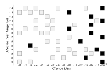

Fig. 2. Changelists and associated test targets.

files (and other programming language-specific implicit dependencies) rules to create a reverse dependency structure that eventually outputs all test targets that directly or indirectly depend on the modified files; these are called AFFECTED test targets. TAP needs to execute these AFFECTED test targets to ensure that the latest changes did not cause breakages. For our example of Figure 2, cl1 affected test targets t1, t3, t8, and t13 (shown as boxes in the figure). As discussed earlier, the granularity of these AFFECTED test targets depends on how their individual BUILD files are written, dependencies between packages, programming language used to code the tests, and how the developer chose to organize the code/tests. Test target t1 might be a JUnit test suite; t3 a single Python test; t8 an end-to-end test script; and so on. TAP knows to put them together as an AFFECTED set for cl1 only because of defined dependencies [17].

As mentioned earlier, Google's code churn rate prohibits the execution of all affected targets (which may run into Millions for some CLs and take hours to run) for each individual change. Hence, TAP postpones running test targets until it determines a time to cut a milestone using heuristics based on the tradeoff between delay to execute work, and getting the data about the freshest CL possible when that delay is minimum. All affected test targets that remained unexecuted since the previous milestone are run together.

Let's assume that a milestone was cut just before cl1 in Figure 2. Assume also that the next milestone was cut at cl16. This means that all test targets affected from cl1 through cl16 will be executed at this milestone. Because there will be overlap in how test targets are affected across CLs, time and resources are saved with this approach because test targets are executed only at their latest affecting CL. For example, even though t14 is affected by multiple CLs (cl2, cl4, cl8, cl13, cl16), it is only executed once at cl16, its latest affecting CL. All the targets actually executed are shown as black boxes in Figure 2. A milestone run will only determine a PASSED/FAILED status for these (black-filled-boxes) targets; others will remain AFFECTED, until (if) run on demand by another process.

#### III. UNDERSTANDING OUR DATASET

We analyzed months of TAP data for this project. In this paper, we report results of studying over 500K CLs, from Feb. 11, to Mar. 11, 2016, that affected more than 5.5 Million unique test targets, and over 4 Billion test outcomes.

In this section, we discuss the primary characteristics of our data that helped us to understand it, and form our hypotheses for further experimentation. We first wanted to see how frequently CLs affected individual test targets, and whether there was in fact overlap in affected test targets across CLs. Our histogram (log scale vertical axis) of how frequently targets are affected is shown in Figure 3. The height of Column x shows the number of test targets that are affected x times. For example, the first column shows that 151,713 targets were affected only once; Column 289 shows that 749 targets were affected 289 times. The two vertical lines, marked with 50% and 75%, tell us that 50% of test targets were affected fewer than 14 times; 75% were affected fewer than 46 times. Because test targets are affected at widely varying rates, some several orders of magnitude more than others, we started to question TAP's one-size-fits-all milestone approach of scheduling and executing test targets.

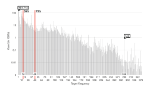

Fig. 3. Affected Targets Frequency.

Next, we wanted to examine the test target outcomes and their distribution. Figure 4 (again the vertical axis is log scale) shows that AFFECTED and PASSED targets formed the bulk of our outcomes, followed by SKIPPED (did not run because they did not match TAP's selection criteria, e.g., they were too large, marked NOTAP, etc.). FAILED were next but they constituted only a small fraction of the full set. The remaining outcomes are too few, and hence grouped together as OTHERS for ease of presentation. We also wanted to see how our test target outcomes looked for an average CL, so we averaged the test outcomes across CLs. As Table I shows, almost half of the test targets PASSED. Of the remaining, 43% remained AFFECTED (not executed) and 7.4% were SKIPPED. Less than 0.5% FAILED. This result was useful for our project as it informed us that FAILED test targets make up a very small fraction of our overall space. That AFFECTED test targets make up a large fraction informed us of the usefulness of TAP's current milestone-based strategy; significant resources

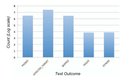

Fig. 4. Distribution of Overall Test Outcomes.

TABLE I PER CHANGELIST OUTCOMES.

| Outcome              | Avg. % per CL |
|----------------------|---------------|
| PASSED               | 48.4964       |
| AFFECTED TARGET      | 43.0578       |
| SKIPPED              | 7.4905        |
| FAILED               | 0.4186        |
| SIX OTHER CATEGORIES | 0.1244        |

were saved because these test targets were not executed at each and every affecting CL.

We next examined the overall history of each test target. We found (Table II) that 91.3% PASSED at least once and never FAILED even once during their execution history. Only 2.07% PASSED and FAILED at least once during their entire execution history. After filtering flaky test targets from these, we were left with 1.23% that actually found a test breakage (or a code fix) being introduced by a developer. This small percentage is what developers care about most as they inform developers of breakages and fixes. We were encouraged by this result because if we could develop mechanisms to identify test targets that are unlikely to reveal breakages and fixes, and execute them less often than others, we may be able to save significant resources and give faster feedback to developers.

## IV. HYPOTHESES, MODELS, AND RESULTS

The preliminary analysis of our dataset, discussed in the previous section, indicated that there may be opportunities to identify test targets that almost never fail; these make up the bulk of TAP's test targets. Significant resources may be saved – and put to better use – if these test targets are executed less frequently than other more-likely-to-fail test targets. Moreover, having a general understanding of these two populations of test targets may help to develop code quality guidelines for developers. To this end, we used our domain expertise to develop and study a number of hypotheses. In this section we present those that led us to valuable insights into Google's code development and testing practices, as well as how we could improve test target scheduling.

TABLE II
PARTITIONING OUR DATASET BY PASSED/FAILED HISTORY.

| Total Targets                                 | 5,562,881         |
|-----------------------------------------------|-------------------|
| Never FAILED; PASSED at least once            | 5,082,803         |
| Never PASSED; FAILED at least once            | 15,893            |
| Never PASSED/FAILED; most likely SKIPPED      | 349,025           |
| PASSED at least once AND FAILED at least once | 115,160           |
| Flakes                                        | 46,694 of 115,160 |
| Remaining (with PASSED/FAILED Edges)          | 68,466            |

A. Hypothesis 1: Test Targets "Farther Away" from Modified Code Do Not Detect Breakages.

Lets first formally define the term "farther away." As is generally the case with most of today's software, building a Google package requires other packages to be built. These "dependencies" are explicitly specified in a BUILD file associated with a package. The lower-level packages may depend on other yet-lower-level packages. Such dependencies form a dependency structure that may be modeled as a directed acyclic graph (DAG). For example, in Figure 5, the top node org/eclipse/platform/ui:ui\_tests requires two packages //ui/tests/ManualScenarioTests and //ui/jface\_tests, which in turn require 6 more packages. Even though the dependencies for //ui/tests/ManualScenarioTests are not shown, all the lower-level packages ultimately depend on the bottom node //ui/jface/tests/viewers/TestElement.java. Whenever //ui/jface/tests/viewers/TestElement.java is changed, all the packages in Figure 5 need to be built again.

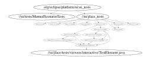

Fig. 5. Modeling Distance.

It is this structure that TAP employs to compute the set of AFFECTED test targets for a given committed code change. Assuming that the file *TestElement.java* has changed in a CL. TAP uses a *reverse dependency* graph to compute all test targets that may be impacted by the change. In our example, the top-level node *org/eclipse/platform/ui:ui\_tests* happens to be a test target, and hence, is added to the set of AFFECTED targets. Because Google's codebase is very large, the set of AFFECTED targets can get quite large. In our work, we have seen set sizes as large as 1.6 Million.

We define the term *MinDist* as the shortest distance (in terms of number of directed edges) between two nodes in our dependency graph. In our example from Figure 5, the MinDist between *ui\_tests* and *TestElement.java* is 5 (we write in functional notation *MinDist(ui\_tests, TestElement.java)* = 5). In our work on Google's code repository, we have seen

MinDist values as high as 43.

We hypothesize that code changes have limited direct impact beyond a certain MinDist value. This makes intuitive sense because packages do not use all the code of other packages that they depend upon. They may use the maximum amount of code of packages at MinDist=1, i.e., packages they directly depend on. But this is expected to reduce as MinDist values grow large, such as 40. For our purposes, this means that test targets that are farther away (higher values of MinDist) from modified code will not detect breakages.

We start by showing, in Figure 6, the distribution of all MinDists in our dataset. To collect this data, we examined all files modified in all changelists, and for each, computed the MinDist to all reachable AFFECTED test targets. As the figure shows, the vast majority of MinDist values are between 5 and 10. They drop beyond 10 but go as high as 40. We remind the reader that we are showing only the the shortest path between our AFFECTED test targets and modified files; if one looked at *all* paths, not only the shortest, then one would certainly find much longer paths.

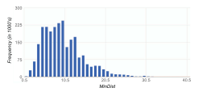

Fig. 6. Distribution of All MinDists.

We are interested in MinDist values for test targets that transitioned from PASSED to FAILED (breakage) and FAILED to PASSED (fix) for a given change. We call these our *edge* targets; our developers are most interested in these edge targets as they provide information regarding fixes and breakages.

Because of the way Google reports test targets results, in terms of test target outcome per CL, we need to define MinDist per CL and test target pair, instead of per file and test target pair.

**Definition**: For a given test target  $T_j$  and an affecting changelist  $CL_i$ , we say that the relation  $MinDist(CL_i, T_j)=n$  holds iff there exists a file F modified at  $CL_i$  such that  $MinDist(T_j, F)=n$ .

Note that  $\operatorname{MinDist}(\operatorname{CL}_i, T_j)$  as defined above is a relation, not a function, i.e.,  $\operatorname{MinDist}(\operatorname{CL}_i, T_j) = n$  may hold for several values of n, determined by our original  $\operatorname{MinDist}()$  function defined for a file and test target pair.

Next we develop the MinDist relation for a specific test target  $T_j$ . Intuitively, this relation holds for all values returned by our original MinDist() function for all constituent files modified in every affecting CL.

**Definition**: For a test target  $T_j$ , we say the relation

MinDist(T<sup>j</sup> )=n holds iff there exists a changelist CL<sup>i</sup> that affects T<sup>j</sup> and MinDist(CLi, T<sup>j</sup> )=n also holds. ✷.

Given all the MinDist values for a test target T<sup>j</sup> , we can compute the probability that MinDist(T<sup>j</sup> )=x for all values of x. We show (Figure 7 smoothed for visualization) the probability distribution of one such test target T<sup>j</sup> from our data. The plot shows that most (25%) of the MinDist values for T<sup>j</sup> were 10, followed by 18, 21, and so on. There were none beyond 22 or lower than 7.

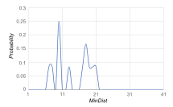

Fig. 7. MinDist Values for T<sup>j</sup> plotted as a Smoothed Curve.

We computed the same probabilities for all the test targets in our dataset. Aggregating them gave us the probability distribution of our entire population as shown in Figure 8. As expected, this curve follows the trend shown in Figure 6.

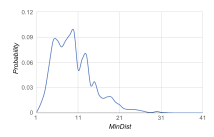

Fig. 8. Probability Distribution of Our Population.

Figure 8 shows the entire population of MinDist values, much of which is of little interest to us. We are eventually interested in our edge targets, so we should eliminate all nonedge test target information. Moreover, each CL describes multiple file modifications, which means that we will have multiple MinDist values per CL (one for each file) and test target pair; without loss of accuracy, we choose to retain only the smallest from this set. If we exclude all test targets, except our edge targets, and retain only the smallest MinDist value, from the data of Figure 8, we see the distribution shown in Figure 9. This distribution is more pronounced between MinDist values 6 and 10.

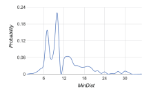

Fig. 9. Probability Distribution of Our Edge Targets.

There are two sources of noise in our data of Figure 9. The first is due to the presence of flaky test targets, and second is an artifact of how TAP cuts milestones, i.e., because TAP does not run each affected target at each CL, we have no way to pinpoint the cause of a breakage or fix. To eliminate the first noise source, we can filter flakes, ending up with a less noisy distribution shown in Figure 10. This distribution is much more focused at MinDist = 10. This shows that most of our non-flaky edge test targets have MinDists between 5 and 10.

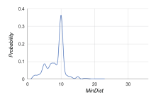

Fig. 10. Distribution of Our Edge Targets Minus Flakes.


Any of the N changelists between the P and F may have caused the breakage, which was eventually detected at a milestone build. Hence, our edge test targets have extra MinDist values that most likely have nothing to do with fixes and breakages. We can eliminate this noise by considering only those edge targets that have no AFFECTED outcomes between PASSED and FAILED (also FAILED to PASSED), i.e., we know for sure the culprit CL for a breakage and fix. Examining only this subset of edge targets, 77% of the full set, gives us the distribution shown in Figure 11, clearly contained

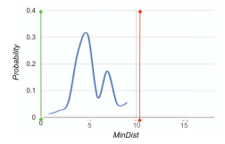

Fig. 11. Distribution for Edge Test Targets without AFFECTED.

within the MinDist boundary of 10.

Our above modeling of edge test targets and comparison with the overall population of test targets gave us confidence that we need not execute test targets beyond MinDist = 10. To better quantify our savings in terms of resources, we ran two simulations, running only test targets with M inDist ≤ 10 and M inDist ≤ 6. We compared these with our entire dataset. The results, in Figure 12 show that we executed only 61% and 50% of test targets with MinDist=10 and MinDist=6, respectively. Because AFFECTED test targets have a cumulative effect on resources, the area under the curves is a better indicator of the resources used. We see that we could save 42% and 55% resources if we executed only test targets within MinDist=10 and MinDist=6, respectively. We also note that for this simulation we did not miss a single breakage or fix.

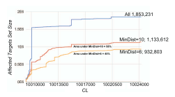

Fig. 12. Simulating with MinDist = 6 and 10.

Going back to our hypothesis, we have shown that test targets that are more than a distance of MinDist=10 do not cause breakages (or fixes) in Google's code in our dataset.

## *B. Hypothesis 2: Frequently Modified Source Code Files are More Often in Edge Changelists*

We call a CL an *edge changelist* if a test target transitioned from a previously known PASSED to FAILED (or FAILED to PASSED) when executed at the CL. We hypothesize that code that is modified very frequently is more likely to be in these edge CLs. Because of the nature of our data, our granularity for code is a source code file. In our dataset, we saw files being modified as frequently as 42 times, and as little as once. We also saw that a very small percentage of files modified only once were in edge CLs, whereas 77% of the files modified 42 times were in edge CLs, which led us to hypothesize that file modification frequency has an impact on how test targets transition.

To examine this hypothesis, we define two terms:

f<sup>i</sup> = Number of files modified i times in edge CLs, and

F<sup>i</sup> = Total number of files modified i times.

We plot P(File in Edge CL) = fi/F<sup>i</sup> for i = 1 to 42, and show the results in Figure 13. We see that P() consistently increases with file modification frequency. For our project, this means that when a developer submits code that has been changed a large number of times in the past, TAP should schedule it as soon as possible (perhaps without waiting for a milestone) so that the impact of the change can be evaluated quickly. Moreover, for the developer, we can issue an alert in the IDE that "*You are modifying a file that was modified 41 times in the past. The probability that you will cause a breakage is 75%.*"

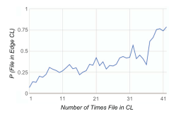

Fig. 13. File modification frequency impact on edge CLs.

### *C. Hypothesis 3: Certain Types of Source Code is More Often in Edge Changelists.*

Some of our programming languages such as Java, have a rich set of tools (e.g., static analysis tools) and type-checking that help to reduce certain types of breakages. Moreover, new developers, fresh out of college, are better prepared in certain programming languages, e.g., Java these days. It is only natural to believe that that bugs and breakages may vary across languages. In our project, we capture differences between languages by using the file extensions (.java or .cpp) and examine whether certain file extensions are more often in edge changelists.

We define two terms:

t<sup>i</sup> = Number of type i files in edge CLs,

## T<sup>i</sup> = Total number of type i files in dataset.

We plot, for each file type i two values, t<sup>i</sup> and T<sup>i</sup> − t<sup>i</sup> and normalize each with Ti. The resulting column chart is shown in Figure 14. We have sorted the columns so that the gray part (ti) shows up in decreasing order of magnitude. The plot shows that file type *.hpp* (leftmost column) was the most prone to breakages. In fact 80% of *.hpp* files appeared in edge CLs. A number of file types (13 of the right-most columns) had no impact on breakages in our dataset. We further superimpose a curve showing the frequency of occurrence of these file types. We see that *java* files were the most commonly modified types and were 40% likely to cause breakages. These turned out to be better than *cc* files, which were 60% likely to cause breakages.

These results were interesting in and of themselves (e.g., C++ is more prone to breakages than Java) but for the purpose of our project, file types gave us a clear signal of how to focus our testing resources. Moreover, *C++* (extension *.cc*) developers at Google need to be aware that they are more likely to cause breakages than their *java* counterparts. For the developer, we can issue an alert in the IDE (or a code review tool) that "*You are modifying a file type that is known to cause XX% of Google's breakages. We recommend a more thorough code review and running a static analysis tool to detect possible problems.*"

### *D. Hypothesis 4: Certain Changelist Authors Cause More Breakages than Others*

CLs at Google are authored by both human developers and tools. Each tool is responsible for generating some part of Google code and automatically adding the generated code via a code commit. We expected these tools to be well-tested so they do not cause breakages when integrated with overall Google code. We further hypothesized that certain human developers are more prone to cause breakages either because of their coding practices or the type/complexity of code they develop.

Our results are shown in Table III. The first 3 entries in the table are anonymized human developers; the remaining are tools. We see that user *userabz* (IDs have been anonymized) made a total of 182 commits of which 59 (31.4%) caused breakages, an unusually large percentage. Tool product1 release made 42 commits of which 39 caused breakages. This was a surprising but valuable result because product1 releases are very carefully tested.

Examining CL authors provided us with valuable insights for our project. TAP could take extra care when scheduling CLs for certain authors, such as product1-release, perhaps during off-peak hours. For the developer, we can issue an alert in the IDE that "*Your recent development history shows a code breakage rate of XX%, which is higher than the average YY%. We recommend a more thorough pre-submit testing cycle, followed by a global presubmit, before committing the code*."

### *E. Hypothesis 5: Code Modified by Multiple Developers Is More Prone to Breakages*

Many parts of Google code are modified by multiple developers. We hypothesize that such code can become fragile and

TABLE III CHANGELIST AUTHOR'S IMPACT ON BREAKAGES.

| USER ID           | Total Commits | Breakages   |
|-------------------|---------------|-------------|
| userabz           | 182           | 59 (31.4%)  |
| userabc           | 1,382         | 196 (14.2%) |
| userxyz           | 1,564         | 214 (13.7%) |
| product1-release  | 42            | 39 (92.9%)  |
| product2-dev      | 319           | 68 (21.3%)  |
| product3-rotation | 302           | 47 (15.6%)  |
| product4-releaser | 263           | 40 (15.2%)  |
| product5-releaser | 442           | 63 (14.3%)  |
| product6-releaser | 526           | 66 (12.5%)  |
| product7-releaser | 784           | 87 (11.1%)  |
| product8-releaser | 2,254         | 226 (10%)   |

more prone to breakages. This would happen if the developers don't understand each other's changes very well.

To examine this hypothesis, we collected the entire set of files with their authors in our dataset. We then computed the frequency with which these files were modified by multiple authors. Our results are shown as a line plot in Figure 15, normalized for the number of times the files are changed. We see multiple lines in the plot, one for each count of the number of times a file was modified. The x-axis shows the number of authors. The plot shows that breakages drop when a file is modified by 2 authors compared to a single author. This may be because two authors working on the same file are able to review one anothers code, and catch each other's faults. However, breakages go up significantly when 3 or more authors are involved in modifying a file. We guess that this is due to breakdown in communication when large number of developers are working on the same code.

For our project, this result provides at least two concrete action items. First, TAP should use "variety of authors" and "code change frequency" together to better schedule test targets. For the developer, we can issue an alert in the IDE, e.g., "*You are 97% likely to cause a breakage because you are editing a Java source file modified by 15 other developers in the last 30 days.*"

#### V. RELATED WORK

In this project, we are aiming to do two things. First, we want to reduce test workload by not frequently re-running tests unlikely to fail. Second, we want to use test results to inform code development.

Our first goal is somewhat related to test selection/prioritization. At one extreme of test selection are *safe* techniques that select all tests that have any chance of failure. These rely on knowing a mapping between code elements (statements, functions/methods, classes/files) and tests. If a modification is made to the code element, then all affected tests are re-run. Rothermel et al. propose a regression test selection technique that uses control flow graphs (CFG) of programs to select tests that execute modified code [18]. Legunsen et al. evaluate static analysis techniques to select tests that may be affected by code change [19].

Different granularities of program elements have also been studied. Rothermel et al. show that fine-granularity techniques

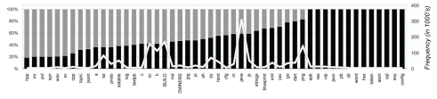

*File Types (by extensions)* 

Fig. 14. File Types' Impact on Edge CLs.

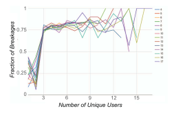

Fig. 15. Multiple CL Authors Impact on Breakages.

(statement-level) typically outperform coarse-granularity techniques (function-level) only by a relatively small margin overall. Some recent studies show that better results can be achieved by selecting tests at a coarser (class-level) compared to a finer (method-level) granularity [17][19].

Because our level of granularity is at the file level, and we use reverse dependencies to obtain implicit on-demand mapping between code (at the file level) and test targets, our work is also related to event-driven systems that use explicit dependencies between elements (in this case, events) for test selection and prioritization. Bryce and Memon proposed a technique to prioritize tests based on t-way interaction coverage of events [20].

Researchers have also used other, non-code elements such as requirements. Srikanth et al. presented a value-driven approach to system-level test case prioritization which prioritizes system test cases based upon four factors: requirements volatility, customer priority, implementation complexity, and fault proneness of the requirements [8]. Arafeen et al. investigated a technique which clusters test cases based on requirements, and then utilize code element metrics to further prioritize tests for different clusters [21].

Different algorithms are studied in test prioritization and selection. Li and Harman et al. presents a set of search algorithms for test case prioritization, including greedy, additional greedy, 2-Optimal, hill-climbing and genetic algorithms [22]. Other works use machine learning techniques to assist test selection. Chen et al. used semi-supervised K-Means to cluster test cases and then pick a small subset of tests from each cluster to approximate the fault detection ability of the original test suite [23]. Arafeen et al. proposed a requirement-based clustering technique for test prioritization [21].

There are also some rule-based techniques. For example, Weyuker et al. showed that files that were recently modified are likely to have faults [24]. Graves et al. presented a study that predicates fault incidence using software change history. Their study showed some interesting findings such as large number of past faults may indicate a module has been rigorously tested and thus will have fewer future faults; and the number of changes to a module tend to be proportional to its expected number of faults. And other studied measures include the age of code and weighted time stamp which assign large and recent changes with big fault potential [25]. Zimmermann and Nagappan investigate how dependencies correlate with and predict defects for binaries in Windows Server 2003 [26].

Hindle et al. [27] performed a case study that includes the manual classification of large commits. They show that large commits tend to be perfective while small commits are more likely to be corrective.

Second, some existing techniques use test results to inform code development. Anvik et al. presented a technique which uses text categorization, a machine learning technique, to learn the kinds of reports each developer resolves, based on which new coming bug reports will be assigned to a small number of candidate developers [28]. Their technique attempts to find a developer who can, instead of who should, fix a bug.

#### VI. CONCLUSIONS & FUTURE DIRECTIONS

We described results of a project performed in TAP, a group at Google responsible for continuous integration and testing of most of Google's codebase. The overarching goal of this project was to develop and empirically evaluate mechanisms that can aid developers by providing them with quick feedback from test runs as well as situational data-driven guidelines regarding the impact of their latest changes on code quality. We empirically studied several relationships between developers, their code, test targets, frequency of code commits and test target execution, and code type, and found novel correlations.

Our specific results and correlations are valid within the context of post-submit test data recorded by TAP, a group that deals with company-wide CI. We recognize that the exact relationships that we have found (e.g., *MinDist* = 10) may not generalize to other companies or even groups across Google for a number of reasons. For example, groups/companies may not use the same test criteria, or follow the same code-review, pre-submit, global presubmit, and post-submit stages of quality control. They may not have deep Google-like dependencies in their relatively-smaller codebases. However, we do believe that our results are generalizable to the extent that similar correlations likely exist in other companies (we know this from verbal discussions with folks at other companies, e.g., certain developers/languages are more error prone than others, frequently modified code is more likely to cause breakages), and hence our results would be of general interest to the software testing community.

This research has raised many questions that require more formal in-depth studies. Our hypotheses are supported by our preliminary data but not yet fully tested. The experimental cycle of each hypothesis needs to be exercised to present validated results that are useful to the broader community. Moreover, we have shown correlations between our variables of study but have not fully explained causation. Finally, our hypotheses are drawn using a mix of expert domain knowledge and observed data; these need to be identified and separated. Addressing all these limitations requires much work. In the short and medium terms, we plan to conduct a more finegrained project-level analysis to clarify some of the relationships we have discovered. We believe that such an analysis could lead to preliminary explanation of the insights that come from the data. Each of these insights have value on their own and could be presented in a separate research paper. Indeed, we ask the broader software testing research community to contact us and help us pursue some of this research.

## ACKNOWLEDGMENTS

The authors would like to thank Jan Bakus, Ot Ten Thije, John Roane, Phil Stahlfled, Murat Ozturk, Jeff Listfield, Celal Ziftci, and John Penix for their support during this work.

#### REFERENCES

- [1] S. Elbaum, G. Rothermel, and J. Penix, "Techniques for improving regression testing in continuous integration development environments," in *Proceedings of the 22nd ACM SIGSOFT International Symposium on Foundations of Software Engineering*. ACM, 2014, pp. 235–245.
- [2] J. Micco, "Tools for continuous integration at google scale," *Google Tech Talk, Google Inc*, 2012.
- [3] R. Potvin and J. Levenberg, "Why google stores billions of lines of code in a single repository," *Communications of the ACM*, vol. 59, no. 7, pp. 78–87, 2016.
- [4] X. Qu, M. B. Cohen, and G. Rothermel, "Configuration-aware regression testing: an empirical study of sampling and prioritization," in *Proceedings of the 2008 international symposium on Software testing and analysis*. ACM, 2008, pp. 75–86.
- [5] S. Elbaum, A. G. Malishevsky, and G. Rothermel, "Test case prioritization: A family of empirical studies," *IEEE transactions on software engineering*, vol. 28, no. 2, pp. 159–182, 2002.

- [6] G. Rothermel, R. H. Untch, C. Chu, and M. J. Harrold, "Prioritizing test cases for regression testing," *IEEE Transactions on software engineering*, vol. 27, no. 10, pp. 929–948, 2001.
- [7] L. C. Briand, J. Wust, S. V. Ikonomovski, and H. Lounis, "Investigating ¨ quality factors in object-oriented designs: an industrial case study," in *Proceedings of the 21st international conference on Software engineering*. ACM, 1999, pp. 345–354.
- [8] H. Srikanth, L. Williams, and J. Osborne, "System test case prioritization of new and regression test cases," in *2005 International Symposium on Empirical Software Engineering, 2005.* IEEE, 2005, pp. 10–pp.
- [9] "Flakiness dashboard howto," http://goo.gl/JRZ1J8, 2016-10-05.
- [10] "Android flakytest annotation," http://goo.gl/e8PILv, 2016-10-05.
- [11] Q. Luo, F. Hariri, L. Eloussi, and D. Marinov, "An empirical analysis of flaky tests," in *Proceedings of the 22nd ACM International Symposium on Foundations of Software Engineering*. ACM, 2014, pp. 643–653.
- [12] A. M. Memon and M. B. Cohen, "Automated testing of gui applications: Models, tools, and controlling flakiness," in *Proceedings of the 2013 International Conference on Software Engineering*, ser. ICSE '13. Piscataway, NJ, USA: IEEE Press, 2013, pp. 1479–1480. [Online]. Available: http://dl.acm.org/citation.cfm?id=2486788.2487046
- [13] Z. Gao, Y. Liang, M. B. Cohen, A. M. Memon, and Z. Wang, "Making system user interactive tests repeatable: When and what should we control?" in *2015 IEEE/ACM 37th IEEE International Conference on Software Engineering*, vol. 1. IEEE, 2015, pp. 55–65.
- [14] D. Saff and M. D. Ernst, "Reducing wasted development time via continuous testing," in *Software Reliability Engineering, 2003. ISSRE 2003. 14th International Symposium on*. IEEE, 2003, pp. 281–292.
- [15] J. Penix, "Large-scale test automation in the cloud (invited industrial talk)," in *2012 34th International Conference on Software Engineering (ICSE)*, June 2012, pp. 1122–1122.
- [16] "Bazel," https://www.bazel.io/, 2016-10-05.
- [17] M. Gligoric, L. Eloussi, and D. Marinov, "Practical regression test selection with dynamic file dependencies," in *Proceedings of the 2015 International Symposium on Software Testing and Analysis*. ACM, 2015, pp. 211–222.
- [18] G. Rothermel and M. J. Harrold, "A safe, efficient regression test selection technique," *ACM Transactions on Software Engineering and Methodology (TOSEM)*, vol. 6, no. 2, pp. 173–210, 1997.
- [19] O. Legunsen, F. Hariri, A. Shi, Y. Lu, L. Zhang, and D. Marinov, "An extensive study of static regression test selection in modern software evolution," in *Proceedings of the 2016 11th Joint Meeting on Foundations of Software Engineering*. ACM, 2016.
- [20] R. C. Bryce and A. M. Memon, "Test suite prioritization by interaction coverage," in *Workshop on Domain specific approaches to software test automation: in conjunction with the 6th ESEC/FSE joint meeting*. ACM, 2007, pp. 1–7.
- [21] M. J. Arafeen and H. Do, "Test case prioritization using requirementsbased clustering," in *2013 IEEE Sixth International Conference on Software Testing, Verification and Validation*. IEEE, 2013, pp. 312–321.
- [22] Z. Li, M. Harman, and R. M. Hierons, "Search algorithms for regression test case prioritization," *IEEE Transactions on software engineering*, vol. 33, no. 4, pp. 225–237, 2007.
- [23] S. Chen, Z. Chen, Z. Zhao, B. Xu, and Y. Feng, "Using semi-supervised clustering to improve regression test selection techniques," in *2011 Fourth IEEE International Conference on Software Testing, Verification and Validation*. IEEE, 2011, pp. 1–10.
- [24] T. J. Ostrand, E. J. Weyuker, and R. M. Bell, "Predicting the location and number of faults in large software systems," *IEEE Transactions on Software Engineering*, vol. 31, no. 4, pp. 340–355, 2005.
- [25] T. L. Graves, A. F. Karr, J. S. Marron, and H. Siy, "Predicting fault incidence using software change history," *IEEE Transactions on software engineering*, vol. 26, no. 7, pp. 653–661, 2000.
- [26] T. Zimmermann and N. Nagappan, "Predicting defects using network analysis on dependency graphs," in *Proceedings of the 30th International Conference on Software Engineering*, ser. ICSE '08. ACM, 2008, pp. 531–540.
- [27] A. Hindle, D. M. German, and R. Holt, "What do large commits tell us?: a taxonomical study of large commits," in *Proceedings of the 2008 international working conference on Mining software repositories*. ACM, 2008, pp. 99–108.
- [28] J. Anvik, L. Hiew, and G. C. Murphy, "Who should fix this bug?" in *Proceedings of the 28th international conference on Software engineering*. ACM, 2006, pp. 361–370.