**Source:** *Does Mutation Testing Improve Testing Practices?* — [PDF](https://arxiv.org/pdf/2103.07189) · [arXiv](https://arxiv.org/abs/2103.07189)

# Does mutation testing improve testing practices?

Goran Petrović  Affiliation: Google Switzerland, GmbH   
Zürich, Switzerland   
goranpetrovic@google.com  Marko Ivanković  Affiliation: Google Switzerland, GmbH   
Zürich, Switzerland   
markoi@google.com  Gordon Fraser  Affiliation: University of Passau   
Passau, Germany   
gordon.fraser@uni-passau.de  René Just  Affiliation: University of Washington   
Seattle, USA   
rjust@cs.washington.edu 

###### Abstract

Various proxy metrics for test quality have been defined in order to guide developers when writing tests. Code coverage is particularly well established in practice, even though the question of how coverage relates to test quality is a matter of ongoing debate. Mutation testing offers a promising alternative: Artificial defects can identify holes in a test suite, and thus provide concrete suggestions for additional tests. Despite the obvious advantages of mutation testing, it is not yet well established in practice. Until recently, mutation testing tools and techniques simply did not scale to complex systems. Although they now do scale, a remaining obstacle is lack of evidence that writing tests for mutants actually improves test quality. In this paper we aim to fill this gap: By analyzing a large dataset of almost 15 million mutants, we investigate how these mutants influenced developers over time, and how these mutants relate to real faults. Our analyses suggest that developers using mutation testing write more tests, and actively improve their test suites with high quality tests such that fewer mutants remain. By analyzing a dataset of past fixes of real high-priority faults, our analyses further provide evidence that mutants are indeed coupled with real faults. In other words, had mutation testing been used for the changes introducing the faults, it would have reported a live mutant that could have prevented the bug.

###### Index Terms: 

mutation testing, code coverage, fault coupling 

## I Introduction

Testing is an essential part of software development, and software developers need guidance in how much testing they need to do, and where to add more tests. Various proxy metrics for test suite quality have been defined over time with the aim to provide this guidance. Out of these, code coverage is probably best established in practice: Executing code is a prerequisite for revealing faults, code coverage can be easily visualized, for example by highlighting covered lines in a different color than uncovered lines, coverage is cheap to compute, and it is well supported by commercial-grade tools [[1](https://arxiv.org/html/2103.07189#bib.bib1)].

There are, however, downsides to coverage: Quantifying code quality based on code coverage alone leads to questionable estimates, whose general utility and actionability are a matter of controversy in the research community [[2](https://arxiv.org/html/2103.07189#bib.bib2), [3](https://arxiv.org/html/2103.07189#bib.bib3), [4](https://arxiv.org/html/2103.07189#bib.bib4)]. Coverage-adequate test suites, which satisfy all test goals, are not the norm nor should they be. In practice, developers only satisfy a fraction of the test goals, but adequate thresholds for code coverage ratios are inherently arbitrary and a matter of much debate [[5](https://arxiv.org/html/2103.07189#bib.bib5), [6](https://arxiv.org/html/2103.07189#bib.bib6)]. Code coverage is also easily fooled, as it only determines whether code has been executed, regardless of how well its behavior has been checked.

These downsides are overcome by mutation testing [[7](https://arxiv.org/html/2103.07189#bib.bib7), [8](https://arxiv.org/html/2103.07189#bib.bib8)]: A test suite is evaluated on a set of systematically generated artificial faults (mutants). Any surviving mutant that is not detected by the test suite constitutes a concrete test goal, pointing out possible ways to improve the test suite. While the idea of mutation testing is appealing, adoption in practice has long been hampered by scalability issues: Even simple programs may result in large numbers of mutants. Performing traditional mutation testing, which evaluates all possible mutants, for a large code base is impracticable. For example, at Google, 500,000,000 tests are executed per day, gate-keeping 60,000 code changes. However, as a result of decades of research on mutation testing, it is now possible to apply mutation testing even at such scale [[20](https://arxiv.org/html/2103.07189#bib.bib20), [10](https://arxiv.org/html/2103.07189#bib.bib10)].

While the computational challenges should no longer prevent adoption in practice, there remains uncertainty about whether the expected benefits of showing mutants to developers manifest: For a large system many mutants can be produced, yet only few of these can be shown to developers. Do developers actually improve their test suites when shown these mutants, and do tests written for these mutants have the potential to help prevent real faults? In this paper, we aim to shed light on these questions of central importance.

Using a dataset of almost 15 million mutants, created in industrial software projects at Google over a duration of six years, we investigate the effects of showing these mutants as test goals to developers. In particular, we aim to answer the following research question:

  * RQ1 Effects on testing quantity. How does continuous mutation testing affect how much test code developers produce? 

Our data shows that developers working on projects exposed to mutation testing over a longer period of time tend to write more tests for their code (Section [III-C](https://arxiv.org/html/2103.07189#S3.SS3 "III-C RQ1: Effects on testing quantity ‣ III Long Term Effects of Mutation Testing ‣ Does mutation testing improve testing practices?")). This raises an immediate follow-up question: Are they writing _good_ tests?

  * RQ2 Effects on testing quality. How does continuous mutation testing affect the survivability of the mutants on a project? 

Our data shows that the tests that developers add when exposed to mutants are effective: The more mutants they act on, the fewer mutants survive for new changes over time as the effectiveness of their test suites improves (Section [III-D](https://arxiv.org/html/2103.07189#S3.SS4 "III-D RQ2: Effects on testing quality ‣ III Long Term Effects of Mutation Testing ‣ Does mutation testing improve testing practices?")); the additional tests written improve the test suite’s ability to detect mutants beyond the ones for which they were written.

Naturally, this leads to the next question: Are tests that are effective at detecting mutants also effective at detecting real faults? Mutants are worth writing test cases for only if they are _coupled_ with real software faults, i.e., test suites that detect mutants would also detect real faults. The third research question is centered around this issue:

  * RQ3 Fault coupling. Are reported mutants coupled with real software faults? Can tests written based on mutants improve test effectiveness for real software faults? 

Using a dataset of historical faults and fixes, our data shows that had mutation testing been used for the fault-introducing changes, it would have reported a live mutant that is killed by tests in the fault-fixing change (Section [IV-C](https://arxiv.org/html/2103.07189#S4.SS3 "IV-C RQ3: Fault coupling ‣ IV Fault Coupling ‣ Does mutation testing improve testing practices?")). It is thus likely that mutants, had they been reported, could have prevented the fault by guiding the developers to investigate the mutants and write tests for them.

Finally, one of the reasons that modern mutation testing systems scale is that they do not generate and analyze all possible mutants—only a small sample. In particular, in our dataset developers were never shown more than one mutant per line of code. This leads to the fourth research question:

  * RQ4 Mutant redundancy. Are the mutants generated for a given line redundant? Is it sufficient in practice to select a single mutant per line? 

Our data shows that most mutants share a majority fate (Section [IV-D](https://arxiv.org/html/2103.07189#S4.SS4 "IV-D RQ4: Mutant redundancy ‣ IV Fault Coupling ‣ Does mutation testing improve testing practices?")). If a single mutant is killed in a line, most likely all mutants in that line will be killed. Conversely, if a single mutant survives in a line, most likely all mutants in that line will survive. This backs the intuition and design choices behind Google’s mutation testing system, in particular the practice of generating only a single mutant per line.

Overall, our results, for the first time, provide strong evidence that mutants are coupled with real faults that matter in practice, and that showing mutants as test goals to developers leads to them writing more and better tests.

## II Mutation Testing at Google

Traditionally, mutation testing is performed by generating all viable mutants for a software under test, and then running its test suite in an attempt to kill those mutants, i.e., to have at least one test that fails on the mutant code. The output of this process is the mutation score (i.e., the ratio of killed mutants), a higher-is-better measure. Considering the scale of software systems at Google, this traditional approach is computationally infeasible. Even if it were feasible, the mutation score itself is difficult to act on by developers. As a consequence, mutation testing at Google has evolved compared to the traditional approach [[20](https://arxiv.org/html/2103.07189#bib.bib20)].

Google’s mutation testing system currently supports 10 programming languages: C++, Java, Go, Python, TypeScript, JavaScript, Dart, SQL, Common Lisp, and Kotlin. This section describes the main distinguishing features of the mutation testing system, and we refer an interested reader to a full description of the system for further details [[10](https://arxiv.org/html/2103.07189#bib.bib10)].

The key difference at Google is that mutation testing is integrated into the code review process: Developers send their code changes for code review in form of _changelists_. A changelist is subject to various static and dynamic analyses that produce _code findings_ , which are reported to the developer and the reviewers assigned to that changelist. An example analysis is line coverage, which is reported at the level of the changed files as well as the actual code changes. Mutation testing is integrated as another such finding: A selection of mutants within the changed code of a changelist, which are not killed by the existing tests, are shown as findings. These live mutants thereby serve as concrete test goals, which a developer can satisfy by adding tests. To avoid cognitive overload, no more than seven mutants are reported per file in a changelist. Reviewers can mark findings as particularly important by clicking on the corresponding ‘Please fix’ link, and developers can provide feedback about findings that are not actionable using a ‘Not useful’ link. Developers can update the changelist based on findings and reviewer comments. Once the reviewers approve, a changelist is _submitted_ (merged) into the main source tree.

Mutating only changed code is key to reducing the computational costs, but further optimizations are necessary to make mutation testing feasible and actionable. First, mutants are only generated in lines that are covered by tests, since lack of coverage is already reported by the coverage analysis. Second, only one mutant is generated per line. Third, in order to increase the chances of generating productive mutants [[11](https://arxiv.org/html/2103.07189#bib.bib11)], suppression rules filter out code that cannot result in productive mutants (e.g., logging statements). The developer feedback informs these heuristics for mutant productivity. Finally, after applying the suppression rules, an important and technically challenging aspect is the choice of mutation operator to generate a mutant for a given line. Our mutation system implements five mutation operators: AOR (Arithmetic operator replacement), LCR (Logical connector replacement), ROR (Relational operator replacement), UOI (Unary operator insertion), and SBR (Statement block removal). The mutation system selects a mutation operator for a given line based on historical information on whether mutants in similar context survived and whether developers thought they were productive. If a mutation operator is not applicable to a line, another one is chosen, until one mutant in the line is generated.

Many individual software projects are developed at Google, and each project can opt-in to use the mutation testing system. When mutation testing is enabled for a project, each changelist in review for that project will be analyzed for mutants, and live mutants will be reported to the changelist author and reviewers. Over time, the same files may be mutated repeatedly whenever they are part of a changelist under review. The mutation system does not offer manual invocations or project-level analyses—only the change-based approach. Hence, developers only observe live mutants that are reported during code review.

Mutation testing has been deployed at Google for more than six years, and some projects have been rolled in since the beginning, while many joined over time. There have now been more than 15 million mutants generated, and hundreds of thousands of analyzed changelists, providing a suitable dataset for analyzing the long-term effects of mutation testing on the developers working on a project employing it.

## III Long Term Effects of Mutation Testing

A core assumption of mutation testing is that mutants are actionable test goals, and that reporting them has the desired effect on developers: They augment their test suites, and generally improve their testing practices over time. We therefore wished to study whether developers exposed to mutants write more tests, and whether these tests improve the test suite quality beyond simply covering additional code. Thus, in this section we focus on the effects that mutants have on the tests developers write, and aim to answer the first two research questions:

  * RQ1 Effects on testing quantity. How does continuous mutation testing affect how much test code developers produce? 
  * RQ2 Effects on testing quality. How does continuous mutation testing affect the survivability of the mutants on a project? 

To answer these research questions, we performed a longitudinal study that fully integrates mutation-based testing into the software-development process. Our study employs a direct intervention to form a treatment group (developers who act on mutants) and uses a control group (developers who use only code coverage).

### III-A Datasets

Although we are interested in how mutation testing affects developers, focusing on individual developers for analysis is difficult: Developers tend to multi-task, either working on a side project, maintaining an older code base, or still partially working on their previous engagement. Different codebases tend to differ greatly in their testing quality, especially when comparing side projects, older projects, and new engagements. Thus, instead of considering the behavior of individual developers we consider individual _files_ of source code. We created two datasets of files: One dataset based on files subjected to mutation testing and, as baseline, one dataset based on files subjected to only code coverage analysis.

Mutant dataset Google has used mutation testing since 2014. At the time of this writing, a total of 14,730,562 mutants have been generated for 662,584 code changes in 446,604 files. Our mutant dataset contains all of them. For each mutant, the dataset contains information about the mutation operator, the programming language of the mutated file, the code location, and the results of mutation testing (i.e., whether the mutant was killed and whether a reviewer requested a test for it).

Coverage dataset As a baseline for comparison, we randomly sampled code changes from projects that did not use mutation testing, but had line coverage calculation enabled, within the same period of time. In total, the sample resulted in 8,788,791 code changes with 3,398,085 files.

### III-B Methodology

#### III-B1 RQ1

We are interested in understanding the effects of mutants on tests written for the mutated code. Therefore, for each file we need to quantify the amount of testing related to that file. For each code change, we identified the edited test files that correspond to that change, using the build system. However, the raw number of edited lines of test code is not a reliable measure because of differing programming languages, testing styles, categories of tests and the specifics of testing and mocking frameworks. For example, in a table-based testing approach, a test case may only consist of a single line of code, whereas an equivalent test case, possibly including harness code, can easily span tens or hundreds of lines. Therefore, we quantify the amount of testing using the number of _test hunks_ —the changed code hunks in the edited test files. Hunks are groups of differing lines (edited or added) that intersperse sequences of lines in common.

In addition, we measure the _exposure_ for each file in a code change, computing the number of times the file has been changed _and_ had a code finding reported before the change under analysis. Code findings are reported mutants for the mutant dataset and code coverage results for the coverage dataset. For example, if a change edits a file for the 10th time, but in the previous 9 times mutants were reported only in 3 instances, the _exposure_ would be 3 for that change. This measure captures the exposure of developers to mutants: The more often mutants had been reported in a file, the more exposure the authors and reviewers developing that file collectively had to mutation testing.

In order to answer RQ1, we evaluate the number of test hunks for each file over the file’s exposure. If developers get accustomed to mutation testing and act on mutants to improve the test suite, we expect the number of test hunks to be larger for mutation than for the baseline. Further, we expect a positive relationship between exposure and number of test hunks. Since we do not expect that relationship to be linear and to show some saturation, we rely on rank statistics. Specifically, we quantify the effect size using Spearman’s rank correlation coefficient \(r_{s}\). In addition, we compute the number of test hunks for individual changelists, considering two timestamps: (1) when code findings are initially reported to the developer during code review and (2) when the changelist is approved and submitted. If code findings are actionable, we expect an increase in the number of test hunks, after reporting the findings.

#### III-B2 RQ2

RQ1 is concerned with testing quantity, but not quality. Writing more tests does not necessarily improve the quality of a test suite. For example, tests written simply for the sake of increasing code coverage tend to be ineffective at detecting faults [[6](https://arxiv.org/html/2103.07189#bib.bib6)]. In particular, if mutation testing generally improves test suite quality, then we expect to observe several effects: First, reported mutants should be killed by additional tests while a changelist is in code review; second, over time, the ratio of mutants (generated for a new changelist) that are already killed by the existing tests should increase; third, fewer mutants should see ‘Please fix’ requests by the reviewers.

As a proxy measurement of test quality, we use mutant _survivability_ , i.e., the probability of a generated mutant being killed. The mutant survivability for a file in a code change is calculated as the ratio of surviving mutants to the total number of generated mutants for that file. A lower mutant survivability indicates a higher test suite quality. We compute the mutant survivability for each file in the mutant dataset over the _exposure_ of the mutated file. If the tests added due to mutation testing lead to an improvement of the test suite quality, then we expect a negative correlation between exposure and survivability, i.e., the tests should become more effective at killing mutants over time—even for mutants that are generated later for newly added or changed code. If tests are strictly added to kill reported mutants, we expect no correlation because survivability should remain fairly constant.

We further compare the number of live mutants first reported to the developer with the final number of live mutants when the changelist is submitted. If mutants are actionable test goals, we expect that the number of live mutants at submission time is lower than the number of originally reported mutants as a result of the additional tests added by the developer.

In the code review system, reviewers can request developers to write tests for mutants they consider important. If developers improve their test suites over time, we would expect the ratio of such requests (for all reported mutants) to gradually decrease. Therefore, we also compute the ratio of requested fixes for mutants over exposure.

### III-C RQ1: Effects on testing quantity

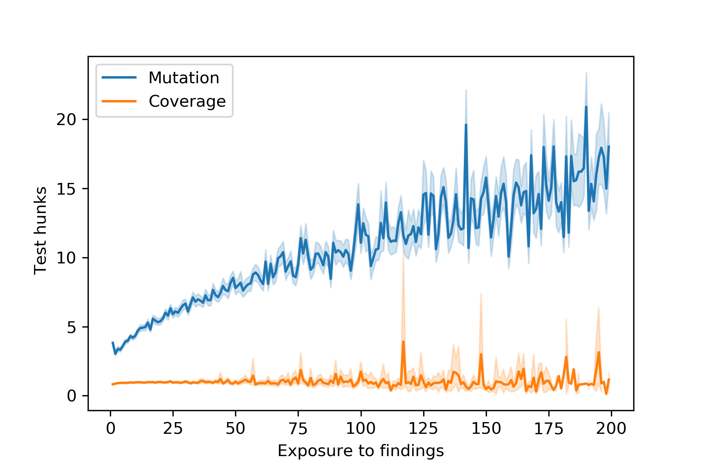

 

Fig. 1: Test hunks changed per file as exposure to reported mutants vs. line coverage increases.

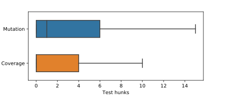

 

Fig. 2: Test hunks changed per changelist after initially reporting mutants vs. line coverage. The median is 1 for mutation and 0 for coverage. Outliers (12% outside of \(\pm 1.5\) times the interquartile range) are not shown for clarity.

Figure [2](https://arxiv.org/html/2103.07189#S3.F2 "Fig. 2 ‣ III-C RQ1: Effects on testing quantity ‣ III Long Term Effects of Mutation Testing ‣ Does mutation testing improve testing practices?") shows the number of changed hunks of test code, normalized by the number of files in the change, over exposure to code findings. This figure shows the estimated central tendency (mean) and corresponding confidence interval. Note that the confidence intervals get wider for higher levels of exposure for mutation because the number of files with such high levels in the mutant dataset decreases. This means that accurately fitting a trend for higher levels of exposure and identifying saturation is challenging. However, there is a clear signal for the mutant dataset: (1) The number of test hunks is larger than that for coverage. (2) The larger the exposure, the more test hunks are changed on average. Spearman’s rank correlation between exposure and the average number of changed test hunks is \(r_{s}=0.9\) (\(p<.001\)). In contrast, Figure [2](https://arxiv.org/html/2103.07189#S3.F2 "Fig. 2 ‣ III-C RQ1: Effects on testing quantity ‣ III Long Term Effects of Mutation Testing ‣ Does mutation testing improve testing practices?") shows no signal for the coverage dataset. In fact, there is a weak negative correlation between exposure and the average number of changed test hunks (\(r_{s}=-0.24\), \(p<.001\)). These results suggest that mutation testing has a positive long-term effect on testing quantity.

Figure [2](https://arxiv.org/html/2103.07189#S3.F2 "Fig. 2 ‣ III-C RQ1: Effects on testing quantity ‣ III Long Term Effects of Mutation Testing ‣ Does mutation testing improve testing practices?") shows the number of test hunks changed in the changelist between the initial state (when a developer sends it for review) and the final state (when it passes the code review and is submitted). The median number of changed test hunks for mutation is \(1\), while for coverage it is \(0\). The difference between mutation and coverage is statistically significant (Wilcoxon Rank Sum Test, \(p<.001\)), and remains significant when normalized for changelist size. This suggests that mutants are actionable and guide developers in writing additional tests.

RQ1: As exposure to mutation testing increases, developers tend to write more tests.

Alternative Hypotheses While our study uses an interventional design and a substantial dataset, it is not a fully randomized controlled experiment. Hence, we account for possible confounding factors, which might also explain the increase in testing quantity. Specifically, we explored and rejected three alternative hypotheses.

  1. Dispersed coverage dataset: The _mutant_ dataset contains all changes that were subject to mutation testing, whereas the _coverage_ dataset contains only a sample of changes that were subject to code coverage analysis. As a result, the coverage dataset may miss individual changes to individual files. We downsampled the mutant dataset to make it as dispersed as the coverage one and repeated our analysis. The results led to the same conclusions for RQ1: There is a strong positive relationship (\(r_{s}=.82\), \(p<0.001\)) between exposure and testing quantity, increasing our confidence that the trend for the mutant dataset is indeed linked to mutation testing and that the absence of that trend in the coverage dataset is not an artifact of random sampling.

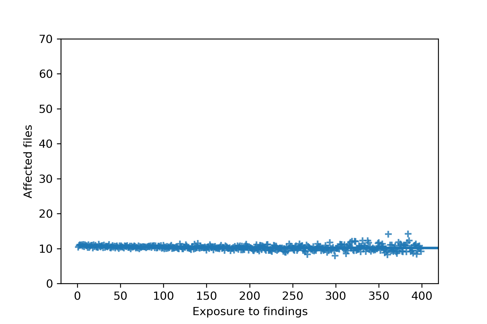

 

Fig. 3: Files changed as exposure to mutants increases.

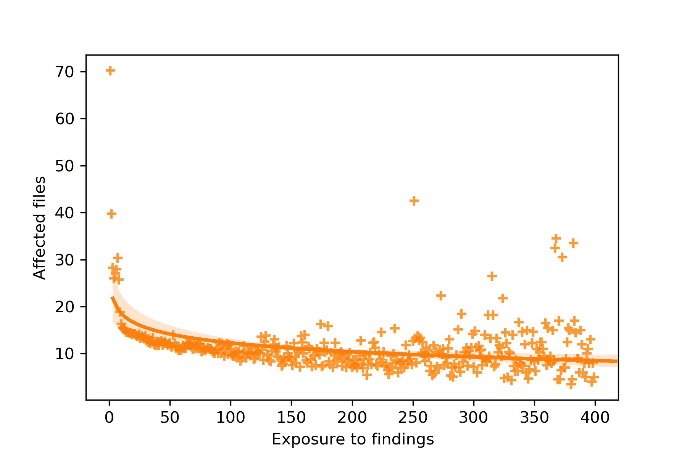

 

Fig. 4: Files changed as exposure to line coverage increases.
  2. Changelist size: Coverage analysis can be done on virtually any code change, while mutation testing has some preconditions. In order for a mutant to be reported for a code change, that change must contain covered source code, and the covered source code must contain code elements for which mutants are not suppressed by the mutation system’s suppression rules. It is thus expected that on average the mutant dataset contains larger changelists than the coverage dataset—largely due to differences in the lower tails. If additional test hunks were just the by-product of larger changelists, then we would expect normalizing for the changelist size to uncover this fact, which it did not (neither on a per-file nor on a per-changelist basis). 

Changes to individual files are part of code changes of varying sizes. To ensure that any effects observed are not a result of differences in the number of changed files, Figure [4](https://arxiv.org/html/2103.07189#S3.F4 "Fig. 4 ‣ item 1 ‣ III-C RQ1: Effects on testing quantity ‣ III Long Term Effects of Mutation Testing ‣ Does mutation testing improve testing practices?") and Figure [4](https://arxiv.org/html/2103.07189#S3.F4 "Fig. 4 ‣ item 1 ‣ III-C RQ1: Effects on testing quantity ‣ III Long Term Effects of Mutation Testing ‣ Does mutation testing improve testing practices?") show the number of files changed by a changelist that contains an exposed files, as a function of exposure. The plots suggest that the numbers of affected files is not positively correlated with exposure for the mutant dataset; indeed the number of affected files tends to slightly decrease over time for both datasets (\(r_{s}=-0.26\) for the _mutant_ dataset and \(r_{s}=-0.34\) for the _coverage_ dataset).

Overall, the results show that it is very unlikely that the changelist size as a function of exposure confounds the observed effects.

  3. Tests for code coverage: Developers who received mutant information also received coverage information, which could confound our results. In order to determine whether developers wrote tests for the reported mutants or simply to increase code coverage for their changelists, we analyzed the differences in code coverage for the changed code between the initial review state and the final submit state and correlated it with exposure. The results show that code coverage is largely stable over time: For the _coverage_ dataset, there is a negligible correlation with exposure (\(r_{s}=-0.02\), \(p<0.001\)); for the _mutant_ dataset, there is a weak negative correlation (\(r_{s}=-0.17\), \(p<0.001\)). This makes it unlikely that developers exposed to mutants wrote tests to increase code coverage. Rather, they wrote tests to kill the reported mutants. 

### III-D RQ2: Effects on testing quality

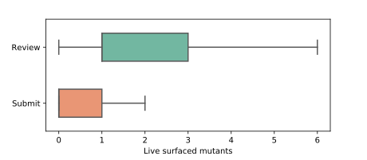

 Fig. 5: Number of surfaced mutants that are live at the beginning of the code review (_Review_) and at the end of the code review (_Submit_). The median is 1 for Review and 0 for Submit. Outliers (11% outside of \(\pm 1.5\) times the interquartile range) are not shown for clarity. 

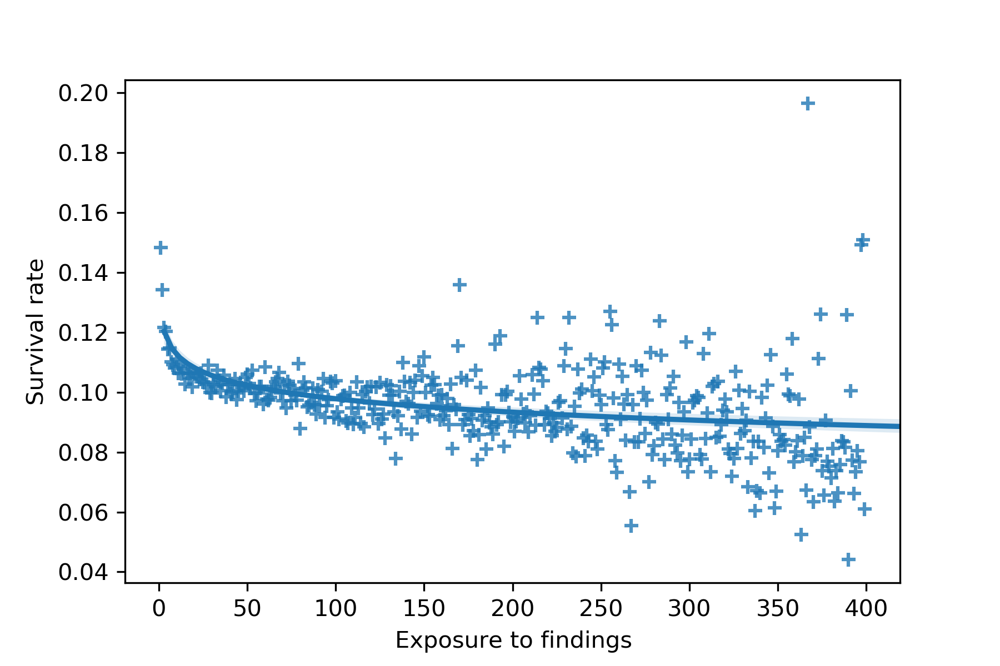

 Fig. 6: Mutant survival rate as exposure to mutants increases. 

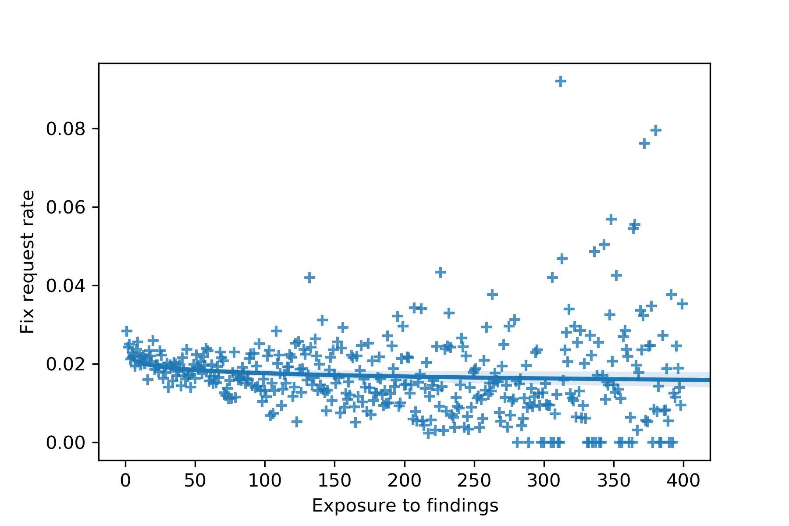

 Fig. 7: Fix requested rate as exposure to mutants increases.

Figure [5](https://arxiv.org/html/2103.07189#S3.F5 "Fig. 5 ‣ III-D RQ2: Effects on testing quality ‣ III Long Term Effects of Mutation Testing ‣ Does mutation testing improve testing practices?") shows the difference between the number of reported live mutants at the beginning of the code review (_Review_), when code findings are initially surfaced, and at end of the code review (_Submit_). Submitted changelists have significantly fewer live mutants, which confirms that tests added by developers in response to mutants indeed succeed at killing these mutants.

If additional tests for a changed file improve overall test suite quality, then future changes to the same file should see fewer surviving mutants. Figure [6](https://arxiv.org/html/2103.07189#S3.F6 "Fig. 6 ‣ III-D RQ2: Effects on testing quality ‣ III Long Term Effects of Mutation Testing ‣ Does mutation testing improve testing practices?") shows the probability of a mutant to survive over time as files are mutated over and over again: The more mutants a file sees, the more likely it is that the already existing tests (incl. those written for the submitted change) kill those mutants. There is a negative relationship (\(r_{s}=-0.50\), \(p<.001\)) between exposure and survivability of mutants. These results suggest that developers not only write more tests when exposed to mutation testing, the tests they write indeed improve test suite quality.

As a further indication that developers write good tests, Figure [7](https://arxiv.org/html/2103.07189#S3.F7 "Fig. 7 ‣ III-D RQ2: Effects on testing quality ‣ III Long Term Effects of Mutation Testing ‣ Does mutation testing improve testing practices?") shows the ratio of reported mutants for which the reviewers request developers to write tests. The results show that, in the beginning, reviewers ask for a larger ratio of the reported mutants to be killed than later (\(r_{s}=-.34\), \(p<.001\)). This corroborates that developers write better tests, such that the surviving mutants represent less critical issues or futile test goals and reviewers have to request fewer changes related to reported mutants.

RQ2: As exposure to mutation testing increases, developers tend to write stronger tests in response to mutants.

Alternative Hypotheses While we observe that developers write tests that kill reported mutants, it is theoretically possible that they write minimal tests that are simple and purely focused on killing mutants, as opposed to tests they would write otherwise. However, two general observations and two analyses suggest that this is not the case. First, this is unlikely in principle: Code reviews are a safety net and minimal, change-detector tests would not pass code review. Second, anecdotally from manually inspecting numerous tests written for mutants over the past six years, we did not observe any unique features of such tests. Third, our analysis of mutant redundancy (Section [IV-D](https://arxiv.org/html/2103.07189#S4.SS4 "IV-D RQ4: Mutant redundancy ‣ IV Fault Coupling ‣ Does mutation testing improve testing practices?")) shows that most mutants generated for the same line are killed by the tests developers write. Since multiple mutants related to conditional or relational operators would require distinct tests to be killed (e.g., testing boundary conditions in a conditional statement), this suggests that developers do not write minimal tests focused on a single mutant. Finally, the increasing number of test hunks and the decreasing survivability (Section [III-C](https://arxiv.org/html/2103.07189#S3.SS3 "III-C RQ1: Effects on testing quantity ‣ III Long Term Effects of Mutation Testing ‣ Does mutation testing improve testing practices?")) support the conclusion that developers write more tests than would be necessary to detect individual, reported mutants. In summary, we did not find evidence that developers write minimal tests for reported mutants.

## IV Fault Coupling

The coupling effect is a foundational assumption underlying mutation testing: Simple faults are coupled to more complex faults in such a way that a test suite that detects simple faults is sensitive enough to likely detect complex faults as well. Since mutants represent simpler faults, compared to more complex real world faults [[12](https://arxiv.org/html/2103.07189#bib.bib12), [13](https://arxiv.org/html/2103.07189#bib.bib13)], it is important to assess whether and to what extent the coupling effect can be observed for mutation testing of real-world software systems. In particular, mutants are only suitable test goals that are worth satisfying if they are coupled to real software faults.

Recall that our mutation testing system only surfaces a single mutant per line because evaluating all mutants is prohibitively expensive and reporting all live mutants to a developer in an actionable way is impracticable. However, we also observed that developers get accustomed to mutation testing in two ways. First, they use and interpret mutants as concrete guides to improve their code and corresponding test suites, as opposed to merely writing a minimal test per test goal (mutant). Second, they write stronger tests in response to, or anticipation of, mutants that are generated and surfaced.

We hypothesize that most mutants per line share the same fate and that it is thus sufficient to surface only one of them. Specifically, we hypothesize that if a developer writes a test suite based on one surfaced mutant in a given line, then that test suite will detect most of the mutants that could be generated for that line. Conversely, if a surfaced mutant in a given line survives, then most mutants that could be generated for that line will survive. Testing this hypothesis is important to determine whether the assumed coupling effect holds for mutation testing systems that rely on sampling representative mutants.

This section answers the remaining two research questions:

  * RQ3 Fault coupling. Are reported mutants coupled with real software faults? Can tests written based on mutants improve test effectiveness for real software faults? 
  * RQ4 Mutant redundancy. Are the mutants generated for a given line redundant? Is it sufficient in practice to select a single mutant per line? 

### IV-A Dataset

In order to evaluate whether mutants are coupled to bugs that matter in practice, we mined our source-code repository and obtained a set of bugs that had a high priority for being fixed. For each bug, the subsequent coupling analysis evaluated mutation testing on the buggy and fixed source-code version of that bug. Specifically, we automated the following analysis:

  1. Find explicit bug-fixing changes in the version control history (Section [IV-A1](https://arxiv.org/html/2103.07189#S4.SS1.SSS1 "IV-A1 Change Selection ‣ IV-A Dataset ‣ IV Fault Coupling ‣ Does mutation testing improve testing practices?")). 
  2. Analyze changes and retain suitable bugs (Section [IV-A2](https://arxiv.org/html/2103.07189#S4.SS1.SSS2 "IV-A2 Change Filtering ‣ IV-A Dataset ‣ IV Fault Coupling ‣ Does mutation testing improve testing practices?")). 
  3. Generate mutants and perform mutation testing on both the buggy and the fixed version of the code (Section [IV-B](https://arxiv.org/html/2103.07189#S4.SS2 "IV-B Methodology ‣ IV Fault Coupling ‣ Does mutation testing improve testing practices?")). 
  4. Analyze the mutation testing results and identify fault-coupled mutants (Section [IV-C](https://arxiv.org/html/2103.07189#S4.SS3 "IV-C RQ3: Fault coupling ‣ IV Fault Coupling ‣ Does mutation testing improve testing practices?")). 

#### IV-A1 Change Selection

We mined our source code repository for changes that explicitly fix high-priority bugs. Bugs are assigned a priority class by developers, and high-priority bugs are expected to be fixed quickly. Our selection approach did not filter for change size or other code-related attributes. This was a conscious design decision to obtain an unbiased sample, spanning multiple programming languages, projects, code styles, etc. Our selection step resulted in 1765 candidate bugs, suitable for our coupling analysis.

We limited the selection to changes that fixed a bug in the last six months. This temporal restriction increases the chances of being able to build the source code and reproduce a bug—the underlying build infrastructure guarantees that recent source code can be built. Furthermore, we limited the selection to changes authored by a developer, and hence changes that are subject to code review. The selection was not limited to changes for which mutation testing was not enabled. Precisely determining when a bug was introduced and whether mutation testing was enable for that project at that time is extremely difficult. To approximate the ratio of bugs that were introduced while mutation testing could have been enabled, we determined the ratio of bug-fixing changes for which mutation testing was enabled. Overall, mutation testing was enabled for 10.8% of bug-fixing changes in our final dataset.

We rely on developers’ change descriptions and labeling to identify bug fixes. While bug hygiene is imperfect and not all of these bugs are necessarily bugs encountered in the field, all of the change descriptions explicitly claimed to fix a high-priority bug, making it very unlikely that the change in fact does not.

#### IV-A2 Change Filtering

To establish the coupling between mutants and bug fixes, we need to parse and build the code, mutate it, and evaluate affected tests against each mutant. This means that the source code in question needs to be correctly configured, buildable, and the number of tests to be executed needs to be reasonable.

Mutant generation is non-trivial and carries a hidden cost. For example, our mutation system uses the Clang compiler front end for the AST analysis and manipulation of C++ code. This requires indexing the compilation unit with the build system to prepare the transitive closure of included headers and the set of Clang arguments that are mandated by the project-under-mutation’s configuration. A common example is code that runs on specialized architecture, or requires additional virtualization libraries, which is unknowable given just the file, and the file is not analyzable without it. The additional cost of indexing all C++ compilation units is relatively small, but still accounts for a large resource expenditure overall.

While the total number of generated mutants is comparatively low due to our mutant suppression and reduction strategies, the sheer number of required test target executions renders this coupling analysis as very expensive. A _test target_ defines a set of tests at the build system level. A test target can be a single test file or a test suite (i.e., collection of test files)—each potentially containing hundreds or thousands of individual tests. This variance comes from how the build system is used, and differs from project to project. In a large project with complex dependencies, any change to a widely used core library will easily require millions of tests to be executed, each of which has the said library in the transitive closure of its dependencies, and all of which have to be evaluated. Failure to evaluate all test targets, as is the norm, inevitably leads to inaccuracies of reported live mutants and would decrease developers’ confidence in mutation testing.

Given the challenges above and our 1765 candidate bugs, we automatically filtered:

  * 41 bugs for which a project configuration failure prevented us from building the buggy or fixed source code version, rendering them unsuitable for our analysis. 
  * 222 bug fixes for which the project configuration exhibited a substantial dependency chain with a very large number of associated test targets. Including these bugs would have made our analysis computationally infeasible. We empirically determined a threshold of 500 test targets (each usually containing many tests) as our filter criterion. Figure [9](https://arxiv.org/html/2103.07189#S4.F9 "Fig. 9 ‣ IV-A2 Change Filtering ‣ IV-A Dataset ‣ IV Fault Coupling ‣ Does mutation testing improve testing practices?") shows the distribution of the number of test targets for all 1765 candidate bugs—indicating that bugs with more than 350 test targets are outliers. 

Our final dataset contains 1502 retained bugs. Table [I](https://arxiv.org/html/2103.07189#S4.T1 "TABLE I ‣ IV-A2 Change Filtering ‣ IV-A Dataset ‣ IV Fault Coupling ‣ Does mutation testing improve testing practices?") shows further characteristics of these bugs, and Figure [9](https://arxiv.org/html/2103.07189#S4.F9 "Fig. 9 ‣ IV-A2 Change Filtering ‣ IV-A Dataset ‣ IV Fault Coupling ‣ Does mutation testing improve testing practices?") shows their distribution of number of test targets and number of mutants. In total, our coupling analysis involves 1502 bugs, almost 400 thousand mutants, and over 33 million test target executions. We performed the coupling analysis over a prolonged period of time because of the huge amount of processing power required for the dependency analysis, mutagenesis, and test target executions.

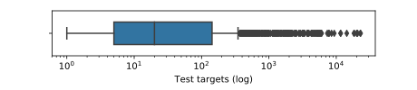

 

Fig. 8: Number of test targets for all candidate bugs.

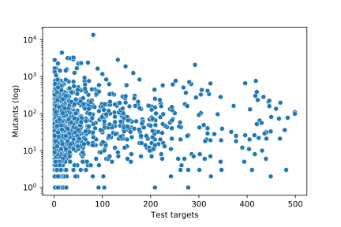

 

Fig. 9: Number of test targets and number of mutants for all retained bugs. TABLE I: Characteristics of the 1502 retained bugs.

<table id="S4.T1.2.1" class="ltx_tabular ltx_guessed_headers ltx_align_middle">
<thead class="ltx_thead">
<tr id="S4.T1.2.1.1" class="ltx_tr">
<th id="S4.T1.2.1.1.1" class="ltx_td ltx_th ltx_th_row ltx_border_tt" style="padding-left:3.0pt;padding-right:3.0pt;"></th>
<th id="S4.T1.2.1.1.2" class="ltx_td ltx_align_center ltx_th ltx_th_column ltx_border_tt" style="padding-left:3.0pt;padding-right:3.0pt;" colspan="2">Bugs</th>
<th id="S4.T1.2.1.1.3" class="ltx_td ltx_align_center ltx_th ltx_th_column ltx_border_tt" style="padding-left:3.0pt;padding-right:3.0pt;" colspan="2">Test targets</th>
<th id="S4.T1.2.1.1.4" class="ltx_td ltx_align_center ltx_th ltx_th_column ltx_border_tt" style="padding-left:3.0pt;padding-right:3.0pt;" colspan="2">Affected files</th>
<th id="S4.T1.2.1.1.5" class="ltx_td ltx_align_center ltx_th ltx_th_column ltx_border_tt" style="padding-left:3.0pt;padding-right:3.0pt;" colspan="2">Affected lines</th></tr>
<tr id="S4.T1.2.1.2" class="ltx_tr">
<th id="S4.T1.2.1.2.1" class="ltx_td ltx_th ltx_th_row" style="padding-left:3.0pt;padding-right:3.0pt;"></th>
<th id="S4.T1.2.1.2.2" class="ltx_td ltx_align_right ltx_th ltx_th_column ltx_border_t" style="padding-left:3.0pt;padding-right:3.0pt;">Count</th>
<th id="S4.T1.2.1.2.3" class="ltx_td ltx_align_right ltx_th ltx_th_column ltx_border_t" style="padding-left:3.0pt;padding-right:3.0pt;">Ratio</th>
<th id="S4.T1.2.1.2.4" class="ltx_td ltx_align_right ltx_th ltx_th_column ltx_border_t" style="padding-left:3.0pt;padding-right:3.0pt;">Median</th>
<th id="S4.T1.2.1.2.5" class="ltx_td ltx_align_right ltx_th ltx_th_column ltx_border_t" style="padding-left:3.0pt;padding-right:3.0pt;">Mean</th>
<th id="S4.T1.2.1.2.6" class="ltx_td ltx_align_right ltx_th ltx_th_column ltx_border_t" style="padding-left:3.0pt;padding-right:3.0pt;">Median</th>
<th id="S4.T1.2.1.2.7" class="ltx_td ltx_align_right ltx_th ltx_th_column ltx_border_t" style="padding-left:3.0pt;padding-right:3.0pt;">Mean</th>
<th id="S4.T1.2.1.2.8" class="ltx_td ltx_align_right ltx_th ltx_th_column ltx_border_t" style="padding-left:3.0pt;padding-right:3.0pt;">Median</th>
<th id="S4.T1.2.1.2.9" class="ltx_td ltx_align_right ltx_th ltx_th_column ltx_border_t" style="padding-left:3.0pt;padding-right:3.0pt;">Mean</th></tr>
</thead>
<tbody class="ltx_tbody">
<tr id="S4.T1.2.1.3" class="ltx_tr">
<th id="S4.T1.2.1.3.1" class="ltx_td ltx_align_left ltx_th ltx_th_row ltx_border_t" style="padding-left:3.0pt;padding-right:3.0pt;">C++</th>
<td id="S4.T1.2.1.3.2" class="ltx_td ltx_align_right ltx_border_t" style="padding-left:3.0pt;padding-right:3.0pt;">736</td>
<td id="S4.T1.2.1.3.3" class="ltx_td ltx_align_right ltx_border_t" style="padding-left:3.0pt;padding-right:3.0pt;">49.0%</td>
<td id="S4.T1.2.1.3.4" class="ltx_td ltx_align_right ltx_border_t" style="padding-left:3.0pt;padding-right:3.0pt;">12</td>
<td id="S4.T1.2.1.3.5" class="ltx_td ltx_align_right ltx_border_t" style="padding-left:3.0pt;padding-right:3.0pt;">35.0</td>
<td id="S4.T1.2.1.3.6" class="ltx_td ltx_align_right ltx_border_t" style="padding-left:3.0pt;padding-right:3.0pt;">3</td>
<td id="S4.T1.2.1.3.7" class="ltx_td ltx_align_right ltx_border_t" style="padding-left:3.0pt;padding-right:3.0pt;">4.8</td>
<td id="S4.T1.2.1.3.8" class="ltx_td ltx_align_right ltx_border_t" style="padding-left:3.0pt;padding-right:3.0pt;">52</td>
<td id="S4.T1.2.1.3.9" class="ltx_td ltx_align_right ltx_border_t" style="padding-left:3.0pt;padding-right:3.0pt;">174.7</td></tr>
<tr id="S4.T1.2.1.4" class="ltx_tr">
<th id="S4.T1.2.1.4.1" class="ltx_td ltx_align_left ltx_th ltx_th_row" style="padding-left:3.0pt;padding-right:3.0pt;">Java</th>
<td id="S4.T1.2.1.4.2" class="ltx_td ltx_align_right" style="padding-left:3.0pt;padding-right:3.0pt;">501</td>
<td id="S4.T1.2.1.4.3" class="ltx_td ltx_align_right" style="padding-left:3.0pt;padding-right:3.0pt;">33.4%</td>
<td id="S4.T1.2.1.4.4" class="ltx_td ltx_align_right" style="padding-left:3.0pt;padding-right:3.0pt;">22</td>
<td id="S4.T1.2.1.4.5" class="ltx_td ltx_align_right" style="padding-left:3.0pt;padding-right:3.0pt;">42.5</td>
<td id="S4.T1.2.1.4.6" class="ltx_td ltx_align_right" style="padding-left:3.0pt;padding-right:3.0pt;">3</td>
<td id="S4.T1.2.1.4.7" class="ltx_td ltx_align_right" style="padding-left:3.0pt;padding-right:3.0pt;">4.9</td>
<td id="S4.T1.2.1.4.8" class="ltx_td ltx_align_right" style="padding-left:3.0pt;padding-right:3.0pt;">50</td>
<td id="S4.T1.2.1.4.9" class="ltx_td ltx_align_right" style="padding-left:3.0pt;padding-right:3.0pt;">263.3</td></tr>
<tr id="S4.T1.2.1.5" class="ltx_tr">
<th id="S4.T1.2.1.5.1" class="ltx_td ltx_align_left ltx_th ltx_th_row" style="padding-left:3.0pt;padding-right:3.0pt;">Python</th>
<td id="S4.T1.2.1.5.2" class="ltx_td ltx_align_right" style="padding-left:3.0pt;padding-right:3.0pt;">180</td>
<td id="S4.T1.2.1.5.3" class="ltx_td ltx_align_right" style="padding-left:3.0pt;padding-right:3.0pt;">12.0%</td>
<td id="S4.T1.2.1.5.4" class="ltx_td ltx_align_right" style="padding-left:3.0pt;padding-right:3.0pt;">10</td>
<td id="S4.T1.2.1.5.5" class="ltx_td ltx_align_right" style="padding-left:3.0pt;padding-right:3.0pt;">30.7</td>
<td id="S4.T1.2.1.5.6" class="ltx_td ltx_align_right" style="padding-left:3.0pt;padding-right:3.0pt;">2</td>
<td id="S4.T1.2.1.5.7" class="ltx_td ltx_align_right" style="padding-left:3.0pt;padding-right:3.0pt;">3.5</td>
<td id="S4.T1.2.1.5.8" class="ltx_td ltx_align_right" style="padding-left:3.0pt;padding-right:3.0pt;">24</td>
<td id="S4.T1.2.1.5.9" class="ltx_td ltx_align_right" style="padding-left:3.0pt;padding-right:3.0pt;">83.6</td></tr>
<tr id="S4.T1.2.1.6" class="ltx_tr">
<th id="S4.T1.2.1.6.1" class="ltx_td ltx_align_left ltx_th ltx_th_row" style="padding-left:3.0pt;padding-right:3.0pt;">Go</th>
<td id="S4.T1.2.1.6.2" class="ltx_td ltx_align_right" style="padding-left:3.0pt;padding-right:3.0pt;">85</td>
<td id="S4.T1.2.1.6.3" class="ltx_td ltx_align_right" style="padding-left:3.0pt;padding-right:3.0pt;">5.7%</td>
<td id="S4.T1.2.1.6.4" class="ltx_td ltx_align_right" style="padding-left:3.0pt;padding-right:3.0pt;">5</td>
<td id="S4.T1.2.1.6.5" class="ltx_td ltx_align_right" style="padding-left:3.0pt;padding-right:3.0pt;">22.2</td>
<td id="S4.T1.2.1.6.6" class="ltx_td ltx_align_right" style="padding-left:3.0pt;padding-right:3.0pt;">3</td>
<td id="S4.T1.2.1.6.7" class="ltx_td ltx_align_right" style="padding-left:3.0pt;padding-right:3.0pt;">3.6</td>
<td id="S4.T1.2.1.6.8" class="ltx_td ltx_align_right" style="padding-left:3.0pt;padding-right:3.0pt;">41</td>
<td id="S4.T1.2.1.6.9" class="ltx_td ltx_align_right" style="padding-left:3.0pt;padding-right:3.0pt;">516.9</td></tr>
<tr id="S4.T1.2.1.7" class="ltx_tr">
<th id="S4.T1.2.1.7.1" class="ltx_td ltx_align_left ltx_th ltx_th_row ltx_border_bb ltx_border_t" style="padding-left:3.0pt;padding-right:3.0pt;">Total</th>
<td id="S4.T1.2.1.7.2" class="ltx_td ltx_align_right ltx_border_bb ltx_border_t" style="padding-left:3.0pt;padding-right:3.0pt;">1502</td>
<td id="S4.T1.2.1.7.3" class="ltx_td ltx_align_right ltx_border_bb ltx_border_t" style="padding-left:3.0pt;padding-right:3.0pt;">100.0%</td>
<td id="S4.T1.2.1.7.4" class="ltx_td ltx_align_right ltx_border_bb ltx_border_t" style="padding-left:3.0pt;padding-right:3.0pt;">13</td>
<td id="S4.T1.2.1.7.5" class="ltx_td ltx_align_right ltx_border_bb ltx_border_t" style="padding-left:3.0pt;padding-right:3.0pt;">36.2</td>
<td id="S4.T1.2.1.7.6" class="ltx_td ltx_align_right ltx_border_bb ltx_border_t" style="padding-left:3.0pt;padding-right:3.0pt;">3</td>
<td id="S4.T1.2.1.7.7" class="ltx_td ltx_align_right ltx_border_bb ltx_border_t" style="padding-left:3.0pt;padding-right:3.0pt;">4.6</td>
<td id="S4.T1.2.1.7.8" class="ltx_td ltx_align_right ltx_border_bb ltx_border_t" style="padding-left:3.0pt;padding-right:3.0pt;">46.5</td>
<td id="S4.T1.2.1.7.9" class="ltx_td ltx_align_right ltx_border_bb ltx_border_t" style="padding-left:3.0pt;padding-right:3.0pt;">212.7</td></tr>
</tbody>
</table>

 

### IV-B Methodology

Incremental mutation testing is substantially different from the traditional approach. Lines are selectively mutated based on the structure of the code, mutator operators are probabilistically picked and tried out, and most potential mutants are discarded because reporting too many mutants during code review would be too visually daunting and likely have a negative effect on developers’ perception of mutation testing.

In order to evaluate whether the mutants our mutation system generates are coupled with the 1502 high-priority bugs that we retained, we had to modify the system to generate multiple mutants per line and to evaluate all of them. This turned out to be very expensive even for a manageable number of bugs, validating our intuition that the traditional approach would not scale to an environment with thousands of changes per day. Note that we kept the notion of suppressing unproductive mutants [[11](https://arxiv.org/html/2103.07189#bib.bib11)], which represent futile test goals, in the modified system, and hence did neither generate nor evaluate them.

For each bug in our dataset, we automatically executed the following steps:

  1. Run dependency analysis and determine all test targets affected by the bug-fixing change. 
  2. Using the buggy source code version, generate all possible mutants for all lines that are affected by the bug-fixing change. 
  3. Using the fixed source code version, generate all possible mutants for all lines that are affected by the bug-fixing change. 
  4. Determine the set of fault-coupled mutants. 

In line with prior work [[14](https://arxiv.org/html/2103.07189#bib.bib14)], we measure fault-coupling as follows: Given a test suite with at least one fault-triggering test, a buggy source code version, and a fixed source code version, a mutant is coupled to a fault (through the triggering tests) if (1) that mutant exists in the buggy and the fixed source code version and (2) that mutant is only detected by the triggering tests. In other words, a fault-coupled mutant is live in the buggy but killed in the fixed source code version: Had mutation testing been run on the buggy source code version, a mutant would have been reported in the lines affected by the fixing change, and the test accompanying the fix kills it.

### IV-C RQ3: Fault coupling

This research question is concerned with whether mutation testing would have reported a live mutant on the change introducing the bug—a live mutant that is subsequently killed by a bug-triggering test. Reporting that mutant would have had a good chance of preventing the bug being introduced in the first place.

#### IV-C1 Coupled Faults

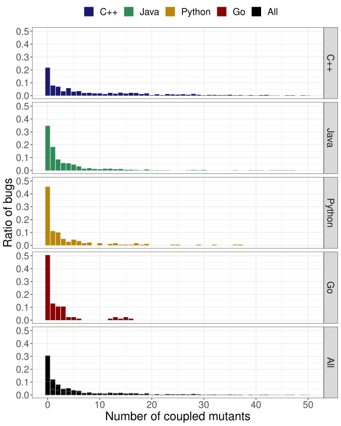

 Fig. 10: Number of mutants coupled to each of the 1502 bugs, grouped by programming language of the bug fix. 4% of all bugs (51 to 485 coupled mutants) are ommitted for clarity.

We found that for 1043 (70%) of the bugs, mutation testing would have reported a fault-coupled mutant in the bug-introducing change. Recall that each bug-introducing change was covered by the existing tests, suggesting that code coverage had exhausted its usefulness.

RQ3: Mutants are coupled with 70% of high-priority bugs, for which mutation testing would have reported a live, fault-coupled mutant on the bug-introducing change.

It is interesting to note that when a bug is coupled to a mutant, it is usually coupled to more than one, as seen in Figure [10](https://arxiv.org/html/2103.07189#S4.F10 "Fig. 10 ‣ IV-C1 Coupled Faults ‣ IV-C RQ3: Fault coupling ‣ IV Fault Coupling ‣ Does mutation testing improve testing practices?"). This observation is consistent with the finding that the majority of mutants, generated for a given line, share the same fate (Section [IV-D](https://arxiv.org/html/2103.07189#S4.SS4 "IV-D RQ4: Mutant redundancy ‣ IV Fault Coupling ‣ Does mutation testing improve testing practices?")).

The statement block removal (SBR) mutation operator, being the most prolific one, generated most of the coupled mutants (Figure [11](https://arxiv.org/html/2103.07189#S4.F11 "Fig. 11 ‣ IV-C1 Coupled Faults ‣ IV-C RQ3: Fault coupling ‣ IV Fault Coupling ‣ Does mutation testing improve testing practices?")). The distributions of number of coupled mutants are consistent across all languages (Figure [10](https://arxiv.org/html/2103.07189#S4.F10 "Fig. 10 ‣ IV-C1 Coupled Faults ‣ IV-C RQ3: Fault coupling ‣ IV Fault Coupling ‣ Does mutation testing improve testing practices?")). In contrast, the distribution of coupled mutants across mutation operators is different for Go (Figure [11](https://arxiv.org/html/2103.07189#S4.F11 "Fig. 11 ‣ IV-C1 Coupled Faults ‣ IV-C RQ3: Fault coupling ‣ IV Fault Coupling ‣ Does mutation testing improve testing practices?")). Given the relatively small sample size of Go bugs, it is possible that this observation is an artifact of the sample size or that Go bugs have indeed different coupling characteristics.

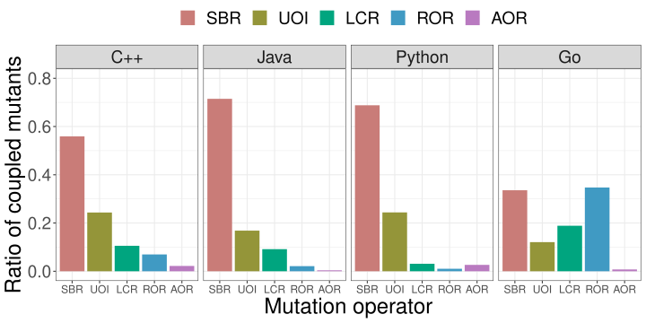

 Fig. 11: Ratio of coupled mutants per mutation operator, grouped by programming language of the bug fix.

#### IV-C2 Non-coupled Faults

Recall that 459 out of 1502 (30%) bugs were not coupled to any of the generated mutants. We randomly sampled 50 of the non-coupled bugs for manual inspection. For each bug, we determined the reason for the absence of fault coupling, following the classification of Just et al. [[14](https://arxiv.org/html/2103.07189#bib.bib14)]: weak mutation operator, missing mutation operator, no such mutation operator.

Weak mutation operator (14/50) While focusing our analysis on the weaknesses of the four mutation operators employed by our mutation system, two patterns emerged. First, the SBR mutation operator currently does not mutate statements that affect control flow, including return, continue, and break statements. The reason is that mutating these statements is more likely to cause compilation issues or infinite loops. Given the occurrences of these statements in our bug data set, however, it seems worthwhile to strengthen the SBR mutation operator to mutate them, employing additional heuristics or program analyses to avoid invalid mutants. Second, the SBR mutation operator does not delete variable declarations because these mutants would not compile. However, a variable declaration with a (complex) initializer should be mutated, e.g., by replacing the initializer with a constant value.

Missing mutation operator (13/50) Recall that our set of mutation operators and the corresponding suppression rules are intentionally chosen to make mutation testing scalable and the number of surfaced mutants manageable. Nonetheless, we considered a broad set of mutation operators, regardless of their costs, to determine whether additional mutation operators would generate mutants that are coupled to the bugs in our data set. We noticed that identifier-based bugs [[15](https://arxiv.org/html/2103.07189#bib.bib15)] are a nontrivial portion in our randomly selected set of non-coupled bugs. While prior work demonstrated that mutation operators that target identifiers have the potential to increase fault coupling [[16](https://arxiv.org/html/2103.07189#bib.bib16), [17](https://arxiv.org/html/2103.07189#bib.bib17)], the same work also showed that these mutation operators can easily quadruple the number of mutants. We leave a deeper investigation into heuristics and program analyses to tame these mutation operators for future work.

No such mutation operator (23/50) Similar to the findings of Just et al. [[14](https://arxiv.org/html/2103.07189#bib.bib14)], we observed a number of non-coupled bugs for which no obvious mutation operator exists. Examples include very subtle, yet valid changes to configurations or environments, for which general-purpose mutation operators are not applicable. Similarly, bugs in higher-level specifications or protocols are outside of the scope of mutation testing. In other words, mutation testing is effective in guiding testing to assess whether an algorithm is correctly implemented but not whether the correct algorithm is implemented.

#### IV-C3 Discussion

While we desire higher fault coupling (to prevent more bugs), we also have a competing incentive to show only productive mutants and not overwhelm the developers. Generating more mutants would almost certainly increase fault coupling, but at what cost? If 1% more coupling means 100% more mutants, or worse 100% more unproductive mutants, then this is undesirable: Developers would likely abandon mutation testing because of too many “false positives”. It is possible that fault coupling can be increased without increasing the ratio of unproductive mutants by adding additional suppression rules tailored to additional mutation operators.

Fault coupling is a valid measure if tests written for mutants are similarly effective as those that are written for other objectives. Section [III](https://arxiv.org/html/2103.07189#S3 "III Long Term Effects of Mutation Testing ‣ Does mutation testing improve testing practices?") provided evidence that this is indeed the case. Further, we count on code authors to push back on introducing tests to kill unproductive mutants, and we count on reviewers to push back on low quality tests, specifically written to kill mutants. Anecdotally, we often see both code authors and reviewers pushing back on a mutant because the kind of test that would kill it is considered low quality or even harmful. Over the past six years, we have observed that code authors do not blindly use mutants as test goals. Rather, they reason about their usefulness and report unproductive mutants so that we can improve suppression rules. Overall, we have no reason to believe that tests written for the mutants are substantially different from other tests.

### IV-D RQ4: Mutant redundancy

Our mutation testing system rests on the assumption that generating and evaluating multiple mutants in the same line is not necessary. The primary reason for this is that we do not compute the mutation score but rather report mutants as test goals and direct developers’ attention to the mutated piece of code—any one _productive_ mutant is sufficient for the latter. A secondary reason is the expectation that mutants for a given line are highly redundant.

We tested our hypothesis about mutant redundancy by analyzing the mutant data from our data set of retained bugs. Since we generated all possible mutants for that data set, we can reason about redundancy. Specifically, we looked at the testing outcomes of mutants in lines for which multiple mutants were generated. We calculated the ratio of the majority event for each line—that is, the ratio of mutants in the majority group sharing the same fate (live or killed). This allows us to capture both cases when most mutants are killed and when most mutants are not; the closer the majority fate is to 100%, the higher the redundancy. The rationale for validating our hypothesis is twofold. First, the results can inform mutant sampling strategies. Second, the results from our coupling analysis translate to our own mutation system only if the majority fate is high on average—that is, if picking a single mutant per line is indeed sufficient.

Figure [12](https://arxiv.org/html/2103.07189#S4.F12 "Fig. 12 ‣ IV-D RQ4: Mutant redundancy ‣ IV Fault Coupling ‣ Does mutation testing improve testing practices?") shows the distribution of the mutant majority fate for all lines that have at least to mutants. Given that more than 90% of all lines have a mutant majority fate of 100%, we conclude that the generated mutants are highly redundant and that generating and reporting at most a single mutant per line is a valid optimization.

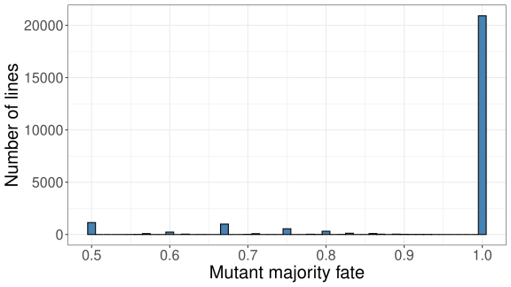

 Fig. 12: Mutant majority fate for all lines with multiple mutants.

RQ4: Mutants are heavily redundant. In more than 90% of cases, either all mutants in a line are killed, or none are.

## V Threats To Validity

Construct validity is concerned with the chosen proxy measures and whether these accurately measure the concept of interest. To address this concern, we relied on proxy measures accepted in the literature, where applicable. Given that there are no comparable studies on the long-term effects of mutation testing, we had to make two notable choices. First, we measure exposure to mutants as the number of times mutants are surfaced during code review, on a per-file basis. We argue that this is a valid proxy for exposure because (1) both authors and reviewers have exposure to mutants during the code review process and (2) code review usually involves peer review of project members, and hence this measure captures the exposure of a development team to mutation testing. Second, we measure testing effort as the number of changed test hunks (as opposed to the raw lines of code). This was a concious choice because lines of code do not generalize across programming languages or testing paradigms. Finally, we consistently employed baselines for comparisons, and the results not only show a signal for mutation testing but also the absence of a signal for the coverage-testing baseline.

Internal validity is concerned with how well our study design isolates variables of interest and whether it accounts for possible confounding. To address this concern, we relied on an interventional study design and tested alternative hypotheses for all reported observations, which our study suggests are linked to mutation testing, thereby increasing confidence in our results. For example, when quantifying how exposure to mutants affects testing effort, we considered possible confounding effects, such as number of affected files and an increase in code coverage. Our explorations of alternative hypotheses all led to the same conclusions. It is, however, possible that we missed other confounding effects.

External validity is largely concerned with generalizability and how well the reported results translate to other development environments. Our study reports on data and observations from a single company. However, our study involves tens of thousands of developers and many different projects, which we believe are representative of a larger population. Furthermore, contemporary code review is ubiquitous and used by software engineers at other companies and in open-source projects.

## VI Related Work

While mutation testing has seen growing interest in research and practice, reports of actual deployments and studies of its efficacy and long-term effects are very rare in the literature. Indeed, we are not aware of any studies that investigate the long-term effects of mutation testing on test quality, test quantity, and developer behavior. This section describes the prior work most closely related to ours, focusing on industrial case studies, studies that compare the characteristics of mutants and real faults, and existing empirical evidence that suggests that mutation testing is likely effective in practice.

Industrial case studies Ahmed et al. reported on a case study, performing mutation analysis with 3169 mutants for a Linux Kernel module, with subsequent analysis of 380 surviving mutants [[18](https://arxiv.org/html/2103.07189#bib.bib18)]. The study aimed at reducing the computational costs of performing mutation analysis on complex software systems, and it concluded that “mutation testing can and should be more extensively used in practice”.

Delgado-Pérez et al. reported on a case study, performing mutation analysis with 2509 mutants for 15 functions (ranging from 10 to 63 lines of code) of different firmware modules [[19](https://arxiv.org/html/2103.07189#bib.bib19)], with subsequent manual analysis of 154 surviving mutants. This study focused on the computational costs and human effort for identifying equivalent mutants and developing a mutation-adequate test suite by extending a coverage-adequate one. The study concluded that “mutation testing can potentially improve fault detection compared to structural-coverage-guided testing”.

In prior work, we reported on the scalable mutation testing system deployed at Google [[20](https://arxiv.org/html/2103.07189#bib.bib20)], as well as on challenges associated with applying mutation testing in practice [[11](https://arxiv.org/html/2103.07189#bib.bib11)]. In this prior work, we addressed the computational costs of applying mutation testing at scale, with a key focus on the identification and elimination of unproductive mutants—mutants that developers consider non-actionable test goals (similar to false positive warnings in static analysis). In other words, we identified mutants that can but should not, and in practice will not, be detected to avoid ineffective tests that negatively affect testing time and maintainability.

In contrast to the three industrial case studies above, our work differs in two ways. First, it reports on a longitudinal, interventional study that spans six years of development and involves more than 14 million mutants, reporting on the effects of mutation testing on test quantity and quality. Second, it reports on whether critical real faults are coupled to mutants—whether mutation testing has the potential to prevent those faults.

Very recently, an industrial application of mutation testing at Facebook [[21](https://arxiv.org/html/2103.07189#bib.bib21)] applied complex mutation operators learned from past bug-inducing changes. These operators achieve higher survival rates at the cost of being applicable to smaller parts of the codebase. These learned mutation operators could offer an alternative approach to taming the number of mutants. Similar to our mutation testing system, Facebook’s system provides information to developers during code review.

Fault coupling and fault characteristics A number of empirical studies showed that mutants are coupled to real faults and that mutant detection is positively correlated with real fault detection [[22](https://arxiv.org/html/2103.07189#bib.bib22), [23](https://arxiv.org/html/2103.07189#bib.bib23), [24](https://arxiv.org/html/2103.07189#bib.bib24), [14](https://arxiv.org/html/2103.07189#bib.bib14), [25](https://arxiv.org/html/2103.07189#bib.bib25)]. The same studies also showed limitations and that about 27% of real faults were not coupled with commonly generated mutants. Brown et al. [[26](https://arxiv.org/html/2103.07189#bib.bib26)] and Allamanis et al. [[16](https://arxiv.org/html/2103.07189#bib.bib16)] aimed at narrowing this gap with their work on wild-caught mutants and tailored mutants, respectively. Both approaches employ semantics-related mutations (e.g., replacing identifiers with similar, type-compatible alternatives) and have the potential to further improve fault coupling. However, the improved fault coupling comes at a cost of significantly more mutants. For example, replacing function calls with all type-compatible alternatives more than quadrupled the number of mutants. Gopinath et al. analyzed the relationship between mutants and real faults from a different viewpoint. Specifically, they compared the complexity and distributions of mutants and real faults [[12](https://arxiv.org/html/2103.07189#bib.bib12)]. Their analyses showed that a typical real fault is more complex in terms of syntactical tokens and that real faults are rarely equivalent to mutants generated by traditional mutation operators.

The observed positive correlations between mutant detection and real fault detection on the one hand and the different characteristics of mutants and real faults on the other hand, motivated, in part, our work on studying the long-term effects of mutation testing and its efficacy in practice.

Mutant characteristics Other researchers have addressed the notion that some mutants are more valuable than others, including stubborn mutants (Yao et al. [[27](https://arxiv.org/html/2103.07189#bib.bib27)]), difficult-to-kill mutants (Namin et al. [[28](https://arxiv.org/html/2103.07189#bib.bib28)]), dominator mutants (Kurtz et al. [[29](https://arxiv.org/html/2103.07189#bib.bib29)] and Ammann et al. [[30](https://arxiv.org/html/2103.07189#bib.bib30)]), and surface mutants (Gopinath et al. [[31](https://arxiv.org/html/2103.07189#bib.bib31)]). While these definitions are useful in a research context (e.g., to study redundancy among mutants), they are not directly relevant to a developer in practice. For example, a difficult-to-kill mutant may still be unproductive [[20](https://arxiv.org/html/2103.07189#bib.bib20)], and hence writing a test for it would be undesirable.

Mutant sampling Prior work examined whether guided mutant sampling is more effective than random mutant sampling for similar numbers of mutants. Acree [[32](https://arxiv.org/html/2103.07189#bib.bib32)] and Budd [[33](https://arxiv.org/html/2103.07189#bib.bib33)] independently concluded that a test suite developed to detect a randomly selected 10% of mutants is almost as effective as a test suite that detects all of the mutants. Wong and Mathur [[34](https://arxiv.org/html/2103.07189#bib.bib34)] reached similar conclusions, finding that randomly sampling mutants beyond 10% yields marginal improvements. Zhang et al. [[35](https://arxiv.org/html/2103.07189#bib.bib35)] compared guided mutant sampling and random mutant sampling and also found no appreciable difference in their performance. Gopinath et al. [[36](https://arxiv.org/html/2103.07189#bib.bib36)] expanded this investigation, using a large body of open-source software, again finding that random mutant sampling performs as well as any of the considered guided mutant sampling strategies.

In line with prior results, our mutation approach samples very few mutants to make mutation testing applicable at scale. Our results confirm that the set of mutants, generated with traditional mutation operators, is indeed highly redundant and that small sampling ratios are sufficient. Moreover, our results show that multiple mutants generated for the same line of code virtually always share the same fate in practice, implying that surfacing one mutant per line is sufficient. This observation is consistent with Zhu et al.’s work [[37](https://arxiv.org/html/2103.07189#bib.bib37)] that also supports the selection of representative mutants.

## VII Conclusions

The idea of mutation testing was introduced more than four decades ago, and in all this time research revolved mainly around problems of scalability. All along, research was based on the fundamental assumption that mutants are meaningful and actionable test goals which lead to positive effects. This assumption, however, has not been evaluated until now.

We have implemented and deployed a mutation testing system capable of scaling to very large software. Developers are shown only a fraction of the possible mutants, by limiting the number of mutants and suppressing mutants assumed to be unproductive test goals. This paper uses long-running production data of this system in order to validate the central assumption underlying mutation testing for the very first time.

Our results show that developers working on projects with mutation testing write more tests on average over longer periods of time, compared to projects that only consider code coverage. Mutants are effective test goals: Developers exposed to mutants write more, effective tests in response to them.

Since the ultimate goal is not just to write tests for mutants, but to prevent real bugs, we investigated a dataset of high-priority bugs and analyzed mutants before and after the fix with an experimental rig of our mutation testing system. In 70% of cases, a bug is coupled with a mutant that, had it been reported during code review, could have prevented the introduction of that bug. Finally, we also validated our approach of generating a single mutant per line: For the vast majority of lines, either all mutants in a line are killed, or all survive. Therefore, generating a single mutant per line is a valid optimization.

This paper finally provides evidence that mutants are indeed meaningful and actionable test goals. Considering that this insight emerges at a time where robust, industry-strength mutation tools appear for more and more programming languages, we hope that mutation testing will see a substantial boost in industrial adoption, leading to better software quality.

## Acknowledgements

This work is supported in part by EPSRC project EP/N023978/2 and by the National Science Foundation under grant CCF-1942055.

## References

  * [1] M. Ivanković, G. Petrović, R. Just, and G. Fraser, “Code coverage at google,” in _Proceedings of the Joint Meeting of the European Software Engineering Conference and the Symposium on the Foundations of Software Engineering (ESEC/FSE)_ , August 26–30 2019, pp. 955–963. 
  * [2] L. Inozemtseva and R. Holmes, “Coverage is not strongly correlated with test suite effectiveness,” in _Proceedings of the 36th International Conference on Software Engineering_. ACM, 2014, pp. 435–445. 
  * [3] R. Gopinath, C. Jensen, and A. Groce, “Code coverage for suite evaluation by developers,” in _Proceedings of the 36th International Conference on Software Engineering_. ACM, 2014, pp. 72–82. 
  * [4] P. S. Kochhar, F. Thung, and D. Lo, “Code coverage and test suite effectiveness: Empirical study with real bugs in large systems,” in _Proceedings of the 22nd International Conference on Software Analysis, Evolution, and Eeengineering (SANER)_. IEEE, 2015, pp. 560–564. 
  * [5] M. Ivanković, “Measuring coverage at google,” July 2014, google Testing Blog (https://testing.googleblog.com/2014/07/measuring-coverage-at-google.html). 
  * [6] B. Marick, “How to misuse code coverage,” in _Proceedings of the Interational Conference on Testing Computer Software (ICTCS)_ , June 1999, pp. 16–18. 
  * [7] A. T. Acree, T. A. Budd, R. A. DeMillo, R. J. Lipton, and F. G. Sayward, “Mutation analysis.” DTIC Document, Tech. Rep., 1979. 
  * [8] R. A. DeMillo, R. J. Lipton, and F. G. Sayward, “Hints on test data selection: Help for the practicing programmer,” _Computer_ , vol. 11, no. 4, pp. 34–41, Apr. 1978. 
  * [9] G. Petrovic and M. Ivankovic, “State of mutation testing at google,” in _Proceedings of the 40th International Conference on Software Engineering 2017 (SEIP)_ , 2018. 
  * [10] G. Petrović, M. Ivanković, G. Fraser, and R. Just, “Practical mutation testing at scale,” _arXiv:2102.11378_ , 2021. 
  * [11] G. Petrović, M. Ivanković, B. Kurtz, P. Ammann, and R. Just, “An industrial application of mutation testing: Lessons, challenges, and research directions,” in _Proceedings of the International Workshop on Mutation Analysis (Mutation)_ , Apr. 2018, pp. 47–53. 
  * [12] R. Gopinath, C. Jensen, and A. Groce, “Mutations: How close are they to real faults?” in _Proceedings of the International Symposium on Software Reliability Engineering (ISSRE)_ , 2014, pp. 189–200. 
  * [13] R. Just, D. Jalali, and M. D. Ernst, “Defects4J: A database of existing faults to enable controlled testing studies for Java programs,” in _Proceedings of the International Symposium on Software Testing and Analysis (ISSTA)_ , July 23–25 2014, pp. 437–440. 
  * [14] R. Just, D. Jalali, L. Inozemtseva, M. D. Ernst, R. Holmes, and G. Fraser, “Are mutants a valid substitute for real faults in software testing?” in _Proceedings of the Symposium on the Foundations of Software Engineering (FSE)_ , Nov. 2014, pp. 654–665. 
  * [15] M. Pradel and K. Sen, “Deepbugs: A learning approach to name-based bug detection,” _Proceedings of the ACM on Programming Languages_ , vol. 2, no. OOPSLA, pp. 1–25, 2018. 
  * [16] M. Allamanis, E. T. Barr, R. Just, and C. Sutton, “Tailored mutants fit bugs better,” _arXiv:1611.02516_ , 2016. 
  * [17] D. B. Brown, M. Vaughn, B. Liblit, and T. Reps, “The care and feeding of wild-caught mutants,” in _Proceedings of the Symposium on the Foundations of Software Engineering (FSE)_ , 2017, pp. 511–522. 
  * [18] I. Ahmed, R. Gopinath, C. Jensen, A. Groce, and P. E. McKenney, “Applying mutation analysis on kernel test suites: An experience report,” in _Proceedings of the International Workshop on Mutation Analysis (Mutation)_ , March 2017, pp. 110–115. 
  * [19] P. Delgado-Pérez, I. Habli, S. Gregory, R. Alexander, J. Clark, and I. Medina-Bulo, “Evaluation of mutation testing in a nuclear industry case study,” _IEEE Transactions on Reliability_ , vol. 67, no. 4, pp. 1406–1419, 2018. 
  * [20] G. Petrović and M. Ivanković, “State of mutation testing at Google,” in _Proceedings of the International Conference on Software Engineering—Software Engineering in Practice (ICSE SEIP)_ , May 2018. 
  * [21] M. Beller, C.-P. Wong, J. Bader, A. Scott, M. Machalica, S. Chandra, and E. Meijer, “What it would take to use mutation testing in industry–a study at facebook,” _arXiv:2010.13464_ , 2021. 
  * [22] M. Daran and P. Thévenod-Fosse, “Software error analysis: A real case study involving real faults and mutations,” _ACM SIGSOFT Software Engineering Notes_ , vol. 21, no. 3, pp. 158–171, 1996. 
  * [23] J. H. Andrews, L. C. Briand, and Y. Labiche, “Is mutation an appropriate tool for testing experiments?” in _Proceedings of the International Conference on Software Engineering (ICSE)_ , 2005. 
  * [24] J. H. Andrews, L. C. Briand, Y. Labiche, and A. S. Namin, “Using mutation analysis for assessing and comparing testing coverage criteria,” _IEEE Transactions on Software Engineering_ , vol. 32, no. 8, pp. 608–624, 2006. 
  * [25] Y. T. Chen, R. Gopinath, A. Tadakamalla, M. D. Ernst, R. Holmes, G. Fraser, P. Ammann, and R. Just, “Revisiting the relationship between fault detection, test adequacy criteria, and test set size,” in _Proceedings of the International Conference on Automated Software Engineering (ASE)_ , September 21–25 2020, pp. 237–249. 
  * [26] D. B. Brown, M. Vaughn, B. Liblit, and T. Reps, “The care and feeding of wild-caught mutants,” in _Proceedings of the Symposium on the Foundations of Software Engineering (FSE)_ , September 2017, pp. 511–522. 
  * [27] X. Yao, M. Harman, and Y. Jia, “A study of equivalent and stubborn mutation operators using human analysis of equivalence,” in _Proceedings of the International Conference on Software Engineering (ICSE)_ , May 2014, pp. 919–930. 
  * [28] A. Namin, X. Xue, O. Rosas, and P. Sharma, “Muranker: A mutant ranking tool,” _Software Testing, Verification and Reliability (JSTVR)_ , vol. 25, no. 5-7, pp. 572–604, 2015. 
  * [29] B. Kurtz, P. Ammann, M. E. Delamaro, J. Offutt, and L. Deng, “Mutation subsumption graphs,” in _Proceedings of the International Workshop on Mutation Analysis (Mutation)_ , Cleveland, Ohio, USA, March 2014, pp. 176–185. 
  * [30] P. Ammann, M. E. Delamaro, and J. Offutt, “Establishing theoretical minimal sets of mutants,” in _Proceedings of the International Conference on Software Testing, Verification and Validation (ICST)_ , March 2014, pp. 21–31. 
  * [31] R. Gopinath, A. Alipour, I. Ahmed, C. Jensen, and A. Groce, “Measuring effectiveness of mutant sets,” in _Proceedings of the International Conference on Software Testing, Verification and Validation Workshops (ICSTW)_ , April 2016, pp. 132–141. 
  * [32] A. T. Acree, “On mutation,” Ph.D. dissertation, Georgia Institute of Technology, Atlanta, GA, 1980. 
  * [33] T. A. Budd, “Mutation analysis of program test data,” Ph.D. dissertation, Yale University, New Haven, Connecticut, USA, 1980. 
  * [34] W. E. Wong and A. P. Mathur, “Reducing the cost of mutation testing: An empirical study,” _Journal of Systems and Software_ , vol. 31, no. 3, pp. 185–196, December 1995. 
  * [35] L. Zhang, S.-S. Hou, J.-J. Hu, T. Xie, and H. Mei, “Is operator-based mutant selection superior to random mutant selection?” in _Proceedings of the International Conference on Software Engineering (ICSE)_ , Cape Town, South Africa, May 2010, pp. 435–444. 
  * [36] R. Gopinath, A. Alipour, I. Ahmed, C. Jensen, and A. Groce, “Do mutation reduction strategies matter?” School of EE/CS, Oregon State Univ., TR, August 2015. 
  * [37] Q. Zhu, A. Panichella, and A. Zaidman, “An investigation of compression techniques to speed up mutation testing,” in _Proceedings of the International Conference on Software Testing, Verification and Validation (ICST)_ , 2018, pp. 274–284. 

