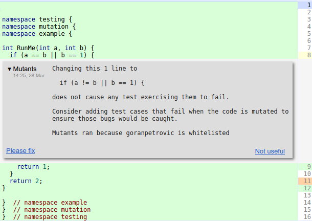
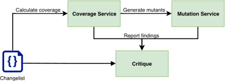
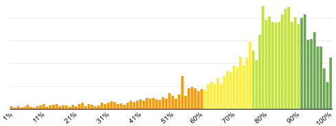
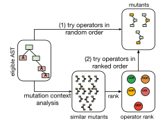
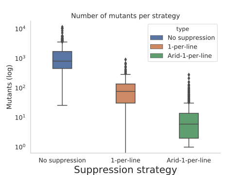
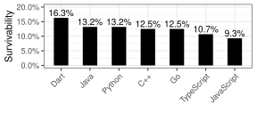
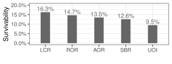
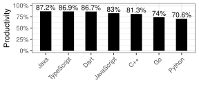
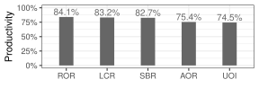
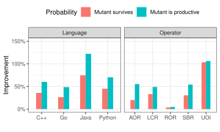

**Source:** *Practical Mutation Testing at Scale: A view from Google* — [PDF](https://arxiv.org/pdf/2102.11378) · [arXiv](https://arxiv.org/abs/2102.11378)

# Practical Mutation Testing at Scale   
A view from Google

Goran Petrović  Marko Ivanković  Gordon Fraser  René Just ††thanks:  Goran Petrović and Marko Ivanković are with Google LLC.   
E-mail: goranpetrovic@google.com, markoi@google.com Gordon Fraser is with the University of Passau   
E-mail: gordon.fraser@uni-passau.de René Just is with the University of Washington   
E-mail: rjust@cs.washington.edu††thanks: This work has been submitted to the IEEE for possible publication. Copyright may be transferred without notice, after which this version may no longer be accessible.

###### Abstract

Mutation analysis assesses a test suite’s adequacy by measuring its ability to detect small artificial faults, systematically seeded into the tested program. Mutation analysis is considered one of the strongest test-adequacy criteria. Mutation testing builds on top of mutation analysis and is a testing technique that uses mutants as test goals to create or improve a test suite. Mutation testing has long been considered intractable because the sheer number of mutants that can be created represents an insurmountable problem—both in terms of human and computational effort. This has hindered the adoption of mutation testing as an industry standard. For example, Google has a codebase of two billion lines of code and more than 500,000,000 tests are executed on a daily basis. The traditional approach to mutation testing does not scale to such an environment; even existing solutions to speed up mutation analysis are insufficient to make it computationally feasible at such a scale.

To address these challenges, this paper presents a scalable approach to mutation testing based on the following main ideas: (1) Mutation testing is done incrementally, mutating only _changed code_ during code review, rather than the entire code base; (2) Mutants are filtered, removing mutants that are likely to be irrelevant to developers, and limiting the number of mutants per line and per code review process; (3) Mutants are selected based on the historical performance of mutation operators, further eliminating irrelevant mutants and improving mutant quality. This paper empirically validates the proposed approach by analyzing its effectiveness in a code-review-based setting, used by more than 24,000 developers on more than 1,000 projects. The results show that the proposed approach produces orders of magnitude fewer mutants and that context-based mutant filtering and selection improve mutant quality and actionability. Overall, the proposed approach represents a mutation testing framework that seamlessly integrates into the software development workflow and is applicable up to large-scale industrial settings.

###### Index Terms: 

mutation testing, code coverage, test efficacy 

## I Introduction

Software testing is the predominant technique for ensuring software quality, and various approaches exist for assessing test suite efficacy (i.e., a test suite’s ability to detect software defects). One such approach is code coverage, which is widely used at Google [[1](https://arxiv.org/html/2102.11378#bib.bib1)] and measures the degree to which a test suite exercises a program. Code coverage is intuitive, cheap to compute, and well supported by commercial-grade tools. However, code coverage alone might be misleading, in particular when program statements are covered but the expected program outcome is not asserted upon [[2](https://arxiv.org/html/2102.11378#bib.bib2), [3](https://arxiv.org/html/2102.11378#bib.bib3)]. Another approach is mutation analysis, which systematically seeds artificial faults into a program and measures a test suite’s ability to detect these artificial faults, called mutants [[4](https://arxiv.org/html/2102.11378#bib.bib4)]. Mutation analysis addresses the limitations of code coverage and is widely considered the best approach for evaluating test suite efficacy [[5](https://arxiv.org/html/2102.11378#bib.bib5), [6](https://arxiv.org/html/2102.11378#bib.bib6), [7](https://arxiv.org/html/2102.11378#bib.bib7)]. Mutation testing is an iterative testing approach that builds on top of mutation analysis and uses undetected mutants as concrete test goals for which to create test cases.

As a concrete example, consider the following fully covered, yet weekly tested, function:

⬇

public Buffer view() {

Buffer buf = new Buffer();

buf.Append(this.internal_buf); //mutation: delete this line

return buf;

}

The tests only exercise the function, but do not assert upon its effects on the returned buffer. This is just one example where mutation testing outperforms code coverage: even though the line that appends some content to buf is covered, a developer is not informed about the fact that no test checks for its effects. The statement-deletion mutation, on the other hand, explicitly points out this testing weakness.

Google always strives to improve test quality, and thus decided to implement and deploy a mutation system to evaluate its effectiveness. The sheer scale of Google’s monolithic repository with approximately 2 billion lines of code [[8](https://arxiv.org/html/2102.11378#bib.bib8)], however, rendered the traditional approach to mutation testing infeasible: More than 500,000,000 test executions per day are gatekeepers for 60,000 change submissions to this code base, ensuring that 13,000 continuous integrations remain healthy on a daily basis [[9](https://arxiv.org/html/2102.11378#bib.bib9)]. First, at this scale, systematically mutating the entire code base would create far too many mutants, each potentially requiring many tests to be executed. Second, neither the traditionally computed mutant-detection ratio, which quantifies test suite efficacy, nor simply showing all mutants that have evaded detection to a developer would be actionable. Given that evaluating and resolving a single mutant takes several minutes [[10](https://arxiv.org/html/2102.11378#bib.bib10), [11](https://arxiv.org/html/2102.11378#bib.bib11)], the required developer effort for resolving all undetected mutants would be prohibitively expensive.

To make matters worse, even when applying sampling techniques to substantially reduce the number of mutants, developers at Google initially classified 85% of reported mutants as unproductive. An unproductive mutant is either trivially equivalent to the original program or it is detectable, but adding a test for it would not improve the test suite [[11](https://arxiv.org/html/2102.11378#bib.bib11)]. For example, mutating the initial capacity of a Java collection (e.g., `new ArrayList(64)` \(\mapsto\) `new ArrayList(16)`) creates an unproductive mutant. While it is possible to write a test that asserts on the collection capacity or expected memory allocations, it is unproductive to do so. In fact, it is conceivable that these tests, if written and added, would even have a negative impact because their change-detector nature (specifically testing the current implementation rather than the specification) violates testing best practices and causes brittle tests and false alarms.

Faced with the two major challenges in deploying mutation testing—the computational costs of mutation analysis and the fact that _most mutants are unproductive_ —we have developed a mutation testing approach that is scalable and usable, based on three central ideas:

  1. Our approach _performs mutation testing on code changes_ , considering only _changed lines_ of code (Section [II](https://arxiv.org/html/2102.11378#S2 "II Mutation Testing at Google ‣ Practical Mutation Testing at Scale A view from Google"), based on our prior work [[12](https://arxiv.org/html/2102.11378#bib.bib12)]), and surfacing mutants during code review. This greatly reduces the number of lines in which mutants are created and matches a developer’s unit of work for which additional tests are desirable. 
  2. Our approach uses _transitive mutant suppression_ , using heuristics based on developer feedback (Section [III](https://arxiv.org/html/2102.11378#S3 "III Arid Node Detection ‣ Practical Mutation Testing at Scale A view from Google"), based on our prior work [[12](https://arxiv.org/html/2102.11378#bib.bib12)]). The feedback of more than 20,000 developers on thousands of mutants over siz years enabled us to develop heuristics for mutant suppression that improved the ratio of productive mutants from 15% to 89%. 
  3. Our approach uses _probabilistic, targeted mutant selection_ , surfacing a restricted number of mutants based on historical performance (Section [IV](https://arxiv.org/html/2102.11378#S4 "IV Mutant Selection Criteria ‣ Practical Mutation Testing at Scale A view from Google")), further avoiding unproductive mutants. 

Based on an evaluation of the proposed mutation testing framework on almost 17 million mutants and 760,000 changes, which surfaced 2 million mutants during code review (Section [V](https://arxiv.org/html/2102.11378#S5 "V Evaluation ‣ Practical Mutation Testing at Scale A view from Google")), we conclude that, taken together, these improvements make mutation testing feasible—even for industry-scale software development environments.

 Fig. 1: Mutagenesis process: (1) For a given changelist, line coverage is computed and code is parsed into an AST. (2) For AST nodes spanning covered lines, arid nodes are tagged as unproductive using the arid node detection heuristic. (3) Non-arid (eligible) nodes are mutated and tested. (4) Surviving mutants are surfaced as code findings.

## II Mutation Testing at Google

Mutation testing at Google faces challenges of scale, both in terms of computation time as well as integration into the developer workflow. Even though existing work on selective mutation and other optimizations can substantially reduce the number of mutants that need to be analyzed, it remains infeasibly expensive to compute the absolute mutation score for the codebase at any given fixed point due to the size of the code repository. It would be even more expensive to keep re-computing the mutation score in any fixed time period (e.g., daily or weekly), and it is impossible to compute the full score after each commit. In addition to the computational costs of the mutation score, we were also unable to find a good way to surface it to the developers in an actionable way, as it is neither concrete nor actionable, and it does not guide testing. The scale, however, also makes surfacing individual mutants to developers challenging, in particular in light of unproductive mutants. Mutation testing at Google is designed to overcome these challenges of scale and unproductive mutants, and therefore differs from the traditional approach to mutation testing, described in the literature [[13](https://arxiv.org/html/2102.11378#bib.bib13)].

Figure [1](https://arxiv.org/html/2102.11378#S1.F1 "Fig. 1 ‣ I Introduction ‣ Practical Mutation Testing at Scale A view from Google") summarizes how the Mutation Testing Service at Google creates and analyzes mutants: Mutation testing is started when developers send changelists for code review. A changelist is an atomic update to the version control system, and it consists of a list of files, the operations to be performed on these files, and possibly the file contents to be modified or added, along with metadata like change description, author, etc. First, the Mutation Testing Service calculates the code coverage for the changelist (Section [II-A](https://arxiv.org/html/2102.11378#S2.SS1 "II-A Prerequisites: Changelists and Coverage ‣ II Mutation Testing at Google ‣ Practical Mutation Testing at Scale A view from Google")). Then, it creates mutants (Section [II-B](https://arxiv.org/html/2102.11378#S2.SS2 "II-B Mutagenesis ‣ II Mutation Testing at Google ‣ Practical Mutation Testing at Scale A view from Google")) by determining which nodes of the abstract syntax tree (AST) are eligible for mutation. An AST node is eligible for mutation if it is covered by at least one test and if it is not _arid_ (i.e., if mutated, it does not create unproductive mutants; see Section [III](https://arxiv.org/html/2102.11378#S3 "III Arid Node Detection ‣ Practical Mutation Testing at Scale A view from Google")). The service then generates, executes, and analyzes mutants for all eligible AST nodes (Section [II-C](https://arxiv.org/html/2102.11378#S2.SS3 "II-C Mutation Analysis and Selection ‣ II Mutation Testing at Google ‣ Practical Mutation Testing at Scale A view from Google")). In the end, only a restricted set of surviving mutants is selected to be surfaced to the developer as part of the code review process (Section [II-D](https://arxiv.org/html/2102.11378#S2.SS4 "II-D Surfacing Mutants in the Code Review Process ‣ II Mutation Testing at Google ‣ Practical Mutation Testing at Scale A view from Google")). This section describes the overall infrastructure and workflow of mutation testing at Google.

### II-A Prerequisites: Changelists and Coverage

To enable mutation testing at Google, we implemented _diff-based_ mutation testing: Mutants are only generated for lines that are changed. Once a developer is happy with their changelist, they send it to peers for code review. At this point, various static and dynamic analyses are run for that changelist and report back useful findings to the developer and the reviewers. Line coverage is one such analysis: During code reviews, _overall_ and _delta_ code coverage is surfaced to the developers [[1](https://arxiv.org/html/2102.11378#bib.bib1)]. Overall code coverage is the ratio of the number of lines covered by tests in the file to the total number of instrumented lines in the file. The number of instrumented lines is usually smaller than the total number of lines, since artifacts like comments or pure whitespace lines are not applicable for testing. Delta coverage is the ratio of the number of lines covered by tests in the added or modified lines in the changelist to the total number of added or modified lines in the changelist.

Code coverage is a prerequisite for running mutation analysis, as shown in Figure [3](https://arxiv.org/html/2102.11378#S2.F3 "Fig. 3 ‣ II-D Surfacing Mutants in the Code Review Process ‣ II Mutation Testing at Google ‣ Practical Mutation Testing at Scale A view from Google"), because of the high cost of generating and evaluating mutants in uncovered lines, all of which would inevitably survive because the code is not tested. Once line-level coverage is available for a changelist, mutagenesis is triggered.

Google uses Bazel as its build system [[14](https://arxiv.org/html/2102.11378#bib.bib14)]. Build targets list their sources and dependencies explicitly. Test targets can contain multiple tests, and each test suite can contain multiple test targets. Tests are executed in parallel. Using the explicit dependency and source listing, test coverage analysis provides information about which test target covers which line in the source code. Results of coverage analysis link lines of code to a set of tests covering them. Line level coverage is used during the test execution phase, where it determines the minimal set of tests that need to be run in an attempt to kill a mutant.

### II-B Mutagenesis

Once delta coverage and line-level coverage metadata is available, the system generates mutants in affected covered lines. Affected lines are added or modified lines in the changelist, and covered lines are defined by the coverage analysis results. The mutagenesis service receives a request to generate _point mutations_ , i.e., mutations that produce a mutant which differs from the original in one AST node on the requested line. For each programming language supported, a special mutagenesis service capable of navigating the AST of a compilation unit in that language accepts point mutation requests and replies with potential mutants.

For each point mutation request, i.e., a \((file,line)\) tuple, a mutation operator is selected and a mutant is generated in that line if that mutation operator is applicable to it. If no mutant is generated by the mutation operator, another is selected and so on until either a mutant is generated or all mutation operators have been tried and no mutant could be generated. There are two mutation operator selection strategies, random and targeted, described in Section [IV](https://arxiv.org/html/2102.11378#S4 "IV Mutant Selection Criteria ‣ Practical Mutation Testing at Scale A view from Google").

When a mutagenesis service receives a point mutation request, it first constructs an AST of the file in question, and visits each node, labeling arid nodes (Section [III](https://arxiv.org/html/2102.11378#S3 "III Arid Node Detection ‣ Practical Mutation Testing at Scale A view from Google")) in advance using heuristics accumulated using developer feedback about mutant productivity over the years. Arid nodes are not considered for mutation and no mutants are produced in them. Arid node labeling happens before mutagenesis is started; mutants in arid nodes are not generated and discarded, they are never created in the first place.

The Mutation Testing Service implements mutagenesis for 10 programming languages: C++, Java, Go, Python, TypeScript, JavaScript, Dart, SQL, Common Lisp, and Kotlin. For each language, the service implements five mutation operators: AOR (Arithmetic operator replacement), LCR (Logical connector replacement), ROR (Relational operator replacement), UOI (Unary operator insertion), and SBR (Statement block removal). These mutation operators were originally introduced for Mothra [[15](https://arxiv.org/html/2102.11378#bib.bib15)], and Table [I](https://arxiv.org/html/2102.11378#S2.T1 "TABLE I ‣ II-B Mutagenesis ‣ II Mutation Testing at Google ‣ Practical Mutation Testing at Scale A view from Google") gives further details for each. In Python, the unary increment and decrement are replaced by a binary operator to achieve the same effect due to the language design. In our experience, the ABS (Absolute value insertion) mutation operator was reported to predominantly create unproductive mutants, mostly because it acted on time-and-count related expressions that are positive and nonsensical if negated, and is therefore not used. Note that this is due to the style and features of our codebase, and may not hold in general.

For each file in the changelist, a set of mutants is requested, one for each affected covered line. Mutagenesis is performed by traversing the ASTs in each of the languages, and decisions are often done on the AST node level because it allows for fine-grained decisions due to the amount of context available.

TABLE I: Mutation operators implemented in the Mutation Testing Service 

<table id="S2.T1.2" class="ltx_tabular ltx_centering ltx_guessed_headers ltx_align_middle">
<tbody class="ltx_tbody">
<tr id="S2.T1.2.1" class="ltx_tr">
<td id="S2.T1.2.1.1" class="ltx_td ltx_border_tt"></td>
<th id="S2.T1.2.1.2" class="ltx_td ltx_align_left ltx_th ltx_th_column ltx_border_tt">Name</th>
<th id="S2.T1.2.1.3" class="ltx_td ltx_align_left ltx_th ltx_th_column ltx_border_tt" colspan="3">Scope</th></tr>
<tr id="S2.T1.2.2" class="ltx_tr">
<td id="S2.T1.2.2.1" class="ltx_td ltx_align_left ltx_border_t">AOR</td>
<td id="S2.T1.2.2.2" class="ltx_td ltx_align_left ltx_border_t">Arithmetic operator replacement</td>
<td id="S2.T1.2.2.3" class="ltx_td ltx_align_left ltx_border_t">a + b</td>
<td id="S2.T1.2.2.4" class="ltx_td ltx_align_center ltx_border_t"><math id="S2.T1.m1" class="ltx_Math" alttext="\rightarrow" display="inline" intent=":literal"><semantics><mo stretchy="false">→</mo><annotation encoding="application/x-tex">\rightarrow</annotation></semantics></math></td>
<td id="S2.T1.2.2.5" class="ltx_td ltx_align_left ltx_border_t"><math id="S2.T1.m2" class="ltx_Math" alttext="\left\{{\mbox{{a, b, a - b, a * b, a / b, a \% b}}}\right\}" display="inline" intent=":literal"><semantics><mrow><mo>{</mo><mtext class="ltx_mathvariant_monospace">a, b, a - b, a * b, a / b, a % b</mtext><mo>}</mo></mrow><annotation encoding="application/x-tex">\left\{{\mbox{{a, b, a - b, a * b, a / b, a \% b}}}\right\}</annotation></semantics></math></td></tr>
<tr id="S2.T1.2.3" class="ltx_tr">
<td id="S2.T1.2.3.1" class="ltx_td ltx_align_left">LCR</td>
<td id="S2.T1.2.3.2" class="ltx_td ltx_align_left">Logical connector replacement</td>
<td id="S2.T1.2.3.3" class="ltx_td ltx_align_left">a &amp;&amp; b</td>
<td id="S2.T1.2.3.4" class="ltx_td ltx_align_center"><math id="S2.T1.m3" class="ltx_Math" alttext="\rightarrow" display="inline" intent=":literal"><semantics><mo stretchy="false">→</mo><annotation encoding="application/x-tex">\rightarrow</annotation></semantics></math></td>
<td id="S2.T1.2.3.5" class="ltx_td ltx_align_left"><math id="S2.T1.m4" class="ltx_Math" alttext="\left\{{\mbox{{a, b, a || b, true, false}}}\right\}" display="inline" intent=":literal"><semantics><mrow><mo>{</mo><mtext class="ltx_mathvariant_monospace">a, b, a || b, true, false</mtext><mo>}</mo></mrow><annotation encoding="application/x-tex">\left\{{\mbox{{a, b, a || b, true, false}}}\right\}</annotation></semantics></math></td></tr>
<tr id="S2.T1.2.4" class="ltx_tr">
<td id="S2.T1.2.4.1" class="ltx_td ltx_align_left">ROR</td>
<td id="S2.T1.2.4.2" class="ltx_td ltx_align_left">Relational operator replacement</td>
<td id="S2.T1.2.4.3" class="ltx_td ltx_align_left">a &gt; b</td>
<td id="S2.T1.2.4.4" class="ltx_td ltx_align_center"><math id="S2.T1.m5" class="ltx_Math" alttext="\rightarrow" display="inline" intent=":literal"><semantics><mo stretchy="false">→</mo><annotation encoding="application/x-tex">\rightarrow</annotation></semantics></math></td>
<td id="S2.T1.2.4.5" class="ltx_td ltx_align_left"><math id="S2.T1.m6" class="ltx_Math" alttext="\left\{{\mbox{{a &lt; b, a &lt;= b, a &gt;= b, true, false}}}\right\}" display="inline" intent=":literal"><semantics><mrow><mo>{</mo><mtext class="ltx_mathvariant_monospace">a &lt; b, a &lt;= b, a &gt;= b, true, false</mtext><mo>}</mo></mrow><annotation encoding="application/x-tex">\left\{{\mbox{{a &lt; b, a &lt;= b, a &gt;= b, true, false}}}\right\}</annotation></semantics></math></td></tr>
<tr id="S2.T1.2.5" class="ltx_tr">
<td id="S2.T1.2.5.1" class="ltx_td ltx_align_left">UOI</td>
<td id="S2.T1.2.5.2" class="ltx_td ltx_align_left">Unary operator insertion</td>
<td id="S2.T1.2.5.3" class="ltx_td ltx_align_left">a</td>
<td id="S2.T1.2.5.4" class="ltx_td ltx_align_center"><math id="S2.T1.m7" class="ltx_Math" alttext="\rightarrow" display="inline" intent=":literal"><semantics><mo stretchy="false">→</mo><annotation encoding="application/x-tex">\rightarrow</annotation></semantics></math></td>
<td id="S2.T1.2.5.5" class="ltx_td ltx_align_left"><math id="S2.T1.m8" class="ltx_Math" alttext="\left\{{\mbox{{a++, a-{}-}}}\right\}" display="inline" intent=":literal"><semantics><mrow><mo>{</mo><mtext class="ltx_mathvariant_monospace">a++, a--</mtext><mo>}</mo></mrow><annotation encoding="application/x-tex">\left\{{\mbox{{a++, a-{}-}}}\right\}</annotation></semantics></math>; b <math id="S2.T1.m9" class="ltx_Math" alttext="\rightarrow" display="inline" intent=":literal"><semantics><mo stretchy="false">→</mo><annotation encoding="application/x-tex">\rightarrow</annotation></semantics></math> !b</td></tr>
<tr id="S2.T1.2.6" class="ltx_tr">
<td id="S2.T1.2.6.1" class="ltx_td ltx_align_left ltx_border_bb">SBR</td>
<td id="S2.T1.2.6.2" class="ltx_td ltx_align_left ltx_border_bb">Statement block removal</td>
<td id="S2.T1.2.6.3" class="ltx_td ltx_align_left ltx_border_bb">stmt</td>
<td id="S2.T1.2.6.4" class="ltx_td ltx_align_center ltx_border_bb"><math id="S2.T1.m10" class="ltx_Math" alttext="\rightarrow" display="inline" intent=":literal"><semantics><mo stretchy="false">→</mo><annotation encoding="application/x-tex">\rightarrow</annotation></semantics></math></td>
<td id="S2.T1.2.6.5" class="ltx_td ltx_align_left ltx_border_bb"><math id="S2.T1.m11" class="ltx_Math" alttext="\emptyset" display="inline" intent=":literal"><semantics><mi mathvariant="normal">∅</mi><annotation encoding="application/x-tex">\emptyset</annotation></semantics></math></td></tr>
</tbody>
</table>

 

### II-C Mutation Analysis and Selection

Once all mutants are generated for a changelist, a temporary state of the version control system is prepared for each of them, based on the original changelist, and then tests are executed in parallel for all those states. This makes for an efficient interaction and caching between our version control system and build system, and evaluates mutants in the fastest possible manner. Once test results are available, we randomly pick mutants from all surviving mutants to be reported. We limit the number of reported mutants to at most 7 times the number of total files in the changelist, to ensure that the cognitive overhead of understanding the reported mutants is not too high, which might cause developers to stop using mutation testing. 7 is a result of heuristics collected over the years of running the system. Selected surviving mutants are reported in the code review UI to the author and the reviewers.

### II-D Surfacing Mutants in the Code Review Process

The selected mutants are shown to developers during the code review process. Most changes to Google’s monolithic codebase, except for a limited number of fully automated changes, are reviewed by developers before they are merged into the source tree. Potvin and Levenberg [[8](https://arxiv.org/html/2102.11378#bib.bib8)] provide a comprehensive overview of Google’s development ecosystem. Reviewers can leave comments on the changed code that must be resolved by the author. A special type of comment generated by an automated analyzer is known as a _finding_. Unlike human-generated comments, findings do not need to be resolved by the author before submission, unless a human reviewer marks them as mandatory. Many analyzers are run automatically when a changelist is sent for review: linters, formatters, static code and build dependency analyzers etc. The majority of analyzers are based on the Tricorder code analysis platform [[16](https://arxiv.org/html/2102.11378#bib.bib16)]. We display mutation analysis results during the code review process because this maximizes the probability that the results will be considered by the developers.

 Fig. 2: Mutant shown in the code review tool

The number of comments displayed during code review can be large, so it is important that all tools only produce high quality findings that can be used immediately by the developers. Surfacing non-actionable findings during code review has a negative impact on the author and the reviewers. If an automated changelist analyzer finding (e.g., a surviving mutant) is not perceived as useful, developers can report that with a single click on the finding. If any of the reviewers consider a finding to be important, they can indicate that to the changelist author with a single click. Figure [2](https://arxiv.org/html/2102.11378#S2.F2 "Fig. 2 ‣ II-D Surfacing Mutants in the Code Review Process ‣ II Mutation Testing at Google ‣ Practical Mutation Testing at Scale A view from Google") shows an example mutant displayed in Critique, including the “Please Fix” and “Not useful” links in the bottom corners. This feedback is accessible to the owner of the system that created the findings, so quality metrics can be tracked and unhelpful findings triaged, and ideally prevented in the future.

 Fig. 3: Code coverage and mutation testing integration

### II-E Mutation Testing in Use at Google

Google has a large codebase with code in various programming languages. The coverage distribution per project is shown in Figure [4](https://arxiv.org/html/2102.11378#S2.F4 "Fig. 4 ‣ II-E Mutation Testing in Use at Google ‣ II Mutation Testing at Google ‣ Practical Mutation Testing at Scale A view from Google"). Although the statement coverage of most projects is satisfactory, even with our system that does heavy suppression and selection, the number of live mutants per changelist is still significant (median is 2 mutants, 99th percentile is 43 mutants). To be of any use to the author and the reviewers, code findings need to be surfaced quickly, before the review is complete. To further reduce the number of mutants, mutations are never generated in uninteresting, arid lines, as described in Section [III](https://arxiv.org/html/2102.11378#S3 "III Arid Node Detection ‣ Practical Mutation Testing at Scale A view from Google"); furthermore, we probabilistically select mutants based on their historical mutation operator performance (Section [IV](https://arxiv.org/html/2102.11378#S4 "IV Mutant Selection Criteria ‣ Practical Mutation Testing at Scale A view from Google")).

 Fig. 4: Distribution of project statement coverage

## III Arid Node Detection

Some parts of the code are less interesting than others. Surfacing live mutants in uninteresting statements, for example debug logging statements, has a negative impact on human time spent analyzing the finding, and its cognitive overhead. Because developers do not perceive adding tests to kill mutants in uninteresting nodes as improving the overall efficacy of the suite to detect faults, such mutants tend to survive. This section proposes an approach for mutant suppression and a set of heuristics for detecting AST nodes in which mutation is to be suppressed. There is a trade-off between correctness and usability of the results; the proposed heuristic may suppress mutation in relevant nodes as a side-effect of reducing uninteresting node mutations. We argue that this is a good trade-off because the number of possible mutants is always orders of magnitude larger than what we could reasonably present to the developers within the existing developer tools, and it is more effective to prevent high impact faults, rather than arid faults.

### III-A Detecting Arid Nodes

Mutation operators create mutants based on the AST of a program. The AST contains nodes, which are statements, expressions or declarations, and their child-parent relationships reflect their connections in the source code [[17](https://arxiv.org/html/2102.11378#bib.bib17)]. In order to prevent the generation of unproductive mutants, we identify nodes in the AST that are related to uninteresting statements, i.e., arid nodes.

Most compilers differentiate simple and compound nodes in an AST. Simple nodes have no body, e.g., a call expression names a function and parameters, but has no body. Compound nodes have at least one body, e.g., a for loop might have a body, while an if statement might have two: then and else branches. Examples of arid nodes would be log statements, calls to memory-reserving functions like std::vector::reserve, or writes to stdout; these scenarios are typically not tested by unit tests.

The heuristic approach for labeling nodes as arid is two-fold and is defined in Equation [1](https://arxiv.org/html/2102.11378#S3.E1 "In III-A Detecting Arid Nodes ‣ III Arid Node Detection ‣ Practical Mutation Testing at Scale A view from Google"):

\[\begin{aligned}
 & \emph{arid}(N)=\left\{\begin{matrix}\emph{expert}(N)&if$ $\emph{simple}(N)\\
1\ if\bigwedge(\emph{arid}(b))=1,\forall b\in N&otherwise\\
\end{matrix}\right. &  & \text{(1)}
\end{aligned}\]

 

Here, \(N\in T\) is a node in the abstract syntax tree \(T\) of a program, _simple_ is a boolean function determining whether a node is simple (compound nodes contain their children nodes), and _expert_ is a boolean function over a subset of simple statements in \(T\) encoding manually curated knowledge on arid simple nodes. The first part of Equation [1](https://arxiv.org/html/2102.11378#S3.E1 "In III-A Detecting Arid Nodes ‣ III Arid Node Detection ‣ Practical Mutation Testing at Scale A view from Google") operates on simple nodes, is represented by an expert curated manually for each programming language and is adjusted over time. The second part operates on compound nodes and is defined recursively. A compound node is an arid node iff _all_ of its parts are arid.

The _expert_ function that flags simple nodes as arid is developed over time to incorporate developer feedback on reported ‘Not useful’ mutants. This process is manual: if we decide a certain mutation is not productive and that the whole class of mutants should not be created, the rule is added to the _expert_ function. This is the critical part of the system because, without it, users would become frustrated with non-actionable feedback and opt out of the system altogether. Targeted mutation and careful surfacing of findings has been critical for adoption of mutation testing at Google. There are more than a hundred rules for arid node detection in our system.

### III-B Expert Heuristic Categories

The _expert_ function consists of various rules, some of which are mutation-operator-specific, and some of which are universal. We distinguish between heuristics that prevent the generation of uncompilable vs. compilable yet unproductive mutants. Most heuristics deal with the latter category, but the former is also important, especially in Go, where the compiler is very sensitive to mutations (e.g., unused import is a compiler error). For compilable mutants, we distinguish between heuristics for equivalent mutants, killable mutants, and redundant mutants, as reported in Table [II](https://arxiv.org/html/2102.11378#S3.T2 "TABLE II ‣ III-B5 Experience with Heuristics ‣ III-B Expert Heuristic Categories ‣ III Arid Node Detection ‣ Practical Mutation Testing at Scale A view from Google").

#### III-B1 Heuristics to Prevent Uncompilable Mutants

A mutant should be a syntactically valid program—otherwise, it would be detected by the compiler and not add any value for testing. There are certain mutations, especially the ones that delete code, that violate this validity principle. A prime example is deleting code in Go; any unused variables or imported modules produce compiler errors. The proposed heuristic is to gather all used symbols and put them in a slice instead of deleting them so they are referenced and the compiler is appeased.

#### III-B2 Heuristics to Prevent Equivalent Mutants

Equivalent mutants, which are semantically equivalent to the mutated program, are a plague in mutation testing and cannot generally be detected automatically. However, there are some categories of equivalent mutants that can be accurately detected. For example, in Java, the specification for the size method of a java.util.Collection is that it returns a non-negative value. This means that mutations such as collection.size() == 0 \(\mapsto\) collection.size() <= 0 are guaranteed to produce an equivalent mutant.

Another example for this category is related to memoization. Memoization is often used to speed up execution, but its removal inevitably causes the generation of equivalent mutants. The following heuristic is used to detect memoization: An if statement is a cache lookup if it is of the form if a, ok := x[v]; ok return a, i.e., if a lookup in the map finds an element, the if block returns that element (among other values, e.g., Error in Go). Such an if statement is a cache lookup statement and is considered arid by the _expert_ function, as is its full body. The following example shows a cache lookup in Go:

⬇

var cache map[string]string

func get(key string) string {

if val, ok := cache[key]; ok {

return val

}

value := expensiveCalculation(key)

cache[key] = value

return value

}

Removing the if statement just removes caching, but does not change functional behavior, and hence yields an equivalent mutant. The program still produces the same output for the same input—albeit slower. Functional tests are not expected to detect such changes.

As a third example, a heuristic in this category avoids mutations of time specifications because unit tests rarely test for time, and if they do, they tend to use fake clocks. Statements invoking sleep-like functionality, setting deadlines, or waiting for services to become ready (like gRPC [[18](https://arxiv.org/html/2102.11378#bib.bib18)] server’s Wait function that is always invoked in RPC servers, which are abundant in Google’s code base) are considered arid by the _expert_ function.

⬇

sleep(100); rpc.set_deadline(10);

⬇

sleep(200); rpc.set_deadline(20);

#### III-B3 Heuristics to Prevent Unproductive Killable Mutants

Not all code is equally important. Much of it can be mutated, and those mutants could actually be killed, but such tests are not considered valuable and will not be written by experienced developers; such mutants are bad test goals. Examples of this category are increments of values in monitoring system frameworks, low level APIs like mkdir or flag changes: these are easy to mutate, easy to test for, and yet mostly undesirable as tests.

A common way to implement heuristics in this category is to match function names; indeed we suppress mutants in calls to hundreds of functions, which is responsible for the highest number of suppressions. The star example of this category is a heuristic that marks any function call arid if the function name starts with the prefix log or the object on which the function is invoked is called logger. We validated this heuristic by randomly sampling 100 nodes that were marked arid by the log heuristic, and found that 99 indeed were correctly marked, while one had marginal utility. We have fuzzy name suppression rules for more than 200 function families.

⬇

log.infof("network speed: %v", bytesH/time)

⬇

log.infof("network speed: %v", bytes@+time)

#### III-B4 Heuristics to Prevent Redundant Mutants

There has been a lot of research on redundant mutants, targeted at reducing the cost of mutation testing. While the cost aspect is not a concern for us, because we generate at most a single mutant in a line, user experience and consistency are important concerns. In a code review context, we surface mutants in each snapshot; when the developers update their code, possibly writing tests to kill mutants, we rerun mutation testing on the new code and report new mutants. Because of this, we suppress some redundant mutants so that mutants are consistently reported, as opposed to alternating between redundant mutants, which introduces cognitive overhead and can be confusing.

As an example, in C++, the LCR mutation operator has a special case when dealing with NULL (i.e., nullptr), because of its logical equivalence with false:

<table id="S3.SS2.SSS4.p2.2" class="ltx_tabular ltx_centering ltx_guessed_headers ltx_align_middle">
<thead class="ltx_thead">
<tr id="S3.SS2.SSS4.p2.2.1" class="ltx_tr">
<th id="S3.SS2.SSS4.p2.2.1.1" class="ltx_td ltx_align_left ltx_th ltx_th_column ltx_border_tt">Original node</th>
<th id="S3.SS2.SSS4.p2.2.1.2" class="ltx_td ltx_th ltx_th_column ltx_border_tt"></th>
<th id="S3.SS2.SSS4.p2.2.1.3" class="ltx_td ltx_align_left ltx_th ltx_th_column ltx_border_tt">Potential mutants</th></tr>
</thead>
<tbody class="ltx_tbody">
<tr id="S3.SS2.SSS4.p2.2.2" class="ltx_tr">
<td id="S3.SS2.SSS4.p2.2.2.1" class="ltx_td ltx_align_left ltx_border_bb ltx_border_t" rowspan="5">if (x != nullptr)</td>
<td id="S3.SS2.SSS4.p2.2.2.2" class="ltx_td ltx_align_center ltx_border_bb ltx_border_t" rowspan="5"><math id="S3.SS2.SSS4.p2.m1" class="ltx_Math" alttext="\longmapsto" display="inline" intent=":literal"><semantics><mo stretchy="false">⟼</mo><annotation encoding="application/x-tex">\longmapsto</annotation></semantics></math></td>
<td id="S3.SS2.SSS4.p2.2.2.3" class="ltx_td ltx_align_left ltx_border_t">if (x)</td></tr>
<tr id="S3.SS2.SSS4.p2.2.3" class="ltx_tr">
<td id="S3.SS2.SSS4.p2.2.3.1" class="ltx_td ltx_align_left">if (nullptr)</td></tr>
<tr id="S3.SS2.SSS4.p2.2.4" class="ltx_tr">
<td id="S3.SS2.SSS4.p2.2.4.1" class="ltx_td ltx_align_left">if (x == nullptr)</td></tr>
<tr id="S3.SS2.SSS4.p2.2.5" class="ltx_tr">
<td id="S3.SS2.SSS4.p2.2.5.1" class="ltx_td ltx_align_left">if (false)</td></tr>
<tr id="S3.SS2.SSS4.p2.2.6" class="ltx_tr">
<td id="S3.SS2.SSS4.p2.2.6.1" class="ltx_td ltx_align_left ltx_border_bb">if (true)</td></tr>
</tbody>
</table>

 

The mutants marked in bold are redundant (equivalent to one another) because the value of nullptr is equivalent to false. Likewise, the opposite example, where the condition is if (nullptr == x), yields redundant mutants for the left-hand side. These mutations are suppressed.

#### III-B5 Experience with Heuristics

The highest mutant productivity gains came from the three heuristics implemented in the early days: suppression of mutations in logging statements, time-related operations (e.g., setting deadlines, timeouts, exponential backoff specifications etc.), and finally configuration flags. Most of the early feedback was about unproductive mutants in such code, which is ubiquitous in the code base. While it is hard to measure exactly, there is strong indication that these suppressions account for improvements in productivity from about 15% to 80%. Additional heuristics and refinements progressivley improved producitvity to 89%.

Heuristics are implemented by matching AST nodes with the full compiler information available to the mutation operator. Some heuristics are unsound: they employ fuzzy name matching and recognize AST shapes, but can suppress a productive mutant. On the other hand, some heuristics make use of the full type information (like matching java.util.HashMap::size calls) and are sound. Sound heuristics are demonstrably correct, but we have had much more important improvements of perceived mutant usefulness from unsound heuristics.

TABLE II: Arid node heuristics. 

Heuristic | Count | Frequency  
---|---|---  
Uncompilable | 1 | Common  
Equivalent | 13 | Common  
Unproductive killable | 16 | Very common  
Redundant | 2 | Uncommon

 

For a detailed list of heuristics, please refer to Appendix [A](https://arxiv.org/html/2102.11378#A1 "Appendix A Arid Node Heuristics ‣ Practical Mutation Testing at Scale A view from Google").

## IV Mutant Selection Criteria

Once arid nodes have been identified in the AST, the next step (cf. Section [II-B](https://arxiv.org/html/2102.11378#S2.SS2 "II-B Mutagenesis ‣ II Mutation Testing at Google ‣ Practical Mutation Testing at Scale A view from Google")) is to produce mutants for the remaining, non-arid nodes. There are two issues arising from this: First, only mutants that survive the tests can be shown to developers, whereas those that are killed just use computational resources. Many mutants never survive the test phase, and are not reported to the developer and reviewers during code review. An iterative approach, where after the first round of tests further rounds of mutagenesis could be run for lines in which mutants were killed, would use the build and test systems inefficiently, and would take much longer because of multiple rounds. Second, not all surviving mutants are equally productive: Depending on the context, certain mutation operators may produce better mutants than others. Reporting all surviving mutants for a line would prolong the mutagenesis step and increase test evaluation costs in a prohibitive manner. Because of this, effective selection criteria not only constitute a good trade-off, but are crucial in making mutation analysis results actionable during code review. In this section, we present a basic random selection strategy that generates one mutant per covered line and considers information about arid nodes, and a targeted selection, which considers the past performance of mutation operators in similar context (Figure [5](https://arxiv.org/html/2102.11378#S4.F5 "Fig. 5 ‣ IV-B Targeted Selection ‣ IV Mutant Selection Criteria ‣ Practical Mutation Testing at Scale A view from Google")).

### IV-A Random Selection

The basic principle of a random line-based mutant selection is shown in Listing [1](https://arxiv.org/html/2102.11378#LST1 "Listing 1 ‣ IV-A Random Selection ‣ IV Mutant Selection Criteria ‣ Practical Mutation Testing at Scale A view from Google"): For each line in a changelist, one of the mutants that can be generated for that line would be selected randomly, or alternatively a mutation target is picked randomly first and then a mutation operator is randomly selected.

⬇

function Mutagenesis(diff_ast)

mutants \(\leftarrow{}\) \(\emptyset{}\)

for line in covered_lines(diff_ast)

mutants \(\leftarrow{}\) uniform_random(all_mutants(line))

endfor

return mutants

Listing 1: Naïve random selection

Since our approach to mutation testing is based on the identification of arid nodes which should not be mutated, the random selection algorithm we use is described in Listing [2](https://arxiv.org/html/2102.11378#LST2 "Listing 2 ‣ IV-A Random Selection ‣ IV Mutant Selection Criteria ‣ Practical Mutation Testing at Scale A view from Google"). For each language, the Mutation Testing Service implements mutation operators as AST visitors. The mutation operators available for a language are randomly shuffled, and are used one by one to try and create a mutant in the given file and line, until one succeeds. We do this for each changed line in the changelist that is covered by tests. If any mutant can be created in a line, one will be created in that line, but which one will depend on the random shuffle and the AST itself (e.g., in a line without relational operators, the ROR mutation operator will not produce a mutant, but SBR might, because most lines can be deleted). If the first mutation operator in the randomly shuffled order cannot produce a mutant in a given line, either because it is not applicable to it, or because the relevant AST nodes are labeled arid, the next mutation operator is invoked, until either a mutant is produced or there are no more mutation operators left. This is done for each mutation request.

⬇

function Mutagenesis(diff_ast)

mutants \(\leftarrow{}\) \(\emptyset{}\)

productive_ast = remove_arid_nodes(diff_ast)

ops = shuffle({UOI, ROR, SBR, LCR, AOR})

for line in covered_lines(productive_ast)

for op in ops

if can_generate(op, line)

mutants \(\cup{}\)=  generate_mutant(op, line)

break

return mutants

Listing 2: Random selection with suppression

It is important to note that many nodes are labeled as arid by our heuristic (see Section [III](https://arxiv.org/html/2102.11378#S3 "III Arid Node Detection ‣ Practical Mutation Testing at Scale A view from Google")), and are not considered for mutation at all. Furthermore, only a single mutant in a line is ever produced, all others are not considered. These design decisions proved to be the core of making mutation testing feasible at very large scale.

### IV-B Targeted Selection

The targeted mutation operator selection strategy orders the operators by their perceived productivity in the mutation AST context, as shown in Listing [3](https://arxiv.org/html/2102.11378#LST3 "Listing 3 ‣ IV-B Targeted Selection ‣ IV Mutant Selection Criteria ‣ Practical Mutation Testing at Scale A view from Google").

⬇

function Mutagenesis(diff_ast)

mutants \(\leftarrow{}\) \(\emptyset{}\)

productive_ast = remove_arid_nodes(diff_ast)

ops = {UOI, ROR, SBR, LCR, AOR}

for line in covered_lines(productive_ast)

ops = order_by_historic_productivity(line, ops)

for operator in ops

if can_generate(operator, line)

mutants \(\cup{}\)=  generate_mutant(operator, line)

break

return mutants

Listing 3: Targeted selection with suppression 

 Fig. 5: Random (1) vs. Targeted (2) mutation selection

The information about how productive mutating a particular AST node by a particular mutation operator is, is based on historical information: First, we can determine a mutation operator’s _survivability_ (i.e., the fraction of mutants produced by the operator in the past that were not killed by the existing tests) in a particular context. Second, we can determine a mutant’s _productivity_ using developer feedback: Each reported mutant can be flagged as productive or unproductive by the author of the changelist or any of the reviewers of the changelist. We consider this a strong signal because it comes from experienced professionals that understand the context of the mutant.

Using this information, we can order the mutation operators by survivability and perceived productivity, rather than using a random shuffle. For each mutant, an AST context is kept, describing the environment of the AST node that was mutated, along with the productivity feedback and whether the mutant was killed or not. When the mutagenesis service receives a point mutation request, for nodes for which the mutation is requested, it finds similar nodes from the body of millions of previously evaluated mutants using the AST context, and then looks into historical performance of those mutants in two categories: developer feedback on productivity and mutant survivabiliy. Mutation operators are ordered using this metric rather than uniformly shuffled, and mutagenesis is attempted in that order, to maximize the probability that the mutant will be productive, or at least survive to be reported in the code review. For example, if we are mutating a binary expression within an if condition, we will find mutants done in a similar AST context and see how each mutation operator performed in them.

### IV-C Mutation Context

In order to apply historical information about mutation productivity and effectiveness, we need to decide how similar candidate mutations are compared to past mutations. We define a mutation to be similar if it happened in a similar context, e.g., replacing a relational operator within an if condition that is the first statement in the body of a for loop, as shown in Listing [4](https://arxiv.org/html/2102.11378#LST4 "Listing 4 ‣ IV-D Generating Pivots from ASTs ‣ IV Mutant Selection Criteria ‣ Practical Mutation Testing at Scale A view from Google").

As an efficient means to capture the similarity of the context of two mutations, we use the hashing framework for tree-structured data introduced by Tatikonda et al. [[19](https://arxiv.org/html/2102.11378#bib.bib19)], which maps an unordered tree into a multiset of simple structures referred to as \(pivots\). Each pivot captures information about the relationship among the nodes of the tree (see Section [IV-D](https://arxiv.org/html/2102.11378#S4.SS4 "IV-D Generating Pivots from ASTs ‣ IV Mutant Selection Criteria ‣ Practical Mutation Testing at Scale A view from Google")).

Finding similar mutation contexts is then reduced to finding similar pivot multisets. To identify similar pivot multisets, we produce a MinHash [[20](https://arxiv.org/html/2102.11378#bib.bib20)] inspired fingerprint of the pivot multiset. Because the distance in the fingerprint space correlates with the distance in the tree space, we can find similar mutation contexts efficiently by finding similar fingerprints of the node under mutation.

### IV-D Generating Pivots from ASTs

In order to capture the intricate relationship between nodes in the AST, we translate the AST into a multiset of pivots. A pivot is a triplet of nodes from the AST that encodes their relationship; for nodes \(u\) and \(v\), a pivot \(p\) is tuple \((lca,u,v)\), where \(lca\) is the lowest common ancestor of nodes \(u\) and \(v\). The pivot represents a subtree of the AST. The set of all pivots involving a particular node describes the tree from the point of view of that node. In mutation testing, we are only interested in nodes that are close to the node being mutated, so we constrain the set of pivots to pivots containing nodes that are a certain distance from the node considered for mutation.

In the example of replacing a relational operator in an if condition within a body of the for loop in Listing [4](https://arxiv.org/html/2102.11378#LST4 "Listing 4 ‣ IV-D Generating Pivots from ASTs ‣ IV Mutant Selection Criteria ‣ Practical Mutation Testing at Scale A view from Google"), one pivot might be \((\)if, Cond, \(*)\), and another \((\)Cond, \(i\), kMax\()\). All combinations of two nodes within some distance from the node being mutated in the AST in Figure [6](https://arxiv.org/html/2102.11378#S4.F6 "Fig. 6 ‣ IV-D Generating Pivots from ASTs ‣ IV Mutant Selection Criteria ‣ Practical Mutation Testing at Scale A view from Google") and their lowest common ancestor make pivot structures.

⬇

for (int i = 0; i < kMax; ++i) {

if (i < kMax / 2) {

return i / 2;

} else {

return i * 2;

}

}

Listing 4: C++ snippet with an if statement within a for loop

\Tree

[ .For [.Init [i ]] [.Cond [.< i kMax ] ] [.Inc [.++ i ] ] [.Block [ .If [.Cond [.< i [./ kMax 2 ] ] ] !\qframesubtree [.Then [.Return [./ i 2 ] ] ] [.Else [.Return [.* i 2 ] ] ] ] ] ]

Fig. 6: AST for the C++ example in Listing [4](https://arxiv.org/html/2102.11378#LST4 "Listing 4 ‣ IV-D Generating Pivots from ASTs ‣ IV Mutant Selection Criteria ‣ Practical Mutation Testing at Scale A view from Google")

Pivot multisets \(P\) precisely preserve the structural relationship of the tree nodes (parent-child and ancestor relations), so the tree similarity of two AST subtrees \(T1\) and \(T2\) can be measured as the Jaccard index of the pivot multisets [[19](https://arxiv.org/html/2102.11378#bib.bib19)] as shown in equation [2](https://arxiv.org/html/2102.11378#S4.E2 "In IV-D Generating Pivots from ASTs ‣ IV Mutant Selection Criteria ‣ Practical Mutation Testing at Scale A view from Google").

\[\begin{aligned}
 & d(T1,T2)=\textrm{Jaccard}(P(T1),P(T2))=\frac{|P(T1)\cap P(T2)|}{|P(T1)\cup P(T2)|} &  & \text{(2)}
\end{aligned}\]

 

### IV-E Fingerprinting Pivot Multisets

Pivot multisets are potentially quadratic in tree size, leading to costly union and intersection operations. Even a trivial if statement with a single return statement produces large pivot sets, and set operations become prohibitive. To alleviate that, a fingerprinting function is applied to convert large pivot multisets into fixed-sized fingerprints.

We hash the pivot sets to single objects that form the multiset of representatives for the input AST. The size of the multiset can be large, especially for large programs. In order to improve the efficiency of further manipulation, we use a signature function that converts large pivot hash sets into shorter signatures. The signatures are later used to compute the similarity between the trees, taking into consideration only the AST node type and ignoring everything else, like type data or names of the identifiers.

We use a simple hash function to hash a single pivot \(p=(lca,u,v)\) into a fixed-size value, proposed by Tatikonda and Parthasarathy [[19](https://arxiv.org/html/2102.11378#bib.bib19)].

\[\begin{aligned}
 & h(p)=(a\cdot lca+b\cdot u+c\cdot v)\bmod K & 
\end{aligned}\]

 

\[\begin{aligned}
 & a,b,c\in\mathbb{Z_{P}} & 
\end{aligned}\]

 

For \(a,b,c\) we pick small primes, and for \(K\) a large prime that fits in 32 bits. To be able to hash AST nodes, we assign sparse integer hash values to different AST node types in each language, e.g., a C++ FunctionDecl is assigned 8500, and CXXMethodDecl 8600\. For nodes in the pivot \((lca,u,v)\) we use these assigned hashes.

The signature for such a bag of representatives is generated using a MinHashing technique. The set of pivots is permuted and hashed under that permutation. To minimize the false positives and negatives (i.e., different trees hash to similar hashes, or vice versa), this is repeated \(k\) times, resulting in \(k\)-MinHashes.

The goal is that the signatures are similar for similar (multi)sets and dissimilar for dissimilar ones. Jaccard similarity between two sets can be estimated by comparing their MinHash signatures in the same way [[20](https://arxiv.org/html/2102.11378#bib.bib20)], as shown in equation [3](https://arxiv.org/html/2102.11378#S4.E3 "In IV-E Fingerprinting Pivot Multisets ‣ IV Mutant Selection Criteria ‣ Practical Mutation Testing at Scale A view from Google"). The MinHash scheme can be considered an instance of locality-sensitive hashing, in which ASTs that have a small distance to each other are transformed into hashes that preserve that property.

\[\begin{aligned}
 & d(T1,T2)=\frac{|P(T1)\cap P(T2)|}{|P(T1)\cup P(T2)|}\approx\frac{|hash(T1)\cap hash(T2)|}{|hash(T1)\cup hash(T2)|} &  & \text{(3)}
\end{aligned}\]

 

When mutating a node, we calculate its pivot set and hash it. We find similar AST contexts using nearest neighbor search algorithms. We observe how different mutants behave in this context and which mutation operators produce the most productive and surviving mutants. This is the basis for targeted mutation selection.

## V Evaluation

In order to bring value to developers, the Mutation Testing Service at Google needs to surface few productive mutants, selected from a large pool of mutants—most of which are unproductive. Recall that a productive mutant elicits an effective test, or otherwise advances code quality [[11](https://arxiv.org/html/2102.11378#bib.bib11)]. Therefore, our goal is two-fold. First, we aim to select mutants with a high survival rate and productivity to maximize their utility as test objectives. Second, we aim to surface very few mutants to reduce computational effort and avoid overwhelming developers with too many findings.

In addition to the design decision of applying mutation testing at the level of changelists rather than projects, two technical solutions reduce the number of mutants: (1) mutant suppression using arid nodes and (2) one-per-line mutant selection. The first research question aims to answer how effective these two solutions are:

  * RQ1 Mutant suppression. How effective is mutant suppression using arid nodes and 1-per-line mutant selection? (Section [V-B](https://arxiv.org/html/2102.11378#S5.SS2 "V-B RQ1 Mutant Suppression ‣ V Evaluation ‣ Practical Mutation Testing at Scale A view from Google")) 

To understand the influence of mutation operator selection on mutant survivability and productivity in the remaining non-arid nodes, we consider historical data, including developer feedback. We aim to answer the following two research questions:

  * RQ2 Mutant survivability. Does mutation operator selection influence the probability that a generated mutant survives the test suite? (Section [V-C](https://arxiv.org/html/2102.11378#S5.SS3 "V-C RQ2 Mutant Survivability ‣ V Evaluation ‣ Practical Mutation Testing at Scale A view from Google")) 
  * RQ3 Mutant productivity. Does mutation operator selection influence developer feedback on a generated mutant? (Section [V-D](https://arxiv.org/html/2102.11378#S5.SS4 "V-D RQ3 Mutant Productivity ‣ V Evaluation ‣ Practical Mutation Testing at Scale A view from Google")) 

Having established the influence of individual mutation operators on survivability and productivity, the final question is whether mutation context can be used to improve both. Therefore, our final research question is as follows:

  * RQ4 Mutation context. Does context-based selection of mutation operators improve mutant survivability and productivity? (Section [V-E](https://arxiv.org/html/2102.11378#S5.SS5 "V-E RQ4 Mutation Context ‣ V Evaluation ‣ Practical Mutation Testing at Scale A view from Google")) 

### V-A Experiment Setup

For our analyses, we established two datasets, one with data on all mutants, and one containing additional data on mutation context for a subset of all mutants.

Mutant dataset. The mutant dataset contains 16,935,148 mutants across 10 programming languages: C++, Java, Go, Python, TypeScript, JavaScript, Dart, SQL, Common Lisp, and Kotlin. Table [III](https://arxiv.org/html/2102.11378#S5.T3 "TABLE III ‣ V-A Experiment Setup ‣ V Evaluation ‣ Practical Mutation Testing at Scale A view from Google") summarizes the mutant dataset and gives the number and ratio of mutants per programming language, the average number of mutants per changelist and the percentage of mutants that survive the test suite. Table [IV](https://arxiv.org/html/2102.11378#S5.T4 "TABLE IV ‣ V-A Experiment Setup ‣ V Evaluation ‣ Practical Mutation Testing at Scale A view from Google") breaks down the numbers by mutation operator.

TABLE III: Summary of the mutant dataset. (Note that SQL, Common Lisp, and Kotlin are excluded from our analyses because of insufficient data.) 

<table id="S5.T3.2" class="ltx_tabular ltx_centering ltx_guessed_headers ltx_align_middle">
<tbody class="ltx_tbody">
<tr id="S5.T3.2.1" class="ltx_tr">
<th id="S5.T3.2.1.1" class="ltx_td ltx_align_left ltx_th ltx_th_row ltx_border_tt">Language</th>
<td id="S5.T3.2.1.2" class="ltx_td ltx_align_center ltx_border_tt" colspan="3">Generated mutants</td>
<td id="S5.T3.2.1.3" class="ltx_td ltx_align_right ltx_border_tt">Survivability</td></tr>
<tr id="S5.T3.2.2" class="ltx_tr">
<th id="S5.T3.2.2.1" class="ltx_td ltx_th ltx_th_row"></th>
<td id="S5.T3.2.2.2" class="ltx_td ltx_align_right ltx_border_t">Count</td>
<td id="S5.T3.2.2.3" class="ltx_td ltx_align_right ltx_border_t">Ratio</td>
<td id="S5.T3.2.2.4" class="ltx_td ltx_align_right ltx_border_t">Per CL</td>
<td id="S5.T3.2.2.5" class="ltx_td"></td></tr>
<tr id="S5.T3.2.3" class="ltx_tr">
<th id="S5.T3.2.3.1" class="ltx_td ltx_align_left ltx_th ltx_th_row ltx_border_t">C++</th>
<td id="S5.T3.2.3.2" class="ltx_td ltx_align_right ltx_border_t">7,197,069</td>
<td id="S5.T3.2.3.3" class="ltx_td ltx_align_right ltx_border_t">42.5%</td>
<td id="S5.T3.2.3.4" class="ltx_td ltx_align_right ltx_border_t">23.2</td>
<td id="S5.T3.2.3.5" class="ltx_td ltx_align_right ltx_border_t">12.5%</td></tr>
<tr id="S5.T3.2.4" class="ltx_tr">
<th id="S5.T3.2.4.1" class="ltx_td ltx_align_left ltx_th ltx_th_row">Java</th>
<td id="S5.T3.2.4.2" class="ltx_td ltx_align_right">2,894,772</td>
<td id="S5.T3.2.4.3" class="ltx_td ltx_align_right">17.1%</td>
<td id="S5.T3.2.4.4" class="ltx_td ltx_align_right">14.8</td>
<td id="S5.T3.2.4.5" class="ltx_td ltx_align_right">13.2%</td></tr>
<tr id="S5.T3.2.5" class="ltx_tr">
<th id="S5.T3.2.5.1" class="ltx_td ltx_align_left ltx_th ltx_th_row">Go</th>
<td id="S5.T3.2.5.2" class="ltx_td ltx_align_right">1,988,798</td>
<td id="S5.T3.2.5.3" class="ltx_td ltx_align_right">11.7%</td>
<td id="S5.T3.2.5.4" class="ltx_td ltx_align_right">27.6</td>
<td id="S5.T3.2.5.5" class="ltx_td ltx_align_right">12.5%</td></tr>
<tr id="S5.T3.2.6" class="ltx_tr">
<th id="S5.T3.2.6.1" class="ltx_td ltx_align_left ltx_th ltx_th_row">Python</th>
<td id="S5.T3.2.6.2" class="ltx_td ltx_align_right">1,689,382</td>
<td id="S5.T3.2.6.3" class="ltx_td ltx_align_right">10.0%</td>
<td id="S5.T3.2.6.4" class="ltx_td ltx_align_right">21.3</td>
<td id="S5.T3.2.6.5" class="ltx_td ltx_align_right">13.2%</td></tr>
<tr id="S5.T3.2.7" class="ltx_tr">
<th id="S5.T3.2.7.1" class="ltx_td ltx_align_left ltx_th ltx_th_row">TypeScript</th>
<td id="S5.T3.2.7.2" class="ltx_td ltx_align_right">1,006,531</td>
<td id="S5.T3.2.7.3" class="ltx_td ltx_align_right">5.9%</td>
<td id="S5.T3.2.7.4" class="ltx_td ltx_align_right">20.8</td>
<td id="S5.T3.2.7.5" class="ltx_td ltx_align_right">10.8%</td></tr>
<tr id="S5.T3.2.8" class="ltx_tr">
<th id="S5.T3.2.8.1" class="ltx_td ltx_align_left ltx_th ltx_th_row">JavaScript</th>
<td id="S5.T3.2.8.2" class="ltx_td ltx_align_right">908,014</td>
<td id="S5.T3.2.8.3" class="ltx_td ltx_align_right">5.4%</td>
<td id="S5.T3.2.8.4" class="ltx_td ltx_align_right">31.0</td>
<td id="S5.T3.2.8.5" class="ltx_td ltx_align_right">9.4%</td></tr>
<tr id="S5.T3.2.9" class="ltx_tr">
<th id="S5.T3.2.9.1" class="ltx_td ltx_align_left ltx_th ltx_th_row">Dart</th>
<td id="S5.T3.2.9.2" class="ltx_td ltx_align_right">581,109</td>
<td id="S5.T3.2.9.3" class="ltx_td ltx_align_right">3.4%</td>
<td id="S5.T3.2.9.4" class="ltx_td ltx_align_right">17.4</td>
<td id="S5.T3.2.9.5" class="ltx_td ltx_align_right">16.3%</td></tr>
<tr id="S5.T3.2.10" class="ltx_tr">
<th id="S5.T3.2.10.1" class="ltx_td ltx_align_left ltx_th ltx_th_row ltx_border_t">SQL</th>
<td id="S5.T3.2.10.2" class="ltx_td ltx_align_right ltx_border_t">478,975</td>
<td id="S5.T3.2.10.3" class="ltx_td ltx_align_right ltx_border_t">2.8%</td>
<td id="S5.T3.2.10.4" class="ltx_td ltx_align_right ltx_border_t">91.2</td>
<td id="S5.T3.2.10.5" class="ltx_td ltx_align_right ltx_border_t">11.7%</td></tr>
<tr id="S5.T3.2.11" class="ltx_tr">
<th id="S5.T3.2.11.1" class="ltx_td ltx_align_left ltx_th ltx_th_row">Common Lisp</th>
<td id="S5.T3.2.11.2" class="ltx_td ltx_align_right">148,289</td>
<td id="S5.T3.2.11.3" class="ltx_td ltx_align_right">0.9%</td>
<td id="S5.T3.2.11.4" class="ltx_td ltx_align_right">179.3</td>
<td id="S5.T3.2.11.5" class="ltx_td ltx_align_right">2.2%</td></tr>
<tr id="S5.T3.2.12" class="ltx_tr">
<th id="S5.T3.2.12.1" class="ltx_td ltx_align_left ltx_th ltx_th_row">Kotlin</th>
<td id="S5.T3.2.12.2" class="ltx_td ltx_align_right">42,209</td>
<td id="S5.T3.2.12.3" class="ltx_td ltx_align_right">0.2%</td>
<td id="S5.T3.2.12.4" class="ltx_td ltx_align_right">20.7</td>
<td id="S5.T3.2.12.5" class="ltx_td ltx_align_right">11.0%</td></tr>
<tr id="S5.T3.2.13" class="ltx_tr">
<th id="S5.T3.2.13.1" class="ltx_td ltx_align_left ltx_th ltx_th_row ltx_border_bb ltx_border_t">Total</th>
<td id="S5.T3.2.13.2" class="ltx_td ltx_align_right ltx_border_bb ltx_border_t">16,935,148</td>
<td id="S5.T3.2.13.3" class="ltx_td ltx_align_right ltx_border_bb ltx_border_t">100%</td>
<td id="S5.T3.2.13.4" class="ltx_td ltx_align_right ltx_border_bb ltx_border_t">21.8</td>
<td id="S5.T3.2.13.5" class="ltx_td ltx_align_right ltx_border_bb ltx_border_t">12.5%</td></tr>
</tbody>
</table>

  TABLE IV: Number of mutants per mutation operator. 

<table id="S5.T4.2" class="ltx_tabular ltx_centering ltx_guessed_headers ltx_align_middle">
<thead class="ltx_thead">
<tr id="S5.T4.2.1" class="ltx_tr">
<th id="S5.T4.2.1.1" class="ltx_td ltx_align_left ltx_th ltx_th_column ltx_th_row ltx_border_tt">Operator</th>
<th id="S5.T4.2.1.2" class="ltx_td ltx_align_center ltx_th ltx_th_column ltx_border_tt" colspan="2">Generated mutants</th>
<th id="S5.T4.2.1.3" class="ltx_td ltx_align_right ltx_th ltx_th_column ltx_border_tt">Survivability</th></tr>
</thead>
<tbody class="ltx_tbody">
<tr id="S5.T4.2.2" class="ltx_tr">
<th id="S5.T4.2.2.1" class="ltx_td ltx_th ltx_th_row"></th>
<th id="S5.T4.2.2.2" class="ltx_td ltx_align_right ltx_th ltx_th_column ltx_border_t">Count</th>
<th id="S5.T4.2.2.3" class="ltx_td ltx_align_right ltx_th ltx_th_column ltx_border_t">Ratio</th>
<td id="S5.T4.2.2.4" class="ltx_td ltx_border_t"></td></tr>
<tr id="S5.T4.2.3" class="ltx_tr">
<th id="S5.T4.2.3.1" class="ltx_td ltx_align_left ltx_th ltx_th_row ltx_border_t">SBR</th>
<td id="S5.T4.2.3.2" class="ltx_td ltx_align_right ltx_border_t">11,522,932</td>
<td id="S5.T4.2.3.3" class="ltx_td ltx_align_right ltx_border_t">68.0%</td>
<td id="S5.T4.2.3.4" class="ltx_td ltx_align_right ltx_border_t">12.7%</td></tr>
<tr id="S5.T4.2.4" class="ltx_tr">
<th id="S5.T4.2.4.1" class="ltx_td ltx_align_left ltx_th ltx_th_row">UOI</th>
<td id="S5.T4.2.4.2" class="ltx_td ltx_align_right">3,137,375</td>
<td id="S5.T4.2.4.3" class="ltx_td ltx_align_right">18.5%</td>
<td id="S5.T4.2.4.4" class="ltx_td ltx_align_right">9.6%</td></tr>
<tr id="S5.T4.2.5" class="ltx_tr">
<th id="S5.T4.2.5.1" class="ltx_td ltx_align_left ltx_th ltx_th_row">LCR</th>
<td id="S5.T4.2.5.2" class="ltx_td ltx_align_right">1,305,499</td>
<td id="S5.T4.2.5.3" class="ltx_td ltx_align_right">7.7%</td>
<td id="S5.T4.2.5.4" class="ltx_td ltx_align_right">16.3%</td></tr>
<tr id="S5.T4.2.6" class="ltx_tr">
<th id="S5.T4.2.6.1" class="ltx_td ltx_align_left ltx_th ltx_th_row">ROR</th>
<td id="S5.T4.2.6.2" class="ltx_td ltx_align_right">672,009</td>
<td id="S5.T4.2.6.3" class="ltx_td ltx_align_right">4.0%</td>
<td id="S5.T4.2.6.4" class="ltx_td ltx_align_right">14.7%</td></tr>
<tr id="S5.T4.2.7" class="ltx_tr">
<th id="S5.T4.2.7.1" class="ltx_td ltx_align_left ltx_th ltx_th_row">AOR</th>
<td id="S5.T4.2.7.2" class="ltx_td ltx_align_right">297,333</td>
<td id="S5.T4.2.7.3" class="ltx_td ltx_align_right">1.8%</td>
<td id="S5.T4.2.7.4" class="ltx_td ltx_align_right">13.5%</td></tr>
<tr id="S5.T4.2.8" class="ltx_tr">
<th id="S5.T4.2.8.1" class="ltx_td ltx_align_left ltx_th ltx_th_row ltx_border_bb ltx_border_t">Total</th>
<td id="S5.T4.2.8.2" class="ltx_td ltx_align_right ltx_border_bb ltx_border_t">16,935,148</td>
<td id="S5.T4.2.8.3" class="ltx_td ltx_align_right ltx_border_bb ltx_border_t">100%</td>
<td id="S5.T4.2.8.4" class="ltx_td ltx_align_right ltx_border_bb ltx_border_t">12.5%</td></tr>
</tbody>
</table>

 

We created this dataset by gathering data on all mutants that the Mutation Testing Service generated since its inauguration, which refers to the date when we made the service broadly available, after the initial development of the service and its suppression rules (see Section [III-B5](https://arxiv.org/html/2102.11378#S3.SS2.SSS5 "III-B5 Experience with Heuristics ‣ III-B Expert Heuristic Categories ‣ III Arid Node Detection ‣ Practical Mutation Testing at Scale A view from Google")). We did not perform any data filtering, hence the dataset provides information about all mutation analyses that were run.

In total, our data collection considered 776,740 changelists that were part of the code review process. For these, 16,935,148 mutants were generated, out of which 2,110,489 were surfaced. Out of all surfaced mutants, 66,798 received explicit developer feedback. For each considered changelist, the mutant dataset contains information about:

  * affected files and affected lines, 
  * test targets testing those affected lines, 
  * mutants generated for each of the affected lines, 
  * test results for the file at the mutated line, and 
  * mutation operator and context for each mutant. 

Our analysis aims to study the efficacy and perceived productivity of mutants and mutation operators across programming languages. Note that our mutant dataset is likely specific to Google’s code style and review practices. However, the code style is widely adopted [[21](https://arxiv.org/html/2102.11378#bib.bib21)], and the modern code review process is used throughout the industry [[22](https://arxiv.org/html/2102.11378#bib.bib22)].

Information about mutant survivability per programming language or mutation operator can be directly extracted from the dataset and allows us to answer research questions RQ1, RQ2 and RQ3.

Context dataset. The context dataset contains 4,068,241 mutants (a subset of the mutant dataset) for the top-four programming languages: C++, Java, Go, and Python. Each mutant in this dataset is enriched with the information of whether our context-based selection strategy would have selected that mutant. When generating mutants, we would also run the context-based prediction, and we persisted the prediction information along with the mutants. If the randomly chosen operator was indeed what the prediction service picked, this mutant is the one with the highest predicted value. For each mutant, the dataset contains:

  * all information from the mutant dataset, 
  * predicted survivability and productivity for each mutation in similar context, and 
  * information about whether the mutant has the highest predicted survivability/productivity. 

We created this dataset by using our context-based mutation selection strategy during mutagenesis on all mutants during a limited period of time. During this time, we automatically annotated the mutants, indicating whether a mutant would be picked by the context-based mutation selection strategy along with the mutant outcome in terms of survivability and productivity. This dataset enables the evaluation of our context-based mutation selection strategy and allows us to answer research question RQ4.

Experiment measures: Surviving the initial test suite is a precondition for surfacing a mutant, but survivability alone is not a good measure of mutant productivity. For example, a mutation that changes the timeout of a network call likely survives the test suite but is also very likely to be unproductive (i.e., a developer will not consider writing a test for it). Hence, developer feedback indicating that a mutant is indeed (un)productive is a stronger signal.

We measure mutant productivity via user feedback gathered from Critique (Section [II-D](https://arxiv.org/html/2102.11378#S2.SS4 "II-D Surfacing Mutants in the Code Review Process ‣ II Mutation Testing at Google ‣ Practical Mutation Testing at Scale A view from Google")), where each surfaced mutant displays a Please fix (productive mutant) and a Not useful (unproductive mutant) link. Please fix corresponds to a request to the author of a changelist to improve the test suite based on the surfaced mutant; not useful corresponds to a false alarm or generally a non-actionable code finding. 82% of all surfaced mutants with feedback were labeled as productive by developers. Note that this ratio is an aggregate over the entire data set. Since the inauguration of the Mutation Testing Service, productivity has increased over time from 80% to 89% because we generalized the feedback on unproductive mutants and created suppression rules for the \(expert\) function, described in Section [III](https://arxiv.org/html/2102.11378#S3 "III Arid Node Detection ‣ Practical Mutation Testing at Scale A view from Google"). This means that later mutations of nodes in which mutants were found to be unproductive will be suppressed, generating fewer unproductive mutants over time. Surfaced mutants without explicit developer feedback are not considered for the productivity analysis.

### V-B RQ1 Mutant Suppression

In order to compare our mutant-suppression approach with the traditional mutagenesis, we (1) randomly sampled 5,000 changelists from the mutant dataset, (2) determined how many mutants traditional mutagenesis produces, and (3) compared the result with the number of mutants generated by our approach. (Since traditional mutation analysis is prohibitively expensive at scale, we adapted our system to only generate all mutants for the selected changelists.) Figure [7](https://arxiv.org/html/2102.11378#S5.F7 "Fig. 7 ‣ V-B RQ1 Mutant Suppression ‣ V Evaluation ‣ Practical Mutation Testing at Scale A view from Google") shows the results for three strategies: no suppression (traditional), select one mutant per line, and select one mutant per line after excluding arid nodes (our approach). We include the 1-per-line approach in the analysis to evaluate the individual contribution of the arid-node suppression, beyond sampling one mutant per line.

 Fig. 7: Number of generated mutants per changelist for no suppression (traditional mutagenesis), 1-per-line and arid-1-per-line (our approach). (Note the log-scaled vertical axis.) 

As shown in and Table [V](https://arxiv.org/html/2102.11378#S5.T5 "TABLE V ‣ V-B RQ1 Mutant Suppression ‣ V Evaluation ‣ Practical Mutation Testing at Scale A view from Google"), the median number of generated mutants is 820 for traditional mutagenesis, 77 for 1-per-line selection, and only 7 for arid-1-per-line selection. Hence, our mutant-suppression approach reduces the number of mutants by two orders of magnitude. Table [V](https://arxiv.org/html/2102.11378#S5.T5 "TABLE V ‣ V-B RQ1 Mutant Suppression ‣ V Evaluation ‣ Practical Mutation Testing at Scale A view from Google") also shows the results for a Mann-Whitney U test, which confirms that the distributions are statistically significantly different.

TABLE V: Mann-Whitney U test comparing the distributions of the number of mutants generated by different strategies.

Strategy A | Strategy B | p-value | Median A | Median B  
---|---|---|---|---  
No suppression | 1-per-line | <.0001 | 820 | 77  
1-per-line | Arid-1-per-line | <.0001 | 77 | 7  
No suppression | Arid-1-per-line | <.0001 | 820 | 7

 

Our mutant-suppression approach generates fewer than 20 mutants for most changelists; the 25th and 75th percentiles are 3 and 19, respectively. In contrast, the 25th and 75th percentiles for 1-per-line are 31 and 138 mutants. Traditional mutagenesis generates more than 450 mutants for most changelists (the 25th and 75th percentiles are 460 and 1734, respectively), further underscoring that this approach is impractical, even at the changelist level. Presenting hundreds of mutants, most of which are not actionable, to a developer would almost certainly result in that developer abandoning mutation testing altogether.

RQ1: Arid-node suppression and 1-per-line selection significantly reduce the number of mutants per changelist, with a median of only 7 mutants per changelist (compared to 820 mutants for traditional mutagenesis).

### V-C RQ2 Mutant Survivability

 (a) Survivability per programming language.

 (b) Survivability per mutation operator.

Fig. 8: Mutant survivability.

Mutant survivability is important because we generate at most a single mutant per line—if that mutant is killed, no other mutant is generated. To be actionable, mutants have to be reported as soon as possible in the code review process, as described in Section [IV](https://arxiv.org/html/2102.11378#S4 "IV Mutant Selection Criteria ‣ Practical Mutation Testing at Scale A view from Google"). Therefore, we aim to maximize mutant survivability because it directly impacts the number of surfaced mutants.

Overall, 87.5% of all generated mutants are killed by the initial test suite. Note that this is not the same as the traditional mutation score [[23](https://arxiv.org/html/2102.11378#bib.bib23)] (ratio of killed mutants to the total number of mutants) because mutagenesis is probabilistic and only generates a subset of all mutants. This means only a fraction of all possible mutants are generated and evaluated, and many other mutants are never generated because they are associated with arid nodes.

Tables [III](https://arxiv.org/html/2102.11378#S5.T3 "TABLE III ‣ V-A Experiment Setup ‣ V Evaluation ‣ Practical Mutation Testing at Scale A view from Google") and [IV](https://arxiv.org/html/2102.11378#S5.T4 "TABLE IV ‣ V-A Experiment Setup ‣ V Evaluation ‣ Practical Mutation Testing at Scale A view from Google") show the distribution of number of mutants and mutant survivability, broken down by programming language and mutation operator. Figure [8](https://arxiv.org/html/2102.11378#S5.F8 "Fig. 8 ‣ V-C RQ2 Mutant Survivability ‣ V Evaluation ‣ Practical Mutation Testing at Scale A view from Google") visualizes the mutant survivability data. Because the SBR mutation operator can be applied to almost any non-arid node in the code, it is no surprise that this mutation operator dominates the number of mutants, contributing roughly 68% of all mutants. While SBR is a prolific and versatile mutation operator, it is also the second least likely to survive the test suite: when applicable to a changelist, SBR mutants are surfaced during code review with a probability of 12.6%. Overall, mutant survivability is similar across mutation operators, with a notable exception of UOI, which has a survivability of only 9.5%. Mutant survivability is also similar across programming languages with the exception of Dart, whose mutant survivability is noticeably higher. We conjecture that this is because Dart is mostly used for web development which has its own testing challenges.

RQ2: Different mutation operators result in different mutant survivability; for example, the survival rate of LCR is almost twice as high as that of UOI.

 (a) Productivity per programming language.

 (b) Productivity per mutation operator.

Fig. 9: Mutant productivity.

### V-D RQ3 Mutant Productivity

Mutant productivity is the most important measure, because it directly measures the utility of a surfaced mutant. Since we only generate a single mutant in a line, that mutant ideally should not just survive the test suite but also be productive, allowing developers to improve the test suite or the source code itself. Given Google’s high accuracy and actionability requirements for surfacing code findings during code reviews, we rely on developer feedback as the best available measure for mutant productivity. Specifically, we consider a mutant a developer marked with Please fix to be more productive than others. Likewise, we consider a mutant a developer marked with Not useful to be less productive than others. (Note that we excluded mutants for which no developer feedback is available from the analysis.) We compare the mutant productivity across mutation operators and programming languages.

Figure [9](https://arxiv.org/html/2102.11378#S5.F9 "Fig. 9 ‣ V-C RQ2 Mutant Survivability ‣ V Evaluation ‣ Practical Mutation Testing at Scale A view from Google") shows the results, indicating that mutant productivity is similar across mutation operators, with AOR and UOI mutants being noticeably less productive. For example, ROR mutants are productive 84.1% of the time, whereas, UOI mutants are only productive 74.5% of the time. The differences between programming languages are even more pronounced, with Java mutants being productive 87.2% of the time, compared to Python mutants that are productive 70.6% of the time. This could be due to code conventions, language common usecase scenarios, testing frameworks or simply the lack of heuristics. We have found that Python code generally requires more tests because of the lack of the compiler.

RQ3: ROR, LCR, and SBR mutants show similar productivity, whereas AOR and UOI mutants show noticeably lower productivity.

### V-E RQ4 Mutation Context

We examine whether context-based selection of mutation operators improves mutant survivability and productivity. Specifically, we determine whether context-based selection of mutation operators increases the probability of a generated mutant to survive and to result in a Please fix request, when compared to the random-selection baseline.

 Fig. 10: Improvements achieved by context-based selection. (0% improvement corresponds to random selection.)

Figure [10](https://arxiv.org/html/2102.11378#S5.F10 "Fig. 10 ‣ V-E RQ4 Mutation Context ‣ V Evaluation ‣ Practical Mutation Testing at Scale A view from Google") shows that selecting mutation operators based on the AST context of the node under mutation substantially increases the probability of the generated mutant to survive and to result in a Please fix request. While improvements vary across programming languages and across mutation operators, the context-based selection consistently outperforms random selection. The largest productivity improvements are achieved for UOI, AOR, and SBR, which generate most of all mutants. Intuitively, these improvements mean that context-based selection results in twice as many productive UOI mutants (out of all generated mutants), when compared to random selection. Figure [10](https://arxiv.org/html/2102.11378#S5.F10 "Fig. 10 ‣ V-E RQ4 Mutation Context ‣ V Evaluation ‣ Practical Mutation Testing at Scale A view from Google") also shows to what extent these improvements can be attributed to the fact that simply more mutants are surfaced. Since the improvements for productivity increase even more than those for survivability, context-based selection not only results in more surfaced mutants but also in higher productivity of the surviving mutants. Overall, the survival rate increases by over 40% and the probability that a reviewer asks for a generated mutant to be fixed increases by almost 50%.

It is important to put these improvements into context. Probabilistic diff-based mutation analysis aggressively trims down the number of considered mutants from thousands in a representative file to a mere few, and enables mutants to be effectively presented to developers as potential test targets. The random-selection approach produces fewer surviving mutants of lower productivity.

RQ4: Context-based selection improves the probability that a generated mutant survives by more than 40% and the probability that a generated mutant is productive by almost 50%.

## VI Related Work

There are several veins of research that are related to this work. Just et al. proposed an AST-based program context model for predicting mutant effectiveness [[24](https://arxiv.org/html/2102.11378#bib.bib24)]. Fernandez et al. developed various rules for Java programs to detect equivalent and redundant mutants [[25](https://arxiv.org/html/2102.11378#bib.bib25)]. The initial results are promising for developing selection strategies that outperform random selection. Further, Zhang et al. used machine learning to predict mutation scores, both on successive versions of a given project, and across projects [[26](https://arxiv.org/html/2102.11378#bib.bib26)]. Finally, the PIT project makes mutation testing usable by practicing developers and has gained adoption in the industry [[27](https://arxiv.org/html/2102.11378#bib.bib27)].

There has been a lot of focus on computational costs and the equivalent mutant problem [[28](https://arxiv.org/html/2102.11378#bib.bib28)]. There is much focus on avoiding redundant mutants, which leads to increase of computational costs and inflation of the mutation score [[29](https://arxiv.org/html/2102.11378#bib.bib29)], and instead favoring hard-to-detect mutants [[30](https://arxiv.org/html/2102.11378#bib.bib30), [31](https://arxiv.org/html/2102.11378#bib.bib31)] or dominator mutants [[32](https://arxiv.org/html/2102.11378#bib.bib32)]. Mutant subsumption graphs have similar goals but mutant productivity is much more fuzzy than dominance or subsumption.

Effectiveness for mutants is primarily defined in terms of redundacy and equivalence. This approach fails to consider the notion that non-reduntant mutants might be unproductive or that equivalent mutants can be productive [[33](https://arxiv.org/html/2102.11378#bib.bib33)]. From our experience, reporting equivalent mutants has been a vastly easier problem than reporting unproductive non-reduntant and non-equivalent mutants.

Our approach for targeted mutant selection (Section [IV](https://arxiv.org/html/2102.11378#S4 "IV Mutant Selection Criteria ‣ Practical Mutation Testing at Scale A view from Google")) compares the context of mutants using tree hashes. The specific implementation was driven by the need for consistency and efficiency, in order to make it possible to look up similar AST contexts in real time during mutant creation. In particular, the hash distances need to be preserved over time to improve the targeted selection. There are approaches to software clone detection [[34](https://arxiv.org/html/2102.11378#bib.bib34)] that similarly use tree-distances (e.g., [[35](https://arxiv.org/html/2102.11378#bib.bib35), [36](https://arxiv.org/html/2102.11378#bib.bib36), [37](https://arxiv.org/html/2102.11378#bib.bib37), [38](https://arxiv.org/html/2102.11378#bib.bib38), [39](https://arxiv.org/html/2102.11378#bib.bib39)]). Whether alternative distance measurements can be scaled for application at Google and whether they can further improve the targeted selection remains to be determined in future work.

This approach is similar to tree-based approaches (e.g., [[35](https://arxiv.org/html/2102.11378#bib.bib35), [36](https://arxiv.org/html/2102.11378#bib.bib36), [37](https://arxiv.org/html/2102.11378#bib.bib37), [38](https://arxiv.org/html/2102.11378#bib.bib38), [39](https://arxiv.org/html/2102.11378#bib.bib39)]) in software clone detection [[34](https://arxiv.org/html/2102.11378#bib.bib34)], which aims to detect that a code fragment is a copy of some original code, with or without modification. The AST-based techniques can detect additional categories of modifications like identifier name changes or type aliases, that token-based detection cannot, and the insensitivity of to variable names is important for the mutation context. However, clone detection differs drastically in its goal: it cares about detecting code with the same semantics, in spite of the syntactical changes made to it. While clone detection might want to detect that an algorithm has been copied and then changed slightly, e.g., a recursion rewritten to an equivalent iterative algorithm, mutation testing context cares only about the neighboring AST nodes: in the iterative algorithm, the most productive mutants will be those that thrived before in such code, not the ones that thrived for a recursive algorithm. In order to look up similar AST contexts in real time, as mutants are created, we require a fast method that preserves hash distance over time. For these consistency and efficiency reasons, we opted for the described tree-hashing approach.

## VII Conclusions

Mutation testing has the potential to effectively guide software testing and advance software quality. However, many mutants represent unproductive test goals; writing tests for them does not improve test suite efficacy and, even worse, negatively affects test maintainability.

Over the past six years, we have developed a scalable mutation testing approach and mutant suppression rules that increased the ratio of productive mutants, as judged by developers, from 15% to 89% at Google. Three strategies were key to success. First, we devised an incremental mutation testing strategy, reporting at most one mutant per line of code—targeting lines that are changed and covered. Second, we have created a set of rule-based heuristics for mutant suppression, based on developer feedback and manual analyses. Third, we devised a probabilistic, targeted mutant selection approach that considers mutation context and historical mutation results.

Given the success of our mutation testing approach and the positive developer feedback, we are planning to deploy it company-wide. We expect that this step will result in additional refinements of the suppression and selection strategies in order to maintain a mutant productivity rate around 90%. Furthermore, we will investigate the long-term effects of mutation testing on developer behavior when writing tests as part of our future work.

## References

  * [1] M. Ivanković, G. Petrović, R. Just, and G. Fraser, “Code coverage at google,” in _Proc. of ESEC/FSE_ , August 26–30 2019, pp. 955–963. 
  * [2] A. J. Offutt and J. M. Voas, “Subsumption of condition coverage techniques by mutation testing,” _Department of Information and Software Systems Engineering, George Mason University, Tech. Rep. ISSE-TR-96-100_ , 1996. 
  * [3] D. Schuler and A. Zeller, “Assessing oracle quality with checked coverage,” in _2011 Fourth IEEE International Conference on Software Testing, Verification and Validation_ , 2011, pp. 90–99. 
  * [4] R. A. DeMillo, R. J. Lipton, and F. G. Sayward, “Hints on test data selection: Help for the practicing programmer,” _Computer_ , vol. 11, no. 4, pp. 34–41, 1978. 
  * [5] J. H. Andrews, L. C. Briand, Y. Labiche, and A. S. Namin, “Using mutation analysis for assessing and comparing testing coverage criteria,” _IEEE Transactions on Software Engineering_ , vol. 32, no. 8, pp. 608–624, 2006. 
  * [6] R. Just, D. Jalali, L. Inozemtseva, M. D. Ernst, R. Holmes, and G. Fraser, “Are mutants a valid substitute for real faults in software testing?” in _Proceedings of the International Symposium on Foundations of Software Engineering_. ACM, 2014, pp. 654–665. 
  * [7] Y. T. Chen, R. Gopinath, A. Tadakamalla, M. D. Ernst, R. Holmes, G. Fraser, P. Ammann, and R. Just, “Revisiting the relationship between fault detection, test adequacy criteria, and test set size,” in _Proc. of ASE_ , September 21–25 2020, pp. 237–249. 
  * [8] R. Potvin and J. Levenberg, “Why Google stores billions of lines of code in a single repository,” _Communications of the ACM_ , vol. 59, pp. 78–87, 2016\. 
  * [9] “How DevOps Accelerates "Ideas to Prod" at Google,” <https://swampup.jfrog.com/>. 
  * [10] D. Schuler and A. Zeller, “(un-)covering equivalent mutants,” in _Proc. of ICST_ , April 2010, pp. 45–54. 
  * [11] G. Petrović, M. Ivanković, B. Kurtz, P. Ammann, and R. Just, “An industrial application of mutation testing: Lessons, challenges, and research directions,” in _Proc. of Mutation_ , Apr. 2018, pp. 47–53. 
  * [12] G. Petrovic and M. Ivankovic, “State of Mutation Testing at Google,” in _Proceedings of the 40th International Conference on Software Engineering 2017 (SEIP)_ , 2018. 
  * [13] A. J. Offutt and R. H. Untch, “Mutation 2000: Uniting the orthogonal,” _Mutation testing for the new century_ , pp. 34–44, 2001. 
  * [14] “Bazel build system,” <https://bazel.io/>, 2015. 
  * [15] A. J. Offutt, A. Lee, G. Rothermel, R. H. Untch, and C. Zapf, “An experimental determination of sufficient mutant operators,” _ACM Transactions on Software Engineering and Methodology (TOSEM)_ , vol. 5, no. 2, pp. 99–118, 1996\. 
  * [16] C. Sadowski, J. van Gogh, C. Jaspan, E. Soederberg, and C. Winter, “Tricorder: Building a program analysis ecosystem,” in _Software Conference (ICSE), 2015_ , 2015. 
  * [17] S. S. Muchnick, _Advanced compiler design implementation_. Morgan Kaufmann, 1997. 
  * [18] G. Inc., “gRPC: A high performance, open-source universal RPC framework,” <https://grpc.io>, 2006. 
  * [19] S. Tatikonda and S. Parthasarathy, “Hashing tree-structured data: Methods and applications,” in _2010 IEEE 26th International Conference on Data Engineering (ICDE 2010)_. IEEE, 2010, pp. 429–440. 
  * [20] A. Z. Broder, M. Charikar, A. M. Frieze, and M. Mitzenmacher, “Min-wise independent permutations,” _Journal of Computer and System Sciences_ , vol. 60, no. 3, pp. 630–659, 2000. 
  * [21] “Google Style Guides,” <https://google.github.io/styleguide/>. 
  * [22] A. Bacchelli and C. Bird, “Expectations, outcomes, and challenges of modern code review,” in _2013 35th International Conference on Software Engineering (ICSE)_. IEEE, 2013, pp. 712–721. 
  * [23] R. A. DeMillo, R. J. Lipton, and F. G. Sayward, “Hints on test data selection: Help for the practicing programmer,” _Computer_ , vol. 11, no. 4, pp. 34–41, Apr. 1978. 
  * [24] R. Just, R. J. Kurtz, and P. Ammann, “Inferring mutant utility from program context,” in _Proc. of ISSTA_ , July 2017, pp. 284–294. 
  * [25] L. Fernandes, M. Ribeiro, L. Carvalho, R. Gheyi, M. Mongiovi, A. Santos, A. Cavalcanti, F. Ferrari, and J. C. Maldonado, “Avoiding useless mutants,” in _Proc. of GPCE_ , October 2017, pp. 187–198. 
  * [26] J. Zhang, Z. Wang, L. Zhang, D. Hao, L. Zang, S. Cheng, and L. Zhang, “Predictive mutation testing,” in _Proc. of ISSTA_ , July 2016, pp. 342–353. 
  * [27] H. Coles, “Real world mutation testing,” http://pitest.org, last accessed January 2018. 
  * [28] Y. Jia and M. Harman, “An analysis and survey of the development of mutation testing,” _IEEE TSE_ , vol. 37, no. 5, pp. 649–678, 2011. 
  * [29] R. Just and F. Schweiggert, “Higher accuracy and lower run time: efficient mutation analysis using non-redundant mutation operators,” _JSTVR_ , vol. 25, no. 5-7, pp. 490–507, 2015. 
  * [30] X. Yao, M. Harman, and Y. Jia, “A study of equivalent and stubborn mutation operators using human analysis of equivalence,” in _Proc. of ICSE_ , May 2014, pp. 919–930. 
  * [31] W. Visser, “What makes killing a mutant hard,” in _Proc. of ASE_ , September 2016, pp. 39–44. 
  * [32] P. Ammann, M. E. Delamaro, and J. Offutt, “Establishing theoretical minimal sets of mutants,” in _Proc. of ICST_ , 2014, pp. 21–31. 
  * [33] P. McMinn, C. J. Wright, C. J. McCurdy, and G. Kapfhammer, “Automatic detection and removal of ineffective mutants for the mutation analysis of relational database schemas,” _IEEE TSE_ , 2017. 
  * [34] C. K. Roy and J. R. Cordy, “A survey on software clone detection research,” _Queen’s School of Computing TR_ , vol. 541, no. 115, pp. 64–68, 2007. 
  * [35] I. D. Baxter, A. Yahin, L. Moura, M. Sant’Anna, and L. Bier, “Clone detection using abstract syntax trees,” in _Proceedings. International Conference on Software Maintenance (Cat. No. 98CB36272)_. IEEE, 1998, pp. 368–377. 
  * [36] W. Yang, “Identifying syntactic differences between two programs,” _Software: Practice and Experience_ , vol. 21, no. 7, pp. 739–755, 1991. 
  * [37] L. Jiang, G. Misherghi, Z. Su, and S. Glondu, “Deckard: Scalable and accurate tree-based detection of code clones,” in _International Conference on Software Engineering (ICSE’07)_. IEEE, 2007, pp. 96–105. 
  * [38] V. Wahler, D. Seipel, J. Wolff, and G. Fischer, “Clone detection in source code by frequent itemset techniques,” in _Source Code Analysis and Manipulation, Fourth IEEE International Workshop on_. IEEE, 2004, pp. 128–135. 
  * [39] W. S. Evans, C. W. Fraser, and F. Ma, “Clone detection via structural abstraction,” _Software Quality Journal_ , vol. 17, no. 4, pp. 309–330, 2009\. 

Goran Petrović Goran Petrović is a Staff Software Engineer at Google Switzerland, Zürich. He received an MS in Computer Science from University of Zagreb, Croatia, in 2009. His main research interests are software quality metrics and improvements, ranging from prevention of software defects to evaluation of software design reusability and maintenance costs and automated large scale software refactoring.  
---

  

Marko Ivanković Marko Ivanković is a Staff Software Engineer at Google Switzerland, Zürich. He received an MS in Computer Science from University of Zagreb, in 2011. His work focuses on Software Engineering as a discipline, large scale code base manipulation, code metrics and developer workflows.  
---

  

Gordon Fraser Gordon Fraser is a full professor in Computer Science at the University of Passau, Germany. He received a PhD in computer science from Graz University of Technology, Austria, in 2007, worked as a post-doc at Saarland University, and was a Senior Lecturer at the University of Sheffield, UK. The central theme of his research is improving software quality, and his recent research concerns the prevention, detection, and removal of defects in software.  
---

  

René Just René Just is an Assistant Professor at the University of Washington. His research interests are in software engineering, software security, and data science, in particular static and dynamic program analysis, mobile security, and applied statistics and machine learning. He is the recipient of an NSF CAREER Award, and his research in the area of software engineering won three ACM SIGSOFT Distinguished Paper Awards. He develops research and educational infrastructures that are widely adopted by other researchers and instructors (e.g., Defects4J and the Major mutation framework).  
---

 

## Appendix A Arid Node Heuristics

Nodes of the abstract syntax tree (AST) are _arid_ if applying mutation operators on them or their subtrees would lead to unproductive mutants. An unproductive mutant is either trivially equivalent to the original program, or if it is detectable then adding a test for it would not lead to an actual improvement of the test suite. The decision of whether a node of the AST is arid is implemented using heuristics built on developer feedback over time. In general, these heuristics are specifically tailored for the environment of the developers who provided the feedback, and a different context will require deriving new, appropriate heuristics. In this appendix, we summarize the main categories of such heuristics. We first summarize the main categories of arid node heuristics that are indendent of a specific programming language, then we describe heuristics developed specifically for different programming languages. For each heuristic, we provide examples of unproductive mutants that the heuristic addresses.

### A-A Language Independent Heuristics

#### A-A1 Logging Frameworks

Logging statements are rarely tested outside of the code of the logging systems themselves. Mutants in logging statements are usually unproductive and would not lead to tests that improve software quality.

⬇

LOG(INFO) << "Duration: " << (absl::Now() - start);

⬇

LOG(INFO) << "Duration: " << (absl::Now() + start);

A special case of the logging statement heuristic concerns the Console class available in the browser that can be used for logging; mutants in that code are unproductive test goals.

⬇

console.log(’duration is ’, new Date() - start);

⬇

console.log(’duration is ’, new Date() + start);

Similar is true for other console methods like assert.

Implementation. This is implemented using AST-level arid node tagging, matching call expression or macros.

Soundness. This heuristic is sound when applied to source code that does not explicitly test the logging code itself, which is easy to detect using the build system.

#### A-A2 Memory and Capacity Functionality

Often it makes sense to pre-allocate memory for efficiency, when the total size is known in advance. Mutants in these memory size specifications are not good test goals; they usually create functionally equivalent code and are not killable by standard testing methods.

⬇

std::vector<std::string> merged(left.size() + right.size());

absl::c_copy(left, std::back_inserter(merged));

absl::c_copy(right, std::back_inserter(merged));

⬇

std::vector<std::string> merged(left.size() - right.size());

absl::c_copy(left, std::back_inserter(merged));

absl::c_copy(right, std::back_inserter(merged));

In this example, the only consequence will be that the vector may need to grow itself and that will take extra time. The same also holds for Java collections, e.g.,

⬇

List<String> merged = new ArrayList<>(left.length() + right.length());

⬇

List<String> merged = new ArrayList<>(left.length() - right.length());

⬇

List<String> merged = Lists.newArrayListWithCapacity(left.length() + right.length());

⬇

List<String> merged = Lists.newArrayListWithCapacity(left.length() - right.length());

Similar constructs exist in all programming languages, and the heuristic extends to all of these such as std::vector::resize, or reserve, shrink_to_fit, free, delete. These represent a family of common functions of many containers in many languages, std::vector being just a representative example.

Another interesting example are cache prefetch instructions added with SSE, prefetch0, prefetch, prefetch2 and prefetchnta accessible with __builtin or directly by an asm block.

⬇

- __builtin_prefetch(&obj, 0, 3);

Implementation. This is implemented using AST-level arid node tagging, matching call expressions.

Soundness. This heuristic is sound; it uses exact symbols and type names.

#### A-A3 Monitoring Systems

Although it may be debatable whether monitoring logic should be tested or not, developers did not use such mutants productively and instead reported them as being unproductive. Consequently, heuristics mark AST nodes related to monitoring logic as arid.

⬇

#include <prometheus/counter.h>

auto& counter_family = prometheus::BuildCounter().Name("time").Register(*r);

auto& error_counter = counter_family.Add({{"error", "value"}}});

error_counter.Increment(run1.errors().size() + run2.errors().size());

⬇

#include <prometheus/counter.h>

auto& counter_family = prometheus::BuildCounter().Name("time").Register(*r);

auto& error_counter = counter_family.Add({{"error", "value"}}});

error_counter.Increment(run1.errors().size() - run2.errors().size());

Implementation. This is implemented using AST-level arid node tagging, matching constructor or call expressions.

Soundness. This heuristic is sound; it uses exact symbols and type names.

#### A-A4 Time Related Code

Clocks are usually faked in tests, and networking calls are short-circuited to special RPC implementations for testing; it therefore rarely makes sense to mutate time expressions when used in a deadline-context, because they would lead to unproductive mutants.

⬇

- ::SleepFor(absl::Seconds(5));

The same holds for other types of network-code, such as setting deadlines:

⬇

context.set_deadline(std::chrono::system_clock::now() + std::chrono::milliseconds(10));

⬇

context.set_deadline(std::chrono::system_clock::now() - std::chrono::milliseconds(10));

Implementation. This is implemented using AST-level arid node tagging, matching constructor or call expressions.

Soundness. This heuristic is sound; it uses exact symbols and type names.

#### A-A5 Tracing and Debugging

Code is often adorned with debugging and tracing information that may be even excluded in the release builds, but present while testing. This code serves its purpose, but is usually impossible to test and mutants in that code do not make good test goals.

⬇

- ASSERT_GT(input.size(), 0);

⬇

- assert(x != nullptr);

⬇

- TRACE(x);

⬇

- Preconditions.checkNotNull(v);

⬇

- exception.printStackTrace();

In general, check-failures usually make the program segfault and serve as a last line of defense, and tracing is used for debugging purposes, and so neither results in productive mutants.

Implementation. This is implemented using AST-level arid node tagging, matching constructors, call expressions or macros.

Soundness. This heuristic is sound; it uses exact symbols and type names.

#### A-A6 Programming Model Frameworks

There are specialized frameworks for specifying complex work conceptually and then executing that work in a different way, where the code that is written serves as a model for the intent, not the real logic that gets executed. Some examples of this principle are Apache Beam and TensorFlow.

⬇

Pipeline p = Pipeline.create(options);

PCollection<String, Long> word_counts = p

.apply(TextIO.read().from(options.getInputFile()))

.apply("ExtractWords", new WordExtractor())

.apply(Count.<String>perElement())

.apply("FormatResults", new ResultFormatter());

// materializes the results

- PipelineRunner.run(p);

In this example, developers usually test the components of the pipeline, but not the code assembling the pipeline. Similar examples exist for TensorFlow:

⬇

- tf.compat.v1.enable_eager_execution()

assert tf.multiply(6, 7).numpy() == 42

Implementation. This is implemented using AST-level arid node tagging, matching constructor or call expressions.

Soundness. This heuristic is not sound. Because it is based on best-effort matching of code structures that look arid and often are, it can suppress productive mutants.

#### A-A7 Block Body Uncovered

Suppose that a block entry condition (e.g., of an if-statement) is covered by tests, but the condition is not fulfilled by any tests and thus the corresponding block is not covered. Most mutants of the condition would only help the developers to identify that no test covers the relevant branch yet. However, the same information is already provided by coverage, and so mutants in such if-conditions are deemed unproductive. Mutants like this can indeed inform about test suite quality, but coverage is a far simpler test goal for the developers to act on in this case, and for that reason we use coverage to drive test case implementation, and mutatns for their subsequent improvement.

Implementation. This is implemented using AST-level arid node tagging, aided by line code coverage data.

Soundness. While most mutants are indeed unproductive, the heuristic is not entirely sound as there may be mutants that reveal information about boundary cases of the condition. Since coverage points out that a branch is not taken, forcing boundary-check tests prior to even covering both branches is pre-mature; if the tests written for the coverage test goal do not check boundary conditions, mutants can then be reported as new test goals.

#### A-A8 Arithmetic Operator with a no-op Child

In some cases, mostly due to style, code will be written with explicit zeros for some parts of an expression. For example:

⬇

data[i] + 0 * sizeof(char), data[i] + 4 * sizeof(char), data[i] + 8 * sizeof(char);

Mutating the binary operator + by removing the right-hand side (the 0 * sizeof(char)), leaving only left-hand side of the binary operator (the data[i]), results in an equivalent mutant. The code is simply written in such a way because it deals with low-level instructions and the code style requires that each offset be explicitly written, and all lines equally aligned so each offset is at the same column.

Implementation. This is implemented using AST-level arid node tagging, matching expressions.

Soundness. This heuristic is sound because it has the full type and expression information available.

#### A-A9 Logical Comparator of POD with Zero Values

When comparing a plain-old-data structure with its zero-value, there is a possibility for creating an equivalent mutant. For example, a conditional statement if (x != 0), with x having a primitive or record type, is equivalent to if (x). In that case, mutating the condition x != 0 to the left-hand-side operand x produces an equivalent mutant.

⬇

if (x !== 0) {

return 5;

}

⬇

if (x) {

return 5;

}

Implementation. This is implemented using AST-level arid node tagging, matching expressions.

Soundness. This heuristic is sound when full type and expression information is available.

#### A-A10 Logical Comparator with Null Child

When comparing something to nullptr and its corresponding value in other languages (NULL, nil, null, None, …), picking the left (or right, depending where the null value is) is equivalent to replacing the binary operator with false.

⬇

if (worker_ == nullptr)

⬇

+ if (nullptr) // ‘if (false)‘ is the equivalent mutation

In an expression of format x != nullptr, mutating it to x is an equivalent mutant.

⬇

if (worker_ != nullptr) worker_->DoWork();

⬇

if (worker_) worker_->DoWork();

Implementation. This is implemented using AST-level arid node tagging, matching expressions.

Soundness. This heuristic is sound because it has the full type and expression information available.

#### A-A11 Floating Point Equality

Floating point equality comparison, except for special values such as zero, is mostly meaningless. For a number x that is not 0, replacing f() > x with f() >= x is not a good test goal.

⬇

return normalized_score > 0.95

⬇

return normalized_score >= 0.95

Implementation. This is implemented using AST-level arid node tagging, matching expressions.

Soundness. This heuristic is sound because it has the full type and expression information available.

#### A-A12 Expression and Statement Deletion

Many statements can be deleted, but usually more cannot, if the code is to compile. This is obvious in itself, but it is worth reporting general types of nodes that are best not deleted. Some of them are: conditional (ternary) operator: b in a ? b : c, parameters of call expressions: a in f(a), non-assignment binary operators, unary operators that are not a standalone statement but within a compound, return, label, default and declaration statements, blocks containing a return path within non-void functions, only statements in non-void functions (function with 1 statement). Some of these rules change from language to language, or are applicable only in some languages, but the ideas carry. In C++, one may have a function without a return statement and when compiled with the right set of compiler flags, it compiles, but the return value is undefined, and in some other languages it would fail to compile and no amount of compiler flags could change that. Blocks can be deleted, or replaced with an empty block {}, or in Python a block with pass.

Implementation. This is implemented using AST-level arid node tagging, matching nodes.

Soundness. This heuristic is not sound because it might suppress some mutants that would be productive.

#### A-A13 Program Flags

Program flags, passed in as arguments and parsed by some flag framework like Abseil, are a way to configure the program. Often, tests will inject the fake flag values, but often they will ignore them; they may be used for algorithm tweaking (max threads in pool, max size of cache, deadline for network operations). Other flags will inform the program about the location of dependencies on the network, or resources on the file system; these are usually faked in tests and injected directly into the code using the programming API rather than flags, since the code is directly invoked, rather than forked into.

⬇

- flags.DEFINE_string(’name’, ’Jane Random’, ’Your name.’)

⬇

flags.DEFINE_integer(’stack_size’, 1000 * 1000, ’Size of the call stack.’)

⬇

flags.DEFINE_integer(’stack_size’, 1000 / 1000, ’Size of the call stack.’)

⬇

flags.DEFINE_integer(’rpc_deadline_seconds’, 5 * 60, ’Network deadline.’)

⬇

flags.DEFINE_integer(’rpc_deadline_seconds’, 5 + 60, ’Network deadline.’)

Implementation. This is implemented using AST-level arid node tagging, matching expressions.

Soundness. This heuristic is sound because it has the full type and expression information available.

#### A-A14 Low-level APIs

If the code directly accesses the operating system using the standard libraries (glibc) or Python’s os or shutil libraries (e.g., to copy some files, create a directory, or to print on the screen), then the program is probably some kind of a utility script and mutating these calls results in unproductive mutants: these calls are hard to mock (except in Python) and mostly unproductive test targets. There are exceptions, e.g., an API that wraps this communication and is used by various projects, but for the most part there are few of those and many more of simple utility scripts for doing basic filesystem operations. We can be sure that these are not critical programs because the standard libraries cannot use any of the standard storages, just local disk, and are rarely used in production.

⬇

- shutil.rmtree(dir)

⬇

- os.rename(from, to)

Implementation. This is implemented using AST-level arid node tagging, matching expressions.

Soundness. This heuristic is sound because it has the full type and expression information available.

#### A-A15 Stream Operations

Streams like stdout, stderr, or any other cached buffer, flush when the buffer fills to some point, or on special events. Removing the flush operations on various streams should change no behavior from the test point of view, and therefore mutants of such statements are not productive test goals. The same also holds for close operations on files or other buffers.

⬇

- buffer.flush();

⬇

- file.close();

Implementation. This is implemented using AST-level arid node tagging, matching call expressions.

Soundness. This heuristic is not sound because there are conceivable code constructs in which buffer operations change the perceived behavior (e.g., in concurrent stream manipulation).

#### A-A16 Gate Configuration

It is very common to use flags or some other mechanisms to facilitate easy switching between different implementations, or control the state of rollout. Consider the following:

⬇

class Controller(object):

USE_NEXT_GEN_BACKEND = True

⬇

class Controller(object):

USE_NEXT_GEN_BACKEND = False

In this example there are two implementations, an old and a new one, but ideally both should work correctly, and then it becomes impossible to distinguish by tests that there is a difference.

Similarly, a more gradual approach might have something like this:

⬇

private static final Double nextGenTrafficRatio = 0.1;

⬇

private static final Double nextGenTrafficRatio = 0.1 + 1;

Some ratio of traffic can exercise a new implementation, for easier incremental control. Mutants in such global switches, usually determinable from code style, do not make for good test goals.

Implementation. This is implemented using AST-level arid node tagging, matching nodes.

Soundness. This heuristic is not sound because it is guessing the meaning of a class field based on its value and location, and it might be wrong.

#### A-A17 Cached lookups

Often, values are cached/memoized to avoid redundant recalculation. Removing the cache lookup slows down the program, but functionally does not change anything, producing an equivalent, and thus unproductive, mutant.

⬇

def fib(n):

- if n in cache:

- return cache[n]

if n == 1:

value = 1

elif n == 2:

value = 1

elif n > 2:

value = fib(n - 1) + fib(n -2)

cache[n] = value

return value

Implementation. This is implemented using AST-level arid node tagging, matching complex code structures. The code structure that is considered a cached lookup must fulfill the following: a) it must lookup an input parameter in a dissociative container and return from it under that key if found, b) it must store the value that it otherwise returns in the same container under the same key.

Soundness. This heuristic is not sound because it only checks for probable code structures.

#### A-A18 Infinity

There are various representations of infinity in mathematical libraries in various languages. Incrementing or decrementing these produces an equivalent, and thus unproductive, mutant.

⬇

x = a.replace([numpy.inf, -numpy.inf])

⬇

x = a.replace([numpy.inf + 1, -numpy.inf])

Implementation. This is implemented using AST-level arid node tagging, matching expressions.

Soundness. This heuristic is sound because it has the full type and expression information available.

#### A-A19 Insensitive Arguments

There are some functions that are insensitive to precise values or use them as an indication only. These, if mutated, should be mutated to a degree that they change not only the value, but also the indication of that value. For example, in Python the zip builtin makes an iterator that aggregates elements from each of the iterables passed to it. The iterator stops when the shortest input iterable is exhausted, meaning that changing the size of one of the parameters is not guaranteed to affect the result.

⬇

zip(a[i:j], b[j:k], c[k:m])

⬇

zip(a[i:j + 1], b[j:k], c[k:m])

Incrementing and decrementing indices within zip parameters has may likely create equivalent (unproductive) mutants. Another example is given by comparator functions in any context: It is very common for comparators to take in two values, and return -1, 0 or 1, if one element is less than the other, equal to it or greater than it, in whatever semantics the author defines. Commonly, any negative value implies the former, and any positive value implies the latter, while zero implies equality. As an example, consider Java Collections:

⬇

list.sort((Person p1, Person p2) -> p1.getAge() - p2.getAge());

⬇

list.sort((Person p1, Person p2) -> p1.getAge() - p2.getAge() + 1);

This mutant can only be helpful when the age difference is exactly -1 or 0, for any other combination it is an equivalent mutant and thus an unproductive test target.

Another Java example is the String::split method, for which one of the overloaded versions takes two parameters, the regex to define the split and the limit that controls the number of times the pattern is applied, affecting the length of the resulting array. According to the API specification, if te limit is non-positive then the pattern will be applied as many times as possible. This means that any negative number has the same semantics.

⬇

String[] parts = key.split(",", -1);

⬇

String[] parts = key.split(",", -2);

Finally, another example is a loop spec with a step. When changing the range condition, it has to be changed at least the full step for the change to have an effect.

⬇

x = l[1:10 + 2 * 7:14]

⬇

x = l[1:10 + 2 * 7 + 1:14]

⬇

for (int i = 1; i < 10 + 2 * 7; i += 14) { std::cout << i << std::endl; }

⬇

for (int i = 1; i < 10 + 2 * 7 + 1; i += 14) { std::cout << i << std::endl; }

Implementation. This is implemented using AST-level arid node tagging, matching expressions.

Soundness. This heuristic is sound because it has the full type and expression information available.

#### A-A20 Collection Size

The size of a collection cannot be a negative number, so when comparing the length of a container to zero, some mutants resulting from the comparison may produce unreachable code and make for unproductive test goals.

⬇

if len(l) > 0:

return l[1]

⬇

if len(l) < 0:

return l[1]

The same also holds for collections in other languages, although it is not always easy to detect when the length is accessed. In Java, the length method can be detected for all the standard library collections by checking the inheritance chain. In Go and Python, the len builtin function can be detected with ease, and for C++, the size method can be checked for, along with iterators or inheritance chain.

Implementation. This is implemented using AST-level arid node tagging, matching expressions.

Soundness. This heuristic is sound because it has the full type and expression information available, barring the redefinition of a len function in Python or hotplugging a patched class in Java standard library.

#### A-A21 Trivial Methods

Most programming languages have different types of “boilerplate” code that is required, but rarely considered as important to be tested by developers. For example, in Java there are methods like equals, hashCode, toString, clone, and they are usually implemented by using existing libraries like the Objects API in Java or Abseil Hash in C++. While it is possible that these methods do indeed contain bugs, the developer feedback on the productivity of corresponding mutants clearly indicates that mutants in such methods are not productive.

⬇

@Override

public boolean equals(Object o) {

if (!(o instanceof CellData)) {

return false;

}

CellData that = (CellData) o;

return Objects.equals(exp, that.exp) && Objects.equals(text, that.text);

}

⬇

@Override

public boolean equals(Object o) {

if (false) {

return false;

}

CellData that = (CellData) o;

return Objects.equals(exp, that.exp) && Objects.equals(text, that.text);

}

Implementation. This is implemented using AST-level arid node tagging, matching expressions.

Soundness. This heuristic is not sound because it relies on the code style recommendation on implementing such methods.

#### A-A22 Early Exit Optimizations

Linus Torvalds famously states that "…if you need more than 3 levels of indentation, you’re screwed anyway, and should fix your program." in the kernel coding style. While this is sometimes hard to accomplish, having less things to remember is a good thing, so it is encouraged by the code style to return early if possible.

Consider the following mutant:

⬇

log.infof("network speed: %v", bytesH/time)

Map<String, Integer> ExtractPrices(List<Product> products) {

- |if (products.empty()) {|

- |return ImmutableMap.of();|

- |}|

// Translation logic.

}

The early return just makes the code easier to understand but has no effect on the behavior, and the produced equivalent mutant is a unproductive test goal.

Implementation. This is implemented using AST-level arid node tagging, matching expressions. This condition triggers when an empty container (e.g., ImmutableMap.of()) is returned if one of the parameters is checked for emptiness. The checks for emptiness range from zero or null-looking expressions, invocations of len or size or empty methods on a container of an appropriate type that depends on the language (e.g., hash maps, lists, dictionaries, trees, stacks, etc.). The empty container criterion checks for standard library containers, commonly used libraries and internal specialized container implementations.

Soundness. This heuristic is not sound because the mutant might not be equivalent.

#### A-A23 Equality and Equivalence

Some languages have equality (==) and equivalence (===) comparison operators, where one checks whether the values look the same versus are the same. The equivalence operators check for strict equality of both type and value, while the standard equality is not strict and applies type coercion and then compares values, making a string ’77’ equal to an integer 77, because the string gets coerced to integer. The overwhelming feedback points that strict-to-nonstrict mutants and vice versa make for unproductive test goals.

⬇

if (value === CarType.ECO)

⬇

if (value != CarType.ECO)

To avoid dogmatic debates, == is only mutated to != and === only to !==.

Implementation. This is implemented using AST-level arid node tagging, matching binary operators.

Soundness. This heuristic is not sound because it relies on the code style recommendation on comparison operators.

#### A-A24 Acceptable Bounds

Gating a computed result into an acceptable bound by using Math.min, Math.max, or constrainToRange of Ints, Longs, and friends is by design unlikely to change behavior when one of the inputs is mutated. This is similar to the Insensitive arguments heuristic, and resulting mutants are usually unproductive.

⬇

long newCapacity = Math.min(Math.max((data.length * 2L), minCapacity), MAX_BUFFER_SIZE);

⬇

long newCapacity = Math.min(Math.max((-(data.length * 2L)), minCapacity), MAX_BUFFER_SIZE);

Implementation. This is implemented using AST-level arid node tagging, matching expressions.

Soundness. This heuristic is not sound; it can suppress productive mutants that can result from mathematical operations.

### A-B JavaScript

#### A-B1 Closure

Closure provides a framework for library management and module registration and exporting. These are function calls but their semantics are for the compiler at the language level, and mutants in nodes containing them make for unproductive test goals.

⬇

- goog.requireType(’goog.dom.TagName’);

Additional issues arise from the fact that the tests are executed in a different environment than the final compiled obfuscated minimized optimized code, where calls to these functions are potentially removed, replaced or modified.

Implementation. This is implemented using AST-level arid node tagging, matching expressions.

Soundness. This heuristic is sound because it has the full type and expression information available.

#### A-B2 Annotations

A special case of the declaration heuristic is based on JavaScript’s JSDoc method of signaling implicit match and interface types, for example, @interface annotations. These are variables specially tagged in comments, and require special handling compared to other languages where interfaces are first class citizen of the language.

⬇

- /**

- * @interface

- */

apps.action.Action = function() {};

Implementation. This is implemented using AST-level arid node tagging, matching expressions.

Soundness. This heuristic is sound because it has the full type and expression information available.

### A-C Java

#### A-C1 System & Runtime Classes

Mutants around the System and Runtime class that is used for interacting with the operating system usually produce mutants that are not good test goals. This is a special case of the Low Level APIs heuristic.

⬇

- System.gc();

⬇

- Runtime.getRuntime().exec("rm -rf " + dirName);

Implementation. This is implemented using AST-level arid node tagging, matching expressions.

Soundness. This heuristic is not sound; it can suppress productive mutants.

#### A-C2 Dependency Injection Modules

Java frequently uses annotation-based automated dependency injection such as Guice or Dagger. Modules provide bindings for injecting implementations or constants, and usually the tests will override the production modules and register testing doubles (fakes, mocks or test implementations), so changing the production module often has no effect on the tests because the tests override the setup. Such mutants are unproductive testing goals.

⬇

- bindAsSingleton(binder, CarType.ECO, EcoImpl.class);

Implementation. This is implemented using AST-level arid node tagging, matching expressions.

Soundness. This heuristic is not sound; it assumes that all automated dependency injection is overridden by tests.

### A-D Python

#### A-D1 Main

Python’s main entry point of a program is usually an if condition checking that the script is being invoked, and not imported by another script:

⬇

if __name__ == ’__main__’:

app.run()

⬇

if __name__ != ’__main__’:

app.run()

Mutants in that expression are not a good test goal.

Implementation. This is implemented using AST-level arid node tagging, matching expressions.

Soundness. This heuristic is sound, barring manipulation of __name__ global.

#### A-D2 Special Exceptions

In Python, exceptions like ValueError imply a programming defect, something a compiler might catch if one was employed, not something for what a test should be written. In that case, Python’s type system would be testable in each function by calling the function with all possible types and asserting that the interpreter works correctly; this is not a good test goal. The AssertionError should usually mean that the code is unreachable. Another special case is a virtual method that raises NotImplementedError and is annotated by abc.abstractmethod.

⬇

@abstractmethod

def virtual_method(self):

- raise NotImplementedError()

⬇

@abstractmethod

def virtual_method(self):

pass

Implementation. This is implemented using AST-level arid node tagging, matching expressions.

Soundness. This heuristic is not sound, because it relies on the consistent usage of control flow mechanisms.

#### A-D3 Version Checks

Python has two major versions, namely 2 and 3, and code can be written to work for both interpreters and language specifications. The version can be determined by reading sys.version_info. Mutants in those lines make for unproductive test goals.

⬇

if sys.version_info[0] < 3:

from urllib import quote

else:

from urllib.parse import quote

⬇

if @False@:

from urllib import quote

else:

from urllib.parse import quote

Implementation. This is implemented using AST-level arid node tagging, matching expressions.

Soundness. This heuristic is not sound, because a productive mutant could conceivably appear in version detection code.

#### A-D4 Multiple Return Paths

The code style requires Python programs to explicitly return None in all leafs if there are multiple return statements: it forbids the explicit return None that Python would return when there is no return statement in some path. Removing those return statements does not make for a good test goal.

⬇

log.infof("network speed: %v", bytesH/time)

def GetBuilder(x):

if x < 10:

logging.info(’too small, ignoring’)

- |return None|

elsif x > 100:

return LargeBuilder()

else:

return SmallBuilder()

Implementation. This is implemented using AST-level arid node tagging, matching complex code structures. The triggering condition is that all leaf nodes are a return statement.

Soundness. This heuristic is not sound, because it relies on the code style recommendation.

#### A-D5 Print

In Python2, print is a first-class citizen of the AST; it is not a function that is called using a CallExpr(call expression, e.g. function or method invocation). While this is covered by the Low Level API heuristics, it is worth noting that Python requires handling this differently.

⬇

- print ’exiting...’

Implementation. This is implemented using AST-level arid node tagging, matching expressions.

Soundness. This heuristic is not sound.

### A-E Go

#### A-E1 Memory Allocation

Go has a built-in make function to allocate and initialize objects of type slice, map or chan. The size parameter is used for specifying the slice capacity, the map size or the channel buffer capacity. The initial capacity will be grown by the runtime as needed, so changing it is undetectable by functional tests. This is a special case of the generic memory and capacity functionality, but it is worth explicitly mentioning because of the builtin status of this function and the AST handling.

⬇

buf := make([]byte, 4, 4+3*10)

⬇

buf := make([]byte, 4, 4+3/10)

Implementation. This is implemented using AST-level arid node tagging, matching expressions.

Soundness. This heuristic is sound, since it relies on full expression and type information. Suppressed mutants are functionally equivalent.

#### A-E2 Statement Deletion

Go has a strict opinionated compiler, and unlike most others, it has very few flags that can affect the behavior. For example, including an unused package is a compiler error, and defining an unused identifier is also a compiler error. In C++, it is easy to pass a flag to gcc or clang to make this only a warning, whereas in Go that is impossible. Deleting statements or blocks of statements almost invariably produces unbuildable code and the mutant appears killed because the test fails (to build). There is a way to work around this, that is employed when deleting Go statements. First, the statement under deletion is traversed by a recursive AST visitor, and all symbols that are used are recorded. This includes included package literals, variables and functions, but excludes types and built-in functions. Once the list of used symbols is computed, the deletion can proceed, in a form of a replacement: everything that was used in the statement under deletion is put into an unnamed slice of type []interface. While this is a “hack”, this is the only way to delete code without semantically analyzing the rest of the translation unit, which then introduces many issues with byte offsets.

⬇

- var v []string

⬇

_ = []interface{}{v}

⬇

v := "-42"

- i, err := strconv.Atoi(v)

⬇

v := "-42"

_ = []interface{}{strconv.Atoi, v}

Implementation. This is implemented using AST-level arid node tagging, matching complex expressions. The deleted code is recursively visited by a custom AST visitor that collects information about variables and functions referenced and extracts the full list of symbols that are referenced therein. The replacement slice is constructed from all eligible objects.

Soundness. This heuristic is sound in a sense that it will produce compilable code, since it relies on full expression and type information. It does not suppress mutants.
