**Source:** *CoverUp: Effective High Coverage Test Generation for Python* — [PDF](https://arxiv.org/pdf/2403.16218) · [arXiv](https://arxiv.org/abs/2403.16218)

# CoverUp: Effective High Coverage Test Generation for Python

DOI: [10.1145/3729398](https://doi.org/10.1145/3729398)Journal: PACMSEVolume: 2FSEFSE1287CCS: Computing methodologies Artificial intelligenceCCS: Software and its engineering Software testing and debugging

Juan Altmayer Pizzorno   Affiliation: University of Massachusetts Amherst, Amherst, MA, United States email: [jpizzorno@cs.umass.edu](mailto:jpizzorno@cs.umass.edu) and  Emery D. Berger   Note: Work done at the University of Massachusetts Amherst.  Affiliation: University of Massachusetts Amherst, Amherst, USA Affiliation: Amazon Web Services, Seattle, USA email: [emery@cs.umass.edu](mailto:emery@cs.umass.edu)

Received 2025-04-01

###### Abstract.

Testing is an essential part of software development. Test generation tools attempt to automate the otherwise labor-intensive task of test creation, but generating high-coverage tests remains challenging. This paper proposes CoverUp, a novel approach to driving the generation of high-coverage Python regression tests. CoverUp combines coverage analysis, code context, and feedback in prompts that iteratively guide the LLM to generate tests that improve line and branch coverage.

We evaluate our prototype CoverUp implementation across a benchmark of challenging code derived from open-source Python projects and show that CoverUp substantially improves on the state of the art. Compared to CodaMosa, a hybrid search/LLM-based test generator, CoverUp achieves a per-module median line+branch coverage of 80% (vs. 47%). Compared to MuTAP, a mutation- and LLM-based test generator, CoverUp achieves an overall line+branch coverage of 89% (vs. 77%). We also demonstrate that CoverUp’s performance stems not only from the LLM used but from the combined effectiveness of its components.

###### Keywords: 

Test Generation, Regression Testing, Large Language Models, Code Coverage 

## 1\. Introduction

Testing is essential to ensuring software quality, but manually crafting tests can be so labor-intensive that developers choose not to write them ([Daka and Fraser, 2014](https://arxiv.org/html/2403.16218#bib.bib11)). Test generation tools attempt to automate this task, generally assuming that the source code is correct. By generating tests based on it, they enable _regression testing_ , which aims to prevent _future_ bugs as the software is modified. As these tools add tests that cover a wider range of scenarios and execution paths, they can help uncover bugs missed by manually written tests.

This paper proposes CoverUp, a novel approach to test generation aimed at achieving high coverage. Our key insight is that large language models (LLMs) can simultaneously reason about code and coverage information. We leverage this insight in the design of CoverUp. CoverUp incorporates detailed coverage information into prompts customized to the current state of the test suite, focusing the LLM on code that lacks coverage. Additionally, it provides a _tool function_ ([OpenAI, 2023](https://arxiv.org/html/2403.16218#bib.bib27)) that allows the LLM to request additional source code context. Once the LLM generates a set of tests, CoverUp executes them and measures the resulting coverage. If the LLM-generated tests fail to improve coverage or fail to run altogether, CoverUp continues the dialogue with the LLM, requesting changes to improve coverage or fix the error. In doing so, CoverUp, in effect, further refines and clarifies the prompt, resulting in tests that significantly improve coverage.

Our empirical evaluation compares CoverUp to two state-of-the-art test generation systems: CodaMosa ([Lemieux et al., 2023](https://arxiv.org/html/2403.16218#bib.bib23)), a hybrid search/LLM-based test generator, and MuTAP ([Dakhel et al., 2024](https://arxiv.org/html/2403.16218#bib.bib12)), a mutation/LLM-based approach. We show that CoverUp substantially improves the state of the art. Across a benchmark of challenging code derived from open-source Python projects and using OpenAI’s GPT-4o LLM, CoverUp increases coverage on every metric vs. CodaMosa, achieving per-module median line+branch coverage of 80% (vs. 47%) and overall line+branch coverage of 60% (vs. 45%). Compared to MuTAP on one of the benchmark suites it supports, CoverUp again achieves greater or equal coverage on every metric, with an overall line+branch coverage of 89% (vs. 77%).

This paper makes the following contributions:

  * It presents CoverUp, a novel approach that drives the generation of high-coverage Python regression tests via a combination of coverage analysis and large language models; 
  * It conducts an empirical analysis of our CoverUp prototype, showing that it significantly advances the state of the art; 
  * It conducts an ablation study, showing that CoverUp’s approach plays a substantial role in the prototype’s performance beyond what can be attributed to the LLM. 

## 2\. Related Work

Automated test generation is a well-established field of research. Among the various proposed methods are specification-based ([Boyapati et al., 2002](https://arxiv.org/html/2403.16218#bib.bib7)), random ([Miller et al., 1990](https://arxiv.org/html/2403.16218#bib.bib26); [Fioraldi et al., 2023](https://arxiv.org/html/2403.16218#bib.bib13)), feedback-directed random ([Pacheco et al., 2007](https://arxiv.org/html/2403.16218#bib.bib28)), symbolic execution guided random (“concolic”) ([Godefroid et al., 2005](https://arxiv.org/html/2403.16218#bib.bib17); [Sen et al., 2005](https://arxiv.org/html/2403.16218#bib.bib35); [Tillmann and de Halleux, 2008](https://arxiv.org/html/2403.16218#bib.bib36)), search-based software testing (SBST) ([Fraser and Zeller, 2012](https://arxiv.org/html/2403.16218#bib.bib16); [Fraser and Arcuri, 2011](https://arxiv.org/html/2403.16218#bib.bib14); [Lukasczyk and Fraser, 2022](https://arxiv.org/html/2403.16218#bib.bib24); [Panichella et al., 2015](https://arxiv.org/html/2403.16218#bib.bib29); [Panichella et al., 2018](https://arxiv.org/html/2403.16218#bib.bib30)) and transformer-based approaches ([Tufano et al., 2020](https://arxiv.org/html/2403.16218#bib.bib37)).

The success of large language models on various tasks has motivated their application to software engineering; Wang et al. survey 102 recent papers using LLMs for software testing ([Wang et al., 2024](https://arxiv.org/html/2403.16218#bib.bib40)). This section focuses on previous work most closely related to CoverUp.

#### SBST approaches

Pynguin ([Lukasczyk and Fraser, 2022](https://arxiv.org/html/2403.16218#bib.bib24)) employs a _search-based software testing_ (SBST) approach. Starting from randomly created test cases, SBST employs genetic algorithms to mutate the tests, aiming to increase coverage. Unfortunately, its search process can get stuck as test mutations repeatedly lead to the same execution paths. CodaMosa ([Lemieux et al., 2023](https://arxiv.org/html/2403.16218#bib.bib23)) addresses this problem by tracking Pynguin’s progress; when it concludes that the search process has stalled, it prompts an LLM for a test. It then uses that test to re-seed the SBST, allowing it to resume progress. We empirically compare CoverUp to CodaMosa in Section [4.2](https://arxiv.org/html/2403.16218#S4.SS2 "4.2. \[RQ1\] Comparison to the previous state of the art ‣ 4. Evaluation ‣ CoverUp: Effective High Coverage Test Generation for Python").

#### LLM-based Approaches

Bareiß et al. study the performance of the Codex LLM on Java test case generation, among other code generation tasks ([Bareiß et al., 2022](https://arxiv.org/html/2403.16218#bib.bib6)). Its prompts contain the signature of the method under test, an example of test generation, and the method’s body; it discards any tests that do not compile. By contrast, CoverUp’s prompts are based on code segments lacking coverage, and they explicitly request tests to improve it. CoverUp also continues the chat with the LLM in case of build failure, failing tests, or lack of coverage. Section [4.4](https://arxiv.org/html/2403.16218#S4.SS4 "4.4. \[RQ3\] How effective are CoverUp’s continued dialogues? ‣ 4. Evaluation ‣ CoverUp: Effective High Coverage Test Generation for Python") shows that this iterative dialogue is responsible for nearly 40% of CoverUp’s successful test generation.

Vikram et al. discuss prompting LLMs based on API documentation to generate property-based tests for Python ([Vikram et al., 2023](https://arxiv.org/html/2403.16218#bib.bib39)). CoverUp instead bases its prompting on the source code and coverage measurements, and while it accepts property-based tests if the LLM generates them, it does not explicitly request them.

TiCoder prompts LLMs to generate tests based on a natural language description of the intended functionality of code ([Lahiri et al., 2022](https://arxiv.org/html/2403.16218#bib.bib21)). Rather than facilitate regression testing, however, TiCoder generates tests to clarify and formalize user intent.

TestPilot prompts an LLM to generate JavaScript unit tests based on the function under test’s implementation, its documentation, and usage snippets ([Schäfer et al., 2024](https://arxiv.org/html/2403.16218#bib.bib34)). Like CoverUp, TestPilot checks the tests generated by the LLM and continues the chat to refine the prompt in case of errors, but it does not prompt based on coverage, nor does it continue the chat if the new tests do not improve coverage, nor does it use tool functions to provide the LLM with additional context.

ChatUniTest ([Chen et al., 2024](https://arxiv.org/html/2403.16218#bib.bib10)) prompts LLMs to generate Java unit tests. Its use of LLMs is limited to prompting with code and for repairs when a generated test fails compilation. Unlike CoverUp, ChatUniTest does not employ coverage measurements to indicate what lines or branches lack coverage, nor does it request improvements if the generated tests do not improve coverage.

#### Concurrent Work Using LLM-based Approaches

The approaches below were developed concurrently with CoverUp, which was initially posted on GitHub on August 7, 2023:

Fuzz4All ([Xia et al., 2024](https://arxiv.org/html/2403.16218#bib.bib43)) uses two separate LLMs to _fuzz test_ programs in various programming languages. The _distillation_ LLM takes in arbitrary user input, such as documentation and code examples, and generates prompts for the _generation_ LLM, which produces test inputs. After the initial user input distillation and prompt selection, Fuzz4All repeatedly employs the generation LLM, mutating its prompt to produce additional test inputs. While Fuzz4All and CoverUp both use LLMs to generate test cases, their approaches differ fundamentally: Fuzz4All generates test inputs based on documentation or examples, relying on a user-provided test oracle for testing; CoverUp instead works based on the source code and coverage measurements, looking to add tests that improve the test suite’s coverage.

SymPrompt ([Ryan et al., 2024](https://arxiv.org/html/2403.16218#bib.bib33)) focuses on generating tests that cover hard-to-reach code. To do so, it first determines the path constraints needed to reach a certain part of the code and then prompts the LLM for tests based on those constraints. CoverUp’s tests can also cover such code, but by prompting based on coverage measurements, a simpler and more direct approach. While SymPrompt extracts related declarations and includes them statically in its prompts, CoverUp combines statically generated `import` declarations with a tool function that enables the LLM to drive the code context discovery process. SymPrompt’s error handling is limited to deleting lines in the response in an attempt to correct syntax errors; CoverUp continues the chat in case of errors, asking the LLM for a correction. CoverUp also continues the chat if the test does not improve coverage. SymPrompt is evaluated on an undisclosed subset of 897 functions (from at least 4,546) previously used by CodaMosa and BugsInPy ([Widyasari et al., 2020](https://arxiv.org/html/2403.16218#bib.bib42)). It achieves 74% line coverage using OpenAI’s GPT-4 LLM, approximately a 2x improvement over its baseline prompt ([Ryan et al., 2024](https://arxiv.org/html/2403.16218#bib.bib33)). Without knowing the exact functions employed despite multiple requests for code and/or a replication package11 1 Personal communication with SymPrompt authors., we can only provide a coarse comparison: as Section [4.2](https://arxiv.org/html/2403.16218#S4.SS2 "4.2. \[RQ1\] Comparison to the previous state of the art ‣ 4. Evaluation ‣ CoverUp: Effective High Coverage Test Generation for Python") shows, using GPT-4o CoverUp obtains 82% median per-module line coverage and 64% overall line coverage on a 4,116-function suite also derived from CodaMosa’s evaluation. Even though CoverUp is evaluated on a 5x larger suite, the median per-module coverage it achieves is also approximately a 2x improvement over an ablated version of itself (Section [4.2](https://arxiv.org/html/2403.16218#S4.SS2 "4.2. \[RQ1\] Comparison to the previous state of the art ‣ 4. Evaluation ‣ CoverUp: Effective High Coverage Test Generation for Python")).

TestGen-LLM ([Alshahwan et al., 2024](https://arxiv.org/html/2403.16218#bib.bib2)) is a test generation tool developed and deployed at Meta to improve Kotlin unit tests. TestGen-LLM prompts LLMs for tests that improve coverage, including in the prompt the class under test and, in some cases, the existing test class. It discards any tests that do not build, do not pass, or do not improve coverage and presents any remaining tests to a developer for approval during code review. Like TestGen-LLM, CoverUp rejects tests that fail or lack coverage, but instead of simply discarding them, it continues the chat with the LLM, asking for improvements. CoverUp also indicates in its prompts what portions of the code lack coverage and allows the LLM to discover additional context through a tool function.

MuTAP ([Dakhel et al., 2024](https://arxiv.org/html/2403.16218#bib.bib12)) prompts an LLM for Python unit tests based on mutation testing. MuTAP first prompts for a test for a portion of code and, using it, performs mutation testing. It then prompts for new assertions for each surviving mutant, adding these to the test. Like CoverUp, MuTAP also prompts the LLM for a repair in case of syntax errors, but unlike CoverUp, it does not prompt it for improvements in case of other errors or lack of coverage, nor does it include coverage information in its prompts. Unfortunately, MuTAP currently lacks any ability to provide context for the code under test and hardcodes the datasets used for evaluation in the code, hampering efforts to evaluate it on other code. In contrast, our implementation of CoverUp, like Pynguin and CodaMosa, can be applied to any Python package. We empirically compare CoverUp to MuTAP in Section [4.2](https://arxiv.org/html/2403.16218#S4.SS2 "4.2. \[RQ1\] Comparison to the previous state of the art ‣ 4. Evaluation ‣ CoverUp: Effective High Coverage Test Generation for Python").

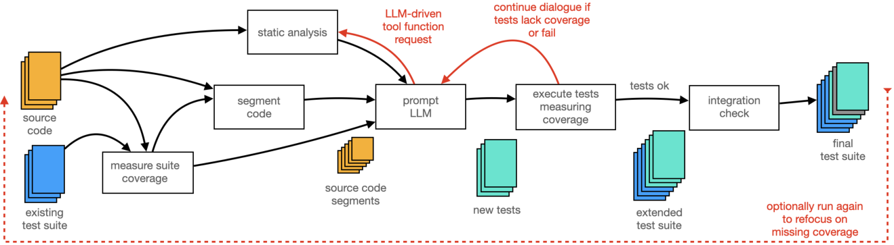

 Figure 1.  Graphical Overview of the CoverUp Algorithm. After measuring the test suite’s coverage, CoverUp prompts the LLM, focusing it on code segments that lack coverage. It checks each new test, either accepting it if it increases coverage or continuing the dialogue if it needs improvements. CoverUp provides a tool function with which the LLM can request additional context. A final check helps ensure that the suite works as a whole. Given its incremental nature, once done, CoverUp can be rerun to refocus the LLM on any segments missed in previous passes. 

## 3\. Approach

This section presents a detailed description of CoverUp. Figure [1](https://arxiv.org/html/2403.16218#S2.F1 "Figure 1 ‣ Concurrent Work Using LLM-based Approaches ‣ 2. Related Work ‣ CoverUp: Effective High Coverage Test Generation for Python") provides a graphical overview of its algorithm. CoverUp first measures the code coverage obtained by the existing test suite and uses it to identify code segments (functions and/or classes) that require additional testing (Section [3.1](https://arxiv.org/html/2403.16218#S3.SS1 "3.1. Code Segmentation ‣ 3. Approach ‣ CoverUp: Effective High Coverage Test Generation for Python")). It then prompts an LLM for tests for each segment, combining information from coverage analysis and static code analysis (Section [3.2](https://arxiv.org/html/2403.16218#S3.SS2 "3.2. Initial Prompting ‣ 3. Approach ‣ CoverUp: Effective High Coverage Test Generation for Python")). CoverUp next executes the LLM-generated tests, once again measuring coverage. If the tests do not compile, fail to run, or do not increase coverage, CoverUp continues the chat with prompts that request improvements and include any error messages (Section [3.3](https://arxiv.org/html/2403.16218#S3.SS3 "3.3. Verification and Continued Chat ‣ 3. Approach ‣ CoverUp: Effective High Coverage Test Generation for Python")). In both initial and continued prompts, CoverUp offers the LLM a tool function with which it can request additional contextual information about names in the source code, such as function or type definitions (Section [3.4](https://arxiv.org/html/2403.16218#S3.SS4 "3.4. Tool Functions ‣ 3. Approach ‣ CoverUp: Effective High Coverage Test Generation for Python")). Having handled all code segments, CoverUp checks the extended test suite, looking for any integration problems (Section [3.5](https://arxiv.org/html/2403.16218#S3.SS5 "3.5. Integration Check ‣ 3. Approach ‣ CoverUp: Effective High Coverage Test Generation for Python")). The entire process can be repeated arbitrarily, enabling the LLM to refocus on segments not covered in previous iterations.

### 3.1. Code Segmentation

CoverUp’s first step is to measure the code coverage of any pre-existing test suite. It then uses the AST of each source file missing coverage to identify code segments that need additional coverage. Code segments typically consist of a single function or method; subject to a size limit, however, they may contain an entire class. As Figure [2](https://arxiv.org/html/2403.16218#S3.F2 "Figure 2 ‣ 3.1. Code Segmentation ‣ 3. Approach ‣ CoverUp: Effective High Coverage Test Generation for Python") shows, if a segment contains a method, CoverUp also includes a few lines of the original class definition to provide the LLM with context but omits other methods and definitions. We find that retaining comments improves code comprehension; for that reason, CoverUp does not remove them, thus trading a loss in concision for an increase in generation quality.

The goal is to provide the LLM, with each prompt, a code excerpt that is intelligible, provides enough context, includes the lines or branches lacking coverage, and is as short as possible. Keeping code segments short is important primarily because of LLMs’ limits on their context (input) window. While various current LLMs, such as OpenAI’s GPT-4 and GPT-4o, Meta’s LLaMA 3, and Anthropic’s Claude 3, support large context windows of over 100K tokens, this limit applies to more than just the initial prompt. It applies to the number of tokens in the entire sequence of messages included with each request, which grows with each tool function call, LLM response, and continued chat prompt. Even when prompts fit in these long context windows, shorter prompts remain preferable: Rosas et al. ([Rosas et al., 2024](https://arxiv.org/html/2403.16218#bib.bib32)) show that as the size of prompts containing code increases, so does the likelihood of inaccuracies. Finally, LLM providers typically charge on a per-token basis, so it literally pays to be succinct.

Concretely, to identify the code segments in a source file, CoverUp first computes a set of “interesting” lines: these are lines that either lack coverage or are the source or the destination in branches that lack coverage. It then looks in the AST for a class, function, or method object containing each line. If the object found is a class that spans more lines than a configurable limit, CoverUp adds that class definition as segment context and recursively looks for another, smaller object containing the line. Algorithm [1](https://arxiv.org/html/2403.16218#algorithm1 "In 3.1. Code Segmentation ‣ 3. Approach ‣ CoverUp: Effective High Coverage Test Generation for Python") describes this process in more detail.

We implement this step using SlipCover ([Altmayer Pizzorno and Berger, 2023](https://arxiv.org/html/2403.16218#bib.bib3)), a recently introduced coverage analyzer with near-zero overhead, and Python’s ast module.

Algorithm 1 Algorithm for identifying the code segments lacking coverage, based on a coverage measurement and a tentative maximum segment length.

Function _identify_segments(_coverage, max_len_)_

\(code\_segs\leftarrow\emptyset\) 

foreach _\(file\) in \(coverage.files\)_ do

\(interesting\leftarrow\textnormal{{missing\_lines(}}\textnormal{\emph{coverage, file}}\textnormal{{)}}~\cup\) lines_in(_missing_branches(_coverage, file_)_)

\(ast\leftarrow\textnormal{{parse\_ast(}}\textnormal{\emph{file}}\textnormal{{)}}\) 

foreach _\(line\) in \(interesting\)_ do

\(context\leftarrow\) empty list 

\(node\leftarrow\textnormal{{find\_line(}}\textnormal{\emph{ast, line}}\textnormal{{)}}\) 

while _(\(node\) is-a Class) and \(\textsc{length}(node)>max\_len\) and \((inner\leftarrow\textnormal{{find\_line(}}\textnormal{\emph{node, line}}\textnormal{{)}})\)_ do

append \(node\) to \(context\) 

\(node\leftarrow inner\) 

\(code\_segs\leftarrow code\_segs\cup\{node,context\}\) 

return \(code\_segs\) 

⬇

1 class AnsiTextWrapper(TextWrapper):

2 def _wrap_chunks(self, chunks: List[str]) -> List[str]:

3

4 lines = []

5 if self.width <= 0:

6 raise ValueError("invalid width %r (must be > 0)" % self.width)

7 if self.max_lines is not None:

8 if self.max_lines > 1:

9 indent = self.subsequent_indent

10 [...]

Figure 2. CoverUp summarizes method excerpts: CoverUp generates compact code excerpts. In this case, 200 lines of source code were originally present between listing lines 1 and 2. The original code is from the flutils package. 

### 3.2. Initial Prompting

CoverUp next prompts the LLM for tests for each code segment it identified in the previous step. Figure [3](https://arxiv.org/html/2403.16218#S3.F3 "Figure 3 ‣ 3.2. Initial Prompting ‣ 3. Approach ‣ CoverUp: Effective High Coverage Test Generation for Python") shows an example of an initial prompt, with circled numbers identifying sections. It has the following structure:

  * <svg id="S3.I1.ix1.pic1" class="ltx_picture" height="19.62" overflow="visible" style="vertical-align:-5.35px" version="1.1" viewBox="0 0 19.62 19.62" width="19.62"><g style="\--ltx-stroke-color:#000000;--ltx-fill-color:#000000;" fill="#000000" stroke="#000000" stroke-width="0.4pt" transform="translate(0,19.62) matrix(1 0 0 -1 0 0) translate(9.81,0) translate(0,9.81)"><g style="\--ltx-fill-color:#FFECD9;" fill="#FFECD9"><path d="M 9.54 0 C 9.54 5.27 5.27 9.54 0 9.54 C -5.27 9.54 -9.54 5.27 -9.54 0 C -9.54 -5.27 -5.27 -9.54 0 -9.54 C 5.27 -9.54 9.54 -5.27 9.54 0 Z M 0 0"></path></g><g style="\--ltx-stroke-color:#000000;--ltx-fill-color:#000000;" fill="#000000" stroke="#000000" transform="matrix(1.0 0.0 0.0 1.0 -3.46 -4.46)"><foreignObject style="\--ltx-fo-width:0.5em;--ltx-fo-height:0.64em;--ltx-fo-depth:0em;font-size:10pt;" height="8.92" overflow="visible" transform="matrix(1 0 0 -1 0 8.92)" width="6.92">1</foreignObject></g></g></svg> a statement assigning the LLM the _persona_ ([White et al., 2023](https://arxiv.org/html/2403.16218#bib.bib41)) of an “expert Python test-driven developer”, intended to help guide it towards high quality tests; 
  * <svg id="S3.I1.ix2.pic1" class="ltx_picture" height="19.62" overflow="visible" style="vertical-align:-5.35px" version="1.1" viewBox="0 0 19.62 19.62" width="19.62"><g style="\--ltx-stroke-color:#000000;--ltx-fill-color:#000000;" fill="#000000" stroke="#000000" stroke-width="0.4pt" transform="translate(0,19.62) matrix(1 0 0 -1 0 0) translate(9.81,0) translate(0,9.81)"><g style="\--ltx-fill-color:#D9FFD9;" fill="#D9FFD9"><path d="M 9.54 0 C 9.54 5.27 5.27 9.54 0 9.54 C -5.27 9.54 -9.54 5.27 -9.54 0 C -9.54 -5.27 -5.27 -9.54 0 -9.54 C 5.27 -9.54 9.54 -5.27 9.54 0 Z M 0 0"></path></g><g style="\--ltx-stroke-color:#000000;--ltx-fill-color:#000000;" fill="#000000" stroke="#000000" transform="matrix(1.0 0.0 0.0 1.0 -3.46 -4.46)"><foreignObject style="\--ltx-fo-width:0.5em;--ltx-fo-height:0.64em;--ltx-fo-depth:0em;font-size:10pt;" height="8.92" overflow="visible" transform="matrix(1 0 0 -1 0 8.92)" width="6.92">2</foreignObject></g></g></svg> a sentence pointing out the code excerpt (segment), identifying what file it comes from, and stating what lines or branches do not execute when tested. The portion specifying the lines and branches missing coverage is compressed using line ranges, simplifying the prompt and reducing token usage. 
  * <svg id="S3.I1.ix3.pic1" class="ltx_picture" height="19.62" overflow="visible" style="vertical-align:-5.35px" version="1.1" viewBox="0 0 19.62 19.62" width="19.62"><g style="\--ltx-stroke-color:#000000;--ltx-fill-color:#000000;" fill="#000000" stroke="#000000" stroke-width="0.4pt" transform="translate(0,19.62) matrix(1 0 0 -1 0 0) translate(9.81,0) translate(0,9.81)"><g style="\--ltx-fill-color:#FFD9D9;" fill="#FFD9D9"><path d="M 9.54 0 C 9.54 5.27 5.27 9.54 0 9.54 C -5.27 9.54 -9.54 5.27 -9.54 0 C -9.54 -5.27 -5.27 -9.54 0 -9.54 C 5.27 -9.54 9.54 -5.27 9.54 0 Z M 0 0"></path></g><g style="\--ltx-stroke-color:#000000;--ltx-fill-color:#000000;" fill="#000000" stroke="#000000" transform="matrix(1.0 0.0 0.0 1.0 -3.46 -4.46)"><foreignObject style="\--ltx-fo-width:0.5em;--ltx-fo-height:0.64em;--ltx-fo-depth:0em;font-size:10pt;" height="8.92" overflow="visible" transform="matrix(1 0 0 -1 0 8.92)" width="6.92">3</foreignObject></g></g></svg> a request for pytest test functions and an encouragement for the LLM to use the provided tool function; 
  * <svg id="S3.I1.ix4.pic1" class="ltx_picture" height="19.62" overflow="visible" style="vertical-align:-5.35px" version="1.1" viewBox="0 0 19.62 19.62" width="19.62"><g style="\--ltx-stroke-color:#000000;--ltx-fill-color:#000000;" fill="#000000" stroke="#000000" stroke-width="0.4pt" transform="translate(0,19.62) matrix(1 0 0 -1 0 0) translate(9.81,0) translate(0,9.81)"><g style="\--ltx-fill-color:#D9D9FF;" fill="#D9D9FF"><path d="M 9.54 0 C 9.54 5.27 5.27 9.54 0 9.54 C -5.27 9.54 -9.54 5.27 -9.54 0 C -9.54 -5.27 -5.27 -9.54 0 -9.54 C 5.27 -9.54 9.54 -5.27 9.54 0 Z M 0 0"></path></g><g style="\--ltx-stroke-color:#000000;--ltx-fill-color:#000000;" fill="#000000" stroke="#000000" transform="matrix(1.0 0.0 0.0 1.0 -3.46 -4.46)"><foreignObject style="\--ltx-fo-width:0.5em;--ltx-fo-height:0.64em;--ltx-fo-depth:0em;font-size:10pt;" height="8.92" overflow="visible" transform="matrix(1 0 0 -1 0 8.92)" width="6.92">4</foreignObject></g></g></svg> a series of other requests, such as “include assertions” and “avoid state pollution”, to steer the result towards usable tests; 
  * <svg id="S3.I1.ix5.pic1" class="ltx_picture" height="19.62" overflow="visible" style="vertical-align:-5.35px" version="1.1" viewBox="0 0 19.62 19.62" width="19.62"><g style="\--ltx-stroke-color:#000000;--ltx-fill-color:#000000;" fill="#000000" stroke="#000000" stroke-width="0.4pt" transform="translate(0,19.62) matrix(1 0 0 -1 0 0) translate(9.81,0) translate(0,9.81)"><g style="\--ltx-fill-color:#ECECEC;" fill="#ECECEC"><path d="M 9.54 0 C 9.54 5.27 5.27 9.54 0 9.54 C -5.27 9.54 -9.54 5.27 -9.54 0 C -9.54 -5.27 -5.27 -9.54 0 -9.54 C 5.27 -9.54 9.54 -5.27 9.54 0 Z M 0 0"></path></g><g style="\--ltx-stroke-color:#000000;--ltx-fill-color:#000000;" fill="#000000" stroke="#000000" transform="matrix(1.0 0.0 0.0 1.0 -3.46 -4.46)"><foreignObject style="\--ltx-fo-width:0.5em;--ltx-fo-height:0.64em;--ltx-fo-depth:0em;font-size:10pt;" height="8.92" overflow="visible" transform="matrix(1 0 0 -1 0 8.92)" width="6.92">5</foreignObject></g></g></svg> a request that the response only include the new Python tests to facilitate its extraction from the response and to reduce token usage; and 
  * <svg id="S3.I1.ix6.pic1" class="ltx_picture" height="19.62" overflow="visible" style="vertical-align:-5.35px" version="1.1" viewBox="0 0 19.62 19.62" width="19.62"><g style="\--ltx-stroke-color:#000000;--ltx-fill-color:#000000;" fill="#000000" stroke="#000000" stroke-width="0.4pt" transform="translate(0,19.62) matrix(1 0 0 -1 0 0) translate(9.81,0) translate(0,9.81)"><g style="\--ltx-fill-color:#FFFFD9;" fill="#FFFFD9"><path d="M 9.54 0 C 9.54 5.27 5.27 9.54 0 9.54 C -5.27 9.54 -9.54 5.27 -9.54 0 C -9.54 -5.27 -5.27 -9.54 0 -9.54 C 5.27 -9.54 9.54 -5.27 9.54 0 Z M 0 0"></path></g><g style="\--ltx-stroke-color:#000000;--ltx-fill-color:#000000;" fill="#000000" stroke="#000000" transform="matrix(1.0 0.0 0.0 1.0 -3.46 -4.46)"><foreignObject style="\--ltx-fo-width:0.5em;--ltx-fo-height:0.64em;--ltx-fo-depth:0em;font-size:10pt;" height="8.92" overflow="visible" transform="matrix(1 0 0 -1 0 8.92)" width="6.92">6</foreignObject></g></g></svg> the code segment, prefixed by generated import statements and tagging the lines lacking (line or branch) coverage with their numbers. 

⬇

You are an expert Python test-driven developer.

⬇

The code below, extracted from thonny/plugins/pgzero_frontend.py, does not achieve full

coverage: when tested, line 19 does not execute.

⬇

Create new pytest test functions that execute all missing lines and branches, always making

sure that each test is correct and indeed improves coverage.

Use the get_info tool function as necessary.

⬇

Always send entire Python test scripts when proposing a new test or correcting one you

previously proposed.

Be sure to include assertions in the test that verify any applicable postconditions.

Please also make VERY SURE to clean up after the test, so as to avoid state pollution;

use ’monkeypatch’ or ’pytest-mock’ if appropriate.

Write as little top-level code as possible, and in particular do not include any top-level

code calling into pytest.main or the test itself.

⬇

Respond ONLY with the Python code enclosed in backticks, without any explanation.

⬇

‘‘‘python

import os

from thonny import get_workbench

def update_environment():

if get_workbench().in_simple_mode():

os.environ["PGZERO_MODE"] = "auto"

else:

19: os.environ["PGZERO_MODE"] = str(get_workbench().get_option(_OPTION_NAME))

‘‘‘

Figure 3. Example of an initial prompt: The initial prompt selects a persona (1), identifies where the code comes from and states how it lacks coverage when tested (2), asks for tests (3-5), and shows the code segment, prefixed by import statements and with the line lacking coverage identified by its number. The code shown is from the thonny package. 

We find that tests generated by GPT-4 often include top-level code calling into pytest.main or into parts of the test itself. While such top-level code can make sense in a standalone test file, Python executes it as part of the loading process, and doing so may significantly disrupt pytest’s operation. In fact, in some of these early test generations, such calls caused pytest to restart its test discovery, slowing it down until it became unusable. For that reason, part  

  of the prompt directs the LLM not to include such calls.

Prompt part  

  also instructs the LLM to generate tests that “clean up […], so as to avoid state pollution”. It suggests using monkeypatch and pytest-mock, useful for automatically cleaning up after tests and isolating the software under test from other parts of the code. Including these instructions improves the generated tests; nonetheless, we still observe test generation that includes side effects. Section [3.5](https://arxiv.org/html/2403.16218#S3.SS5 "3.5. Integration Check ‣ 3. Approach ‣ CoverUp: Effective High Coverage Test Generation for Python") describes how CoverUp handles such tests.

Prior to the code excerpt in part  

 , CoverUp adds import statements that provide context for each code segment: we find that without these, LLMs often make incorrect assumptions about symbols in the code, leading to errors. Rather than extract these verbatim from source code, CoverUp generates imports based on static analysis. In particular, it converts any relative imports to absolute imports. Using relative imports in code excerpts can lead to tests that use them outside of package scope, where they are invalid.

Within the code excerpt, CoverUp tags certain lines with their numbers, as in “`19:`” in Figure [3](https://arxiv.org/html/2403.16218#S3.F3 "Figure 3 ‣ 3.2. Initial Prompting ‣ 3. Approach ‣ CoverUp: Effective High Coverage Test Generation for Python"). It tags all lines lacking coverage and those that are part of a branch lacking coverage. This tagging improves the LLM’s understanding of the missing coverage: we find that prompts that only indicate the starting line number at the beginning of the excerpt lead to tests that do not improve coverage.

To send the prompt using OpenAI’s API, CoverUp embeds it as a “message” in a JSON-formatted request that also includes other fields specifying the model to use, meta-parameters such as the model temperature, etc. Figure [4](https://arxiv.org/html/2403.16218#S3.F4 "Figure 4 ‣ 3.2. Initial Prompting ‣ 3. Approach ‣ CoverUp: Effective High Coverage Test Generation for Python") shows an example.

⬇

{

"model": "gpt-4o-2024-05-13",

"temperature": 0,

"messages": [

{

"role": "user",

"content": """

You are an expert Python test-driven developer.

The code below, extracted from code/funcs.py, does not achieve full coverage:

when tested, line 4 does not execute.

[...]

‘‘‘python

from code import A

def func(a: A) -> int:

4: return bool(a.x > 5 or a.x < 2)

‘‘‘

"""

}

]

}

Figure 4. Sending a prompt: to prompt and LLM using OpenAI’s chat API, CoverUp puts together a JSON-formatted request that includes the prompt in “messages”. [...] indicates a portion omitted for brevity. 

### 3.3. Verification and Continued Chat

Once the LLM generates tests in response to the initial prompt, CoverUp executes them, again measuring coverage. In our implementation, this step is made more efficient by SlipCover’s near-zero overhead: using `coverage.py`, the only other alternative tool for Python, introduces up to 260% overhead ([Altmayer Pizzorno and Berger, 2023](https://arxiv.org/html/2403.16218#bib.bib3)).

If the new tests pass and increase coverage, CoverUp saves them. If, conversely, they do not increase coverage or result in failures or errors, CoverUp continues the chat session, pointing out the problem(s) and requesting improvements. To continue the chat, CoverUp sends another request to the LLM, appending the LLM’s response and a new prompt to the previous messages. Figure [5](https://arxiv.org/html/2403.16218#S3.F5 "Figure 5 ‣ 3.3. Verification and Continued Chat ‣ 3. Approach ‣ CoverUp: Effective High Coverage Test Generation for Python") shows how CoverUp continues the chat; Figures [6](https://arxiv.org/html/2403.16218#S3.F6 "Figure 6 ‣ 3.3. Verification and Continued Chat ‣ 3. Approach ‣ CoverUp: Effective High Coverage Test Generation for Python") and [7](https://arxiv.org/html/2403.16218#S3.F7 "Figure 7 ‣ 3.3. Verification and Continued Chat ‣ 3. Approach ‣ CoverUp: Effective High Coverage Test Generation for Python") show examples of prompts requesting improvements.

⬇

{

"model": "gpt-4o-2024-05-13",

"temperature": 0,

"messages": [

{

"role": "user",

"content": """

You are an expert Python test-driven developer.

The code below, extracted from code/funcs.py, does not achieve full coverage:

[...]

"""

},

{

"role": "assistant",

"content": """

‘‘‘python

import pytest

def test_something():

[...]

"""

},

{

"role": "user",

"content": """

Executing the test yields an error, shown below.

Modify the test to correct it; respond only with the complete Python code in backticks.

[...]

"""

}

]

}

Figure 5. Continuing the chat: to continue a chat, CoverUp sends out a new request, including the previous messages (here, the initial prompt), the LLM’s response (indicated with the “assistant” role), and the new prompt. [...] indicates a portion omitted for brevity. 

⬇

This test still lacks coverage: line 615 and branches 603->exit, 610->608, 618->exit

do not execute.

⬇

Modify it to correct that; respond only with the complete Python code in backticks.

Use the get_info function as necessary.

Figure 6. Example of a coverage follow-up prompt: CoverUp indicates to the LLM that a line and some branches still weren’t covered (1), asking that it correct the test (2). 

⬇

Executing the test yields an error, shown below.

⬇

Modify the test to correct it; respond only with the complete Python code in backticks.

Use the get_info function as necessary.

⬇

def test_AnsiTextWrapper_non_stripped_placeholder():

wrapper = AnsiTextWrapper()

wrapper.placeholder = " \x1b[31mplaceholder\x1b[0m "

> assert wrapper.placeholder_len == len_without_ansi(wrapper.placeholder.strip())

E AssertionError: assert 13 == 11

E + where 13 = <flutils.txtutils.AnsiTextWrapper object at 0x7f992ca5e440>.placeholder_len

E + and 11 = len_without_ansi(’\x1b[31mplaceholder\x1b[0m’)

E + where ’\x1b[31mplaceholder\x1b[0m’ = <built-in method strip of str object at 0x7f992bc06c90>()

E + where <built-in method strip of str object at 0x7f992bc06c90> = ’ \x1b[31mplaceholder\x1b[0m ’.strip

E + where ’ \x1b[31mplaceholder\x1b[0m ’ = <flutils.txtutils.AnsiTextWrapper object at 0x7f992ca5e440>.placeholder

coverup-tests/tmp_test_s4dcdnes.py:7: AssertionError

Figure 7. Example of an error follow-up prompt: CoverUp indicates to the LLM that an error occurred (1), requests a repair (2), and includes an excerpt of the error messages (3). In the original execution from which this example is taken, the LLM responds with a usable test (not shown). 

Before executing a new set of tests, CoverUp looks for any Python modules used by the test that are absent from the system. These missing modules are typically test helper modules, such as the pytest-ansible plugin used to help test the ansible package. Our implementation offers options to install missing modules automatically and record these in Python’s requirements.txt format to facilitate their use in a subsequent run.

### 3.4. Tool Functions

Tool functions allow an LLM to interact with external tools ([OpenAI, 2023](https://arxiv.org/html/2403.16218#bib.bib27)). CoverUp exposes a get_info tool function, which allows the LLM to request additional information about any names in the excerpt, such as types or variables. In response, CoverUp provides a portion of the source code that shows the definition of the requested object.

To indicate support for the get_info tool function, CoverUp includes its description in a “tools” JSON element within each chat request. If the LLM needs to invoke this function, it may respond with a list of get_info call requests instead of generating text, each specifying the symbol to retrieve. CoverUp then continues the chat by sending a new request that appends the LLM’s call requests and the retrieved results from get_info to the previous messages.

⬇

You are an expert Python test-driven developer.

[...]

Use the get_info tool function as necessary.

[...]

‘‘‘python

from code import A

def func(a: A) -> int:

4: return bool(a.x > 5 or a.x < 2)

‘‘‘

Figure 8. Example of a prompt likely to lead to a tool function call: In response to this initial prompt, the LLM would likely choose to respond with a request to call get_info("code.A"), as it requires more information on how to instantiate A in tests. [...] indicates a portion omitted for brevity. 

⬇

"..." below indicates omitted code.

‘‘‘python

class A:

def __init__(self, *, initial_x=0):

self._x = initial_x

@property

def x(self):

...

‘‘‘

Figure 9. Example function call response: Asked about code.A, CoverUp performs static analysis and, discovering that A is a class, responds with an abbreviated form of its definition. In this case, it includes its __init__ constructor, which indicates to the LLM that A’s constructor takes the initial_x keyword argument. The response does not include any of the contents of method x; the LLM could subsequently ask for code.A.x to obtain more information on it. The ... in the Python excerpt is literal: it is a valid no-op token in Python, and CoverUp uses it to indicate where code has been removed. 

For example, when given the prompt shown in Figure [8](https://arxiv.org/html/2403.16218#S3.F8 "Figure 8 ‣ 3.4. Tool Functions ‣ 3. Approach ‣ CoverUp: Effective High Coverage Test Generation for Python"), the LLM might ask for information on `code.A`. The function response, shown in Figure [9](https://arxiv.org/html/2403.16218#S3.F9 "Figure 9 ‣ 3.4. Tool Functions ‣ 3. Approach ‣ CoverUp: Effective High Coverage Test Generation for Python"), indicates that values of `x` must be passed to the class constructor using a keyword argument. This response lets the LLM immediately respond with correct tests; we find that if we do not include the tool function in this situation, the LLM attempts to pass values of `x` to the constructor, leading to errors.

To generate its response, `get_info` first looks for a function, class, module, or variable matching the requested name. Supporting variables is particularly important, as constants and aliases in Python are created using variable assignments. Beginning with the module where the excerpt originated, `get_info` may extend its search to other modules by following import statements. Once it locates the definition, `get_info` constructs a response by extracting relevant portions from each module. For many constructs, such as assignments, import statements, or function definitions, it includes the entire definition. However, for classes and modules, including their full definitions may result in prohibitively long responses. Simply omitting elements, as done in the initial prompt, can lead to missing essential information or cause the LLM to assume such elements do not exist. For example, if `get_info` had entirely omitted property `x` in Figure [9](https://arxiv.org/html/2403.16218#S3.F9 "Figure 9 ‣ 3.4. Tool Functions ‣ 3. Approach ‣ CoverUp: Effective High Coverage Test Generation for Python"), there would be no indication of how attribute `A.x` was accessed. Instead, `get_info` replaces the bodies of such elements with `...`, a valid “no-op” token in Python, and indicates the omission in the response.

CoverUp makes `get_info` available both with initial (Section [3.2](https://arxiv.org/html/2403.16218#S3.SS2 "3.2. Initial Prompting ‣ 3. Approach ‣ CoverUp: Effective High Coverage Test Generation for Python")) and continuation prompts (Section [3.3](https://arxiv.org/html/2403.16218#S3.SS3 "3.3. Verification and Continued Chat ‣ 3. Approach ‣ CoverUp: Effective High Coverage Test Generation for Python")) so that it can help generate both better responses and better corrections.

### 3.5. Integration Check

While CoverUp only saves tests that pass when run in isolation, it is still possible that some may fail to clean up after themselves or introduce side effects (“state pollution”) that cause other tests to fail ([Gyori et al., 2015](https://arxiv.org/html/2403.16218#bib.bib19)). This issue is not unique to LLM-based test generation: Fraser et al. ([Fraser and Arcuri, 2014](https://arxiv.org/html/2403.16218#bib.bib15)) report side effects on 50% of test classes generated by EvoSuite ([Fraser and Arcuri, 2011](https://arxiv.org/html/2403.16218#bib.bib14)), an SBST test generator. Figure [10](https://arxiv.org/html/2403.16218#S3.F10 "Figure 10 ‣ 3.5. Integration Check ‣ 3. Approach ‣ CoverUp: Effective High Coverage Test Generation for Python") shows an example where a generated test not only modifies but also deletes global symbols used by the code under test, in a misguided attempt to clean up. For a test generation approach to be effective, it must thus include some way to handle state pollution.

Our implementation offers three alternatives:

  1. (1) Execute each test in isolation: This approach prevents memory-based state pollution by one test from affecting other tests. CoverUp implements efficient test isolation based on the Unix `fork()` system call for the `pytest` framework. This option is the default, which Section [4](https://arxiv.org/html/2403.16218#S4 "4. Evaluation ‣ CoverUp: Effective High Coverage Test Generation for Python") uses for the empirical evaluation of CoverUp. 
  2. (2) Disable polluting tests: This approach executes the entire suite and, upon a test failure, searches for the polluting tests and disables them. CoverUp implements the search by successively reducing and executing subsets of the entire suite; 
  3. (3) Disable failing tests: This approach may lead to a significant loss in coverage as tests may be disabled unnecessarily and may still leave a polluting test enabled, but it allows the user to move on quickly to prompting for more tests. 

Any disabled tests remain available for review and possible reactivation by the user.

⬇

1 from ansible import constants as C

2

3 def test_process_include_results():

4 C._ACTION_ALL_INCLUDES = [’include’, ’include_tasks’, ’import_tasks’, ’import_playbook’]

5 C._ACTION_INCLUDE = ’include’

6

7 assert [...]

8

9 del C._ACTION_ALL_INCLUDES

10 del C._ACTION_INCLUDE

Figure 10. Handling state pollution: This LLM-generated test overwrites global constants and then deletes them in a misguided attempt to clean up. The test succeeds if executed by itself, but when executed along with other tests, the missing constants cause other tests to fail. Our implementation offers three alternatives to handle this situation: it can execute tests in isolation (the default), disable the polluting tests, or disable the failing tests. [...] indicates a portion omitted for brevity. 

### 3.6. Handling Flaky Tests

Flaky tests are those that can both pass or fail inconsistently without any changes to the code under test ([Parry et al., 2021](https://arxiv.org/html/2403.16218#bib.bib31); [Lam et al., 2020](https://arxiv.org/html/2403.16218#bib.bib22); [Gruber et al., 2024](https://arxiv.org/html/2403.16218#bib.bib18)). Their unreliable behavior has a variety of causes; in the context of LLM-generated tests, they can also, in part, result from not providing the LLM with sufficient information. Figure [11](https://arxiv.org/html/2403.16218#S3.F11 "Figure 11 ‣ 3.6. Handling Flaky Tests ‣ 3. Approach ‣ CoverUp: Effective High Coverage Test Generation for Python") shows a test for the mimesis data generator package. The code under test randomly assigns a blood type to its Person object; the LLM, not having been provided with the list of valid names, assumes that it includes 0- and 0+ whereas code actually uses O- and O+ (using the letter O, not zero). Consequently, the test fails whenever that blood type is assigned.

⬇

1 from mimesis.providers.person import Person

2

3 def test_blood_type():

4 blood_type = Person().blood_type() # this performs a random assignment

5 [...]

6 BLOOD_GROUPS = [’0-’, ’0+’, ’A-’, ’A+’, ’B-’, ’B+’, ’AB-’, ’AB+’]

7 assert blood_type in BLOOD_GROUPS

Figure 11. Example of a flaky test: This test checks that a randomly assigned blood type is valid. It fails whenever the blood type is O+ or O-, as the LLM assumed these would be named using zero rather than the letter O. CoverUp executes each test a few times, making the error more likely to surface and thus allowing the LLM to attempt to correct it. 

Our implementation uses the `pytest-repeat` module to execute each newly generated test multiple times, making any flaky tests more likely to fail. If a test fails, CoverUp continues the chat, allowing the LLM to attempt to correct the problem.

### 3.7. Other Technical Challenges

Making CoverUp a practical tool poses several technical challenges. One such challenge stems from the time spent in LLM inference and executing tests. Each individual prompt sent through OpenAI’s API typically requires several seconds to complete. Similarly, executing individual LLM-generated tests and measuring the new coverage achieved requires additional time. CoverUp repeats this process for each code segment and each time the dialogue is continued. Even though our implementation limits the time spent waiting on responses and test executions, if each code segment were processed serially, creating tests for packages of nontrivial size would take an unacceptable amount of time. Instead, it prompts for tests and verifies them asynchronously, using the Python asyncio package. As a result, during CoverUp’s evaluation (Section [4](https://arxiv.org/html/2403.16218#S4 "4. Evaluation ‣ CoverUp: Effective High Coverage Test Generation for Python")), we observe a 500x speedup over serial execution.

Other practical challenges arise because OpenAI’s API is provided as a cloud service and is subject to various limits. Our implementation handles various timeout and other error conditions automatically. To avoid exceeding the rate limits imposed by OpenAI, it spreads out its requests using a leaky bucket scheme ([Turner, 1986](https://arxiv.org/html/2403.16218#bib.bib38)) implemented by the Python module `aiolimiter`. Additionally, we implement checkpointing to files, allowing the user to resume prompting for tests (and not lose any progress so far) after interrupting it or stopping due to unforeseen circumstances, such as the OpenAI account running out of funds.

## 4\. Evaluation

Our evaluation investigates the following questions:

RQ1:: 
    

Does the coverage of CoverUp’s generated tests improve upon the state of the art? (Section [4.2](https://arxiv.org/html/2403.16218#S4.SS2 "4.2. \[RQ1\] Comparison to the previous state of the art ‣ 4. Evaluation ‣ CoverUp: Effective High Coverage Test Generation for Python"))

RQ2:: 
    

How effective is CoverUp compared to simply prompting an LLM for tests? (Section [4.3](https://arxiv.org/html/2403.16218#S4.SS3 "4.3. \[RQ2\] How effective is CoverUp compared to simply prompting an LLM for tests? ‣ 4. Evaluation ‣ CoverUp: Effective High Coverage Test Generation for Python"))

RQ3:: 
    

How effective are CoverUp’s continued dialogues at increasing coverage? (Section [4.4](https://arxiv.org/html/2403.16218#S4.SS4 "4.4. \[RQ3\] How effective are CoverUp’s continued dialogues? ‣ 4. Evaluation ‣ CoverUp: Effective High Coverage Test Generation for Python"))

RQ4:: 
    

How does the cost of running CoverUp compare to CodaMosa? (Section [4.5](https://arxiv.org/html/2403.16218#S4.SS5 "4.5. \[RQ4\] How does the cost of running CoverUp compare to CodaMosa? ‣ 4. Evaluation ‣ CoverUp: Effective High Coverage Test Generation for Python"))

RQ5:: 
    

How important are CoverUp’s components to its performance? (Section [4.6](https://arxiv.org/html/2403.16218#S4.SS6 "4.6. \[RQ5\] How important are CoverUp’s components to its performance? ‣ 4. Evaluation ‣ CoverUp: Effective High Coverage Test Generation for Python"))

### 4.1. Experimental Setup

#### Benchmarks

We utilize three benchmark suites:

  * _CM_ , a benchmark suite on which Pynguin struggles to obtain high coverage. Collated originally by the authors of CodaMosa ([Lemieux et al., 2023](https://arxiv.org/html/2403.16218#bib.bib23)) and available from <https://github.com/microsoft/codamosa>, it is derived from 35 open-source projects used in the evaluation of BugsInPy ([Widyasari et al., 2020](https://arxiv.org/html/2403.16218#bib.bib42)) and Pynguin ([Lukasczyk et al., 2023](https://arxiv.org/html/2403.16218#bib.bib25)). It contains \(\approx\)100,000 lines of code across 425 Python modules. 
  * _PY_ , a set of modules originally excluded from CodaMosa’s suite because Pynguin already performs well on it. We evaluate CoverUp on these modules so as not to leave open the question of how well it performs on code where Pynguin / SBST already performed well. It contains \(\approx\)5,000 lines of code across 84 Python modules. 
  * _MT_ , a dataset of functions extracted from the HumanEval dataset ([Chen et al., 2021](https://arxiv.org/html/2403.16218#bib.bib9)), originally used in the evaluation of MuTAP ([Dakhel et al., 2024](https://arxiv.org/html/2403.16218#bib.bib12)). We use this dataset to enable comparisons to MuTAP since its implementation lacks the support needed to run on arbitrary Python packages. It contains \(\approx\)2,000 lines of code across 163 functions. 

CM excludes the mimesis, sanic, and thef*ck packages from the original CodaMosa suite: mimesis is a package for generating random data, making it challenging to generate non-flaky tests for it. mimesis was included in CodaMosa’s original evaluation, but the tests CodaMosa generates do not contain any assertions and thus do not fail in the face of randomly generated values. The sanic and thef*ck packages require modules that either are no longer available or conflict with CoverUp.

#### Baselines

To examine RQ1, we compare against two versions of CodaMosa and four versions of MuTAP, varying their LLM and prompt type:

  * _CodaMosa (codex)_, the original version that uses the Codex LLM. Since Codex is no longer available, we use original tests from CodaMosa’s evaluation, using its best performing configuration (`0.8-uninterp`); 
  * _CodaMosa (gpt4o)_, our adapted version that uses the same model as CoverUp, to help rule out differences in performance due to the use of different LLMs. 
  * _MuTAP (codex few-shot)_ , the original version that uses the Codex LLM, using a “few-shot” prompt, where two examples of test generation are included with the prompt. Since Codex is no longer available, we use original tests from MuTAP’s evaluation; 
  * _MuTAP (codex zero-shot)_ , also the original Codex version, but using a prompt without examples. Here, too, we use original tests from MuTAP’s evaluation; 
  * _MuTAP (gpt4o few-shot)_ , our adapted version that uses the same model as CoverUp, with newly generated tests using a “few-shot” prompt; 
  * _MuTAP (gpt4o zero-shot)_ , our adapted version, but using a “zero-shot” prompt. 

To create the gpt4o versions of CodaMosa and MuTAP, we modify these to use OpenAI’s chat API and, in the case of CodaMosa, insert instructions requesting a code completion before its original code completion prompt. For MuTAP, we insert a prompt requesting that it respond in the same format as a Codex model.

We could not empirically evaluate ([Ryan et al., 2024](https://arxiv.org/html/2403.16218#bib.bib33)) as, at the time of writing, it remains unavailable: its authors have indicated that it is not publicly available.

For RQ2, we create an “CoverUp (ablated)”, a version of CoverUp which utilizes a nearly identical prompt, except in that it does not specify how the code lacks coverage or tags lines lacking coverage, does not add computed import statements, does not offer a tool function for additional context, and does not continue the chat in case of errors or lack of coverage.

#### Metric

We utilize the line, branch, and combined line and branch coverage as metrics, computing these for all benchmark modules. We also compute the combined line and branch coverage on a per-module basis. It is necessary to include both line and branch coverage as metrics because in Python, branch coverage does not subsume line coverage: various situations can lead the Python interpreter to throw exceptions, and when thrown, these exceptions are not recorded as branches in coverage information. We run all generated tests in isolation (see Section [3.5](https://arxiv.org/html/2403.16218#S3.SS5 "3.5. Integration Check ‣ 3. Approach ‣ CoverUp: Effective High Coverage Test Generation for Python")) and measure all coverage using SlipCover ([Altmayer Pizzorno and Berger, 2023](https://arxiv.org/html/2403.16218#bib.bib3)).

#### Execution Environment

We evaluate both CodaMosa and CoverUp using the codamosa-docker Docker image available at <https://github.com/microsoft/codamosa>, modified only to install SlipCover and to disable its default entrypoint script, allowing easy execution of other scripts. The image is based on Debian 11 and includes Python 3.10.2, with which we run all benchmarks. As the host system for Docker, we utilize a Linux kernel 5.6 system with 10 Intel i9 cores at 3.7GHz and 64GB RAM.

Before each measurement, our scripts install the benchmark-specific package.txt requirements file distributed with CodaMosa using pip. Unfortunately, pip fails to install some of these requirements. Since these failures were originally ignored for CodaMosa, we also ignore them to replicate the original conditions as closely as possible.

For MuTAP and the tests it generates, we use Python 3.9.12: MuTAP uses MutPy ([Hałas, 2019](https://arxiv.org/html/2403.16218#bib.bib20)) for mutation testing, which requires older versions of Python.

#### CoverUp options

We configure CoverUp to use OpenAI’s `gpt-4o-2024-05-13` LLM, setting its “temperature” to zero and do not limit the number of output tokens. We leave CoverUp’s target code segment size (see Section [3.1](https://arxiv.org/html/2403.16218#S3.SS1 "3.1. Code Segmentation ‣ 3. Approach ‣ CoverUp: Effective High Coverage Test Generation for Python")) at its default of 50 lines and automatically repeat test executions to look for flaky tests (see Section [3.6](https://arxiv.org/html/2403.16218#S3.SS6 "3.6. Handling Flaky Tests ‣ 3. Approach ‣ CoverUp: Effective High Coverage Test Generation for Python")).

We first run it without any pre-existing test suite to place CoverUp on the same footing as CodaMosa. We then run it twice more, allowing it to build upon the test suite from the previous runs. Since GPT-generated tests often assume the presence of certain Python modules, we configure CoverUp to install any such missing modules automatically.

### 4.2. [RQ1] Comparison to the previous state of the art

To compare CoverUp to the previous state of the art, we first evaluate it on the CM suite, using CodaMosa (codex) and CodaMosa (gpt4o) as baselines. Figure [12](https://arxiv.org/html/2403.16218#S4.F12 "Figure 12 ‣ 4.2. \[RQ1\] Comparison to the previous state of the art ‣ 4. Evaluation ‣ CoverUp: Effective High Coverage Test Generation for Python") shows, on the left, the line, branch, and combined line and branch coverage obtained by CoverUp and the baselines over the entire benchmark suite; on the right, it shows the median of those measurements on a module-by-module basis. Additionally, Figure [14](https://arxiv.org/html/2403.16218#S4.F14 "Figure 14 ‣ 4.2. \[RQ1\] Comparison to the previous state of the art ‣ 4. Evaluation ‣ CoverUp: Effective High Coverage Test Generation for Python") plots the difference between the combined line and branch coverage obtained by CoverUp and CodaMosa on that suite, also on a module-by-module basis; green bars in the plot indicate modules where CoverUp achieved higher coverage.

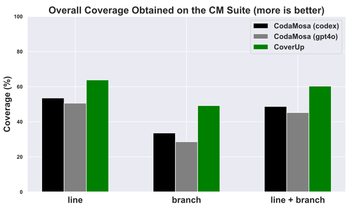

 

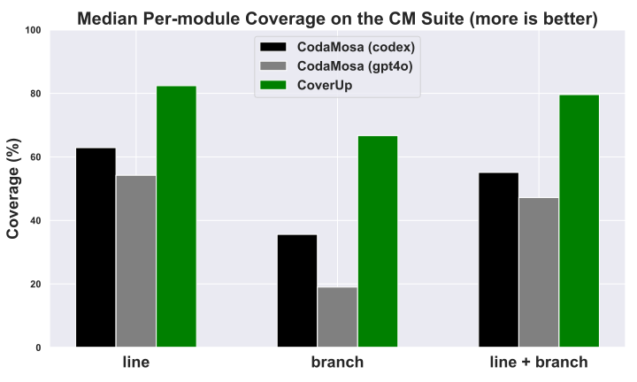

 

Figure 12. [RQ1] CoverUp yields higher overall and median per-module coverage: Across the board, CoverUp yields higher coverage than CodaMosa, whether measured over the entire suite or on a module-by-module basis. 

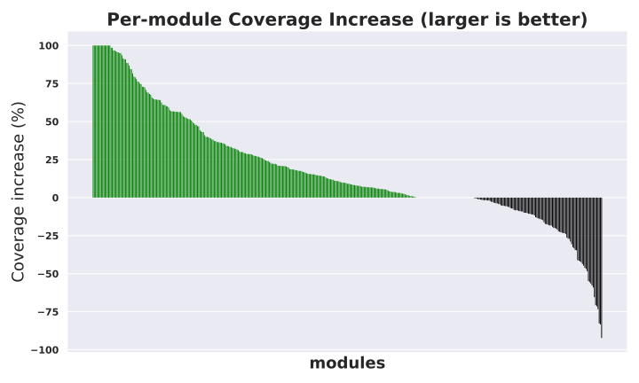

 Figure 13. [RQ1] CoverUp yields higher coverage than the state of the art: The graph shows the difference in (lines + branches) coverage between CoverUp and CodaMosa for the modules in the CM suite. Green highlights modules where CoverUp achieved a higher coverage. 

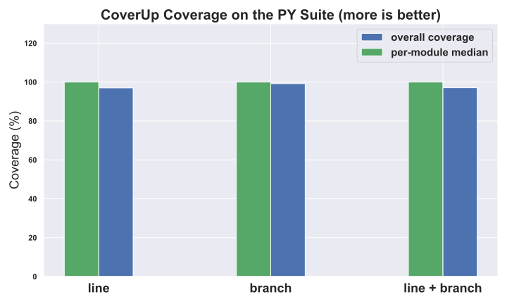

 Figure 14. [RQ1] CoverUp also performs well on the PY suite: CoverUp yields 100% median and near 100% overall coverage on all metrics, showing that its effectiveness is not limited to the modules selected for the CM suite. 

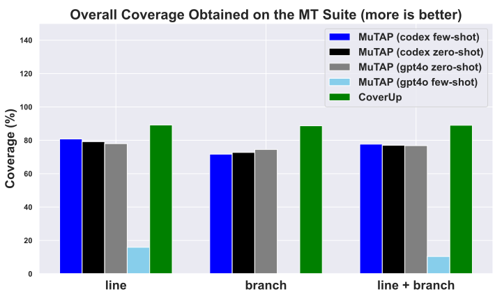

 

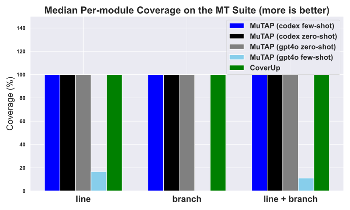

 

Figure 15. [RQ1] CoverUp yields higher overall and per-module coverage: CoverUp yields higher or equal coverage than MuTAP, whether measured over the entire suite or on a module-by-module basis. 

As the figures show, CoverUp achieves higher line, branch, and combined line and branch coverage than both CodaMosa baselines, both measuring over the entire benchmark code base and on a per-module basis. Across the entire benchmark suite, CoverUp achieves 64% (vs. 54% and 51%) line coverage, 49% (vs. 34% and 29%) branch coverage, and 60% (vs. 49% and 45%) line+branch coverage. On a per-module basis, CoverUp achieves 82% (vs. 63% and 54%) line coverage, 67% (vs. 36% and 19%) branch coverage, and 80% (vs. 55% and 47%) line+branch coverage. These per-module improvements over CodaMosa (GPT-4o) and CodaMosa (Codex) are statistically significant: using paired permutation tests, we obtain a \(p\)-value of \(2.0\times 10^{-5}\) for both, well below the standard \(p<0.05\) threshold. We also observe that CodaMosa (gpt4o)’s performance falls slightly behind that of CodaMosa (codex), with overall coverage measurements within 5% of each other. As this difference shows, a newer model does not necessarily lead to higher performance.

As Figure [14](https://arxiv.org/html/2403.16218#S4.F14 "Figure 14 ‣ 4.2. \[RQ1\] Comparison to the previous state of the art ‣ 4. Evaluation ‣ CoverUp: Effective High Coverage Test Generation for Python") shows, CoverUp does not achieve higher coverage than CodaMosa for some modules. We examine CoverUp’s logs and observe that timeouts running tests for modules in the youtube_dl package constitute the largest single source of failure. While the authors of CodaMosa also report problems with timeouts for that package ([Lemieux et al., 2023](https://arxiv.org/html/2403.16218#bib.bib23)), it seems likely that CoverUp’s test execution timeout of one minute was set too low. In other cases, we observe that CoverUp’s static analysis cannot provide the LLM with correct context when the code under test contains conditional imports, such as those intended to accommodate package differences across Python versions. Additionally, while LLM test generations often include multiple test functions in the same response, CoverUp rejects them all if any of them fails; it is possible that CoverUp’s performance would have been higher if it were to evaluate each test function individually.

Next, we evaluate the performance of CoverUp on code for which the original Pynguin performed well. Figure [14](https://arxiv.org/html/2403.16218#S4.F14 "Figure 14 ‣ 4.2. \[RQ1\] Comparison to the previous state of the art ‣ 4. Evaluation ‣ CoverUp: Effective High Coverage Test Generation for Python") shows the results. Given CoverUp’s 100% median per-module coverage and near 100% overall coverage results, we conclude that CoverUp also performs well on such code.

We then compare CoverUp to MuTAP, evaluating it on the MT suite. Figure [15](https://arxiv.org/html/2403.16218#S4.F15 "Figure 15 ‣ 4.2. \[RQ1\] Comparison to the previous state of the art ‣ 4. Evaluation ‣ CoverUp: Effective High Coverage Test Generation for Python") shows, on the left, the line, branch, and combined line and branch coverage obtained by CoverUp and the baselines over the entire benchmark suite; on the right, it shows the median of those measurements on a module-by-module basis. As the figures show, CoverUp achieves higher line, branch, and combined line and branch coverage than the MuTAP baselines when measuring over the entire benchmark and greater or equal coverage when measuring on a per-module basis. Across the entire benchmark suite, CoverUp achieves 89% (vs. 81% to 16%) line coverage, 89% (vs. 73% to 0%) branch coverage, and 89% (vs. 78% to 10%) line+branch coverage; on a per-module basis, like its baselines, CoverUp achieves 100% on all metrics, except for MuTAP (gtp4o few-shot), which achieves extremely low coverage (17%, 0% and 11%).

We investigate MuTAP (gpt4o few-shot)’s extremely low performance and discover that its original few-shot prompt confuses GPT-4o: it generates tests for the test generation examples included in that prompt rather than for the function under test. When this happens, even if the resulting tests run to completion, they do not contribute to coverage.

As the consistently high per-module median coverage values indicate, the MT suite does not contain particularly challenging code. In fact, the functions in the suite are entirely self-contained. They only rarely utilize external code; when they do so, they use it from standard libraries. Additionally, the functions commonly include type annotations. All of these characteristics greatly simplify the task of test generation. By contrast, the functions in the CM suite have numerous dependencies, often use external code, and are generally unannotated.

 

Table 1. [RQ1, RQ2] CoverUp outperforms CodaMosa on the CM suite and far outperforms itself when ablated to simply rely on LLM performance (top). Bottom line: as the results for the PY suite show, CoverUp’s performance is not limited to “challenging” code.  

<table id="S4.T1.10" class="ltx_tabular ltx_align_middle">
<tbody class="ltx_tbody">
<tr id="S4.T1.10.1" class="ltx_tr">
<th id="S4.T1.10.1.1" class="ltx_td ltx_align_left ltx_th ltx_th_column ltx_th_row ltx_border_r ltx_border_t"> </th>
<td id="S4.T1.10.1.2" class="ltx_td ltx_align_center ltx_border_r ltx_border_t" colspan="3"> 

Overall Coverage
</td>
<td id="S4.T1.10.1.3" class="ltx_td ltx_align_center ltx_border_t" colspan="3"> 

Median Per-Module Coverage
</td></tr>
<tr id="S4.T1.10.2" class="ltx_tr">
<th id="S4.T1.10.2.1" class="ltx_td ltx_align_left ltx_th ltx_th_column ltx_th_row ltx_border_r">

Test Generator

</th>
<th id="S4.T1.10.2.2" class="ltx_td ltx_align_right ltx_th ltx_th_column ltx_th_row"> 

Line
</th>
<th id="S4.T1.10.2.3" class="ltx_td ltx_align_right ltx_th ltx_th_column ltx_th_row"> 

Branch
</th>
<th id="S4.T1.10.2.4" class="ltx_td ltx_align_right ltx_th ltx_th_column ltx_th_row ltx_border_r"> 

Line + Branch
</th>
<th id="S4.T1.10.2.5" class="ltx_td ltx_align_right ltx_th ltx_th_column ltx_th_row"> 

Line
</th>
<th id="S4.T1.10.2.6" class="ltx_td ltx_align_right ltx_th ltx_th_column ltx_th_row"> 

Branch
</th>
<th id="S4.T1.10.2.7" class="ltx_td ltx_nopad_r ltx_align_right ltx_th ltx_th_column ltx_th_row"> 

Line + Branch
</th></tr>
<tr id="S4.T1.10.3" class="ltx_tr">
<td id="S4.T1.10.3.1" class="ltx_td ltx_align_left ltx_border_r ltx_border_t">

CoverUp
</td>
<td id="S4.T1.10.3.2" class="ltx_td ltx_align_right ltx_border_t"><math id="S4.T1.m1" class="ltx_Math" alttext="63.8\text{\,}\%" display="inline" intent=":literal"><semantics><mrow><mn mathsize="0.900em">63.8</mn><mtext class="ltx_mathvariant_bold" mathsize="0.900em"> </mtext><mo lspace="0.222em">%</mo></mrow><annotation encoding="application/x-tex">63.8\text{\,}\%</annotation></semantics></math></td>
<td id="S4.T1.10.3.3" class="ltx_td ltx_align_right ltx_border_t"><math id="S4.T1.m2" class="ltx_Math" alttext="49.2\text{\,}\%" display="inline" intent=":literal"><semantics><mrow><mn mathsize="0.900em">49.2</mn><mtext class="ltx_mathvariant_bold" mathsize="0.900em"> </mtext><mo lspace="0.222em">%</mo></mrow><annotation encoding="application/x-tex">49.2\text{\,}\%</annotation></semantics></math></td>
<td id="S4.T1.10.3.4" class="ltx_td ltx_align_right ltx_border_r ltx_border_t"><math id="S4.T1.m3" class="ltx_Math" alttext="60.3\text{\,}\%" display="inline" intent=":literal"><semantics><mrow><mn mathsize="0.900em">60.3</mn><mtext class="ltx_mathvariant_bold" mathsize="0.900em"> </mtext><mo lspace="0.222em">%</mo></mrow><annotation encoding="application/x-tex">60.3\text{\,}\%</annotation></semantics></math></td>
<td id="S4.T1.10.3.5" class="ltx_td ltx_align_right ltx_border_t"><math id="S4.T1.m4" class="ltx_Math" alttext="82.4\text{\,}\%" display="inline" intent=":literal"><semantics><mrow><mn mathsize="0.900em">82.4</mn><mtext class="ltx_mathvariant_bold" mathsize="0.900em"> </mtext><mo lspace="0.222em">%</mo></mrow><annotation encoding="application/x-tex">82.4\text{\,}\%</annotation></semantics></math></td>
<td id="S4.T1.10.3.6" class="ltx_td ltx_align_right ltx_border_t"><math id="S4.T1.m5" class="ltx_Math" alttext="66.7\text{\,}\%" display="inline" intent=":literal"><semantics><mrow><mn mathsize="0.900em">66.7</mn><mtext class="ltx_mathvariant_bold" mathsize="0.900em"> </mtext><mo lspace="0.222em">%</mo></mrow><annotation encoding="application/x-tex">66.7\text{\,}\%</annotation></semantics></math></td>
<td id="S4.T1.10.3.7" class="ltx_td ltx_nopad_r ltx_align_right ltx_border_t"><math id="S4.T1.m6" class="ltx_Math" alttext="79.6\text{\,}\%" display="inline" intent=":literal"><semantics><mrow><mn mathsize="0.900em">79.6</mn><mtext class="ltx_mathvariant_bold" mathsize="0.900em"> </mtext><mo lspace="0.222em">%</mo></mrow><annotation encoding="application/x-tex">79.6\text{\,}\%</annotation></semantics></math></td></tr>
<tr id="S4.T1.10.4" class="ltx_tr">
<td id="S4.T1.10.4.1" class="ltx_td ltx_align_left ltx_border_r">

CodaMosa (codex)
</td>
<td id="S4.T1.10.4.2" class="ltx_td ltx_align_right"><math id="S4.T1.m7" class="ltx_Math" alttext="53.5\text{\,}\%" display="inline" intent=":literal"><semantics><mrow><mn mathsize="0.900em">53.5</mn><mtext mathsize="0.900em"> </mtext><mo lspace="0.222em">%</mo></mrow><annotation encoding="application/x-tex">53.5\text{\,}\%</annotation></semantics></math></td>
<td id="S4.T1.10.4.3" class="ltx_td ltx_align_right"><math id="S4.T1.m8" class="ltx_Math" alttext="33.6\text{\,}\%" display="inline" intent=":literal"><semantics><mrow><mn mathsize="0.900em">33.6</mn><mtext mathsize="0.900em"> </mtext><mo lspace="0.222em">%</mo></mrow><annotation encoding="application/x-tex">33.6\text{\,}\%</annotation></semantics></math></td>
<td id="S4.T1.10.4.4" class="ltx_td ltx_align_right ltx_border_r"><math id="S4.T1.m9" class="ltx_Math" alttext="48.7\text{\,}\%" display="inline" intent=":literal"><semantics><mrow><mn mathsize="0.900em">48.7</mn><mtext mathsize="0.900em"> </mtext><mo lspace="0.222em">%</mo></mrow><annotation encoding="application/x-tex">48.7\text{\,}\%</annotation></semantics></math></td>
<td id="S4.T1.10.4.5" class="ltx_td ltx_align_right"><math id="S4.T1.m10" class="ltx_Math" alttext="62.9\text{\,}\%" display="inline" intent=":literal"><semantics><mrow><mn mathsize="0.900em">62.9</mn><mtext mathsize="0.900em"> </mtext><mo lspace="0.222em">%</mo></mrow><annotation encoding="application/x-tex">62.9\text{\,}\%</annotation></semantics></math></td>
<td id="S4.T1.10.4.6" class="ltx_td ltx_align_right"><math id="S4.T1.m11" class="ltx_Math" alttext="35.6\text{\,}\%" display="inline" intent=":literal"><semantics><mrow><mn mathsize="0.900em">35.6</mn><mtext mathsize="0.900em"> </mtext><mo lspace="0.222em">%</mo></mrow><annotation encoding="application/x-tex">35.6\text{\,}\%</annotation></semantics></math></td>
<td id="S4.T1.10.4.7" class="ltx_td ltx_nopad_r ltx_align_right"><math id="S4.T1.m12" class="ltx_Math" alttext="55.1\text{\,}\%" display="inline" intent=":literal"><semantics><mrow><mn mathsize="0.900em">55.1</mn><mtext mathsize="0.900em"> </mtext><mo lspace="0.222em">%</mo></mrow><annotation encoding="application/x-tex">55.1\text{\,}\%</annotation></semantics></math></td></tr>
<tr id="S4.T1.10.5" class="ltx_tr">
<td id="S4.T1.10.5.1" class="ltx_td ltx_align_left ltx_border_r">

CodaMosa (gpt4o)
</td>
<td id="S4.T1.10.5.2" class="ltx_td ltx_align_right"><math id="S4.T1.m13" class="ltx_Math" alttext="50.6\text{\,}\%" display="inline" intent=":literal"><semantics><mrow><mn mathsize="0.900em">50.6</mn><mtext mathsize="0.900em"> </mtext><mo lspace="0.222em">%</mo></mrow><annotation encoding="application/x-tex">50.6\text{\,}\%</annotation></semantics></math></td>
<td id="S4.T1.10.5.3" class="ltx_td ltx_align_right"><math id="S4.T1.m14" class="ltx_Math" alttext="28.6\text{\,}\%" display="inline" intent=":literal"><semantics><mrow><mn mathsize="0.900em">28.6</mn><mtext mathsize="0.900em"> </mtext><mo lspace="0.222em">%</mo></mrow><annotation encoding="application/x-tex">28.6\text{\,}\%</annotation></semantics></math></td>
<td id="S4.T1.10.5.4" class="ltx_td ltx_align_right ltx_border_r"><math id="S4.T1.m15" class="ltx_Math" alttext="45.2\text{\,}\%" display="inline" intent=":literal"><semantics><mrow><mn mathsize="0.900em">45.2</mn><mtext mathsize="0.900em"> </mtext><mo lspace="0.222em">%</mo></mrow><annotation encoding="application/x-tex">45.2\text{\,}\%</annotation></semantics></math></td>
<td id="S4.T1.10.5.5" class="ltx_td ltx_align_right"><math id="S4.T1.m16" class="ltx_Math" alttext="54.2\text{\,}\%" display="inline" intent=":literal"><semantics><mrow><mn mathsize="0.900em">54.2</mn><mtext mathsize="0.900em"> </mtext><mo lspace="0.222em">%</mo></mrow><annotation encoding="application/x-tex">54.2\text{\,}\%</annotation></semantics></math></td>
<td id="S4.T1.10.5.6" class="ltx_td ltx_align_right"><math id="S4.T1.m17" class="ltx_Math" alttext="19.0\text{\,}\%" display="inline" intent=":literal"><semantics><mrow><mn mathsize="0.900em">19.0</mn><mtext mathsize="0.900em"> </mtext><mo lspace="0.222em">%</mo></mrow><annotation encoding="application/x-tex">19.0\text{\,}\%</annotation></semantics></math></td>
<td id="S4.T1.10.5.7" class="ltx_td ltx_nopad_r ltx_align_right"><math id="S4.T1.m18" class="ltx_Math" alttext="47.2\text{\,}\%" display="inline" intent=":literal"><semantics><mrow><mn mathsize="0.900em">47.2</mn><mtext mathsize="0.900em"> </mtext><mo lspace="0.222em">%</mo></mrow><annotation encoding="application/x-tex">47.2\text{\,}\%</annotation></semantics></math></td></tr>
<tr id="S4.T1.10.6" class="ltx_tr">
<td id="S4.T1.10.6.1" class="ltx_td ltx_align_left ltx_border_r">

CoverUp (ablated)
</td>
<td id="S4.T1.10.6.2" class="ltx_td ltx_align_right"><math id="S4.T1.m19" class="ltx_Math" alttext="38.8\text{\,}\%" display="inline" intent=":literal"><semantics><mrow><mn mathsize="0.900em">38.8</mn><mtext mathsize="0.900em"> </mtext><mo lspace="0.222em">%</mo></mrow><annotation encoding="application/x-tex">38.8\text{\,}\%</annotation></semantics></math></td>
<td id="S4.T1.10.6.3" class="ltx_td ltx_align_right"><math id="S4.T1.m20" class="ltx_Math" alttext="19.0\text{\,}\%" display="inline" intent=":literal"><semantics><mrow><mn mathsize="0.900em">19.0</mn><mtext mathsize="0.900em"> </mtext><mo lspace="0.222em">%</mo></mrow><annotation encoding="application/x-tex">19.0\text{\,}\%</annotation></semantics></math></td>
<td id="S4.T1.10.6.4" class="ltx_td ltx_align_right ltx_border_r"><math id="S4.T1.m21" class="ltx_Math" alttext="34.0\text{\,}\%" display="inline" intent=":literal"><semantics><mrow><mn mathsize="0.900em">34.0</mn><mtext mathsize="0.900em"> </mtext><mo lspace="0.222em">%</mo></mrow><annotation encoding="application/x-tex">34.0\text{\,}\%</annotation></semantics></math></td>
<td id="S4.T1.10.6.5" class="ltx_td ltx_align_right"><math id="S4.T1.m22" class="ltx_Math" alttext="43.8\text{\,}\%" display="inline" intent=":literal"><semantics><mrow><mn mathsize="0.900em">43.8</mn><mtext mathsize="0.900em"> </mtext><mo lspace="0.222em">%</mo></mrow><annotation encoding="application/x-tex">43.8\text{\,}\%</annotation></semantics></math></td>
<td id="S4.T1.10.6.6" class="ltx_td ltx_align_right"><math id="S4.T1.m23" class="ltx_Math" alttext="7.3\text{\,}\%" display="inline" intent=":literal"><semantics><mrow><mn mathsize="0.900em">7.3</mn><mtext mathsize="0.900em"> </mtext><mo lspace="0.222em">%</mo></mrow><annotation encoding="application/x-tex">7.3\text{\,}\%</annotation></semantics></math></td>
<td id="S4.T1.10.6.7" class="ltx_td ltx_nopad_r ltx_align_right"><math id="S4.T1.m24" class="ltx_Math" alttext="38.5\text{\,}\%" display="inline" intent=":literal"><semantics><mrow><mn mathsize="0.900em">38.5</mn><mtext mathsize="0.900em"> </mtext><mo lspace="0.222em">%</mo></mrow><annotation encoding="application/x-tex">38.5\text{\,}\%</annotation></semantics></math></td></tr>
<tr id="S4.T1.10.7" class="ltx_tr">
<td id="S4.T1.10.7.1" class="ltx_td ltx_align_left ltx_border_b ltx_border_r ltx_border_t">

CoverUp on PY suite
</td>
<td id="S4.T1.10.7.2" class="ltx_td ltx_align_right ltx_border_b ltx_border_t"><math id="S4.T1.m25" class="ltx_Math" alttext="97.0\text{\,}\%" display="inline" intent=":literal"><semantics><mrow><mn mathsize="0.900em">97.0</mn><mtext mathsize="0.900em"> </mtext><mo lspace="0.222em">%</mo></mrow><annotation encoding="application/x-tex">97.0\text{\,}\%</annotation></semantics></math></td>
<td id="S4.T1.10.7.3" class="ltx_td ltx_align_right ltx_border_b ltx_border_t"><math id="S4.T1.m26" class="ltx_Math" alttext="99.2\text{\,}\%" display="inline" intent=":literal"><semantics><mrow><mn mathsize="0.900em">99.2</mn><mtext mathsize="0.900em"> </mtext><mo lspace="0.222em">%</mo></mrow><annotation encoding="application/x-tex">99.2\text{\,}\%</annotation></semantics></math></td>
<td id="S4.T1.10.7.4" class="ltx_td ltx_align_right ltx_border_b ltx_border_r ltx_border_t"><math id="S4.T1.m27" class="ltx_Math" alttext="97.1\text{\,}\%" display="inline" intent=":literal"><semantics><mrow><mn mathsize="0.900em">97.1</mn><mtext mathsize="0.900em"> </mtext><mo lspace="0.222em">%</mo></mrow><annotation encoding="application/x-tex">97.1\text{\,}\%</annotation></semantics></math></td>
<td id="S4.T1.10.7.5" class="ltx_td ltx_align_right ltx_border_b ltx_border_t"><math id="S4.T1.m28" class="ltx_Math" alttext="100.0\text{\,}\%" display="inline" intent=":literal"><semantics><mrow><mn mathsize="0.900em">100.0</mn><mtext mathsize="0.900em"> </mtext><mo lspace="0.222em">%</mo></mrow><annotation encoding="application/x-tex">100.0\text{\,}\%</annotation></semantics></math></td>
<td id="S4.T1.10.7.6" class="ltx_td ltx_align_right ltx_border_b ltx_border_t"><math id="S4.T1.m29" class="ltx_Math" alttext="100.0\text{\,}\%" display="inline" intent=":literal"><semantics><mrow><mn mathsize="0.900em">100.0</mn><mtext mathsize="0.900em"> </mtext><mo lspace="0.222em">%</mo></mrow><annotation encoding="application/x-tex">100.0\text{\,}\%</annotation></semantics></math></td>
<td id="S4.T1.10.7.7" class="ltx_td ltx_nopad_r ltx_align_right ltx_border_b ltx_border_t"><math id="S4.T1.m30" class="ltx_Math" alttext="100.0\text{\,}\%" display="inline" intent=":literal"><semantics><mrow><mn mathsize="0.900em">100.0</mn><mtext mathsize="0.900em"> </mtext><mo lspace="0.222em">%</mo></mrow><annotation encoding="application/x-tex">100.0\text{\,}\%</annotation></semantics></math></td></tr>
</tbody>
</table>

 

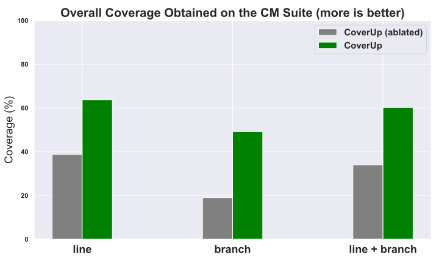

 

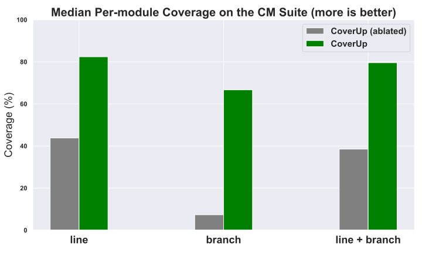

 

Figure 16. [RQ2] CoverUp contributes significantly to overall performance: Across the board, CoverUp yields higher coverage in comparison to the ablated (LLM only) version, whether measured over the entire suite or on a module-by-module basis. 

### 4.3. [RQ2] How effective is CoverUp compared to simply prompting an LLM for tests?

Given many LLMs’ near-human performance on various tasks, including software engineering tasks ([Bubeck et al., 2023](https://arxiv.org/html/2403.16218#bib.bib8)), it is reasonable to ask just how much CoverUp contributes to performance. To address this question, we compare CoverUp to an ablated LLM-only version that utilizes a nearly identical prompt but which lacks all other CoverUp functionality (coverage information, computed import statements, get_info tool function and continued chats). Rather than ask for tests for the uncovered code, it asks instead for tests “that execute _all_ lines and branches”.

As Figure [16](https://arxiv.org/html/2403.16218#S4.F16 "Figure 16 ‣ 4.2. \[RQ1\] Comparison to the previous state of the art ‣ 4. Evaluation ‣ CoverUp: Effective High Coverage Test Generation for Python") shows, CoverUp achieves substantially higher line, branch, and combined line and branch coverage than CoverUp (ablated), both measured over the entire benchmark code base and on a per-module basis. Across the entire benchmark suite, it achieves 64% (vs. 39%) line coverage, 49% (vs. 19%) branch coverage, and 60% (vs. 34%) line+branch coverage; on a per-module basis, it achieves 82% (vs. 44%) line coverage, 67% (vs. 7%) branch coverage, and 80% (vs. 39%) line+branch coverage.

 

Table 2. [RQ1] CoverUp outperforms MuTAP’s coverage on the MT suite.  

<table id="S4.T2.7" class="ltx_tabular ltx_align_middle">
<tbody class="ltx_tbody">
<tr id="S4.T2.7.1" class="ltx_tr">
<th id="S4.T2.7.1.1" class="ltx_td ltx_align_left ltx_th ltx_th_column ltx_th_row ltx_border_r ltx_border_t"> </th>
<td id="S4.T2.7.1.2" class="ltx_td ltx_align_center ltx_border_r ltx_border_t" colspan="3"> 

Overall Coverage
</td>
<td id="S4.T2.7.1.3" class="ltx_td ltx_align_center ltx_border_t" colspan="3"> 

Median Per-Module Coverage
</td></tr>
<tr id="S4.T2.7.2" class="ltx_tr">
<th id="S4.T2.7.2.1" class="ltx_td ltx_align_left ltx_th ltx_th_column ltx_th_row ltx_border_r">

Test Generator

</th>
<th id="S4.T2.7.2.2" class="ltx_td ltx_align_right ltx_th ltx_th_column ltx_th_row"> 

Line
</th>
<th id="S4.T2.7.2.3" class="ltx_td ltx_align_right ltx_th ltx_th_column ltx_th_row"> 

Branch
</th>
<th id="S4.T2.7.2.4" class="ltx_td ltx_align_right ltx_th ltx_th_column ltx_th_row ltx_border_r"> 

Line + Branch
</th>
<th id="S4.T2.7.2.5" class="ltx_td ltx_align_right ltx_th ltx_th_column ltx_th_row"> 

Line
</th>
<th id="S4.T2.7.2.6" class="ltx_td ltx_align_right ltx_th ltx_th_column ltx_th_row"> 

Branch
</th>
<th id="S4.T2.7.2.7" class="ltx_td ltx_nopad_r ltx_align_right ltx_th ltx_th_column ltx_th_row"> 

Line + Branch
</th></tr>
<tr id="S4.T2.7.3" class="ltx_tr">
<td id="S4.T2.7.3.1" class="ltx_td ltx_align_left ltx_border_r ltx_border_t">

CoverUp
</td>
<td id="S4.T2.7.3.2" class="ltx_td ltx_align_right ltx_border_t"><math id="S4.T2.m1" class="ltx_Math" alttext="89.2\text{\,}\%" display="inline" intent=":literal"><semantics><mrow><mn mathsize="0.900em">89.2</mn><mtext class="ltx_mathvariant_bold" mathsize="0.900em"> </mtext><mo lspace="0.222em">%</mo></mrow><annotation encoding="application/x-tex">89.2\text{\,}\%</annotation></semantics></math></td>
<td id="S4.T2.7.3.3" class="ltx_td ltx_align_right ltx_border_t"><math id="S4.T2.m2" class="ltx_Math" alttext="88.7\text{\,}\%" display="inline" intent=":literal"><semantics><mrow><mn mathsize="0.900em">88.7</mn><mtext class="ltx_mathvariant_bold" mathsize="0.900em"> </mtext><mo lspace="0.222em">%</mo></mrow><annotation encoding="application/x-tex">88.7\text{\,}\%</annotation></semantics></math></td>
<td id="S4.T2.7.3.4" class="ltx_td ltx_align_right ltx_border_r ltx_border_t"><math id="S4.T2.m3" class="ltx_Math" alttext="89.0\text{\,}\%" display="inline" intent=":literal"><semantics><mrow><mn mathsize="0.900em">89.0</mn><mtext class="ltx_mathvariant_bold" mathsize="0.900em"> </mtext><mo lspace="0.222em">%</mo></mrow><annotation encoding="application/x-tex">89.0\text{\,}\%</annotation></semantics></math></td>
<td id="S4.T2.7.3.5" class="ltx_td ltx_align_right ltx_border_t"><math id="S4.T2.m4" class="ltx_Math" alttext="100.0\text{\,}\%" display="inline" intent=":literal"><semantics><mrow><mn mathsize="0.900em">100.0</mn><mtext class="ltx_mathvariant_bold" mathsize="0.900em"> </mtext><mo lspace="0.222em">%</mo></mrow><annotation encoding="application/x-tex">100.0\text{\,}\%</annotation></semantics></math></td>
<td id="S4.T2.7.3.6" class="ltx_td ltx_align_right ltx_border_t"><math id="S4.T2.m5" class="ltx_Math" alttext="100.0\text{\,}\%" display="inline" intent=":literal"><semantics><mrow><mn mathsize="0.900em">100.0</mn><mtext class="ltx_mathvariant_bold" mathsize="0.900em"> </mtext><mo lspace="0.222em">%</mo></mrow><annotation encoding="application/x-tex">100.0\text{\,}\%</annotation></semantics></math></td>
<td id="S4.T2.7.3.7" class="ltx_td ltx_nopad_r ltx_align_right ltx_border_t"><math id="S4.T2.m6" class="ltx_Math" alttext="100.0\text{\,}\%" display="inline" intent=":literal"><semantics><mrow><mn mathsize="0.900em">100.0</mn><mtext class="ltx_mathvariant_bold" mathsize="0.900em"> </mtext><mo lspace="0.222em">%</mo></mrow><annotation encoding="application/x-tex">100.0\text{\,}\%</annotation></semantics></math></td></tr>
<tr id="S4.T2.7.4" class="ltx_tr">
<td id="S4.T2.7.4.1" class="ltx_td ltx_align_left ltx_border_r">

MuTAP (codex few-shot)
</td>
<td id="S4.T2.7.4.2" class="ltx_td ltx_align_right"><math id="S4.T2.m7" class="ltx_Math" alttext="80.8\text{\,}\%" display="inline" intent=":literal"><semantics><mrow><mn mathsize="0.900em">80.8</mn><mtext mathsize="0.900em"> </mtext><mo lspace="0.222em">%</mo></mrow><annotation encoding="application/x-tex">80.8\text{\,}\%</annotation></semantics></math></td>
<td id="S4.T2.7.4.3" class="ltx_td ltx_align_right"><math id="S4.T2.m8" class="ltx_Math" alttext="71.7\text{\,}\%" display="inline" intent=":literal"><semantics><mrow><mn mathsize="0.900em">71.7</mn><mtext mathsize="0.900em"> </mtext><mo lspace="0.222em">%</mo></mrow><annotation encoding="application/x-tex">71.7\text{\,}\%</annotation></semantics></math></td>
<td id="S4.T2.7.4.4" class="ltx_td ltx_align_right ltx_border_r"><math id="S4.T2.m9" class="ltx_Math" alttext="77.7\text{\,}\%" display="inline" intent=":literal"><semantics><mrow><mn mathsize="0.900em">77.7</mn><mtext mathsize="0.900em"> </mtext><mo lspace="0.222em">%</mo></mrow><annotation encoding="application/x-tex">77.7\text{\,}\%</annotation></semantics></math></td>
<td id="S4.T2.7.4.5" class="ltx_td ltx_align_right"><math id="S4.T2.m10" class="ltx_Math" alttext="100.0\text{\,}\%" display="inline" intent=":literal"><semantics><mrow><mn mathsize="0.900em">100.0</mn><mtext mathsize="0.900em"> </mtext><mo lspace="0.222em">%</mo></mrow><annotation encoding="application/x-tex">100.0\text{\,}\%</annotation></semantics></math></td>
<td id="S4.T2.7.4.6" class="ltx_td ltx_align_right"><math id="S4.T2.m11" class="ltx_Math" alttext="100.0\text{\,}\%" display="inline" intent=":literal"><semantics><mrow><mn mathsize="0.900em">100.0</mn><mtext mathsize="0.900em"> </mtext><mo lspace="0.222em">%</mo></mrow><annotation encoding="application/x-tex">100.0\text{\,}\%</annotation></semantics></math></td>
<td id="S4.T2.7.4.7" class="ltx_td ltx_nopad_r ltx_align_right"><math id="S4.T2.m12" class="ltx_Math" alttext="100.0\text{\,}\%" display="inline" intent=":literal"><semantics><mrow><mn mathsize="0.900em">100.0</mn><mtext mathsize="0.900em"> </mtext><mo lspace="0.222em">%</mo></mrow><annotation encoding="application/x-tex">100.0\text{\,}\%</annotation></semantics></math></td></tr>
<tr id="S4.T2.7.5" class="ltx_tr">
<td id="S4.T2.7.5.1" class="ltx_td ltx_align_left ltx_border_r">

MuTAP (codex zero-shot)
</td>
<td id="S4.T2.7.5.2" class="ltx_td ltx_align_right"><math id="S4.T2.m13" class="ltx_Math" alttext="79.2\text{\,}\%" display="inline" intent=":literal"><semantics><mrow><mn mathsize="0.900em">79.2</mn><mtext mathsize="0.900em"> </mtext><mo lspace="0.222em">%</mo></mrow><annotation encoding="application/x-tex">79.2\text{\,}\%</annotation></semantics></math></td>
<td id="S4.T2.7.5.3" class="ltx_td ltx_align_right"><math id="S4.T2.m14" class="ltx_Math" alttext="72.7\text{\,}\%" display="inline" intent=":literal"><semantics><mrow><mn mathsize="0.900em">72.7</mn><mtext mathsize="0.900em"> </mtext><mo lspace="0.222em">%</mo></mrow><annotation encoding="application/x-tex">72.7\text{\,}\%</annotation></semantics></math></td>
<td id="S4.T2.7.5.4" class="ltx_td ltx_align_right ltx_border_r"><math id="S4.T2.m15" class="ltx_Math" alttext="77.0\text{\,}\%" display="inline" intent=":literal"><semantics><mrow><mn mathsize="0.900em">77.0</mn><mtext mathsize="0.900em"> </mtext><mo lspace="0.222em">%</mo></mrow><annotation encoding="application/x-tex">77.0\text{\,}\%</annotation></semantics></math></td>
<td id="S4.T2.7.5.5" class="ltx_td ltx_align_right"><math id="S4.T2.m16" class="ltx_Math" alttext="100.0\text{\,}\%" display="inline" intent=":literal"><semantics><mrow><mn mathsize="0.900em">100.0</mn><mtext mathsize="0.900em"> </mtext><mo lspace="0.222em">%</mo></mrow><annotation encoding="application/x-tex">100.0\text{\,}\%</annotation></semantics></math></td>
<td id="S4.T2.7.5.6" class="ltx_td ltx_align_right"><math id="S4.T2.m17" class="ltx_Math" alttext="100.0\text{\,}\%" display="inline" intent=":literal"><semantics><mrow><mn mathsize="0.900em">100.0</mn><mtext mathsize="0.900em"> </mtext><mo lspace="0.222em">%</mo></mrow><annotation encoding="application/x-tex">100.0\text{\,}\%</annotation></semantics></math></td>
<td id="S4.T2.7.5.7" class="ltx_td ltx_nopad_r ltx_align_right"><math id="S4.T2.m18" class="ltx_Math" alttext="100.0\text{\,}\%" display="inline" intent=":literal"><semantics><mrow><mn mathsize="0.900em">100.0</mn><mtext mathsize="0.900em"> </mtext><mo lspace="0.222em">%</mo></mrow><annotation encoding="application/x-tex">100.0\text{\,}\%</annotation></semantics></math></td></tr>
<tr id="S4.T2.7.6" class="ltx_tr">
<td id="S4.T2.7.6.1" class="ltx_td ltx_align_left ltx_border_r">

MuTAP (gpt4o zero-shot)
</td>
<td id="S4.T2.7.6.2" class="ltx_td ltx_align_right"><math id="S4.T2.m19" class="ltx_Math" alttext="78.0\text{\,}\%" display="inline" intent=":literal"><semantics><mrow><mn mathsize="0.900em">78.0</mn><mtext mathsize="0.900em"> </mtext><mo lspace="0.222em">%</mo></mrow><annotation encoding="application/x-tex">78.0\text{\,}\%</annotation></semantics></math></td>
<td id="S4.T2.7.6.3" class="ltx_td ltx_align_right"><math id="S4.T2.m20" class="ltx_Math" alttext="74.5\text{\,}\%" display="inline" intent=":literal"><semantics><mrow><mn mathsize="0.900em">74.5</mn><mtext mathsize="0.900em"> </mtext><mo lspace="0.222em">%</mo></mrow><annotation encoding="application/x-tex">74.5\text{\,}\%</annotation></semantics></math></td>
<td id="S4.T2.7.6.4" class="ltx_td ltx_align_right ltx_border_r"><math id="S4.T2.m21" class="ltx_Math" alttext="76.8\text{\,}\%" display="inline" intent=":literal"><semantics><mrow><mn mathsize="0.900em">76.8</mn><mtext mathsize="0.900em"> </mtext><mo lspace="0.222em">%</mo></mrow><annotation encoding="application/x-tex">76.8\text{\,}\%</annotation></semantics></math></td>
<td id="S4.T2.7.6.5" class="ltx_td ltx_align_right"><math id="S4.T2.m22" class="ltx_Math" alttext="100.0\text{\,}\%" display="inline" intent=":literal"><semantics><mrow><mn mathsize="0.900em">100.0</mn><mtext mathsize="0.900em"> </mtext><mo lspace="0.222em">%</mo></mrow><annotation encoding="application/x-tex">100.0\text{\,}\%</annotation></semantics></math></td>
<td id="S4.T2.7.6.6" class="ltx_td ltx_align_right"><math id="S4.T2.m23" class="ltx_Math" alttext="100.0\text{\,}\%" display="inline" intent=":literal"><semantics><mrow><mn mathsize="0.900em">100.0</mn><mtext mathsize="0.900em"> </mtext><mo lspace="0.222em">%</mo></mrow><annotation encoding="application/x-tex">100.0\text{\,}\%</annotation></semantics></math></td>
<td id="S4.T2.7.6.7" class="ltx_td ltx_nopad_r ltx_align_right"><math id="S4.T2.m24" class="ltx_Math" alttext="100.0\text{\,}\%" display="inline" intent=":literal"><semantics><mrow><mn mathsize="0.900em">100.0</mn><mtext mathsize="0.900em"> </mtext><mo lspace="0.222em">%</mo></mrow><annotation encoding="application/x-tex">100.0\text{\,}\%</annotation></semantics></math></td></tr>
<tr id="S4.T2.7.7" class="ltx_tr">
<td id="S4.T2.7.7.1" class="ltx_td ltx_align_left ltx_border_b ltx_border_r">

MuTAP (gpt4o few-shot)
</td>
<td id="S4.T2.7.7.2" class="ltx_td ltx_align_right ltx_border_b"><math id="S4.T2.m25" class="ltx_Math" alttext="15.9\text{\,}\%" display="inline" intent=":literal"><semantics><mrow><mn mathsize="0.900em">15.9</mn><mtext mathsize="0.900em"> </mtext><mo lspace="0.222em">%</mo></mrow><annotation encoding="application/x-tex">15.9\text{\,}\%</annotation></semantics></math></td>
<td id="S4.T2.7.7.3" class="ltx_td ltx_align_right ltx_border_b"><math id="S4.T2.m26" class="ltx_Math" alttext="0.0\text{\,}\%" display="inline" intent=":literal"><semantics><mrow><mn mathsize="0.900em">0.0</mn><mtext mathsize="0.900em"> </mtext><mo lspace="0.222em">%</mo></mrow><annotation encoding="application/x-tex">0.0\text{\,}\%</annotation></semantics></math></td>
<td id="S4.T2.7.7.4" class="ltx_td ltx_align_right ltx_border_b ltx_border_r"><math id="S4.T2.m27" class="ltx_Math" alttext="10.4\text{\,}\%" display="inline" intent=":literal"><semantics><mrow><mn mathsize="0.900em">10.4</mn><mtext mathsize="0.900em"> </mtext><mo lspace="0.222em">%</mo></mrow><annotation encoding="application/x-tex">10.4\text{\,}\%</annotation></semantics></math></td>
<td id="S4.T2.7.7.5" class="ltx_td ltx_align_right ltx_border_b"><math id="S4.T2.m28" class="ltx_Math" alttext="16.7\text{\,}\%" display="inline" intent=":literal"><semantics><mrow><mn mathsize="0.900em">16.7</mn><mtext mathsize="0.900em"> </mtext><mo lspace="0.222em">%</mo></mrow><annotation encoding="application/x-tex">16.7\text{\,}\%</annotation></semantics></math></td>
<td id="S4.T2.7.7.6" class="ltx_td ltx_align_right ltx_border_b"><math id="S4.T2.m29" class="ltx_Math" alttext="0.0\text{\,}\%" display="inline" intent=":literal"><semantics><mrow><mn mathsize="0.900em">0.0</mn><mtext mathsize="0.900em"> </mtext><mo lspace="0.222em">%</mo></mrow><annotation encoding="application/x-tex">0.0\text{\,}\%</annotation></semantics></math></td>
<td id="S4.T2.7.7.7" class="ltx_td ltx_nopad_r ltx_align_right ltx_border_b"><math id="S4.T2.m30" class="ltx_Math" alttext="11.1\text{\,}\%" display="inline" intent=":literal"><semantics><mrow><mn mathsize="0.900em">11.1</mn><mtext mathsize="0.900em"> </mtext><mo lspace="0.222em">%</mo></mrow><annotation encoding="application/x-tex">11.1\text{\,}\%</annotation></semantics></math></td></tr>
</tbody>
</table>

 

### 4.4. [RQ3] How effective are CoverUp’s continued dialogues?

To investigate RQ3, we process CoverUp’s logs generated while evaluated on the CM suite, identifying each successful test (i.e., which passes and improves coverage) that was generated immediately upon the first prompt or after continuing the chat with a second or third prompt (by default, and also in our evaluation, CoverUp continues the conversation for at most two additional prompts). We observe that 60.3% of successes result from the first prompt, 27.2% from the second, and 12.5% from the third. While the success rate decreases with each iteration, approximately 40% of successes were achieved through iterative refinement of the prompt, highlighting its importance.

 

### 4.5. [RQ4] How does the cost of running CoverUp compare to CodaMosa?

Examining the logs from runs on the CM suite, we assemble Table [3](https://arxiv.org/html/2403.16218#S4.T3 "Table 3 ‣ 4.5. \[RQ4\] How does the cost of running CoverUp compare to CodaMosa? ‣ 4. Evaluation ‣ CoverUp: Effective High Coverage Test Generation for Python"), which shows the number of prompts, completions, tokens, running time, and approximate cost incurred.

Table 3. [RQ4] Cost of running CoverUp and CodaMosa on the CM suite: CoverUp runs roughly 18\(\times\) faster while achieving higher coverage than CodaMosa, but uses 48% more tokens.  

Test Generator |  Prompts |  P. Tokens |  Completions |  C. Tokens |  Time (h) |  Cost (US$)  
---|---|---|---|---|---|---  
CoverUp | 28,690 | 58,081,908 | 28,654 | 7,257,400 | 4.0 | 399  
CoverUp (ablated) | 9,224 | 3,501,827 | 9,188 | 3,859,444 | 1.7 | 75  
CodaMosa (gpt4o) | 30,368 | 39,508,559 | 29,136 | 4,504,329 | 71.0 | 265

 

We observe that CoverUp runs roughly 18 times faster (4 vs. 71 hours) while achieving higher coverage than CodaMosa, but using 48% more tokens. Although this time comparison can provide insight into each method’s applicability for a given context, it is important to understand its limitations. CoverUp and CodaMosa utilize both local and cloud-based computing resources; we describe the local system in Section [4.1](https://arxiv.org/html/2403.16218#S4.SS1.SSSx4 "Execution Environment ‣ 4.1. Experimental Setup ‣ 4. Evaluation ‣ CoverUp: Effective High Coverage Test Generation for Python"), but OpenAI does not disclose details of their computing environment, whose availability may vary over time. CoverUp’s implementation is both parallelized and asynchronous. Its running time is primarily gated by the rate limits imposed by OpenAI (see Section [3.7](https://arxiv.org/html/2403.16218#S3.SS7 "3.7. Other Technical Challenges ‣ 3. Approach ‣ CoverUp: Effective High Coverage Test Generation for Python")), their response times, and the time required to execute the generated tests. In contrast, CodaMosa is a sequential process that runs for 10 minutes per module. While this duration is configurable, we follow the setting used in the CodaMosa paper ([Lemieux et al., 2023](https://arxiv.org/html/2403.16218#bib.bib23)).

 

### 4.6. [RQ5] How important are CoverUp’s components to its performance?

In broad terms, CoverUp contains components that perform three main functions: provide the LLM information on coverage, provide it with additional code context, and provide it with feedback on any errors. In this research question, we explore how ablating each one of these components affects CoverUp. Table [4](https://arxiv.org/html/2403.16218#S4.T4 "Table 4 ‣ 4.6. \[RQ5\] How important are CoverUp’s components to its performance? ‣ 4. Evaluation ‣ CoverUp: Effective High Coverage Test Generation for Python") shows the specific elements disabled for each variant; disabling all three yields the same “CoverUp (ablated)” system explored already in RQ2.

Table 4. [RQ5] Elements in CoverUp ablations: The non-ablated CoverUp contains all of these elements, while CoverUp (ablated) from RQ2 contains none of them. To answer RQ5, we create three additional ablations.  

Component |  non-ablated |  ablated [RQ2] |  no coverage |  no code context |  no error fixing  
---|---|---|---|---|---  
Indication of what coverage is missing |  

  |  

  |  

  |  

  |  

   
Continued chat if generated tests do not improve coverage |  

  |  

  |  

  |  

  |  

   
Generated import statements |  

  |  

  |  

  |  

  |  

   
The get_info tool function |  

  |  

  |  

  |  

  |  

   
Continued chat in case of errors |  

  |  

  |  

  |  

  |  

 

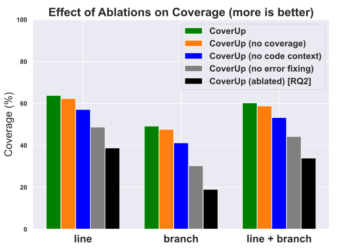

 Figure 17. [RQ5] Effect of ablations on coverage: Removing any of these components from CoverUp lowers its performance. 

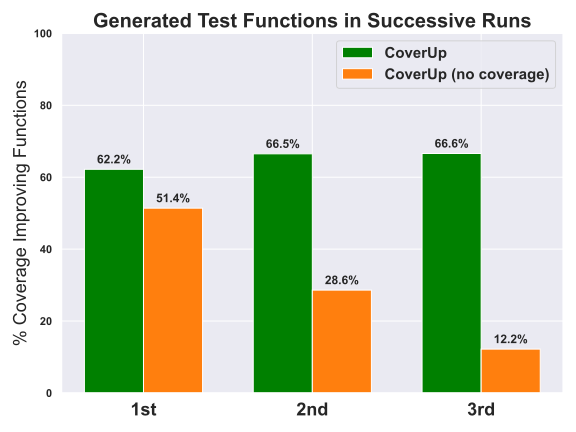

 Figure 18. [RQ5] Importance of coverage-based prompting: As the starting coverage grows with each successive run, the coverage-ablated prompt generates fewer and fewer functions that increase coverage. 

We first evaluate these new ablations of CoverUp using suite CM; Figure [18](https://arxiv.org/html/2403.16218#S4.F18 "Figure 18 ‣ 4.6. \[RQ5\] How important are CoverUp’s components to its performance? ‣ 4. Evaluation ‣ CoverUp: Effective High Coverage Test Generation for Python") shows the resulting overall coverage for each ablation. We observe that all ablations negatively affect coverage, indicating their importance. Ablating error fixing has the most significant effect, losing between 14% and 37% on the various coverage metrics; ablating code context loses between 7% and 16%, and ablating coverage information up to 2%. In interpreting these results, it is important to realize that the components are not entirely independent. For example, the feedback from error fixing may allow the LLM to correct for insufficient code context, and through improved code context, errors resulting from incorrect assumptions may be avoided.

To better understand the effect of ablating coverage information from the prompt, we count the test functions generated by the model and assess how many of these increase coverage for each successive run. As Figure [18](https://arxiv.org/html/2403.16218#S4.F18 "Figure 18 ‣ 4.6. \[RQ5\] How important are CoverUp’s components to its performance? ‣ 4. Evaluation ‣ CoverUp: Effective High Coverage Test Generation for Python") shows, as coverage increases, the coverage-ablated prompt results in fewer and fewer functions that increase coverage. In contrast, CoverUp’s prompt remains effective. This result shows that, by providing coverage information in the prompt, CoverUp focuses the LLM’s attention on uncovered code. Even though the coverage-ablated prompt only fell short in coverage by a small amount, it did so by generating over 50% more functions than the non-ablated prompt (11,222 vs. 7,366). If left in the test suite, these functions contribute to bloat, slowing the suite’s execution. But even if rejected after a coverage check, they add unnecessary tokens in LLM responses and thus increase cost.

 

## 5\. Threats to Validity

#### Benchmark selection

We utilize the CM and PY benchmark suites to evaluate CoverUp’s performance on both challenging and less challenging code, as well as to facilitate including Codex-based results; we utilize the MT benchmark suite because MuTAP supports it, and it, too, facilitates including Codex-based results. While our experience executing CoverUp to generate tests for other software has yielded similarly high coverage, selecting a different set of benchmarks could produce different results.

#### Execution environment

CodaMosa’s original evaluation environment failed to install a number of Python modules that are prerequisites for the applications used as benchmarks. In an effort to replicate the original conditions as closely as possible, we ignored these failures as well. It seems likely that both CodaMosa and CoverUp would be better able to generate tests if these modules were not missing.

#### LLM model dependency

CoverUp was developed and evaluated using OpenAI’s GPT-4, GPT-4 Turbo and GPT-4o models. CoverUp’s approach is independent of the LLM and, as Section [4.3](https://arxiv.org/html/2403.16218#S4.SS3 "4.3. \[RQ2\] How effective is CoverUp compared to simply prompting an LLM for tests? ‣ 4. Evaluation ‣ CoverUp: Effective High Coverage Test Generation for Python") shows, CoverUp significantly outperforms an ablated version of itself that just relies on the LLM’s capabilities. Its ultimate performance naturally depends on the model’s ability to interpret its prompts and generate tests as requested.

## 6\. Conclusion

This paper introduces CoverUp, a novel approach to guide LLM-based test generation through coverage analysis. While modern LLMs achieve near-human performance on various tasks, simply prompting them is insufficient for generating high-coverage tests. We demonstrate that integrating coverage information into prompts directs the LLM’s attention to uncovered code and highlight the benefits of iterative refinement through error and coverage feedback. By combining these elements with code context, CoverUp produces test suites that achieve higher coverage than previous approaches.

## 7\. Data Availability

A replication package is available at <https://github.com/plasma-umass/coverup-eval>;CoverUp is available on GitHub at <https://github.com/plasma-umass/coverup> and archived on Zenodo ([Altmayer Pizzorno and Berger, 2025a](https://arxiv.org/html/2403.16218#bib.bib4); [Altmayer Pizzorno and Berger, 2025b](https://arxiv.org/html/2403.16218#bib.bib5)).

## References

  * Alshahwan et al. (2024) Nadia Alshahwan, Jubin Chheda, Anastasia Finogenova, Beliz Gokkaya, Mark Harman, Inna Harper, Alexandru Marginean, Shubho Sengupta, and Eddy Wang. 2024.  Automated Unit Test Improvement using Large Language Models at Meta. In _Companion Proceedings of the 32nd ACM International Conference on the Foundations of Software Engineering, FSE 2024, Porto de Galinhas, Brazil, July 15-19, 2024_ , Marcelo d’Amorim (Ed.). ACM, 185–196.  <https://doi.org/10.1145/3663529.3663839>
  * Altmayer Pizzorno and Berger (2023) Juan Altmayer Pizzorno and Emery D. Berger. 2023.  SlipCover: Near Zero-Overhead Code Coverage for Python. In _Proceedings of the 32nd ACM SIGSOFT International Symposium on Software Testing and Analysis_ (Seattle, WA, USA) _(ISSTA 2023)_. Association for Computing Machinery, New York, NY, USA, 1195–1206.  <https://doi.org/10.1145/3597926.3598128> arXiv:2305.02886 
  * Altmayer Pizzorno and Berger (2025a) Juan Altmayer Pizzorno and Emery D. Berger. 2025a.  _plasma-umass/coverup: Automatically Generating Higher-Coverage Test Suites with AI_.  <https://doi.org/10.5281/zenodo.15187805>
  * Altmayer Pizzorno and Berger (2025b) Juan Altmayer Pizzorno and Emery D. Berger. 2025b.  _plasma-umass/pytest-cleanslate: State pollution handling for CoverUp_.  <https://doi.org/10.5281/zenodo.15187866>
  * Bareiß et al. (2022) Patrick Bareiß, Beatriz Souza, Marcelo d’Amorim, and Michael Pradel. 2022.  Code Generation Tools (Almost) for Free? A Study of Few-Shot, Pre-Trained Language Models on Code.  <https://doi.org/10.48550/arXiv.2206.01335> arXiv:2206.01335 [cs.SE] 
  * Boyapati et al. (2002) Chandrasekhar Boyapati, Sarfraz Khurshid, and Darko Marinov. 2002\.  Korat: automated testing based on Java predicates. In _Proceedings of the 2002 ACM SIGSOFT International Symposium on Software Testing and Analysis_ (Roma, Italy) _(ISSTA ’02)_. Association for Computing Machinery, New York, NY, USA, 123–133.  <https://doi.org/10.1145/566172.566191>
  * Bubeck et al. (2023) Sébastien Bubeck, Varun Chandrasekaran, Ronen Eldan, Johannes Gehrke, Eric Horvitz, Ece Kamar, Peter Lee, Yin Tat Lee, Yuanzhi Li, Scott Lundberg, Harsha Nori, Hamid Palangi, Marco Tulio Ribeiro, and Yi Zhang. 2023\.  Sparks of Artificial General Intelligence: Early experiments with GPT-4.  <https://doi.org/10.48550/arXiv.2303.12712> arXiv:2303.12712 [cs.CL] 
  * Chen et al. (2021) Mark Chen, Jerry Tworek, Heewoo Jun, Qiming Yuan, Henrique Ponde de Oliveira Pinto, Jared Kaplan, Harri Edwards, Yuri Burda, Nicholas Joseph, Greg Brockman, Alex Ray, Raul Puri, Gretchen Krueger, Michael Petrov, Heidy Khlaaf, Girish Sastry, Pamela Mishkin, Brooke Chan, Scott Gray, Nick Ryder, Mikhail Pavlov, Alethea Power, Lukasz Kaiser, Mohammad Bavarian, Clemens Winter, Philippe Tillet, Felipe Petroski Such, Dave Cummings, Matthias Plappert, Fotios Chantzis, Elizabeth Barnes, Ariel Herbert-Voss, William Hebgen Guss, Alex Nichol, Alex Paino, Nikolas Tezak, Jie Tang, Igor Babuschkin, Suchir Balaji, Shantanu Jain, William Saunders, Christopher Hesse, Andrew N. Carr, Jan Leike, Josh Achiam, Vedant Misra, Evan Morikawa, Alec Radford, Matthew Knight, Miles Brundage, Mira Murati, Katie Mayer, Peter Welinder, Bob McGrew, Dario Amodei, Sam McCandlish, Ilya Sutskever, and Wojciech Zaremba. 2021\.  Evaluating Large Language Models Trained on Code.  <https://doi.org/10.48550/arXiv.2107.03374> arXiv:2107.03374 [cs.LG] 
  * Chen et al. (2024) Yinghao Chen, Zehao Hu, Chen Zhi, Junxiao Han, Shuiguang Deng, and Jianwei Yin. 2024\.  ChatUniTest: A Framework for LLM-Based Test Generation. In _Companion Proceedings of the 32nd ACM International Conference on the Foundations of Software Engineering, FSE 2024, Porto de Galinhas, Brazil, July 15-19, 2024_ , Marcelo d’Amorim (Ed.). ACM, 572–576.  <https://doi.org/10.1145/3663529.3663801>
  * Daka and Fraser (2014) Ermira Daka and Gordon Fraser. 2014.  A Survey on Unit Testing Practices and Problems. In _25th IEEE International Symposium on Software Reliability Engineering, ISSRE 2014, Naples, Italy, November 3-6, 2014_. IEEE Computer Society, 201–211.  <https://doi.org/10.1109/ISSRE.2014.11>
  * Dakhel et al. (2024) Arghavan Moradi Dakhel, Amin Nikanjam, Vahid Majdinasab, Foutse Khomh, and Michel C. Desmarais. 2024\.  Effective test generation using pre-trained Large Language Models and mutation testing.  _Inf. Softw. Technol._ 171 (2024), 107468.  <https://doi.org/10.1016/J.INFSOF.2024.107468>
  * Fioraldi et al. (2023) Andrea Fioraldi, Alessandro Mantovani, Dominik Christian Maier, and Davide Balzarotti. 2023\.  Dissecting American Fuzzy Lop: A FuzzBench Evaluation.  _ACM Trans. Softw. Eng. Methodol._ 32, 2 (2023), 52:1–52:26.  <https://doi.org/10.1145/3580596>
  * Fraser and Arcuri (2011) Gordon Fraser and Andrea Arcuri. 2011.  EvoSuite: automatic test suite generation for object-oriented software. In _Proceedings of the 19th ACM SIGSOFT Symposium and the 13th European Conference on Foundations of Software Engineering_ (Szeged, Hungary) _(ESEC/FSE ’11)_. Association for Computing Machinery, New York, NY, USA, 416–419.  <https://doi.org/10.1145/2025113.2025179>
  * Fraser and Arcuri (2014) Gordon Fraser and Andrea Arcuri. 2014.  A Large-Scale Evaluation of Automated Unit Test Generation Using EvoSuite.  _ACM Trans. Softw. Eng. Methodol._ 24, 2, Article 8 (December 2014), 42 pages.  <https://doi.org/10.1145/2685612>
  * Fraser and Zeller (2012) Gordon Fraser and Andreas Zeller. 2012.  Mutation-Driven Generation of Unit Tests and Oracles.  _IEEE Transactions on Software Engineering_ 38, 2 (2012), 278–292.  <https://doi.org/10.1109/TSE.2011.93>
  * Godefroid et al. (2005) Patrice Godefroid, Nils Klarlund, and Koushik Sen. 2005\.  DART: directed automated random testing. In _Proceedings of the 2005 ACM SIGPLAN Conference on Programming Language Design and Implementation_ (Chicago, IL, USA) _(PLDI ’05)_. Association for Computing Machinery, New York, NY, USA, 213–223.  <https://doi.org/10.1145/1065010.1065036>
  * Gruber et al. (2024) Martin Gruber, Muhammad Firhard Roslan, Owain Parry, Fabian Scharnböck, Phil McMinn, and Gordon Fraser. 2024.  Do Automatic Test Generation Tools Generate Flaky Tests?. In _Proceedings of the IEEE/ACM 46th International Conference on Software Engineering_ (Lisbon, Portugal) _(ICSE ’24)_. Association for Computing Machinery, New York, NY, USA, Article 47, 12 pages.  <https://doi.org/10.1145/3597503.3608138>
  * Gyori et al. (2015) Alex Gyori, August Shi, Farah Hariri, and Darko Marinov. 2015\.  Reliable testing: detecting state-polluting tests to prevent test dependency. In _Proceedings of the 2015 International Symposium on Software Testing and Analysis_ (Baltimore, MD, USA) _(ISSTA 2015)_. Association for Computing Machinery, New York, NY, USA, 223–233.  <https://doi.org/10.1145/2771783.2771793>
  * Hałas (2019) Konrad Hałas. 2019\.  _MutPy, a mutation testing tool for Python_.  <https://github.com/mutpy/mutpy> Retrieved on 2024-09-11. 
  * Lahiri et al. (2022) Shuvendu K. Lahiri, Aaditya Naik, Georgios Sakkas, Piali Choudhury, Curtis von Veh, Madanlal Musuvathi, Jeevana Priya Inala, Chenglong Wang, and Jianfeng Gao. 2022\.  Interactive Code Generation via Test-Driven User-Intent Formalization.  _CoRR_ abs/2208.05950 (2022).  <https://doi.org/10.48550/ARXIV.2208.05950> arXiv:2208.05950 
  * Lam et al. (2020) Wing Lam, Stefan Winter, Anjiang Wei, Tao Xie, Darko Marinov, and Jonathan Bell. 2020\.  A large-scale longitudinal study of flaky tests.  _Proc. ACM Program. Lang._ 4, OOPSLA, Article 202 (November 2020), 29 pages.  <https://doi.org/10.1145/3428270>
  * Lemieux et al. (2023) Caroline Lemieux, Jeevana Priya Inala, Shuvendu K. Lahiri, and Siddhartha Sen. 2023.  CodaMosa: Escaping Coverage Plateaus in Test Generation with Pre-trained Large Language Models. In _2023 IEEE/ACM 45th International Conference on Software Engineering (ICSE)_. 919–931.  <https://doi.org/10.1109/ICSE48619.2023.00085>
  * Lukasczyk and Fraser (2022) Stephan Lukasczyk and Gordon Fraser. 2022.  Pynguin: Automated Unit Test Generation for Python. In _44th IEEE/ACM International Conference on Software Engineering: Companion Proceedings, ICSE Companion 2022, Pittsburgh, PA, USA, May 22-24, 2022_. ACM/IEEE, 168–172.  <https://doi.org/10.1145/3510454.3516829>
  * Lukasczyk et al. (2023) Stephan Lukasczyk, Florian Kroiß, and Gordon Fraser. 2023\.  An empirical study of automated unit test generation for Python.  _Empir. Softw. Eng._ 28, 2 (2023), 36.  <https://doi.org/10.1007/S10664-022-10248-W>
  * Miller et al. (1990) Barton P. Miller, Lars Fredriksen, and Bryan So. 1990\.  An Empirical Study of the Reliability of UNIX Utilities.  _Commun. ACM_ 33, 12 (1990), 32–44.  <https://doi.org/10.1145/96267.96279>
  * OpenAI (2023) OpenAI. 2023.  Function calling.  <https://platform.openai.com/docs/guides/function-calling> Retrieved on 2024-09-11. 
  * Pacheco et al. (2007) Carlos Pacheco, Shuvendu K. Lahiri, Michael D. Ernst, and Thomas Ball. 2007.  Feedback-Directed Random Test Generation. In _29th International Conference on Software Engineering (ICSE 2007), Minneapolis, MN, USA, May 20-26, 2007_. IEEE Computer Society, 75–84.  <https://doi.org/10.1109/ICSE.2007.37>
  * Panichella et al. (2015) Annibale Panichella, Fitsum Meshesha Kifetew, and Paolo Tonella. 2015.  Reformulating Branch Coverage as a Many-Objective Optimization Problem. In _2015 IEEE 8th International Conference on Software Testing, Verification and Validation (ICST)_. 1–10.  <https://doi.org/10.1109/ICST.2015.7102604>
  * Panichella et al. (2018) Annibale Panichella, Fitsum Meshesha Kifetew, and Paolo Tonella. 2018.  Automated Test Case Generation as a Many-Objective Optimisation Problem with Dynamic Selection of the Targets.  _IEEE Transactions on Software Engineering_ 44, 2 (2018), 122–158.  <https://doi.org/10.1109/TSE.2017.2663435>
  * Parry et al. (2021) Owain Parry, Gregory M. Kapfhammer, Michael Hilton, and Phil McMinn. 2021.  A Survey of Flaky Tests.  _ACM Trans. Softw. Eng. Methodol._ 31, 1, Article 17 (October 2021), 74 pages.  <https://doi.org/10.1145/3476105>
  * Rosas et al. (2024) Miguel Romero Rosas, Miguel Torres Sanchez, and Rudolf Eigenmann. 2024.  Should AI Optimize Your Code? A Comparative Study of Current Large Language Models Versus Classical Optimizing Compilers.  <https://doi.org/10.48550/arXiv.2406.12146> arXiv:2406.12146 [cs.AI] 
  * Ryan et al. (2024) Gabriel Ryan, Siddhartha Jain, Mingyue Shang, Shiqi Wang, Xiaofei Ma, Murali Krishna Ramanathan, and Baishakhi Ray. 2024.  Code-Aware Prompting: A Study of Coverage-Guided Test Generation in Regression Setting using LLM.  _Proc. ACM Softw. Eng._ 1, FSE (2024), 951–971.  <https://doi.org/10.1145/3643769>
  * Schäfer et al. (2024) Max Schäfer, Sarah Nadi, Aryaz Eghbali, and Frank Tip. 2024\.  An Empirical Evaluation of Using Large Language Models for Automated Unit Test Generation.  _IEEE Transactions on Software Engineering_ 50, 1 (2024), 85–105.  <https://doi.org/10.1109/TSE.2023.3334955>
  * Sen et al. (2005) Koushik Sen, Darko Marinov, and Gul Agha. 2005.  CUTE: a concolic unit testing engine for C. In _Proceedings of the 10th European Software Engineering Conference Held Jointly with 13th ACM SIGSOFT International Symposium on Foundations of Software Engineering_ (Lisbon, Portugal) _(ESEC/FSE-13)_. Association for Computing Machinery, New York, NY, USA, 263–272.  <https://doi.org/10.1145/1081706.1081750>
  * Tillmann and de Halleux (2008) Nikolai Tillmann and Jonathan de Halleux. 2008.  Pex-White Box Test Generation for .NET. In _Tests and Proofs - 2nd International Conference, TAP 2008, Prato, Italy, April 9-11, 2008. Proceedings_ _(Lecture Notes in Computer Science, Vol. 4966)_ , Bernhard Beckert and Reiner Hähnle (Eds.). Springer, 134–153.  <https://doi.org/10.1007/978-3-540-79124-9_10>
  * Tufano et al. (2020) Michele Tufano, Dawn Drain, Alexey Svyatkovskiy, Shao Kun Deng, and Neel Sundaresan. 2020\.  Unit Test Case Generation with Transformers.  _CoRR_ abs/2009.05617 (2020).  <https://doi.org/10.48550/arXiv.2009.05617> arXiv:2009.05617 
  * Turner (1986) J. Turner. 1986\.  New directions in communications (or which way to the information age?).  _Comm. Mag._ 24, 10 (October 1986), 8–15.  <https://doi.org/10.1109/MCOM.1986.1092946>
  * Vikram et al. (2023) Vasudev Vikram, Caroline Lemieux, and Rohan Padhye. 2023\.  Can Large Language Models Write Good Property-Based Tests?  _CoRR_ abs/2307.04346 (2023).  <https://doi.org/10.48550/arXiv.2307.04346> arXiv:2307.04346 
  * Wang et al. (2024) Junjie Wang, Yuchao Huang, Chunyang Chen, Zhe Liu, Song Wang, and Qing Wang. 2024\.  Software Testing With Large Language Models: Survey, Landscape, and Vision.  _IEEE Trans. Software Eng._ 50, 4 (2024), 911–936.  <https://doi.org/10.1109/TSE.2024.3368208>
  * White et al. (2023) Jules White, Quchen Fu, Sam Hays, Michael Sandborn, Carlos Olea, Henry Gilbert, Ashraf Elnashar, Jesse Spencer-Smith, and Douglas C. Schmidt. 2023.  A Prompt Pattern Catalog to Enhance Prompt Engineering with ChatGPT.  <https://doi.org/10.48550/arXiv.2302.11382> arXiv:2302.11382 [cs.SE] 
  * Widyasari et al. (2020) Ratnadira Widyasari, Sheng Qin Sim, Camellia Lok, Haodi Qi, Jack Phan, Qijin Tay, Constance Tan, Fiona Wee, Jodie Ethelda Tan, Yuheng Yieh, Brian Goh, Ferdian Thung, Hong Jin Kang, Thong Hoang, David Lo, and Eng Lieh Ouh. 2020.  BugsInPy: a database of existing bugs in Python programs to enable controlled testing and debugging studies. In _ESEC/FSE ’20: 28th ACM Joint European Software Engineering Conference and Symposium on the Foundations of Software Engineering, Virtual Event, USA, November 8-13, 2020_ , Prem Devanbu, Myra B. Cohen, and Thomas Zimmermann (Eds.). ACM, 1556–1560.  <https://doi.org/10.1145/3368089.3417943>
  * Xia et al. (2024) Chunqiu Steven Xia, Matteo Paltenghi, Jia Le Tian, Michael Pradel, and Lingming Zhang. 2024.  Fuzz4All: Universal Fuzzing with Large Language Models. In _Proceedings of the IEEE/ACM 46th International Conference on Software Engineering_ (Lisbon, Portugal) _(ICSE ’24)_. Association for Computing Machinery, New York, NY, USA, Article 126, 13 pages.  <https://doi.org/10.1145/3597503.3639121>

