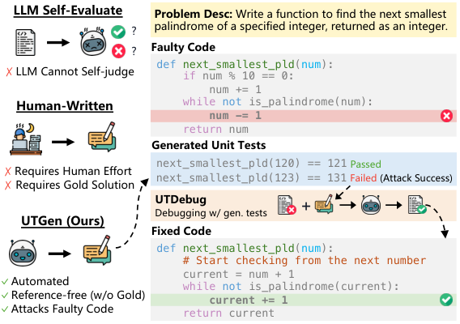
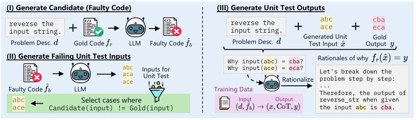
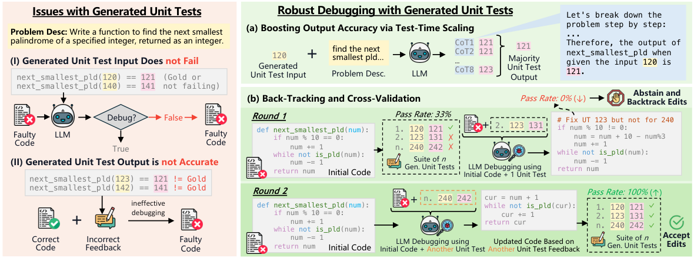
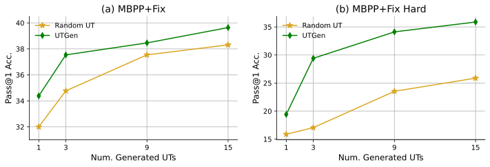

**Source:** *Learning to Generate Unit Tests for Automated Debugging* — [PDF](https://arxiv.org/pdf/2502.01619) · [arXiv](https://arxiv.org/abs/2502.01619)

# Learning to Generate Unit Tests for Automated Debugging

Archiki Prasad  Elias Stengel-Eskin  Justin Chih-Yao Chen  Affiliation: Zaid Khan Mohit Bansal  Affiliation: University of North Carolina at Chapel Hill  Affiliation: {archiki, esteng, cychen, zaidkhan, mbansal}@cs.unc.edu

###### Abstract

Unit tests (UTs) play an instrumental role in assessing code correctness as well as providing feedback to large language models (LLMs), motivating automated test generation. However, we uncover a trade-off between generating unit test inputs that reveal errors when given a faulty code and _correctly_ predicting the unit test output without access to the gold solution. To address this trade-off, we propose UTGen, which teaches LLMs to generate unit test inputs that reveal errors along with their correct expected outputs based on task descriptions. Since model-generated tests can provide noisy signals (e.g., from incorrectly predicted outputs), we propose UTDebug that (i) scales UTGen via test-time compute to improve UT output prediction, and (ii) validates and backtracks edits based on multiple generated UTs to avoid overfitting, and helps LLMs debug effectively. We show that UTGen outperforms other LLM-based baselines by 7.59% based on a metric measuring the presence of _both_ error-revealing UT inputs and correct UT outputs. When used with UTDebug, we find that feedback from UTGen’s unit tests improves pass@1 accuracy of Qwen2.5 32B on HumanEvalFix and our own harder debugging split of MBPP+ by over 3.17% and 12.35% (respectively) over other LLM-based UT generation baselines.  Moreover, we observe that feedback from Qwen2.5 32B-based UTGen model can enhance debugging with frontier LLMs like GPT-4o by 13.8%. Lastly, we demonstrate that UTGen is a better judge for code correctness, outperforming a state-of-the-art trained 8B reward model by 4.43% on HumanEval+ with best-of-10 sampling using Qwen2.5 7B. Our code and datasets are publicly available at <https://github.com/archiki/UTGenDebug>.

## 1 Introduction

 Figure 1:  We propose UTGen, which automatically generates failing unit tests (UTs) for a faulty code (triggering errors) without access to the gold solution. The generated UTs can in turn be used for LLM debugging via UTDebug, improving code accuracy.

With rapid advancements in training large language models ([Achiam et al., 2023](https://arxiv.org/html/2502.01619#bib.bib1); [Anthropic, 2024](https://arxiv.org/html/2502.01619#bib.bib3); [Gemini et al., 2023](https://arxiv.org/html/2502.01619#bib.bib15), LLMs;), enhancing their coding abilities has garnered significant attention ([Chen et al., 2021](https://arxiv.org/html/2502.01619#bib.bib10); [Li et al., 2022](https://arxiv.org/html/2502.01619#bib.bib30); [Li et al., 2023](https://arxiv.org/html/2502.01619#bib.bib29); [Roziere et al., 2023](https://arxiv.org/html/2502.01619#bib.bib45); [Guo et al., 2024b](https://arxiv.org/html/2502.01619#bib.bib18), _inter alia_). However, these models are far from perfect and – much like human-written code – model-written code contains errors. Human developers often improve their code through test-driven development, i.e., identifying failure cases by providing example inputs and their expected outputs – referred to as unit tests (UTs) – to test individual functionalities, reasoning over causes of failure, and modifying the code to address the issues ([Maximilien & Williams, 2003](https://arxiv.org/html/2502.01619#bib.bib36); [Nagappan et al., 2008](https://arxiv.org/html/2502.01619#bib.bib40); [Ficco et al., 2011](https://arxiv.org/html/2502.01619#bib.bib14); [Beck, 2022](https://arxiv.org/html/2502.01619#bib.bib5)). Models have similarly been shown to benefit from iterative debugging based on explicit or implicit feedback stemming from failing unit tests ([Zhang et al., 2023](https://arxiv.org/html/2502.01619#bib.bib54); [Chen et al., 2023b](https://arxiv.org/html/2502.01619#bib.bib11); [Moon et al., 2023](https://arxiv.org/html/2502.01619#bib.bib37)). However, the ability to provide feedback and debug incorrect code is often bottlenecked by the availability of (failing) unit tests for a given problem.

While several coding benchmarks come with human-written UTs for evaluation purposes, these suites of UTs are typically small due to the laborious annotation process ([Liu et al., 2024b](https://arxiv.org/html/2502.01619#bib.bib33)). Unit test collection is challenging for two reasons: first, it requires sampling inputs that are likely to trigger an error. For example in [Fig. 1](https://arxiv.org/html/2502.01619#S1.F1 "In 1 Introduction ‣ Learning to Generate Unit Tests for Automated Debugging"), the unit test: \(\tt{{\color[rgb]{0,0.5,0}next\_smallest\_pld}}\)(120)==121 would _not_ trigger any error (despite the fact that the code is incorrect for non-multiples of 10), while another unit test: \(\tt{{\color[rgb]{0,0.5,0}next\_smallest\_pld}}\)(123)==131 would lead to an incorrect output, revealing a bug in the function. Secondly, UTs require expected outputs (e.g., 131 in the previous UT), i.e., the desired behavior of the code being tested must be known. Due to these challenges, prior work employs LLMs to generate unit test inputs at random (i.e., without conditioning on faulty code to generate failing inputs) and often uses the gold (correct) code solution for generating outputs ([Chen et al., 2023a](https://arxiv.org/html/2502.01619#bib.bib9); [Chae et al., 2024](https://arxiv.org/html/2502.01619#bib.bib8)). Therefore, these approaches do not scale well at inference time, which requires an _online and automated_ method for generating UTs as the LLMs solve problems on the fly. To bridge this gap, we pose the following research questions:

  * RQ1: _What are desirable properties for UT generators, and how do we measure them?_
  * RQ2: _How well do LLMs perform zero-shot UT generation, and how can we improve them?_
  * RQ3: _How do we best use an automated but potentially noisy UT generator to improve code debugging and generation?_

To address RQ1, we characterize two desirable properties of unit test generators (in [Sec. 3.1](https://arxiv.org/html/2502.01619#S3.SS1 "3.1 Background and Task Setup ‣ 3 Unit Test Generation and Automated Debugging ‣ Learning to Generate Unit Tests for Automated Debugging")): 1) _high attack rate_ , i.e., given a faulty code, the unit test generator should generate inputs that are likely to trigger errors;11 1 Here, an ‘error’ means either a syntax/runtime error, or when the result of the target code does not match the expected output of the UT. We expand on this in [Sec. 3](https://arxiv.org/html/2502.01619#S3 "3 Unit Test Generation and Automated Debugging ‣ Learning to Generate Unit Tests for Automated Debugging"). 2) _high output accuracy_ , ensuring that the UT output is consistent with the task description (and that of a correct solution). For instance, in [Fig. 1](https://arxiv.org/html/2502.01619#S1.F1 "In 1 Introduction ‣ Learning to Generate Unit Tests for Automated Debugging"), \(\tt{{\color[rgb]{0,0.5,0}next\_smallest\_pld}}\)(120) would lead to a lower attack rate, as it does not trigger any errors, while \(\tt{{\color[rgb]{0,0.5,0}next\_smallest\_pld}}\)(123)==131 does (high attack rate); however, both have high output accuracy as in both cases the output is correct. We measure these properties via three _intrinsic metrics_ : measuring attack rate and output accuracy independently and then, crucially, how often a UT generator can generate both failing inputs along with correct UT outputs based only on the problem description and a faulty code. We benchmark the ability of LLMs to act as zero-shot unit test generators and show that coding LLMs generally struggle (cf. [Sec. 5.1](https://arxiv.org/html/2502.01619#S5.SS1 "5.1 Intrinsic Evaluation of UT Generation ‣ 5 Results and Analysis ‣ Learning to Generate Unit Tests for Automated Debugging")).

Moreover, addressing RQ2, we find that, without finetuning, zero-shot models often exhibit a strong trade-off between attack rate and output accuracy. In other words, the UTs that are most likely to trigger errors (i.e., higher attack rate) are generally more challenging edge cases, making it harder for the model to predict their output (i.e., lower output accuracy). Due to a lack of dedicated datasets for unit test generation in prior work, we introduce UTGen, a data creation and training recipe ([Sec. 3.2](https://arxiv.org/html/2502.01619#S3.SS2 "3.2 UTGen: Training LLMs for Unit Test Generation ‣ 3 Unit Test Generation and Automated Debugging ‣ Learning to Generate Unit Tests for Automated Debugging")) that bootstraps training data for UT generation from _existing_ code generation datasets by perturbing code to simulate errors, generating failing unit test and augmenting it with chain-of-thought rationales ([Wei et al., 2022](https://arxiv.org/html/2502.01619#bib.bib52)). We show that training via UTGen better balances this trade-off and yields a higher number of unit tests that have _both_ attacking inputs and correct outputs, with 7.59% absolute improvement over prompting models to generate failing UTs.

Finally, we examine RQ3, utilizing our generated UTs on downstream, i.e., _extrinsic_ tasks: code debugging and code generation. Here, automated UT generation methods face additional challenges: unlike human-generated gold UTs – which have correct outputs but require human involvement – generated UTs provide noisy feedback, as the UT might fail to reveal the buggy code’s errors or have an incorrectly predicted output. To mitigate this issue, we propose UTDebug, an improved multi-turn debugging method that addresses these challenges in two ways (cf. [Sec. 3.3](https://arxiv.org/html/2502.01619#S3.SS3 "3.3 UTDebug: Generated Unit Tests for Debugging ‣ 3 Unit Test Generation and Automated Debugging ‣ Learning to Generate Unit Tests for Automated Debugging")): (i) we improve the output accuracy of generated UTs by scaling test-time compute via self-consistency ([Wang et al., 2022](https://arxiv.org/html/2502.01619#bib.bib51)); (ii) we regularize the debugging process by generating multiple UTs and accepting code edits _only if_ the revised code passes _more_ generated UTs, backtracking edits otherwise. We then plug UTs generated from multiple LLM-based methods into UTDebug in [Sec. 5.2](https://arxiv.org/html/2502.01619#S5.SS2 "5.2 Generated UTs for Code Debugging ‣ 5 Results and Analysis ‣ Learning to Generate Unit Tests for Automated Debugging"), finding that on our most challenging subset of MBPP+ problems, UTDebug with UTs generated by UTGen improves pass@1 accuracy of Qwen2.5 Coder 32B Instruct by 15.07% (absolute) compared to debugging without UTs, and by 4.61% over a zero-shot unit test generation baseline (with similar trends on 8B-scale LLMs). We demonstrate that by generating UTs with UTGen and computing the rate of passing UTs, we can _better judge code correctness_ than using scores from trained, state-of-the-art 8B reward model (RM). For best-of-10 sampling with Qwen2.5 Coder 7B Instruct, UTGen improves accuracy by 4.43% over the RM on HumanEval+. Finally, in [Sec. 5.5](https://arxiv.org/html/2502.01619#S5.SS5 "5.5 Importance of Unit Tests with a Frontier Debugger ‣ 5 Results and Analysis ‣ Learning to Generate Unit Tests for Automated Debugging"), we highlight the importance of high-quality unit tests generated by UTGen when debugging with a frontier LLM like GPT-4o ([Hurst et al., 2024](https://arxiv.org/html/2502.01619#bib.bib23)), finding that using UTGen-feedback from a smaller model, such as Qwen2.5 32B, significantly outperforms self-generated feedback from GPT-4o by nearly 25% (absolute) on the most challenging subset of MBPP+ problems.

## 2 Related Work

Automatic Unit Test Generation.  Manually writing unit tests is laborious and often infeasible ([Chen et al., 2023a](https://arxiv.org/html/2502.01619#bib.bib9); [Liu et al., 2024b](https://arxiv.org/html/2502.01619#bib.bib33)). Consequently, past research explores automatic UT generation ([King, 1976](https://arxiv.org/html/2502.01619#bib.bib26); [Cadar et al., 2008](https://arxiv.org/html/2502.01619#bib.bib6); [Holler et al., 2012](https://arxiv.org/html/2502.01619#bib.bib19); [Cha et al., 2015](https://arxiv.org/html/2502.01619#bib.bib7), _inter alia_). The advent of LLMs has spurred recent efforts in using them for UT generation ([Chen et al., 2023a](https://arxiv.org/html/2502.01619#bib.bib9); [Schäfer et al., 2023](https://arxiv.org/html/2502.01619#bib.bib46); [Liu et al., 2024b](https://arxiv.org/html/2502.01619#bib.bib33)). Specifically, [Schäfer et al. (2023)](https://arxiv.org/html/2502.01619#bib.bib46) and [Liu et al. (2024b)](https://arxiv.org/html/2502.01619#bib.bib33) focus on generating _unit test inputs_ via prompting frontier LLMs like GPT-4 and/or iterative prompting, assuming access to the _gold_ solution. In contrast, our models, trained with UTGen, generate _both input-output UT pairs_ based on the task description without relying on the gold implementation. While [Chen et al. (2023a)](https://arxiv.org/html/2502.01619#bib.bib9) also generate input-output UT pairs using standard LLM prompting, their primary focus is code generation – _not_ the quality of generated UTs. In contrast, we directly model the desiderata (or quality) of UTs, and demonstrate its utility on code generation and debugging.

LLM Debugging.  Using LLMs for debugging faulty code, or program repair, has been extensively studied. Debugging approaches are divided into those training models to debug ([Moon et al., 2023](https://arxiv.org/html/2502.01619#bib.bib37); [Ni et al., 2024](https://arxiv.org/html/2502.01619#bib.bib41); [Chae et al., 2024](https://arxiv.org/html/2502.01619#bib.bib8)) and those providing external feedback to pretrained models ([Chen et al., 2023b](https://arxiv.org/html/2502.01619#bib.bib11); [Zhang et al., 2023](https://arxiv.org/html/2502.01619#bib.bib54); [Olausson et al., 2023](https://arxiv.org/html/2502.01619#bib.bib42); [Zhong et al., 2024](https://arxiv.org/html/2502.01619#bib.bib56)). Both rely on gold unit tests for training or feedback. Thus, UTGen complements both methods by providing generated unit tests when human-written tests are scarce or unavailable. In [Sec. 3.3](https://arxiv.org/html/2502.01619#S3.SS3 "3.3 UTDebug: Generated Unit Tests for Debugging ‣ 3 Unit Test Generation and Automated Debugging ‣ Learning to Generate Unit Tests for Automated Debugging"), we introduce UTDebug, a debugging pipeline that addresses noisy feedback from inaccurate unit tests through test-time scaling and backtracking. Moreover, in [Sec. 5](https://arxiv.org/html/2502.01619#S5 "5 Results and Analysis ‣ Learning to Generate Unit Tests for Automated Debugging") we show that UTGen’s unit tests can effectively provide feedback to LLMs for code generation and debugging.

## 3 Unit Test Generation and Automated Debugging

### 3.1 Background and Task Setup

Given a natural language task description \(d\) for a coding task, we focus on generating unit tests (UTs) in the format of _input-output pairs_ that are consistent with the task description \(d\). Our setup is consistent with [Chen et al. (2023a)](https://arxiv.org/html/2502.01619#bib.bib9) and [Jain et al. (2024)](https://arxiv.org/html/2502.01619#bib.bib24) who also consider unit tests in the form of input-output pairs generated _without_ utilizing the correct implementation of the function. More generally, our setting is akin to parameterized unit testing ([Tillmann et al., 2010](https://arxiv.org/html/2502.01619#bib.bib50)) and uses the notion of _functional correctness_ , i.e., measuring correctness by simulating an exhaustive set of scenarios (UT inputs) and ensuring that the function performs as expected (as per the problem description \(d\)).

#### Notation and Desiderata. 

Let \(d\) denote the natural language description of the function to be implemented (top yellow box in [Fig. 1](https://arxiv.org/html/2502.01619#S1.F1 "In 1 Introduction ‣ Learning to Generate Unit Tests for Automated Debugging")). We assume that this description specifies the input space \(\mathcal{X}\) and output space \(\mathcal{Y}\). Furthermore, let the set of all functions that correctly solve the task be \(\mathcal{F}_{d}\). Then, a _valid_ unit test \((x,y)\) for task \(d\) is:

  * \(x\in\mathcal{X}\), i.e., the input of the unit test is a _valid input_ as per the task description \(d\). 
  * \(f_{r}(x)=y,\forall f_{r}\in\mathcal{F}_{d}\), i.e., \(y\) is the _expected output_ as per the task description \(d\), and therefore, is the result one gets by executing any correct implementation. 

For example, in [Fig. 1](https://arxiv.org/html/2502.01619#S1.F1 "In 1 Introduction ‣ Learning to Generate Unit Tests for Automated Debugging"), 120 is a valid input, as it is a number, whereas "apple" is not. Similarly, 121 is the expected output of the function (given 120 as input), while 122 would be an invalid output. Thus, (120, 121) is a valid unit test for the task.

#### Unit Test Generator.

Addressing RQ1, we define the desirable properties of an automatic unit test generator \(T_{\theta}\), parameterized by \(\theta\). Ideally, \(T_{\theta}\) should generate _valid unit tests_ from a task description \(d\), i.e., \(T_{\theta}(d)\mapsto(x,y)\) without any manual intervention. However, to account for downstream utility of unit tests, we denote a potentially buggy code under testing as \(\widehat{f}_{b}\). If \(\widehat{f}_{b}\notin\mathcal{F}_{d}\) is faulty or implemented incorrectly, a _desirable_ unit test generator should be able to efficiently generate _failing unit tests_ : \(T_{\theta}(d,\widehat{f}_{b})\mapsto(x,y)\), such that \(\widehat{f}_{b}(x)\neq y\), i.e., a valid unit test input \(x\) that uncovers the errors in \(\widehat{f}_{b}\). Moreover, \(T_{\theta}\) must also predict the correct UT output \(y\), i.e., the output of the correct code. We study generators of the form \(T_{\theta}(d)\), which consider only the description, and debugging-style generators of the form \(T_{\theta}(d,\widehat{f}_{b})\), which also consider a buggy code solution \(\widehat{f}_{b}\). Empirically, we find that \(T_{\theta}(d)\) lacks sufficient context to generate effective error-revealing tests. Therefore, we focus on training UT generators of the form \(T_{\theta}(d,\widehat{f}_{b})\).

### 3.2 UTGen: Training LLMs for Unit Test Generation

While prior work focuses on curating training data for improving code generation ([Guo et al., 2024a](https://arxiv.org/html/2502.01619#bib.bib17); [Muennighoff et al., 2023](https://arxiv.org/html/2502.01619#bib.bib38)), there is a general lack of dedicated datasets for training the desired UT generator outlined above. Therefore, to improve along the lines of RQ2, we design, UTGen, a training recipe that bootstraps this data from training datasets for code generation i.e., a collection of problem descriptions and their corresponding code.

 Figure 2: UTGen Training Pipeline: Starting with training data for code generation (problem description and gold code), we create training data for UT generation in three stages: (I) perturbing gold code to generate faulty codes, (II) generating UT inputs and filtering for failing UTs, and (III) generating and relabeling chain-of-thought rationales conditioned on the gold code’s outputs. 

#### Problem Descriptions and Target Codes.

We start with a collection of coding problems with problem descriptions (\(d\)) and gold codes (\(f_{r}\)) as illustrated in [Fig. 2](https://arxiv.org/html/2502.01619#S3.F2 "In 3.2 UTGen: Training LLMs for Unit Test Generation ‣ 3 Unit Test Generation and Automated Debugging ‣ Learning to Generate Unit Tests for Automated Debugging") (I). Specifically, we use publicly available data from Tulu-3 ([Lambert et al., 2024a](https://arxiv.org/html/2502.01619#bib.bib27)) due to its large scale and the improvements noted by [Lambert et al. (2024a)](https://arxiv.org/html/2502.01619#bib.bib27) when finetuning LLMs on coding tasks.22 2 The code solutions in the Tulu-3 SFT mix have either been written by humans or by frontier models and are thus highly likely to be correct ([Lambert et al., 2024a](https://arxiv.org/html/2502.01619#bib.bib27)). We filter it to focus on Python code with functional abstractions (further details in [Appendix B](https://arxiv.org/html/2502.01619#A2 "Appendix B UTGen Training ‣ Learning to Generate Unit Tests for Automated Debugging")). However, in order to train a unit test generator we would need access to incorrect or faulty code that can be debugged, as unit tests must have some error to attack. We obtain these by using the LLM to perturb the reference code solution.

#### Annotating Unit Tests.

As mentioned in [Sec. 3.1](https://arxiv.org/html/2502.01619#S3.SS1 "3.1 Background and Task Setup ‣ 3 Unit Test Generation and Automated Debugging ‣ Learning to Generate Unit Tests for Automated Debugging"), one of the goals of the unit test generator is to be able to not only generate valid unit tests, but _failing_ unit tests (that trigger errors). To facilitate this, given a problem description, reference code \(f_{r}\), and buggy candidate code \(\widehat{f}_{b}\), we sample \(n\) different unit test inputs (via the prompts in [Appendix H](https://arxiv.org/html/2502.01619#A8 "Appendix H Prompts ‣ Learning to Generate Unit Tests for Automated Debugging")). A unit test \((x,f_{r}(x))\) is _failing_ if \(f_{r}(x)\neq\widehat{f}_{b}(x)\), i.e., if the output of the candidate fails to match the reference output (cf. [Fig. 2](https://arxiv.org/html/2502.01619#S3.F2 "In 3.2 UTGen: Training LLMs for Unit Test Generation ‣ 3 Unit Test Generation and Automated Debugging ‣ Learning to Generate Unit Tests for Automated Debugging") (II)). Note that, while the LLM can be used to generate the output of unit test, it can often be inaccurate ([Jain et al., 2024](https://arxiv.org/html/2502.01619#bib.bib24); [Gu et al., 2024](https://arxiv.org/html/2502.01619#bib.bib16)); so to ensure output accuracy, we use the output of the reference code during training. Due to the formalization of UT output prediction as a _reasoning word problem_ , we further explore generating chain-of-thought ([Wei et al., 2022](https://arxiv.org/html/2502.01619#bib.bib52), CoT;) reasoning before predicting the UT output. To this end, we employ the post-hoc rationalization procedure outlined in [Zelikman et al. (2022)](https://arxiv.org/html/2502.01619#bib.bib53) – given the entire UT \((x,f_{r}(x))\), we ask the LLM to generate rationales supporting why \(f_{r}(x)\) is the output corresponding to the input \(x\). Then, to create the supervision data, we add these rationales as CoTs prior to the output prediction, as illustrated in [Fig. 2](https://arxiv.org/html/2502.01619#S3.F2 "In 3.2 UTGen: Training LLMs for Unit Test Generation ‣ 3 Unit Test Generation and Automated Debugging ‣ Learning to Generate Unit Tests for Automated Debugging") (III).  We revisit the discussion of how accurate LLMs are at output prediction during inference in [Sec. 5](https://arxiv.org/html/2502.01619#S5 "5 Results and Analysis ‣ Learning to Generate Unit Tests for Automated Debugging").

#### Supervised Finetuning.

When training LLMs, the input to the LLM is the same prompt used for sampling unit tests (listed in [Appendix H](https://arxiv.org/html/2502.01619#A8 "Appendix H Prompts ‣ Learning to Generate Unit Tests for Automated Debugging")) and the output is a failing unit test. We collect nearly 30K training instances for 8B-scale models and roughly 70K instances for training 32B LLMs (details in [Appendix B](https://arxiv.org/html/2502.01619#A2 "Appendix B UTGen Training ‣ Learning to Generate Unit Tests for Automated Debugging")). The goal here is to improve both output accuracy and attack rate _jointly_ via supervised finetuning using the negative log-likelihood loss using basic hyperparameters outlined in [Appendix B](https://arxiv.org/html/2502.01619#A2 "Appendix B UTGen Training ‣ Learning to Generate Unit Tests for Automated Debugging").

### 3.3 UTDebug: Generated Unit Tests for Debugging

A key difference when using generated unit tests, as opposed to human-generated UTs, is the _degree of noise_ in the feedback. Despite training models via UTGen or other methods, a generated unit test \((\widehat{x},\widehat{y})\) may not be 100% accurate. This can manifest in two ways: 1) the generated UT _input does not fail_ for the code under debugging \(\widehat{f}_{b}\), i.e., \(f_{r}(\widehat{x})=\widehat{f}_{b}(\widehat{x})\); 2) the generated UT _output is inaccurate_ , i.e., not consistent with what a gold solution would yield (\(\widehat{y}\neq f_{r}(\widehat{x})\)). Both types of errors can negatively impact the utility of unit tests for debugging, as shown in [Fig. 3](https://arxiv.org/html/2502.01619#S3.F3 "In 3.3 UTDebug: Generated Unit Tests for Debugging ‣ 3 Unit Test Generation and Automated Debugging ‣ Learning to Generate Unit Tests for Automated Debugging") (left). A non-adversarial input might result in faulty code being misclassified as correct and prematurely removed from debugging. Additionally, incorrect outputs can cause false positives, introducing errors to otherwise correct code. Even if the candidate code has bugs, incorrect UT outputs can lead to incorrect feedback, thereby, degrading performance. These issues motivate our RQ3 to incorporate noisy feedback. We propose UTDebug, which includes two ways to mitigate noisy feedback from automatically generated unit tests (additional details in [Appendix C](https://arxiv.org/html/2502.01619#A3 "Appendix C Overall Pipeline for UTDebug ‣ Learning to Generate Unit Tests for Automated Debugging")). We empirically validate the importance of both these components of UTDebug in [Appendix E](https://arxiv.org/html/2502.01619#A5 "Appendix E Additional Analysis and Results with UTDebug ‣ Learning to Generate Unit Tests for Automated Debugging").

 Figure 3: Left: We highlight potential issues with debugging a faulty code using generated UTs: (I) _non-failing_ UTs misclassify faulty code as correct; (II) UTs with incorrect outputs produce incorrect feedback and consequently, unsuccessful debugging. Right: We introduce UTDebug which (a) uses inference-time scaling to select better UT outputs based on a majority vote, and (b) generates multiple UTs for validation, discarding edits when overall pass rate decreases (round 1) and accepting edits when overall pass rate improves (round 2).

#### Boosting Output Accuracy via Test-Time Scaling.

Building on past work that has shown the benefits of scaling up inference-time compute ([Wang et al., 2022](https://arxiv.org/html/2502.01619#bib.bib51); [Lightman et al., 2023](https://arxiv.org/html/2502.01619#bib.bib31); [Snell et al., 2024](https://arxiv.org/html/2502.01619#bib.bib48)), we improve UT output accuracy by allocating additional computation to the problem. Specifically, we use self-consistency ([Wang et al., 2022](https://arxiv.org/html/2502.01619#bib.bib51), SC;), whereby, for a given UT input, we sample \(k=8\) output completions (including CoT rationales) and take the most common final UT output (majority vote) as the final answer, as shown in [Fig. 3](https://arxiv.org/html/2502.01619#S3.F3 "In 3.3 UTDebug: Generated Unit Tests for Debugging ‣ 3 Unit Test Generation and Automated Debugging ‣ Learning to Generate Unit Tests for Automated Debugging") (top-right). To further boost output accuracy, consistent with [Prasad et al. (2024)](https://arxiv.org/html/2502.01619#bib.bib43), we upsample UT inputs and only retain those where the final answer gets over 50% of the votes (i.e., 4 votes), discarding the unit test otherwise.

#### Back-Tracking and Validation.

To handle noisy feedback, it is crucial to know when to _abstain or backtrack_ , e.g., discard edits. This is useful when generated UT outputs are incorrect, leading to faulty feedback, or when correct feedback is not incorporated by the model. Inspired by test-driven development, we accept changes only if the revised code _passes the previously failing UT_. Moreover, developers often use multiple UTs to detect errors from changes in other parts of the code. This helps prevent _overfitting_ , where code is modified to pass a single unit test but fails others. Therefore, in each debugging round via UTGen, we generate \(n\) UTs. We use one for debugging feedback and accept edits only if the pass rate on the entire set improves (validation); otherwise, we backtrack. This process is shown in [Fig. 3](https://arxiv.org/html/2502.01619#S3.F3 "In 3.3 UTDebug: Generated Unit Tests for Debugging ‣ 3 Unit Test Generation and Automated Debugging ‣ Learning to Generate Unit Tests for Automated Debugging") (b), where edits in round 1 are discarded, but those in round 2 improve the test suite as a whole and are accepted.

## 4 Experimental Setup 

#### Models.

We demonstrate the effectiveness of UTGen on three 7-8B scale LLMs across different model families that are adept at coding, namely, Llama3 8B Instruct ([AI@Meta, 2024](https://arxiv.org/html/2502.01619#bib.bib2)), Llama3.1 8B Instruct ([Dubey et al., 2024](https://arxiv.org/html/2502.01619#bib.bib13)), Qwen 2.5 Coder 7B Instruct in addition to the stronger Qwen 2.5 Coder 32B Instruct model ([Hui et al., 2024](https://arxiv.org/html/2502.01619#bib.bib22)).

#### Datasets.

We use debugging datasets based on popular LLM coding benchmarks, HumanEval ([Chen et al., 2021](https://arxiv.org/html/2502.01619#bib.bib10)) and MBPP ([Austin et al., 2021](https://arxiv.org/html/2502.01619#bib.bib4)) along with their extended evaluation suites with more unit tests as proposed by ([Liu et al., 2024b](https://arxiv.org/html/2502.01619#bib.bib33)). We describe their construction below, with further details in [Sec. A.1](https://arxiv.org/html/2502.01619#A1.SS1 "A.1 Debugging Datasets ‣ Appendix A Experimental Setup Details ‣ Learning to Generate Unit Tests for Automated Debugging").

  * HE+Fix. We take HumanEvalFix ([Muennighoff et al., 2024](https://arxiv.org/html/2502.01619#bib.bib39)), which has human-introduced errors, and following [Ni et al. (2024)](https://arxiv.org/html/2502.01619#bib.bib41), augment each problem’s test suite with overlapping problems from EvalPlus ([Liu et al., 2024b](https://arxiv.org/html/2502.01619#bib.bib33)). This yields 158 problems, each with a faulty solution and a suite of private UTs for evaluation – i.e., UTs not used for debugging. 
  * MBPP+Fix. We construct a debugging dataset based on the MBPP+ benchmark ([Austin et al., 2021](https://arxiv.org/html/2502.01619#bib.bib4); [Liu et al., 2024b](https://arxiv.org/html/2502.01619#bib.bib33); [Ni et al., 2024](https://arxiv.org/html/2502.01619#bib.bib41)). To obtain faulty codes, we sample 16 solutions for each problem from different 7-8B scale models and filter for incorrect solutions based on the private unit tests (described in [Sec. A.1](https://arxiv.org/html/2502.01619#A1.SS1 "A.1 Debugging Datasets ‣ Appendix A Experimental Setup Details ‣ Learning to Generate Unit Tests for Automated Debugging")). Then, we sample one faulty solution for each problem, resulting in 325 problems with realistic incorrect solutions generated by LLMs. We find such errors are generally harder for models to debug (cf. [Sec. 5](https://arxiv.org/html/2502.01619#S5 "5 Results and Analysis ‣ Learning to Generate Unit Tests for Automated Debugging")). 
  * MBPP+Fix (Hard). Additionally, we create a different split from MBPP+ with more subtle errors, logical flaws and missing corner cases making it harder to debug. To this end, we follow a similar generation and filtering process as above but only retain faulty code that passes between \(50\%\text{ - }95\%\) of unit tests, resulting in 170 problems with faulty codes. 

#### Evaluation Metrics.

Below we describe three intrinsic evaluation metrics for unit test generation (with additional details in [Sec. A.2](https://arxiv.org/html/2502.01619#A1.SS2 "A.2 Evaluation Metrics ‣ Appendix A Experimental Setup Details ‣ Learning to Generate Unit Tests for Automated Debugging")):

  * Attack Rate. We measure the attacking ability of a UT generator by the frequency with which the output of a gold solution \(f_{r}\) for input \(\widehat{x}\) differs from that of the buggy code \(\widehat{f_{b}}\). 
  * Output Accuracy. Measures how often the output of a generated unit test \(\widehat{y}\) is consistent with the problem description, i.e., generates the same output as the reference code \(f_{r}\). 
  * Accuracy \(\cap\) Attack. This metric combines both attack rate and output accuracy and represents how often a unit test generator \(T_{\theta}\) generates a useful (i.e., _failing_) unit test for a given target code \(\widehat{f}_{b}\) while _also_ predicting the output _correctly_. 

We rely on intrinsic metrics during development on a validation split from MBPP+ data, e.g., for checkpoint selection and prompt design. Then, we measure the utility and effectiveness of UTGen by computing the pass@1 code accuracy, i.e., the percentage of codes passing all unit tests on code debugging and generation tasks.

#### Baselines.

We compare UTGen against the following (prompts in [Appendix H](https://arxiv.org/html/2502.01619#A8 "Appendix H Prompts ‣ Learning to Generate Unit Tests for Automated Debugging")):

  * No UT feedback:  In this baseline, we use self-generated or self-critique feedback, following prior work ([Madaan et al., 2024](https://arxiv.org/html/2502.01619#bib.bib34); [Shinn et al., 2024](https://arxiv.org/html/2502.01619#bib.bib47); [Chen et al., 2023b](https://arxiv.org/html/2502.01619#bib.bib11)). Specifically, we prompt the model to generate an explanation about the bugs in the target code in addition to determining if the target code is correct, i.e., does not have any more bugs. 
  * Randomly-sampled UTs:  Consistent with [Chen et al. (2023a)](https://arxiv.org/html/2502.01619#bib.bib9), we relax the requirement for the LLM to generate failing unit tests, and prompt the model to jointly generate valid unit tests (inputs and outputs) based on the task description, irrespective of the target code, i.e., we sample \((\widehat{x},\widehat{y})\sim T_{\theta}(d)\). We further expand on the comparison with [Chen et al. (2023a)](https://arxiv.org/html/2502.01619#bib.bib9) in [Appendix E](https://arxiv.org/html/2502.01619#A5 "Appendix E Additional Analysis and Results with UTDebug ‣ Learning to Generate Unit Tests for Automated Debugging"). 
  * Prompted Failing UTs:  Using the same prompts as UTGen without any training, we prompt an LLM to generate a failing UT (with a correct output) given the description and the target code. Here, we sample \((\widehat{x},\widehat{y})\sim T_{\theta}(d,\widehat{f}_{b})\). 

Note that all UT-generation baselines along with UTGen utilize the test-time scaling and backtracking approaches of UTDebug highlighted in [Sec. 3.3](https://arxiv.org/html/2502.01619#S3.SS3 "3.3 UTDebug: Generated Unit Tests for Debugging ‣ 3 Unit Test Generation and Automated Debugging ‣ Learning to Generate Unit Tests for Automated Debugging") and exhibit similar run times.

## 5 Results and Analysis

### 5.1 Intrinsic Evaluation of UT Generation

In order to study the inherent UT generation abilities of different models and baselines, we use the intrinsic metrics defined by RQ1 and outlined in [Sec. 4](https://arxiv.org/html/2502.01619#S4 "4 Experimental Setup ‣ Learning to Generate Unit Tests for Automated Debugging") in [Table 1](https://arxiv.org/html/2502.01619#S5.T1 "In Trade-offs in Attack Rate and Output Accuracy. ‣ 5.1 Intrinsic Evaluation of UT Generation ‣ 5 Results and Analysis ‣ Learning to Generate Unit Tests for Automated Debugging") on the most challenging debugging task MBPP+Fix (Hard) averaged over 3 runs.

#### Trade-offs in Attack Rate and Output Accuracy.

<table id="S5.T1.2" class="ltx_tabular ltx_centering ltx_guessed_headers ltx_align_middle">
<thead class="ltx_thead">
<tr id="S5.T1.2.1" class="ltx_tr">
<th id="S5.T1.2.1.1" class="ltx_td ltx_nopad_l ltx_nopad_r ltx_align_left ltx_th ltx_th_column ltx_th_row ltx_border_tt" style="padding-left:1.5pt;padding-right:1.5pt;">Model</th>
<th id="S5.T1.2.1.2" class="ltx_td ltx_nopad_l ltx_nopad_r ltx_align_center ltx_th ltx_th_column ltx_border_tt" style="padding-left:1.5pt;padding-right:1.5pt;">Method</th>
<th id="S5.T1.2.1.3" class="ltx_td ltx_nopad_l ltx_nopad_r ltx_align_center ltx_th ltx_th_column ltx_border_tt" style="padding-left:1.5pt;padding-right:1.5pt;">Attack Rate</th>
<th id="S5.T1.2.1.4" class="ltx_td ltx_nopad_l ltx_nopad_r ltx_align_center ltx_th ltx_th_column ltx_border_tt" style="padding-left:1.5pt;padding-right:1.5pt;">Out Acc.</th>
<th id="S5.T1.2.1.5" class="ltx_td ltx_nopad_l ltx_nopad_r ltx_align_center ltx_th ltx_th_column ltx_border_tt" style="padding-left:1.5pt;padding-right:1.5pt;">Acc. <math id="S5.T1.m1" class="ltx_Math" alttext="\cap" display="inline" intent=":literal"><semantics><mo>∩</mo><annotation encoding="application/x-tex">\cap</annotation></semantics></math> Attack</th></tr>
</thead>
<tbody class="ltx_tbody">
<tr id="S5.T1.2.2" class="ltx_tr">
<th id="S5.T1.2.2.1" class="ltx_td ltx_nopad_l ltx_nopad_r ltx_align_left ltx_th ltx_th_row ltx_border_t" style="padding-left:1.5pt;padding-right:1.5pt;" rowspan="3">Llama3

 8B</th>
<td id="S5.T1.2.2.2" class="ltx_td ltx_nopad_l ltx_nopad_r ltx_align_center ltx_border_t" style="padding-left:1.5pt;padding-right:1.5pt;">Random</td>
<td id="S5.T1.2.2.3" class="ltx_td ltx_nopad_l ltx_nopad_r ltx_align_center ltx_border_t" style="padding-left:1.5pt;padding-right:1.5pt;">30.98</td>
<td id="S5.T1.2.2.4" class="ltx_td ltx_nopad_l ltx_nopad_r ltx_align_center ltx_border_t" style="padding-left:1.5pt;padding-right:1.5pt;">46.86</td>
<td id="S5.T1.2.2.5" class="ltx_td ltx_nopad_l ltx_nopad_r ltx_align_center ltx_border_t" style="padding-left:1.5pt;padding-right:1.5pt;">10.24</td></tr>
<tr id="S5.T1.2.3" class="ltx_tr">
<td id="S5.T1.2.3.1" class="ltx_td ltx_nopad_l ltx_nopad_r ltx_align_center" style="padding-left:1.5pt;padding-right:1.5pt;">Prompted</td>
<td id="S5.T1.2.3.2" class="ltx_td ltx_nopad_l ltx_nopad_r ltx_align_center" style="padding-left:1.5pt;padding-right:1.5pt;">38.04</td>
<td id="S5.T1.2.3.3" class="ltx_td ltx_nopad_l ltx_nopad_r ltx_align_center" style="padding-left:1.5pt;padding-right:1.5pt;">37.10</td>
<td id="S5.T1.2.3.4" class="ltx_td ltx_nopad_l ltx_nopad_r ltx_align_center" style="padding-left:1.5pt;padding-right:1.5pt;">11.51</td></tr>
<tr id="S5.T1.2.4" class="ltx_tr">
<td id="S5.T1.2.4.1" class="ltx_td ltx_nopad_l ltx_nopad_r ltx_align_center" style="padding-left:1.5pt;padding-right:1.5pt;">UTGen</td>
<td id="S5.T1.2.4.2" class="ltx_td ltx_nopad_l ltx_nopad_r ltx_align_center" style="padding-left:1.5pt;padding-right:1.5pt;">41.18</td>
<td id="S5.T1.2.4.3" class="ltx_td ltx_nopad_l ltx_nopad_r ltx_align_center" style="padding-left:1.5pt;padding-right:1.5pt;">48.24</td>
<td id="S5.T1.2.4.4" class="ltx_td ltx_nopad_l ltx_nopad_r ltx_align_center" style="padding-left:1.5pt;padding-right:1.5pt;">16.57</td></tr>
<tr id="S5.T1.2.5" class="ltx_tr">
<th id="S5.T1.2.5.1" class="ltx_td ltx_nopad_l ltx_nopad_r ltx_align_left ltx_th ltx_th_row ltx_border_t" style="padding-left:1.5pt;padding-right:1.5pt;" rowspan="3">Llama3.1
 8B</th>
<td id="S5.T1.2.5.2" class="ltx_td ltx_nopad_l ltx_nopad_r ltx_align_center ltx_border_t" style="padding-left:1.5pt;padding-right:1.5pt;">Random</td>
<td id="S5.T1.2.5.3" class="ltx_td ltx_nopad_l ltx_nopad_r ltx_align_center ltx_border_t" style="padding-left:1.5pt;padding-right:1.5pt;">21.76</td>
<td id="S5.T1.2.5.4" class="ltx_td ltx_nopad_l ltx_nopad_r ltx_align_center ltx_border_t" style="padding-left:1.5pt;padding-right:1.5pt;">39.80</td>
<td id="S5.T1.2.5.5" class="ltx_td ltx_nopad_l ltx_nopad_r ltx_align_center ltx_border_t" style="padding-left:1.5pt;padding-right:1.5pt;">9.02</td></tr>
<tr id="S5.T1.2.6" class="ltx_tr">
<td id="S5.T1.2.6.1" class="ltx_td ltx_nopad_l ltx_nopad_r ltx_align_center" style="padding-left:1.5pt;padding-right:1.5pt;">Prompted</td>
<td id="S5.T1.2.6.2" class="ltx_td ltx_nopad_l ltx_nopad_r ltx_align_center" style="padding-left:1.5pt;padding-right:1.5pt;">40.59</td>
<td id="S5.T1.2.6.3" class="ltx_td ltx_nopad_l ltx_nopad_r ltx_align_center" style="padding-left:1.5pt;padding-right:1.5pt;">26.86</td>
<td id="S5.T1.2.6.4" class="ltx_td ltx_nopad_l ltx_nopad_r ltx_align_center" style="padding-left:1.5pt;padding-right:1.5pt;">9.61</td></tr>
<tr id="S5.T1.2.7" class="ltx_tr">
<td id="S5.T1.2.7.1" class="ltx_td ltx_nopad_l ltx_nopad_r ltx_align_center" style="padding-left:1.5pt;padding-right:1.5pt;">UTGen</td>
<td id="S5.T1.2.7.2" class="ltx_td ltx_nopad_l ltx_nopad_r ltx_align_center" style="padding-left:1.5pt;padding-right:1.5pt;">41.37</td>
<td id="S5.T1.2.7.3" class="ltx_td ltx_nopad_l ltx_nopad_r ltx_align_center" style="padding-left:1.5pt;padding-right:1.5pt;">47.75</td>
<td id="S5.T1.2.7.4" class="ltx_td ltx_nopad_l ltx_nopad_r ltx_align_center" style="padding-left:1.5pt;padding-right:1.5pt;">16.67</td></tr>
<tr id="S5.T1.2.8" class="ltx_tr">
<th id="S5.T1.2.8.1" class="ltx_td ltx_nopad_l ltx_nopad_r ltx_align_left ltx_th ltx_th_row ltx_border_t" style="padding-left:1.5pt;padding-right:1.5pt;" rowspan="3">Qwen2.5
 7B</th>
<td id="S5.T1.2.8.2" class="ltx_td ltx_nopad_l ltx_nopad_r ltx_align_center ltx_border_t" style="padding-left:1.5pt;padding-right:1.5pt;">Random</td>
<td id="S5.T1.2.8.3" class="ltx_td ltx_nopad_l ltx_nopad_r ltx_align_center ltx_border_t" style="padding-left:1.5pt;padding-right:1.5pt;">26.27</td>
<td id="S5.T1.2.8.4" class="ltx_td ltx_nopad_l ltx_nopad_r ltx_align_center ltx_border_t" style="padding-left:1.5pt;padding-right:1.5pt;">57.25</td>
<td id="S5.T1.2.8.5" class="ltx_td ltx_nopad_l ltx_nopad_r ltx_align_center ltx_border_t" style="padding-left:1.5pt;padding-right:1.5pt;">13.53</td></tr>
<tr id="S5.T1.2.9" class="ltx_tr">
<td id="S5.T1.2.9.1" class="ltx_td ltx_nopad_l ltx_nopad_r ltx_align_center" style="padding-left:1.5pt;padding-right:1.5pt;">Prompted</td>
<td id="S5.T1.2.9.2" class="ltx_td ltx_nopad_l ltx_nopad_r ltx_align_center" style="padding-left:1.5pt;padding-right:1.5pt;">39.80</td>
<td id="S5.T1.2.9.3" class="ltx_td ltx_nopad_l ltx_nopad_r ltx_align_center" style="padding-left:1.5pt;padding-right:1.5pt;">40.78</td>
<td id="S5.T1.2.9.4" class="ltx_td ltx_nopad_l ltx_nopad_r ltx_align_center" style="padding-left:1.5pt;padding-right:1.5pt;">14.71</td></tr>
<tr id="S5.T1.2.10" class="ltx_tr">
<td id="S5.T1.2.10.1" class="ltx_td ltx_nopad_l ltx_nopad_r ltx_align_center" style="padding-left:1.5pt;padding-right:1.5pt;">UTGen</td>
<td id="S5.T1.2.10.2" class="ltx_td ltx_nopad_l ltx_nopad_r ltx_align_center" style="padding-left:1.5pt;padding-right:1.5pt;">41.96</td>
<td id="S5.T1.2.10.3" class="ltx_td ltx_nopad_l ltx_nopad_r ltx_align_center" style="padding-left:1.5pt;padding-right:1.5pt;">58.04</td>
<td id="S5.T1.2.10.4" class="ltx_td ltx_nopad_l ltx_nopad_r ltx_align_center" style="padding-left:1.5pt;padding-right:1.5pt;">20.20</td></tr>
<tr id="S5.T1.2.11" class="ltx_tr">
<th id="S5.T1.2.11.1" class="ltx_td ltx_nopad_l ltx_nopad_r ltx_align_left ltx_th ltx_th_row ltx_border_bb ltx_border_t" style="padding-left:1.5pt;padding-right:1.5pt;" rowspan="3">Qwen2.5
 32B</th>
<td id="S5.T1.2.11.2" class="ltx_td ltx_nopad_l ltx_nopad_r ltx_align_center ltx_border_t" style="padding-left:1.5pt;padding-right:1.5pt;">Random</td>
<td id="S5.T1.2.11.3" class="ltx_td ltx_nopad_l ltx_nopad_r ltx_align_center ltx_border_t" style="padding-left:1.5pt;padding-right:1.5pt;">25.29</td>
<td id="S5.T1.2.11.4" class="ltx_td ltx_nopad_l ltx_nopad_r ltx_align_center ltx_border_t" style="padding-left:1.5pt;padding-right:1.5pt;">47.25</td>
<td id="S5.T1.2.11.5" class="ltx_td ltx_nopad_l ltx_nopad_r ltx_align_center ltx_border_t" style="padding-left:1.5pt;padding-right:1.5pt;">11.37</td></tr>
<tr id="S5.T1.2.12" class="ltx_tr">
<td id="S5.T1.2.12.1" class="ltx_td ltx_nopad_l ltx_nopad_r ltx_align_center" style="padding-left:1.5pt;padding-right:1.5pt;">Prompted</td>
<td id="S5.T1.2.12.2" class="ltx_td ltx_nopad_l ltx_nopad_r ltx_align_center" style="padding-left:1.5pt;padding-right:1.5pt;">51.96</td>
<td id="S5.T1.2.12.3" class="ltx_td ltx_nopad_l ltx_nopad_r ltx_align_center" style="padding-left:1.5pt;padding-right:1.5pt;">48.43</td>
<td id="S5.T1.2.12.4" class="ltx_td ltx_nopad_l ltx_nopad_r ltx_align_center" style="padding-left:1.5pt;padding-right:1.5pt;">29.41</td></tr>
<tr id="S5.T1.2.13" class="ltx_tr">
<td id="S5.T1.2.13.1" class="ltx_td ltx_nopad_l ltx_nopad_r ltx_align_center ltx_border_bb" style="padding-left:1.5pt;padding-right:1.5pt;">UTGen</td>
<td id="S5.T1.2.13.2" class="ltx_td ltx_nopad_l ltx_nopad_r ltx_align_center ltx_border_bb" style="padding-left:1.5pt;padding-right:1.5pt;">56.08</td>
<td id="S5.T1.2.13.3" class="ltx_td ltx_nopad_l ltx_nopad_r ltx_align_center ltx_border_bb" style="padding-left:1.5pt;padding-right:1.5pt;">59.22</td>
<td id="S5.T1.2.13.4" class="ltx_td ltx_nopad_l ltx_nopad_r ltx_align_center ltx_border_bb" style="padding-left:1.5pt;padding-right:1.5pt;">34.71</td></tr>
</tbody>
</table>

 Table 1: Evaluation on intrinsic metrics of different UT generation baselines and UTGen across 7-8B different model families on MBPP+Fix (Hard) over 3 runs. Higher is better for all three intrinsic metrics.

In [Table 1](https://arxiv.org/html/2502.01619#S5.T1 "In Trade-offs in Attack Rate and Output Accuracy. ‣ 5.1 Intrinsic Evaluation of UT Generation ‣ 5 Results and Analysis ‣ Learning to Generate Unit Tests for Automated Debugging"), we benchmark the zero-shot abilities of different models on UT generation, as well as our improved training method (corresponding to RQ2). Here, we observe a clear tradeoff: prompted and random unit test generation each optimizing output accuracy or attack rate at the cost of the other metric. While randomly sampled UTs have relatively higher output accuracy (i.e., the output of the unit test is correct according to the problem description), the random baseline often lacks the ability to generate UTs with inputs that trigger errors (failing UTs). This can be explained by the fact that it is not conditioned on the faulty code \(\widehat{f}_{b}\). On the other hand, when models are prompted to generate a UT that breaks the faulty code in the prompted UT baseline, they generally achieve a higher attack rate; however, they lag in terms of output accuracy. For instance, in the case of Qwen2.5 7B, switching from random sampling to prompting failing UTs improves the attack rate by 13.53% but decreases the output accuracy by 16.47%, hence leading to comparable Acc. \(\cap\) Attack scores (13.53% vs 14.71%). Taken together, this suggests the presence of competing desirable traits of UT generators (cf. [Sec. 3.1](https://arxiv.org/html/2502.01619#S3.SS1 "3.1 Background and Task Setup ‣ 3 Unit Test Generation and Automated Debugging ‣ Learning to Generate Unit Tests for Automated Debugging"); RQ1): without training, one baseline often generates trivial unit tests for which the output can easily be predicted (high output accuracy, low attack rate), while the other generates challenging unit tests for which it cannot produce the expected answer (low output accuracy, high attack rate). It also indicates that while models can generate challenging unit test inputs that result in code failure, _models struggle with reasoning over correct outputs of failing UT inputs_.

#### UTGen is Most Effective at Unit Test Generation.

We propose to break through this trade-off (thereby addressing RQ2, _“How can we improve LLMs’ UT generation abilities?”_) by training models with UTGen, where we directly supervise models to have both high output accuracy and high attack rate. Ideally, UTGen should lead to models that generate unit tests in the “sweet spot” of difficulty, where they are hard enough to trigger errors but not so hard that their output cannot be predicted. [Table 1](https://arxiv.org/html/2502.01619#S5.T1 "In Trade-offs in Attack Rate and Output Accuracy. ‣ 5.1 Intrinsic Evaluation of UT Generation ‣ 5 Results and Analysis ‣ Learning to Generate Unit Tests for Automated Debugging") shows that models trained with UTGen consistently rank highest at jointly generating _failing UT inputs with correct outputs_ (as measured via Acc. \(\cap\) Attack in [Table 1](https://arxiv.org/html/2502.01619#S5.T1 "In Trade-offs in Attack Rate and Output Accuracy. ‣ 5.1 Intrinsic Evaluation of UT Generation ‣ 5 Results and Analysis ‣ Learning to Generate Unit Tests for Automated Debugging")). For instance, on the strongest coding model in our setting, Qwen2.5 32B, UTGen obtains the highest attack rate, and output accuracy as well as improves Acc. \(\cap\) Attack score by 5.3% (absolute) over failing UTs generated by prompting and by 23.34% over randomly generated UTs.  Similarly, Llama3.1 improves (in terms of attack rate) over randomly-sampled UTs by 19.61% and the output accuracy of prompted failing UTs by 20.89%, ultimately improving the joint Acc. \(\cap\) Attack score by up to 7.65%. We report the intrinsic metrics for HE+Fix and MBPP+Fix in [Appendix D](https://arxiv.org/html/2502.01619#A4 "Appendix D Additional Intrinsic Evaluation ‣ Learning to Generate Unit Tests for Automated Debugging").

### 5.2 Generated UTs for Code Debugging

#### UTs from UTGen are Best for UTDebug.

Addressing RQ3, we measure how effective each type of UT generator is in a downstream debugging evaluation. From [Table 2](https://arxiv.org/html/2502.01619#S5.T2 "In UTs from UTGen are Best for UTDebug. ‣ 5.2 Generated UTs for Code Debugging ‣ 5 Results and Analysis ‣ Learning to Generate Unit Tests for Automated Debugging"),

<table id="S5.T2.2" class="ltx_tabular ltx_centering ltx_guessed_headers ltx_align_middle">
<thead class="ltx_thead">
<tr id="S5.T2.2.1" class="ltx_tr">
<th id="S5.T2.2.1.1" class="ltx_td ltx_align_left ltx_th ltx_th_column ltx_th_row ltx_border_tt" style="padding-left:2.0pt;padding-right:2.0pt;">Model</th>
<th id="S5.T2.2.1.2" class="ltx_td ltx_align_center ltx_th ltx_th_column ltx_border_tt" style="padding-left:2.0pt;padding-right:2.0pt;">UT Method</th>
<th id="S5.T2.2.1.3" class="ltx_td ltx_align_center ltx_th ltx_th_column ltx_border_tt" style="padding-left:2.0pt;padding-right:2.0pt;">HE+Fix</th>
<th id="S5.T2.2.1.4" class="ltx_td ltx_align_center ltx_th ltx_th_column ltx_border_tt" style="padding-left:2.0pt;padding-right:2.0pt;">MBPP+Fix</th>
<th id="S5.T2.2.1.5" class="ltx_td ltx_align_center ltx_th ltx_th_column ltx_border_tt" style="padding-left:2.0pt;padding-right:2.0pt;">(Hard)</th></tr>
</thead>
<tbody class="ltx_tbody">
<tr id="S5.T2.2.2" class="ltx_tr">
<th id="S5.T2.2.2.1" class="ltx_td ltx_align_left ltx_th ltx_th_row ltx_border_t" style="padding-left:2.0pt;padding-right:2.0pt;" rowspan="4">Llama3
 8B</th>
<td id="S5.T2.2.2.2" class="ltx_td ltx_align_center ltx_border_t" style="padding-left:2.0pt;padding-right:2.0pt;">No UT</td>
<td id="S5.T2.2.2.3" class="ltx_td ltx_align_center ltx_border_t" style="padding-left:2.0pt;padding-right:2.0pt;">27.22</td>
<td id="S5.T2.2.2.4" class="ltx_td ltx_align_center ltx_border_t" style="padding-left:2.0pt;padding-right:2.0pt;">16.31</td>
<td id="S5.T2.2.2.5" class="ltx_td ltx_align_center ltx_border_t" style="padding-left:2.0pt;padding-right:2.0pt;">11.76</td></tr>
<tr id="S5.T2.2.3" class="ltx_tr">
<td id="S5.T2.2.3.1" class="ltx_td ltx_align_center" style="padding-left:2.0pt;padding-right:2.0pt;">Random</td>
<td id="S5.T2.2.3.2" class="ltx_td ltx_align_center" style="padding-left:2.0pt;padding-right:2.0pt;">51.90</td>
<td id="S5.T2.2.3.3" class="ltx_td ltx_align_center" style="padding-left:2.0pt;padding-right:2.0pt;">30.46</td>
<td id="S5.T2.2.3.4" class="ltx_td ltx_align_center" style="padding-left:2.0pt;padding-right:2.0pt;">17.06</td></tr>
<tr id="S5.T2.2.4" class="ltx_tr">
<td id="S5.T2.2.4.1" class="ltx_td ltx_align_center" style="padding-left:2.0pt;padding-right:2.0pt;">Prompted</td>
<td id="S5.T2.2.4.2" class="ltx_td ltx_align_center" style="padding-left:2.0pt;padding-right:2.0pt;">51.90</td>
<td id="S5.T2.2.4.3" class="ltx_td ltx_align_center" style="padding-left:2.0pt;padding-right:2.0pt;">28.92</td>
<td id="S5.T2.2.4.4" class="ltx_td ltx_align_center" style="padding-left:2.0pt;padding-right:2.0pt;">22.94</td></tr>
<tr id="S5.T2.2.5" class="ltx_tr">
<td id="S5.T2.2.5.1" class="ltx_td ltx_align_center" style="padding-left:2.0pt;padding-right:2.0pt;">UTGen</td>
<td id="S5.T2.2.5.2" class="ltx_td ltx_align_center" style="padding-left:2.0pt;padding-right:2.0pt;">53.80</td>
<td id="S5.T2.2.5.3" class="ltx_td ltx_align_center" style="padding-left:2.0pt;padding-right:2.0pt;">37.54</td>
<td id="S5.T2.2.5.4" class="ltx_td ltx_align_center" style="padding-left:2.0pt;padding-right:2.0pt;">28.82</td></tr>
<tr id="S5.T2.2.6" class="ltx_tr">
<th id="S5.T2.2.6.1" class="ltx_td ltx_align_left ltx_th ltx_th_row ltx_border_t" style="padding-left:2.0pt;padding-right:2.0pt;" rowspan="4">Llama3.1
 8B</th>
<td id="S5.T2.2.6.2" class="ltx_td ltx_align_center ltx_border_t" style="padding-left:2.0pt;padding-right:2.0pt;">No UT</td>
<td id="S5.T2.2.6.3" class="ltx_td ltx_align_center ltx_border_t" style="padding-left:2.0pt;padding-right:2.0pt;">31.65</td>
<td id="S5.T2.2.6.4" class="ltx_td ltx_align_center ltx_border_t" style="padding-left:2.0pt;padding-right:2.0pt;">10.15</td>
<td id="S5.T2.2.6.5" class="ltx_td ltx_align_center ltx_border_t" style="padding-left:2.0pt;padding-right:2.0pt;">11.18</td></tr>
<tr id="S5.T2.2.7" class="ltx_tr">
<td id="S5.T2.2.7.1" class="ltx_td ltx_align_center" style="padding-left:2.0pt;padding-right:2.0pt;">Random</td>
<td id="S5.T2.2.7.2" class="ltx_td ltx_align_center" style="padding-left:2.0pt;padding-right:2.0pt;">62.03</td>
<td id="S5.T2.2.7.3" class="ltx_td ltx_align_center" style="padding-left:2.0pt;padding-right:2.0pt;">33.54</td>
<td id="S5.T2.2.7.4" class="ltx_td ltx_align_center" style="padding-left:2.0pt;padding-right:2.0pt;">13.53</td></tr>
<tr id="S5.T2.2.8" class="ltx_tr">
<td id="S5.T2.2.8.1" class="ltx_td ltx_align_center" style="padding-left:2.0pt;padding-right:2.0pt;">Prompted</td>
<td id="S5.T2.2.8.2" class="ltx_td ltx_align_center" style="padding-left:2.0pt;padding-right:2.0pt;">56.33</td>
<td id="S5.T2.2.8.3" class="ltx_td ltx_align_center" style="padding-left:2.0pt;padding-right:2.0pt;">28.00</td>
<td id="S5.T2.2.8.4" class="ltx_td ltx_align_center" style="padding-left:2.0pt;padding-right:2.0pt;">24.71</td></tr>
<tr id="S5.T2.2.9" class="ltx_tr">
<td id="S5.T2.2.9.1" class="ltx_td ltx_align_center" style="padding-left:2.0pt;padding-right:2.0pt;">UTGen</td>
<td id="S5.T2.2.9.2" class="ltx_td ltx_align_center" style="padding-left:2.0pt;padding-right:2.0pt;">67.09</td>
<td id="S5.T2.2.9.3" class="ltx_td ltx_align_center" style="padding-left:2.0pt;padding-right:2.0pt;">36.92</td>
<td id="S5.T2.2.9.4" class="ltx_td ltx_align_center" style="padding-left:2.0pt;padding-right:2.0pt;">28.23</td></tr>
<tr id="S5.T2.2.10" class="ltx_tr">
<th id="S5.T2.2.10.1" class="ltx_td ltx_align_left ltx_th ltx_th_row ltx_border_t" style="padding-left:2.0pt;padding-right:2.0pt;" rowspan="4">Qwen2.5
 7B</th>
<td id="S5.T2.2.10.2" class="ltx_td ltx_align_center ltx_border_t" style="padding-left:2.0pt;padding-right:2.0pt;">No UT</td>
<td id="S5.T2.2.10.3" class="ltx_td ltx_align_center ltx_border_t" style="padding-left:2.0pt;padding-right:2.0pt;">52.53</td>
<td id="S5.T2.2.10.4" class="ltx_td ltx_align_center ltx_border_t" style="padding-left:2.0pt;padding-right:2.0pt;">23.08</td>
<td id="S5.T2.2.10.5" class="ltx_td ltx_align_center ltx_border_t" style="padding-left:2.0pt;padding-right:2.0pt;">16.47</td></tr>
<tr id="S5.T2.2.11" class="ltx_tr">
<td id="S5.T2.2.11.1" class="ltx_td ltx_align_center" style="padding-left:2.0pt;padding-right:2.0pt;">Random</td>
<td id="S5.T2.2.11.2" class="ltx_td ltx_align_center" style="padding-left:2.0pt;padding-right:2.0pt;">79.75</td>
<td id="S5.T2.2.11.3" class="ltx_td ltx_align_center" style="padding-left:2.0pt;padding-right:2.0pt;">34.77</td>
<td id="S5.T2.2.11.4" class="ltx_td ltx_align_center" style="padding-left:2.0pt;padding-right:2.0pt;">17.06</td></tr>
<tr id="S5.T2.2.12" class="ltx_tr">
<td id="S5.T2.2.12.1" class="ltx_td ltx_align_center" style="padding-left:2.0pt;padding-right:2.0pt;">Prompted</td>
<td id="S5.T2.2.12.2" class="ltx_td ltx_align_center" style="padding-left:2.0pt;padding-right:2.0pt;">75.32</td>
<td id="S5.T2.2.12.3" class="ltx_td ltx_align_center" style="padding-left:2.0pt;padding-right:2.0pt;">32.92</td>
<td id="S5.T2.2.12.4" class="ltx_td ltx_align_center" style="padding-left:2.0pt;padding-right:2.0pt;">24.12</td></tr>
<tr id="S5.T2.2.13" class="ltx_tr">
<td id="S5.T2.2.13.1" class="ltx_td ltx_align_center" style="padding-left:2.0pt;padding-right:2.0pt;">UTGen</td>
<td id="S5.T2.2.13.2" class="ltx_td ltx_align_center" style="padding-left:2.0pt;padding-right:2.0pt;">82.91</td>
<td id="S5.T2.2.13.3" class="ltx_td ltx_align_center" style="padding-left:2.0pt;padding-right:2.0pt;">37.54</td>
<td id="S5.T2.2.13.4" class="ltx_td ltx_align_center" style="padding-left:2.0pt;padding-right:2.0pt;">29.41</td></tr>
<tr id="S5.T2.2.14" class="ltx_tr">
<th id="S5.T2.2.14.1" class="ltx_td ltx_align_left ltx_th ltx_th_row ltx_border_bb ltx_border_t" style="padding-left:2.0pt;padding-right:2.0pt;" rowspan="4">Qwen2.5
 32B</th>
<td id="S5.T2.2.14.2" class="ltx_td ltx_align_center ltx_border_t" style="padding-left:2.0pt;padding-right:2.0pt;">No UT</td>
<td id="S5.T2.2.14.3" class="ltx_td ltx_align_center ltx_border_t" style="padding-left:2.0pt;padding-right:2.0pt;">79.11</td>
<td id="S5.T2.2.14.4" class="ltx_td ltx_align_center ltx_border_t" style="padding-left:2.0pt;padding-right:2.0pt;">39.08</td>
<td id="S5.T2.2.14.5" class="ltx_td ltx_align_center ltx_border_t" style="padding-left:2.0pt;padding-right:2.0pt;">32.94</td></tr>
<tr id="S5.T2.2.15" class="ltx_tr">
<td id="S5.T2.2.15.1" class="ltx_td ltx_align_center" style="padding-left:2.0pt;padding-right:2.0pt;">Random</td>
<td id="S5.T2.2.15.2" class="ltx_td ltx_align_center" style="padding-left:2.0pt;padding-right:2.0pt;">84.81</td>
<td id="S5.T2.2.15.3" class="ltx_td ltx_align_center" style="padding-left:2.0pt;padding-right:2.0pt;">49.54</td>
<td id="S5.T2.2.15.4" class="ltx_td ltx_align_center" style="padding-left:2.0pt;padding-right:2.0pt;">22.94</td></tr>
<tr id="S5.T2.2.16" class="ltx_tr">
<td id="S5.T2.2.16.1" class="ltx_td ltx_align_center" style="padding-left:2.0pt;padding-right:2.0pt;">Prompted</td>
<td id="S5.T2.2.16.2" class="ltx_td ltx_align_center" style="padding-left:2.0pt;padding-right:2.0pt;">85.44</td>
<td id="S5.T2.2.16.3" class="ltx_td ltx_align_center" style="padding-left:2.0pt;padding-right:2.0pt;">50.77</td>
<td id="S5.T2.2.16.4" class="ltx_td ltx_align_center" style="padding-left:2.0pt;padding-right:2.0pt;">40.59</td></tr>
<tr id="S5.T2.2.17" class="ltx_tr">
<td id="S5.T2.2.17.1" class="ltx_td ltx_align_center ltx_border_bb" style="padding-left:2.0pt;padding-right:2.0pt;">UTGen</td>
<td id="S5.T2.2.17.2" class="ltx_td ltx_align_center ltx_border_bb" style="padding-left:2.0pt;padding-right:2.0pt;">88.61</td>
<td id="S5.T2.2.17.3" class="ltx_td ltx_align_center ltx_border_bb" style="padding-left:2.0pt;padding-right:2.0pt;">54.15</td>
<td id="S5.T2.2.17.4" class="ltx_td ltx_align_center ltx_border_bb" style="padding-left:2.0pt;padding-right:2.0pt;">45.29</td></tr>
</tbody>
</table>

 Table 2: Evaluating pass@1 accuracies after debugging with UTDebug, using UTs generated by UTGen and other baselines for 3 rounds, on HumanEval+Fix (HE+Fix), MPBB+Fix, and MBPP+Fix (Hard). 

we observe that across different LLM families, multi-turn debugging with UTDebug is more effective when using generated UTs from UTGen than debugging with UTs generated by the baselines, as well as debugging without feedback. For instance, with Qwen2.5 32B, after 3 rounds of debugging on MBPP+Fix, UTGen improves over debugging with randomly-sampled UTs by 4.61%, debugging by failing UTs by 3.38%, and debugging without UT feedback by 15.07%. Moreover, on the more challenging MBPP+Fix (Hard) split, UTGen improves over randomly-sampled UTs by 22.35% and the baseline without UT feedback by 12.35%.  Given that we use the same underlying LLM and similar feedback templates, the results in [Table 2](https://arxiv.org/html/2502.01619#S5.T2 "In UTs from UTGen are Best for UTDebug. ‣ 5.2 Generated UTs for Code Debugging ‣ 5 Results and Analysis ‣ Learning to Generate Unit Tests for Automated Debugging") show that UTs generated by UTGen provide the _most useful and effective_ feedback. Lastly, we find that LLM debugging without any UT feedback is least effective across model families, thus, establishing that despite noise and issues discussed in [Sec. 3.3](https://arxiv.org/html/2502.01619#S3.SS3 "3.3 UTDebug: Generated Unit Tests for Debugging ‣ 3 Unit Test Generation and Automated Debugging ‣ Learning to Generate Unit Tests for Automated Debugging") and [Fig. 3](https://arxiv.org/html/2502.01619#S3.F3 "In 3.3 UTDebug: Generated Unit Tests for Debugging ‣ 3 Unit Test Generation and Automated Debugging ‣ Learning to Generate Unit Tests for Automated Debugging"), UTDebug with UT-based feedback is more effective than self-generated feedback. This aligns with past work indicating that LLMs are poor at self-critiquing ([Huang et al., 2024](https://arxiv.org/html/2502.01619#bib.bib21)).

#### Debugging Difficulty Varies Across Datasets.

Comparing the post-debugging accuracy across the three datasets in [Table 2](https://arxiv.org/html/2502.01619#S5.T2 "In UTs from UTGen are Best for UTDebug. ‣ 5.2 Generated UTs for Code Debugging ‣ 5 Results and Analysis ‣ Learning to Generate Unit Tests for Automated Debugging") suggests different difficulty levels when it comes to LLM debugging. The relatively high accuracies on HE+Fix (especially with Qwen2.5) suggest that human-introduced errors in that dataset are obvious and thus too easy for the models to discover and debug. This is also corroborated by the fact that starting codes in this dataset have a pass rate of 0%, i.e., fail on _all_ unit tests, suggesting high-level coarse-grained errors, e.g., syntax errors that prevent execution, or incorrect function references. On the other hand, MBPP+Fix (Hard) (with an initial pass rate of \(\approx\)75%) appears to be the hardest to debug, with the lowest overall post-debugging accuracy across models – up to a difference of 53.5% in final accuracies of HumanEvalFix and MBPP+Fix (Hard) for UTGen based on Qwen2.5 7B. This in turn suggests that LLMs still struggle with identifying and fixing subtle flaws in generated code, especially in scenarios involving corner cases wherein the model passes some unit tests and fails at the rest.

### 5.3 Generated UTs for Code Generation

<table id="S5.T3.2" class="ltx_tabular ltx_centering ltx_guessed_headers ltx_align_middle">
<thead class="ltx_thead">
<tr id="S5.T3.2.1" class="ltx_tr">
<th id="S5.T3.2.1.1" class="ltx_td ltx_align_left ltx_th ltx_th_column ltx_th_row ltx_border_tt" style="padding-left:2.5pt;padding-right:2.5pt;">Model</th>
<th id="S5.T3.2.1.2" class="ltx_td ltx_align_center ltx_th ltx_th_column ltx_border_tt" style="padding-left:2.5pt;padding-right:2.5pt;">Judge Method</th>
<th id="S5.T3.2.1.3" class="ltx_td ltx_align_center ltx_th ltx_th_column ltx_border_tt" style="padding-left:2.5pt;padding-right:2.5pt;">HE+</th>
<th id="S5.T3.2.1.4" class="ltx_td ltx_align_center ltx_th ltx_th_column ltx_border_tt" style="padding-left:2.5pt;padding-right:2.5pt;">MBPP+</th></tr>
</thead>
<tbody class="ltx_tbody">
<tr id="S5.T3.2.2" class="ltx_tr">
<th id="S5.T3.2.2.1" class="ltx_td ltx_align_left ltx_th ltx_th_row ltx_border_t" style="padding-left:2.5pt;padding-right:2.5pt;" rowspan="5">

Llama3 8B
</th>
<td id="S5.T3.2.2.2" class="ltx_td ltx_align_center ltx_border_t" style="padding-left:2.5pt;padding-right:2.5pt;">-†</td>
<td id="S5.T3.2.2.3" class="ltx_td ltx_align_center ltx_border_t" style="padding-left:2.5pt;padding-right:2.5pt;">54.43</td>
<td id="S5.T3.2.2.4" class="ltx_td ltx_align_center ltx_border_t" style="padding-left:2.5pt;padding-right:2.5pt;">56.00</td></tr>
<tr id="S5.T3.2.3" class="ltx_tr">
<td id="S5.T3.2.3.1" class="ltx_td ltx_align_center" style="padding-left:2.5pt;padding-right:2.5pt;">RM <cite class="ltx_cite ltx_citemacro_citep">(<a href="https://arxiv.org/html/2502.01619#bib.bib32" title="" class="ltx_ref">Liu et al., 2024a</a>)</cite></td>
<td id="S5.T3.2.3.2" class="ltx_td ltx_align_center" style="padding-left:2.5pt;padding-right:2.5pt;">60.76</td>
<td id="S5.T3.2.3.3" class="ltx_td ltx_align_center" style="padding-left:2.5pt;padding-right:2.5pt;">59.47</td></tr>
<tr id="S5.T3.2.4" class="ltx_tr">
<td id="S5.T3.2.4.1" class="ltx_td ltx_align_center" style="padding-left:2.5pt;padding-right:2.5pt;">Random UT</td>
<td id="S5.T3.2.4.2" class="ltx_td ltx_align_center" style="padding-left:2.5pt;padding-right:2.5pt;">61.39</td>
<td id="S5.T3.2.4.3" class="ltx_td ltx_align_center" style="padding-left:2.5pt;padding-right:2.5pt;">58.93</td></tr>
<tr id="S5.T3.2.5" class="ltx_tr">
<td id="S5.T3.2.5.1" class="ltx_td ltx_align_center" style="padding-left:2.5pt;padding-right:2.5pt;">Prompted UT</td>
<td id="S5.T3.2.5.2" class="ltx_td ltx_align_center" style="padding-left:2.5pt;padding-right:2.5pt;">63.29</td>
<td id="S5.T3.2.5.3" class="ltx_td ltx_align_center" style="padding-left:2.5pt;padding-right:2.5pt;">60.00</td></tr>
<tr id="S5.T3.2.6" class="ltx_tr">
<td id="S5.T3.2.6.1" class="ltx_td ltx_align_center" style="padding-left:2.5pt;padding-right:2.5pt;">UTGen</td>
<td id="S5.T3.2.6.2" class="ltx_td ltx_align_center" style="padding-left:2.5pt;padding-right:2.5pt;">65.12</td>
<td id="S5.T3.2.6.3" class="ltx_td ltx_align_center" style="padding-left:2.5pt;padding-right:2.5pt;">61.60</td></tr>
<tr id="S5.T3.2.7" class="ltx_tr">
<th id="S5.T3.2.7.1" class="ltx_td ltx_align_left ltx_th ltx_th_row ltx_border_bb ltx_border_t" style="padding-left:2.5pt;padding-right:2.5pt;" rowspan="5">

Qwen2.5 7B
</th>
<td id="S5.T3.2.7.2" class="ltx_td ltx_align_center ltx_border_t" style="padding-left:2.5pt;padding-right:2.5pt;">-†</td>
<td id="S5.T3.2.7.3" class="ltx_td ltx_align_center ltx_border_t" style="padding-left:2.5pt;padding-right:2.5pt;">81.64</td>
<td id="S5.T3.2.7.4" class="ltx_td ltx_align_center ltx_border_t" style="padding-left:2.5pt;padding-right:2.5pt;">65.06</td></tr>
<tr id="S5.T3.2.8" class="ltx_tr">
<td id="S5.T3.2.8.1" class="ltx_td ltx_align_center" style="padding-left:2.5pt;padding-right:2.5pt;">RM <cite class="ltx_cite ltx_citemacro_citep">(<a href="https://arxiv.org/html/2502.01619#bib.bib32" title="" class="ltx_ref">Liu et al., 2024a</a>)</cite></td>
<td id="S5.T3.2.8.2" class="ltx_td ltx_align_center" style="padding-left:2.5pt;padding-right:2.5pt;">83.54</td>
<td id="S5.T3.2.8.3" class="ltx_td ltx_align_center" style="padding-left:2.5pt;padding-right:2.5pt;">66.67</td></tr>
<tr id="S5.T3.2.9" class="ltx_tr">
<td id="S5.T3.2.9.1" class="ltx_td ltx_align_center" style="padding-left:2.5pt;padding-right:2.5pt;">Random UT</td>
<td id="S5.T3.2.9.2" class="ltx_td ltx_align_center" style="padding-left:2.5pt;padding-right:2.5pt;">85.44</td>
<td id="S5.T3.2.9.3" class="ltx_td ltx_align_center" style="padding-left:2.5pt;padding-right:2.5pt;">68.80</td></tr>
<tr id="S5.T3.2.10" class="ltx_tr">
<td id="S5.T3.2.10.1" class="ltx_td ltx_align_center" style="padding-left:2.5pt;padding-right:2.5pt;">Prompted UT</td>
<td id="S5.T3.2.10.2" class="ltx_td ltx_align_center" style="padding-left:2.5pt;padding-right:2.5pt;">85.71</td>
<td id="S5.T3.2.10.3" class="ltx_td ltx_align_center" style="padding-left:2.5pt;padding-right:2.5pt;">67.47</td></tr>
<tr id="S5.T3.2.11" class="ltx_tr">
<td id="S5.T3.2.11.1" class="ltx_td ltx_align_center ltx_border_bb" style="padding-left:2.5pt;padding-right:2.5pt;">UTGen</td>
<td id="S5.T3.2.11.2" class="ltx_td ltx_align_center ltx_border_bb" style="padding-left:2.5pt;padding-right:2.5pt;">87.97</td>
<td id="S5.T3.2.11.3" class="ltx_td ltx_align_center ltx_border_bb" style="padding-left:2.5pt;padding-right:2.5pt;">70.13</td></tr>
</tbody>
</table>

 Table 3: Best-of-10 code accuracy after judging code correctness via generated UTs and external reward model (RM). †Code accuracy after sampling 1 solution.

We further demonstrate the effectiveness of generated UTs at judging code correctness via Best-of-\(N\) sampling (\(N=10\)). Given a problem \(d\), we sample \(N\) different code solutions, and for each solution, we generate 3 UTs (via UTGen and baselines in [Sec. 4](https://arxiv.org/html/2502.01619#S4 "4 Experimental Setup ‣ Learning to Generate Unit Tests for Automated Debugging") with test-time scaling). In the end, we collate all generated UTs from each method (removing any duplicates) and choose the generated code solution that passes the most generated UTs. In other words, we use UTGen to rerank 10 generated solutions. In addition to comparing to the random and prompt UT generation baselines, we also rerank according to a state-of-the-art 8B scale reward model ([Liu et al., 2024a](https://arxiv.org/html/2502.01619#bib.bib32)) on HE+ and MBPP+ (two standard code-generation datasets). Results in [Table 3](https://arxiv.org/html/2502.01619#S5.T3 "In 5.3 Generated UTs for Code Generation ‣ 5 Results and Analysis ‣ Learning to Generate Unit Tests for Automated Debugging") reveal that:

  * Generated UTs Outperform External RMs. In all four settings (models and datasets) in [Table 3](https://arxiv.org/html/2502.01619#S5.T3 "In 5.3 Generated UTs for Code Generation ‣ 5 Results and Analysis ‣ Learning to Generate Unit Tests for Automated Debugging"), we find that LLM-generated UT are better judges for selecting code solutions with higher pass rates as compared to trained, state-of-the-art 8B RM. 
  * UTGen is a Better Judge for Code. Across models and datasets, using UTs from UTGen to select code yields the highest performance, outperforming external RM by 4.36%, randomly generated UTs as employed by [Chen et al. (2023a)](https://arxiv.org/html/2502.01619#bib.bib9) by 3.73%, and prompted UTs by 1.83% on HE+ with Llama3 8B (with similar trends on MBPP+ and using Qwen2.5 7B). 

### 5.4 Comparison to Unit Test Generation by Frontier LLMs

<table id="S5.T4.2" class="ltx_tabular ltx_centering ltx_guessed_headers ltx_align_middle">
<tbody class="ltx_tbody">
<tr id="S5.T4.2.1" class="ltx_tr">
<th id="S5.T4.2.1.1" class="ltx_td ltx_nopad_l ltx_nopad_r ltx_align_left ltx_th ltx_th_row ltx_border_tt" style="padding-left:1.5pt;padding-right:1.5pt;">Model</th>
<td id="S5.T4.2.1.2" class="ltx_td ltx_nopad_l ltx_nopad_r ltx_align_center ltx_border_tt" style="padding-left:1.5pt;padding-right:1.5pt;">Method</td>
<td id="S5.T4.2.1.3" class="ltx_td ltx_nopad_l ltx_nopad_r ltx_align_center ltx_border_tt" style="padding-left:1.5pt;padding-right:1.5pt;">Attack Rate</td>
<td id="S5.T4.2.1.4" class="ltx_td ltx_nopad_l ltx_nopad_r ltx_align_center ltx_border_tt" style="padding-left:1.5pt;padding-right:1.5pt;">Out Acc.</td>
<td id="S5.T4.2.1.5" class="ltx_td ltx_nopad_l ltx_nopad_r ltx_align_center ltx_border_tt" style="padding-left:1.5pt;padding-right:1.5pt;">Acc. <math id="S5.T4.m1" class="ltx_Math" alttext="\cap" display="inline" intent=":literal"><semantics><mo>∩</mo><annotation encoding="application/x-tex">\cap</annotation></semantics></math> Attack</td></tr>
<tr id="S5.T4.2.2" class="ltx_tr">
<th id="S5.T4.2.2.1" class="ltx_td ltx_nopad_l ltx_nopad_r ltx_align_left ltx_th ltx_th_row ltx_border_t" style="padding-left:1.5pt;padding-right:1.5pt;" rowspan="2">GPT-4o</th>
<td id="S5.T4.2.2.2" class="ltx_td ltx_nopad_l ltx_nopad_r ltx_align_center ltx_border_t" style="padding-left:1.5pt;padding-right:1.5pt;">Random</td>
<td id="S5.T4.2.2.3" class="ltx_td ltx_nopad_l ltx_nopad_r ltx_align_center ltx_border_t" style="padding-left:1.5pt;padding-right:1.5pt;">23.92</td>
<td id="S5.T4.2.2.4" class="ltx_td ltx_nopad_l ltx_nopad_r ltx_align_center ltx_border_t" style="padding-left:1.5pt;padding-right:1.5pt;">57.25</td>
<td id="S5.T4.2.2.5" class="ltx_td ltx_nopad_l ltx_nopad_r ltx_align_center ltx_border_t" style="padding-left:1.5pt;padding-right:1.5pt;">17.25</td></tr>
<tr id="S5.T4.2.3" class="ltx_tr">
<td id="S5.T4.2.3.1" class="ltx_td ltx_nopad_l ltx_nopad_r ltx_align_center" style="padding-left:1.5pt;padding-right:1.5pt;">Prompted</td>
<td id="S5.T4.2.3.2" class="ltx_td ltx_nopad_l ltx_nopad_r ltx_align_center" style="padding-left:1.5pt;padding-right:1.5pt;">54.51</td>
<td id="S5.T4.2.3.3" class="ltx_td ltx_nopad_l ltx_nopad_r ltx_align_center" style="padding-left:1.5pt;padding-right:1.5pt;">60.39</td>
<td id="S5.T4.2.3.4" class="ltx_td ltx_nopad_l ltx_nopad_r ltx_align_center" style="padding-left:1.5pt;padding-right:1.5pt;">33.33</td></tr>
<tr id="S5.T4.2.4" class="ltx_tr">
<th id="S5.T4.2.4.1" class="ltx_td ltx_nopad_l ltx_nopad_r ltx_align_left ltx_th ltx_th_row ltx_border_t" style="padding-left:1.5pt;padding-right:1.5pt;" rowspan="2">DeepSeek
 V3</th>
<td id="S5.T4.2.4.2" class="ltx_td ltx_nopad_l ltx_nopad_r ltx_align_center ltx_border_t" style="padding-left:1.5pt;padding-right:1.5pt;">Random</td>
<td id="S5.T4.2.4.3" class="ltx_td ltx_nopad_l ltx_nopad_r ltx_align_center ltx_border_t" style="padding-left:1.5pt;padding-right:1.5pt;">24.31</td>
<td id="S5.T4.2.4.4" class="ltx_td ltx_nopad_l ltx_nopad_r ltx_align_center ltx_border_t" style="padding-left:1.5pt;padding-right:1.5pt;">63.53</td>
<td id="S5.T4.2.4.5" class="ltx_td ltx_nopad_l ltx_nopad_r ltx_align_center ltx_border_t" style="padding-left:1.5pt;padding-right:1.5pt;">17.84</td></tr>
<tr id="S5.T4.2.5" class="ltx_tr">
<td id="S5.T4.2.5.1" class="ltx_td ltx_nopad_l ltx_nopad_r ltx_align_center" style="padding-left:1.5pt;padding-right:1.5pt;">Prompted</td>
<td id="S5.T4.2.5.2" class="ltx_td ltx_nopad_l ltx_nopad_r ltx_align_center" style="padding-left:1.5pt;padding-right:1.5pt;">54.31</td>
<td id="S5.T4.2.5.3" class="ltx_td ltx_nopad_l ltx_nopad_r ltx_align_center" style="padding-left:1.5pt;padding-right:1.5pt;">58.04</td>
<td id="S5.T4.2.5.4" class="ltx_td ltx_nopad_l ltx_nopad_r ltx_align_center" style="padding-left:1.5pt;padding-right:1.5pt;">33.33</td></tr>
<tr id="S5.T4.2.6" class="ltx_tr">
<th id="S5.T4.2.6.1" class="ltx_td ltx_nopad_l ltx_nopad_r ltx_align_left ltx_th ltx_th_row ltx_border_bb ltx_border_t" style="padding-left:1.5pt;padding-right:1.5pt;" rowspan="3">Qwen2.5
 32B</th>
<td id="S5.T4.2.6.2" class="ltx_td ltx_nopad_l ltx_nopad_r ltx_align_center ltx_border_t" style="padding-left:1.5pt;padding-right:1.5pt;">Random</td>
<td id="S5.T4.2.6.3" class="ltx_td ltx_nopad_l ltx_nopad_r ltx_align_center ltx_border_t" style="padding-left:1.5pt;padding-right:1.5pt;">25.29</td>
<td id="S5.T4.2.6.4" class="ltx_td ltx_nopad_l ltx_nopad_r ltx_align_center ltx_border_t" style="padding-left:1.5pt;padding-right:1.5pt;">47.25</td>
<td id="S5.T4.2.6.5" class="ltx_td ltx_nopad_l ltx_nopad_r ltx_align_center ltx_border_t" style="padding-left:1.5pt;padding-right:1.5pt;">11.37</td></tr>
<tr id="S5.T4.2.7" class="ltx_tr">
<td id="S5.T4.2.7.1" class="ltx_td ltx_nopad_l ltx_nopad_r ltx_align_center" style="padding-left:1.5pt;padding-right:1.5pt;">Prompted</td>
<td id="S5.T4.2.7.2" class="ltx_td ltx_nopad_l ltx_nopad_r ltx_align_center" style="padding-left:1.5pt;padding-right:1.5pt;">51.96</td>
<td id="S5.T4.2.7.3" class="ltx_td ltx_nopad_l ltx_nopad_r ltx_align_center" style="padding-left:1.5pt;padding-right:1.5pt;">48.43</td>
<td id="S5.T4.2.7.4" class="ltx_td ltx_nopad_l ltx_nopad_r ltx_align_center" style="padding-left:1.5pt;padding-right:1.5pt;">29.41</td></tr>
<tr id="S5.T4.2.8" class="ltx_tr">
<td id="S5.T4.2.8.1" class="ltx_td ltx_nopad_l ltx_nopad_r ltx_align_center ltx_border_bb" style="padding-left:1.5pt;padding-right:1.5pt;">UTGen</td>
<td id="S5.T4.2.8.2" class="ltx_td ltx_nopad_l ltx_nopad_r ltx_align_center ltx_border_bb" style="padding-left:1.5pt;padding-right:1.5pt;">56.08</td>
<td id="S5.T4.2.8.3" class="ltx_td ltx_nopad_l ltx_nopad_r ltx_align_center ltx_border_bb" style="padding-left:1.5pt;padding-right:1.5pt;">59.22</td>
<td id="S5.T4.2.8.4" class="ltx_td ltx_nopad_l ltx_nopad_r ltx_align_center ltx_border_bb" style="padding-left:1.5pt;padding-right:1.5pt;">34.71</td></tr>
</tbody>
</table>

 Table 4: Evaluation of frontier models on intrinsic metrics on MBPP+Fix (Hard) over 3 runs.

In [Table 1](https://arxiv.org/html/2502.01619#S5.T1 "In Trade-offs in Attack Rate and Output Accuracy. ‣ 5.1 Intrinsic Evaluation of UT Generation ‣ 5 Results and Analysis ‣ Learning to Generate Unit Tests for Automated Debugging") we evaluated open-source LLMs that we trained using UTGen, and in [Sec. 3.3](https://arxiv.org/html/2502.01619#S3.SS3 "3.3 UTDebug: Generated Unit Tests for Debugging ‣ 3 Unit Test Generation and Automated Debugging ‣ Learning to Generate Unit Tests for Automated Debugging") we applied these models in our UTDebug framework for debugging, finding the trained models to be effective. [Table 4](https://arxiv.org/html/2502.01619#S5.T4 "In 5.4 Comparison to Unit Test Generation by Frontier LLMs ‣ 5 Results and Analysis ‣ Learning to Generate Unit Tests for Automated Debugging") compares stronger frontier models – GPT-4o ([Hurst et al., 2024](https://arxiv.org/html/2502.01619#bib.bib23)) and DeepSeek-V3 ([Guo et al., 2024b](https://arxiv.org/html/2502.01619#bib.bib18)) – to the best open-source model tested (Qwen2.5 32B). Here, we see that even these stronger and much larger frontier models struggle at the task of generating failing unit tests. First, we find that when prompting models with faulty codes, the attack rate of the generated UTs is slightly over 50% on MBPP+Fix (Hard) dataset, showcasing the inherently challenging nature of isolating corner cases and subtle errors in partially correct code. Furthermore, UTGen beats both GPT-4o and DeepSeek-V3 in terms of Acc. \(\cap\) Attack, with a gain of \(1.38\%\) over both, as well as in terms of Attack Rate. On output accuracy, UTGen is better than DeepSeek-V3 and slightly worse than GPT-4o. Overall, we find that using UT-based feedback even with frontier LLMs only triggers and identifies errors 1 in 3 times, leaving tremendous room for growth in the ability of models to identify partially incorrect code.

Note that cost is a major factor in automated debugging; we show that using UTGen for debugging in UTDebug is successful, but involves generating multiple UTs with self-consistency across several rounds of debugging for each problem (cf. [Algorithms 1](https://arxiv.org/html/2502.01619#alg1 "In A.2 Evaluation Metrics ‣ Appendix A Experimental Setup Details ‣ Learning to Generate Unit Tests for Automated Debugging") and [2](https://arxiv.org/html/2502.01619#alg2 "Algorithm 2 ‣ A.2 Evaluation Metrics ‣ Appendix A Experimental Setup Details ‣ Learning to Generate Unit Tests for Automated Debugging")). Such calls will quickly become costly on frontier models like GPT-4o and DeepSeek-V3, making relatively smaller models trained with UTGen more attractive options.

### 5.5 Importance of Unit Tests with a Frontier Debugger

<table id="S5.T5.2" class="ltx_tabular ltx_centering ltx_guessed_headers ltx_align_middle">
<thead class="ltx_thead">
<tr id="S5.T5.2.1" class="ltx_tr">
<th id="S5.T5.2.1.1" class="ltx_td ltx_nopad_l ltx_nopad_r ltx_align_left ltx_th ltx_th_column ltx_th_row ltx_border_tt" style="padding-left:1.5pt;padding-right:1.5pt;">Debugger</th>
<th id="S5.T5.2.1.2" class="ltx_td ltx_nopad_l ltx_nopad_r ltx_align_center ltx_th ltx_th_column ltx_border_tt" style="padding-left:1.5pt;padding-right:1.5pt;">UT Method (Model)</th>
<th id="S5.T5.2.1.3" class="ltx_td ltx_nopad_l ltx_nopad_r ltx_align_center ltx_th ltx_th_column ltx_border_tt" style="padding-left:1.5pt;padding-right:1.5pt;">MBPP+Fix (Hard)</th></tr>
</thead>
<tbody class="ltx_tbody">
<tr id="S5.T5.2.2" class="ltx_tr">
<th id="S5.T5.2.2.1" class="ltx_td ltx_nopad_l ltx_nopad_r ltx_align_left ltx_th ltx_th_row ltx_border_bb ltx_border_t" style="padding-left:1.5pt;padding-right:1.5pt;" rowspan="4">GPT4o</th>
<td id="S5.T5.2.2.2" class="ltx_td ltx_nopad_l ltx_nopad_r ltx_align_center ltx_border_t" style="padding-left:1.5pt;padding-right:1.5pt;">No UT (GPT-4o)</td>
<td id="S5.T5.2.2.3" class="ltx_td ltx_nopad_l ltx_nopad_r ltx_align_center ltx_border_t" style="padding-left:1.5pt;padding-right:1.5pt;">34.71</td></tr>
<tr id="S5.T5.2.3" class="ltx_tr">
<td id="S5.T5.2.3.1" class="ltx_td ltx_nopad_l ltx_nopad_r ltx_align_center" style="padding-left:1.5pt;padding-right:1.5pt;">No UT (Qwen 32B)</td>
<td id="S5.T5.2.3.2" class="ltx_td ltx_nopad_l ltx_nopad_r ltx_align_center" style="padding-left:1.5pt;padding-right:1.5pt;">32.94</td></tr>
<tr id="S5.T5.2.4" class="ltx_tr">
<td id="S5.T5.2.4.1" class="ltx_td ltx_nopad_l ltx_nopad_r ltx_align_center" style="padding-left:1.5pt;padding-right:1.5pt;">Prompted (Qwen 32B)</td>
<td id="S5.T5.2.4.2" class="ltx_td ltx_nopad_l ltx_nopad_r ltx_align_center" style="padding-left:1.5pt;padding-right:1.5pt;">45.88</td></tr>
<tr id="S5.T5.2.5" class="ltx_tr">
<td id="S5.T5.2.5.1" class="ltx_td ltx_nopad_l ltx_nopad_r ltx_align_center ltx_border_bb" style="padding-left:1.5pt;padding-right:1.5pt;">UTGen (Qwen 32B)</td>
<td id="S5.T5.2.5.2" class="ltx_td ltx_nopad_l ltx_nopad_r ltx_align_center ltx_border_bb" style="padding-left:1.5pt;padding-right:1.5pt;">59.69</td></tr>
</tbody>
</table>

 Table 5: Performance of GPT-4o as a debugger on MBPP+Fix (Hard) with different UT-generation methods. High-quality UTs from UTGen significantly improve the performance of GPT-4o.

Finally, we study the importance of unit tests when using a more powerful, frontier model for debugging. To this end, we use GPT-4o ([Hurst et al., 2024](https://arxiv.org/html/2502.01619#bib.bib23)) as the debugger and evaluate its performance on the MBPP+Fix (Hard) benchmark. We compare a baseline that _does not_ use UT-execution feedback, where GPT-4o generates its own feedback, or uses feedback generated by Qwen2.5 32B (without any unit tests) against scenarios where it uses UT feedback from the smaller Qwen2.5 32B model, both from a prompted baseline and from our proposed UTGen. The results, presented in [Table 5](https://arxiv.org/html/2502.01619#S5.T5 "In 5.5 Importance of Unit Tests with a Frontier Debugger ‣ 5 Results and Analysis ‣ Learning to Generate Unit Tests for Automated Debugging"), show that even with a significantly stronger debugger model, feedback from high-quality unit tests remains crucial for effective debugging – both the prompted baseline and UTGen outperform the “no UT” baselines by 11.17% and \(\approx\)25% (absolute), respectively. This demonstrates not only that UT feedback is vital even for frontier models, but also that the quality of the unit tests is a key factor, as UTGen outperforms the prompted baseline by a large margin of 13.8%. 

## 6 Conclusion

We first identified a key trade-off between attack rate and output prediction accuracy when predicting unit tests with models. In light of this trade-off, we introduced UTGen, a new method for creating training data and teaching models to produce unit tests. This allows us to train models to produce better unit tests, as measured by intrinsic metrics like attack rate and output accuracy. Moreover, finding that existing data contains large numbers of easy errors, we introduce a new subset of data with challenging and hard-to-diagnose errors. To enable debugging with automated unit tests, we propose UTDebug, wherein we augment our predictor’s accuracy with test-time scaling and regularize it using a cross-validation and back-tracking procedure that prevents it from overfitting to a narrow or incorrect unit test. Additionally, in [Appendix F](https://arxiv.org/html/2502.01619#A6 "Appendix F Scaling with Number of Generated UTs ‣ Learning to Generate Unit Tests for Automated Debugging"), we demonstrate that these gains persist as we scale the number of generated UTs across datasets. This, combined with UTGen, results in consistent increases in debugging performance across models, and can be used to improve code generation via best-of-N sampling. Finally, we note that UTGen is complementary to work on handling real-world programming issues such as [Jimenez et al. (2024)](https://arxiv.org/html/2502.01619#bib.bib25), which focus on debugging GitHub issues raised by people; in the future, such issues could be identified by a unit test generator such as UTGen.

## Acknowledgments

We thank Swarnadeep Saha for insightful discussions in the early phases of this work. Furthermore, we thank the anonymous reviewers and area chairs for their helpful feedback throughout the reviewing process. This work was supported by NSF-CAREER Award 1846185, DARPA ECOLE Program No. HR00112390060, NSF-AI Engage Institute DRL-2112635, and the Center for AI Safety Compute Cluster. Any opinions, findings, and conclusions or recommendations in this work are those of the author(s) and do not necessarily reflect the views of the sponsors.

## References

  * Achiam et al. (2023) Josh Achiam, Steven Adler, Sandhini Agarwal, Lama Ahmad, Ilge Akkaya, Florencia Leoni Aleman, Diogo Almeida, Janko Altenschmidt, Sam Altman, Shyamal Anadkat, et al.  Gpt-4 technical report.  _arXiv preprint arXiv:2303.08774_ , 2023. 
  * AI@Meta (2024) AI@Meta.  Llama 3 model card.  2024\.  URL <https://github.com/meta-llama/llama3/blob/main/MODEL_CARD.md>. 
  * Anthropic (2024) Anthropic.  The claude 3 model family: Opus, sonnet, haiku.  2024\.  URL <https://www-cdn.anthropic.com/de8ba9b01c9ab7cbabf5c33b80b7bbc618857627/Model_Card_Claude_3.pdf>. 
  * Austin et al. (2021) Jacob Austin, Augustus Odena, Maxwell Nye, Maarten Bosma, Henryk Michalewski, David Dohan, Ellen Jiang, Carrie Cai, Michael Terry, Quoc Le, et al.  Program synthesis with large language models.  _arXiv preprint arXiv:2108.07732_ , 2021. 
  * Beck (2022) Kent Beck.  _Test driven development: By example_.  Addison-Wesley Professional, 2022. 
  * Cadar et al. (2008) Cristian Cadar, Daniel Dunbar, Dawson R Engler, et al.  Klee: unassisted and automatic generation of high-coverage tests for complex systems programs.  In _OSDI_ , volume 8, pp. 209–224, 2008. 
  * Cha et al. (2015) Sang Kil Cha, Maverick Woo, and David Brumley.  Program-adaptive mutational fuzzing.  In _2015 IEEE Symposium on Security and Privacy_ , pp. 725–741. IEEE, 2015. 
  * Chae et al. (2024) Hyungjoo Chae, Taeyoon Kwon, Seungjun Moon, Yongho Song, Dongjin Kang, Kai Tzu-iunn Ong, Beong-woo Kwak, Seonghyeon Bae, Seung-won Hwang, and Jinyoung Yeo.  Coffee-gym: An environment for evaluating and improving natural language feedback on erroneous code.  _arXiv preprint arXiv:2409.19715_ , 2024. 
  * Chen et al. (2023a) Bei Chen, Fengji Zhang, Anh Nguyen, Daoguang Zan, Zeqi Lin, Jian-Guang Lou, and Weizhu Chen.  Codet: Code generation with generated tests.  In _The Eleventh International Conference on Learning Representations_ , 2023a. 
  * Chen et al. (2021) Mark Chen, Jerry Tworek, Heewoo Jun, Qiming Yuan, Henrique Ponde De Oliveira Pinto, Jared Kaplan, Harri Edwards, Yuri Burda, Nicholas Joseph, Greg Brockman, et al.  Evaluating large language models trained on code.  _arXiv preprint arXiv:2107.03374_ , 2021. 
  * Chen et al. (2023b) Xinyun Chen, Maxwell Lin, Nathanael Schärli, and Denny Zhou.  Teaching large language models to self-debug.  _arXiv preprint arXiv:2304.05128_ , 2023b. 
  * Dettmers et al. (2023) Tim Dettmers, Artidoro Pagnoni, Ari Holtzman, and Luke Zettlemoyer.  Qlora: Efficient finetuning of quantized llms.  _Advances in neural information processing systems_ , 36:10088–10115, 2023. 
  * Dubey et al. (2024) Abhimanyu Dubey, Abhinav Jauhri, Abhinav Pandey, Abhishek Kadian, Ahmad Al-Dahle, Aiesha Letman, Akhil Mathur, Alan Schelten, Amy Yang, Angela Fan, et al.  The llama 3 herd of models.  _arXiv preprint arXiv:2407.21783_ , 2024. 
  * Ficco et al. (2011) Massimo Ficco, Roberto Pietrantuono, and Stefano Russo.  Bug localization in test-driven development.  _Advances in Software Engineering_ , 2011(1):492757, 2011. 
  * Gemini et al. (2023) Team Gemini, Rohan Anil, Sebastian Borgeaud, Jean-Baptiste Alayrac, Jiahui Yu, Radu Soricut, Johan Schalkwyk, Andrew M Dai, Anja Hauth, Katie Millican, et al.  Gemini: a family of highly capable multimodal models.  _arXiv preprint arXiv:2312.11805_ , 2023. 
  * Gu et al. (2024) Alex Gu, Baptiste Rozière, Hugh Leather, Armando Solar-Lezama, Gabriel Synnaeve, and Sida I Wang.  Cruxeval: A benchmark for code reasoning, understanding and execution.  _arXiv preprint arXiv:2401.03065_ , 2024. 
  * Guo et al. (2024a) Daya Guo, Qihao Zhu, Dejian Yang, Zhenda Xie, Kai Dong, Wentao Zhang, Guanting Chen, Xiao Bi, Y. Wu, Y.K. Li, Fuli Luo, Yingfei Xiong, and Wenfeng Liang.  Deepseek-coder: When the large language model meets programming – the rise of code intelligence, 2024a.  URL <https://arxiv.org/abs/2401.14196>. 
  * Guo et al. (2024b) Daya Guo, Qihao Zhu, Dejian Yang, Zhenda Xie, Kai Dong, Wentao Zhang, Guanting Chen, Xiao Bi, Yu Wu, YK Li, et al.  Deepseek-coder: When the large language model meets programming–the rise of code intelligence.  _arXiv preprint arXiv:2401.14196_ , 2024b. 
  * Holler et al. (2012) Christian Holler, Kim Herzig, and Andreas Zeller.  Fuzzing with code fragments.  In _21st USENIX Security Symposium (USENIX Security 12)_ , pp. 445–458, 2012. 
  * Hu et al. (2021) Edward J Hu, Yelong Shen, Phillip Wallis, Zeyuan Allen-Zhu, Yuanzhi Li, Shean Wang, Lu Wang, and Weizhu Chen.  Lora: Low-rank adaptation of large language models.  _arXiv preprint arXiv:2106.09685_ , 2021. 
  * Huang et al. (2024) Jie Huang, Xinyun Chen, Swaroop Mishra, Huaixiu Steven Zheng, Adams Wei Yu, Xinying Song, and Denny Zhou.  Large language models cannot self-correct reasoning yet.  In _The Twelfth International Conference on Learning Representations_ , 2024.  URL <https://openreview.net/forum?id=IkmD3fKBPQ>. 
  * Hui et al. (2024) Binyuan Hui, Jian Yang, Zeyu Cui, Jiaxi Yang, Dayiheng Liu, Lei Zhang, Tianyu Liu, Jiajun Zhang, Bowen Yu, Kai Dang, et al.  Qwen2. 5-coder technical report.  _arXiv preprint arXiv:2409.12186_ , 2024. 
  * Hurst et al. (2024) Aaron Hurst, Adam Lerer, Adam P Goucher, Adam Perelman, Aditya Ramesh, Aidan Clark, AJ Ostrow, Akila Welihinda, Alan Hayes, Alec Radford, et al.  Gpt-4o system card.  _arXiv preprint arXiv:2410.21276_ , 2024. 
  * Jain et al. (2024) Naman Jain, King Han, Alex Gu, Wen-Ding Li, Fanjia Yan, Tianjun Zhang, Sida Wang, Armando Solar-Lezama, Koushik Sen, and Ion Stoica.  Livecodebench: Holistic and contamination free evaluation of large language models for code.  _arXiv preprint arXiv:2403.07974_ , 2024. 
  * Jimenez et al. (2024) Carlos E Jimenez, John Yang, Alexander Wettig, Shunyu Yao, Kexin Pei, Ofir Press, and Karthik R Narasimhan.  SWE-bench: Can language models resolve real-world github issues?  In _The Twelfth International Conference on Learning Representations_ , 2024.  URL <https://openreview.net/forum?id=VTF8yNQM66>. 
  * King (1976) James C King.  Symbolic execution and program testing.  _Communications of the ACM_ , 19(7):385–394, 1976. 
  * Lambert et al. (2024a) Nathan Lambert, Jacob Morrison, Valentina Pyatkin, Shengyi Huang, Hamish Ivison, Faeze Brahman, Lester James V. Miranda, Alisa Liu, Nouha Dziri, Shane Lyu, Yuling Gu, Saumya Malik, Victoria Graf, Jena D. Hwang, Jiangjiang Yang, Ronan Le Bras, Oyvind Tafjord, Chris Wilhelm, Luca Soldaini, Noah A. Smith, Yizhong Wang, Pradeep Dasigi, and Hannaneh Hajishirzi.  Tülu 3: Pushing frontiers in open language model post-training.  2024a. 
  * Lambert et al. (2024b) Nathan Lambert, Valentina Pyatkin, Jacob Morrison, LJ Miranda, Bill Yuchen Lin, Khyathi Chandu, Nouha Dziri, Sachin Kumar, Tom Zick, Yejin Choi, Noah A. Smith, and Hannaneh Hajishirzi.  Rewardbench: Evaluating reward models for language modeling, 2024b.  URL <https://huggingface.co/spaces/allenai/reward-bench>. 
  * Li et al. (2023) Raymond Li, Loubna Ben Allal, Yangtian Zi, Niklas Muennighoff, Denis Kocetkov, Chenghao Mou, Marc Marone, Christopher Akiki, Jia Li, Jenny Chim, et al.  Starcoder: may the source be with you!  _arXiv preprint arXiv:2305.06161_ , 2023. 
  * Li et al. (2022) Yujia Li, David Choi, Junyoung Chung, Nate Kushman, Julian Schrittwieser, Rémi Leblond, Tom Eccles, James Keeling, Felix Gimeno, Agustin Dal Lago, et al.  Competition-level code generation with alphacode.  _Science_ , 378(6624):1092–1097, 2022. 
  * Lightman et al. (2023) Hunter Lightman, Vineet Kosaraju, Yura Burda, Harri Edwards, Bowen Baker, Teddy Lee, Jan Leike, John Schulman, Ilya Sutskever, and Karl Cobbe.  Let’s verify step by step.  _arXiv preprint arXiv:2305.20050_ , 2023. 
  * Liu et al. (2024a) Chris Yuhao Liu, Liang Zeng, Jiacai Liu, Rui Yan, Jujie He, Chaojie Wang, Shuicheng Yan, Yang Liu, and Yahui Zhou.  Skywork-reward: Bag of tricks for reward modeling in llms.  _arXiv preprint arXiv:2410.18451_ , 2024a. 
  * Liu et al. (2024b) Jiawei Liu, Chunqiu Steven Xia, Yuyao Wang, and Lingming Zhang.  Is your code generated by chatgpt really correct? rigorous evaluation of large language models for code generation.  _Advances in Neural Information Processing Systems_ , 36, 2024b. 
  * Madaan et al. (2024) Aman Madaan, Niket Tandon, Prakhar Gupta, Skyler Hallinan, Luyu Gao, Sarah Wiegreffe, Uri Alon, Nouha Dziri, Shrimai Prabhumoye, Yiming Yang, et al.  Self-refine: Iterative refinement with self-feedback.  _Advances in Neural Information Processing Systems_ , 36, 2024. 
  * Mahan et al. (2024) Dakota Mahan, Duy Van Phung, Rafael Rafailov, Chase Blagden, Nathan Lile, Louis Castricato, Jan-Philipp Fränken, Chelsea Finn, and Alon Albalak.  Generative reward models.  _arXiv preprint arXiv:2410.12832_ , 2024. 
  * Maximilien & Williams (2003) E.M. Maximilien and L. Williams.  Assessing test-driven development at ibm.  In _25th International Conference on Software Engineering, 2003. Proceedings._ , pp. 564–569, 2003.  doi: 10.1109/ICSE.2003.1201238. 
  * Moon et al. (2023) Seungjun Moon, Hyungjoo Chae, Yongho Song, Taeyoon Kwon, Dongjin Kang, Kai Tzu-iunn Ong, Seung-won Hwang, and Jinyoung Yeo.  Coffee: Boost your code llms by fixing bugs with feedback.  _arXiv preprint arXiv:2311.07215_ , 2023. 
  * Muennighoff et al. (2023) Niklas Muennighoff, Qian Liu, Armel Zebaze, Qinkai Zheng, Binyuan Hui, Terry Yue Zhuo, Swayam Singh, Xiangru Tang, Leandro von Werra, and Shayne Longpre.  Octopack: Instruction tuning code large language models.  _arXiv preprint arXiv:2308.07124_ , 2023. 
  * Muennighoff et al. (2024) Niklas Muennighoff, Qian Liu, Armel Randy Zebaze, Qinkai Zheng, Binyuan Hui, Terry Yue Zhuo, Swayam Singh, Xiangru Tang, Leandro Von Werra, and Shayne Longpre.  Octopack: Instruction tuning code large language models.  In _The Twelfth International Conference on Learning Representations_ , 2024.  URL <https://openreview.net/forum?id=mw1PWNSWZP>. 
  * Nagappan et al. (2008) Nachiappan Nagappan, E. Michael Maximilien, Thirumalesh Bhat, and Laurie A. Williams.  Realizing quality improvement through test driven development: results and experiences of four industrial teams.  _Empir. Softw. Eng._ , 13(3):289–302, 2008.  doi: 10.1007/S10664-008-9062-Z.  URL <https://doi.org/10.1007/s10664-008-9062-z>. 
  * Ni et al. (2024) Ansong Ni, Miltiadis Allamanis, Arman Cohan, Yinlin Deng, Kensen Shi, Charles Sutton, and Pengcheng Yin.  Next: Teaching large language models to reason about code execution.  In _Forty-first International Conference on Machine Learning_ , 2024. 
  * Olausson et al. (2023) Theo X Olausson, Jeevana Priya Inala, Chenglong Wang, Jianfeng Gao, and Armando Solar-Lezama.  Is self-repair a silver bullet for code generation?  In _The Twelfth International Conference on Learning Representations_ , 2023. 
  * Prasad et al. (2024) Archiki Prasad, Weizhe Yuan, Richard Yuanzhe Pang, Jing Xu, Maryam Fazel-Zarandi, Mohit Bansal, Sainbayar Sukhbaatar, Jason Weston, and Jane Yu.  Self-consistency preference optimization.  _arXiv preprint arXiv:2411.04109_ , 2024. 
  * Rice (1953) Henry Gordon Rice.  Classes of recursively enumerable sets and their decision problems.  _Transactions of the American Mathematical Society_ , 74(2):358–366, 1953. 
  * Roziere et al. (2023) Baptiste Roziere, Jonas Gehring, Fabian Gloeckle, Sten Sootla, Itai Gat, Xiaoqing Ellen Tan, Yossi Adi, Jingyu Liu, Romain Sauvestre, Tal Remez, et al.  Code llama: Open foundation models for code.  _arXiv preprint arXiv:2308.12950_ , 2023. 
  * Schäfer et al. (2023) Max Schäfer, Sarah Nadi, Aryaz Eghbali, and Frank Tip.  An empirical evaluation of using large language models for automated unit test generation.  _IEEE Transactions on Software Engineering_ , 2023. 
  * Shinn et al. (2024) Noah Shinn, Federico Cassano, Ashwin Gopinath, Karthik Narasimhan, and Shunyu Yao.  Reflexion: Language agents with verbal reinforcement learning.  _Advances in Neural Information Processing Systems_ , 36, 2024. 
  * Snell et al. (2024) Charlie Snell, Jaehoon Lee, Kelvin Xu, and Aviral Kumar.  Scaling llm test-time compute optimally can be more effective than scaling model parameters.  _arXiv preprint arXiv:2408.03314_ , 2024.  URL <https://arxiv.org/abs/2408.03314>. 
  * Team et al. (2024) Gemma Team, Thomas Mesnard, Cassidy Hardin, Robert Dadashi, Surya Bhupatiraju, Shreya Pathak, Laurent Sifre, Morgane Rivière, Mihir Sanjay Kale, Juliette Love, et al.  Gemma: Open models based on gemini research and technology.  _arXiv preprint arXiv:2403.08295_ , 2024. 
  * Tillmann et al. (2010) Nikolai Tillmann, Jonathan de Halleux, and Tao Xie.  Parameterized unit testing: theory and practice.  In _2010 ACM/IEEE 32nd International Conference on Software Engineering_ , volume 2, pp. 483–484, 2010.  doi: 10.1145/1810295.1810441. 
  * Wang et al. (2022) Xuezhi Wang, Jason Wei, Dale Schuurmans, Quoc V Le, Ed H Chi, Sharan Narang, Aakanksha Chowdhery, and Denny Zhou.  Self-consistency improves chain of thought reasoning in language models.  In _The Eleventh International Conference on Learning Representations_ , 2022. 
  * Wei et al. (2022) Jason Wei, Xuezhi Wang, Dale Schuurmans, Maarten Bosma, Fei Xia, Ed Chi, Quoc V Le, Denny Zhou, et al.  Chain-of-thought prompting elicits reasoning in large language models.  _Advances in neural information processing systems_ , 35:24824–24837, 2022. 
  * Zelikman et al. (2022) Eric Zelikman, Yuhuai Wu, Jesse Mu, and Noah Goodman.  STaR: Bootstrapping reasoning with reasoning.  _Advances in Neural Information Processing Systems_ , 35:15476–15488, 2022. 
  * Zhang et al. (2023) Kechi Zhang, Zhuo Li, Jia Li, Ge Li, and Zhi Jin.  Self-edit: Fault-aware code editor for code generation.  _arXiv preprint arXiv:2305.04087_ , 2023. 
  * Zhang et al. (2024) Lunjun Zhang, Arian Hosseini, Hritik Bansal, Mehran Kazemi, Aviral Kumar, and Rishabh Agarwal.  Generative verifiers: Reward modeling as next-token prediction.  _arXiv preprint arXiv:2408.15240_ , 2024. 
  * Zhong et al. (2024) Li Zhong, Zilong Wang, and Jingbo Shang.  Ldb: A large language model debugger via verifying runtime execution step-by-step.  _arXiv preprint arXiv:2402.16906_ , 2024. 

## Appendix A Experimental Setup Details

### A.1 Debugging Datasets

We use debugging datasets based on popular LLM coding benchmarks, HumanEval ([Chen et al., 2021](https://arxiv.org/html/2502.01619#bib.bib10)) and MBPP ([Austin et al., 2021](https://arxiv.org/html/2502.01619#bib.bib4)) along with their extended evaluation suites with more unit tests as proposed by ([Liu et al., 2024b](https://arxiv.org/html/2502.01619#bib.bib33)).

  * HE+Fix. We start with the HumanEvalFix dataset containing human-introduced errors to gold solutions proposed by [Muennighoff et al. (2024)](https://arxiv.org/html/2502.01619#bib.bib39) (released under MIT license). However, this dataset only uses minimal unit tests to evaluate code correctness (from HumanEval) which has shown to be unreliable ([Li et al., 2023](https://arxiv.org/html/2502.01619#bib.bib29)), as it can miss errors due to low coverage. Therefore, we filter for problems that overlap with EvalPlus ([Liu et al., 2024b](https://arxiv.org/html/2502.01619#bib.bib33)) released under Apache-2.0 license, which contains over 80\(\times\) more unit tests. This yields 158 problems that each have a faulty solution and an expanded suite of private UTs – i.e., UTs not used for debugging – for evaluation. 
  * MBPP+Fix. We construct a debugging dataset based on the MBPP+ benchmark ([Austin et al., 2021](https://arxiv.org/html/2502.01619#bib.bib4); [Liu et al., 2024b](https://arxiv.org/html/2502.01619#bib.bib33); [Ni et al., 2024](https://arxiv.org/html/2502.01619#bib.bib41)). To obtain faulty codes, we sample 16 solutions for each problem from different 7-8B scale models and filter for incorrect solutions based on the private unit tests (described in [Sec. A.1](https://arxiv.org/html/2502.01619#A1.SS1 "A.1 Debugging Datasets ‣ Appendix A Experimental Setup Details ‣ Learning to Generate Unit Tests for Automated Debugging")). Then, we select one faulty solution at random corresponding to each problem. This results in a total of 325 problems with incorrect solutions representing realistic errors made by LLM coders. We find such errors are generally more challenging for models to debug (cf. [Sec. 5](https://arxiv.org/html/2502.01619#S5 "5 Results and Analysis ‣ Learning to Generate Unit Tests for Automated Debugging")). 
  * MBPP+Fix (Hard). To make the debugging task more challenging, we create a different split from MBPP+ with more subtle errors that are harder to debug. We identify these subtle errors by following a similar code generation setup described above, but only retain faulty code that passes between \(50\%\text{ - }95\%\) of unit tests, as these partially correct solutions contain less obvious logical flaws and often require handling difficult corner cases. This results in a total of 170 problems with faulty codes. 

HE+Fix. This dataset contains a total of 158 problems each with one incorrect human-written code and has an initial pass rate (prior to debugging) of 0%, i.e., all private unit tests are failing. As mentioned in [Sec. 4](https://arxiv.org/html/2502.01619#S4 "4 Experimental Setup ‣ Learning to Generate Unit Tests for Automated Debugging"), we use the dataset provided by [Muennighoff et al. (2024)](https://arxiv.org/html/2502.01619#bib.bib39)33 3 <https://huggingface.co/datasets/bigcode/humanevalpack> but replace the test set for each problem from the original test suite in HumanEval ([Chen et al., 2021](https://arxiv.org/html/2502.01619#bib.bib10)) to that in the EvalPlus evaluation suite ([Liu et al., 2024b](https://arxiv.org/html/2502.01619#bib.bib33)). This increases the average unit tests per problem from 8.17 to 775.18 gold unit tests. Note that we have an automatic UT extraction script for the test code in EvalPlus, and we only retain problems for which this extraction is successful (158 out of 164).

MBPP+Fix and MBPP+Fix (Hard). We begin with 378 problems in the MBPP+ dataset ([Liu et al., 2024b](https://arxiv.org/html/2502.01619#bib.bib33))44 4 <https://huggingface.co/datasets/evalplus/mbppplus> and follow the same gold UT extraction step described above, discarding problems for which the extraction fails. This leaves us with 375 problems, for which we sample 16 solutions per problem across multiple LLMs: Gemma-7B-IT ([Team et al., 2024](https://arxiv.org/html/2502.01619#bib.bib49)), Llama3 8B Instruct ([AI@Meta, 2024](https://arxiv.org/html/2502.01619#bib.bib2)), Llama3.1 8B Instruct ([Dubey et al., 2024](https://arxiv.org/html/2502.01619#bib.bib13)), Tulu-3 8B SFT ([Lambert et al., 2024a](https://arxiv.org/html/2502.01619#bib.bib27)), DeepSeek 7B coder ([Guo et al., 2024b](https://arxiv.org/html/2502.01619#bib.bib18)), Qwen2.5 Coder 7B ([Hui et al., 2024](https://arxiv.org/html/2502.01619#bib.bib22)). To generate MBPP+Fix, we filter for incorrect solutions (i.e., with at least one failing UT) and then randomly sample one incorrect code per problem. This yields 325 problems in total, each with one faulty code. This dataset has an initial pass rate of 24.21% and an average of 107.45 gold unit tests per problem. In order to construct, MBPP+Fix (Hard), we follow a similar process but select only incorrect solutions which pass 50 - 95% of unit tests. The intuition here is that solutions that are _partially_ correct are often harder to debug than those that are fully incorrect. We then randomly sample one such incorrect solution per problem, yielding a dataset of 170 problems with an initial pass rate of 74.83% and an average of 107.49 gold unit tests.

#### Code Generation.

When using generated UTs for improving code generation, we evaluate on HumanEval+ (HE+) and MBPP+ benchmarks proposed in [Liu et al. (2024b)](https://arxiv.org/html/2502.01619#bib.bib33) released under Apache-2.0 license. As described above, we filter out problems for which we can extract private UTs, yielding 158 problems in HE+ dataset and 375 problems in MBPP+ dataset. For the RM baseline we use the latest version of the 8B model based on Llama-3.1 backbone in [Liu et al. (2024a)](https://arxiv.org/html/2502.01619#bib.bib32).55 5 <https://huggingface.co/Skywork/Skywork-Reward-Llama-3.1-8B-v0.2> We made this choice based on on rankings on the RewardBench leaderboard [Lambert et al. (2024b)](https://arxiv.org/html/2502.01619#bib.bib28)

### A.2 Evaluation Metrics

Below we describe three intrinsic evaluation metrics for unit test generation: _attack rate, output accuracy,_ and _accuracy \(\cap\) attack_ ; along with pass@1 accuracy as the extrinsic metric to measure LLM’s debugging abilities using UT-feedback.

  * Attack Rate. This metric measures a UT generator \(T_{\theta}\)’s attacking ability, i.e., its ability to generate a failing unit test input \(\widehat{x}\) for a given buggy solution \(\widehat{f_{b}}\). We measure this by matching if the output of a gold reference solution \(f_{r}\) for input \(\widehat{x}\) differs from that of the buggy code \(\widehat{f_{b}}\). Note that this does not take into account the accuracy of the unit test output which we measure separately below. Mathematically, for any dataset \(\mathcal{D}\) of coding problems, attack rate is defined as: 

\[\begin{aligned}
 & \displaystyle\mathrm{AttackRate} & \displaystyle=\frac{100}{|\mathcal{D}|}\times\sum_{d\in\mathcal{D}}\mathbbm{1}_{f_{r}(\widehat{x})\neq\widehat{f_{b}}(\widehat{x})}; &  \\
 &  & \displaystyle\text{where}(\widehat{x},\widehat{y})\sim T_{\theta}(d,\widehat{f_{b}}) & 
\end{aligned}\]

 
  * Output Accuracy. This metric measures how often the output of a generated unit test \(\widehat{y}\) is consistent with the problem description, i.e., generates the same output as the reference gold code \(f_{r}\). Output accuracy does not require the generated unit test to fail. In other words, 

\[\begin{aligned}
 & \displaystyle\mathrm{OutputAcc} & \displaystyle=\frac{100}{|\mathcal{D}|}\times\sum_{d\in\mathcal{D}}\mathbbm{1}_{\widehat{y}=f_{r}(\widehat{x})}; &  \\
 &  & \displaystyle\text{where}(\widehat{x},\widehat{y})\sim T_{\theta}(d,\widehat{f_{b}}) & 
\end{aligned}\]

 
  * Accuracy \(\cap\) Attack. This metric combines both attack rate and output accuracy and represents how often a unit test generator \(T_{\theta}\) generates a useful (i.e., _failing_) unit test for a given target code \(\widehat{f}_{b}\) while _also_ predicting the output _correctly_. We calculate this as, 

\[\begin{aligned}
 & \displaystyle\mathrm{Acc.\cap Attack}= & \displaystyle\frac{100}{|\mathcal{D}|}\!\!\times\!\!\sum_{d\in\mathcal{D}}\!\mathbbm{1}_{f_{r}(\widehat{x})\neq(\widehat{f}_{b})(\widehat{x}),\widehat{y}=f_{r}(\widehat{x})} &  \\
 &  & \displaystyle\text{where }(\widehat{x},\widehat{y})\sim T_{\theta}(d,\widehat{f_{b}}) & 
\end{aligned}\]

 
  * Code Accuracy. To evaluate the utility of generated unit tests via code debugging, we follow prior work ([Chen et al., 2023b](https://arxiv.org/html/2502.01619#bib.bib11); [Chae et al., 2024](https://arxiv.org/html/2502.01619#bib.bib8)) in reporting pass@1 code accuracy, i.e., the percentage of codes passing all unit tests after 3 rounds of debugging. Note that while we _debug_ with model-generated UTs, we evaluate code accuracy using private _human-annotated_ UTs. 

Algorithm 1 \(\tt{BuildUT}\): Build Generated Unit Test Suite

Input: \(d,\hat{f}_{b}\) // problem description and buggy code

Params: Number of UTs \(n\), Number of SC samples \(k\), Unit Test Generator \(T_{\theta}\)

Output: Set of Generated UTs \(\mathcal{U}\)

\(\mathcal{U}\leftarrow\varnothing\) // Initialization, i.e., no generated UTs

  for UT index \(i\) \(\in[1,\cdots,3\times n]\) do 

  

 

  // Generates up to \(n\) distinct UTs from the UT generator \(T_{\theta}\) 

  

 

  

  

  

  \((\hat{x}^{i},\hat{y}^{i})\sim T_{\theta}(d,\hat{f}_{b})\) // Sample UTs from UT generator 

  

 

  

  

  

  \(\nu^{i}\leftarrow\varnothing\) // Initialize vote lookup for self-consistency 

  

 

  

  

  

  

  for Output index \(j\in[1,\cdots,k]\) do 

  

 

  

  

  

  \(r^{i}_{j}\sim T_{\theta}(d,\hat{f}_{b}|x^{i})\) // Sample UT output 

  

 

  

  

  

  \(y_{j}\leftarrow\tt{extractAns}(r^{i}_{j})\) // Extract UT output 

  

 

  

  

  

  \(\nu^{i}[y_{j}]\leftarrow\nu^{i}[y_{j}]+1\) // Append vote tally 

  

  

 

  

  

  

  \(\hat{y}^{i}\leftarrow\mathrm{argmax}(\nu^{i})\) // Use majority vote for UT output 

  

 

  

  

  

  

  if \(\nu^{i}[\hat{y}^{i}]\geq 0.5k\) then // Answer gets over 50% of the vote 

  

 

  

  

  

  \(\mathcal{U}\leftarrow\mathcal{U}+(\hat{x}^{i},\hat{y}^{i})\) // Add to generated UT set 

  

  

 

  

  

  

  

  if \(|\mathcal{U}|\geq n\) then return \(\mathcal{U}\) 

  

  

  

 return \(\mathcal{U}\) 

Algorithm 2 \(\tt{UTDebug}\): Debugging with generated UTs

Input: \(d,\hat{f}_{b}\) // problem description and buggy code

Params: Number of UTs \(n\), Number of SC samples \(k\), Unit Test Generator \(T_{\theta}\), Number of debugging rounds \(m\)

Output: Debugged code \(\hat{f}_{e}\)

\(i\leftarrow m\) // Initializing number of rounds left

\(\hat{f}_{e}\leftarrow\hat{f}_{b}\) // Initializing edited code with code to debug

\(\mathrm{acceptEdit}\leftarrow True\) // Accept edits to start debugging

  while \(i>0\) do 

  

 

  \(i\leftarrow i-1\) // One round of debugging 

  

 

  

  

  

  

  if \(\mathrm{acceptEdit}=True\) then 

  

 

  

  

  

  \(\mathcal{U}\leftarrow{\tt{BuildUT}}(d,\hat{f}_{e})\) // Obtain generated UTs 

  

 

  

  

  

  \((x_{d},y_{d})\leftarrow\varnothing\) // Initialize UT for debugging feedback 

  

 

  

  

  

  

  for \((x,y)\in\mathcal{U}\) do 

  

 

  

  

  

  

  if \(\hat{f}_{e}(x)\neq y\) then 

  

 

  

  

  

  \((x_{d},y_{d})\leftarrow(x,y)\) // Failing UT to debug 

  

  

 

  

  

  

  \(\mathrm{prePass}\leftarrow{\tt{EvalCode}}(\hat{f}_{e},\mathcal{U})\)  // Get pass rate 

  

 

  

  

  

  

  if \(x_{d}=\varnothing\) then // No need to debug 

  

 

  

  

  

  return \(\hat{f}_{e}\) 

  

 

  

  

  

  

  

  else // Prompt LLM to debug code 

  

 

  

  

  

  \(f^{\prime}\sim{\tt{LLM}}(\hat{f}_{e}|{\tt Debug}(x_{d},y_{d},\hat{f_{e}}))\)  // Prompt LLM to debug code with UT feedback 

  

 

  

  

  

  \(\mathrm{postPass}\leftarrow{\tt{EvalCode}}(f^{\prime},\mathcal{U})\) 

  

 

  

  

  

  

  if \(\mathrm{postPass}>\mathrm{prePass}\) then 

  

 

  

  

  

  \(\hat{f}_{e}\leftarrow f^{\prime}\)  // Based on validation on the generated UTs, accept the edits, otherwise discard, i.e., backtrack 

  

  

  

  

  

  

 return \(\hat{f}_{e}\) 

## Appendix B UTGen Training

Preprocessing Tulu Data. We use the Tulu-3 SFT mixture dataset released by [Lambert et al. (2024a)](https://arxiv.org/html/2502.01619#bib.bib27) which contains a total of 939.3K instances.66 6 <https://huggingface.co/datasets/allenai/tulu-3-sft-mixture> However, it contains a mixture of prompts for instruction-following, math reasoning, and coding. Therefore, we filter for prompts involving Python coding by regex search for keywords “python” and “def ” which suit our task setup described in [Sec. 3.1](https://arxiv.org/html/2502.01619#S3.SS1 "3.1 Background and Task Setup ‣ 3 Unit Test Generation and Automated Debugging ‣ Learning to Generate Unit Tests for Automated Debugging"). Furthermore, we filter out instances with more than 2K tokens in the prompt and ensure the prompt is a valid unicode string. This results in a total of 48.3K instances for which we use the “prompt” as the problem description and extract code from the response of the last turn when multi-turn interactions are present provided that the extracted code executes without any errors or issues. Finally, we prompt the LLM to be trained with UTGen to generate 2 corrupted versions of this code to serve as the target code, and for each target code, we make 5 attempts to generate failing unit test inputs and filter out instances that do not have any such UTs. This is followed by the rationalization step (with the same LLM to be trained) described in [Sec. 3.2](https://arxiv.org/html/2502.01619#S3.SS2 "3.2 UTGen: Training LLMs for Unit Test Generation ‣ 3 Unit Test Generation and Automated Debugging ‣ Learning to Generate Unit Tests for Automated Debugging") and in [Fig. 2](https://arxiv.org/html/2502.01619#S3.F2 "In 3.2 UTGen: Training LLMs for Unit Test Generation ‣ 3 Unit Test Generation and Automated Debugging ‣ Learning to Generate Unit Tests for Automated Debugging"), which results in roughly 30K instances for each 7-8B model trained with UTGen and nearly 70K instances for Qwen2.5 32B.

<table id="A2.T6.2" class="ltx_tabular ltx_centering ltx_guessed_headers ltx_align_middle">
<thead class="ltx_thead">
<tr id="A2.T6.2.1" class="ltx_tr">
<th id="A2.T6.2.1.1" class="ltx_td ltx_nopad_l ltx_nopad_r ltx_align_left ltx_th ltx_th_column ltx_th_row ltx_border_tt" style="padding-left:1.5pt;padding-right:1.5pt;">Model</th>
<th id="A2.T6.2.1.2" class="ltx_td ltx_nopad_l ltx_nopad_r ltx_align_center ltx_th ltx_th_column ltx_border_tt" style="padding-left:1.5pt;padding-right:1.5pt;">UT Method</th>
<th id="A2.T6.2.1.3" class="ltx_td ltx_nopad_l ltx_align_center ltx_th ltx_th_column ltx_border_tt" style="padding-left:1.5pt;padding-right:1.5pt;" colspan="3">HE+Fix</th>
<th id="A2.T6.2.1.4" class="ltx_td ltx_nopad_l ltx_nopad_r ltx_align_center ltx_th ltx_th_column ltx_border_tt" style="padding-left:1.5pt;padding-right:1.5pt;" colspan="3">MBPP+Fix</th></tr>
<tr id="A2.T6.2.2" class="ltx_tr">
<th id="A2.T6.2.2.1" class="ltx_td ltx_nopad_r ltx_th ltx_th_row" style="padding-left:1.5pt;padding-right:1.5pt;"></th>
<th id="A2.T6.2.2.2" class="ltx_td ltx_nopad_r ltx_th ltx_th_column" style="padding-left:1.5pt;padding-right:1.5pt;"></th>
<th id="A2.T6.2.2.3" class="ltx_td ltx_nopad_l ltx_nopad_r ltx_align_center ltx_th ltx_th_column ltx_border_t" style="padding-left:1.5pt;padding-right:1.5pt;">Attack Rate</th>
<th id="A2.T6.2.2.4" class="ltx_td ltx_nopad_l ltx_nopad_r ltx_align_center ltx_th ltx_th_column ltx_border_t" style="padding-left:1.5pt;padding-right:1.5pt;">Out Acc.</th>
<th id="A2.T6.2.2.5" class="ltx_td ltx_nopad_l ltx_nopad_r ltx_align_center ltx_th ltx_th_column ltx_border_t" style="padding-left:1.5pt;padding-right:1.5pt;">Acc. <math id="A2.T6.m1" class="ltx_Math" alttext="\cap" display="inline" intent=":literal"><semantics><mo>∩</mo><annotation encoding="application/x-tex">\cap</annotation></semantics></math> Attack</th>
<th id="A2.T6.2.2.6" class="ltx_td ltx_nopad_l ltx_nopad_r ltx_align_center ltx_th ltx_th_column ltx_border_t" style="padding-left:1.5pt;padding-right:1.5pt;">Attack Rate</th>
<th id="A2.T6.2.2.7" class="ltx_td ltx_nopad_l ltx_nopad_r ltx_align_center ltx_th ltx_th_column ltx_border_t" style="padding-left:1.5pt;padding-right:1.5pt;">Out Acc.</th>
<th id="A2.T6.2.2.8" class="ltx_td ltx_nopad_l ltx_nopad_r ltx_align_center ltx_th ltx_th_column ltx_border_t" style="padding-left:1.5pt;padding-right:1.5pt;">Acc. <math id="A2.T6.m2" class="ltx_Math" alttext="\cap" display="inline" intent=":literal"><semantics><mo>∩</mo><annotation encoding="application/x-tex">\cap</annotation></semantics></math> Attack</th></tr>
</thead>
<tbody class="ltx_tbody">
<tr id="A2.T6.2.3" class="ltx_tr">
<th id="A2.T6.2.3.1" class="ltx_td ltx_nopad_l ltx_nopad_r ltx_align_left ltx_th ltx_th_row ltx_border_t" style="padding-left:1.5pt;padding-right:1.5pt;" rowspan="3">Llama3 8B</th>
<td id="A2.T6.2.3.2" class="ltx_td ltx_nopad_l ltx_nopad_r ltx_align_center ltx_border_t" style="padding-left:1.5pt;padding-right:1.5pt;">Random</td>
<td id="A2.T6.2.3.3" class="ltx_td ltx_nopad_l ltx_nopad_r ltx_align_center ltx_border_t" style="padding-left:1.5pt;padding-right:1.5pt;">89.63</td>
<td id="A2.T6.2.3.4" class="ltx_td ltx_nopad_l ltx_nopad_r ltx_align_center ltx_border_t" style="padding-left:1.5pt;padding-right:1.5pt;">72.97</td>
<td id="A2.T6.2.3.5" class="ltx_td ltx_nopad_l ltx_nopad_r ltx_align_center ltx_border_t" style="padding-left:1.5pt;padding-right:1.5pt;">72.97</td>
<td id="A2.T6.2.3.6" class="ltx_td ltx_nopad_l ltx_nopad_r ltx_align_center ltx_border_t" style="padding-left:1.5pt;padding-right:1.5pt;">62.56</td>
<td id="A2.T6.2.3.7" class="ltx_td ltx_nopad_l ltx_nopad_r ltx_align_center ltx_border_t" style="padding-left:1.5pt;padding-right:1.5pt;">41.85</td>
<td id="A2.T6.2.3.8" class="ltx_td ltx_nopad_l ltx_nopad_r ltx_align_center ltx_border_t" style="padding-left:1.5pt;padding-right:1.5pt;">24.28</td></tr>
<tr id="A2.T6.2.4" class="ltx_tr">
<td id="A2.T6.2.4.1" class="ltx_td ltx_nopad_l ltx_nopad_r ltx_align_center" style="padding-left:1.5pt;padding-right:1.5pt;">Prompted</td>
<td id="A2.T6.2.4.2" class="ltx_td ltx_nopad_l ltx_nopad_r ltx_align_center" style="padding-left:1.5pt;padding-right:1.5pt;">95.73</td>
<td id="A2.T6.2.4.3" class="ltx_td ltx_nopad_l ltx_nopad_r ltx_align_center" style="padding-left:1.5pt;padding-right:1.5pt;">39.59</td>
<td id="A2.T6.2.4.4" class="ltx_td ltx_nopad_l ltx_nopad_r ltx_align_center" style="padding-left:1.5pt;padding-right:1.5pt;">38.78</td>
<td id="A2.T6.2.4.5" class="ltx_td ltx_nopad_l ltx_nopad_r ltx_align_center" style="padding-left:1.5pt;padding-right:1.5pt;">62.67</td>
<td id="A2.T6.2.4.6" class="ltx_td ltx_nopad_l ltx_nopad_r ltx_align_center" style="padding-left:1.5pt;padding-right:1.5pt;">29.64</td>
<td id="A2.T6.2.4.7" class="ltx_td ltx_nopad_l ltx_nopad_r ltx_align_center" style="padding-left:1.5pt;padding-right:1.5pt;">16.41</td></tr>
<tr id="A2.T6.2.5" class="ltx_tr">
<td id="A2.T6.2.5.1" class="ltx_td ltx_nopad_l ltx_nopad_r ltx_align_center" style="padding-left:1.5pt;padding-right:1.5pt;">UTGen</td>
<td id="A2.T6.2.5.2" class="ltx_td ltx_nopad_l ltx_nopad_r ltx_align_center" style="padding-left:1.5pt;padding-right:1.5pt;">96.34</td>
<td id="A2.T6.2.5.3" class="ltx_td ltx_nopad_l ltx_nopad_r ltx_align_center" style="padding-left:1.5pt;padding-right:1.5pt;">53.27</td>
<td id="A2.T6.2.5.4" class="ltx_td ltx_nopad_l ltx_nopad_r ltx_align_center" style="padding-left:1.5pt;padding-right:1.5pt;">52.04</td>
<td id="A2.T6.2.5.5" class="ltx_td ltx_nopad_l ltx_nopad_r ltx_align_center" style="padding-left:1.5pt;padding-right:1.5pt;">67.18</td>
<td id="A2.T6.2.5.6" class="ltx_td ltx_nopad_l ltx_nopad_r ltx_align_center" style="padding-left:1.5pt;padding-right:1.5pt;">42.67</td>
<td id="A2.T6.2.5.7" class="ltx_td ltx_nopad_l ltx_nopad_r ltx_align_center" style="padding-left:1.5pt;padding-right:1.5pt;">26.87</td></tr>
<tr id="A2.T6.2.6" class="ltx_tr">
<th id="A2.T6.2.6.1" class="ltx_td ltx_nopad_l ltx_nopad_r ltx_align_left ltx_th ltx_th_row ltx_border_t" style="padding-left:1.5pt;padding-right:1.5pt;" rowspan="3">Llama3.1 8B</th>
<td id="A2.T6.2.6.2" class="ltx_td ltx_nopad_l ltx_nopad_r ltx_align_center ltx_border_t" style="padding-left:1.5pt;padding-right:1.5pt;">Random</td>
<td id="A2.T6.2.6.3" class="ltx_td ltx_nopad_l ltx_nopad_r ltx_align_center ltx_border_t" style="padding-left:1.5pt;padding-right:1.5pt;">76.02</td>
<td id="A2.T6.2.6.4" class="ltx_td ltx_nopad_l ltx_nopad_r ltx_align_center ltx_border_t" style="padding-left:1.5pt;padding-right:1.5pt;">63.52</td>
<td id="A2.T6.2.6.5" class="ltx_td ltx_nopad_l ltx_nopad_r ltx_align_center ltx_border_t" style="padding-left:1.5pt;padding-right:1.5pt;">63.52</td>
<td id="A2.T6.2.6.6" class="ltx_td ltx_nopad_l ltx_nopad_r ltx_align_center ltx_border_t" style="padding-left:1.5pt;padding-right:1.5pt;">47.28</td>
<td id="A2.T6.2.6.7" class="ltx_td ltx_nopad_l ltx_nopad_r ltx_align_center ltx_border_t" style="padding-left:1.5pt;padding-right:1.5pt;">36.0</td>
<td id="A2.T6.2.6.8" class="ltx_td ltx_nopad_l ltx_nopad_r ltx_align_center ltx_border_t" style="padding-left:1.5pt;padding-right:1.5pt;">21.33</td></tr>
<tr id="A2.T6.2.7" class="ltx_tr">
<td id="A2.T6.2.7.1" class="ltx_td ltx_nopad_l ltx_nopad_r ltx_align_center" style="padding-left:1.5pt;padding-right:1.5pt;">Prompted</td>
<td id="A2.T6.2.7.2" class="ltx_td ltx_nopad_l ltx_nopad_r ltx_align_center" style="padding-left:1.5pt;padding-right:1.5pt;">92.68</td>
<td id="A2.T6.2.7.3" class="ltx_td ltx_nopad_l ltx_nopad_r ltx_align_center" style="padding-left:1.5pt;padding-right:1.5pt;">34.53</td>
<td id="A2.T6.2.7.4" class="ltx_td ltx_nopad_l ltx_nopad_r ltx_align_center" style="padding-left:1.5pt;padding-right:1.5pt;">33.89</td>
<td id="A2.T6.2.7.5" class="ltx_td ltx_nopad_l ltx_nopad_r ltx_align_center" style="padding-left:1.5pt;padding-right:1.5pt;">59.28</td>
<td id="A2.T6.2.7.6" class="ltx_td ltx_nopad_l ltx_nopad_r ltx_align_center" style="padding-left:1.5pt;padding-right:1.5pt;">19.38</td>
<td id="A2.T6.2.7.7" class="ltx_td ltx_nopad_l ltx_nopad_r ltx_align_center" style="padding-left:1.5pt;padding-right:1.5pt;">11.08</td></tr>
<tr id="A2.T6.2.8" class="ltx_tr">
<td id="A2.T6.2.8.1" class="ltx_td ltx_nopad_l ltx_nopad_r ltx_align_center" style="padding-left:1.5pt;padding-right:1.5pt;">UTGen</td>
<td id="A2.T6.2.8.2" class="ltx_td ltx_nopad_l ltx_nopad_r ltx_align_center" style="padding-left:1.5pt;padding-right:1.5pt;">96.54</td>
<td id="A2.T6.2.8.3" class="ltx_td ltx_nopad_l ltx_nopad_r ltx_align_center" style="padding-left:1.5pt;padding-right:1.5pt;">56.38</td>
<td id="A2.T6.2.8.4" class="ltx_td ltx_nopad_l ltx_nopad_r ltx_align_center" style="padding-left:1.5pt;padding-right:1.5pt;">55.76</td>
<td id="A2.T6.2.8.5" class="ltx_td ltx_nopad_l ltx_nopad_r ltx_align_center" style="padding-left:1.5pt;padding-right:1.5pt;">62.77</td>
<td id="A2.T6.2.8.6" class="ltx_td ltx_nopad_l ltx_nopad_r ltx_align_center" style="padding-left:1.5pt;padding-right:1.5pt;">43.59</td>
<td id="A2.T6.2.8.7" class="ltx_td ltx_nopad_l ltx_nopad_r ltx_align_center" style="padding-left:1.5pt;padding-right:1.5pt;">25.54</td></tr>
<tr id="A2.T6.2.9" class="ltx_tr">
<th id="A2.T6.2.9.1" class="ltx_td ltx_nopad_l ltx_nopad_r ltx_align_left ltx_th ltx_th_row ltx_border_t" style="padding-left:1.5pt;padding-right:1.5pt;" rowspan="3">Qwen2.5 7B</th>
<td id="A2.T6.2.9.2" class="ltx_td ltx_nopad_l ltx_nopad_r ltx_align_center ltx_border_t" style="padding-left:1.5pt;padding-right:1.5pt;">Random</td>
<td id="A2.T6.2.9.3" class="ltx_td ltx_nopad_l ltx_nopad_r ltx_align_center ltx_border_t" style="padding-left:1.5pt;padding-right:1.5pt;">90.85</td>
<td id="A2.T6.2.9.4" class="ltx_td ltx_nopad_l ltx_nopad_r ltx_align_center ltx_border_t" style="padding-left:1.5pt;padding-right:1.5pt;">87.36</td>
<td id="A2.T6.2.9.5" class="ltx_td ltx_nopad_l ltx_nopad_r ltx_align_center ltx_border_t" style="padding-left:1.5pt;padding-right:1.5pt;">86.47</td>
<td id="A2.T6.2.9.6" class="ltx_td ltx_nopad_l ltx_nopad_r ltx_align_center ltx_border_t" style="padding-left:1.5pt;padding-right:1.5pt;">55.28</td>
<td id="A2.T6.2.9.7" class="ltx_td ltx_nopad_l ltx_nopad_r ltx_align_center ltx_border_t" style="padding-left:1.5pt;padding-right:1.5pt;">52.31</td>
<td id="A2.T6.2.9.8" class="ltx_td ltx_nopad_l ltx_nopad_r ltx_align_center ltx_border_t" style="padding-left:1.5pt;padding-right:1.5pt;">30.38</td></tr>
<tr id="A2.T6.2.10" class="ltx_tr">
<td id="A2.T6.2.10.1" class="ltx_td ltx_nopad_l ltx_nopad_r ltx_align_center" style="padding-left:1.5pt;padding-right:1.5pt;">Prompted</td>
<td id="A2.T6.2.10.2" class="ltx_td ltx_nopad_l ltx_nopad_r ltx_align_center" style="padding-left:1.5pt;padding-right:1.5pt;">93.29</td>
<td id="A2.T6.2.10.3" class="ltx_td ltx_nopad_l ltx_nopad_r ltx_align_center" style="padding-left:1.5pt;padding-right:1.5pt;">54.55</td>
<td id="A2.T6.2.10.4" class="ltx_td ltx_nopad_l ltx_nopad_r ltx_align_center" style="padding-left:1.5pt;padding-right:1.5pt;">53.91</td>
<td id="A2.T6.2.10.5" class="ltx_td ltx_nopad_l ltx_nopad_r ltx_align_center" style="padding-left:1.5pt;padding-right:1.5pt;">62.97</td>
<td id="A2.T6.2.10.6" class="ltx_td ltx_nopad_l ltx_nopad_r ltx_align_center" style="padding-left:1.5pt;padding-right:1.5pt;">35.29</td>
<td id="A2.T6.2.10.7" class="ltx_td ltx_nopad_l ltx_nopad_r ltx_align_center" style="padding-left:1.5pt;padding-right:1.5pt;">22.60</td></tr>
<tr id="A2.T6.2.11" class="ltx_tr">
<td id="A2.T6.2.11.1" class="ltx_td ltx_nopad_l ltx_nopad_r ltx_align_center" style="padding-left:1.5pt;padding-right:1.5pt;">UTGen</td>
<td id="A2.T6.2.11.2" class="ltx_td ltx_nopad_l ltx_nopad_r ltx_align_center" style="padding-left:1.5pt;padding-right:1.5pt;">96.54</td>
<td id="A2.T6.2.11.3" class="ltx_td ltx_nopad_l ltx_nopad_r ltx_align_center" style="padding-left:1.5pt;padding-right:1.5pt;">72.90</td>
<td id="A2.T6.2.11.4" class="ltx_td ltx_nopad_l ltx_nopad_r ltx_align_center" style="padding-left:1.5pt;padding-right:1.5pt;">72.48</td>
<td id="A2.T6.2.11.5" class="ltx_td ltx_nopad_l ltx_nopad_r ltx_align_center" style="padding-left:1.5pt;padding-right:1.5pt;">65.54</td>
<td id="A2.T6.2.11.6" class="ltx_td ltx_nopad_l ltx_nopad_r ltx_align_center" style="padding-left:1.5pt;padding-right:1.5pt;">48.62</td>
<td id="A2.T6.2.11.7" class="ltx_td ltx_nopad_l ltx_nopad_r ltx_align_center" style="padding-left:1.5pt;padding-right:1.5pt;">32.82</td></tr>
<tr id="A2.T6.2.12" class="ltx_tr">
<th id="A2.T6.2.12.1" class="ltx_td ltx_nopad_l ltx_nopad_r ltx_align_left ltx_th ltx_th_row ltx_border_bb ltx_border_t" style="padding-left:1.5pt;padding-right:1.5pt;" rowspan="3">Qwen2.5 32B</th>
<td id="A2.T6.2.12.2" class="ltx_td ltx_nopad_l ltx_nopad_r ltx_align_center ltx_border_t" style="padding-left:1.5pt;padding-right:1.5pt;">Random</td>
<td id="A2.T6.2.12.3" class="ltx_td ltx_nopad_l ltx_nopad_r ltx_align_center ltx_border_t" style="padding-left:1.5pt;padding-right:1.5pt;">84.96</td>
<td id="A2.T6.2.12.4" class="ltx_td ltx_nopad_l ltx_nopad_r ltx_align_center ltx_border_t" style="padding-left:1.5pt;padding-right:1.5pt;">80.19</td>
<td id="A2.T6.2.12.5" class="ltx_td ltx_nopad_l ltx_nopad_r ltx_align_center ltx_border_t" style="padding-left:1.5pt;padding-right:1.5pt;">79.95</td>
<td id="A2.T6.2.12.6" class="ltx_td ltx_nopad_l ltx_nopad_r ltx_align_center ltx_border_t" style="padding-left:1.5pt;padding-right:1.5pt;">54.56</td>
<td id="A2.T6.2.12.7" class="ltx_td ltx_nopad_l ltx_nopad_r ltx_align_center ltx_border_t" style="padding-left:1.5pt;padding-right:1.5pt;">50.17</td>
<td id="A2.T6.2.12.8" class="ltx_td ltx_nopad_l ltx_nopad_r ltx_align_center ltx_border_t" style="padding-left:1.5pt;padding-right:1.5pt;">34.87</td></tr>
<tr id="A2.T6.2.13" class="ltx_tr">
<td id="A2.T6.2.13.1" class="ltx_td ltx_nopad_l ltx_nopad_r ltx_align_center" style="padding-left:1.5pt;padding-right:1.5pt;">Prompted</td>
<td id="A2.T6.2.13.2" class="ltx_td ltx_nopad_l ltx_nopad_r ltx_align_center" style="padding-left:1.5pt;padding-right:1.5pt;">88.82</td>
<td id="A2.T6.2.13.3" class="ltx_td ltx_nopad_l ltx_nopad_r ltx_align_center" style="padding-left:1.5pt;padding-right:1.5pt;">64.77</td>
<td id="A2.T6.2.13.4" class="ltx_td ltx_nopad_l ltx_nopad_r ltx_align_center" style="padding-left:1.5pt;padding-right:1.5pt;">63.89</td>
<td id="A2.T6.2.13.5" class="ltx_td ltx_nopad_l ltx_nopad_r ltx_align_center" style="padding-left:1.5pt;padding-right:1.5pt;">66.87</td>
<td id="A2.T6.2.13.6" class="ltx_td ltx_nopad_l ltx_nopad_r ltx_align_center" style="padding-left:1.5pt;padding-right:1.5pt;">35.59</td>
<td id="A2.T6.2.13.7" class="ltx_td ltx_nopad_l ltx_nopad_r ltx_align_center" style="padding-left:1.5pt;padding-right:1.5pt;">27.38</td></tr>
<tr id="A2.T6.2.14" class="ltx_tr">
<td id="A2.T6.2.14.1" class="ltx_td ltx_nopad_l ltx_nopad_r ltx_align_center ltx_border_bb" style="padding-left:1.5pt;padding-right:1.5pt;">UTGen</td>
<td id="A2.T6.2.14.2" class="ltx_td ltx_nopad_l ltx_nopad_r ltx_align_center ltx_border_bb" style="padding-left:1.5pt;padding-right:1.5pt;">95.93</td>
<td id="A2.T6.2.14.3" class="ltx_td ltx_nopad_l ltx_nopad_r ltx_align_center ltx_border_bb" style="padding-left:1.5pt;padding-right:1.5pt;">70.64</td>
<td id="A2.T6.2.14.4" class="ltx_td ltx_nopad_l ltx_nopad_r ltx_align_center ltx_border_bb" style="padding-left:1.5pt;padding-right:1.5pt;">69.79</td>
<td id="A2.T6.2.14.5" class="ltx_td ltx_nopad_l ltx_nopad_r ltx_align_center ltx_border_bb" style="padding-left:1.5pt;padding-right:1.5pt;">70.36</td>
<td id="A2.T6.2.14.6" class="ltx_td ltx_nopad_l ltx_nopad_r ltx_align_center ltx_border_bb" style="padding-left:1.5pt;padding-right:1.5pt;">50.87</td>
<td id="A2.T6.2.14.7" class="ltx_td ltx_nopad_l ltx_nopad_r ltx_align_center ltx_border_bb" style="padding-left:1.5pt;padding-right:1.5pt;">40.62</td></tr>
</tbody>
</table>

 Table 6: Evaluation on intrinsic metrics on HE+Fix and MBPP+Fix for different UT generation methods across multiple models.

#### Training Hyperparameters.

We train each model for 10 epochs with a batch size of 16 and a learning rate of 5e-6 with a cosine learning rate scheduler. Moreover, we only compute negative log-likelihood loss over the completions. We use LoRA ([Hu et al., 2021](https://arxiv.org/html/2502.01619#bib.bib20)) with a rank of 16, \(\alpha\) = 32 with a dropout of 0.05. We perform checkpoint selection based on the intrinsic Acc. \(\cap\) Attack metric. All training and inference is conducted on Nvidia’s A6000 GPUs taking \(\approx\)20 GPU hours for training and \(<0.5\) GPU hours for inference (generating one code solution and corresponding UTs with test-time scaling). We train the larger Qwen2.5 32B model on 8 A100 GPUs for roughly 40 GPU hours using QLoRa ([Dettmers et al., 2023](https://arxiv.org/html/2502.01619#bib.bib12)) with 4-bit quantization.

## Appendix C Overall Pipeline for UTDebug

In [Algorithm 1](https://arxiv.org/html/2502.01619#alg1 "In A.2 Evaluation Metrics ‣ Appendix A Experimental Setup Details ‣ Learning to Generate Unit Tests for Automated Debugging") we describe the process of generating UTs for a candidate buggy code \(\widehat{f}_{b}\) using any UT generation method and perform test time scaling for UT output prediction. This is then used within UTDebug as shown in [Algorithm 2](https://arxiv.org/html/2502.01619#alg2 "In A.2 Evaluation Metrics ‣ Appendix A Experimental Setup Details ‣ Learning to Generate Unit Tests for Automated Debugging"), which identifies failing UTs, debugs the target code \(\widehat{f}_{b}\) based on feedback from failing UTs over multiple rounds, and returns the debugged (edited code). As illustrated in [Fig. 3](https://arxiv.org/html/2502.01619#S3.F3 "In 3.3 UTDebug: Generated Unit Tests for Debugging ‣ 3 Unit Test Generation and Automated Debugging ‣ Learning to Generate Unit Tests for Automated Debugging") (b), edits are accepted only if the newly generated code achieves a higher pass rate than the code before debugging, otherwise the edits are discarded.

Inference Hyperparameters. When sampling multiple UTs and for generating LLMs response to UT feedback we use temperature sampling with \(\mathrm{temp}\!=\!0.7\) and \(\mathrm{top\_p}\!=\!0.9\).

## Appendix D Additional Intrinsic Evaluation

Similar to [Table 1](https://arxiv.org/html/2502.01619#S5.T1 "In Trade-offs in Attack Rate and Output Accuracy. ‣ 5.1 Intrinsic Evaluation of UT Generation ‣ 5 Results and Analysis ‣ Learning to Generate Unit Tests for Automated Debugging"), we report intrinsic evaluation metrics (cf. [Sec. 4](https://arxiv.org/html/2502.01619#S4 "4 Experimental Setup ‣ Learning to Generate Unit Tests for Automated Debugging")) for HE+Fix and MBPP+Fix datasets in [Table 6](https://arxiv.org/html/2502.01619#A2.T6 "In Appendix B UTGen Training ‣ Learning to Generate Unit Tests for Automated Debugging"). Consistent with the findings in [Sec. 5.1](https://arxiv.org/html/2502.01619#S5.SS1 "5.1 Intrinsic Evaluation of UT Generation ‣ 5 Results and Analysis ‣ Learning to Generate Unit Tests for Automated Debugging"), without training, we observe a trade-off between attack rate and output accuracy, with randomly sampled UTs showing higher output accuracy whereas the prompted baseline exhibits higher attack rates and vice-versa. Once again UTGen training best balances this trade-off yielding both high output accuracy and attack rate. However, due to the relative ease of attacking faulty codes in HE+Fix (initial pass rate of 0%) almost any generated UT fails and thus can be used for debugging. This, coupled with the higher output accuracy, results in the random baseline having the highest score on Acc. \(\cap\) Attack. Note that we mitigate this impact on downstream performance by using test-time scaling for output prediction in UTDebug, which especially boosts the accuracies of targeted UTs generated based on the buggy code. On MBPP+Fix, UTGen consistently yields the highest Acc. \(\cap\) Attack score, followed by the random baseline.

Intrinsic Metric | Somers’ Delta  
---|---  
Attack Rate | 0.43  
Output Acc. | 0.34  
Acc. \(\cap\) Attack (Both) | 0.63

 Table 7: Somers’ D correlation between intrinsic UT metrics and whether it resulted in successful debugging. Note, all reported results are statistically significant (\(p<0.05\)).

To further validate our intrinsic evaluation metrics, specifically, that _both_ high input attack rate and high output accuracy are key to downstream utility of model-generated unit tests – we measure the correlation between each property of the UT and whether the UT yielded successful debugging. To this end, we collect oracle metadata on all unit tests generated for MBPP+Fix with Qwen2.5 7B, i.e., we record if the unit test caused the target code to fail, whether its output was correct, and compute its Somers’ D correlation with whether the target code was debugged successfully for \(n=1\) UTs and 1 round of debugging in [Table 7](https://arxiv.org/html/2502.01619#A4.T7 "In Appendix D Additional Intrinsic Evaluation ‣ Learning to Generate Unit Tests for Automated Debugging"). While individually, failing UTs and output correctness show mild correlation with downstream debugging, [Table 7](https://arxiv.org/html/2502.01619#A4.T7 "In Appendix D Additional Intrinsic Evaluation ‣ Learning to Generate Unit Tests for Automated Debugging") shows that the presence of both attributes yields a strong (and the highest) correlation with debugging success and reinforces the motivation for UTGen and improving unit-test generation ability of LLMs at large. 

## Appendix E Additional Analysis and Results with UTDebug

#### On Test-time Scaling and Backtracking.

In [Sec. 3.3](https://arxiv.org/html/2502.01619#S3.SS3 "3.3 UTDebug: Generated Unit Tests for Debugging ‣ 3 Unit Test Generation and Automated Debugging ‣ Learning to Generate Unit Tests for Automated Debugging"), we highlighted the challenges of debugging with imperfect UTs and suggested remedies to make our debugging pipeline, UTDebug, robust to noisy feedback from such UTs. We study the effectiveness of these measures, i.e., test-time scaling of UT outputs, and backtracking, on debugging with \(n=3\) generated UTs for 3 rounds using Qwen2.5 7B on the MBPP+Fix dataset in [Table 8](https://arxiv.org/html/2502.01619#A5.T8 "In On Test-time Scaling and Backtracking. ‣ Appendix E Additional Analysis and Results with UTDebug ‣ Learning to Generate Unit Tests for Automated Debugging").

UT Method | Acc. | \(\Delta\)  
---|---|---  
Randomly-sampled (Qwen2.5 7B) | 34.77 |   
\- Output Test-time Scaling | 30.77 | \- 4.0  
\- Backtracking | 32.61 | \- 2.2  
UTGen (Qwen2.5 7B) | 37.54 |   
\- Output Test-time Scaling | 26.15 | \- 11.4  
\- Backtracking | 34.38 | \- 3.2

 Table 8: Ablating components of UTDebug’s pipeline (cf. [Sec. 3.3](https://arxiv.org/html/2502.01619#S3.SS3 "3.3 UTDebug: Generated Unit Tests for Debugging ‣ 3 Unit Test Generation and Automated Debugging ‣ Learning to Generate Unit Tests for Automated Debugging")) for two different unit test generation methods (including UTGen) on MBPP+Fix using Qwen2.5.

We show that test-time scaling and backtracking are _crucial_ for LLM debugging with _generated_ UTs. From [Table 8](https://arxiv.org/html/2502.01619#A5.T8 "In On Test-time Scaling and Backtracking. ‣ Appendix E Additional Analysis and Results with UTDebug ‣ Learning to Generate Unit Tests for Automated Debugging"), we observe that irrespective of the underlying method for UT generation (either randomly sampled or from UTGen), removing either backtracking or test-time scaling hurts downstream performance. First, we find that removing test-time scaling for predicting the output of UTs decreases the performance of randomly-sampled UTs by 4% and that of UTGen by 11.4%. Note that a larger drop in UTGen’s performance when removing test-time scaling of UT output prediction is consistent with the findings in [Sec. 5.1](https://arxiv.org/html/2502.01619#S5.SS1 "5.1 Intrinsic Evaluation of UT Generation ‣ 5 Results and Analysis ‣ Learning to Generate Unit Tests for Automated Debugging") that models struggle with reasoning over correct outputs for _failing UT inputs_ (more often generated by UTGen). Therefore, test-time scaling in output prediction provides a greater boost for reasoning over challenging inputs ([Wang et al., 2022](https://arxiv.org/html/2502.01619#bib.bib51)), and consequently, removing it yields larger drops for UTGen. Moreover, [Table 8](https://arxiv.org/html/2502.01619#A5.T8 "In On Test-time Scaling and Backtracking. ‣ Appendix E Additional Analysis and Results with UTDebug ‣ Learning to Generate Unit Tests for Automated Debugging") demonstrates that, without validation on other generated unit tests, LLMs tend to _overfit_ on the unit test contained in the feedback, resulting in up to 3.2% drop in performance of UTGen without backtracking.

#### Comparison with CodeT ([Chen et al., 2023a](https://arxiv.org/html/2502.01619#bib.bib9)) for Debugging.

<table id="A5.T9.2" class="ltx_tabular ltx_centering ltx_guessed_headers ltx_align_middle">
<thead class="ltx_thead">
<tr id="A5.T9.2.1" class="ltx_tr">
<th id="A5.T9.2.1.1" class="ltx_td ltx_align_left ltx_th ltx_th_column ltx_th_row ltx_border_tt" style="padding-left:2.0pt;padding-right:2.0pt;">Model</th>
<th id="A5.T9.2.1.2" class="ltx_td ltx_align_left ltx_th ltx_th_column ltx_th_row ltx_border_tt" style="padding-left:2.0pt;padding-right:2.0pt;">UT Method</th>
<th id="A5.T9.2.1.3" class="ltx_td ltx_align_center ltx_th ltx_th_column ltx_border_tt" style="padding-left:2.0pt;padding-right:2.0pt;">HE+Fix</th>
<th id="A5.T9.2.1.4" class="ltx_td ltx_align_center ltx_th ltx_th_column ltx_border_tt" style="padding-left:2.0pt;padding-right:2.0pt;">MBPP+Fix</th>
<th id="A5.T9.2.1.5" class="ltx_td ltx_align_center ltx_th ltx_th_column ltx_border_tt" style="padding-left:2.0pt;padding-right:2.0pt;">(Hard)</th></tr>
</thead>
<tbody class="ltx_tbody">
<tr id="A5.T9.2.2" class="ltx_tr">
<th id="A5.T9.2.2.1" class="ltx_td ltx_align_left ltx_th ltx_th_row ltx_border_t" style="padding-left:2.0pt;padding-right:2.0pt;" rowspan="5">Qwen 2.5 7B</th>
<th id="A5.T9.2.2.2" class="ltx_td ltx_align_left ltx_th ltx_th_row ltx_border_t" style="padding-left:2.0pt;padding-right:2.0pt;">No UT</th>
<td id="A5.T9.2.2.3" class="ltx_td ltx_align_center ltx_border_t" style="padding-left:2.0pt;padding-right:2.0pt;">52.53</td>
<td id="A5.T9.2.2.4" class="ltx_td ltx_align_center ltx_border_t" style="padding-left:2.0pt;padding-right:2.0pt;">23.08</td>
<td id="A5.T9.2.2.5" class="ltx_td ltx_align_center ltx_border_t" style="padding-left:2.0pt;padding-right:2.0pt;">16.47</td></tr>
<tr id="A5.T9.2.3" class="ltx_tr">
<th id="A5.T9.2.3.1" class="ltx_td ltx_align_left ltx_th ltx_th_row" style="padding-left:2.0pt;padding-right:2.0pt;">Random</th>
<td id="A5.T9.2.3.2" class="ltx_td ltx_align_center" style="padding-left:2.0pt;padding-right:2.0pt;">79.75</td>
<td id="A5.T9.2.3.3" class="ltx_td ltx_align_center" style="padding-left:2.0pt;padding-right:2.0pt;">34.77</td>
<td id="A5.T9.2.3.4" class="ltx_td ltx_align_center" style="padding-left:2.0pt;padding-right:2.0pt;">17.06</td></tr>
<tr id="A5.T9.2.4" class="ltx_tr">
<th id="A5.T9.2.4.1" class="ltx_td ltx_align_left ltx_th ltx_th_row" style="padding-left:2.0pt;padding-right:2.0pt;">Prompted</th>
<td id="A5.T9.2.4.2" class="ltx_td ltx_align_center" style="padding-left:2.0pt;padding-right:2.0pt;">75.32</td>
<td id="A5.T9.2.4.3" class="ltx_td ltx_align_center" style="padding-left:2.0pt;padding-right:2.0pt;">32.92</td>
<td id="A5.T9.2.4.4" class="ltx_td ltx_align_center" style="padding-left:2.0pt;padding-right:2.0pt;">24.12</td></tr>
<tr id="A5.T9.2.5" class="ltx_tr">
<th id="A5.T9.2.5.1" class="ltx_td ltx_align_left ltx_th ltx_th_row" style="padding-left:2.0pt;padding-right:2.0pt;">CodeT</th>
<td id="A5.T9.2.5.2" class="ltx_td ltx_align_center" style="padding-left:2.0pt;padding-right:2.0pt;">81.65</td>
<td id="A5.T9.2.5.3" class="ltx_td ltx_align_center" style="padding-left:2.0pt;padding-right:2.0pt;">34.30</td>
<td id="A5.T9.2.5.4" class="ltx_td ltx_align_center" style="padding-left:2.0pt;padding-right:2.0pt;">21.18</td></tr>
<tr id="A5.T9.2.6" class="ltx_tr">
<th id="A5.T9.2.6.1" class="ltx_td ltx_align_left ltx_th ltx_th_row" style="padding-left:2.0pt;padding-right:2.0pt;">UTGen</th>
<td id="A5.T9.2.6.2" class="ltx_td ltx_align_center" style="padding-left:2.0pt;padding-right:2.0pt;">82.91</td>
<td id="A5.T9.2.6.3" class="ltx_td ltx_align_center" style="padding-left:2.0pt;padding-right:2.0pt;">37.54</td>
<td id="A5.T9.2.6.4" class="ltx_td ltx_align_center" style="padding-left:2.0pt;padding-right:2.0pt;">29.41</td></tr>
<tr id="A5.T9.2.7" class="ltx_tr">
<th id="A5.T9.2.7.1" class="ltx_td ltx_align_left ltx_th ltx_th_row ltx_border_bb ltx_border_t" style="padding-left:2.0pt;padding-right:2.0pt;" rowspan="5">Qwen 2.5 32B</th>
<th id="A5.T9.2.7.2" class="ltx_td ltx_align_left ltx_th ltx_th_row ltx_border_t" style="padding-left:2.0pt;padding-right:2.0pt;">No UT</th>
<td id="A5.T9.2.7.3" class="ltx_td ltx_align_center ltx_border_t" style="padding-left:2.0pt;padding-right:2.0pt;">79.11</td>
<td id="A5.T9.2.7.4" class="ltx_td ltx_align_center ltx_border_t" style="padding-left:2.0pt;padding-right:2.0pt;">39.08</td>
<td id="A5.T9.2.7.5" class="ltx_td ltx_align_center ltx_border_t" style="padding-left:2.0pt;padding-right:2.0pt;">32.94</td></tr>
<tr id="A5.T9.2.8" class="ltx_tr">
<th id="A5.T9.2.8.1" class="ltx_td ltx_align_left ltx_th ltx_th_row" style="padding-left:2.0pt;padding-right:2.0pt;">Random</th>
<td id="A5.T9.2.8.2" class="ltx_td ltx_align_center" style="padding-left:2.0pt;padding-right:2.0pt;">84.81</td>
<td id="A5.T9.2.8.3" class="ltx_td ltx_align_center" style="padding-left:2.0pt;padding-right:2.0pt;">49.54</td>
<td id="A5.T9.2.8.4" class="ltx_td ltx_align_center" style="padding-left:2.0pt;padding-right:2.0pt;">22.94</td></tr>
<tr id="A5.T9.2.9" class="ltx_tr">
<th id="A5.T9.2.9.1" class="ltx_td ltx_align_left ltx_th ltx_th_row" style="padding-left:2.0pt;padding-right:2.0pt;">Prompted</th>
<td id="A5.T9.2.9.2" class="ltx_td ltx_align_center" style="padding-left:2.0pt;padding-right:2.0pt;">85.44</td>
<td id="A5.T9.2.9.3" class="ltx_td ltx_align_center" style="padding-left:2.0pt;padding-right:2.0pt;">50.77</td>
<td id="A5.T9.2.9.4" class="ltx_td ltx_align_center" style="padding-left:2.0pt;padding-right:2.0pt;">40.59</td></tr>
<tr id="A5.T9.2.10" class="ltx_tr">
<th id="A5.T9.2.10.1" class="ltx_td ltx_align_left ltx_th ltx_th_row" style="padding-left:2.0pt;padding-right:2.0pt;">CodeT</th>
<td id="A5.T9.2.10.2" class="ltx_td ltx_align_center" style="padding-left:2.0pt;padding-right:2.0pt;">86.71</td>
<td id="A5.T9.2.10.3" class="ltx_td ltx_align_center" style="padding-left:2.0pt;padding-right:2.0pt;">46.61</td>
<td id="A5.T9.2.10.4" class="ltx_td ltx_align_center" style="padding-left:2.0pt;padding-right:2.0pt;">29.41</td></tr>
<tr id="A5.T9.2.11" class="ltx_tr">
<th id="A5.T9.2.11.1" class="ltx_td ltx_align_left ltx_th ltx_th_row ltx_border_bb" style="padding-left:2.0pt;padding-right:2.0pt;">UTGen</th>
<td id="A5.T9.2.11.2" class="ltx_td ltx_align_center ltx_border_bb" style="padding-left:2.0pt;padding-right:2.0pt;">88.61</td>
<td id="A5.T9.2.11.3" class="ltx_td ltx_align_center ltx_border_bb" style="padding-left:2.0pt;padding-right:2.0pt;">54.15</td>
<td id="A5.T9.2.11.4" class="ltx_td ltx_align_center ltx_border_bb" style="padding-left:2.0pt;padding-right:2.0pt;">45.29</td></tr>
</tbody>
</table>

 Table 9: Comparison of pass@1 accuracies after \(n=3\) rounds of debugging with UTDebug of different UT-generation methods including CodeT ([Chen et al., 2023a](https://arxiv.org/html/2502.01619#bib.bib9)) – a variant of random UT generation baseline – as well as UTGen.

As mentioned in [Sec. 2](https://arxiv.org/html/2502.01619#S2 "2 Related Work ‣ Learning to Generate Unit Tests for Automated Debugging"), UTGen differs from [Chen et al. (2023a)](https://arxiv.org/html/2502.01619#bib.bib9) in that CodeT is designed for code generation by selecting a code from the largest consensus set of codes and independently generated UT (without conditioning on code). Alternatively, this UT sampling procedure is akin to the randomly-sampled baseline (described in [Sec. 4](https://arxiv.org/html/2502.01619#S4 "4 Experimental Setup ‣ Learning to Generate Unit Tests for Automated Debugging")) but the latter uses self-consistency for predicting the UT output. In contrast, UTGen is designed for UT generation focusing on the intrinsic quality of UTs as well as their utility for downstream tasks like code-debugging and best-of-N ranking by conditioning UT generation on the edge cases of a target code. To directly compare against CodeT, instead of using the code generated from CodeT, we use its unit tests in downstream debugging. In [Table 9](https://arxiv.org/html/2502.01619#A5.T9 "In Comparison with CodeT \( , \) for Debugging. ‣ Appendix E Additional Analysis and Results with UTDebug ‣ Learning to Generate Unit Tests for Automated Debugging"), we scale up CodeT such that it uses a similar computational budget as UTGen and sample \(n=3\) unit tests for debugging with Qwen 2.5 7B and 32B Code-Instruct models. Across both models and all three debugging datasets, UTGen outperforms debugging with unit tests generated by CodeT by as much as 7.54% (absolute) on MBPP+Fix and 15.88% (absolute) on MBPP+Fix (Hard) with Qwen 2.5 32B model. Moreover, CodeT (which generates UTs independent of code being debugged) lags behind the prompted UT baseline in nearly half of the settings, showing that conditioning UT generation on the erroneous code better helps identify and localize bugs. 

## Appendix F Scaling with Number of Generated UTs

 Figure 4: Increasing number of UTs across MBPP+Fix and MBPP+Fix (Hard) using UTs generated by UTGen and randomly-sampling with Qwen2.5 7B. 

Thus far, we use \(n\!=\!3\) generated UTs across baselines and models. However, as we described in [Sec. 3.3](https://arxiv.org/html/2502.01619#S3.SS3 "3.3 UTDebug: Generated Unit Tests for Debugging ‣ 3 Unit Test Generation and Automated Debugging ‣ Learning to Generate Unit Tests for Automated Debugging"), having multiple UTs can be advantageous because: (i) there is a higher likelihood of generating a failing UT and getting a reliable signal for when the code is correct, (ii) more robust signal for when to backtrack using validation on the entire generate test suite. We analyze the impact of increasing the number of generated UTs \(n\) on downstream accuracy of Qwen2.5 7B after 3 rounds of debugging in [Fig. 4](https://arxiv.org/html/2502.01619#A6.F4 "In Appendix F Scaling with Number of Generated UTs ‣ Learning to Generate Unit Tests for Automated Debugging"). Our findings are as follows:

  * First, [Fig. 4](https://arxiv.org/html/2502.01619#A6.F4 "In Appendix F Scaling with Number of Generated UTs ‣ Learning to Generate Unit Tests for Automated Debugging") shows that despite increasing the number of generated unit tests, UTGen consistently outperforms randomly sampled UTs that may not be failing. This highlights the benefits of generating _targeted unit tests conditioned on buggy code_ in order to trigger errors and generate appropriate feedback for debugging. 
  * In settings with constrained resources, i.e., sampling \(n\leq 3\) UTs, UTGen is more effective at identifying errors by up to 3% on MBPP+Fix and 12% on MBPP+Fix (Hard). 
  * On MBPP+Fix (Hard), which contains less obvious errors and is harder to debug, we find that despite scaling to up to \(15\) generated UTs, the performance gap between UTGen and randomly-sampled UTs remains at 10% (absolute). 

## Appendix G Discussion

Our work on UTGen contributes to the broader landscape of verification and feedback generation for LLM-generated code. While recent work has focused on training verifiers to provide feedback ([Mahan et al., 2024](https://arxiv.org/html/2502.01619#bib.bib35); [Zhang et al., 2024](https://arxiv.org/html/2502.01619#bib.bib55)), a key challenge remains in obtaining high-quality feedback signals for debugging. UTGen addresses this by directly generating unit tests that can identify problems in code, complementing existing work on how to effectively incorporate and present feedback for debugging ([Chen et al., 2023b](https://arxiv.org/html/2502.01619#bib.bib11); [Zhong et al., 2024](https://arxiv.org/html/2502.01619#bib.bib56)) along with test-time scaling and backtracking incorporated in UTDebug. Our results demonstrate that without a quality signal to determine code correctness and/or how a faulty code is failing (in the form of unit tests), using LLMs to generate feedback and debug still proves to be challenging. This is one of the first efforts in this direction, and we hope to spark more interest in future work toward LLM-generated unit tests (both input and outputs) that reveal the model’s coding errors.

Our approach connects to and complements recent work on handling real-world programming issues. While approaches designed for SWEBench ([Jimenez et al., 2024](https://arxiv.org/html/2502.01619#bib.bib25)) focus on fixing known issues from GitHub by understanding and implementing fixes for bug reports, UTGen addresses the upstream challenge of automatically discovering potential issues in new code through test generation. Both tasks share a core challenge: determining the expected behavior of code without access to correct implementations. This connects to the fundamental concept of simulatability from computability theory ([Rice, 1953](https://arxiv.org/html/2502.01619#bib.bib44)), where we ask whether a program can predict the behavior of another program. Recent work such as [Jain et al. (2024)](https://arxiv.org/html/2502.01619#bib.bib24) shows that while LLMs can often simulate existing code by tracing execution steps, they struggle more with predicting correct outputs from specifications alone. Our results align with these findings – while UTGen can generate test inputs that trigger errors (high attack rate), predicting correct expected outputs remains challenging (lower output accuracy). This suggests that improving LLMs’ ability to reason about intended program behavior from specifications remains a crucial direction for future work. Nevertheless, we find that the modifications made to debugging in UTDebug help boost UTGen’s accuracy and account for noise, leading to downstream gains.

## Appendix H Prompts

In the following pages, we list all the prompts we use in this work.

You are given a Python function {signature} to solve the following task: ## Task: {description} ## Code Solution: {code} The code solution I have provided to you is **incorrect**. Your job is to give feedback by generating a unit test that 1\. Is **valid** input based on the task description, i.e., an acceptable input consistent with task description that a correct program should be able to execute. 2\. The output enclosed in . and is **faithful** to the task description, i.e., the output of the unit test is consistent with what a correct program would return. 3\. **Breaks** the given code, i.e., does **not** execute to the **correct** output and brings out its mistakes and vulnerabilities. Provide a reasoning for your answer and identify a general hypothesis or rationale identifying the cause of error. Then provide input and output of the unit test consistent with the pattern (hypotheis) you have identified. Note: \- that you MUST directly write ALL input arguments of the function in the correct order. Skip writing any names of arguments. \- you MUST enclose the unit test inputs and outputs in. Respond in the format below: ## Hypothesis <step-by-step reasoning > Error Pattern: <an identified pattern of inputs that yields erroneous or incorrect outputs > ## Unit Test ### Input Arguments <step-by-step reasoning for constructing a unit test that fits the error pattern identified above and is valid as per the task description >Arguments: {entry_point}(<all arguments >) ### Output <step-by-step reasoning for what a **correct** {entry_point} would execute to based on the task description and your input above. Make sure your data type of the final answer matches the expected output type of the function. > Output: <your final answer >

# Your Task ## Task {prompt} ## Code: {code} Based on given task and code, generate feedback that decides whether the code is correct or wrong in the format Feedback: <your feedback >. Always end your feedback with the line “The above code is correct.” if it is correct, otherwise the feedback should end with “The above code is wrong, please fix it.”

Given a Python function {signature} to solve the following task: {description} Code Solution: {code} The code solution I have provided to you is incorrect. Your job is to give feedback by generating a unit test input that 1\. Valid input based on the task description, i.e., an acceptable input consistent with task description that a correct program should be able to execute. 2\. Given code will NOT be able to solve and brings out its mistakes and vulnerabilities. Provide a reasoning for your answer and present your response in the format below: <reasoning > Arguments: {entry_point}(<all arguments >) Note that you MUST directly write ALL input arguments of the function in the correct order. Skip writing any names of arguments.

You are given a Python function {signature} to solve the following task: ## Task {description} ## Correct Code Solution: {code} Assume you are a TA for a programming course. Your task is to corrupt the correct code or implementation of function {entry_point} to introduce realistic errors that can be made by your programming students. Note that you should write a code that fails one or more unit tests that this correct would succeed in. Also, give all your reasoning for why your generated code is incorrect outside the code block, i.e., **do not** leave comments in the code block that reveals the code is incorrect. Give your output in the format: <reasoning of error introduced > ## Incorrect Code Solution <your generated incorrect code for {entry_point} >

The above code is incorrect and does not pass the testcase. Input: {wrong_testcase_input} Output: {wrong_testcase_output} Expected: {wrong_testcase_expected}

## Example Given a Python function check(string) to solve the following task: Write a python function to accept the strings which contains all vowels. A user provides an the following input to function. The teacher lets you know that correct function generates the following output. Input: ”BCDEFG” Output: False Now **without** coding up the the function check(string), provide step-by-step reasoning for why function check when given input of ”BCDFG” generates or returns False. ### Reasoning Let’s think step by step. \- According to the problem description, given a string the check should return accepted if it contains all the vowels and not accepted otherwise. \- The vowels (in lower case) that should be present in the string are: ”a”, ”e”, ”i”, ”o” and ”u”. \- The given input is ”BCDEFG” which contains characters: ”b”, ”c”, ”d”, ”e”, ”f”, ”g”. \- While the input string ”BCDEFG” contains only vowel ”e” and is missing vowels: ”a”, ”i”, ”o”, ”u”. \- Therefore, the output of the function is not accepted. ## Test Problem Given a Python function {signature} to solve the following task: {description} A user provides an the following input to function {signature}. The teacher lets you know that correct function generates the following output. Input: {unit_input} Output: {unit_output} Now **without** coding up the the function {signature}, provide step-by-step reasoning for why function {entry_point} when given input of {unit_input} generates or returns {unit_output}. Write your output under header ### Reasoning.
