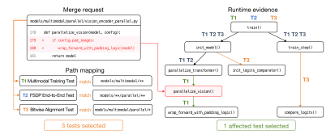
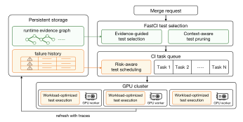
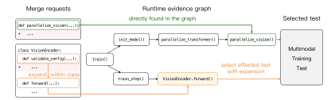
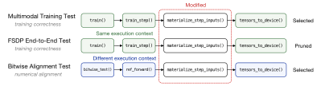
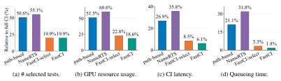
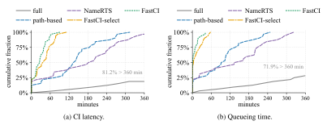
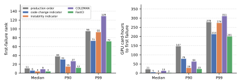

**Source:** *FastCI: Efficient GPU-Intensive CI for LLM Training Frameworks* — [PDF](https://arxiv.org/pdf/2610.01967) · [arXiv](https://arxiv.org/abs/2610.01967)

# FASTCI: EFFICIENT GPU-INTENSIVE CI FOR LLM TRAINING FRAMEWORKS

Tianshuo Qiao1, Naiqian Zheng1, Xiaopeng Liu2, Shuguang Wang2,

Diandian Gu2, Xuanzhe Liu1, Xin Jin1,\*

1Peking University 2ByteDance Seed

#### **ABSTRACT**

As large language models (LLMs) keep growing in size and complexity, their training frameworks evolve at a rapid pace as well. Therefore, continuous integration (CI) is critical for maintaining the quality and stability of these frameworks. However, unlike traditional software, CI for LLM training frameworks relies on GPU-intensive tests, which usually involve complete model training or evaluation. This leads CI itself to become a new bottleneck for fast-paced development. In this paper, we introduce FastCI, a framework that improves the efficiency of CI for LLM training frameworks. FastCI leverages runtime evidence to select affected tests and prune tests that execute changed code in equivalent contexts. Then FastCI prioritizes high-risk tests to expose potential failures earlier, and optimizes test workloads along dimensions outside the intended validation scope of each test. Evaluated on the CI workload of our LLM training framework, FastCI reduces the CI latency by 77.5% and the GPU resource usage by 63.9%, while improving the modified code coverage retention by 3.2%, compared with the currently deployed CI pipelines. FastCI has now been integrated into the CI pipelines of our LLM training framework at ByteDance.

## 1 Introduction

As large language models (LLMs) keep growing in size and complexity and are adopted in a wider range of tasks (Vaswani et al., 2017; Brown et al., 2020; Hoffmann et al., 2022), their training frameworks have evolved from simple libraries to sophisticated systems. For example, training frameworks may combine data, tensor, and pipeline parallelism with partitioned optimizer states in large scale training, or jointly manage vision and language components in multimodal training (Narayanan et al., 2021; Rajbhandari et al., 2020; Alayrac et al., 2022; Liu et al., 2023a). To preserve the quality and stability of these frameworks, continuous integration (CI) has become a critical part of the development process. CI refers to continuously building and testing code changes, commonly when a merge request (MR) is submitted or updated. Unlike traditional software, whose CI workloads are typically dominated by unit tests, LLM training frameworks rely heavily on GPU-intensive end-toend tests, since many behaviors, including successful training completion and numerical alignment, can be verified only through complete model training or evaluation. Validating these behaviors requires an extensive test suite that takes hours and consumes substantial GPU resources, making CI a new bottleneck in fast-paced LLM framework development.

In production CI pipelines, long latency and high GPU resource consumption are even more severe (Hilton et al., 2016; Xiao et al., 2018; Gu et al., 2019; Memon et al., 2017). The master branch of our training framework receives more than 200 MRs per week, and each MR may trigger CI pipelines multiple times as developers push commits to refine code or fix failures. Coding agents have further increased the frequency of code changes, accelerating development while also adding to the CI burden (Malhotra, 2026). To handle this workload, we maintain a dedicated CI resource pool comprising thousands of GPUs. Nevertheless, this resource pool remains saturated, and a CI run takes more than four hours on average. This problem stems not only from the high cost of individual

\*Corresponding author.

Figure 1: Test selection using path mappings and runtime evidence.

end-to-end tests, but also from inefficiencies in how existing CI pipelines validate the code changes. In fact, many tests are unnecessary, as they do not cover the changed code.

To prevent CI from triggering full test suites for each MR, path-based test selection has been adopted in open source projects and industry practice (Luu, 2026; Ray Project, 2026). This approach selects tests based on the mapping from files to tests, which is built and maintained manually in our deployed CI pipelines. There are two limitations preventing this approach from addressing the CI bottleneck for LLM training frameworks effectively. First, the mapping from files to tests is too coarse-grained to capture the dependencies between code changes and tests precisely, still causing many unnecessary tests to be executed. Second, maintaining the mapping manually is error-prone as the codebase evolves rapidly, and incomplete mappings can lead to false negatives in test selection. Figure 1 illustrates over-selection by path-based test selection. In this example, an MR modifies the function parallelize\_vision within vision\_encoder\_parallel.py. Path-based test selection includes all tests that depend on the modified file, while runtime evidence shows that only the Multimodal Training Test executes the modified function. This suggests that precise test selection should move from static file-level path mapping to function-level runtime evidence.

Beyond test selection, how the selected tests are executed presents further optimization opportunities (Li et al., 2024; Dutta et al., 2021). In our CI pipelines, tests follow first-in-first-out scheduling, which may take a long time to expose CI failures. Exposing failures earlier allows developers to manually stop the CI run and fix them sooner, saving time and GPU resources. In addition, end-to-end tests usually reuse the same workloads whose model sizes and numbers of training steps exceed what is necessary for their intended validation scope. These inefficiencies further delay actionable feedback and consume GPU resources without proportionally improving regression validation.

To address these issues, we present FastCI, a framework that optimizes both test selection and test execution in CI pipelines for LLM training frameworks. For test selection, FastCI uses lightweight sampling to collect runtime traces from GPU-intensive tests and organizes them into a graph that records the functions and calls observed for each test. Using this runtime evidence graph, FastCI selects only the tests that execute the changed functions and prunes those that execute them in equivalent contexts. For test execution, FastCI schedules tests based on their execution history, prioritizing high-risk tests to expose potential failures earlier, and accelerates individual tests by reducing the workload along dimensions outside the intended validation scope of each test.

Evaluated on the CI workload of our LLM training framework, FastCI reduces the CI latency by 77.5% and the GPU resource usage by 63.9% compared with path-based test selection, which is currently adopted in our CI pipelines. In addition, FastCI improves the modified code coverage retention by 3.2% over path-based test selection because runtime evidence recovers affected tests missed by file-level mappings, thereby covering more modified code lines. Furthermore, FastCI cuts the GPU resource usage before exposing the first failure by 89.2%, compared with the currently used first-in-first-out test scheduling. FastCI has now been integrated into the CI pipelines of our LLM training framework at ByteDance. With FastCI handling the CI workload, the average CI latency has been reduced by 58.4%, substantially improving development efficiency of our LLM training framework.

Figure 2: Overview of FastCI.

#### 2 RELATED WORK

Program analysis and runtime tracing for test selection. Regression test selection usually relies on dependencies between code and tests to identify which tests are affected by code changes (Rothermel & Harrold, 1996; Yoo & Harman, 2012; Elbaum et al., 2014). In addition to manually maintained path mapping, static program analysis is also widely used to extract these dependencies (Legunsen et al., 2017; Zhang, 2018; Liu et al., 2023b; Zhang et al., 2024; Maurina et al., 2025). File- or module-level static analysis is coarse-grained and still over-selects tests (Shi et al., 2017). Function- or method-level analysis can be more precise but introduce high analysis overhead for LLM training frameworks, causing the analysis to time out in our experiments. To address this issue, some recent approaches optimize the static analysis process. NameRTS makes function-level analysis potentially practical by using conservative name matching refined with runtime information (Wang et al., 2026). However, end-to-end tests in LLM training frameworks often share a core training entry point but execute different code paths across configurations, tasks, and enabled features. As NameRTS distinguishes tests by their test file entry points, it may therefore select unnecessary jobs in this scenario, as evaluated in Section 5.2.

To extract precise dependencies between code and tests, some approaches turn to runtime tracing (Gligoric et al., 2015b;a; Kauhanen et al., 2021). However, exhaustive tracing can substantially increase the runtime and GPU resource consumption of CI pipelines (Wang et al., 2024). To address this issue, FastCI turns to lightweight sampling to obtain runtime evidence, but it is challenging to design a test selection mechanism under potentially incomplete evidence.

**Prediction-based test selection and prioritization.** Prediction-based approaches may leverage historical outcomes, developer-provided information, learned representations, or LLM reasoning (Roy et al., 2026; Tao et al., 2025) to identify tests that are likely to fail (Leong et al., 2019; Machalica et al., 2019; Spieker et al., 2017; Prado Lima & Vergilio, 2022; Pan et al., 2022; Zhao et al., 2023; Plyusnin et al., 2025; Mehta et al., 2021; Herzig et al., 2015). However, their predictions do not provide a clear guarantee for test skipping. They are therefore commonly used in fail-stop pipelines, where likely failures are executed first but the full test suite remains necessary if no failure is observed. Rather than using predictions to skip tests, FastCI uses historical information only to schedule selected tests in our non-fail-stop CI pipelines.

#### 3 Overview

Figure 2 provides an overview of FastCI. FastCI consists of modular components that can be integrated into existing CI pipelines for LLM training frameworks with minimal changes. Across CI runs, it continuously updates a runtime evidence graph and test execution history. For each MR, FastCI uses this state to optimize both test selection and execution, improving CI efficiency throughout the MR lifecycle.

Each CI run first enters test selection. FastCI applies evidence-guided test selection, mapping code changes to runtime graph entities and selecting tests that reach them. If some changes lack

Figure 3: Affected-test selection for two MRs, either directly from runtime evidence or through within-class expansion when evidence is missing.

corresponding entities, indicating incomplete runtime evidence, FastCI broadens the selection to reduce the risk of omitting affected tests. The selected tests then pass through **context-aware test pruning**, which identifies tests that execute the changed code in equivalent contexts and removes redundant ones from the selection. In this phase, the core of FastCI is a runtime evidence graph built from runtime-sampled traces. This graph must be updated continuously to reflect the evolving codebase, which we will detail in Section 4.1.

The remaining tests then enter the test execution phase. FastCI first applies **risk-aware test scheduling** to prioritize high-risk tests based on associations between code changes and test failures, together with the recent flakiness of each test. This scheduling exposes potential failures earlier, allowing developers to receive feedback and intervene sooner. Then the ordered tests are submitted for execution, where FastCI applies **workload-optimized test execution** to reduce workload along dimensions outside the intended validation scope of each test. If the workload cannot be reduced, FastCI retains the original workload to preserve the validation capability of the test.

#### 4 Design

This section details the design of FastCI, consisting of four techniques, which are evidence-guided test selection (Section 4.1), context-aware test pruning (Section 4.2), risk-aware test scheduling (Section 4.3), and workload-optimized test execution (Section 4.4).

#### 4.1 EVIDENCE-GUIDED TEST SELECTION

Evidence-guided test selection uses a runtime evidence graph built from runtime traces sampled during previous CI runs. When the graph contains evidence for a modified function, FastCI directly selects the tests observed to execute that function. When such evidence is missing, FastCI intentionally broadens the selection to include tests that may execute the modified function even though this execution was not observed in previous runs.

For each codebase version, FastCI maintains a runtime evidence graph  $G=(V,E,A_V,A_E)$  that captures function-level code—test dependencies. V contains observed functions and methods, while  $E\subseteq V\times V$  represents observed calls. Attributes  $A_V$  and  $A_E$  map vertices and edges to the tests that executed them. Node attributes support precise affected-test selection, while edges support context-aware pruning in Section 4.2.

At the beginning of the test selection, code changes are mapped to a set of corresponding entities, denoted by M. For changes within explicit function or method scope, M contains the corresponding function or method. For changes outside explicit function or method scope, such as global variable definitions and conditional imports, M includes all functions and methods within the changed file.

Then FastCI searches the runtime evidence graph G for each entity in M and extracts the tests with explicit evidence of executing the modified code. However, it is possible that some entities in M cannot be found in G, indicating that the runtime evidence is incomplete. This issue stems from the sampling method for trace collection, especially for short-lived functions like configuration setters and utility functions. To reduce the risk of omitting potentially affected tests, FastCI intentionally broadens the test selection in two ways. First, for each modified method, M is expanded to include

all methods within the same class, as multiple methods of a class are usually invoked together within the same test. Second, for each modified function, M is expanded to include all its caller functions by scanning the codebase. After the expansion, evidence associated with these added entities allows FastCI to identify candidate tests for modified entities missing from G. Let Extend(M) denote the expanded set of entities. The selected tests Taf f ected(M) can be determined as

$$T_{affected}(M) = \bigcup_{m \in Extend(M)} A_V(m) \tag{1}$$

Figure [3](#page-3-1) illustrates the test selection process. For an MR modifying parallelize vision, its corresponding entity can be found in the runtime evidence graph and the affected test is selected directly. However, for an MR modifying VisionEncoder.validate config, which is a simple configuration setter, its corresponding entity is missing from the graph. Therefore, FastCI broadens the selection through other methods within the same class and finally identifies the test through VisionEncoder.forward. This test was verified to be affected by the MR.

The remaining challenge is keeping the runtime evidence graph aligned with the evolving codebase. Sampling tools (*e.g.*, py-spy [\(Frederickson, 2026\)](#page-9-4)) add overhead, but it is small relative to savings of FastCI. By default, FastCI samples each CI run and updates the graph when an MR is merged. For a stable codebase, since a single MR changes only a small fraction of the codebase, the graph tolerates limited staleness and can instead be updated periodically, such as every three commits.

## 4.2 CONTEXT-AWARE TEST PRUNING

After evidence-guided test selection, the selected test set may still be large because multiple tests can execute the same modified function [\(Shi et al., 2015\)](#page-12-12). For instance, lightweight environment checking functions are invoked by most end-to-end tests, causing many tests with redundant coverage to be selected when these functions change. Although one representative test may be sufficient, tests cannot be pruned solely because they execute the same function, as the behavior of the function may depend on the calling context. FastCI therefore distinguishes tests by their execution contexts and prunes only those that exercise the modified function in equivalent contexts.

To identify such redundant tests, FastCI extracts an execution context CK(m, t) for each modified entity m and selected test t from the runtime evidence graph. The context is a test-specific subgraph of G containing the callers and callees within K hops of m. We use K = 3 by default. Then two tests are considered redundant for m only if their context subgraphs are identical and their validation metadata, such as task type and hardware requirements, also match. Accordingly, test equivalence is defined as follows:

$$t_i \equiv_m t_j \iff C_K(m, t_i) = C_K(m, t_j) \land meta(t_i) = meta(t_j). \tag{2}$$

Pruning is performed independently for each modified entity, and the retained tests are then merged across all modified entities.

Figure [4](#page-5-1) shows an example of redundant tests. The Multimodal Training Test and FSDP End-to-End Test execute materialize step inputs with identical caller and callee chains in the runtime evidence graph. They are therefore considered redundant, and only one needs to be retained. In contrast, the Bitwise Alignment Test executes the function in a different context and must remain selected.

After identifying redundant tests, FastCI selects a representative test for each equivalence group. It estimates the GPU cost of each test from its historical execution time and the number of GPUs required. Among tests with equivalent execution contexts and validation metadata, FastCI selects the test with the lowest estimated GPU cost, while the remaining tests are pruned from the selection.

#### 4.3 RISK-AWARE TEST SCHEDULING

Once the test set has been selected and pruned, the remaining tests are scheduled and dispatched to the GPU resource pool for execution. First-in-first-out scheduling can delay actionable failure feedback. Developers must then fix the problem and rerun CI from scratch, leading to inefficient development cycles and GPU resource waste. FastCI instead derives each test's risk from historical execution outcomes and prioritizes high-risk tests to expose potential failures earlier.

Figure 4: Context-aware test pruning when materialize\_step\_inputs is modified.

Failures in production CI pipelines arise not only from incorrect code changes but also from external factors such as environment issues and dependency breakages. FastCI therefore uses two complementary risk indicators to prioritize tests. The first captures historical associations between code changes and test failures. It identifies failures likely caused by code changes but provides limited evidence for newly added modules and functions. The second captures the recent instability of each test. It reflects failures caused by changing environments, dependencies, or flaky behavior (Luo et al., 2014; Bell et al., 2018; Lam et al., 2020), but is less specific to the current code change.

FastCI assesses the risk of each test by combining the two risk indicators as

$$R(t) = \alpha_t R_{code}(t) + (1 - \alpha_t) \times R_{instability}(t)$$
(3)

where  $R_{code}(t)$  is the risk of t based on code changes, and  $R_{instability}(t)$  is the risk of t based on recent instability.  $\alpha_t$  reflects the confidence in the code change risk indicator and increases with the number of historical observations available for the current change-test associations. Appendix A details the calculation of this risk score. By combining these two indicators, FastCI can capture both failures caused by code changes and external factors, and avoid being misled when encountering newly added modules and functions. Accordingly, FastCI schedules tests in descending order of their risk scores, improving the feedback efficiency and reducing the GPU resource waste caused by running on already broken code.

#### 4.4 WORKLOAD-OPTIMIZED TEST EXECUTION

Beyond test scheduling, FastCI also considers the workload of each test to optimize the GPU resource utilization. Typically, the workload of each test is derived from production configurations. Some dimensions of the workload, including parallelism degree and batch size, are adjusted to CI requirements, but others like model size, sequence length and production options (*e.g.*, logging and metrics collection) are left unchanged. These unchanged dimensions of the workload further increase GPU resource usage without proportionally improving regression validation, as they are outside the intended validation scope of the test.

For each test, FastCI identifies the dimensions of the workload that are related to its intended validation scope through test metadata and its historical execution paths from the runtime evidence graph. For example, tests for distributed execution rely on the parallelism degree, while tests for long sequence training rely on the sequence length. For dimensions that can be explicitly identified as unrelated to the intended validation scope, FastCI reduces them automatically. For dimensions that cannot be explicitly identified, FastCI leaves them unchanged.

FastCI applies these reductions as configuration overrides when submitting a test to the existing CI runner, without modifying the test code. In practice, we found that decreasing model size and turning off production options like logging and metrics collection can accelerate tests in many cases while producing the same test outcomes as the original workload in our comparisons. To reduce the risk of missing failures that appear only under the original workload, FastCI periodically executes the same test with both the original and reduced workloads and compares their pass or fail outcomes. The reduction is retained only while the outcomes agree. Otherwise, the original workload is restored. Repeating this comparison allows FastCI to withdraw an accepted reduction when the code or test behavior changes.

Figure 5: End-to-end CI performance. The statistics are relative to full CI.

Figure 6: CDF of CI latency and queueing time under different approaches. The x-axis is shown up to 360 minutes and annotations report the fraction of full CI runs beyond this range.

#### 5 EVALUATION

We evaluate FastCI on CI workloads from our LLM training framework, which supports diverse training tasks at ByteDance. Compared with deployed CI, FastCI reduces latency by 77.5% and GPU usage by 63.9%, while improving modified code coverage retention by 3.2% through recovering affected tests missed by file-level mappings. Each technique contributes to overall performance. FastCI has been integrated into production CI at ByteDance and now handles the CI workload, reducing CI latency by 58.4%, with no reported regressions caused by omitted tests across 784 CI runs over three weeks.

#### 5.1 END-TO-END CI PERFORMANCE

We evaluate the end-to-end performance of FastCI by sampling production MRs and submitting them to self-provisioned shadow CI pipelines over two days, avoiding interference with production CI. We compare FastCI against full CI, path-based CI, NameRTS, and FastCI-select. Under full CI, the entire suite is executed for each MR, while path-based CI uses the file-level mapping to select tests and is currently deployed in our production CI. NameRTS is a state-of-the-art regression test selection method whose optimized static analysis scales to our large LLM training framework (Wang et al., 2026). FastCI-select applies only evidence-guided selection and context-aware pruning, without risk-aware test scheduling or workload-optimized execution.

Figure 5 compares the average efficiency of different approaches. Path-based CI selects 50.6% of tests and reduces GPU resource usage, CI latency, and queueing time of tests to 51.5%, 26.9%, and 21.1% of full CI, respectively. However, its coarse-grained mappings still select many unnecessary tests, preventing it from fully relieving the pressure on production CI. Fine-grained static analysis alone is also insufficient as NameRTS selects 55.1% of tests and is even less efficient than path-based CI across all four metrics. This is because NameRTS is only able to map code changes to entry points of tests, which can be shared by the end-to-end tests of LLM training framework CI, causing over-selection. Beyond them, FastCI reduces GPU resource usage, CI latency, and queueing time to 18.6%, 6.1%, and 1.8% of full CI.

| Method                    | Number of selected tests | GPU resource cost | Recall of affected tests | Modified code coverage retention |
|---------------------------|-----------------------------|----------------------|-----------------------------|-------------------------------------|
| Path-based                | 62.6%                       | 67.6%                | 76.1%                       | 96.0%                               |
| NameRTS                   | 77.2%                       | 80.8%                | 94.0%                       | 95.8%                               |
| LLM reasoning             | 39.4%                       | 42.1%                | 54.6%                       | 83.1%                               |
| FastCI-select w/o pruning | 35.9%                       | 39.4%                | 84.5%                       | 99.8%                               |

FastCI-select 25.7% 28.6% 66.2% 99.2%

Table 1: Comparison between different test selection methods.

Figure [6](#page-6-1) shows CI latency and test queueing time distributions under different approaches. For both metrics, FastCI outperforms path-based CI and NameRTS at every percentile. Compared with path-based CI, at the median, FastCI reduces CI latency by 79.2%, and queueing time by 97.3%. At the 90th percentile, the corresponding reductions are 78.3% and 89.0%, demonstrating that the improvement is consistent across MRs rather than being driven by a few inexpensive cases. Notably, some MRs have zero CI latency under path-based CI, NameRTS, and FastCI. They usually introduce new features or new modules and thus there are no tests executing the newly added code.

## 5.2 EFFECTIVENESS OF TEST SELECTION

We evaluate test selection by replaying production CI workloads from an internal LLM training framework. We compare five test selection methods: path-based test selection, LLM reasoning, NameRTS, FastCI-select without context-aware test pruning, and the full FastCI-select. For the LLM reasoning baseline, a GPT-5.5 [\(OpenAI, 2026\)](#page-11-14) agent analyzes each MR diff and candidate tests and returns those it considers affected. For efficiency, we measure the selected-test ratio and normalized GPU cost. For coverage, we execute the full suite with exhaustive line-level collection using Coverage.py [\(Batchelder et al., 2026\)](#page-9-6), establishing an offline reference of tests that execute the modified code. Against this reference, we measure the recall of affected tests and the modified code coverage retained by each selection method.

As shown in Table [1,](#page-7-1) compared with path-based test selection, evidence-guided test selection achieves better efficiency by reducing the selected test ratio from 62.6% to 35.9% and normalized GPU cost from 67.6% to 39.4%, while improving the recall of affected tests from 76.1% to 84.5% and modified code coverage retention from 96.0% to 99.8%. By further applying context-aware test pruning, FastCI-select reduces the selected test ratio to 25.7% and normalized GPU cost to 28.6%. This efficiency gain comes with recall of affected tests decreasing to 66.2%, as some affected tests are intentionally pruned as redundant. However, modified code coverage retention decreases by only 0.6% to 99.2%, which remains higher than that of the other approaches, suggesting that most pruned tests cover modified code already executed by the retained tests.

As for other baselines, LLM reasoning reduces the selected test ratio and GPU cost compared to path-based test selection, but it performs poorly on coverage, retaining only 54.6% of affected tests and 83.1% of modified code coverage. This is because LLM reasoning cannot infer the complete execution paths of end-to-end tests precisely, especially on our large codebase. For NameRTS, although it achieves 94.0% recall of affected tests, its normalized GPU cost also reaches 80.8%, indicating that the higher recall substantially comes from over-selection.

#### 5.3 EFFECTIVENESS OF TEST SCHEDULING

We evaluate whether FastCI's risk-aware scheduling exposes CI failures earlier, improving feedback efficiency and reducing GPU usage. We compare FastCI with the production first-in-first-out order, the two single-indicator variants, and COLEMAN, a representative learning-based test prioritization approach for CI [\(Prado Lima & Vergilio, 2022\)](#page-11-9). We use its best-performing configuration, FRRMAB with the TimeRank reward, and average the results over ten fixed random seeds. Because resource pool capacity and concurrent CI workloads affect feedback latency, we focus on first-failing-test rank and GPU consumption before the first failure, which directly reflect the effectiveness of test scheduling.

| Table 2: Tracing | overhead and fina | 1 test-selection | effectiveness a    | t different sa | ampling rates   |
|------------------|-------------------|------------------|--------------------|----------------|-----------------|
| radic 2. Tracing | Overnead and mid  | i tost sciection | CIICCII I CIICSS a | t uniterent st | minpinia rates. |

| Sampling rate | Tracing overhead | Recall of affected tests | Modified code coverage retention |
|---------------|------------------|--------------------------|----------------------------------|
| 10 Hz         | 0.3%             | 57.7%                    | 97.5%                            |
| 50 Hz         | 4.1%             | 66.2%                    | 99.2%                            |
| 100 Hz        | 17.0%            | 68.4%                    | 99.6%                            |

Figure 7 shows that, compared with production first-in-first-out scheduling, FastCI reduces median first-failure rank by 63.6% and median GPU consumption before the first failure by 89.2%, exposing failures earlier with substantially less GPU consumption. Compared with COLEMAN, FastCI reduces the median first-failure rank from 9 to 4 and the median GPU consumption before the first failure from 12.6 to 2.3 card-hours. It also performs better at P90 and P99 on both metrics. The two indicators provide complementary benefits. The instability indicator performs better at the median and P90, suggesting that recent test instability is more informative for most production failures. In contrast, the code change indicator performs better at P99, where CI runs tend to contain larger selected test sets. By combining both indicators, FastCI achieves better overall performance than either indicator alone.

Figure 7: Effectiveness of risk-aware test scheduling compared with production order, single-indicator variants, and COLEMAN.

#### 5.4 EFFECTIVENESS OF WORKLOAD OPTIMIZATION

We evaluate two questions: whether workload-optimized execution accelerates individual tests and whether this acceleration improves end-to-end CI. Comparing tests with and without workload optimization, we find that FastCI reduces average single-test execution time by 11.8% and GPU consumption by 19.3%, since tests with larger workloads tend to run longer and therefore offer more optimization opportunities. This acceleration of individual tests contributes to the end-to-end CI performance. As illustrated in Figure 5, compared with FastCI-select, FastCI can further reduce the GPU resource usage by 18.3%, average CI latency by 28.6% and queueing time of tests by 46.6%, demonstrating the effectiveness of workload-optimized test execution in an end-to-end setting.

#### 5.5 OVERHEAD AND COVERAGE OF RUNTIME SAMPLING

We study the sampling-rate tradeoff and whether runtime sampling overhead becomes a new CI bottleneck. We repeat the test selection evaluation in Section 5.2 at 10, 50, and 100 Hz, enabling context-aware pruning in all configurations. Thus, the reported recall and coverage reflect final selection rather than raw trace capture. In this evaluation, Hz denotes stack samples collected per second. Table 2 shows that higher rates provide more complete runtime evidence for coverage but add overhead. In practice, 50 Hz is a suitable tradeoff, retaining 99.2% of full-suite modified-code coverage with only 4.1% overhead. Raising the rate to 100 Hz improves retention by only 0.4% but raises overhead to 17.0%. Relative to FastCI's efficiency gains, this overhead is small and does not become a new CI bottleneck, as the end-to-end evaluation (Section 5.1) still shows substantial reductions in CI latency and GPU usage.

# 6 CONCLUSION

We present FastCI, a framework that improves CI efficiency for LLM training frameworks by using a runtime evidence graph to select and prune tests while optimizing their scheduling and execution. On production CI workloads, FastCI reduces CI latency by 77.5% and GPU resource usage by 63.9%, while improving modified code coverage retention by 3.2% over the deployed CI pipelines. FastCI has been integrated into production CI at ByteDance.

## AI USE STATEMENT

Generative AI tools were used to assist with language editing, literature search and reference organization, and the implementation of plotting scripts. The manuscript was originally written by the authors, and all AI-assisted textual suggestions were reviewed and manually revised by the authors. The conceptual design and content of all figures were determined by the authors. For experimental figures, the authors provided the data, verified the plotting code, and executed the scripts themselves. Generative AI was not used to generate experimental data, conduct experiments, formulate the core methodology, or draw final scientific conclusions. The authors take full responsibility for the final content of this work.

# REFERENCES

Jean-Baptiste Alayrac, Jeff Donahue, Pauline Luc, Antoine Miech, Iain Barr, Yana Hasson, Karel Lenc, Arthur Mensch, Katherine Millican, Malcolm Reynolds, Roman Ring, Eliza Rutherford, Serkan Cabi, Tengda Han, Zhitao Gong, Sina Samangooei, Marianne Monteiro, Jacob L. Menick, Sebastian Borgeaud, Andy Brock, Aida Nematzadeh, Sahand Sharifzadeh, Mikołaj Binkowski, ´ Ricardo Barreira, Oriol Vinyals, Andrew Zisserman, and Karen Simonyan. Flamingo: A visual ´ language model for few-shot learning. In *Advances in Neural Information Processing Systems*, volume 35, pp. 23716–23736. Curran Associates, Inc., 2022. doi: 10.52202/068431-1723.

Ned Batchelder et al. Coverage.py: The code coverage tool for python. Software documentation, 2026. URL <https://coverage.readthedocs.io/>.

Jonathan Bell, Owolabi Legunsen, Michael Hilton, Lamyaa Eloussi, Tifany Yung, and Darko Marinov. DeFlaker: Automatically detecting flaky tests. In *Proceedings of the 40th International Conference on Software Engineering*, pp. 433–444, 2018. doi: 10.1145/3180155.3180164.

Tom B. Brown, Benjamin Mann, Nick Ryder, Melanie Subbiah, Jared D. Kaplan, Prafulla Dhariwal, Arvind Neelakantan, Pranav Shyam, Girish Sastry, Amanda Askell, Sandhini Agarwal, Ariel Herbert-Voss, Gretchen Krueger, Tom Henighan, Rewon Child, Aditya Ramesh, Daniel M. Ziegler, Jeffrey Wu, Clemens Winter, Chris Hesse, Mark Chen, Eric Sigler, Mateusz Litwin, Scott Gray, Benjamin Chess, Jack Clark, Christopher Berner, Sam McCandlish, Alec Radford, Ilya Sutskever, and Dario Amodei. Language models are few-shot learners. In *Advances in Neural Information Processing Systems*, volume 33, pp. 1877–1901. Curran Associates, Inc., 2020. URL [https://proceedings.neurips.cc/paper/2020/hash/](https://proceedings.neurips.cc/paper/2020/hash/1457c0d6bfcb4967418bfb8ac142f64a-Abstract.html) [1457c0d6bfcb4967418bfb8ac142f64a-Abstract.html](https://proceedings.neurips.cc/paper/2020/hash/1457c0d6bfcb4967418bfb8ac142f64a-Abstract.html).

Saikat Dutta, Jeeva Selvam, Aryaman Jain, and Sasa Misailovic. TERA: Optimizing stochastic regression tests in machine learning projects. In *Proceedings of the 30th ACM SIG-SOFT International Symposium on Software Testing and Analysis*, pp. 413–426, 2021. doi: 10.1145/3460319.3464844.

Sebastian Elbaum, Gregg Rothermel, and John Penix. Techniques for improving regression testing in continuous integration development environments. In *Proceedings of the 22nd ACM SIGSOFT International Symposium on Foundations of Software Engineering*, pp. 235–245, 2014. doi: 10. 1145/2635868.2635910.

Ben Frederickson. py-spy: Sampling profiler for python programs. Software repository, 2026. URL <https://github.com/benfred/py-spy>.

- Milos Gligoric, Lamyaa Eloussi, and Darko Marinov. Practical regression test selection with dynamic file dependencies. In *Proceedings of the 2015 International Symposium on Software Testing and Analysis*, pp. 211–222, 2015a. doi: 10.1145/2771783.2771784.
- Milos Gligoric, Lamyaa Eloussi, and Darko Marinov. Ekstazi: Lightweight test selection. In *2015 IEEE/ACM 37th IEEE International Conference on Software Engineering*, volume 2, pp. 713– 716, 2015b. doi: 10.1109/ICSE.2015.230.
- Juncheng Gu, Mosharaf Chowdhury, Kang G. Shin, Yibo Zhu, Myeongjae Jeon, Junjie Qian, Hongqiang Liu, and Chuanxiong Guo. Tiresias: A GPU cluster manager for distributed deep learning. In *16th USENIX Symposium on Networked Systems Design and Implementation (NSDI 19)*, pp. 485–500. USENIX Association, 2019. URL [https://www.usenix.org/](https://www.usenix.org/conference/nsdi19/presentation/gu) [conference/nsdi19/presentation/gu](https://www.usenix.org/conference/nsdi19/presentation/gu).
- Kim Herzig, Michaela Greiler, Jacek Czerwonka, and Brendan Murphy. The art of testing less without sacrificing quality. In *Proceedings of the 37th International Conference on Software Engineering*, volume 1, pp. 483–493, 2015. doi: 10.1109/ICSE.2015.66.
- Michael Hilton, Timothy Tunnell, Kai Huang, Darko Marinov, and Danny Dig. Usage, costs, and benefits of continuous integration in open-source projects. In *Proceedings of the 31st IEEE/ACM International Conference on Automated Software Engineering*, pp. 426–437, 2016. doi: 10.1145/ 2970276.2970358.
- Jordan Hoffmann, Sebastian Borgeaud, Arthur Mensch, Elena Buchatskaya, Trevor Cai, Eliza Rutherford, Diego de Las Casas, Lisa Anne Hendricks, Johannes Welbl, Aidan Clark, Thomas Hennigan, Eric Noland, Katherine Millican, George van den Driessche, Bogdan Damoc, Aurelia Guy, Simon Osindero, Karen Simonyan, Erich Elsen, Oriol Vinyals, Jack Rae, and Laurent Sifre. ´ An empirical analysis of compute-optimal large language model training. In *Advances in Neural Information Processing Systems*, volume 35, pp. 30016–30030. Curran Associates, Inc., 2022. doi: 10.52202/068431-2176.
- Eero Olavi Kauhanen, Jukka K. Nurminen, Tommi Mikkonen, and Matvei Pashkovskiy. Regression test selection tool for python in continuous integration process. In *2021 IEEE International Conference on Software Analysis, Evolution and Reengineering (SANER)*, pp. 618–621, 2021. doi: 10.1109/SANER50967.2021.00077.
- Wing Lam, Kıvanc¸ Mus¸lu, Hitesh Sajnani, and Suresh Thummalapenta. A study on the lifecycle of flaky tests. In *Proceedings of the ACM/IEEE 42nd International Conference on Software Engineering*, pp. 1471–1482, 2020. doi: 10.1145/3377811.3381749.
- Owolabi Legunsen, August Shi, and Darko Marinov. STARTS: Static regression test selection. In *2017 32nd IEEE/ACM International Conference on Automated Software Engineering (ASE)*, pp. 949–954, 2017. doi: 10.1109/ASE.2017.8115710.
- Claire Leong, Abhayendra Singh, Mike Papadakis, Yves Le Traon, and John Micco. Assessing transition-based test selection algorithms at google. In *2019 IEEE/ACM 41st International Conference on Software Engineering: Software Engineering in Practice (ICSE-SEIP)*, pp. 101–110, 2019. doi: 10.1109/ICSE-SEIP.2019.00019.
- Chengpeng Li, Abdelrahman Baz, and August Shi. Reducing test runtime by transforming test fixtures. In *Proceedings of the 39th IEEE/ACM International Conference on Automated Software Engineering*, pp. 1757–1769, 2024. doi: 10.1145/3691620.3695541.
- Haotian Liu, Chunyuan Li, Qingyang Wu, and Yong Jae Lee. Visual instruction tuning. In *Advances in Neural Information Processing Systems*, volume 36, pp. 34892–34916. Curran Associates, Inc., 2023a. doi: 10.52202/075280-1516.
- Yu Liu, Jiyang Zhang, Pengyu Nie, Milos Gligoric, and Owolabi Legunsen. More precise regression test selection via reasoning about semantics-modifying changes. In *Proceedings of the 32nd ACM SIGSOFT International Symposium on Software Testing and Analysis*, pp. 664–676, 2023b. doi: 10.1145/3597926.3598086.

- Qingzhou Luo, Farah Hariri, Lamyaa Eloussi, and Darko Marinov. An empirical analysis of flaky tests. In *Proceedings of the 22nd ACM SIGSOFT International Symposium on Foundations of Software Engineering*, pp. 643–653, 2014. doi: 10.1145/2635868.2635920.
- Kevin Luu. Keeping vLLM production quality: A look inside CI, benchmarking, and the release process. vLLM Project Blog, 2026. URL [https://github.](https://github.com/vllm-project/vllm-project.github.io/blob/main/_posts/2026-07-16-keeping-vllm-production-quality.md) [com/vllm-project/vllm-project.github.io/blob/main/\\_posts/](https://github.com/vllm-project/vllm-project.github.io/blob/main/_posts/2026-07-16-keeping-vllm-production-quality.md) [2026-07-16-keeping-vllm-production-quality.md](https://github.com/vllm-project/vllm-project.github.io/blob/main/_posts/2026-07-16-keeping-vllm-production-quality.md).
- Mateusz Machalica, Alex Samylkin, Meredith Porth, and Satish Chandra. Predictive test selection. In *2019 IEEE/ACM 41st International Conference on Software Engineering: Software Engineering in Practice (ICSE-SEIP)*, pp. 91–100, 2019. doi: 10.1109/ICSE-SEIP.2019.00018.
- Sachin Malhotra. Agentic coding is straining CI. here's how we scaled test impact analysis at Anthropic. [Anthropic Blog,](https://claude.com/blog/agentic-coding-is-straining-ci-heres-how-we-scaled-test-impact-analysis-at-anthropic) September 2026.
- Gabriele Maurina, Walter Cazzola, and Sudipto Ghosh. BabelRTS: Polyglot regression test selection. *IEEE Transactions on Software Engineering*, 51(5):1487–1499, 2025. doi: 10.1109/TSE. 2025.3554403.
- Sonu Mehta, Farima Farmahinifarahani, Ranjita Bhagwan, Suraj Guptha, Sina Jafari, Rahul Kumar, Vaibhav Saini, and Anirudh Santhiar. Data-driven test selection at scale. In *Proceedings of the 29th ACM Joint Meeting on European Software Engineering Conference and Symposium on the Foundations of Software Engineering*, pp. 1225–1235, 2021. doi: 10.1145/3468264.3473916.
- Atif Memon, Zebao Gao, Bao Nguyen, Sanjeev Dhanda, Eric Nickell, Rob Siemborski, and John Micco. Taming google-scale continuous testing. In *2017 IEEE/ACM 39th International Conference on Software Engineering: Software Engineering in Practice Track (ICSE-SEIP)*, pp. 233– 242, 2017. doi: 10.1109/ICSE-SEIP.2017.16.
- Deepak Narayanan, Mohammad Shoeybi, Jared Casper, Patrick LeGresley, Mostofa Patwary, Vijay Korthikanti, Dmitri Vainbrand, Prethvi Kashinkunti, Julie Bernauer, Bryan Catanzaro, Amar Phanishayee, and Matei Zaharia. Efficient large-scale language model training on GPU clusters using Megatron-LM. In *Proceedings of the International Conference for High Performance Computing, Networking, Storage and Analysis*, pp. 1–15, 2021. doi: 10.1145/3458817.3476209.
- OpenAI. GPT-5.5 Model. OpenAI API Documentation, 2026. URL [https://developers.](https://developers.openai.com/api/docs/models/gpt-5.5) [openai.com/api/docs/models/gpt-5.5](https://developers.openai.com/api/docs/models/gpt-5.5).
- Rongqi Pan, Mojtaba Bagherzadeh, Taher A. Ghaleb, and Lionel Briand. Test case selection and prioritization using machine learning: A systematic literature review. *Empirical Software Engineering*, 27(2):29, 2022. doi: 10.1007/s10664-021-10066-6.
- Pavel Plyusnin, Aleksey Antonov, Vasilii Ermakov, Aleksandr Khaybriev, Margarita Kikot, Ilseyar Alimova, and Stanislav Moiseev. Targeted test selection approach in continuous integration. In *IEEE International Conference on Software Maintenance and Evolution (ICSME)*, pp. 697–708, 2025. doi: 10.1109/ICSME64153.2025.00070. URL [https://arxiv.org/abs/2509.](https://arxiv.org/abs/2509.10279) [10279](https://arxiv.org/abs/2509.10279).
- Jackson Antonio Prado Lima and Silvia Regina Vergilio. A multi-armed bandit approach for test case prioritization in continuous integration environments. *IEEE Transactions on Software Engineering*, 48(2):453–465, 2022. doi: 10.1109/TSE.2020.2992428.
- Samyam Rajbhandari, Jeff Rasley, Olatunji Ruwase, and Yuxiong He. ZeRO: Memory optimizations toward training trillion parameter models. In *SC20: International Conference for High Performance Computing, Networking, Storage and Analysis*, pp. 1–16, 2020. doi: 10.1109/SC41405.2020.00024.
- Ray Project. Path-based test selection in Ray CI. Software repository, 2026. URL [https://github.com/ray-project/ray/blob/master/ci/pipeline/](https://github.com/ray-project/ray/blob/master/ci/pipeline/determine_tests_to_run.py) [determine\\_tests\\_to\\_run.py](https://github.com/ray-project/ray/blob/master/ci/pipeline/determine_tests_to_run.py).
- Gregg Rothermel and Mary Jean Harrold. Analyzing regression test selection techniques. *IEEE Transactions on Software Engineering*, 22(8):529–551, 1996. doi: 10.1109/32.536955.

- Monoshi Kumar Roy, Simin Chen, Benjamin Steenhoek, Jinjun Peng, Gail Kaiser, Baishakhi Ray, and Wei Le. CodeSense: A real-world benchmark and dataset for code semantic reasoning. In *International Conference on Learning Representations (ICLR)*, pp. 13735–13768, 2026. URL [https://proceedings.iclr.cc/paper\\_files/paper/2026/hash/](https://proceedings.iclr.cc/paper_files/paper/2026/hash/17111bdc85e54468afb111e33f6f7eec-Abstract-Conference.html) [17111bdc85e54468afb111e33f6f7eec-Abstract-Conference.html](https://proceedings.iclr.cc/paper_files/paper/2026/hash/17111bdc85e54468afb111e33f6f7eec-Abstract-Conference.html).
- August Shi, Tifany Yung, Alex Gyori, and Darko Marinov. Comparing and combining test-suite reduction and regression test selection. In *Proceedings of the 2015 10th Joint Meeting on Foundations of Software Engineering*, pp. 237–247, 2015. doi: 10.1145/2786805.2786878.
- August Shi, Suresh Thummalapenta, Shuvendu K. Lahiri, Nikolaj Bjørner, and Jacek Czerwonka. Optimizing test placement for module-level regression testing. In *Proceedings of the 39th International Conference on Software Engineering*, pp. 689–699, 2017. doi: 10.1109/ICSE.2017.69.
- Helge Spieker, Arnaud Gotlieb, Dusica Marijan, and Morten Mossige. Reinforcement learning for automatic test case prioritization and selection in continuous integration. In *Proceedings of the 26th ACM SIGSOFT International Symposium on Software Testing and Analysis*, pp. 12–22, 2017. doi: 10.1145/3092703.3092709.
- Hongyuan Tao, Ying Zhang, Zhenhao Tang, Hongen Peng, Xukun Zhu, Bingchang Liu, Yingguang Yang, Ziyin Zhang, Zhaogui Xu, Haipeng Zhang, Linchao Zhu, Rui Wang, Hang Yu, Jianguo Li, and Peng Di. Code graph model (CGM): A graph-integrated large language model for repositorylevel software engineering tasks. In *Advances in Neural Information Processing Systems*, volume 38, pp. 15869–15909. Curran Associates, Inc., 2025. doi: 10.52202/085713-0537.
- Ashish Vaswani, Noam Shazeer, Niki Parmar, Jakob Uszkoreit, Llion Jones, Aidan N. Gomez, Łukasz Kaiser, and Illia Polosukhin. Attention is all you need. In *Advances in Neural Information Processing Systems*, volume 30. Curran Associates, Inc., 2017. URL [https://proceedings.neurips.cc/paper/2017/hash/](https://proceedings.neurips.cc/paper/2017/hash/3f5ee243547dee91fbd053c1c4a845aa-Abstract.html) [3f5ee243547dee91fbd053c1c4a845aa-Abstract.html](https://proceedings.neurips.cc/paper/2017/hash/3f5ee243547dee91fbd053c1c4a845aa-Abstract.html).
- Jiale Amber Wang, Kaiyuan Wang, and Pengyu Nie. Efficient incremental code coverage analysis for regression test suites. In *Proceedings of the 39th IEEE/ACM International Conference on Automated Software Engineering*, pp. 1882–1894, 2024. doi: 10.1145/3691620.3695551.
- You Wang, Michael Pradel, and Zhongxin Liu. Names are all you need: Effective and safe regression test selection for python. *arXiv preprint arXiv:2605.25356*, 2026. URL [https://arxiv.](https://arxiv.org/abs/2605.25356) [org/abs/2605.25356](https://arxiv.org/abs/2605.25356).
- Wencong Xiao, Romil Bhardwaj, Ramachandran Ramjee, Muthian Sivathanu, Nipun Kwatra, Zhenhua Han, Pratyush Patel, Xuan Peng, Hanyu Zhao, Quanlu Zhang, Fan Yang, and Lidong Zhou. Gandiva: Introspective cluster scheduling for deep learning. In *13th USENIX Symposium on Operating Systems Design and Implementation (OSDI 18)*, pp. 595–610. USENIX Association, 2018. URL [https://www.usenix.org/conference/osdi18/presentation/](https://www.usenix.org/conference/osdi18/presentation/xiao) [xiao](https://www.usenix.org/conference/osdi18/presentation/xiao).
- Shin Yoo and Mark Harman. Regression testing minimization, selection and prioritization: A survey. *Software Testing, Verification and Reliability*, 22(2):67–120, 2012. doi: 10.1002/stv.430.
- Guofeng Zhang, Luyao Liu, Zhenbang Chen, and Ji Wang. Hybrid regression test selection by integrating file and method dependences. In *Proceedings of the 39th IEEE/ACM International Conference on Automated Software Engineering*, pp. 1557–1569, 2024. doi: 10.1145/3691620. 3695525.
- Lingming Zhang. Hybrid regression test selection. In *Proceedings of the 40th International Conference on Software Engineering*, pp. 199–209, 2018. doi: 10.1145/3180155.3180198.
- Yifan Zhao, Dan Hao, and Lu Zhang. Revisiting machine learning based test case prioritization for continuous integration. In *2023 IEEE International Conference on Software Maintenance and Evolution (ICSME)*, pp. 232–244, 2023. doi: 10.1109/ICSME58846.2023.00032.

# A RISK SCORE COMPUTATION FOR TEST SCHEDULING

We calculate the risk score in Equation [3](#page-5-2) from statistics collected online from previous CI runs. In the evaluation, code changes are represented by the files containing the modified entities. For a changed file f and test t, let nf,t be the number of previous CI runs in which f was changed and t was executed, and let ef,t be the number of these runs in which t failed. Given the set of files F changed by the current MR, risk indicated by code change is

$$R_{code}(t) = \max_{f \in F} \frac{e_{f,t}}{n_{f,t}},\tag{4}$$

where a pair without previous observations contributes zero. Let f ∗ be the file attaining the maximum positive failure rate. We set the confidence of this signal to

$$\alpha_t = \frac{n_{f^*,t}}{n_{f^*,t} + \lambda}.\tag{5}$$

Here, λ is a smoothing parameter controlling how quickly the code change indicator gains confidence; we set λ = 5 in our evaluation. If no changed file has a positive historical failure rate for t, we set Rcode(t) = 0 and αt = 0, so the risk score is determined solely by the instability indicator.

To assess test instability, we retain up to W most recent execution outcomes for each test. Let Nt be the number of outcomes available for test t and Lt = min(W, Nt) be the actual history length used. Let yi ∈ {0, 1} denote the i-th outcome in this history, where one indicates failure and the outcomes are ordered from oldest to newest. We first compute an exponentially weighted failure rate

$$\widetilde{R}_{instability}(t) = \frac{\sum_{i=1}^{L_t} \gamma^{L_t - i} y_i}{\sum_{i=1}^{L_t} \gamma^{L_t - i}},$$
(6)

where γ is the exponential decay factor. We set W = 5 and γ = 0.8 in our evaluation, and the score is zero when no history is available. Consecutive passes may indicate that a previous failure has been fixed or that test optimizations have reduced its flakiness. FastCI therefore increasingly attenuates the exponentially weighted failure rate with the consecutive-pass count, which resets after a failure. In our evaluation, the attenuation factors are 0.85 and 0.6 at two and four consecutive passes, respectively, and the attenuated value is used as Rinstability(t).

Tests are ordered by decreasing R(t). Ties preserve the original execution order. To avoid futureinformation leakage in the offline replay, MRs are processed chronologically, both statistics are updated only after the current MR has been scored, and the first 30 MRs are used only to warm up the history.

# B MAINTAINING THE RUNTIME EVIDENCE GRAPH

FastCI injects lightweight runtime sampling into the existing CI launch script rather than modifying individual tests. During each test, py-spy samples the rank-0 Python process at the configured rate and records sampled stacks in the Speedscope format. Subprocess following can also be enabled. Because sampling may miss short-lived functions and native execution, an entity absent from the trace is treated as missing evidence, activating the expansion mechanism in Section [4.1.](#page-3-0)

Trace files are organized by test, with each test corresponding to one CI job in our deployment. For each sampled stack, frames outside the repository are removed, paths are normalized, and Python methods are resolved to class-qualified names using the source AST when possible. Consecutive retained frames produce caller–callee edges, while each frame records the test that executed the function. All trace files for a test are combined into one partial graph.

Before selecting tests for an MR, FastCI loads the graph associated with its merge base, falling back to the stable graph if that version is unavailable, and saves it as the base snapshot for the current run. Each successfully traced test produces a partial graph. After the CI run, FastCI replaces the base snapshot's evidence for these tests with their partial graphs, preserves evidence for tests not executed in the run, and stores the merged graph under the new commit. A later MR whose merge base matches that commit uses the updated graph for selection, and its execution produces the next set of traces, closing the collection–selection–update loop.

# C EVALUATION DETAILS

## C.1 LLM SELECTION BASELINE

The LLM selection baseline operates on the same MR revisions and candidate tests as the other methods. We implement it with a GPT-5.5 code agent given the MR diff, the evaluated repository, and the CI test definitions. Its fixed instruction asks the agent to interpret the semantic effect of the changes, inspect related code and concrete CI entry points, and select candidate tests whose execution may reach the changed behavior. When the impact is uncertain, the agent favors recall while keeping its output within the MR-triggered candidate test set. We use the same instruction and repository-access scope for every evaluated MR. No execution outcome from the current or future MRs is provided.

## C.2 COLEMAN SCHEDULING BASELINE

To isolate the effect of test ordering, all schedulers receive the same selected tests, per-test runtime and GPU requirements, and MR order. COLEMAN treats each CI test as an arm and uses its FRRMAB scheduler with the TimeRank reward. Before each MR, FRRMAB combines the normalized TimeRank reward accumulated over a sliding window with an exploration bonus for less frequently observed tests. After the resulting order is replayed, TimeRank converts the test outcomes and their positions into rewards that favor placing failures earlier. We configure FRRMAB with C = 0.3, a history window of 100 CI cycles, and a decay factor of 1, following the original evaluation [\(Prado Lima & Vergilio, 2022\)](#page-11-9). Equal-score ties are broken using a seeded random order, and we average the results over ten fixed seeds. For each MR, COLEMAN produces the ranking using only outcomes from earlier MRs. The current MR's outcomes are added to its history only after ranking and replay, preventing future-information leakage.

## C.3 OFFLINE COVERAGE REFERENCE

The evaluation executes the complete CI test suite and collects per-job line coverage using Coverage.py. Coverage fragments within each job are combined before its XML report is exported. We retain positive-hit lines, normalize paths against the evaluated repository revision, and map them to executable lines inside Python function bodies, excluding module-level code, declarations, decorators, docstrings, comments, and blank lines. A test enters the offline affected-test reference for a modified function only if its report shows that execution entered the function body. Modified-code coverage retention is the fraction of executable lines in modified functions covered by the full CI suite that are also covered by the selected tests. A retention of 100% means that the selected tests execute every modified Python line covered by the full CI suite, but tests covering the same lines may exercise different inputs and assertions. The reference also excludes native C++ and CUDA execution.

# D PRODUCTION DEPLOYMENT

# D.1 DEPLOYMENT PROCESS

We first implemented the complete FastCI workflow and exercised it end to end on the selfprovisioned shadow CI used in our evaluation. This environment allowed us to validate the workflow and collect the experimental evidence without affecting production CI. We then reviewed the measured improvements and observed failure modes with the development team before enabling FastCI for production workload.

We rolled out FastCI in four stages. We first enabled runtime tracing for a small subset of CI tests to validate graph construction and maintenance. We then introduced an MR-title keyword that routed selected MRs through the complete FastCI workflow. Next, we expanded the set of instrumented tests to validate graph construction across the CI suite. After these checks, we removed the keyword gate and enabled FastCI by default for eligible production MRs.

# D.2 DEPLOYMENT SAFEGUARDS

We maintained compatibility with the existing CI workflow throughout the rollout. For non-code configuration changes, such as YAML only updates, the test selection stage continued to use the existing CI rules rather than FastCI's evidence guided test selection. The staged rollout allowed us to expand FastCI's scope incrementally and validate each stage before proceeding.

To complement the staged rollout, we implemented a configuration-based rollback mechanism. A single configuration field supports two rollback levels: FastCI can stop handling incoming MRs, returning them to the existing CI workflow, or be disabled entirely. Both levels require only a configuration update, enabling rapid containment without code changes.

## D.3 OPERATIONAL LESSONS

On-demand graph materialization. During early validation, only a small number of traces had accumulated, and graph maintenance appeared inexpensive. Our initial implementation eagerly processed all accumulated traces and maintained graphs for every version. In production, however, the amount of trace processing performed for each MR grew as traces accumulated, eventually causing the test-selection step to time out. We therefore switched to on-demand graph materialization. For each MR, FastCI processes only the traces associated with the version whose graph is required. This makes the trace-processing overhead per MR O(1) with respect to the total number of accumulated traces.

Local configuration derivation. FastCI requires a small set of test-specific settings for each CI test run. Our initial design centrally managed these settings in persistent storage, requiring each test to perform remote reads and writes during execution. Across many concurrently running tests, this remote I/O introduced considerable overhead. We therefore pass the necessary inputs through environment variables and let each test derive its settings locally. This removes remote storage access from the test execution path and nearly eliminates the configuration overhead.