**Source:** *Large-Scale Empirical Analysis of Continuous Fuzzing: Insights from 1 Million Fuzzing Sessions* — [PDF](https://arxiv.org/pdf/2510.16433) · [arXiv](https://arxiv.org/abs/2510.16433)

# Large-Scale Empirical Analysis of Continuous Fuzzing: Insights from 1 Million Fuzzing Sessions

Tatsuya Shirai  Olivier Nourry  Yutaro Kashiwa  Kenji Fujiwara  Yasutaka Kamei  and Hajimu Iida ††thanks: T. Shirai, Y. Kashiwa, and H. Iida are with Nara Institute of Science and Technology, Nara, 630-0192, Japan (e-mail: {shirai.tatsuya.sp1, yutaro.kashiwa, iida}@naist.ac.jp).††thanks: O. Nourry is with Osaka University, Suita, 565-0871, Japan (e-mail:nourry@ist.osaka-u.ac.jp).††thanks: Y. Kamei is with Kyushu University, Fukuoka, 819-0395, Japan (e-mail: kamei@ait.kyushu-u.ac.jp).††thanks: K. Fujiwara is with Nara Women’s University, Nara, 630-8263, Japan (e-mail:kenjif@ics.nara-wu.ac.jp).††thanks: Manuscript received April 1, 2025; revised August 26, 2025.

###### Abstract

Software vulnerabilities are constantly being reported and exploited in software products, causing significant impacts on society. In recent years, the main approach to vulnerability detection, fuzzing, has been integrated into the continuous integration process to run in short and frequent cycles. This continuous fuzzing allows for fast identification and remediation of vulnerabilities during the development process. Despite adoption by thousands of projects, however, it is unclear how continuous fuzzing contributes to vulnerability detection.

This study aims to elucidate the role of continuous fuzzing in vulnerability detection. Specifically, we investigate the coverage and the total number of fuzzing sessions when fuzzing bugs are discovered. We collect issue reports, coverage reports, and fuzzing logs from OSS-Fuzz, an online service provided by Google that performs fuzzing during continuous integration. Through an empirical study of a total of approximately 1.12 million fuzzing sessions from 878 projects participating in OSS-Fuzz, we reveal that (i) a substantial number of fuzzing bugs exist prior to the integration of continuous fuzzing, leading to a high detection rate in the early stages; (ii) code coverage continues to increase as continuous fuzzing progresses; and (iii) changes in coverage contribute to the detection of fuzzing bugs. This study provides empirical insights into how continuous fuzzing contributes to fuzzing bug detection, offering practical implications for future strategies and tool development in continuous fuzzing.

###### Index Terms: 

Continuous Fuzzing, OSS-Fuzz, DevOps 

 

## I Introduction

In recent years, a significant number of vulnerabilities have impacted the open-source software ecosystem [[1](https://arxiv.org/html/2510.16433#bib.bib1)]. With over 96% of commercial code making use of open-source software (OSS) [[2](https://arxiv.org/html/2510.16433#bib.bib2)], any vulnerability present in OSS has the potential to spread across the world. The risk and impacts of vulnerability propagation was clearly demonstrated by vulnerabilities such as Heartbleed [[3](https://arxiv.org/html/2510.16433#bib.bib3)], Log4Shell [[4](https://arxiv.org/html/2510.16433#bib.bib4)], and RegreSSHion [[5](https://arxiv.org/html/2510.16433#bib.bib5)]. The Heartbleed vulnerability exposed security flaws in approximately 2.0 million HTTPS servers [[6](https://arxiv.org/html/2510.16433#bib.bib6)] and RegreSSHion allowed arbitrary code execution with root privileges on an estimated 14 million servers [[7](https://arxiv.org/html/2510.16433#bib.bib7)].

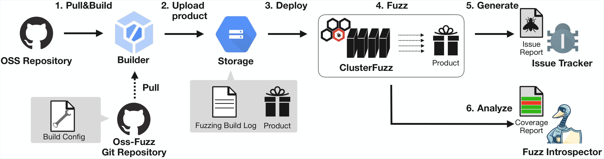

 Fig. 1: Architecture of OSS-Fuzz

The current state-of-the-art automated approach to detect software vulnerabilities is fuzz testing (fuzzing) [[8](https://arxiv.org/html/2510.16433#bib.bib8)]. It works by generating large amounts of testing inputs to trigger unintended behavior such as simple crashes, to memory overflows which can be exploited to gain elevated privileges. There are three types of fuzzing strategies: black-box fuzzing, white-box fuzzing and grey-box fuzzing. Black-box fuzzing works by randomly sending large amounts of inputs to the target software. For white-box and grey-box fuzzing, the fuzzer is given knowledge (full knowledge for white-box, partial knowledge for grey-box) about the codebase so that it can send its inputs to specific lines of code.

As of 2025, most modern state-of-the-art fuzzers such as AFL++ and libfuzzer are greybox fuzzers and follow a coverage-guided fuzzing approach (CGF) [[9](https://arxiv.org/html/2510.16433#bib.bib9)]. CGF refers to a fuzzing strategy where the fuzzer tries to maximize the coverage (i.e., the number of source code lines executed) during fuzzing to increase the chances of finding vulnerabilities.

Several studies investigated the effectiveness of coverage-based fuzzing. In their study on the reliability of coverage-guided fuzzing, Böhme et al. [[10](https://arxiv.org/html/2510.16433#bib.bib10)] found that there is a strong correlation between code coverage and the number of detected fuzzing bugs (i.e., bugs identified by fuzzing). Liyanage et al. [[11](https://arxiv.org/html/2510.16433#bib.bib11)] conducted another study where they fuzzed continuously for seven days to study the evolution of code coverage over time. Their results indicate that fuzzing coverage increases logarithmically over time, meaning that long fuzzing sessions give diminishing return over time.

Despite many studies reporting the efficacy of fuzzing, some studies investigated the current limitations of fuzzing and its pitfalls. For example, Nourry et al. [[12](https://arxiv.org/html/2510.16433#bib.bib12)] conducted a survey with fuzzing experts to investigate the challenges of fuzzing. Their results revealed several challenges related to the configuration, compilation, and usage of fuzzers. Based on their results, they concluded that the high barrier of entry of fuzzing hinders the adoption of fuzz testing by non-experts (i.e., average developers).

To address the complexity and difficulty of adopting fuzzing, external fuzzing providers have gained significant popularity in recent years. As of 2025, the main provider, OSS-Fuzz, is developed and maintained by Google to fuzz critical open-source software systems. One of the major reasons behind the popularity of OSS-Fuzz is its implementation of Continuous Fuzzing through seamless integration within the continuous integration (CI) process [[13](https://arxiv.org/html/2510.16433#bib.bib13)]. By executing fuzzing periodically and automatically, OSS-Fuzz can provide continuous fuzzing to participating software systems, making early detection of fuzzing bugs more likely.

Traditional fuzzing typically involves executing a fuzzer on a fixed version of the software over an extended period. An industry report suggests that effective fuzzing often spans at least one week, with 30 days considered ideal to search for fuzzing bugs [[14](https://arxiv.org/html/2510.16433#bib.bib14)]. In contrast, continuous fuzzing adopts a different strategy by conducting brief but frequent fuzzing sessions, aiming to identify fuzzing bugs in near real-time as the software evolves. In their study on continuous fuzzing, Klooster et al. [[15](https://arxiv.org/html/2510.16433#bib.bib15)] showed that short sessions of 15 minutes can also be effective to detect critical bugs. In 2021, Zhu et al. [[16](https://arxiv.org/html/2510.16433#bib.bib16)] conducted a study on grey-box fuzzing and found that 77% of the fuzzing-related bugs were introduced by recent code changes. Continuous fuzzing provides the ability to fuzz quickly and frequently, while eliminating the need for developers to manually configure the fuzzers. This makes it a particularly appealing approach for non-experts who seek to improve the security of their OSS systems.

While continuous fuzzing offers some advantages over traditional methods, it is still unclear whether the effectiveness of shorter, more frequent fuzzing sessions is sustained across multiple repeated runs. It is also not obvious whether existing findings on traditional fuzzing can be generalized to continuous fuzzing or not. For example, traditional fuzzing involving long fuzzing sessions on a specific commit might allow a fuzzer to reach deeper parts of the code (i.e., higher coverage), leading to more fuzzing bugs being found [[17](https://arxiv.org/html/2510.16433#bib.bib17)]. While prior work [[18](https://arxiv.org/html/2510.16433#bib.bib18)] and OSS-Fuzz [[19](https://arxiv.org/html/2510.16433#bib.bib19)] have proven that short fuzzing sessions are also effective, it remains unclear how repeated short fuzzing sessions in continuous fuzzing can progressively increase code coverage and bug detection.

In this study, we aim to investigate and clarify how the number of fuzzing sessions can impact fuzzing bug detection and code coverage. To do so, we analyze historical fuzzing data from 878 open-source projects participating in the OSS-Fuzz initiative. To the best of our knowledge, this is the first large-scale study investigating the effectiveness of continuous fuzzing. The main contributions of this study are as follows:

  1. Empirical Analysis of Continuous Fuzzing at Scale. We conducted a large-scale empirical investigation on the effectiveness of continuous fuzzing by analyzing more than 3.95 million build logs, 1 million coverage reports, and over 70,000 issue reports. 
  2. Trends in Coverage and Fuzzing Bug Detection Rate Over Time. We examined how the number of continuous fuzzing sessions relates to fuzzing bug detection rates and coverage trends, and found that many fuzzing bugs are detected in the early stages and that coverage generally increases over time. 
  3. Impact of Coverage Fluctuations on Fuzzing Bug Discovery. We analyzed coverage changes at the time of fuzzing bug detection, and found that fuzzing bugs are more likely to be discovered when the coverage not only increased but also decreased. 
  4. Replication packages for Open Science. To facilitate replication and further studies, we provide the data used in our replication package.11 1 During peer review, the following limited public share link on Zenodo is provided: https://bit.ly/3IQ8j0k.

The remainder of this paper is organized as follows. Section [II](https://arxiv.org/html/2510.16433#S2 "II Core Concept in OSS-Fuzz ‣ Large-Scale Empirical Analysis of Continuous Fuzzing: Insights from 1 Million Fuzzing Sessions") provides background information. Section [III](https://arxiv.org/html/2510.16433#S3 "III Research Questions ‣ Large-Scale Empirical Analysis of Continuous Fuzzing: Insights from 1 Million Fuzzing Sessions") states the research questions. Section [IV](https://arxiv.org/html/2510.16433#S4 "IV Study Design ‣ Large-Scale Empirical Analysis of Continuous Fuzzing: Insights from 1 Million Fuzzing Sessions") outlines the study design. Section [V](https://arxiv.org/html/2510.16433#S5 "V Result ‣ Large-Scale Empirical Analysis of Continuous Fuzzing: Insights from 1 Million Fuzzing Sessions") presents the results. Section [VI](https://arxiv.org/html/2510.16433#S6 "VI Implication ‣ Large-Scale Empirical Analysis of Continuous Fuzzing: Insights from 1 Million Fuzzing Sessions") discusses the implications. Section [VII](https://arxiv.org/html/2510.16433#S7 "VII Threats to Validity ‣ Large-Scale Empirical Analysis of Continuous Fuzzing: Insights from 1 Million Fuzzing Sessions") addresses threats to validity. Section [VIII](https://arxiv.org/html/2510.16433#S8 "VIII Related Work ‣ Large-Scale Empirical Analysis of Continuous Fuzzing: Insights from 1 Million Fuzzing Sessions") reviews related work. Section [IX](https://arxiv.org/html/2510.16433#S9 "IX Conclusion ‣ Large-Scale Empirical Analysis of Continuous Fuzzing: Insights from 1 Million Fuzzing Sessions") concludes the paper.

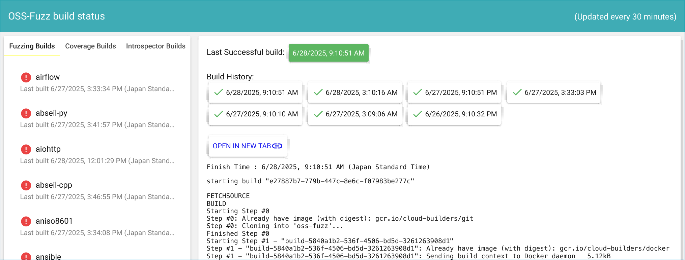

 Fig. 2: List of Build Logs on OSS-Fuzz Snippet 1: Example of Build Log

⬇

1 Starting Step #2 - "srcmap"

2 Step #2 - "srcmap": Already have image: gcr.io/oss-fuzz/avahi

3 (ommited...)

4 Step #2 - "srcmap": {

5 Step #2 - "srcmap": "/src/avahi": {

6 Step #2 - "srcmap": "type": "git",

7 Step #2 - "srcmap": "url": "https://github.com/lathiat/avahi",

8 Step #2 - "srcmap": "rev": "fd482a74625b8db8547b8cfca3ee3d3c6c721423"

9 Step #2 - "srcmap": },

10 Step #2 - "srcmap": "/src/aflplusplus": {

11 Step #2 - "srcmap": "type": "git",

12 Step #2 - "srcmap": "url": "https://github.com/AFLplusplus/AFLplusplus.git",

13 Step #2 - "srcmap": "rev": "c208dcf9c573e3d85990c7dea777646f7fa4961c"

14 Step #2 - "srcmap": }

15 Step #2 - "srcmap": }

16 Finished Step #2 - "srcmap"

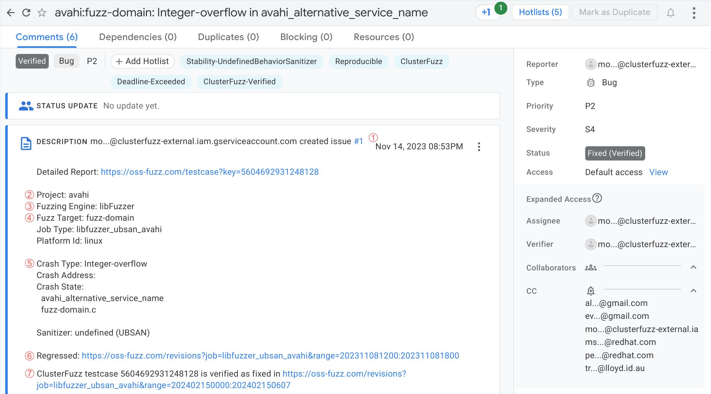

 Fig. 3: Example of Issue Report on the Issue Tracker for OSS-Fuzz

## II Core Concept in OSS-Fuzz

This section explains the concept of fuzzing and presents OSS-Fuzz, an implementation of continuous fuzzing.

### II-A Fuzzing

Fuzzing, an automated software testing technique proposed by Miller et al. in 1990, is designed to trigger unintended behaviors intentionally [[20](https://arxiv.org/html/2510.16433#bib.bib20)]. It generates a large volume of input data based on predefined rules, which is then fed into a program to verify its stability. By triggering unexpected crashes or security issues such as memory leaks, fuzzing is able to reveal security flaws in software systems. Despite its simple mechanism, fuzzing can uncover many vulnerabilities and bugs that other testing methods might miss.

Many studies have demonstrated the effectiveness of fuzzing at revealing fuzzing bugs. Böhme et al. [[10](https://arxiv.org/html/2510.16433#bib.bib10)] showed that as a fuzzer explores more of the codebase, the number of fuzzing bugs discovered tends to increase proportionally, highlighting a positive correlation between code coverage and bug detection. Liyanage et al. [[11](https://arxiv.org/html/2510.16433#bib.bib11)] conducted a seven-day fuzzing experiment and observed a consistent increase in code coverage over time. Their analysis indicated that code coverage growth tends to follow a logarithmic pattern.

Despite its effectiveness, fuzzing has many pitfalls. Specifically, fuzzing is notorious for being resource-intensive, requiring substantial computational power and execution time [[12](https://arxiv.org/html/2510.16433#bib.bib12)][[18](https://arxiv.org/html/2510.16433#bib.bib18)]. Previous studies recommend at least 24 hours of fuzzing to efficiently detect fuzzing bugs [[10](https://arxiv.org/html/2510.16433#bib.bib10)][[21](https://arxiv.org/html/2510.16433#bib.bib21)]. Additionally, Nourry et al. [[12](https://arxiv.org/html/2510.16433#bib.bib12)] have shown that for fuzzing users, the cost and the complexity of setting up and preparing the environment pose significant challenges.

### II-B Continuous Fuzzing and OSS-Fuzz

Continuous fuzzing integrates fuzzing into the CI pipeline, ensuring that fuzzing sessions are conducted automatically and frequently, such as when new code is committed or modifications are made to the software. Unlike traditional fuzzing, which might be run periodically or on-demand, continuous fuzzing operates in short and frequent cycles, allowing for rapid identification of fuzzing bugs as soon as they are introduced into the codebase. Continuous fuzzing tools automatically execute fuzz tests, monitor the program’s behavior, and report any anomalies or crashes. This automation helps maintain a high level of security throughout the development process. By continuously running fuzz tests, developers can detect and address fuzzing bugs quickly, thereby reducing the risk of security issues in the final product.

As of 2025, the most popular implementation of continuous fuzzing is the OSS-Fuzz service, which is developed and maintained by Google. OSS-Fuzz enables distributed and continuous fuzzing by leveraging ClusterFuzz, a platform to conduct fuzzing in a distributed manner. Additionally, OSS-Fuzz utilizes CIFuzz, a system designed to integrate fuzzing into CI/CD pipelines, allowing fuzzing to be performed automatically on a per-commit basis or at scheduled intervals. OSS-Fuzz has integrated over 1,000 open-source projects, contributing to the identification and remediation of more than 10,000 vulnerabilities and 36,000 bugs [[19](https://arxiv.org/html/2510.16433#bib.bib19)].

Figure [1](https://arxiv.org/html/2510.16433#S1.F1 "Fig. 1 ‣ I Introduction ‣ Large-Scale Empirical Analysis of Continuous Fuzzing: Insights from 1 Million Fuzzing Sessions") illustrates the bug detection process using OSS-Fuzz. First, open-source developers upload a build configuration of their software repository and the fuzz targets to OSS-Fuzz. Based on the build configuration, OSS-Fuzz periodically builds the target OSS project and the fuzz targets (Step 1. Pull & Build in the figure).

At the end of the build process, the compiled project files and fuzz targets are uploaded to cloud storage (Step 2. Upload product). The fuzzing build logs are also generated and stored in a Google Cloud Storage (GCS) bucket. Figure [2](https://arxiv.org/html/2510.16433#S1.F2 "Fig. 2 ‣ I Introduction ‣ Large-Scale Empirical Analysis of Continuous Fuzzing: Insights from 1 Million Fuzzing Sessions") shows a build status dashboard for OSS Fuzz, and Snippet [1](https://arxiv.org/html/2510.16433#LST1 "Snippet 1 ‣ I Introduction ‣ Large-Scale Empirical Analysis of Continuous Fuzzing: Insights from 1 Million Fuzzing Sessions") shows an example of build logs that can be viewed in the dashboard.22 2 https://oss-fuzz-build-logs.storage.googleapis.com/log-004ed00b-bcd3-4c2e-bf70-9f9ff046cba8.txt The build log contains the project name (line 2 in Snippet [1](https://arxiv.org/html/2510.16433#LST1 "Snippet 1 ‣ I Introduction ‣ Large-Scale Empirical Analysis of Continuous Fuzzing: Insights from 1 Million Fuzzing Sessions")), required component names (e.g., fuzzers and fuzz targets) (line 5, 10), Git commit SHA (line 8, 13), error messages if any occurred, etc. Additionally, metadata files containing additional information such as build dates are stored in JSON files in GCS buckets.33 3 https://www.googleapis.com/storage/v1/b/oss-fuzz-gcb-logs/o/log-004ed00b-bcd3-4c2e-bf70-9f9ff046cba8.txt

After the build is completed, the compiled files are uploaded to cloud storage. ClusterFuzz then downloads these files along with the initial fuzzing inputs and starts the fuzzing process (Step 3. Deploy) and fuzzing is applied to the uploaded fuzz targets (Step 4. Fuzz).

Once ClusterFuzz triggers a bug, an issue report is automatically generated and submitted to the issue-tracking system (Step 5. Generate). Figure [3](https://arxiv.org/html/2510.16433#S1.F3 "Fig. 3 ‣ I Introduction ‣ Large-Scale Empirical Analysis of Continuous Fuzzing: Insights from 1 Million Fuzzing Sessions") shows an example of a issue report. An issue report contains the reported date (①), project name (②), fuzzing engine (③), fuzz target (④), and various crash information (⑤) such as the type of crash. In addition, the reports contain the regression range (⑥) and fixed range (⑦), which shows the commit SHAs when the bug was detected and when the bug could not be reproduced. Note that issue reports remain private for 90 days after detection or until the bug is fixed to give time to developers to fix the bug and prevent any exploitation from malicious actors.

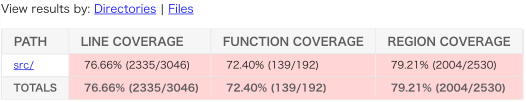

 Fig. 4: Example of Coverage Reports55 5 https://storage.googleapis.com/oss-fuzz-coverage/avahi/reports/20250526/linux/report.html

In addition, Fuzz Introspector analyzes the fuzzing results and generates daily coverage reports, which are also uploaded to the GCS bucket (Step 6. Analyze).66 6 https://storage.googleapis.com/oss-fuzz-introspector/avahi/inspector-report/20250526/fuzz_report.html The coverage reports include ‘‘line coverage,’’ ‘‘function coverage,’’ and ‘‘region coverage.’’77 7 Note: OSS-Fuzz does not provide official information, but their source code suggests that region coverage is similar to branch coverage.\({}^{,\thinspace}\)88 8 The types of coverage that can be measured by OSS-Fuzz vary depending on the programming languages of the fuzz target. Line coverage measures the proportion of source code lines executed during testing. Function coverage quantifies the number of functions that were invoked, while region coverage—closely related to branch coverage captures the extent to which distinct control-flow regions were exercised. For instance, the coverage report presented in Figure [5](https://arxiv.org/html/2510.16433#footnote5 "footnote 5 ‣ Fig. 4 ‣ II-B Continuous Fuzzing and OSS-Fuzz ‣ II Core Concept in OSS-Fuzz ‣ Large-Scale Empirical Analysis of Continuous Fuzzing: Insights from 1 Million Fuzzing Sessions") indicates that 76.66% of the lines, 72.40% of the functions, and 79.21% of regions were covered during fuzz testing.

## III Research Questions

This section describes the three research questions (RQs) we address in this study.

\(RQ_{1}\): What Is the Relationship Between the Number of Cumulative Fuzzing Sessions and the Bug Detection Rate?

Continuous fuzzing, including OSS-Fuzz, performs fuzzing for a fixed duration each day, typically around 10 minutes by default [[22](https://arxiv.org/html/2510.16433#bib.bib22)]. If the likelihood of detecting bugs continues to increase or remains consistently high as the number of fuzzing sessions accumulates, it would indicate that continuous fuzzing is effective over the long term and justifies sustained execution. In contrast, if most fuzzing bugs are detected during the initial sessions and the detection rate significantly declines thereafter, it would suggest that the majority of issues are uncovered early, and that fuzzing resources could be more efficiently allocated or strategically scheduled. However, the relationship between the cumulative number of fuzzing sessions and the bug detection rate remains unclear. RQ1 investigates how the number of detected fuzzing bugs is associated with the cumulative number of fuzzing sessions.

\(RQ_{2}\): Is Coverage Correlated with the Cumulative Number of Fuzzing Sessions?

Coverage is a widely used performance metric for evaluating fuzzing techniques [[8](https://arxiv.org/html/2510.16433#bib.bib8)]. Previous studies [[11](https://arxiv.org/html/2510.16433#bib.bib11), [23](https://arxiv.org/html/2510.16433#bib.bib23)] have shown that, for traditional fuzzing, a single extended fuzzing session improves code coverage. On contrary, ClusterFuzz, which is used by OSS-Fuzz, includes a feature called Corpus Pruning [[24](https://arxiv.org/html/2510.16433#bib.bib24)], which removes unnecessary inputs from the corpus while preserving coverage with a minimal set of test cases. As more fuzzing sessions are performed, this pruning process helps refine the corpus, potentially allowing OSS-Fuzz to achieve progressively higher coverage over time. However, to the best of our knowledge, it remains unclear how continuous fuzzing’s short, repetitive fuzzing sessions contribute to coverage improvement. If coverage increases consistently with the number of fuzzing sessions, it would suggest that even shorter time of fuzzing helps explore new program paths and justify sustained fuzzing efforts. RQ2 investigates how the number of fuzzing sessions impacts code coverage.

\(RQ_{3}\): To What Extent Does Increasing Coverage Through Fuzzing Make it Easier to Detect Fuzzing Bugs?

OSS-Fuzz utilizes state-of-the-art fuzzers such as AFL and libfuzzer, both of which use coverage-guided fuzzing (i.e., they aim to maximize code coverage to enhance fuzzing bug detection). However, despite the central role of coverage in modern fuzzing strategies, the relationship between coverage and the bug detection rate remains unclear. Since OSS-Fuzz provides the fuzzing results for each short session, including the changes in coverage and found fuzzing bugs, we are able to investigate how an increase or decrease in coverage correlates with more or fewer fuzzing bugs detected. RQ3 analyzes the changes in coverage when fuzzing bugs are triggered to see if increasing, decreasing, or maintaining coverage affects bug discovery.

## IV Study Design

This section describes the approaches for the data collection, project selection, and data analyses to answer each RQ.

### IV-A Data Collection

We first data mined all issue reports from the official OSS-Fuzz issue tracker. This process gave us a total of 72,660 reports spanning over 1,201 projects. We then excluded all issue reports that did not have a “Fixed” status (i.e., unfixable, open, unreproducible, etc.), which resulted in 56,173 valid reports from 1,125 projects. Note that issues in the tracker are classified into two categories: Bugs and Vulnerabilities. In this study, we consider both categories and collectively refer to them as “fuzzing bugs” for simplicity, following the previous studies [[25](https://arxiv.org/html/2510.16433#bib.bib25)].

Next, we collected over 3.95 million build logs generated from compiling the fuzzers and the projects between March 2017 and January 2025 in order to measure how many fuzzing sessions had been performed. Finally, we then collected all the coverage reports generated by Fuzz-Introspector and obtained a total of 1.04 million coverage reports. We extracted the line coverage information from the coverage reports.

### IV-B Project Selection

As of January 7th 2025, 1,288 open-source projects have been fuzzed by OSS-Fuzz. Since we are investigating the evolution of code coverage and fuzzing bugs found over time, we had to select projects with sufficient historical data to conduct our analyses. By default, OSS-Fuzz will fuzz each participating project at least once a day but project maintainers can change the default configuration to be fuzzed more frequently. To ensure we are using projects with sufficient historical data, we therefore selected projects that had measured their coverage at least 365 times by January 7th 2025 (meaning they had been fuzzed for at least 1 year by OSS-Fuzz). This filtering resulted in 878 valid projects, accounting for 68% of all projects that have participated in OSS-Fuzz. By narrowing down the issue reports to those associated with these projects, we were eventually able to analyze 49,470 issue reports from 808 projects.

### IV-C Linking issue reports and coverage reports

In RQ3, we aim to link issue reports with coverage reports. However, issue reports lack the necessary data for this linkage. To address this, we utilize fuzzing build logs. Figure [5](https://arxiv.org/html/2510.16433#S4.F5 "Fig. 5 ‣ IV-C Linking issue reports and coverage reports ‣ IV Study Design ‣ Large-Scale Empirical Analysis of Continuous Fuzzing: Insights from 1 Million Fuzzing Sessions") provides an overview of the data linking process.

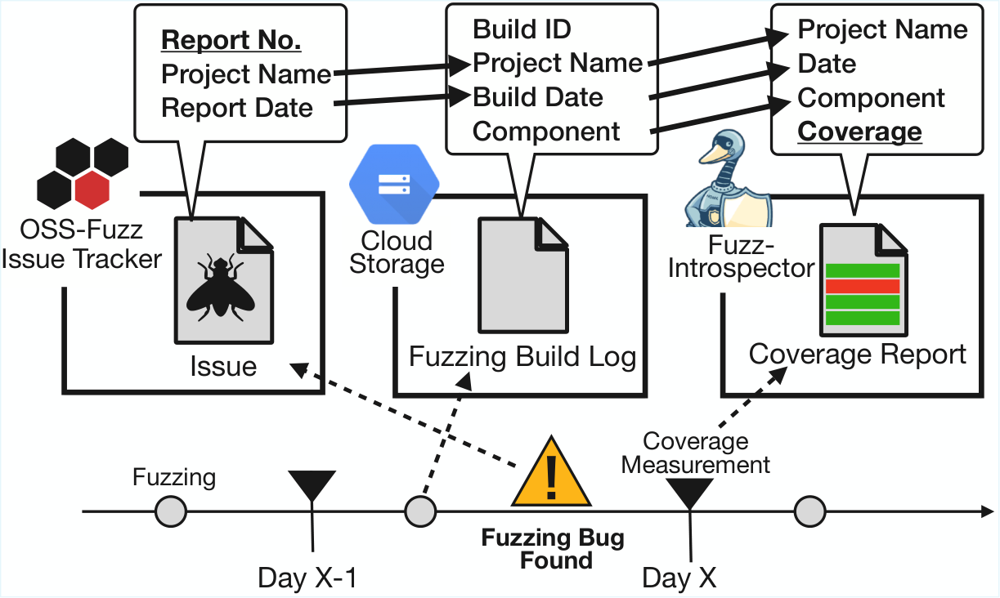

 Fig. 5: Overview of Data Linking Process

We first associate each issue report with its corresponding build log using the project name and the date specified in the issue reports. Since issue reports are automatically generated by OSS-Fuzz when a fuzzer crashes the fuzz target, we can identify the corresponding build log by selecting the last successful build log that was generated before the report was created. Using this approach, we successfully associated 43,170 reports with their corresponding build logs (87.3%). The remaining 12.7% could not be associated due to build failures, etc.

Next, we link fuzzing build logs with coverage reports by extracting properties from the build logs. Specifically, we use the project name, build timestamp, component path, and component revision (i.e., SHA) found in the build logs to match each log with its corresponding coverage report.

However, in several cases, changes are made to the component (i.e., the project) between the time when fuzzing is conducted and the time when the coverage report is generated. These changes cause the project’s SHA to be updated and therefore causes a mismatch between the build log’s identifier and the coverage report’s identifier. For these cases, even if all other information matches (e.g., name, timestamp, component path, etc.) we cannot guarantee that both the build log and the coverage report were executed on the same revision of the project which affects the validity of our results. To ensure the accuracy of our results, we only include issue reports where the issue report’s SHA identifier has both a build log and a coverage report with a matching identifier. This additional filtering process resulted in 5,465 valid issue reports for RQ3.

### IV-D Data Analysis

This section describes the data analysis process to answer each RQ.

#### IV-D1 RQ1. Fuzzing Sessions and Fuzzing Bug Detection Rate

RQ1 investigates the relationship between the number of cumulative fuzzing sessions and the fuzzing bug detection rate. Specifically, we calculate the percentage of projects that detect fuzzing bugs during each fuzzing session (e.g., the first, second, \(i\)-th session). To achieve this, we examine the build logs of each project at session \(i\) to identify whether fuzzing bugs are detected during the \(i\)-th fuzzing session. We then calculate the percentage of projects that detect fuzzing bugs, referred to as the bug detection rate \(R_{i}\). The bug detection rate \(R_{i}\) at a given \(i\)-th fuzzing session is formulated as follows:

\[\begin{aligned}
 & R_{i}=\frac{P_{i}}{F_{i}}, &  & \text{(1)}
\end{aligned}\]

 

where \(P_{i}\) represents the number of projects that detected a fuzzing bug during the \(i\)-th fuzzing session, and \(F_{i}\) represents the number of projects that performed fuzzing at the \(i\)-th session. To maintain a sample size of at least 100 projects for our analysis, we calculated the rate of bug detection up to the 2,263rd session.

#### IV-D2 RQ2. Fuzzing Sessions and Coverage

RQ2 investigates how code coverage evolves as the number of cumulative fuzzing sessions increases. Specifically, we aim to understand both the general and project-specific trends in coverage growth over time.

  * Overall trend: We examine the overall relationship between the number of fuzzing sessions and line coverage across all studied projects. Specifically, we analyze the line coverage scores at each cumulative fuzzing session and assess whether the median coverage exhibits a consistent trend as the number of fuzzing session increases. 
  * Project specific trend: We further investigate the correlation between the number of fuzzing sessions and line coverage on a per-project basis. For each project, we compute the correlation coefficient and then analyze the distribution of these coefficients across all projects, reporting the median as a summary statistic. 

To quantify the relationship between fuzzing sessions and code coverage, we employ the Spearman’s rank correlation coefficient, which is a nonparametric measure to account for potential non-linear trends. To ensure statistical robustness, we exclude sessions for which coverage data is available from fewer than 100 projects. Our analysis therefore includes data up to the 2,092nd fuzzing session.

#### IV-D3 RQ3. Coverage Changes and Fuzzing Bug Detection

RQ3 investigates the impact of the coverage changes on the fuzzing bug detection. We first identify fuzzing sessions where fuzzing bugs were detected by identifying whether the sessions are associated with issue reports or not (i.e., Section [IV-C](https://arxiv.org/html/2510.16433#S4.SS3 "IV-C Linking issue reports and coverage reports ‣ IV Study Design ‣ Large-Scale Empirical Analysis of Continuous Fuzzing: Insights from 1 Million Fuzzing Sessions")). We then obtained the coverage values of each session and calculated the difference in coverage before and after fuzzing.

Next, we conducted a statistical analysis to examine whether the distributions of coverage changes differ significantly between sessions that detected a bug and those that did not. We employed the Brunner-Munzel test [[26](https://arxiv.org/html/2510.16433#bib.bib26)], which is a non-parametric statistical test, to detect the statistically significant difference between the two groups. The reason why we use this test is that we found that the variances between the two groups were not equal99 9 We confirmed this with Levene’s test (\(p<0.01\)) [[27](https://arxiv.org/html/2510.16433#bib.bib27)]., violating the homoscedasticity assumption required by the Mann-Whitney U test [[28](https://arxiv.org/html/2510.16433#bib.bib28)]. On the contrary, the Brunner-Munzel test does not assume equal variances but can assess the significance of differences between groups, as the typical statistical tests such as Mann-Whitney U test do.

## V Result

In this section, we present the results for each RQ.

 Fig. 6: Bug Detection Rate Over Fuzzing Sessions

### \(RQ_{1}\): What Is the Relationship Between the Number of Cumulative Fuzzing Sessions and the Bug Detection Rate?

Figure [6](https://arxiv.org/html/2510.16433#S5.F6 "Fig. 6 ‣ V Result ‣ Large-Scale Empirical Analysis of Continuous Fuzzing: Insights from 1 Million Fuzzing Sessions") shows both the proportion (\(y\)-axis left side) and absolute (\(y\)-axis right side) number of projects in which fuzzing bugs were detected, with the corresponding cumulative number of fuzzing sessions at the time of detection. The green shaded graph indicates the absolute number of projects that reached the number of fuzzing sessions shown on the \(x\)-axis. The blue line graph represents the proportion of projects (left side \(y\)-axis) that detected a fuzzing bug during the \(i\)-th session, shown on the \(x\)-axis.

Our results indicate that fuzzing bugs are more frequently detected during the early stages (i.e., early fuzzing sessions). Notably, for almost 36% of our studied projects, a fuzzing bug was discovered during the first fuzzing session after the project was integrated into OSS-Fuzz. Although this detection rate drops to 20% in the second session, subsequent fuzzing sessions also often find fuzzing bugs. These results show that a significant portion of open-source software projects contain fuzzing bugs and could benefit from adopting fuzz testing as part of their testing practices.

Our results also indicate that during the 26th fuzzing session, the detection rate drops to 4.90%, falling below the 5% threshold for the first time. Subsequently, it remains relatively stable, exhibiting a slight downward trend over time. After the 26th session, the detection rate stabilizes around a median of 2.19%, with most of the remaining data fluctuating close to the median value. These results demonstrate that although the efficiency of fuzzing declines from early to later sessions, fuzzers remain effective at discovering new fuzzing bugs even after prolonged operation and thousands of fuzzing sessions.

 

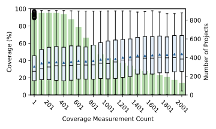

 Fig. 7: Cumulative Fuzzing Sessions and Coverage

### \(RQ_{2}\): Is Coverage Correlated with the Cumulative Number of Fuzzing Sessions?

Figure [7](https://arxiv.org/html/2510.16433#S5.F7 "Fig. 7 ‣ 𝑅⁢𝑄_1: What Is the Relationship Between the Number of Cumulative Fuzzing Sessions and the Bug Detection Rate? ‣ V Result ‣ Large-Scale Empirical Analysis of Continuous Fuzzing: Insights from 1 Million Fuzzing Sessions") depicts the distribution of coverage levels based on the cumulative number of fuzzing sessions. The median line denotes the median coverage percentage and the triangle shows the mean coverage percentage. Additionally, the bar graphs represent the number of projects that were analyzed for the \(i\)-th fuzzing session shown on the \(x\)-axis.

We observed the lowest median coverage values during the initial fuzzing sessions. Notably, in the early phase of continuous fuzzing (i.e., sessions 1-200), although the overall coverage remained low, the median coverage exhibited the steepest increase, indicating the highest rate of coverage growth. After this period, although the growth rate decreased, a stable and consistent increase in coverage was observed. Our observations align with the findings of Liyanage et al. [[11](https://arxiv.org/html/2510.16433#bib.bib11)], where they found that traditional fuzzing showed no signs of reaching an asymptotic upper bound for coverage. Interestingly, while traditional fuzzing tends to exhibit logarithmic growth in coverage over time, our results on continuous fuzzing seem to display a linear increase in coverage as the number of fuzzing sessions increases.

We examined the relationship between the number of fuzzing sessions and median code coverage across all projects by computing Spearman’s rank correlation coefficient. The resulting coefficient was 0.962, indicating a very strong positive correlation between the two metrics. This suggests that, in general, continued fuzzing tends to improve coverage.

However, a different pattern emerges when we compute the correlation within individual projects. Figure [8](https://arxiv.org/html/2510.16433#S5.F8 "Fig. 8 ‣ 𝑅⁢𝑄_2: Is Coverage Correlated with the Cumulative Number of Fuzzing Sessions? ‣ V Result ‣ Large-Scale Empirical Analysis of Continuous Fuzzing: Insights from 1 Million Fuzzing Sessions") shows the distribution of correlation coefficients across the studied projects. These coefficients range from strongly negative to strongly positive, with a median value of 0.006.

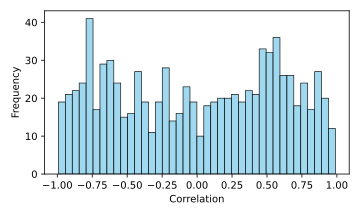

 Fig. 8: Correlation Histogram for Each Project 

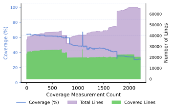

 Fig. 9: Decreasing coverage with the covered lines and total lines of code. 

One plausible explanation for negative correlations in some projects is that the total number of lines of code increases over time due to ongoing development, while the number of lines executed during fuzzing remains relatively stable. As a result, the relative coverage decreases, leading to a negative correlation. For instance, in project mbedtls, we analyzed 2,247 coverage reports and observed a correlation coefficient of -0.99. As illustrated in Figure [9](https://arxiv.org/html/2510.16433#S5.F9 "Fig. 9 ‣ 𝑅⁢𝑄_2: Is Coverage Correlated with the Cumulative Number of Fuzzing Sessions? ‣ V Result ‣ Large-Scale Empirical Analysis of Continuous Fuzzing: Insights from 1 Million Fuzzing Sessions"), although the total codebase size steadily increased (i.e., purple shade), the number of executed lines remained nearly constant (i.e., green shade), resulting in a gradual decline in coverage (i.e., blue line).

 

### \(RQ_{3}\): To What Extent Does Increasing Coverage Through Fuzzing Make it Easier to Detect Fuzzing Bugs?

Figure [10](https://arxiv.org/html/2510.16433#S5.F10 "Fig. 10 ‣ 𝑅⁢𝑄_3: To What Extent Does Increasing Coverage Through Fuzzing Make it Easier to Detect Fuzzing Bugs? ‣ V Result ‣ Large-Scale Empirical Analysis of Continuous Fuzzing: Insights from 1 Million Fuzzing Sessions") presents the distribution of coverage changes associated with the detection of fuzzing bugs. Our analysis reveals that the median coverage change is 0%, regardless of whether fuzzing bugs were detected. However, the interquartile ranges (IQRs) of the two distributions differ notably. When fuzzing bugs are identified, the IQR spans from -0.01% to 0.15%, indicating a broader spread of coverage changes. In contrast, when no fuzzing bugs are found, the changes are tightly clustered around 0.00%, suggesting minimal variation. While these percentage differences may appear small, they are substantial in the context of large codebases (median size: 14,913 lines of code). We applied the Brunner-Munzel test and observed a statistically significant difference between the two groups (\(W=-19.64,p<0.01\)).

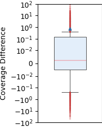

 (a) Fuzzing sessions that detected fuzzing bugs

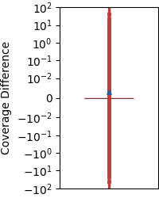

 (b) Fuzzing sessions that did not detect fuzzing bugs

Fig. 10: Distribution of Coverage Changes TABLE I: Percentages of sessions that experienced an increase, decrease or stagnation of coverage when at least one fuzzing bug is found/not found in a session 

| Found | Not Found  
---|---|---  
Increase | 51.6% | 20.6%  
Stagnation | 20.5% | 61.0%  
Decrease | 27.9% | 18.4%

 

Additionally, we classified the coverage changes into three categories: Increase, Stagnation, and Decrease. Specifically, we define Stagnation as no change in coverage, Increase as at least one additional line of code being covered, and Decrease as at least one previously covered line no longer being covered. Table [I](https://arxiv.org/html/2510.16433#S5.T1 "TABLE I ‣ 𝑅⁢𝑄_3: To What Extent Does Increasing Coverage Through Fuzzing Make it Easier to Detect Fuzzing Bugs? ‣ V Result ‣ Large-Scale Empirical Analysis of Continuous Fuzzing: Insights from 1 Million Fuzzing Sessions") summarizes the frequency of each event. Our results show that when fuzzing bugs were found, approximately 52% of fuzzing sessions exhibited increased coverage, 28% showed decreased coverage, and 21% experienced stagnation. In contrast, when no fuzzing bugs were found, only 21% of sessions showed increased coverage, while 61% remained stable and 18% showed decreased coverage. These findings suggest that both coverage increases and decreases are associated with bug detection, highlighting that not only coverage growth but also reduction may signal meaningful exploration behavior.

 

## VI Implication

Our empirical findings can help improve continuous fuzzing platforms and provide insights for practitioners and future research. We present the following key implications.

### VI-A Implication for continuous fuzzing providers (platforms)

Current continuous fuzzing platforms allow their users to set up a static duration of fuzzing. However, these platforms lack adaptive mechanisms that would allow adjusting the fuzzing duration and frequency based on a project’s testing history or coverage achieved in previous runs. Findings from RQ1 indicate that fuzzing bugs are more likely to be discovered during the early stages of fuzzing adoption, with diminishing returns over time. This suggests that fuzzing duration should be adaptively shortened or extended based on the cumulative number of sessions. Additionally, RQ3 shows that fuzzing bugs are often discovered not only when coverage increases but also when it decreases, such as after the integration of large code changes. This implies that fuzzing duration should also scale with the magnitude of recent codebase modifications. Implementing such dynamic adjustments would enhance both the effectiveness and efficiency of fuzzing, while also contributing to energy savings. Therefore, we recommend that continuous fuzzing providers develop functionality to dynamically adjust fuzzing duration based on cumulative fuzzing history and the size of code changes.

### VI-B Implication for Practitioners

Our analysis reveals that 36% of OSS-Fuzz projects detected at least one fuzzing bug during the first fuzzing session, and 20% during the second, indicating that many fuzzing bugs exist prior to the adoption of fuzzing. These findings highlight the value of early integration of fuzzing into the development lifecycle to enable rapid bug detection and mitigation, thereby reducing security risks and associated costs. We thus first recommend that practitioners should integrate fuzzing in their project’s development process as early as possible. 

Furthermore, the bug detection rate remains above 5% through the first 25 sessions, suggesting that practitioners should allocate additional resources during this early phase and after integrating significant code changes. Even beyond the 25th session, the detection rate rarely drops to zero, highlighting the continued value of sustained, low-cost fuzzing efforts as coverage expands over time.

### VI-C Implication for Researchers

RQ2 indicates that code coverage tends to increase linearly with prolonged fuzzing. Moreover, the likelihood of discovering fuzzing bugs rises when coverage changes. While increased coverage typically results from exploring new code regions, it is notable that fuzzing bugs were also uncovered during periods of coverage decline. Such declines are likely attributable to substantial changes in the codebase. This suggests that most existing fuzzing techniques are not optimized for continuous fuzzing environments, as they often fail to generate inputs that exercise newly added code. Therefore, researchers should propose more diff-aware fuzzing strategies that effectively target and test modified or newly introduced code regions in evolving software systems.

## VII Threats to Validity

We identify several potential threats to the validity of our findings and discuss how they may impact the interpretation of our results.

Internal Validity: Internal validity refers to the threats to validity concerning whether the observed outcomes in this study can be causally attributed to the variables under investigation. Open-source contributors may conduct local fuzzing sessions to identify and resolve fuzzing bugs before committing code to repositories. This pre-commit testing could reduce the number of fuzzing bugs subsequently detected through continuous fuzzing, potentially affecting our measurements. In addition the projects examined in this study are predominantly high-profile OSS-Fuzz participants that likely undergo rigorous testing and code review processes within structured development environments. These mature development practices may result in lower baseline bug rates compared to typical open-source projects, potentially limiting the observed effectiveness of continuous fuzzing.

Construct Validity: Construct validity refers to the threats to validity concerning whether the measurement methods used in this study accurately reflect the intended theoretical concepts or constructs. OSS-Fuzz records coverage data once daily, while our analysis relies on coverage measurements immediately before and after bug detection. When multiple fuzzing executions occur within a 24-hour period, the actual coverage at bug detection may differ from the recorded daily values. Although approximately 98% of projects perform fuzzing only once daily, minimizing this impact, the temporal mismatch cannot be entirely eliminated.

Additionally, our analysis treats all detected fuzzing bugs equally, regardless of severity or exploitability. This approach may not accurately capture the security impact or reflect the relative effectiveness of continuous fuzzing for identifying critical versus minor fuzzing bugs.

External Validity: External validity refers to the threats to validity related to the generalizability of our findings to other contexts or software projects. This study analyzed 878 projects. While this is a relatively large dataset, projects participating to OSS-Fuzz are core OSS projects, which implies that they have higher security requirements than average projects and therefore are more incentivized to conduct continuous fuzzing. As a result, conducting the same experiment on other projects might yield different results.

Additionally, our results may be specific to the particular fuzzing engines and strategies employed by OSS-Fuzz and may not generalize to other fuzzing approaches, tools, or methodologies used in different continuous fuzzing implementations. The development practices, contributor expertise levels, and security awareness of OSS-Fuzz participating projects may differ substantially from typical open-source projects or proprietary software development environments, potentially affecting the external validity of our conclusions.

## VIII Related Work

This section reviews prior empirical studies on both traditional and continuous fuzzing techniques.

### VIII-A Empirical Studies on Traditional Fuzzing

Several studies have characterized the fundamental patterns of coverage growth in traditional fuzzing. Böhme et al. [[23](https://arxiv.org/html/2510.16433#bib.bib23)] investigated the trend of coverage growth using FST, a benchmark suite for evaluating fuzzer performance. They demonstrated that for many projects, coverage increases sharply at the beginning of fuzzing and subsequently follows a logarithmic growth pattern. Liyanage et al. [[11](https://arxiv.org/html/2510.16433#bib.bib11)] conducted an experiment to observe coverage trends when fuzzing is executed for extended periods. Their results indicated that when fuzzing a single dataset over a long duration, coverage growth follows a logarithmic pattern. Additionally, Böhme et al. [[10](https://arxiv.org/html/2510.16433#bib.bib10)] analyzed the correlation between coverage achieved by fuzzing tools and the number of detected bugs. They revealed a strong positive correlation between coverage and bug detection.

Building on understanding coverage patterns, researchers have developed methods to predict and estimate fuzzing outcomes. Liyanage et al. [[11](https://arxiv.org/html/2510.16433#bib.bib11)] proposed a dynamic estimation method for reachable code in fuzzing by applying species diversity estimation techniques. Their findings revealed that existing static analysis methods tend to either overestimate or underestimate the amount of reachable code. Liyanage et al. [[29](https://arxiv.org/html/2510.16433#bib.bib29)] proposed a method for predicting future coverage discovery rates in greybox fuzzing while accounting for adaptive bias. Their approach achieved up to an order of magnitude lower prediction error compared to existing methods. Furthermore, in predicting the time to reach a target coverage rate, their method demonstrated an average error reduction of 35–77%. Böhme et al. [[30](https://arxiv.org/html/2510.16433#bib.bib30)] proposed a method to estimate the residual risk of undiscovered bugs in greybox fuzzing campaigns and demonstrated that existing approaches significantly underestimate this risk. Their evaluation showed that the proposed method provides a more realistic estimation.

Multiple approaches have been developed to improve fuzzing effectiveness and efficiency. Klees et al. [[21](https://arxiv.org/html/2510.16433#bib.bib21)] compared the performance of multiple fuzzers across different execution time intervals. Their findings suggest that running fuzzing for at least 24 hours is optimal for maximizing bug detection efficiency. Zhou et al. [[31](https://arxiv.org/html/2510.16433#bib.bib31)] addressed the inefficiency of fuzzing by identifying the high cost of coverage tracing as a major bottleneck. They proposed a framework named Zeror, which balances speed and accuracy through dynamic binary switching. As a result, Zeror achieves an average 159.8% speedup over AFL while preserving coverage information. Bundt et al. [[32](https://arxiv.org/html/2510.16433#bib.bib32)] focused on human intervention in fuzzing and proposed a method that leverages compartment analysis to examine intermediate fuzzing results and identify concrete intervention points for improving coverage. Their approach demonstrated coverage improvements of up to 94%, with a median increase of 13%. Feng et al. [[33](https://arxiv.org/html/2510.16433#bib.bib33)] proposed MagicMirror, a fuzzing approach for smart contracts that leverages precondition-based input generation and selective state exploration, achieving an average of 21% improvement in code coverage compared to existing methods.

The reliability of coverage measurement itself has also received attention. Liu et al. [[34](https://arxiv.org/html/2510.16433#bib.bib34)] investigated the accuracy of instrumentation used by fuzzers and revealed that instrumentation errors are a common issue in real-world coverage-based greybox fuzzers. They further proposed InstruGuard, a technique for detecting and repairing such errors, and demonstrated a high repair success rate, averaging over 99.9%. Moreover, their evaluation showed that the repaired instrumentation led to an increase in the number of executed paths and detected bugs during fuzzing. Gao et al. [[35](https://arxiv.org/html/2510.16433#bib.bib35)] conducted a systematic classification and analysis of fuzz blockers to investigate the root causes of the “plateau” phenomenon in greybox fuzzing, where code coverage growth stagnates. Their study identified five categories of fuzz blockers and revealed that 61.7% of the blockers are caused by the design of the fuzz driver, which is responsible for delivering inputs to the target program.

While prior studies have primarily examined the effectiveness of long-running fuzzing on specific versions of software projects, we investigate the impact of short, iterative fuzzing sessions conducted continuously throughout the software development lifecycle. We present the first large-scale empirical study that characterizes longitudinal trends in fuzzing bug detection rates and coverage evolution across thousands of cumulative fuzzing sessions on evolving software systems.

### VIII-B Empirical Studies on Continuous Fuzzing

Several studies have examined the characteristics of bugs and vulnerabilities detected through continuous fuzzing systems. Ding et al. [[36](https://arxiv.org/html/2510.16433#bib.bib36)] analyzed bugs detected by OSS-Fuzz, specifically examining the types of detected bugs, the time required for detection, and the time taken for fixes. Zhu et al. [[16](https://arxiv.org/html/2510.16433#bib.bib16)] investigated the characteristics of bugs detected by OSS-Fuzz. They found that 77% of bugs detected by OSS-Fuzz were recently introduced, indicating that continuous fuzzing is particularly effective at identifying newly introduced security issues. Keller et al. [[25](https://arxiv.org/html/2510.16433#bib.bib25)] conducted a large-scale analysis of bug reports from OSS-Fuzz, examining the lifespan of bugs, the developers responsible for fixing them, and bug types. They recommended strategies to help developers learn more effectively while debugging code.

Research has also focused on optimizing fuzzing parameters and understanding infrastructure limitations. Klooster et al. [[15](https://arxiv.org/html/2510.16433#bib.bib15)] studied the relationship between fuzzing duration and bug detection rate, recommending 30 minutes as an optimal duration for continuous fuzzing. Nourry et al. [[37](https://arxiv.org/html/2510.16433#bib.bib37)] investigated the issue of build failures in fuzzing. Their study revealed that 9.41% of OSS-Fuzz project builds fail, highlighting challenges in maintaining a stable fuzzing infrastructure.

Recent work has specifically targeted fuzzing optimization within continuous integration and deployment environments. Sharma et al. [[38](https://arxiv.org/html/2510.16433#bib.bib38)] proposed a method called PaZZER, which enables effective fuzzing in CI/CD environments by incrementally computing the estimated distance to the modified code regions based on the call graph. Compared to the conventional method AFLGo, PaZZER reduces the distance calculation time by up to 140 seconds and demonstrates effectiveness even in short tests of around 10 minutes for large-scale software systems that previously faced challenges in terms of processing time. Zhang et al. [[39](https://arxiv.org/html/2510.16433#bib.bib39)] proposed a method called CIDFuzz, which focuses on code changes introduced during Continuous Integration (CI) and their impact range to achieve efficient fuzzing. By appropriately allocating testing resources based on control-flow and data-flow information derived through static analysis, CIDFuzz reduces the time required to achieve coverage of the modified code by up to 34.78% compared to conventional methods.

In the domain of kernel fuzzing, Ruohonen et al. [[40](https://arxiv.org/html/2510.16433#bib.bib40)] analyzed the effectiveness of continuous kernel fuzzing using syzkaller/syzbot on Linux and BSD-based kernels. They reported that the median time-to-fix (TTF) for the Linux kernel was 38 days, while all BSD kernels had TTFs of less than 20 days. Also, only about 23% of the fixed bugs in the Linux kernel underwent code review or additional testing.

While prior work has examined the detected bugs during continuous fuzzing or specific aspects of continuous fuzzing such as determining optimal session duration, our study emphasizes the effectiveness that emerges from the cumulative and sustained execution of fuzzing over time. We investigate how the total number of fuzzing sessions correlates with both fuzzing bug detection and coverage evolution. Additionally, we analyze the relationship between fluctuations in code coverage and the discovery of fuzzing bugs. This analysis contributes to a deeper understanding of continuous fuzzing and offers actionable insights for enhancing its practical effectiveness.

## IX Conclusion

This study presents the first large-scale empirical investigation on the effectiveness of continuous fuzzing, examining over 1 million fuzzing sessions from 878 open-source projects participating in OSS-Fuzz. Through our comprehensive investigation of fuzzing bug detection patterns, coverage evolution, and the relationship between coverage changes and fuzzing bug discovery, we provide several key new insights into continuous fuzzing behavior.

We found that fuzzing bugs are predominantly detected during the initial phases of fuzzing adoption, with 36% of projects detecting fuzzing bugs in their first session and 20% in their second session. This high early detection rate indicates that many fuzzing bugs exist in codebases prior to fuzzing integration, emphasizing the importance of early adoption. While detection rates stabilize around 5% after the 26th session, continuous fuzzing remains effective even after thousands of sessions.

Additionally, our analysis reveals that continuous fuzzing exhibits linear coverage growth over time, contrasting with the logarithmic patterns observed in traditional fuzzing. We found an overall correlation of 0.962 between the cumulative number of fuzzing sessions and coverage percentage, though some projects vary due to factors such as development activity and codebase growth. Examining the relationship between coverage changes and fuzzing bug detection, we found that fuzzing bugs are discovered when coverage increases (51.6% of cases), decreases (27.9%), or remains stable (20.5%). This suggests that both coverage expansion and reduction signal meaningful code exploration leading to fuzzing bug discovery.

These findings have significant implications for practitioners, CF platforms, and researchers. The high rate of detection during early-stages of fuzzing suggests opportunities for adaptive fuzzing strategies, while the linear coverage growth and bidirectional coverage-fuzzing bug relationship highlight the need for diff-aware fuzzing techniques that effectively target modified code regions.

Future research should investigate fuzzing bug types under different conditions and develop more sophisticated fuzzing strategies for continuous integration environments.

## Acknowledgment

We gratefully acknowledge the financial support of JSPS for the KAKENHI grants (JP24K02921, JP24K02923, JP25K21359), as well as JST for the PRESTO grant (JPMJPR22P3), the ASPIRE grant (JPMJAP2415), and the AIP Accelerated Program (JPMJCR25U7).

## References

  * [1] Mend.io, “The state of open source vulnerabilities 2021 annual report,” accessed: February 13th, 2025. [Online]. Available: https://www.mend.io/wp-content/media/2021/03/The-state-of-open-source-vulnerabilities-2021-annual-report.pdf
  * [2] E. R. Murphy-Hill, C. Jaspan, C. Sadowski, D. C. Shepherd, M. Phillips, C. Winter, A. Knight, E. K. Smith, and M. Jorde, “What predicts software developers’ productivity?” _IEEE Transactions on Software Engineering (TSE)_ , vol. 47, no. 3, pp. 582–594, 2021. 
  * [3] National Vulnerability Database, “CVE-2014-0160 Detail - NVD,” accessed: January 9th, 2025. [Online]. Available: https://nvd.nist.gov/vuln/detail/CVE-2014-0160
  * [4] ——, “CVE-2021-44228 Detail - NVD,” accessed: February 13th, 2025. [Online]. Available: https://nvd.nist.gov/vuln/detail/cve-2021-44228
  * [5] ——, “CVE-2024-6387 Detail,” accessed: February 13th, 2025. [Online]. Available: https://nvd.nist.gov/vuln/detail/cve-2024-6387
  * [6] Z. Durumeric, J. Kasten, D. Adrian, J. A. Halderman, M. D. Bailey, F. Li, N. Weaver, J. Amann, J. Beekman, M. Payer, and V. Paxson, “The matter of heartbleed,” in _Proceedings of the 14th ACM International Conference on Internet Measurement Conference (IMC’14)_ , 2014, pp. 475–488. 
  * [7] Qualys, “RegreSSHion: Remote Unauthenticated Code Execution Vulnerability in OpenSSH Server,” accessed: February 13th, 2025. [Online]. Available: https://blog.qualys.com/vulnerabilities-threat-research/2024/07/01/regresshion-remote-unauthenticated-code-execution-vulnerability-in-openssh-server
  * [8] C. Chen, B. Cui, J. Ma, R. Wu, J. Guo, and W. Liu, “A systematic review of fuzzing techniques,” _Computers & Security_, vol. 75, pp. 118–137, 2018. 
  * [9] M. Z. (lcamtuf), “American fuzzy lop (afl),” accessed: February 13th, 2025. [Online]. Available: https://lcamtuf.coredump.cx/afl/
  * [10] M. Böhme, L. Szekeres, and J. Metzman, “On the reliability of coverage-based fuzzer benchmarking,” in _Proceedings of the 44th IEEE/ACM International Conference on Software Engineering (ICSE’22)_ , 2022, pp. 1621–1633. 
  * [11] D. Liyanage, M. Böhme, C. Tantithamthavorn, and S. Lipp, “Reachable coverage: Estimating saturation in fuzzing,” in _Proceedings of the 45th IEEE/ACM International Conference on Software Engineering (ICSE’23)_ , 2023, pp. 371–383. 
  * [12] O. Nourry, Y. Kashiwa, B. Lin, G. Bavota, M. Lanza, and Y. Kamei, “The human side of fuzzing: Challenges faced by developers during fuzzing activities,” _ACM Transactions on Software Engineering and Methodology (TOSEM)_ , vol. 33, no. 1, pp. 14:1–14:26, 2024. 
  * [13] Help Net Security, “Ci fuzz cli: Open-source tool simplifies fuzz testing for c++,” accessed: June 21st, 2025. [Online]. Available: https://www.helpnetsecurity.com/2022/09/26/ci-fuzz-cli-open-source-fuzz-testing/
  * [14] Black Duck, “Integrating fuzzing into devsecops,” accessed: June 22nd, 2025. [Online]. Available: https://www.blackduck.com/blog/integrating-fuzzing-into-devsecops.html
  * [15] T. Klooster, F. Turkmen, G. Broenink, R. ten Hove, and M. Böhme, “Continuous fuzzing: A study of the effectiveness and scalability of fuzzing in CI/CD pipelines,” in _Proceedings of the 16th IEEE/ACM International Workshop on Search-Based and Fuzz Testing (SBFT’23)_ , 2023, pp. 25–32. 
  * [16] X. Zhu and M. Böhme, “Regression greybox fuzzing,” in _Proceedings of the 28th ACM SIGSAC International Conference on Computer and Communications Security (CCS’21)_ , 2021, pp. 2169–2182. 
  * [17] Z. Yu, Z. Liu, X. Cong, X. Li, and L. Yin, “Fuzzing: Progress, challenges, and perspectives,” _Computers, Materials & Continua_, vol. 78, no. 1, pp. 1–29, 2024. 
  * [18] M. Böhme and B. Falk, “Fuzzing: on the exponential cost of vulnerability discovery,” in _Proceedings of the 28th ACM Joint Meeting on European Software Engineering Conference and Symposium on the Foundations of Software Engineering (ESEC/FSE’20)_ , 2020, pp. 713–724. 
  * [19] Google, “Documentation for oss-fuzz,” accessed: February 13th, 2025. [Online]. Available: https://google.github.io/oss-fuzz/
  * [20] B. P. Miller, L. Fredriksen, and B. So, “An empirical study of the reliability of UNIX utilities,” _Communications of the ACM_ , vol. 33, no. 12, pp. 32–44, 1990. 
  * [21] G. Klees, A. Ruef, B. Cooper, S. Wei, and M. Hicks, “Evaluating fuzz testing,” in _Proceedings of the 25th ACM SIGSAC International Conference on Computer and Communications Security (CCS’18)_ , 2018, pp. 2123–2138. 
  * [22] Google, “OSS-Fuzz: Continuous Integration,” accessed: 2025-06-17. [Online]. Available: https://google.github.io/oss-fuzz/getting-started/continuous-integration/#how-it-works
  * [23] M. Böhme, V. J. M. Manès, and S. K. Cha, “Boosting fuzzer efficiency: an information theoretic perspective,” in _Proceedings of the 28th ACM Joint Meeting on European Software Engineering Conference and Symposium on the Foundations of Software Engineering (ESEC/FSE’20)_ , 2020, pp. 678–689. 
  * [24] Google, “Clusterfuzz glossary,” accessed: June 22, 2025. [Online]. Available: https://google.github.io/clusterfuzz/reference/glossary/
  * [25] B. N. Keller, B. S. Meyers, and A. Meneely, “What happens when we fuzz? investigating oss-fuzz bug history,” in _Proceedings of the 20th IEEE/ACM International Conference on Mining Software Repositories, (MSR’23)_ , 2023, pp. 207–217. 
  * [26] E. Brunner and U. Munzel, “The nonparametric behrens-fisher problem: Asymptotic theory and a small-sample approximation,” _Biometrical Journal_ , vol. 42, no. 1, pp. 17–25, 2000. 
  * [27] H. LEVENE, “Robust tests for equality of variances,” _Contributions to probability and statistics_ , pp. 278–292, 1960. 
  * [28] E. Kasuya, “Mann–whitney u test when variances are unequal,” _Animal Behaviour_ , vol. 61, no. 6, pp. 1247–1249, 2001. 
  * [29] D. Liyanage, S. Lee, C. Tantithamthavorn, and M. Böhme, “Extrapolating coverage rate in greybox fuzzing,” in _Proceedings of the 46th IEEE/ACM International Conference on Software Engineering (ICSE’24)_ , 2024, pp. 132:1–132:12. 
  * [30] M. Böhme, D. Liyanage, and V. Wüstholz, “Estimating residual risk in greybox fuzzing,” in _Proceedings of the 29th ACM Joint Meeting on European Software Engineering Conference and Symposium on the Foundations of Software Engineering (ESEC/FSE’21)_ , 2021, pp. 230–241. 
  * [31] C. Zhou, M. Wang, J. Liang, Z. Liu, and Y. Jiang, “Zeror: Speed up fuzzing with coverage-sensitive tracing and scheduling,” in _Proceedings of the 35th IEEE/ACM International Conference on Automated Software Engineering, (ASE’20)_ , 2020, pp. 858–870. 
  * [32] J. Bundt, A. Fasano, B. Dolan-Gavitt, W. K. Robertson, and T. Leek, “Homo in machina: Improving fuzz testing coverage via compartment analysis,” in _Proceedings of the 16th IEEE International Conference on Software Testing, Verification and Validation (ICST’23)_ , 2023, pp. 117–128. 
  * [33] H. Feng, X. Ren, Q. Wei, Y. Lei, R. Kacker, D. R. Kuhn, and D. E. Simos, “Magicmirror: Towards high-coverage fuzzing of smart contracts,” in _Proceedings of the 16th IEEE International Conference on Software Testing, Verification and Validation (ICST’23)_ , 2023, pp. 141–152. 
  * [34] Y. Liu, Y. Wang, P. Su, Y. Yu, and X. Jia, “Instruguard: Find and fix instrumentation errors for coverage-based greybox fuzzing,” in _Proceedings of the 36th IEEE/ACM International Conference on Automated Software Engineering, (ASE’21)_ , 2021, pp. 568–580. 
  * [35] W. Gao, V. Pham, D. Liu, O. Chang, T. Murray, and B. I. P. Rubinstein, “Beyond the coverage plateau: A comprehensive study of fuzz blockers (registered report),” in _Proceedings of the 2nd International Fuzzing Workshop (FUZZING’23)_ , 2023, pp. 47–55. 
  * [36] Z. Y. Ding and C. Le Goues, “An empirical study of oss-fuzz bugs,” in _Proceedings of the 18th IEEE/ACM International Conference on Mining Software Repositories, (MSR’21)_ , 2021, pp. 131–142. 
  * [37] O. Nourry, Y. Kashiwa, W. Shang, H. Shu, and Y. Kamei, “My fuzzers won’t build: An empirical study of fuzzing build failures,” _ACM Transactions on Software Engineering and Methodology (TOSEM)_ , vol. 34, no. 2, pp. 29:1–29:30, 2025. 
  * [38] A. Sharma, C. Cadar, and J. Metzman, “Effective fuzzing within CI/CD pipelines (registered report),” in _Proceedings of the 3rd ACM International Fuzzing Workshop (FUZZING’24)_ , 2024, pp. 52–60. 
  * [39] J. Zhang, Z. Cui, X. Chen, H. Yang, L. Zheng, and J. Liu, “Cidfuzz: Fuzz testing for continuous integration,” _IET Software_ , vol. 17, no. 3, pp. 301–315, 2023. 
  * [40] J. Ruohonen and K. Rindell, “Empirical notes on the interaction between continuous kernel fuzzing and development,” in _Proceedings of the 30th IEEE International Symposium on Software Reliability Engineering Workshops, Workshops (ISSREW 2019)_ , 2019, pp. 276–281. 

  |  Tasuya Shirai is currently a Master’s student at the Graduate School of Science and Technology, Nara Institute of Science and Technology (NAIST). He received the Bachelor of Engineering degree from Kumamoto National College of Technology in 2024. He is currently conducting research toward a doctoral degree under the supervision of Dr. Yutaro Kashiwa and Dr. Hajimu Iida. His research interests include fuzzing, especially continuous fuzzing.  
---|---

  

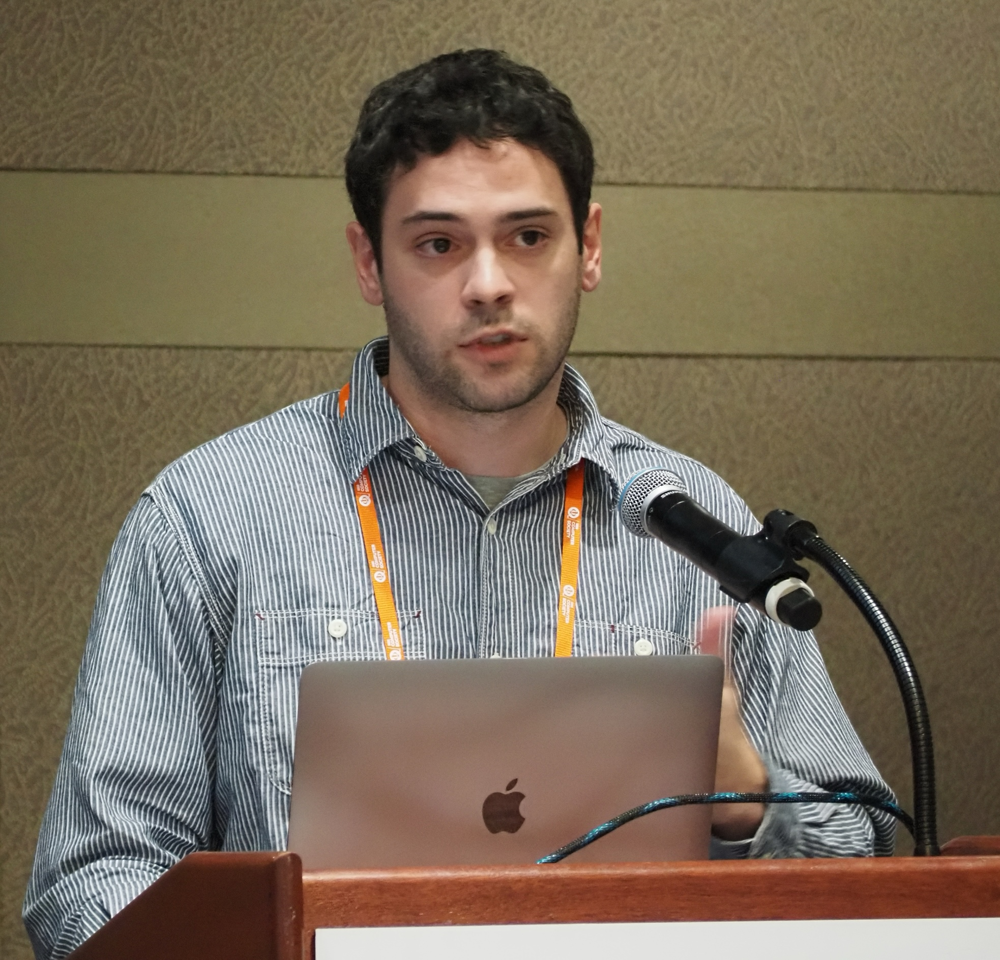

  |  Olivier Nourry is an assistant professor at Osaka University, Japan. He received his Ph.D. degree in Information Science and Technology from Kyushu University in 2024. His research interests include fuzzing, automated vulnerability repair, and empirical software engineering. He has many publications regarding continuous fuzzing in major journals and conferences such as TOSEM and ICSME.  
---|---

  

  |  Yutaro Kashiwa is an associate professor at Nara Institute of Science and Technology (NAIST), Japan. He worked for Hitachi Ltd. as a full-time software engineer for two years before spending three years as a research fellow of the Japan Society for the Promotion of Science. He received his Ph.D. degree in engineering from Wakayama University in 2020. His research interests include empirical software engineering, specifically the analysis of testing, refactoring, and releasing.  
---|---

  

  |  Kenji Fujiwara received the Ph.D. degree from the Nara Institute of Science and Technology in 2015. He is currently a Lecturer at Nara Women’s University, Japan. Before joining Nara Women’s University, he was a Lecturer at Tokyo City University, from 2021 to 2023, and an Assistant Professor at National Institute of Technology, Toyota College, from 2016 to 2021. His research interests include software maintenance and testing, and support for programming education.  
---|---

  

  |  Yasutaka Kamei is a full professor at Kyushu University in Japan. He was a research fellow of the JSPS (PD) and was a postdoctoral fellow at Queen’s University in Canada. He received Ph.D. degree in Information Science from Nara Institute of Science and Technology. His research interests include empirical software engineering, open source software engineering and Mining Software Repositories (MSR). He served as a program-committee co-chair of SANER 2016 and MSR 2018 conferences.  
---|---

  

  |  Hajimu Iida is a full professor at the Graduate School of Science and Technology, Nara Institute of Science and Technology (NAIST), Japan, where he leads the Laboratory for Software Design and Analysis. He received his Ph.D. in Engineering from Osaka University in 1994. His research interests span a wide range of topics in software engineering, including software process modeling and analysis, quantitative project management, repository mining, and software analytics.  
---|---

 
