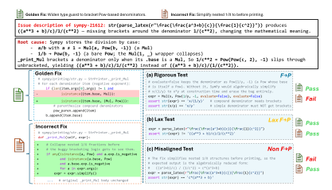
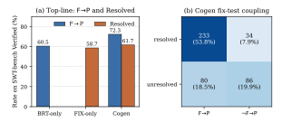
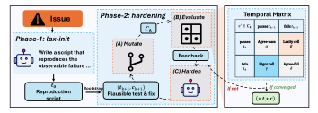
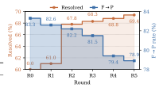

**Source:** *Beyond Fail-to-Pass: Iterative Hardening of Co-Generated Bug Reproduction Tests and Fixes* — [PDF](https://arxiv.org/pdf/2607.19843) · [arXiv](https://arxiv.org/abs/2607.19843)

# Beyond Fail-to-Pass: Iterative Hardening of Co-Generated Bug Reproduction Tests and Fixes

Yuhao Tan1,<sup>3</sup> Zhibang Yang2,<sup>3</sup> Fangkai Yang3† Yuan Yao<sup>1</sup> Yu Kang<sup>3</sup> Lu Wang<sup>3</sup> Pu Zhao<sup>3</sup> Xin Zhang<sup>3</sup> Xiaoxing Ma1† Qingwei Lin<sup>3</sup> Saravan Rajmohan<sup>3</sup> Dongmei Zhang<sup>3</sup>

<sup>1</sup>Nanjing University <sup>2</sup>Peking University <sup>3</sup>Microsoft †Corresponding authors: fangkaiyang@microsoft.com, xxm@nju.edu.cn yhtan@smail.nju.edu.cn Project page: <https://aka.ms/CoHarden>

# Abstract

Large language models (LLMs) have made automated program repair (APR) increasingly practical for real-world bugs, but repairing directly from bug reports remains underconstrained. Bug reproduction tests (BRTs) help close this gap by turning a bug report into an executable, bug-specific signal that can guide repair and validate candidate patches. Existing work has therefore studied BRT generation as a core subproblem in APR and mainly evaluates a generated BRT using the fail-to-pass (F→P) criterion, which requires the test to fail on the buggy code but pass on the golden fix. We show that F→P alone is insufficient when the goal of a BRT is to improve downstream repair. In particular, some F→P BRTs are *lax*, reproducing the observed symptom yet still admitting plausible-but-incorrect patches. We formalize this missing quality dimension by separating F→P BRTs into *rigorous* and *lax* ones, and show empirically that only the former consistently improve repair success. We further find that co-generation introduces test–fix error coupling, where the in-trajectory fail-to-pass (F→P) check can pass even when both the generated patch and generated test are wrong. Based on these findings, we propose COHARDEN, a co-generation framework that uses the Lax signal as an in-loop convergence criterion. COHARDEN first generates a test before any fix, then iteratively hardens the test and fix against surviving mutation patches until the generated test no longer admits Lax regressions. Experiments show that COHARDEN reaches 69.4% Resolved and 78.9% F→P on SWE-bench Verified, outperforming the strongest fix-only and cogeneration baselines by +9.6 and +7.9 percentage points in Resolved, respectively, with consistent gains across LLM backbones and benchmarks.

# 1 Introduction

Automated Program Repair (APR) has advanced rapidly with Large Language Models (LLMs), and recent agentic systems can generate increasingly plausible fixes for real-world software bugs [\[Xia](#page-10-0) [et al., 2023,](#page-10-0) [Yang et al., 2024,](#page-10-1) [Zhang et al., 2024,](#page-10-2) [Xia et al., 2025\]](#page-10-3). However, a plausible fix is not the same as a correct fix. When APR is driven directly from natural-language issue reports, the task remains fundamentally underconstrained: bug reports are often incomplete, many candidate patches appear superficially reasonable, and passing the existing test suite does not guarantee that the reported bug has actually been fixed [\[Qi et al., 2015,](#page-10-4) [Wang et al., 2025a\]](#page-10-5). This problem is compounded by the fact that, when an issue is first reported, the existing test suite often does not yet contain

<span id="page-1-0"></span>

Figure 1: Three reproduction tests for the issue sympy-21612 (from SWT-bench [Mündler et al.](#page-10-6) [\[2024\]](#page-10-6)) react differently to two plausible fixes. The bug is: a SymPy printer omits brackets around 1/X denominators, changing the math. Golden Fix widens the type check at the root cause. Incorrect Fix instead simplifies away the input pattern which the type check fails to recognize, leaving the check itself untouched. The reproduction tests include: (a) Rigorous test asserts the printer's exact output on two probes, which passes Gold and rejects Incorrect. (b) Lax test only checks the output differs from the known-buggy string, which accepts both fixes indistinguishably. (c) Misaligned test hard-codes the simplified form c\*(a\*\*3+b), which passes Incorrect (which produces this form) and rejects Gold. All three tests fail on the buggy code, yet they react differently to the two fixes. Only Rigorous constrains the repair toward the actual root cause.

a reproduction test for that bug [Kang et al.](#page-10-7) [\[2023\]](#page-10-7), [Mündler et al.](#page-10-6) [\[2024\]](#page-10-6), [Liu et al.](#page-10-8) [\[2026\]](#page-10-8). Bug Reproduction Tests (BRTs) help close this gap. A BRT is generated from the natural-language issue description and is designed to expose the reported bug. By turning the issue report into an executable, bug-specific signal, BRTs can validate candidate patches, constrain the downstream repair space, and filter out plausible-but-incorrect fixes [\[Nashid et al., 2025,](#page-10-9) [Fei et al., 2026,](#page-10-10) [Hora and Fraser,](#page-11-0) [2026\]](#page-11-0). This role has made BRT generation increasingly important in APR, and has also motivated recent systems to co-generate tests and fixes in iterative loops, where generated tests guide repair and generated fixes in turn shape tests [\[Ahmed et al., 2025a,](#page-11-1) [Cheng et al., 2026,](#page-11-2) [Li et al., 2026a\]](#page-11-3).

The dominant criterion for evaluating generated BRTs is the Fail-to-Pass (F→P) property: a test must fail on the buggy version and pass on the fixed one. While useful, F→P only checks whether a test detects the reported bug under one reference fix; it does not assess whether the test sufficiently constrains repair by ruling out plausible but incorrect fixes. Figure [1](#page-1-0) illustrates this with sympy-21612, where a SymPy printer omits brackets around 1/X denominators. Three reproduction tests all detect the buggy behavior but differ sharply in repair guidance. A Lax test satisfies F→P yet accepts both the golden fix and an incorrect simplify-away fix. A Rigorous test accepts the golden fix while rejecting the incorrect one. A Misaligned test instead accepts the incorrect fix and rejects the golden fix. Current BRT evaluation does not distinguish these cases: both Rigorous and Lax tests satisfy F→P, although only the Rigorous test properly constrains the repair space.

Current approaches miss this repair-constraining dimension. Methods that generate BRTs separately [\[Nashid et al., 2025,](#page-10-9) [Fei et al., 2026\]](#page-10-10) treat the task largely as F→P optimization, while cogeneration methods [\[Li et al., 2026a,](#page-11-3) [2025a\]](#page-11-4) evolve tests and fixes jointly but still do not distinguish Lax from Rigorous tests. Post-hoc variant analysis [\[Li et al., 2026b\]](#page-11-5) similarly uses fix variants to expose inadequate tests, but it requires gold fixes and is aimed at benchmark analysis rather than in-loop repair. As a result, current methods cannot tell whether a generated BRT merely reproduces the symptom or truly constrains repair toward the correct fix.

To study this, we introduce *Mutation Patch Evaluation* (MPE), which evaluates a BRT against plausible-but-incorrect fixes and classifies it as Rigorous, Lax, or Misaligned. Using MPE, we analyze generated BRTs in two settings (Section 2): *BRT injection*, where a separately generated BRT guides a fix agent, and *cogeneration*, where one agent jointly produces the fix and BRT. We find that the benefit of  $F \rightarrow P$ -passing BRTs comes entirely from the Rigorous tier ( $\Delta = +8.5$  Resolved), while Lax tests provide no gain ( $\Delta = 0.0$ ). In cogeneration, we further find that the generated test and fix errors are correlated rather than independent, with a joint-failure rate  $1.87 \times$  the independent prediction.

Building on these findings, we propose COHARDEN (Section 3), a two-phase cogeneration loop. Lax-init generates a reproduction test  $t_0$  before any fix attempt, reducing early Misaligned tests and test–fix coupling. Hardening then iteratively refines the  $(t_k, c_k)$  pair against a per-round mutant pool, using a  $Temporal\ Matrix$  that converts MPE's within-pool signal into a reference-free in-loop signal. On the SWE-bench  $\cap$  SWT-bench Verified subset, COHARDEN reaches 69.4% Resolved and 78.9% F $\rightarrow$ P, outperforming vanilla cogeneration on the same backbone (OpenHands + GPT-5-mini) by +8.0 points in Resolved. In summary, we make three contributions:

- We introduce *Mutation Patch Evaluation* (MPE), a finer-grained evaluation framework that partitions BRTs into a three-way taxonomy (Rigorous, Lax, Misaligned), exposing a quality dimension orthogonal to F→P.
- Using MPE, we conduct an empirical study (Section 2) that identifies a research gap between
  automatic BRT generation and downstream BRT utility. F→P-passing BRTs concentrate their
  fix-side benefit in the Rigorous tier; cogeneration further produces Lax tests in its own outputs, and\nits Misaligned tests strongly correlate with incorrect fixes.
- We design COHARDEN, a two-phase cogeneration loop (lax-init, hardening) that turns MPE into a reference-free in-loop signal via a *Temporal Matrix* (with the previous-round test in place of  $t_{\text{golden}}$ ); the test is hardened against a per-round mutant pool while the agent updates the fix in lockstep.

# <span id="page-2-0"></span>2 Empirical Study

Bug-reproducing tests (BRTs) are intended to expose a reported bug and verify whether a candidate fix resolves it, but their contribution to bug fixing has not been directly tested. Figure 1 shows a failure case where a Lax test satisfies  $F \rightarrow P$  yet still accepts an incorrect fix. We introduce *Mutation Patch Evaluation* (MPE, Section 2.1), which partitions generated BRTs into Rigorous, Lax, and Misaligned, and use it to measure their effect in two settings: a *standalone setting* (Section 2.2), where the BRT is provided to a fix agent as guidance, and a *cogeneration setting* [Ahmed et al., 2025a, Cheng et al., 2026, Li et al., 2026a, 2025a] (Section 2.3), where one agent jointly produces the fix and the BRT. We find that the  $F \rightarrow P$ -passing pool's fix-side gain concentrates in the Rigorous tier while Lax tests provide none, and that cogeneration's own output exhibits the same Lax pattern coupled with correlated fix errors.

# <span id="page-2-1"></span>2.1 Mutation Patch Evaluation (MPE)

We follow the standard SWT-Bench setup [Mündler et al., 2024], where each instance provides a buggy program  $c_{\rm buggy}$ , a golden fix  $c_{\rm golden}$ , and a golden test  $t_{\rm golden}$  as the human bug specification. Under this setup, a generated reproduction test  $t_{\rm gen}$  is typically judged by F $\rightarrow$ P, meaning that it fails on  $c_{\rm buggy}$  and passes on  $c_{\rm golden}$ . However, F $\rightarrow$ P only checks rejection of  $c_{\rm buggy}$  and acceptance of  $c_{\rm golden}$ ; it does not test whether  $t_{\rm gen}$  rejects plausible but incorrect fixes. Inspired by classical mutation testing [DeMillo et al., 1978, Jia and Harman, 2011], we therefore evaluate  $t_{\rm gen}$  on a pool of *semantic* mutations of  $c_{\rm golden}$  to formalize the three-way classification into Rigorous, Lax, and Misaligned.

**Mutation patch pool.** We construct a *mutation patch pool*  $\mathcal{C} = \{c_1', c_2', \ldots, c_N'\}$  that approximates the space of plausible-but-incorrect repairs. Since this space is unbounded, we sample it by mutating the golden fix under a fixed set of *semantic operators*. Each c' is generated by an LLM under one of five operators, namely *vanilla*, *symptom suppression*, *incomplete fix*, *input-specific shortcut*, and *behavior substitution*. These operators target common ways an incorrect fix can pass a reproduction test. To encourage mutants in the plausible-but-incorrect region rather than trivially rejected ones, the mutator is conditioned on  $(c_{\text{golden}}, t_{\text{gen}}, t_{\text{golden}})$  and targets fixes that pass both tests but leave the bug unresolved. In Figure 1, the Incorrect Fix simplifies the input expression, matching the

<span id="page-3-1"></span>Table 1: Bug fixing utility of generated BRTs on SWT-Bench.  $\Delta$  is the paired change in RESOLVED relative to running the same instance without the BRT. The performance gain mainly comes from the generated  $F \rightarrow P$  BRTs that are consistent with the golden tests (i.e., Rigorous), while the non- $F \rightarrow P$  BRTs (i.e., Misaligned) hurt the fixing performance.

| Test class | # instances | FIX-ONLY | with-BRT | $\Delta$               |
|------------|-------------|----------|----------|------------------------|
| Rigorous   | 552         | 67.3%    | 75.8%    | $+8.5 \\ +0.0 \\ -3.6$ |
| Lax        | 552         | 69.5%    | 69.5%    |                        |
| Misaligned | 474         | 44.5%    | 40.9%    |                        |

behavior-substitution pattern, and the Lax test in panel (b) accepts it because the test only asserts that the output differs from the known-buggy string. Section A.1 gives operator definitions, sampling budget, and full prompts.

**Confusion matrix.** Running each  $c' \in \mathcal{C}$  against both  $t_{\text{gen}}$  and  $t_{\text{golden}}$  yields the following  $2 \times 2$  confusion matrix.

|                                         | c' passes t <sub>golden</sub>                        | $c'$ fails $t_{\rm golden}$                 |
|-----------------------------------------|------------------------------------------------------|---------------------------------------------|
| $c' passes t_{gen} \\ c' fails t_{gen}$ | $\alpha$ (Agree-pass) $\gamma$ ( <b>Rigor cell</b> ) | $\beta$ (Laxity cell) $\delta$ (Agree-fail) |

The diagonal cells  $(\alpha, \delta)$  collect the mutation patches on which the generated and golden tests agree, while the two off-diagonal cells expose failure modes  $F \rightarrow P$  conflates. Cell  $\beta$  counts mutation patches that pass  $t_{\rm gen}$  but fail  $t_{\rm golden}$ . Such tests detect the bug, yet still admits incorrect repairs and so under-constrains the repair space. Cell  $\gamma$  counts patches that fail  $t_{\rm gen}$  but pass  $t_{\rm golden}$ . These tests reject behaviorally valid repairs and impose inconsistent constraints. We define the *Laxity rate* of a test as  $\beta/{\rm total}$ , the share of mutation patches on which  $t_{\rm gen}$  is laxer than  $t_{\rm golden}$ .

**Three-way partition.** Combined with the F $\rightarrow$ P status of  $t_{\rm gen}$  on  $c_{\rm golden}$ , the 2×2 matrix yields three categories: Rigorous (F $\rightarrow$ P with Laxity rate below the Laxity-rate cutoff  $\tau$ ), where the test detects the bug and constrains repairs consistently with the golden test; Lax (F $\rightarrow$ P with Laxity rate at or above  $\tau$ ), where the test detects the bug but still admits many plausible yet incorrect repairs; and Misaligned, where the test rejects  $c_{\rm golden}$  and therefore conflicts with the golden correctness specification. We use the median Laxity-rate cutoff  $\tau=0.202$  in the main analysis and report cutoff sensitivity in Section A.2.

#### <span id="page-3-0"></span>2.2 Bug Fixing with BRT Injection

We first study how BRTs from BRT-ONLY methods affect downstream bug fixing. These methods treat BRT generation as a standalone task and produce a BRT independently of fix generation. We use four representative BRT-ONLY methods: LogicStar [LogicStar AI, 2025], e-Otter++ [Ahmed et al., 2025b], AssertFlip [Khatib et al., 2025], and OpenHands in BRT-ONLY mode [Wang et al., 2025b].

**Setup.** The fix agent is OpenHands with GPT-5-mini. We define FIX-ONLY as the same agent given only the issue description with no BRT injected and use it as the no-BRT baseline. For each (instance, BRT) pair from SWT-Bench [Mündler et al., 2024], we inject the BRT into the fix agent as test-driven guidance and run the agent once. To measure the BRT's contribution to bug fixing, we use the paired Resolved change on the same instances (the fraction of generated fixes that pass the golden tests). Formally,  $\Delta = \text{Resolved}_{\text{with-BRT}} - \text{Resolved}_{\text{FIX-ONLY}}$ . The four BRT-ONLY methods together produce  $1{,}104 \text{ F} \rightarrow \text{P}$  and  $474 \text{ non-F} \rightarrow \text{P}$  pairs (Section A.2 shows details of each method).

BRTs that satisfy  $F \rightarrow P$  help the fix agent on average, while those that fail it harm performance. On the 1,104  $F \rightarrow P$  pairs, adding BRTs lifts Resolved from 68.4% to 72.6% ( $\Delta = +4.3$ ); on the 474 non- $F \rightarrow P$  pairs, Resolved drops from 44.5% to 40.9% ( $\Delta = -3.6$ ). This validates  $F \rightarrow P$  as a coarse binary filter and rules out the null hypothesis that all generated BRTs are equally informative.

Within the  $F \rightarrow P$  pool, however, the entire fixing gain concentrates in the Rigorous half. We apply MPE (Section 2.1) to split the  $F \rightarrow P$  pool into Rigorous and Lax halves; Table 1 reports the results. The Rigorous half carries the entire  $F \rightarrow P$  pool's fixing benefit ( $\Delta = +8.5$ ), while the Lax half contributes none ( $\Delta = 0.0$ ). The same pattern holds within each individual generator (Table 7 in

<span id="page-4-1"></span>

Figure 2: Cogeneration vs. single-task baselines on SWT-Bench. (a) COGEN (joint fix+test in one trajectory) exceeds each single-task baseline (BRT-ONLY on F→P, FIX-ONLY on RESOLVED), but its fix-side gain is modest. (b) The Lax pattern of Section [2.2](#page-3-0) surfaces inside COGEN's own output. In particular, 80 of the 166 unresolved instances pair an F→P-passing test with an incorrect fix, and the joint-failure cell is 1.87× the rate predicted under independent fix and test errors.

Section [A.2\)](#page-13-1), ruling out the alternative explanation that the gap is an artifact of pooling tests across heterogeneous agents.

### Finding 1

F→P agrees with downstream bug fixing utility as a coarse binary filter. Within the F→P pool, however, the fixing gain concentrates in the Rigorous half: F→P alone is too coarse and collapses a within-pool quality dimension that materially determines BRT utility.

### <span id="page-4-0"></span>2.3 Bug Fixing with Cogeneration

In practice, human developers typically resolve a bug by writing the fix and the reproduction test together rather than as two separate tasks. *Cogeneration* [\[Cheng et al., 2026\]](#page-11-2) methods mirror this workflow by jointly producing the fix and the BRT in a single trajectory. We study, under this setting, whether the cogenerated BRT actually contributes to downstream bug fixing.

Setup. We compare three configurations of the same underlying agent (OpenHands + GPT-5 mini) on SWT-Bench [\[Mündler et al., 2024\]](#page-10-6): COGEN jointly produces a fix and a BRT in one trajectory [\[Cheng et al., 2026\]](#page-11-2); BRT-ONLY produces only the BRT, evaluated by F→P against the golden fix; and FIX-ONLY produces only the fix, evaluated against the golden test. Additional setup details are in Section [A.3.](#page-15-1)

Cogeneration beats both specialists, but the fix-side gain is marginal. Figure [2\(](#page-4-1)a) shows that COGEN exceeds each single-task baseline on both metrics, with test F→P 72.3% (+11.8 over BRT-ONLY) and RESOLVED 61.7% (+3.0 over FIX-ONLY).

The Lax pattern also appears in the cogeneration setting. For 80 (48.2%) of COGEN's 166 unresolved instances, the cogenerated test F→P-passes on the golden fix (Figure [2\(](#page-4-1)b), bottom-left cell) yet the cogenerated fix is wrong. In these trajectories, the agent stopped after observing its own test pass on its own fix, so the cogenerated test passes on *both* the wrong fix and the golden fix, exhibiting the Lax pattern of Section [2.2.](#page-3-0) A Lax test lets an incorrect fix satisfy the in-trajectory F→P signal, triggering early stopping while the bug remains unfixed.

COGEN's fix and test errors are correlated. An ideal joint formulation would derive the fix and test from the issue specification independently, so that errors on each would be uncorrelated. Figure [2\(](#page-4-1)b) shows that COGEN's joint-failure rate is 19.9% (1.87× the 10.6% predicted under independence), with P(fix wrong | test wrong) = 71.7% and P(test wrong | fix wrong) = 51.8%. This suggests that the cogenerated fix and test share a common (mis)interpretation of the intended behavior.

<span id="page-5-1"></span>

Figure 3: **COHARDEN pipeline. Phase 1 (Lax-init):** given the issue, the agent writes a reproduction test  $t_0$  targeting the observable failure without source edits. **Phase 2 (Hardening):** bootstrapping  $t_0$  into a plausible pair  $(t_1, c_1)$ , the loop iterates three steps per round k: (A) **Mutate** produces a mutant pool  $\mathcal{C}_k$  from  $c_k$  via four targeted operators; (B) **Evaluate** runs each  $c' \in \mathcal{C}_k$  against  $t_k$  and  $t_{k-1}$  to fill the Temporal Matrix with cells  $\alpha$  (Agree-pass),  $\beta$  (Laxity),  $\gamma$  (Rigor),  $\delta$  (Agree-fail); (C) **Harden** feeds the Temporal Matrix back to the agent, which strengthens the test (and updates the fix) into the next pair  $(t_{k+1}, c_{k+1})$ . The loop returns the final pair  $(t^*, c^*)$  when hardening converges.

# Finding 2

Cogeneration's joint fix-side gain over a fix specialist is marginal. The Lax pattern from Section 2.2 resurfaces within COGEN's own output, and its fix and test errors are correlated rather than independent because  $F \rightarrow P$  between two artifacts of one trajectory cannot serve as an independent correctness check.

# <span id="page-5-0"></span>3 COHARDEN: Iterative-Hardening Cogeneration

We design COHARDEN (Figure 3), a two-phase cogeneration loop, to mitigate two failure modes identified in Section 2. Lax tests admit incorrect fixes, while Misaligned tests reject even the golden fix. Phase 1: Lax-init (Section 3.1) writes a reproduction test  $t_0$  before any fix attempt to avoid an early Misaligned  $t_0$ . Phase 2: Hardening (Section 3.2) bootstraps  $t_0$  into a  $(t_1, c_1)$  pair and iteratively refines it through rounds of Mutate, Evaluate, and Harden, with a Temporal Matrix flagging per-round Lax regression. We detail Phase 1 in Section 3.1 and Phase 2 in Section 3.2.

# <span id="page-5-2"></span>3.1 Lax-init: produce the test before the fix

Misaligned tests harm the fix process. Section 2.2 shows that injecting a non-F $\rightarrow$ P (Misaligned) BRT into the fix agent lowers Resolved below the no-BRT baseline: the wrong test misleads the agent rather than helping it. The same coupling appears inside cogeneration, where the cogenerated fix tends to be wrong when the cogenerated test is wrong (Section 2.3).

To avoid Misaligned  $t_0$ , COHARDEN mirrors how human developers begin debugging: write a short script that captures the observable failure (printed output, raised exception, return-value discrepancy) before reasoning about the implementation. The agent therefore emits only a reproduction test  $t_0$  and is forbidden from modifying any source file; the prompt steers  $t_0$  toward the most observable witness of the bug and away from internal hooks or strict structural assertions. Writing the test first also weakens the cogeneration coupling of Section 2.3, since  $t_0$  has no current fix to anchor against.

### <span id="page-5-3"></span>3.2 Hardening: cogenerate and tighten the (test, fix) pair

After Phase 1 produces  $t_0$ , Hardening iteratively refines a  $(t_k, c_k)$  pair over rounds  $k = 1, \ldots, K$ . At each round, the agent debugs from the previous round to locate the root cause and jointly emit an  $F \rightarrow P$ -passing pair  $(t_k, c_k)$ , where  $t_k$  fails on the buggy code with  $c_k$  reverted, and passes on  $c_k$ . Joint generation gives the test concrete internal behaviors to check, and Section 2.3 provides empirical support that cogeneration raises test  $F \rightarrow P$  above the BRT-only baseline.

The  $F \rightarrow P$  gate is binary, however, and cannot tell Rigorous from Lax, so passing it is not by itself a sign of progress. In Section 2.1,  $c_{\text{golden}}$  seeds the mutant pool, while  $t_{\text{golden}}$  serves as the reference test for grading  $t_{\text{gen}}$ . Inside the loop, neither golden artifact is available. COHARDEN therefore generates mutants from the current fix  $c_k$  and grades the current test  $t_k$  against the previous-round test  $t_{k-1}$ . At each round k, after the agent emits an  $F \rightarrow P$ -passing  $(t_k, c_k)$ , the loop applies the four targeted operators of Section 2.1 to  $c_k$  to produce a mutant pool  $\mathcal{C}_k$ , and running each  $c' \in \mathcal{C}_k$  against both  $t_k$  and  $t_{k-1}$  yields the *Temporal Matrix*:

|                                    | $c'$ passes $t_{k-1}$                                | $c'$ fails $t_{k-1}$                        |
|------------------------------------|------------------------------------------------------|---------------------------------------------|
| $c'$ passes $t_k$ $c'$ fails $t_k$ | $\alpha$ (Agree-pass) $\gamma$ ( <b>Rigor cell</b> ) | $\beta$ (Laxity cell) $\delta$ (Agree-fail) |

The resulting Temporal Matrix measures whether the new test  $t_k$  moves from Lax toward Rigorous relative to  $t_{k-1}$ . As the empirical study in Section 2.2 shows,  $\beta/\text{total}$  separates Lax tests from Rigorous ones, where  $\beta$  counts mutants accepted by the generated test but rejected by the reference test. CoHarden therefore uses  $\ell_k = \beta/\text{total}$  as its in-loop Laxity rate, where total is the number of admissible mutants in  $\mathcal{C}_k$ . We set the convergence rule to accept a round only when the updated test is non-trivially changed and its Laxity rate stays below  $\tau=0.2$ , matching the empirical Rigorous/Lax boundary in Section 2.2. If  $\ell_k > \tau$ , the update remains too Lax and the loop continues with feedback from the surviving mutants. If  $t_k$  changes non-trivially and  $\ell_k \leq \tau$ , the round is clean and the loop exits. Section C.1 gives the full algorithm.

# <span id="page-6-1"></span>4 Experiments

**Benchmark.** The main experiments use the 433-instance intersection of SWE-bench Verified [Jimenez et al., 2024] and SWT-bench Verified [Mündler et al., 2024], enabling joint evaluation of fix correctness and test quality on the same instances. For cross-benchmark generalization (Section 4.2), we additionally report results on SWE-bench Lite.

**Metrics. Resolved** is the fraction of instances on which the generated fix passes the golden test (SWE-bench harness).  $\mathbf{F} \rightarrow \mathbf{P}$  rate is the fraction of instances on which the generated test fails on the buggy code and passes on the golden fix (SWT-bench harness).

**Baselines.** We compare COHARDEN against two families of methods: (i) fix-only agents that generate only a fix, and (ii) cogeneration methods that jointly produce the fix and the BRT in a single trajectory. Table 2 lists all baselines; detailed descriptions are in Section B.2.

**Implementation.** We instantiate COHARDEN on top of OpenHands with GPT-5-mini as the backbone LLM, the same backbone used in Section 2. The hardening loop runs for K=5 rounds; each round generates the mutant pool  $\mathcal{C}_k$  with the four targeted operators of Section 2.1 (N=3 samples per operator,  $|\mathcal{C}_k|=12$  at full admission). All OpenHands-based agents (COHARDEN, OpenHands fix-only, OpenHands + COGEN) use GPT-5-mini for fair comparison. For other agents, we report scores from each method's official release. Per-round implementation details and the pluggable critic interface are in Sections C.1 and C.2.

## <span id="page-6-0"></span>4.1 COHARDEN Improves Fix Correctness over Existing Pipelines

Table 2 compares COHARDEN against fix-only and cogeneration baselines.

COHARDEN outperforms all baselines on Resolved. COHARDEN achieves 69.4% Resolved, the highest in Table 2. Building on Section 2.3, COHARDEN introduces a two-phase design (lax-init + hardening) that directly addresses limitations of vanilla cogeneration, yielding a +8.0 gain in Resolved over the same-backbone OpenHands+COGEN baseline. Other cogeneration baselines (InfCode 61.5%, Agent-CoEvo 58.2%) and the strongest fix-only agent (SWE-Agent 59.8%) sit below this mark.

COHARDEN improves both test effectiveness and fix correctness. COHARDEN'S F $\rightarrow$ P rate (78.9%) exceeds OpenHands+COGEN'S (72.7%) by +6.2 points, while its Resolved rate improves by +8.0 points. Against InfCode, COHARDEN gains +9.3 points in F $\rightarrow$ P and +7.9 points in Resolved. This joint improvement is consistent with the empirical finding of Section 2: within the F $\rightarrow$ P pool,

<span id="page-7-1"></span>Table 2: Resolved, F→P, and average per-instance cost on the SWE-bench Verified ∩ SWT-bench Verified setting. All methods share the same GPT-5-mini backbone. "–" denotes unreported values. COHARDEN outperforms fix-only and cogeneration baselines on both Resolved and F→P, suggesting that iterative hardening improves fix quality while producing stronger reproduction tests.

| Method                                      | Resolved (%) | Test F→P (%) | Avg. cost (USD/inst) |
|---------------------------------------------|--------------|--------------|----------------------|
| FIX-ONLY (no reproduction test)             |              |              |                      |
| SWE-Agent [Yang et al., 2024]               | 59.8         | –            | 0.10                 |
| mini SWE-Agent [Yang et al., 2024]          | 55.3         | –            | 0.17                 |
| Agentless [Xia et al., 2025]                | 46.5         | –            | 0.24                 |
| OpenHands [Wang et al., 2025b]              | 58.9         | –            | 0.39                 |
| Cogeneration (fix and BRT produced jointly) |              |              |                      |
| InfCode [Li et al., 2025a]                  | 61.5         | 69.6         | 0.77                 |
| Agent-CoEvo [Li et al., 2026a]              | 58.2         | 64.9         | 0.88                 |
| OpenHands + COGEN [Wang et al., 2025b]      | 61.4         | 72.7         | 0.56                 |
| COHARDEN (Ours)                             | 69.4         | 78.9         | 0.84                 |

<span id="page-7-2"></span>Table 3: Cogeneration methods across LLM backbones (GPT-5.4 and Claude Opus 4.5) on the 433 instance SWE-bench Verified ∩ SWT-bench Verified: InfCode [\[Li et al., 2025a\]](#page-11-4), Agent-CoEvo [\[Li](#page-11-3) [et al., 2026a\]](#page-11-3), and OpenHands + COGEN [\[Wang et al., 2025b\]](#page-11-11). COHARDEN leads under both backbones, with up to +4.0 Resolved gain over the strongest baseline.

|                   |         | Resolved (%) |         | Test F→P (%) |         | Avg. cost (USD/inst) |
|-------------------|---------|--------------|---------|--------------|---------|----------------------|
| Method            | GPT-5.4 | Opus 4.5     | GPT-5.4 | Opus 4.5     | GPT-5.4 | Opus 4.5             |
| InfCode           | 73.2    | 74.4         | 76.6    | 71.3         | 7.25    | 26.91                |
| Agent-CoEvo       | 73.5    | 74.7         | 75.6    | 71.8         | 8.79    | 28.43                |
| OpenHands + COGEN | 70.0    | 70.8         | 75.3    | 71.5         | 4.26    | 13.99                |
| COHARDEN (Ours)   | 76.2    | 78.7         | 76.7    | 79.0         | 6.69    | 18.07                |

fixing utility concentrates in the Rigorous tier. The iterative hardening loop (Section [3.2\)](#page-5-3) is designed to shift tests from Lax to Rigorous by killing surviving mutants round over round, so stronger reproduction tests translate into stronger downstream fixes.

Cost remains practical. COHARDEN costs \$0.84 per instance, comparable to existing cogeneration methods (InfCode \$0.77, Agent-CoEvo \$0.88). Section [4.3](#page-8-0) further shows that most of the Resolved gain is obtained within the first few rounds; Table [9](#page-19-1) reports the per-round active-instance counts and shows that MPE mutant generation accounts for 9.5% of the final run cost.

# <span id="page-7-0"></span>4.2 COHARDEN Generalizes across LLM Backbones and Benchmarks

Across LLM backbones. To test whether COHARDEN's gains are tied to a specific backbone, we re-run cogeneration methods with GPT-5.4 and Claude Opus 4.5 on the 433-instance SWE-bench Verified ∩ SWT-bench Verified (Table [3\)](#page-7-2). COHARDEN achieves 76.2% Resolved with GPT-5.4 and 78.7% with Claude Opus 4.5, outperforming the strongest cogeneration baseline (Agent-CoEvo, 73.5% / 74.7%) by +2.7 and +4.0 points respectively. COHARDEN's per-instance cost (\$6.69 / \$18.07) also sits below InfCode (\$7.25 / \$26.91) and Agent-CoEvo (\$8.79 / \$28.43) under both backbones. The consistent improvement across two architecturally different LLMs indicates that the hardening mechanism is backbone-agnostic: the gain comes from the loop structure rather than from a model-specific ability.

Across benchmarks. Table [4](#page-8-1) reports results on the 276-instance SWE-bench Lite ∩ SWT-bench Lite. COHARDEN reaches 57.6% Resolved, outperforming InfCode (54.2%) by +3.4 points and OpenHands+COGEN (52.0%) by +5.6 points. The consistent improvement on a separate benchmark confirms that COHARDEN is not overfit to the SWE-bench Verified task distribution.

<span id="page-8-1"></span>Table 4: Cogeneration methods on the 276-instance SWE-bench Lite  $\cap$  SWT-bench Lite with GPT-5-mini. COHARDEN achieves the highest Resolved (57.6%) and F $\rightarrow$ P (64.1%), confirming that COHARDEN transfers to a different benchmark.

| Method                                 | Resolved (%) | Test $F \rightarrow P$ (%) |
|----------------------------------------|--------------|----------------------------|
| OpenHands + COGEN [Cheng et al., 2026] | 52.0         | 62.3                       |
| Agent-CoEvo [Li et al., 2026a]         | 51.0         | 53.6                       |
| InfCode [Li et al., 2025a]             | 54.2         | 63.7                       |
| COHARDEN (Ours)                        | 57.6         | 64.1                       |

<span id="page-8-2"></span>Table 5: Phase ablation. Each variant removes one phase from the full COHARDEN pipeline. Lax-init and hardening each address a distinct cogeneration weakness; either alone recovers little of the full gain.

| Variant       | Resolved (%) | Test $F \rightarrow P$ (%) |
|---------------|--------------|----------------------------|
| COHARDEN      | 69.4         | 78.9                       |
| w/o lax-init  | 62.4         | 70.2                       |
| w/o hardening | 61.0         | 82.6                       |
| w/o both      | 61.4         | 72.7                       |



Figure 4: Per-round evaluation of Resolved and  $F\rightarrow P$ . Resolved rises sharply after the first hardening step and then improves gradually;  $F\rightarrow P$  decreases from 83.3% at R0 to 78.9%.

# <span id="page-8-0"></span>4.3 Ablation Study: Effects of Lax-init and Hardening

COHARDEN has two design modules aligned with the weaknesses in Section 2. Lax-init targets early test–fix misalignment, while hardening targets Lax acceptance of incorrect fixes. We assess both modules with the phase ablation in Table 5 and the per-round dynamics in Figure 4.

**Lax-init reduces early misalignment.** By generating the test before any fix is committed, lax-init reduces the chance that the initial (t,c) pair shares the same wrong interpretation. Table 5 supports this: removing lax-init drops Resolved to 62.4% ( $\Delta=-7.0$ ); even with the hardening loop still applied, the result is only +1.0 over vanilla COGEN (61.4%). This indicates that once the initial (t,c) pair is jointly misaligned, hardening alone cannot fully recover.

Hardening discourages Lax acceptance, with saturation after R3. Hardening iteratively strengthens tests and filters regressions (Section 3.2), reducing Lax acceptance. Without it, Resolved drops to 61.0% ( $\Delta=-8.4$ ) even though F $\rightarrow$ P remains high at 82.6%, a typical Lax signature (Table 5). A budget-matched Ralph self-refinement baseline (K=5) reaches 63.8% Resolved and 66.7% F $\rightarrow$ P (Appendix Table 10), showing that extra refinement rounds alone do not explain CoHARDEN's joint gains. Across hardening rounds, Resolved jumps from 61.0% (R1) to 67.8% (R2), then improves more gradually to 69.4% in the final output; F $\rightarrow$ P decreases from 83.3% at R0 to 78.9% at R5 as the test is tightened. Most gains occur within the first few rounds; later improvements are marginal.

# 5 Related Work

#### 5.1 Generating and Evaluating Bug Reproduction Tests

Prior work on bug reproduction tests (BRTs) focuses on generating tests from issue descriptions and judging them by  $F\rightarrow P$ . Methods improve generation through issue-driven or repository-aware construction (Issue2Test [Nashid et al., 2025], Otter [Ahmed et al., 2025a]), retrieval and execution feedback (Echo [Fei et al., 2026]), model specialization (SWE-tester [Soni et al., 2026]), or test inversion from passing tests (AssertFlip [Khatib et al., 2025]). Related studies ask whether such tests improve downstream repair [Zhang et al., 2026] or analyze empirical properties of generated tests [Hora and Fraser, 2026]. All evaluate test quality through  $F\rightarrow P$  or repair utility rather than whether a

test constrains plausible fixes; COHARDEN fills this gap by turning the Rigorous/Lax/Misaligned categories of Section [2.2](#page-3-0) into an in-loop generation signal.

### 5.2 Test-Fix Co-Evolution

Another line of work treats tests and fixes as coupled search objects and improves them jointly. Dynamic Cogeneration [\[Cheng et al., 2026\]](#page-11-2) studies different loop orderings, while Agent-CoEvo [\[Li](#page-11-3) [et al., 2026a\]](#page-11-3) and InfCode [\[Li et al., 2025a\]](#page-11-4) iteratively refine tests and fixes through mutual or adversarial feedback. CoCoEvo [\[Li et al., 2025b\]](#page-12-2) and LLMLOOP [\[Ravi et al., 2025\]](#page-12-3) explore similar co-evolutionary designs in function-level settings. Together, these works show that tests should not be generated independently of fixes. However, their interaction signals remain undifferentiated because the loop does not distinguish beneficial rigor from laxity. Our work targets this gap by identifying Lax and Misaligned tests and addressing the resulting test-fix coupling and repair failures.

### 5.3 Overfitting and Variant-Based Test Analysis

The broader repair literature has long shown that passing available tests is not enough for correctness. Work on patch plausibility [\[Qi et al., 2015\]](#page-10-4) and behavioral divergence in SWE-bench-style evaluation [\[Wang et al., 2025a\]](#page-10-5) highlights the limits of weak tests and motivates evaluating how well tests constrain variants. SWE-ABS [\[Yu et al., 2026\]](#page-12-4) uses adversarial analysis to expose inflated success rates under weak tests, SWE-Bench+ [\[Aleithan et al., 2024\]](#page-12-5) reveals benchmark blind spots, EVOREPAIR [\[Soto, 2019\]](#page-12-6) studies co-evolution for patch quality, and STING [\[Li et al., 2026b\]](#page-11-5) uses variant pools to expose under-constrained behavior. However, these approaches are mainly benchmark-oriented, post-hoc, or dependent on golden artifacts, and they do not provide a repairoriented taxonomy that separates Lax from Misaligned tests and assigns distinct corrective actions.

# 6 Discussion

Beyond F→P. F→P is a useful but coarse criterion for BRT generation; within the F→P-passing pool the entire fix-side gain concentrates in the Rigorous tier (Section [2.2\)](#page-3-0). MPE surfaces this within-pool dimension as a reference-free signal usable both at evaluation time and inside the cogeneration loop, suggesting that test-quality metrics for repair should look beyond binary specification matching.

Why hardening saturates. Resolved plateaus after R3 (Section [4.3\)](#page-8-0). One plausible factor is that hardening still cogenerates the test and the fix in lockstep, so the test–fix coupling of Section [2.3](#page-4-0) can re-emerge across rounds: the test tightens around what the current fix already passes and the fix updates around what the current test already accepts, leaving certain joint errors invisible to the Temporal Matrix. Breaking this in-loop coupling is a promising direction for future work.

Limitations. MPE and the Temporal Matrix rely on LLM-synthesized mutants of cgolden or ck, so their coverage inherits the underlying LLM's notion of plausible-but-incorrect fixes; the four targeted operators are tuned to common Lax patterns we observed (Section [2.1\)](#page-2-1), and rare or domain-specific Lax patterns may go undetected. Our experiments focus on Python bug-fix benchmarks (SWE-bench Verified and SWE-bench Lite) and OpenHands-style agent loops. Generalization to other languages, repair settings such as security patching, or non-agentic LLM systems remains untested.

# 7 Conclusion

We studied whether generated bug-reproducing tests (BRTs) actually advance downstream bug fixing. To answer this, we introduced *Mutation Patch Evaluation* (MPE), which classifies BRTs as Rigorous, Lax, or Misaligned. Our empirical study revealed two limitations of F→P-only quality control: the fix-side gain concentrates in the Rigorous tier, while cogeneration produces Lax tests with correlated fix errors. Building on these findings, we proposed COHARDEN, a two-phase cogeneration loop that uses lax-init to avoid early misalignment and hardening with a Temporal Matrix to discourage Lax acceptance. COHARDEN reaches 69.4% Resolved and 78.9% F→P on SWE-bench Verified, outperforming the strongest fix-only and cogeneration baselines by +9.6 and +7.9 percentage points in Resolved, respectively, with consistent gains across LLM backbones and benchmarks.

# References

- <span id="page-10-0"></span>Chunqiu Steven Xia, Yuxiang Wei, and Lingming Zhang. Automated program repair in the era of large pre-trained language models. In *45th IEEE/ACM International Conference on Software Engineering, ICSE 2023, Melbourne, Australia, May 14-20, 2023*, pages 1482–1494. IEEE, 2023. doi: 10.1109/ICSE48619.2023.00129. URL [https://doi.org/10.1109/ICSE48619.2023.](https://doi.org/10.1109/ICSE48619.2023.00129) [00129](https://doi.org/10.1109/ICSE48619.2023.00129).
- <span id="page-10-1"></span>John Yang, Carlos E. Jimenez, Alexander Wettig, Kilian Lieret, Shunyu Yao, Karthik Narasimhan, and Ofir Press. Swe-agent: Agent-computer interfaces enable automated software engineering. In Amir Globersons, Lester Mackey, Danielle Belgrave, Angela Fan, Ulrich Paquet, Jakub M. Tomczak, and Cheng Zhang, editors, *Advances in Neural Information Processing Systems 38: Annual Conference on Neural Information Processing Systems 2024, NeurIPS 2024, Vancouver, BC, Canada, December 10 - 15, 2024*, 2024. URL [http://papers.nips.cc/paper\\_files/](http://papers.nips.cc/paper_files/paper/2024/hash/5a7c947568c1b1328ccc5230172e1e7c-Abstract-Conference.html) [paper/2024/hash/5a7c947568c1b1328ccc5230172e1e7c-Abstract-Conference.html](http://papers.nips.cc/paper_files/paper/2024/hash/5a7c947568c1b1328ccc5230172e1e7c-Abstract-Conference.html).
- <span id="page-10-2"></span>Yuntong Zhang, Haifeng Ruan, Zhiyu Fan, and Abhik Roychoudhury. Autocoderover: Autonomous program improvement. In Maria Christakis and Michael Pradel, editors, *Proceedings of the 33rd ACM SIGSOFT International Symposium on Software Testing and Analysis, ISSTA 2024, Vienna, Austria, September 16-20, 2024*, pages 1592–1604. ACM, 2024. doi: 10.1145/3650212.3680384. URL <https://doi.org/10.1145/3650212.3680384>.
- <span id="page-10-3"></span>Chunqiu Steven Xia, Yinlin Deng, Soren Dunn, and Lingming Zhang. Demystifying llm-based software engineering agents. *Proc. ACM Softw. Eng.*, 2(FSE):801–824, 2025. doi: 10.1145/ 3715754. URL <https://doi.org/10.1145/3715754>.
- <span id="page-10-4"></span>Zichao Qi, Fan Long, Sara Achour, and Martin C. Rinard. An analysis of patch plausibility and correctness for generate-and-validate patch generation systems. In Michal Young and Tao Xie, editors, *Proceedings of the 2015 International Symposium on Software Testing and Analysis, ISSTA 2015, Baltimore, MD, USA, July 12-17, 2015*, pages 24–36. ACM, 2015. doi: 10.1145/2771783. 2771791. URL <https://doi.org/10.1145/2771783.2771791>.
- <span id="page-10-5"></span>You Wang, Michael Pradel, and Zhongxin Liu. Are "solved issues" in swe-bench really solved correctly? an empirical study. *CoRR*, abs/2503.15223, 2025a. doi: 10.48550/ARXIV.2503.15223. URL <https://doi.org/10.48550/arXiv.2503.15223>.
- <span id="page-10-7"></span>Sungmin Kang, Juyeon Yoon, and Shin Yoo. Large language models are few-shot testers: Exploring llm-based general bug reproduction. In *45th IEEE/ACM International Conference on Software Engineering, ICSE 2023, Melbourne, Australia, May 14-20, 2023*, pages 2312–2323, 2023. doi: 10. 1109/ICSE48619.2023.00194. URL <https://doi.org/10.1109/ICSE48619.2023.00194>.
- <span id="page-10-6"></span>Niels Mündler, Mark Niklas Müller, Jingxuan He, and Martin T. Vechev. Swt-bench: Testing and validating real-world bug-fixes with code agents. In Amir Globersons, Lester Mackey, Danielle Belgrave, Angela Fan, Ulrich Paquet, Jakub M. Tomczak, and Cheng Zhang, editors, *Advances in Neural Information Processing Systems 38: Annual Conference on Neural Information Processing Systems 2024, NeurIPS 2024, Vancouver, BC, Canada, December 10 - 15, 2024*, 2024. URL [http://papers.nips.cc/paper\\_files/paper/2024/hash/](http://papers.nips.cc/paper_files/paper/2024/hash/94f093b41fc2666376fb1f667fe282f3-Abstract-Conference.html) [94f093b41fc2666376fb1f667fe282f3-Abstract-Conference.html](http://papers.nips.cc/paper_files/paper/2024/hash/94f093b41fc2666376fb1f667fe282f3-Abstract-Conference.html).
- <span id="page-10-8"></span>Steven Liu, Jane Luo, Xin Zhang, Aofan Liu, Hao Liu, Jie Wu, Ziyang Huang, Yangyu Huang, Yu Kang, and Scarlett Li. Testexplora: Benchmarking llms for proactive bug discovery via repository-level test generation. *CoRR*, abs/2602.10471, 2026. doi: 10.48550/ARXIV.2602.10471. URL <https://doi.org/10.48550/arXiv.2602.10471>.
- <span id="page-10-9"></span>Noor Nashid, Islem Bouzenia, Michael Pradel, and Ali Mesbah. Issue2test: Generating reproducing test cases from issue reports. *CoRR*, abs/2503.16320, 2025. doi: 10.48550/ARXIV.2503.16320. URL <https://doi.org/10.48550/arXiv.2503.16320>.
- <span id="page-10-10"></span>Zhiwei Fei, Yue Pan, Federica Sarro, Jidong Ge, Marc Liu, Vincent Ng, and He Ye. Echo: Graph-enhanced retrieval and execution feedback for issue reproduction test generation. *CoRR*, abs/2603.07326, 2026. doi: 10.48550/ARXIV.2603.07326. URL [https://doi.org/10.48550/](https://doi.org/10.48550/arXiv.2603.07326) [arXiv.2603.07326](https://doi.org/10.48550/arXiv.2603.07326).

- <span id="page-11-0"></span>André C. Hora and Gordon Fraser. Understanding bug-reproducing tests: A first empirical study. *CoRR*, abs/2602.02965, 2026. doi: 10.48550/ARXIV.2602.02965. URL [https://doi.org/10.](https://doi.org/10.48550/arXiv.2602.02965) [48550/arXiv.2602.02965](https://doi.org/10.48550/arXiv.2602.02965).
- <span id="page-11-1"></span>Toufique Ahmed, Jatin Ganhotra, Rangeet Pan, Avraham Shinnar, Saurabh Sinha, and Martin Hirzel. Otter: Generating tests from issues to validate SWE patches. In Aarti Singh, Maryam Fazel, Daniel Hsu, Simon Lacoste-Julien, Felix Berkenkamp, Tegan Maharaj, Kiri Wagstaff, and Jerry Zhu, editors, *Forty-second International Conference on Machine Learning, ICML 2025, Vancouver, BC, Canada, July 13-19, 2025*, Proceedings of Machine Learning Research. PMLR / OpenReview.net, 2025a. URL <https://proceedings.mlr.press/v267/ahmed25b.html>.
- <span id="page-11-2"></span>Runxiang Cheng, Michele Tufano, José Cambronero, Renyao Wei, Sherry Shi, Grant Uy, Pat Rondon, and Franjo Ivancic. Dynamic cogeneration of bug reproduction test in agentic program repair. *CoRR*, abs/2601.19066, 2026. doi: 10.48550/ARXIV.2601.19066. URL [https://doi.org/10.](https://doi.org/10.48550/arXiv.2601.19066) [48550/arXiv.2601.19066](https://doi.org/10.48550/arXiv.2601.19066).
- <span id="page-11-3"></span>Kefan Li, Yuan Yuan, Mengfei Wang, Shihao Zheng, Wei Wang, Ping Yang, Mu Li, and Weifeng Lv. Beyond fixed tests: Repository-level issue resolution as coevolution of code and behavioral constraints. *arXiv preprint arXiv:2604.04580*, 2026a.
- <span id="page-11-4"></span>KeFan Li, Mengfei Wang, Hengzhi Zhang, Zhichao Li, Yuan Yuan, Mu Li, Xiang Gao, Hailong Sun, Chunming Hu, and Weifeng Lv. Infcode: Adversarial iterative refinement of tests and patches for reliable software issue resolution. *CoRR*, abs/2511.16004, 2025a. doi: 10.48550/ARXIV.2511. 16004. URL <https://doi.org/10.48550/arXiv.2511.16004>.
- <span id="page-11-5"></span>Chenglin Li, Yisen Xu, Zehao Wang, Shin Hwei Tan, et al. Are benchmark tests strong enough? mutation-guided diagnosis and augmentation of regression suites. *arXiv preprint arXiv:2604.01518*, 2026b.
- <span id="page-11-6"></span>Richard A. DeMillo, Richard J. Lipton, and Frederick G. Sayward. Hints on test data selection: Help for the practicing programmer. *Computer*, 11(4):34–41, 1978. doi: 10.1109/C-M.1978.218136. URL <https://doi.org/10.1109/C-M.1978.218136>.
- <span id="page-11-7"></span>Yue Jia and Mark Harman. An analysis and survey of the development of mutation testing. *IEEE Trans. Software Eng.*, 37(5):649–678, 2011. doi: 10.1109/TSE.2010.62. URL [https://doi.](https://doi.org/10.1109/TSE.2010.62) [org/10.1109/TSE.2010.62](https://doi.org/10.1109/TSE.2010.62).
- <span id="page-11-8"></span>LogicStar AI. LogicStar on test generation benchmark SWT-Bench Verified: Best test generation at 84%. LogicStar AI Blog, September 2025. [https://logicstar.ai/blog/](https://logicstar.ai/blog/logicstar-on-test-generation-benchmark-swt) [logicstar-on-test-generation-benchmark-swt](https://logicstar.ai/blog/logicstar-on-test-generation-benchmark-swt), accessed 2026-04-27.
- <span id="page-11-9"></span>Toufique Ahmed, Jatin Ganhotra, Avraham Shinnar, and Martin Hirzel. Heterogeneous prompting and execution feedback for swe issue test generation and selection. *arXiv preprint arXiv:2508.06365*, 2025b.
- <span id="page-11-10"></span>Lara Khatib, Noble Saji Mathews, and Meiyappan Nagappan. Assertflip: Reproducing bugs via inversion of llm-generated passing tests. *CoRR*, abs/2507.17542, 2025. doi: 10.48550/ARXIV. 2507.17542. URL <https://doi.org/10.48550/arXiv.2507.17542>.
- <span id="page-11-11"></span>Xingyao Wang, Boxuan Li, Yufan Song, Frank F. Xu, Xiangru Tang, Mingchen Zhuge, Jiayi Pan, Yueqi Song, Bowen Li, Jaskirat Singh, Hoang H. Tran, Fuqiang Li, Ren Ma, Mingzhang Zheng, Bill Qian, Yanjun Shao, Niklas Muennighoff, Yizhe Zhang, Binyuan Hui, Junyang Lin, and et al. Openhands: An open platform for AI software developers as generalist agents. In *The Thirteenth International Conference on Learning Representations, ICLR 2025, Singapore, April 24-28, 2025*. OpenReview.net, 2025b. URL <https://openreview.net/forum?id=OJd3ayDDoF>.
- <span id="page-11-12"></span>Carlos E. Jimenez, John Yang, Alexander Wettig, Shunyu Yao, Kexin Pei, Ofir Press, and Karthik R. Narasimhan. Swe-bench: Can language models resolve real-world github issues? In *The Twelfth International Conference on Learning Representations, ICLR 2024, Vienna, Austria, May 7-11, 2024*, 2024. URL <https://openreview.net/forum?id=VTF8yNQM66>.

- <span id="page-12-0"></span>Aditya Bharat Soni, Rajat Ghosh, Vaishnavi Bhargava, Valerie Chen, and Debojyoti Dutta. Swe-tester: Training open-source llms for issue reproduction in real-world repositories. *CoRR*, abs/2601.13713, 2026. doi: 10.48550/ARXIV.2601.13713. URL [https://doi.org/10.48550/arXiv.2601.](https://doi.org/10.48550/arXiv.2601.13713) [13713](https://doi.org/10.48550/arXiv.2601.13713).
- <span id="page-12-1"></span>Chengming Zhang, Haoye Wang, Chuyang Xu, Jiakun Liu, Kui Liu, and Zhongxin Liu. Can test cases generated by large language models facilitate automated program repair? *Empir. Softw. Eng.*, 31(3):68, 2026. doi: 10.1007/S10664-026-10802-W. URL [https://doi.org/10.1007/](https://doi.org/10.1007/s10664-026-10802-w) [s10664-026-10802-w](https://doi.org/10.1007/s10664-026-10802-w).
- <span id="page-12-2"></span>Kefan Li, Yuan Yuan, Hongyue Yu, Tingyu Guo, and Shijie Cao. Cocoevo: Co-evolution of programs and test cases to enhance code generation. *IEEE Transactions on Evolutionary Computation*, 2025b.
- <span id="page-12-3"></span>Ravin Ravi, Dylan Bradshaw, Stefano Ruberto, Gunel Jahangirova, and Valerio Terragni. LLMLOOP: improving llm-generated code and tests through automated iterative feedback loops. In *IEEE International Conference on Software Maintenance and Evolution, ICSME 2025, Auckland, New Zealand, September 7-12, 2025*, pages 930–934. IEEE, 2025. doi: 10.1109/ICSME64153.2025. 00109. URL <https://doi.org/10.1109/ICSME64153.2025.00109>.
- <span id="page-12-4"></span>Boxi Yu, Yang Cao, Yuzhong Zhang, Liting Lin, Junjielong Xu, Zhiqing Zhong, Qinghua Xu, Guancheng Wang, Jialun Cao, Shing-Chi Cheung, Pinjia He, and Lionel C. Briand. SWE-ABS: adversarial benchmark strengthening exposes inflated success rates on test-based benchmark. *CoRR*, abs/2603.00520, 2026. doi: 10.48550/ARXIV.2603.00520. URL [https://doi.org/10.](https://doi.org/10.48550/arXiv.2603.00520) [48550/arXiv.2603.00520](https://doi.org/10.48550/arXiv.2603.00520).
- <span id="page-12-5"></span>Reem Aleithan, Haoran Xue, Mohammad Mahdi Mohajer, Elijah Nnorom, Gias Uddin, and Song Wang. Swe-bench+: Enhanced coding benchmark for llms. *CoRR*, abs/2410.06992, 2024. doi: 10.48550/ARXIV.2410.06992. URL <https://doi.org/10.48550/arXiv.2410.06992>.
- <span id="page-12-6"></span>Mauricio Soto. Improving patch quality by enhancing key components of automatic program repair. In *34th IEEE/ACM International Conference on Automated Software Engineering, ASE 2019, San Diego, CA, USA, November 11-15, 2019*, pages 1230–1233. IEEE, 2019. doi: 10.1109/ASE.2019. 00147. URL <https://doi.org/10.1109/ASE.2019.00147>.
- <span id="page-12-7"></span>Anthropic. Claude Code. <https://www.anthropic.com/claude-code>, 2025. Accessed 2025.
- <span id="page-12-8"></span>GitHub. GitHub Copilot. <https://github.com/features/copilot>, 2025. Accessed 2025.

# A Empirical Study Details

This appendix gives implementation details for the empirical study of Section 2: the mutation patch pool used as the evaluation instrument (Section A.1), the standalone BRT-injection study and cutoff-sensitivity check (Section A.2), and the cogeneration study (Section A.3).

### <span id="page-13-0"></span>A.1 Mutation Patch Evaluation: operators and prompts

This appendix details the mutation patch pool used as the evaluation instrument in Section 2.2. Given a generated test  $t_{\rm gen}$ , we construct a pool  $\mathcal{C}=\{c_1,\ldots,c_K\}$  of plausible-but-incorrect repairs, and use the joint pass/fail outcomes of  $t_{\rm gen}$  and  $t_{\rm golden}$  on  $\mathcal{C}$  to populate the  $2\times 2$  confusion matrix that classifies  $t_{\rm gen}$  via MPE's three-way partition.

**Operators.** Each mutation patch is generated under one of five *semantic operators*, targeting common ways an incorrect fix can pass a reproduction test. Figure 5 illustrates one concrete realization for each of the four targeted operators.

- Vanilla. A free-form repair attempt with no operator-specific guidance, used as a reference distribution of unconstrained mutation patches.
- Symptom suppression. Targets tests whose detection signal is an exception or warning. The fix does not address the underlying bug; instead, it suppresses, swallows, or replaces the signal the test inspects. Typical realizations: wrap the buggy region in a try/except that swallows the exception; suppress warnings via warnings.catch\_warnings(); silence error output; catch the bug's exception and re-raise a different (expected) type.
- Incomplete fix. Targets tests that exercise only a strict subset of the bug-affected paths (one type, one file, one pipeline stage, one caller). Applying the golden fix only to that subset is enough to pass the test, while the rest of the buggy paths remain unfixed. Typical realizations: when  $c_{\rm golden}$  modifies multiple locations, edit only one; when  $c_{\rm golden}$  handles multiple conditions or types, add an if guard that restricts the fix to one of them; when  $c_{\rm golden}$  touches multiple stages of a pipeline, only repair one stage.
- Input-specific shortcut. Targets tests that pin a specific input shape, type, or value. A precomputed shortcut or guard for that input lets the test pass while the buggy region of the code remains untouched. Typical realizations: an early return for the test's specific input shape, type, or value; a guard clause that routes the test inputs to a clean code path; a cache or memoization layer that returns a precomputed result; a special-case branch inserted before the buggy region.
- **Behavior substitution.** Targets tests that check only partial output properties (e.g., output differs from the buggy string, type, shape, or finiteness). Replacing the golden fix's core expression or call with a syntactically valid alternative satisfies the partial check while the resulting behavior is still incorrect. Typical realizations: a different (e.g., narrower or platform-dependent) type cast; a different but similar API call; a different comparison operator (e.g., >= for >); a different ordering of operations.

For each instance we sample 56 patches per operator, yielding  $|\mathcal{C}| = 280$  mutation patches per instance. Patches that fail to apply or fail to produce a runnable repository are discarded and resampled from the same operator until the budget is exhausted.

**Patch generator.** Mutation patches are generated using the Agentless pipeline [Xia et al., 2025] backed by GPT-5-mini. We prepend the operator-specific instruction to Agentless's fix-generation prompt and inject three additional context items: the golden fix  $c_{\rm golden}$ , the golden test  $t_{\rm golden}$ , and the generated test  $t_{\rm gen}$ . The two tests are shown as an anonymized pair (Test 1/Test 2, randomized order) so the mutator is not told which one is generated. The operator-specific instruction is the only signal that biases the pipeline toward a particular failure mode.

### <span id="page-13-1"></span>A.2 Standalone BRT Injection Study

**Setup.** We use SWT-Bench [Mündler et al., 2024] as the instance pool. For each of the four BRT generators considered—LogicStar [LogicStar AI, 2025], e-Otter++ [Ahmed et al., 2025b], AssertFlip [Khatib et al., 2025], and OpenHands (BRT-ONLY mode) [Wang et al., 2025b]—we

```
def f(x):
    with warnings.catch_warnings():
       warnings.simplefilter("ignore")
       return buggy_call(x) # still wrong, just quiet
                                                       def f(a, b):
                                                          # gold_fix uses strict '>' to exclude equality;
                                                          if a >= b:
                                                             return handle(a, b)
                                                          return default()
                                                       def pipeline(x):
                                                          x = parse_fixed(x) # only parsing is fixed
                                                          x = normalize_buggy(x) # normalization still buggy
                                                          return serialize_buggy(x)
(a) Symptom suppression (b) Incomplete fix
                                                       (d) Behavior substitution
def f(x):
   if x == TEST_INPUT: # exactly the failing case
      return PRECOMPUTED_OUTPUT
   return buggy_call(x) # other inputs still buggy
(c) Input-specific shortcut
```

Figure 5: Concrete examples of the four targeted MPE operators. (a) Symptom suppression: wrapping the buggy call in a warning-suppression context lets the bug-introduced warning disappear from the test's view. (b) Incomplete fix: a multi-stage pipeline is repaired only at the parsing stage, leaving normalization and serialization buggy. (c) Input-specific shortcut: an early branch returns a precomputed answer for the test's specific input, bypassing the buggy code path. (d) Behavior substitution: a comparison operator is replaced (>= for >), satisfying tests that only check the boundary case qualitatively.

download each generator's published BRT predictions from the prediction logs linked in their GitHub repositories. We then label the resulting (instance, BRT) pair as F→P or non-F→P according to whether the test fails on the buggy code and passes on the golden fix cgolden. Pairs on which the test harness errors out (timeouts, parser failures, non-importable test modules) are excluded; the remaining pairs form the two evaluation pools.

Run protocol. The fix agent is OpenHands [\[Wang et al., 2025b\]](#page-11-11) backed by GPT-5-mini-0807, with one trial per instance and a single shared no-test baseline (the same fix agent run on each instance with no BRT injected).

Per-agent pool sizes. Table [6](#page-14-1) reports the per-agent pool sizes. The F→P pool aggregates to 1,104 pairs and the non-F→P pool to 474 pairs. The four agents differ widely in F→P rate: LogicStar covers 87.1% of instances, while AssertFlip covers 45.7%; the non-F→P pool is correspondingly skewed toward the lower-coverage agents. This skew matters when interpreting the per-agent breakdown in Table [7,](#page-15-0) because F→P rate alone does not predict TDD utility—LogicStar combines the highest F→P rate with the largest TDD gain, whereas AssertFlip combines a much lower F→P rate with zero gain.

<span id="page-14-1"></span>Table 6: Per-agent pool sizes for the TDD experiment on SWT-Bench. The F→P pool is the set of instance-agent pairs on which the BRT fails on the buggy code and passes on the golden fix cgolden; the non-F→P pool is the complementary set, after excluding pairs on which the test harness errors out.

| Agent              | F→P pairs | non-F→P pairs | F→P rate |
|--------------------|-----------|---------------|----------|
| LogicStar          | 377       | 53            | 87.1%    |
| e-Otter++          | 272       | 154           | 62.8%    |
| AssertFlip         | 198       | 127           | 45.7%    |
| OpenHands-GPT5mini | 257       | 140           | 59.4%    |
| Total              | 1,104     | 474           | 63.7%    |

### Cutoff sensitivity.

Table [1](#page-3-1) splits the F→P pool by the median Laxity rate, reported as τ = 0.202. To check that the finding is not an artifact of this cutoff, we sweep τ while holding the same 1,104 F→P records fixed. Table [8](#page-15-2) reports representative cutoffs. The Rigorous–Lax gap remains positive even when the partition is far from balanced.

<span id="page-15-0"></span>Table 7: Per-method breakdown of the RQ1 TDD experiment under the three-way taxonomy of generated BRTs. *Overall* TDD *Resolved* is the fraction of the method's instances on which the OpenHands+GPT-5-mini fix agent, guided by the injected BRT, produces a fix passing the gold tests. Rigorous and Lax partition the method's  $F \rightarrow P$  pool by the median of  $\beta/\text{total}$  (= 0.202); Misaligned collects tests that reject the golden fix. Methods are listed in decreasing order of  $F \rightarrow P$  rate (per Table 6).

| Test class    | # BRT                                                       | FIX-ONLY | TDD        | Δ          | $\Delta_R$ |
|---------------|-------------------------------------------------------------|----------|------------|------------|------------|
| LogicStar [L  | ogicStar AI,                                                | 2025] O1 | verall TDI | D Resolved | =65.8%     |
| Rigorous      | 196                                                         | 61.7%    | 75.5%      | +13.8      | +36%       |
| Lax           | 181                                                         | 68.9%    | 69.1%      | +0.2       | +1%        |
| Misaligned    | 53                                                          | 28.3%    | 18.9%      | -9.4       | -13%       |
| e-Otter++ [A  | Ahmed et al.,                                               | 2025b] ( | Overall TI | DD Resolve | d = 60.3%  |
| Rigorous      | 156                                                         | 69.5%    | 75.9%      | +6.4       | +21%       |
| Lax           | 116                                                         | 69.1%    | 65.7%      | -3.4       | -11%       |
| Misaligned    | 154                                                         | 45.5%    | 41.6%      | -3.9       | -7%        |
| OpenHands [   | OpenHands [Wang et al., 2025b] Overall TDD Resolved = 61.0% |          |            |            |            |
| Rigorous      | 123                                                         | 71.2%    | 76.1%      | +4.9       | +17%       |
| Lax           | 134                                                         | 72.5%    | 74.7%      | +2.2       | +8%        |
| Misaligned    | 140                                                         | 40.0%    | 40.7%      | +0.7       | +1%        |
| AssertFlip [K | Khatib et al.,                                              | 2025] O  | verall TD  | D Resolved | = 58.9%    |
| Rigorous      | 77                                                          | 71.1%    | 76.3%      | +5.2       | +18%       |
| Lax           | 121                                                         | 70.0%    | 66.7%      | -3.3       | -11%       |
| Misaligned    | 127                                                         | 55.1%    | 42.5%      | -12.6      | -28%       |

<span id="page-15-2"></span>Table 8: Cutoff sensitivity of the Rigorous/Lax split. For each Laxity-rate cutoff  $\tau$ ,  $\Delta_{\text{Rigorous}}$  is the Resolved gain from injecting tests with Laxity rate below  $\tau$ , and  $\Delta_{\text{Lax}}$  is the corresponding gain for tests at or above  $\tau$ , both measured relative to running the same instance without injecting a BRT.

| Cutoff $\tau$ | $N_{\rm Rigorous}$ | $N_{\rm Lax}$ | $\Delta_{\rm Rigorous}$ | $\Delta_{Lax}$ | Gap  |
|---------------|--------------------|---------------|-------------------------|----------------|------|
| 0.050         | 315                | 789           | +8.6                    | +2.5           | +6.0 |
| 0.100         | 403                | 701           | +8.2                    | +2.0           | +6.2 |
| 0.150         | 491                | 613           | +8.6                    | +0.8           | +7.7 |
| 0.202         | 552                | 552           | +8.5                    | +0.0           | +8.5 |
| 0.250         | 610                | 494           | +7.2                    | +0.6           | +6.6 |
| 0.300         | 678                | 426           | +7.1                    | -0.2           | +7.3 |
| 0.400         | 770                | 334           | +6.0                    | +0.3           | +5.7 |
| 0.500         | 844                | 260           | +5.6                    | +0.0           | +5.6 |

# <span id="page-15-1"></span>A.3 Cogeneration Study

**Setup.** Our COGEN configuration follows the joint fix-and-test design of Cheng et al. [2026], which has no official SWT-Bench implementation; we implement it by adapting the OpenHands [Wang et al., 2025b] prompt template to also emit a reproduction test in the same trajectory. The configuration uses GPT-5-mini-0807 as the underlying language model with one trial per instance on SWT-Bench.

**Comparison configurations.** In COGEN mode, the agent emits both a fix and a test in a single trajectory. In BRT-ONLY mode, the same agent is asked only for a reproduction test (fix emission disabled). In FIX-ONLY mode, the agent is asked only for a fix (test emission disabled). The three configurations share the same backbone, prompt scaffold, and inference settings; they differ only in the artifacts requested from the agent within the trajectory.

**Joint-failure baseline.** Let  $p_{\rm fix}$  be the marginal rate of unresolved fixes (166/433) and  $p_{\rm test}$  the marginal rate of non-F $\rightarrow$ P tests (120/433). Under independent fix and test errors, the joint-failure rate is  $p_{\rm fix} \cdot p_{\rm test} = 10.6\%$ ; the observed joint-failure rate is 86/433 = 19.9%, giving a coupling factor of 1.87.

# B Experimental Setup Details

Benchmark. We use the 433-instance intersection of SWE-bench Verified and SWT-bench Verified, which enables joint evaluation of patch correctness and test effectiveness. To assess cross-benchmark generalization, we additionally evaluate on SWE-bench Lite. Dataset construction, filtering criteria, and statistics are detailed in Section [B.1.](#page-16-1)

Metrics. Resolved measures the fraction of instances where the generated patch passes the SWEbench evaluation harness. F→P measures the fraction of instances where the generated test fails on the buggy program and passes on the corresponding reference fix, following the SWT-bench protocol. Together, these metrics capture complementary aspects of correctness (fix validity vs. test effectiveness).

Baselines. We compare against two families: (i) *fix-only* agents that generate patches without explicit reproduction tests, and (ii) *cogeneration* methods that jointly produce patches and tests in a single trajectory. The full list of baselines and their configurations are provided in Table [2,](#page-7-1) with detailed descriptions in Section [B.2.](#page-16-0)

Implementation. We implement COHARDEN on top of OpenHands with GPT-5-mini as the backbone LLM. The hardening procedure runs for K = 5 rounds. In each round, we construct a mutant pool C<sup>k</sup> using the four targeted mutation operators described in Section [2.1,](#page-2-1) with N = 3 samples per operator (up to |Ck| = 12). All OpenHands-based methods share the same backbone to ensure fair comparison. For non-OpenHands baselines, we report results from their official implementations. Additional implementation details, including prompts and per-round procedures, are provided in Section [C.1.](#page-17-0)

### <span id="page-16-1"></span>B.1 Dataset Details

SWE-bench. SWE-bench [\[Jimenez et al., 2024\]](#page-11-12) collects real-world GitHub issues paired with developer-written patches (*golden fixes*) from 12 popular open-source Python repositories (Django, scikit-learn, sympy, matplotlib, etc.). SWE-bench Verified is a 500-instance human-validated subset whose golden fixes are confirmed correct and self-contained. SWE-bench Lite is a separate 300 instance subset curated for faster evaluation.

SWT-bench. SWT-bench [\[Mündler et al., 2024\]](#page-10-6) re-purposes the same issue–patch instances but targets *test generation*: each instance is evaluated against a golden fail-to-pass test extracted from the original pull request. Because not every SWE-bench instance has a test patch suitable for fail-to-pass evaluation, SWT-bench filters out a small number of incompatible cases from each SWE-bench subset, 67 from Verified and 24 from Lite, yielding 433 and 276 usable instances respectively.

Evaluation sets. Our main experiments (Sections [4.1](#page-6-0) and [4.3\)](#page-8-0) use the 433-instance SWE-bench Verified ∩ SWT-bench Verified subset, where every instance possesses both a golden fix and a golden test, enabling joint evaluation of fix correctness (Resolved) and test quality (F→P). The cross-benchmark experiment (Section [4.2\)](#page-7-0) uses the 276-instance SWE-bench Lite ∩ SWT-bench Lite subset.

# <span id="page-16-0"></span>B.2 Baseline Implementation Details

We compare COHARDEN against two families of methods. (i) Fix-only: agents that generate only a fix, including SWE-Agent and mini SWE-Agent [\[Yang et al., 2024\]](#page-10-1), Agentless [\[Xia et al., 2025\]](#page-10-3), and OpenHands [\[Wang et al., 2025b\]](#page-11-11). (ii) Cogeneration: methods that jointly produce the fix and the BRT, including InfCode [\[Li et al., 2025a\]](#page-11-4), Agent-CoEvo [\[Li et al., 2026a\]](#page-11-3), and OpenHands + COGEN (same backbone as COHARDEN). Below we describe each method in detail.

Fix-only. Fix-only methods produce a patch without generating an explicit bug-reproduction test. The fix is evaluated directly against the golden test suite.

• SWE-Agent / mini SWE-Agent [Yang et al.](#page-10-1) [\[2024\]](#page-10-1). SWE-Agent equips an LLM with a custom Agent–Computer Interface (ACI) that exposes repository navigation, file viewing, and editing as LM-friendly commands. The ACI abstractions (e.g., a scrollable file viewer, a targeted edit command with lint feedback) substantially improve the agent's ability to

resolve software-engineering issues end-to-end. mini SWE-Agent is a simplified variant (∼100 lines) of SWE-Agent from the same team, designed for minimal complexity while retaining competitive performance.

- Agentless [Xia et al.](#page-10-3) [\[2025\]](#page-10-3). Agentless follows a non-agentic, three-phase pipeline: (1) hierarchical fault localization that narrows the search from file to class/function to fine-grained edit location, (2) LLM-based patch generation via sampling, and (3) patch selection using regression tests and LLM-generated reproduction tests. Unlike agent-based methods, the LLM does not decide future actions or wield interactive tools; it is queried in a fixed, structured sequence.
- OpenHands [Wang et al.](#page-11-11) [\[2025b\]](#page-11-11). OpenHands is a composable software-agent platform that provides sandboxed runtime environments, an event-stream architecture, and modular agent components for planning, memory, and skill execution. In fix-only mode the agent interactively browses the repository, localizes the bug, and applies a patch without generating a reproduction test.

Cogeneration. Cogeneration baselines produce the fix and the reproduction test within a single trajectory, allowing mutual feedback between the two artifacts.

- InfCode [Li et al.](#page-11-4) [\[2025a\]](#page-11-4). InfCode is a multi-agent adversarial framework comprising a Test Patch Generator, a Code Patch Generator, and a Selector agent. The test agent generates tests that expose failures, the code agent refines patches to pass them, and the Selector picks the best fix. This adversarial co-refinement iterates inside a containerized repository environment. Results are obtained from the official open-source implementation.
- Agent-CoEvo [Li et al.](#page-11-3) [\[2026a\]](#page-11-3). Agent-CoEvo frames issue resolution as coevolution: candidate code patches and test patches are jointly explored by multiple agents, with each side mutually evaluating and semantically recombining the other's candidates across iterations. Tests are treated as dynamic behavioral constraints that evolve alongside the code rather than fixed oracles. Since no official implementation is available, we reproduce it on top of the InfCode codebase from the same authors.
- OpenHands + COGEN. Dynamic Cogeneration studies workflow orderings for jointly generating a fix and a BRT inside the OpenHands agent. The agent alternates between fix and test steps within one trajectory, using the co-generated test as an in-trajectory F→P gate to guide subsequent iterations.

# C Method implementation

# <span id="page-17-0"></span>C.1 COHARDEN implementation notes

Algorithm [1](#page-18-0) states the full procedure. This appendix records implementation choices that support the algorithm but do not affect its algorithmic content. COHARDEN ships as a single-skill instantiation of Section [C.2:](#page-19-0) critic.yaml declares one hard\_gate signal whose detector implements Algorithm [1](#page-18-0) end-to-end.

### <span id="page-18-0"></span>Algorithm 1 COHARDEN: iterative-hardening cogeneration.

Require: issue I; max rounds K; mutation operators O; samples per operator N; regression tolerance τ (default 0.2).

```
Ensure: reproduction test t
                  ⋆
                   , fix c
                      ⋆
                       .
1: ▷ Phase 1 (Round 0): lax-init
2: t0 ← AGENTtest-only(I)
3: c0 ← ∅; tref ← t0; feedback ← ∅
4: ▷ Phase 2 (Rounds 1..K): hardening
5: for k = 1, . . . , K do
6: (tk, ck) ← AGENTjoint(I, tref, ck−1, feedback)
7: Ck ←
         S
           o∈O MUTATE(ck, o, N)
8: TMk ← TEMPORALMATRIX(tk, tref, Ck) ▷ cells α, β, γ, δ
9: ℓk ← β(TMk) / total(TMk) ▷ Laxity rate
10: if ℓk > τ then ▷ regression: revert test to t0, keep fix
11: tk ← t0; tref ← t0
12: else if tk ̸= tref then ▷ clean round with non-trivial edit: exit
13: return (tk, ck)
14: else
15: tref ← tk ▷ test unchanged: continue with retry feedback
16: feedback ← RENDER(TMk, Ck)
17: return (tK, cK) ▷ budget exhausted
```

Convergence. The loop exits on (i) a *clean round*, where the agent's t<sup>k</sup> differs from the reference tref and the Laxity rate ℓ<sup>k</sup> = β/total stays at or below tolerance τ , where total is the number of admissible mutants in that round, or (ii) the round budget K. A round with ℓ<sup>k</sup> > τ instead reverts t<sup>k</sup> to the lax-init test t<sup>0</sup> while retaining ck, then continues to round k + 1 with feedback that names the regressed mutants. We use K = 5 and τ = 0.2 as defaults in Section [4.](#page-6-1)

Variant generation budget. At each round the loop calls the patch-mutation LLM with N samples per operator (default N = 3, total |Ck| = 12 when all four targeted operators are active) in parallel. Variants that fail to apply, time out, or raise an environment error are excluded from |Ck| rather than counted as survivors. A round is marked *inconclusive* if zero admissible variants are produced; the regression check is skipped for that round and the inconclusive count is tracked separately.

State persistence across agent invocations. Algorithm [1](#page-18-0) treats the loop as a single program, but in the deployed system each iteration of the for loop is a separate agent invocation: the agent calls finish, the critic evaluates, and on rejection the SDK injects the followup and lets the agent continue. A small JSON state object (tprev, round counter, inconclusive streak, fix history for the previous-round survivor check) is persisted to disk between invocations and reset whenever the benchmark instance changes.

Sampling budget vs. post-hoc evaluation. The post-hoc evaluation in Section [A.1](#page-13-0) uses a much larger pool (56 patches per operator, |C| = 280) because it is a one-shot offline measurement; the in-loop pool is deliberately small (N = 3) because its cost is paid per agent round and the loop amortizes the evaluation over K rounds.

Cost by hardening round. Table [9](#page-19-1) reports cumulative cost in the final COHARDEN run. The number of active instances drops sharply after R1, and most instances no longer trigger MPE mutant generation in later rounds. This behavior is intentional. The convergence rule exits once the current test has changed non-trivially without introducing Lax regressions, so instances whose test–fix pair is already sufficiently strong do not pay for unnecessary hardening. This matches the expected use of COHARDEN, which reserves extra rounds for the harder tail rather than forcing every instance through the full budget.

<span id="page-19-1"></span>Table 9: Cumulative cost by hardening round. *Active instances* counts instances that still trigger MPE mutant generation in that round. *Total cost / inst.* is the cumulative end-to-end LLM cost averaged over the full 433-instance benchmark. *MPE cost / inst.* is the subset of that cost spent on mutation-patch generation, also averaged over 433 instances; percentages in parentheses show its share of the total cumulative cost in the same row. R5 is the final submitted output; no new MPE mutants are generated after R4, so MPE cost stays unchanged.

| Round      | Active instances | Total cost / inst. | MPE cost / inst. |
|------------|------------------|--------------------|------------------|
| R0         | 433              | \$0.115            | \$0.000 (0.0%)   |
| R1         | 433              | \$0.492            | \$0.049 (10.0%)  |
| R2         | 106              | \$0.638            | \$0.062 (9.7%)   |
| R3         | 80               | \$0.696            | \$0.071 (10.2%)  |
| R4         | 62               | \$0.744            | \$0.079 (10.6%)  |
| R5 / Final | 0                | \$0.834            | \$0.079 (9.5%)   |

Budget-matched self-refinement baseline. To check whether the gains come only from extra refinement budget, we evaluate a pure Ralph-style baseline. Ralph starts from the same vanilla cogeneration prompt and uses the same K = 5 round budget, but receives only generic "review and improve" feedback; it does not use mutation feedback or CoHarden diagnostic checks.

<span id="page-19-2"></span>Table 10: Budget-matched self-refinement baseline. Generic self-refinement improves Resolved over vanilla cogeneration, but does not match CoHarden and loses test quality.

| Method                         | Test F→P (%) | Resolved (%) |
|--------------------------------|--------------|--------------|
| Vanilla cogeneration (K = 1)   | 72.3         | 61.7         |
| Pure Ralph self-refine (K = 5) | 66.7         | 63.8         |
| COHARDEN (CoHarden)            | 78.9         | 69.4         |

### <span id="page-19-0"></span>C.2 PLUGGABLECRITIC for fine-grained loop control

Background. We build on three mechanisms that today's LLM-agent stacks expose in isolation. A *Ralph-style loop* is the simplest possible autonomous-agent driver: a coding tool such as Claude Code [\[Anthropic, 2025\]](#page-12-7), GitHub Copilot [\[GitHub, 2025\]](#page-12-8), or OpenHands [\[Wang et al., 2025b\]](#page-11-11) is re-invoked on the same task until it declares completion, in spirit

```
while :; do cat PROMPT.md | claude-code --continue; done
```

A *skill* is a self-contained, reusable, pluggable unit of domain knowledge that recent SDKs (Claude Code Skills, GitHub Copilot's skill packs, the OpenHands skill catalog) standardize: a skill bundles prompts, reference documents, and small tools that the agent can read or invoke during a turn. A *critic* is an agent-internal scoring component that inspects what the agent has done and decides whether the submission is acceptable or whether the agent should retry.

Where each primitive falls short. Composing these three primitives to produce a domain-controlled loop runs into four gaps. 1. Loops driven by Ralph-style scripts (or any external orchestrator) only see what the agent prints to stdout and the process exit code; they cannot inspect the agent's trajectory (which tools were called, what intermediate artifacts were produced, whether the agent actually ran the test) and so cannot make behavior-level decisions. 2. Skills are *passive* from the loop's perspective: the agent decides when, or whether, to consult them, and there is no surface to enforce that a skill's protocol was actually followed before the loop accepts a submission. 3. There is no community-standard verify-and-feedback interface; each project hand-rolls its own retry harness, verification logic gets entangled with task logic, and good verifiers cannot be packaged and shared the way skills can. 4. Retry feedback in script-driven loops is largely static ("try again, more carefully"); there is no clean way to push trajectory-derived dynamic content (which files were touched, which mutated patches survived, what the per-operator counts are) back into the next turn.

PLUGGABLECRITIC. PLUGGABLECRITIC combines the pluggability of a skill with the trajectory access of a critic, and exposes the combination as a user-defined verify-and-feedback boundary at the agent's finish action. On finish, the harness invokes the user-supplied critic, which inspects the agent's full event stream (tool calls, observations, messages) plus the working-tree diff and returns a score in [0, 1]. If the score falls below a configured threshold, the harness injects the critic's followup prompt as the next user turn and lets the agent retry, up to a configured maximum. This addresses gap 1 (the critic receives the full event stream and the working-tree diff), gap 2 (the critic can require arbitrary post-conditions before the loop accepts), gap 3 (the critic itself ships as a swappable unit, configured per experiment), and gap 4 (the followup prompt is composed by the critic and can carry trajectory-derived evidence).

Instantiation. A user instantiates a PLUGGABLECRITIC in one of two complementary modes. The *subclass mode* requires implementing one method on the abstract base CriticBase: evaluate(events, git\_patch) -> CriticResult, where CriticResult carries a score, a message, and a free-form metadata dictionary; get\_followup\_prompt(result, iteration) -> str is optionally overridden to compose dynamic feedback from that metadata (the default returns a generic "please try again" message). The *skill mode*, used by COHARDEN, instead loads the critic declaratively from a skill directory: a critic.yaml manifest lists named signals (each typed as hard\_gate or soft with a weight) together with their detector file, and each detector is a small Python module exposing detect(events, git\_patch) -> (triggered, metadata). The harness short-circuits on the first triggered hard gate and otherwise sums the soft-signal weights against the threshold; the default followup prompt walks the triggered signals and concatenates each detector's metadata["followup\_text"]. The git\_patch argument is the agent's working-tree diff at finish time, computed by the harness so detectors do not each have to recompute it. Two implementation choices support COHARDEN specifically: detectors run in-process via importlib so they share the SDK's LLM client (variant generation and survivor analysis would otherwise pay a serialization cost per round), and detectors own their feedback text (sampled survivor patches and per-operator counts) so dynamic content flows back to the agent without an SDK-side templating layer. The current implementation is coupled to the OpenHands SDK's event and tool model; the same design admits a small adapter layer for any other skill-based SDK that exposes a finish-equivalent boundary.

Reusability and release. The contract is intentionally minimal, so the same harness hosts critics that have nothing to do with COHARDEN: a clean-patch gate (rejects non-test files in test-only phases), a structural-validity gate (rejects unparseable diffs), and the test-only enforcement gate used by the BRT-ONLY baseline of Section [2.3](#page-4-0) all ship as separate single-detector skills without code changes to the harness.

### C.3 Computational Resources and Software Environment

Hardware. All experiments were conducted on a single server running Ubuntu 24.04.1 LTS, equipped with four Intel Xeon E7-4830 v3 processors (12 cores per socket, 48 physical cores, 96 logical threads at 2.10 GHz) and 503 GB of RAM. No GPU was used: all workloads are LLM API calls, Docker-based test execution, and lightweight scripting.

Software environment. The orchestration codebase is written in Python 3.13 managed via uv. Key dependencies include OpenHands SDK, SWE-agent, Agentless, and the OpenAI Python client (openai ≥ 2.24). Each SWE-bench instance runs inside an isolated Docker container with its own Conda environment, following the SWE-bench harness protocol.

LLM API models. All LLM calls are made through commercial APIs. The per-token pricing (per 1 M tokens) is: GPT-5-mini (\$0.25 / \$2.00 input / output), GPT-5.4 (\$2.50 / \$15.00), and Claude Opus 4.5 (\$5.00 / \$25.00). All cost estimates assume zero prompt-cache hit rate to ensure a fair, reproducible upper bound.

# D Prompts

In this section, we provide the prompts used in the different configurations of our framework.

# Mutation Operator Definitions

Four semantic-level mutation operators used to generate adversarial code patches. Each operator instructs the LLM to produce a "plausible but incorrect" fix using a specific strategy. These operators are injected into the sampling prompt via the {{ operator }} variable.

#### Operator 1: Symptom Suppression

The bug still occurs and produces incorrect behavior, but you HIDE the observable signal that the test relies on to detect it. The test checks for a specific error signal (exception, warning, assertion error, wrong error message, etc.). Your patch should suppress or silence that signal without fixing the underlying computation.

#### Common techniques:

- Wrap buggy code in try/except to swallow exceptions
- Use warnings.catch\_warnings() to suppress warnings
- Redirect or silence error output
- Catch and re-raise a different (expected) exception type

#### Operator 2: Incomplete Fix

Take the gold fix and REMOVE part of it. Apply only a SUBSET of the changes — enough for the test to pass, but leaving some of the bug unfixed.

#### Concrete operations:

- If the gold fix modifies multiple locations, apply changes at only ONE location and leave the others unchanged
- If the gold fix handles multiple conditions/types, add an if guard that restricts it to only ONE condition/type
- If the gold fix changes multiple stages of a pipeline, only fix one stage and leave the rest broken
- If the gold fix adds both a computation AND error handling, only add the computation and skip the error handling

# Operator 3: Input-Specific Shortcut

You add a SHORTCUT that prevents the test input from ever reaching the buggy code. The bug is not fixed — the buggy code still exists unchanged — but the test input is intercepted and handled separately before it gets there.

### Common techniques:

- Add an early return for the specific input shape/type/value
- Add a guard clause that routes test inputs to a clean path
- Add a cache/memoization that returns a pre-computed result
- Insert a special-case branch before the buggy code region

#### Operator 4: Behavior Substitution

Take the gold fix and REPLACE its core expression or function call with a DIFFERENT one that is syntactically valid and plausible. Keep the same code location but use a different approach.

### Key constraints:

- Your patch must touch the SAME lines as the gold fix do not add code elsewhere
- Replace the key expression/operation with a different but syntactically valid alternative

#### Concrete operations:

- If the gold fix uses one type cast, use a DIFFERENT type cast (e.g., a narrower or platform-dependent type)
- If the gold fix uses one API/function, use a DIFFERENT API/function that has similar but not identical behavior
- If the gold fix uses one comparison operator, use a DIFFERENT operator (e.g., >= instead of >)
- If the gold fix reorders operations in one way, reorder them in a DIFFERENT way

# Mutation Patch Sampling Prompt

```
We are currently solving the following issue within our repository. Here is the issue text:
--- BEGIN ISSUE ---
{{ problem_statement }}
--- END ISSUE ---
Below are some code segments, each from a relevant file. One or more of these files may contain bugs.
--- BEGIN FILE ---
{{ content }}
--- END FILE ---
{{ operator }}
Generate edit_file commands to implement your patch.
--- Test 1 ---
{{ test_1 }}
--- End Test 1 ---
--- Test 2 ---
{{ test_2 }}
--- End Test 2 ---
Two tests exist for this bug. Study both carefully and note their differences in assertions, inputs, and
coverage. Your patch should produce DIFFERENT outcomes on these two tests — passing one while
failing the other.
--- Reference Fix (the correct developer patch) ---
{{ gold_fix }}
--- End Reference Fix ---
The above is the correct fix. Use it as a starting point to generate a VARIANT patch — one that partially
fixes the bug or fixes it in a subtly different way, so that the two tests above produce different outcomes.
The edit_file command takes four arguments:
edit_file(filename: str, start: int, end: int, content: str) -> None:
  Edit a file. It replaces lines start through end (inclusive) with the given text content in the open
file.
  Args:
     filename: The full file name to edit.
     start: The start line number. Must satisfy start >= 1.
     end: The end line number. Must satisfy start <= end <= number of lines in the file.
     content: The content to replace the lines with.
Please note that THE edit_file FUNCTION REQUIRES PROPER INDENTATION. If you would
like to add the line ' print(x)', you must fully write that out, with all those spaces before
```

the code! Wrap the edit\_file command in blocks "'python..."'.

# COHARDEN Lax-Init Prompt (Round 0)

```
<uploaded_files>
/workspace/{{ workspace_dir_name }}
</uploaded_files>
```

I've uploaded a python code repository in the directory {{ workspace\_dir\_name }}. Consider the following issue description:

```
<issue_description>
{{ instance.problem_statement }}
</issue_description>

Your task is to write a test that reproduces this bug, then fix it.

```

Your fix should resolve the issue. Your test should reproduce the issue — fail before the fix, pass after. Keep the test implementation-agnostic: verify behavior from the project's semantics, not details specific to your fix.

After each step you will receive feedback guiding you to the next step. The workflow is:

- Round 0: write reproduction.py only no fix yet.
- Round 1: find the root cause and the boundary.
- Round 2+ (Hardening): refine both the fix and the test based on feedback.

#### Guidelines for Round 0:

The issue description mixes two kinds of information: OBSERVATION (pasted code, exact inputs, printed strings, error messages, stack traces, or the wrong value that came out) and ATTRIBUTION (claims about what should happen or which component is at fault). Reuse observed inputs verbatim as the reproduction fixture, but do not encode attribution directly as the oracle unless you independently verify it from project semantics.

Your reproduction distinguishes two world states: bug present (exit non-zero) vs. bug absent (exit zero). A script that reports "no bug detected" on fixed code is a successful reproduction. Write the bug-present predicate P explicitly and use the fixed shape sys.exit(1 if P else 0).

What to put in P: if the reporter's expected value is verifiable from a stable independent source (mathematical/library specification, existing tests, docstrings, or documented public API), derive it yourself and set P to detect deviation from that value. If it is not verifiable, use an invariant that any correct fix must preserve, such as difference across feature settings, equivalence to an independent implementation, round-trip preservation, or absence of an exception on valid input. For rendered text output, parse into the semantic object when possible rather than substring-matching raw formatting.

In Round 0, make the final user-visible observable your main witness: printed output, rendered response, exception text, returned value, or visible side effect. Use internal values only as supporting sanity checks.

#### Steps (Round 0):

- 1. Explore the repo and read the source files mentioned in the issue. Docstrings and comments often reveal the intended contract.
- 2. Boundary localization (REQUIRED): produce (a) a boundary chain from public API to symptom, (b) the chosen boundary and observable your reproduction will exercise, (c) two plausible candidates for where the gold fix might live, and (d) an assertion derivation that justifies each assertion by observation, project specification, or buggy-code output. Walk through P on buggy, fixed, and unrelated-crash states before committing.
- 3. Create reproduction.py inside the project directory using the chosen boundary. Trigger the bug the same way an end-user would: invoke the public CLI, call the documented public API, or hit the HTTP endpoint the reporter used. Do not substitute the project's test-infrastructure helpers.
- 4. Execute python reproduction.py and confirm it exits non-zero because of the bug.
- 5. Call finish you will receive feedback guiding you through the remaining steps.

Conventions: Create reproduction.py inside /workspace/{{ workspace\_dir\_name }}/. Keep all changes uncommitted throughout the process — the detector evaluates via git diff. Use git stash / git stash pop for F→P verification.

Your thinking should be thorough and so it's fine if it's very long.

# COHARDEN Bootstrap Prompt (Round 1)

Round 0 complete — your reproduction.py correctly detects the bug (exits non-zero on buggy code). What to do next (Round 1: identify scope, find the boundary, write the fix):

- 1. Identify scope (sibling enumeration) bugs often manifest at multiple sibling-shaped sites that reproduction.py exercises only one of. Before debugging, enumerate the candidate scope. Sibling shapes to consider:
  - Parallel implementations: per-backend, per-renderer, subclass overrides
  - Mirror printers/converters: str/latex/pretty/repr, to\_python/from\_python, encode/decode
  - Caller direction: who CALLS the buggy function?
  - Companion methods: paired changes (add ↔ clear, \_\_mul\_\_ ↔ \_\_rmul\_\_)

For each candidate shape, run grep -rln '<symbol>' –include='\*.py' and inspect each result. Record the sibling files — they are the SCOPE your fix must address.

- 2. Debug to find the root cause: Starting from the symptom your reproduction.py exhibits, trace inward along the witness chain to the boundary — the first inner layer where the behavior turns from correct to wrong.
- 3. Determine expected behavior: Based on your root cause analysis, form a hypothesis about what the correct behavior should be. Verify by examining the project's specification (existing tests, docstrings, API contracts).
- 4. Strengthen reproduction.py along the boundary: state the expected vs actual behavior at the boundary, then add hypothesis checks — assertions on intermediate values along the boundary path. If step 1 surfaced multiple sibling sites, add at least one assertion per sibling.
- 5. Write a fix targeting the boundary each change should follow from the expected behavior in step 3. Apply the fix at every in-scope sibling that shares the buggy pattern. Run the entire test module to check for regressions: PYTHONPATH={{ repo\_dir }} {{ test\_framework }} <test\_module>
- 6. Verify F→P: Revert only your fix (not the test) by running git stash push <fix\_files>, run reproduction.py to confirm it FAILS, then restore with git stash pop.
- 7. Call finish.

# COHARDEN Hardening Feedback Prompt (Round ≥ 2)

{{ n\_total − n\_rejected }}/{{ n\_total }} mutants accepted. Vs prev round: {{ temporal.a\_T }} persistent · {{ temporal.b\_T }} regressed · {{ temporal.c\_T }} newly killed ✓.

Why this matters: This mutant slipped through your test, which means your test is narrow on some dimension — it cannot tell your fix apart from a wrong-fix that produces the same symptom. By symmetry, your fix may have the same blind spot. Re-debug from the symptom; then strengthen BOTH reproduction.py and the fix.

# Top accepted mutant:

{{ top\_exemplar\_diff }}

Other surviving operators: {{ surviving\_ops[1:] | join(', ') }}. Per-mutant diffs + hints in /workspace/.adversarial\_feedback/latest.md.

### Fix-side audit (run before finish):

- 1. Root-cause depth: is the function you edited the deepest one returning the wrong value? If the symptom flows from a callee whose value is also wrong, fix the callee — not the symptom site.
- 2. Sibling-fix enumeration: for each symbol your fix touches, run grep -rln '<symbol>' and inspect each non-edited file. Apply the fix at every site sharing the buggy pattern, or articulate why each is unaffected.
- 3. Scope check: every file in your diff should appear in the issue's stack trace or be named in the issue text.
- 4. Output-shape match: if the fix changes a returned value, message, or exception, predict the exact output and compare to the issue text's expected output. If your prediction differs, restructure the fix.

Verify before finish: (1) Re-run reproduction.py → F→P holds. (2) Run existing tests for your edited symbol; any newly-failing test → narrow the fix.

# FIX-ONLY Prompt

I have access to a python code repository in the directory {{ instance.repo\_path }}. You can explore and modify files using the available tools. Consider the following issue description:

<issue\_description>

{{ instance.problem\_statement }}

</issue\_description>

Can you help me implement the necessary changes to the repository so that the requirements specified in the <issue\_description> are met? I've already taken care of all changes to any of the test files described in the <issue\_description>. This means you DON'T have to modify the testing logic or any of the tests in any way! Also the development Python environment is already set up for you (i.e., all dependencies already installed), so you don't need to install other packages. Your task is to make the minimal changes to non-test files in the {{ instance.repo\_path }} directory to ensure the <issue\_description> is satisfied.

Follow these phases to resolve the issue:

#### Phase 1. READING: read the problem and reword it in clearer terms

- 1.1 If there are code or config snippets, express in words any best practices or conventions in them.
- 1.2 Highlight message errors, method names, variables, file names, stack traces, and technical details.
- 1.3 Explain the problem in clear terms.
- 1.4 Enumerate the steps to reproduce the problem.
- 1.5 Highlight any best practices to take into account when testing and fixing the issue.

#### Phase 2. RUNNING: install and run the tests on the repository

- 2.1 Activate the environment by running ./opt/miniconda3/etc/profile.d/conda.sh ; conda activate testbed
- 2.2 Follow the readme and install the environment and anything needed.
- 2.3 Iterate and figure out how to run the tests.

# Phase 3. EXPLORATION: find the files that are related to the problem and possible solutions

- 3.1 Use grep to search for relevant methods, classes, keywords and error messages.
- 3.2 Identify all files related to the problem statement.
- 3.3 Propose the methods and files to fix the issue and explain why.
- 3.4 From the possible file locations, select the most likely location to fix the issue.

#### Phase 4. TEST CREATION: create a script to reproduce and verify the issue

- 4.1 Look at existing test files in the repository to understand the test format/structure.
- 4.2 Create a minimal reproduction script that reproduces the located issue.
- 4.3 Run the reproduction script to confirm you are reproducing the issue.
- 4.4 Adjust the reproduction script as necessary.

# Phase 5. FIX ANALYSIS: state clearly the problem and how to fix it

- 5.1 State clearly what the problem is.
- 5.2 State clearly where the problem is located.
- 5.3 State clearly how the test reproduces the issue.
- 5.4 State clearly the best practices to take into account in the fix.
- 5.5 State clearly how to fix the problem.

#### Phase 6. FIX IMPLEMENTATION: Edit the source code to implement your chosen solution.

• 6.1 Make minimal, focused changes to fix the issue.

#### Phase 7. VERIFICATION: Test your implementation thoroughly.

- 7.1 Run your reproduction script to verify the fix works.
- 7.2 Add edge cases to your test script to ensure comprehensive coverage.
- 7.3 Run existing tests related to the modified code to ensure you haven't broken anything.

Phase 8. FINAL REVIEW: Carefully re-read the problem description and compare your changes with the base commit {{ instance.base\_commit }}.

- 8.1 Ensure you've fully addressed all requirements.
- 8.2 Run any tests in the repository related to: the issue you are fixing, the files you modified, and the functions you changed.
- 8.3 If any tests fail, revise your implementation until all tests pass.

Be thorough in your exploration, testing, and reasoning. It's fine if your thinking process is lengthy quality and completeness are more important than brevity.

# TDD-style BRT Injection Prompt

I have access to a python code repository in the directory {{ instance.repo\_path }}. You can explore and modify files using the available tools. Consider the following issue description:

```
<issue_description>
{{ instance.problem_statement }}
</issue_description>
```

A reproduction test has already been written for this issue. Apply the test below to the repository, then fix the source code so the test passes.

```
<reproduction_test_patch>
{{ instance.tdd_test_patch }}
</reproduction_test_patch>
```

The development Python environment is already set up for you (i.e., all dependencies already installed), so you don't need to install other packages. Your task is to make the minimal changes to non-test files in the {{ instance.repo\_path }} directory to ensure the <issue\_description> is satisfied and the reproduction test passes.

Follow these phases to resolve the issue:

#### Phase 1. READING: read the problem and the reproduction test

- 1.1 Read the issue description and reword it in clearer terms.
- 1.2 Read the reproduction test patch carefully. Identify which test file(s) and test function(s) it adds or modifies.
- 1.3 Understand what behavior the test asserts what inputs does it use, what outputs does it expect?
- 1.4 Explain the connection between the issue and the test: how does the test expose the bug?

#### Phase 2. TEST SETUP: apply the reproduction test to the repository

- 2.1 Activate the environment by running ./opt/miniconda3/etc/profile.d/conda.sh ; conda activate testbed
- 2.2 Apply the reproduction test patch using git apply (or manually create the test files).
- 2.3 Run the reproduction test to confirm it fails on the current (buggy) code.
- 2.4 If the test does not fail, re-read the patch and the issue you may need to adjust how you apply it.

#### Phase 3. EXPLORATION: find the source code related to the failing test

- 3.1 Use grep to search for the methods, classes, and keywords referenced by the test and the issue.
- 3.2 Identify all source files related to the problem.
- 3.3 Propose candidate fix locations and explain why.
- 3.4 Select the most likely location to fix.

# Phase 4. FIX ANALYSIS: plan the fix

- 4.1 State clearly what the problem is.
- 4.2 State clearly where the problem is located.
- 4.3 State clearly how the reproduction test exposes the issue.
- 4.4 State clearly the best practices to take into account in the fix.
- 4.5 State clearly how to fix the problem.

#### Phase 5. FIX IMPLEMENTATION: Edit the source code to implement your chosen solution.

• 5.1 Make minimal, focused changes to fix the issue.

#### Phase 6. VERIFICATION: Test your implementation thoroughly.

- 6.1 Run the reproduction test to verify the fix makes it pass.
- 6.2 Run existing tests related to the modified code to ensure you haven't broken anything.
- 6.3 If any tests fail, revise your implementation until all tests pass.

Phase 7. FINAL REVIEW: Carefully re-read the problem description and compare your changes with the base commit {{ instance.base\_commit }}.

- 7.1 Ensure you've fully addressed all requirements.
- 7.2 Run any tests in the repository related to: the issue you are fixing, the files you modified, and the functions you changed.
- 7.3 If any tests fail, revise your implementation until all tests pass.

Be thorough in your exploration, testing, and reasoning. It's fine if your thinking process is lengthy quality and completeness are more important than brevity.

# COGEN Prompt

```
<uploaded_files>
/workspace/{{ workspace_dir_name }}
</uploaded_files>
```

I've uploaded a python code repository in the directory {{ workspace\_dir\_name }}. Consider the following issue description:

```
<issue_description>
{{ instance.problem_statement }}
</issue_description>

```

Your task is to fix this bug and write a test that reproduces it. Both the fix and the test must be in your final patch.



Your fix should resolve the issue with minimal changes. Your test should reproduce the issue — i.e., it should fail before the fix is applied and pass after. Make sure the test is implementation-agnostic: it should verify the correct behavior described in the issue, not details specific to your fix.

Important: After you submit, your test will be automatically evaluated against alternative code patches — some may be correct fixes using a different approach, others may be plausible but subtly wrong. Your test should be robust enough to:

- PASS on any correct fix (regardless of implementation details)
- FAIL on patches that don't fully resolve the underlying bug

Use your understanding of the issue semantics to decide what the correct behavior should be, and test for that rather than for artifacts of your particular fix.

Follow these steps to resolve the issue:

- 1. As a first step, it might be a good idea to explore the repo to familiarize yourself with its structure.
- 2. Create a script reproduction.py to reproduce the error and execute it with python reproduction.py using the BashTool, to confirm the error.
- 3. The issue describes a SYMPTOM. Find WHERE the root cause is it may be in a different module than where the symptom appears. Test one hypothesis at a time.
- 4. Fix the bug with a minimal code change.
- 5. Re-run reproduction.py to confirm the fix resolves the issue.
- 6. Run the existing test suite for the module(s) you modified to make sure your fix doesn't break anything. Fix any regressions before proceeding.
- 7. Edit the sourcecode of the repo to integrate your reproduction script into the test framework. Find the most relevant existing test file. Make sure your test fails on the buggy code and passes on the fixed code.
- 8. Verify F→P: revert your fix with git stash, run your test to confirm it FAILS, then restore with git stash pop.
- 9. Clean up: remove reproduction.py and any other scratch files before finishing. Only source and test file changes should remain in your patch.

### BRT-ONLY Prompt

```
<uploaded_files>
/workspace/{{ workspace_dir_name }}
</uploaded_files>
```

I've uploaded a python code repository in the directory {{ workspace\_dir\_name }}. Consider the following issue description:

```
<issue_description>
{{ instance.problem_statement }}
</issue_description>
```

Can you help me implement the necessary changes to the repository to test whether the issue in <issue\_description> was resolved? I will take care of all changes to any of the non-test files. This means you DON'T have to modify the actual logic and ONLY have to update test logic and tests!

Your task is to make the minimal changes to tests files in the /workspace directory to reproduce the issue in the <issue\_description>, i.e., such that the generated tests fail in the current state (where the issue is unresolved) and pass when the issue will be resolved.

Follow these steps to reproduce the issue:

- 1. As a first step, it might be a good idea to explore the repo to familiarize yourself with its structure.
- 2. Create a script reproduction.py to reproduce the error and execute it with python reproduction.py using the BashTool, to confirm the error.
- 3. Edit the sourcecode of the repo to integrate your reproduction script into the test framework.
- 4. Run the test framework and make sure your tests fail! Only submit FAILING tests! Never submit passing tests.

Your thinking should be thorough and so it's fine if it's very long.