**Source:** *Fuzz4All: Universal Fuzzing with Large Language Models* — [PDF](https://arxiv.org/pdf/2308.04748) · [arXiv](https://arxiv.org/abs/2308.04748)

# Fuzz4All: Universal Fuzzing with Large Language Models

Conference: 2024 IEEE/ACM 46th International Conference on Software Engineering; April 14–20, 2024; Lisbon, Portugal2024 IEEE/ACM 46th International Conference on Software Engineering (ICSE ’24), April 14–20, 2024, Lisbon, PortugalDOI: [10.1145/3597503.3639121](https://doi.org/10.1145/3597503.3639121)ISBN: 979-8-4007-0217-4/24/04

Chunqiu Steven Xia  Affiliation: University of Illinois   
Urbana-Champaign, USA email: [chunqiu2@illinois.edu](mailto:chunqiu2@illinois.edu) ,  Matteo Paltenghi  Affiliation: University of   
Stuttgart, Germany email: [mattepalte@live.it](mailto:mattepalte@live.it) ,  Jia Le Tian  Affiliation: University of Illinois   
Urbana-Champaign, USA email: [jialelt2@illinois.edu](mailto:jialelt2@illinois.edu) ,  Michael Pradel  Affiliation: University of   
Stuttgart, Germany email: [michael@binaervarianz.de](mailto:michael@binaervarianz.de) and  Lingming Zhang  Affiliation: University of Illinois   
Urbana-Champaign, USA email: [lingming@illinois.edu](mailto:lingming@illinois.edu)

© acmlicensed

###### Abstract.

Fuzzing has achieved tremendous success in discovering bugs and vulnerabilities in various software systems. Systems under test (SUTs) that take in programming or formal language as inputs, e.g., compilers, runtime engines, constraint solvers, and software libraries with accessible APIs, are especially important as they are fundamental building blocks of software development. However, existing fuzzers for such systems often target a specific language, and thus cannot be easily applied to other languages or even other versions of the same language. Moreover, the inputs generated by existing fuzzers are often limited to specific features of the input language, and thus can hardly reveal bugs related to other or new features. This paper presents Fuzz4All, the first fuzzer that is _universal_ in the sense that it can target many different input languages and many different features of these languages. The key idea behind Fuzz4All is to leverage large language models (LLMs) as an input generation and mutation engine, which enables the approach to produce diverse and realistic inputs for any practically relevant language. To realize this potential, we present a novel autoprompting technique, which creates LLM prompts that are well-suited for fuzzing, and a novel LLM-powered fuzzing loop, which iteratively updates the prompt to create new fuzzing inputs. We evaluate Fuzz4All on nine systems under test that take in six different languages (C, C++, Go, SMT2, Java, and Python) as inputs. The evaluation shows, across all six languages, that universal fuzzing achieves higher coverage than existing, language-specific fuzzers. Furthermore, Fuzz4All has identified 98 bugs in widely used systems, such as GCC, Clang, Z3, CVC5, OpenJDK, and the Qiskit quantum computing platform, with 64 bugs already confirmed by developers as previously unknown.

## 1\. Introduction

Fuzz testing ([Sutton et al., 2007](https://arxiv.org/html/2308.04748#bib.bib70); [Zeller et al., 2019](https://arxiv.org/html/2308.04748#bib.bib85)), also known as fuzzing, is an automated testing approach for generating inputs designed to expose unexpected behaviors, e.g., crashes, of a system under test (SUT). Researchers and practitioners have successfully built practical fuzzing tools, which have shown great success in finding numerous bugs and vulnerabilities in real-world systems ([Böhme et al., 2020](https://arxiv.org/html/2308.04748#bib.bib7)). A particularly important family of SUTs are systems that take in programming or formal language inputs, e.g., compilers, runtime engines, and constraint solvers. Numerous fuzzers have been proposed for such systems since they are the fundamental building blocks for software development ([Chen et al., 2020](https://arxiv.org/html/2308.04748#bib.bib13)). For example, finding bugs in compilers and runtime engines is crucial because they can affect all corresponding downstream applications.

Traditional fuzzers can be categorized into generation-based ([Yang et al., 2011](https://arxiv.org/html/2308.04748#bib.bib82); [jsfunfuzz, 2017](https://arxiv.org/html/2308.04748#bib.bib35); [Livinskii et al., 2020](https://arxiv.org/html/2308.04748#bib.bib50)) and mutation-based ([Sutton et al., 2007](https://arxiv.org/html/2308.04748#bib.bib70); [Holler et al., 2012](https://arxiv.org/html/2308.04748#bib.bib32); [Even-Mendoza et al., 2023](https://arxiv.org/html/2308.04748#bib.bib22)). Generation-based fuzzers aim to directly synthesize complete code snippets, e.g., using a pre-defined grammar for the target language. Instead of synthesizing from scratch, mutation-based fuzzers apply mutation operators or transformation rules to a set of high quality fuzzing seeds. Unfortunately, both traditional fuzzing approaches face the following limitations and challenges:

C1: Tight coupling with target system and language. Traditional fuzzers are often designed to target a specific language or a particular SUT. However, designing and implementing a fuzzer is extremely time-consuming. For example, Csmith ([Yang et al., 2011](https://arxiv.org/html/2308.04748#bib.bib82)), a fuzzer for C/C++ compilers, has more than 80k lines of code, while Syzkaller ([syzkaller, 2023](https://arxiv.org/html/2308.04748#bib.bib71)), a fuzzer for Linux system calls, contains tens of thousands of handcrafted rules ([Bulekov et al., 2023](https://arxiv.org/html/2308.04748#bib.bib11)) to generate and modify system calls. Because each target language is different, it is often non-trivial to reuse the effort of implementing a fuzzer from one input language for another. Furthermore, fuzzing strategies that work well for one SUT may not work at all for another one.

C2: Lack of support for evolution. Real-world systems are constantly evolving, e.g., by adding new features to the input language. Traditional fuzzers designed for a specific version of a language or SUT may lose their effectiveness on a new version and cannot be easily used to test newly implemented features. For example, Csmith supports only a limited set of features up to C++11, while the C++ language has evolved significantly since then. In fact, recent work ([Even-Mendoza et al., 2022](https://arxiv.org/html/2308.04748#bib.bib21)) shows that over a six-month fuzzing period, Csmith was not able to uncover any new bugs in the latest releases of the GCC and Clang compilers, showing that new versions of compilers are becoming immune to existing fuzzers.

C3: Restricted generation ability. Even within the scope of a specific target language, both generation-based and mutation-based fuzzing often are unable to cover a large part the input space. Generation-based fuzzers heavily rely on an input grammar to synthesize valid code, and additionally are equipped with semantic rules that ensure the validity of the synthesized code. To generate a high amount of valid fuzzing inputs or to side-step difficult-to-model language features, generation-based fuzzers often use a subset of the full language grammar, which limits them to test only a subset of all language features. Similarly, mutation-based fuzzers are limited by their mutation operators and require high quality seeds that can be difficult to obtain.

Our work. We present Fuzz4All, the first fuzzer that is _universal_ in the sense that it can target many different input languages and many different features of theses languages. Our approach fundamentally differs from existing general-purpose fuzzers, e.g., AFL ([M. Zalewski, 2016](https://arxiv.org/html/2308.04748#bib.bib51)) and libFuzzer ([libFuzzer, 2023](https://arxiv.org/html/2308.04748#bib.bib44)), which use extremely simple mutations, are unaware of the target language, and therefore struggle to produce meaningful programming language fuzzing inputs. Instead, our key idea is to leverage a large language model (LLM) as an input generation and mutation engine. Because LLMs are pre-trained on large amounts of examples in various programming languages and other formal languages, they come with an implicit understanding of the syntax and semantics of these languages. Fuzz4All leverages this ability by using an LLM as a universal input generation and mutation engine.

The input to Fuzz4All are user-provided documents describing the SUT, and optionally, specific features of the SUT to focus on, e.g., in the form of documentation, example code, or formal specifications. However, these user inputs may be too verbose to directly use as a prompt for the LLM. Instead of requiring the user to manually engineer a prompt ([Liu et al., 2021](https://arxiv.org/html/2308.04748#bib.bib48)), which is time-consuming, we present an _autoprompting_ step that automatically distills all user-provided inputs into a concise and effective prompt for fuzzing. This prompt is the initial input to an LLM that generates fuzzing inputs. Since continuously sampling with the same prompt would lead to many similar fuzzing inputs, we present an _LLM-powered fuzzing loop_ , which iteratively updates the prompt to generate a diverse set of fuzzing inputs. To this end, Fuzz4All combines fuzzing inputs generated in previous iterations with natural language instructions, e.g., asking to mutate these inputs. The LLM-generated fuzzing inputs are then passed to the SUT, which we validate against a user-provided test oracle, such as checking for system crashes.

Fuzz4All addresses the previously discussed limitations and challenges of traditional fuzzers. Instead of meticulously designing a single-purpose fuzzer for a specific SUT (C1), Fuzz4All, by using an LLM as the generation engine, can be applied to a wide range of SUTs and input languages. Compared to existing fuzzers that target a specific version of the SUT or input language (C2), Fuzz4All can easily evolve with the target. For example, to fuzz-test a newly implemented feature, a user can simply provide documentation or example code related to that feature. To address the restricted generation ability of traditional fuzzers (C3), Fuzz4All exploits the fact that LLMs are pre-trained on billions of code snippets, enabling them to create a wide range of examples that likely obey the syntactic and semantic constraints of the input language. Finally, Fuzz4All does not require any instrumentation of the SUT, making the approach easily applicable in practice.

We perform an extensive evaluation on six input languages (C, C++, SMT, Go, Java, and Python) and nine SUTs. For each of them, we compare our approach against state-of-the-art generation-based and mutation-based fuzzers. The results show that Fuzz4All achieves the highest code coverage across all languages, improving the previous state-of-the-art coverage by 36.8%, on average. Additionally, we demonstrate that Fuzz4All supports both general fuzzing and fuzzing targeted at specific features of the SUT, which a user decides upon by providing adequate input documents. Finally, Fuzz4All detects 98 bugs across our studied SUTs, with 64 already confirmed by developers as previously unknown.

Contributions: This paper makes the following contributions:

  * \(\star\) Universal fuzzing. We introduce a new dimension for fuzzing that directly leverages the multi-lingual capabilities of LLMs to fuzz-test many SUTs with a wide range of meaningful inputs. 
  * \(\star\) Autoprompting for fuzzing. We present a novel autoprompting stage to support both general and targeted fuzzing by automatically distilling user inputs into a prompt that is effective at generating inputs to the SUT. 
  * \(\star\) LLM-powered fuzzing loop. We present an algorithm that continuously generates new fuzzing inputs by iteratively modifying the prompt with selected examples and generation strategies. 
  * \(\star\) Evidence of real-world effectiveness. We show across six popular languages and nine real-world SUTs (e.g., GCC, CVC5, Go, javac, and Qiskit) that our approach significantly improves coverage compared to state-of-the-art fuzzers (avg. 36.8%) and detects 98 bugs, with 64 already confirmed as previously unknown. 

## 2\. Background and Related Work

### 2.1. Large Language Models

Recent developments in natural language processing (NLP) has lead to the wide-spread adoption of large language models (LLMs) for both natural language ([Brown et al., 2020](https://arxiv.org/html/2308.04748#bib.bib9)) and code tasks ([Xu et al., 2022](https://arxiv.org/html/2308.04748#bib.bib81)). State-of-the-art LLMs are based on transformers ([Vaswani et al., 2017](https://arxiv.org/html/2308.04748#bib.bib74)) and can be classified into decoder-only (e.g., GPT3 ([Brown et al., 2020](https://arxiv.org/html/2308.04748#bib.bib9)) and StarCoder ([Li et al., 2023](https://arxiv.org/html/2308.04748#bib.bib42))), encoder-only (e.g., BERT ([Devlin et al., 2018](https://arxiv.org/html/2308.04748#bib.bib20)) and CodeBERT ([Feng et al., 2020](https://arxiv.org/html/2308.04748#bib.bib23))) and encoder-decoder (BART ([Lewis et al., 2019](https://arxiv.org/html/2308.04748#bib.bib41)) and CodeT5 ([Yue Wang and Hoi, 2021](https://arxiv.org/html/2308.04748#bib.bib84))) models. More recently, instruction-based LLMs (e.g., ChatGPT ([Schulman et al., 2022](https://arxiv.org/html/2308.04748#bib.bib66)) and GPT4 ([OpenAI, 2023](https://arxiv.org/html/2308.04748#bib.bib56))) and LLMs fine-tuned using reinforcement learning from human feedback (RLHF) ([Ziegler et al., 2019](https://arxiv.org/html/2308.04748#bib.bib89)) are shown to understand and follow complex instructions ([Ouyang et al., 2022](https://arxiv.org/html/2308.04748#bib.bib57); [Schulman et al., 2022](https://arxiv.org/html/2308.04748#bib.bib66); [Bang et al., 2023](https://arxiv.org/html/2308.04748#bib.bib5)).

LLMs are typically either fine-tuned ([Radford et al., 2018](https://arxiv.org/html/2308.04748#bib.bib64)) or prompted ([Liu et al., 2021](https://arxiv.org/html/2308.04748#bib.bib48)) to perform specific tasks. Fine-tuning updates the model weights through further training on a task-specific dataset. However, suitable datasets may be unavailable, and as LLM sizes continue to grow ([Kaplan et al., 2020](https://arxiv.org/html/2308.04748#bib.bib36)), fine-tuning an LLM is also increasingly expensive. Prompting, on the other hand, does not require explicitly updating the model weights, but provides the LLM with a description of the task, and optionally, a few examples of solving the task. The process of picking the input (i.e., prompt) is known as prompt engineering ([Liu et al., 2021](https://arxiv.org/html/2308.04748#bib.bib48)), where a user tries different input instructions until finding one that works well. Recently, researchers have proposed autoprompting ([Shin et al., 2020](https://arxiv.org/html/2308.04748#bib.bib69)), an automatic process that uses LLM gradients to select either soft prompts ([Qin and Eisner, 2021](https://arxiv.org/html/2308.04748#bib.bib63); [Li and Liang, 2021](https://arxiv.org/html/2308.04748#bib.bib43)), i.e., continuous vector embeddings, or hard prompts ([Tam et al., 2021](https://arxiv.org/html/2308.04748#bib.bib72); [Schick and Schütze, 2020](https://arxiv.org/html/2308.04748#bib.bib65)), i.e., natural language text. Even more recently, researchers have substituted gradient-based methods by computing a proxy score of effectiveness ([Zhou et al., 2022](https://arxiv.org/html/2308.04748#bib.bib88)).

This work leverages LLMs for the important problem of fuzzing. Unlike traditional autoprompting and proxy-based approaches, our autoprompting strategy directly synthesizes prompts using GPT4 and scores them according to a fuzzing-specific goal.

### 2.2. Fuzzing and Testing

Fuzz testing aims to generate inputs that cause unexpected behaviors of the SUT. Traditional fuzzers can be classified into generation-based ([Yang et al., 2011](https://arxiv.org/html/2308.04748#bib.bib82); [jsfunfuzz, 2017](https://arxiv.org/html/2308.04748#bib.bib35); [Livinskii et al., 2020](https://arxiv.org/html/2308.04748#bib.bib50)) and mutation-based ([Sutton et al., 2007](https://arxiv.org/html/2308.04748#bib.bib70); [Holler et al., 2012](https://arxiv.org/html/2308.04748#bib.bib32); [Even-Mendoza et al., 2023](https://arxiv.org/html/2308.04748#bib.bib22)). Generation-based fuzzers create complete code snippets using pre-defined grammars and built-in knowledge of the semantics of the target language. Csmith ([Yang et al., 2011](https://arxiv.org/html/2308.04748#bib.bib82)) and YARPGen ([Livinskii et al., 2020](https://arxiv.org/html/2308.04748#bib.bib50)) hard-code language specifications to ensure the validity of generated code snippets to test C and C++ compilers, respectively. jsfunfuzz ([jsfunfuzz, 2017](https://arxiv.org/html/2308.04748#bib.bib35)) combines a language grammar with historical bug-triggering code snippets to generate new inputs to test JavaScript engines. Generation-based fuzzers have also been used to test OpenCL ([Lidbury et al., 2015](https://arxiv.org/html/2308.04748#bib.bib45)), the JVM ([Chaliasos et al., 2022](https://arxiv.org/html/2308.04748#bib.bib12)), CUDA ([Jiang et al., 2020](https://arxiv.org/html/2308.04748#bib.bib34)), deep learning compilers ([Liu et al., 2023](https://arxiv.org/html/2308.04748#bib.bib46)), Datalog engines ([Mansur et al., 2021](https://arxiv.org/html/2308.04748#bib.bib54)), and interactive debuggers ([Lehmann and Pradel, 2018](https://arxiv.org/html/2308.04748#bib.bib39)). Mutation-based fuzzers ([Sutton et al., 2007](https://arxiv.org/html/2308.04748#bib.bib70)) iteratively perform transformations on seeds to generate new fuzzing inputs. In addition to basic mutations, researchers have developed complex transformations targeted at ensuring type consistency ([Chaliasos et al., 2022](https://arxiv.org/html/2308.04748#bib.bib12); [Park et al., 2021](https://arxiv.org/html/2308.04748#bib.bib60)), adding historical bug-triggering code snippets ([Holler et al., 2012](https://arxiv.org/html/2308.04748#bib.bib32); [Zhao et al., 2022](https://arxiv.org/html/2308.04748#bib.bib87)), and coverage feedback ([Even-Mendoza et al., 2023](https://arxiv.org/html/2308.04748#bib.bib22); [Aschermann et al., 2019](https://arxiv.org/html/2308.04748#bib.bib4); [Liu et al., 2022](https://arxiv.org/html/2308.04748#bib.bib47)). To benefit from both generation and mutation, many fuzzers use a combination of both approaches ([Chen et al., 2020](https://arxiv.org/html/2308.04748#bib.bib13); [Ma, 2023](https://arxiv.org/html/2308.04748#bib.bib52)).

Different from the above fuzzers, which target specific SUTs or languages, another line of research is on general-purpose fuzzing. AFL ([M. Zalewski, 2016](https://arxiv.org/html/2308.04748#bib.bib51)) and libFuzzer ([libFuzzer, 2023](https://arxiv.org/html/2308.04748#bib.bib44)) are general-purpose fuzzers that use genetic algorithms with a fitness function to prioritize fuzzing inputs for further mutations that achieve new coverage. These mutations are unaware of the SUT and focus on byte-level transformations. That is, when applied on SUTs that receive programming languages as input, general-purpose fuzzers are extremely unlikely to produce valid inputs. Recent work ([Groce et al., 2022](https://arxiv.org/html/2308.04748#bib.bib29)) has instead added regular expression-based mutation operators to match common programming statements (e.g., change + to -). The simplicity of these mutation operators limits the ability of such fuzzers at covering new code, especially in more complex languages, such as C ([Groce et al., 2022](https://arxiv.org/html/2308.04748#bib.bib29); [Even-Mendoza et al., 2023](https://arxiv.org/html/2308.04748#bib.bib22)). PolyGlot ([Chen et al., 2021b](https://arxiv.org/html/2308.04748#bib.bib15)) is another language-agnostic fuzzer, which first parses the seed programs into a uniform intermediate representation using a language-specific grammar and then uses a set of mutation operators to generate new programs. While promising, PolyGlot still uses a limited set of mutations and cannot achieve the same level of coverage as fuzzers that are designed for a particular language ([Even-Mendoza et al., 2023](https://arxiv.org/html/2308.04748#bib.bib22)).

To complement traditional fuzzing techniques and apply fuzzing to emerging domains, learning-based fuzzers have been proposed. Prior learning-based techniques mainly focus on training a neural network to generate fuzzing inputs. TreeFuzz ([Patra and Pradel, 2016](https://arxiv.org/html/2308.04748#bib.bib61)) parses the training corpus into a tree structure and through tree traversal, learns a probabilistic, generative model that synthesizes new fuzzing inputs. Deep learning models have been used to fuzz PDF parsers ([Godefroid et al., 2017](https://arxiv.org/html/2308.04748#bib.bib27)), OpenCL ([Cummins et al., 2018](https://arxiv.org/html/2308.04748#bib.bib18)), C ([Liu et al., 2019](https://arxiv.org/html/2308.04748#bib.bib49)), network protocols ([Zhao et al., 2019](https://arxiv.org/html/2308.04748#bib.bib86)), and JavaScript ([Lee et al., 2020](https://arxiv.org/html/2308.04748#bib.bib38)). Very recently, researchers have also directly leveraged LLMs for fuzzing specific libraries, e.g., TitanFuzz ([Deng et al., 2023](https://arxiv.org/html/2308.04748#bib.bib19)) uses Codex ([Chen et al., 2021a](https://arxiv.org/html/2308.04748#bib.bib14)) to generate seed programs and InCoder ([Fried et al., 2022](https://arxiv.org/html/2308.04748#bib.bib25)) to perform template-based mutation for fuzzing deep learning libraries ([PyTorch, 2023](https://arxiv.org/html/2308.04748#bib.bib62); [TensorFlow, 2023](https://arxiv.org/html/2308.04748#bib.bib73)).

Unlike prior learning- and LLM-based fuzzers, Fuzz4All is easily applicable across many programming languages. Prior work trains language-specific models or requires language-specific parsing. Even TitanFuzz, a recent LLM-based approach, is designed specifically for deep learning libraries with hand-crafted prompts and mutation patterns, and therefore cannot be easily extended to other SUTs. Furthermore, unlike existing techniques, which produce general fuzzing inputs in a particular language, Fuzz4All additionally supports targeted fuzzing, which can generate code snippets that focus on selected features.

In addition to fuzzing, LLMs have also been applied to the related problem of unit test generation ([Lemieux et al., 2023](https://arxiv.org/html/2308.04748#bib.bib40); [Schäfer et al., 2023](https://arxiv.org/html/2308.04748#bib.bib67); [Nie et al., 2023](https://arxiv.org/html/2308.04748#bib.bib55); [Vikram et al., 2023](https://arxiv.org/html/2308.04748#bib.bib75); [Bareiß et al., 2022](https://arxiv.org/html/2308.04748#bib.bib6); [Yuan et al., 2023](https://arxiv.org/html/2308.04748#bib.bib83)). CodaMosa ([Lemieux et al., 2023](https://arxiv.org/html/2308.04748#bib.bib40)) interleaves traditional search-based software testing with querying Codex to generate new unit tests whenever a coverage plateau is reached. TestPilot ([Schäfer et al., 2023](https://arxiv.org/html/2308.04748#bib.bib67)) prompts Codex with method source code and example usages to generate unit tests and to fix incorrectly generated tests. In contrast to these LLM-based test generators, which require a specific type of input (e.g., function source code) and only work for unit testing ([Nie et al., 2023](https://arxiv.org/html/2308.04748#bib.bib55); [Schäfer et al., 2023](https://arxiv.org/html/2308.04748#bib.bib67)), by using our novel autoprompting stage, Fuzz4All can take inputs in arbitrary formats for both general and targeted fuzzing. Furthermore, such unit test generators often require manual work to check or complete the tests as they are limited by automatically generated test-oracles, which even state-of-the-art LLMs ([Chowdhery et al., 2022](https://arxiv.org/html/2308.04748#bib.bib16); [Schulman et al., 2022](https://arxiv.org/html/2308.04748#bib.bib66)) cannot always produce reliably. Instead, Fuzz4All leverages widely-used fuzzing oracles, such as crashes, and is fully automated.

## 3\. Fuzz4All Approach

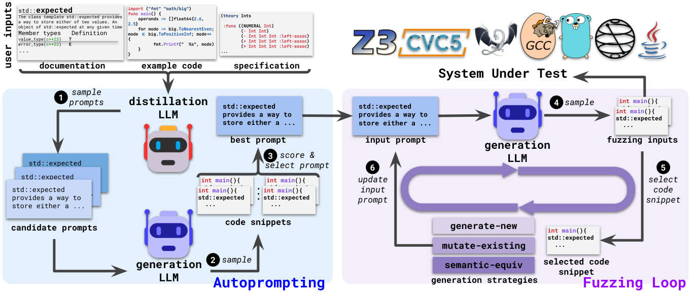

 Figure 1. Overview of Fuzz4All. 

We present Fuzz4All, a universal fuzzer that leverages LLMs to support both general and targeted fuzzing of any SUTs that take in programming language input. Figure [1](https://arxiv.org/html/2308.04748#S3.F1 "Figure 1 ‣ 3. Fuzz4All Approach ‣ Fuzz4All: Universal Fuzzing with Large Language Models") provides an overview of our approach. Fuzz4All first takes in arbitrary _user input_ that describes the fuzzing inputs to be generated, e.g., documentation of the SUT, example code snippets, or specifications. As the user input may be long, redundant, and partially irrelevant, the approach distills it into a concise but informative prompt for fuzzing. To this end, Fuzz4All performs an _autoprompting_ step (Section [3.1](https://arxiv.org/html/2308.04748#S3.SS1 "3.1. Autoprompting ‣ 3. Fuzz4All Approach ‣ Fuzz4All: Universal Fuzzing with Large Language Models")) by using a large, state-of-the-art _distillation LLM_ to sample multiple different candidate prompts  

  . Each candidate prompt is passed on to the _generation LLM_ to generate code snippets (i.e., fuzzing inputs)  

  . Fuzz4All then selects the prompt that produces the highest quality fuzzing inputs  

  .

Fuzz4All builds on two models, a distillation LLM that reduces the given user input and a generation LLM that creates the fuzzing inputs, to balance the trade-off between the costs and benefits different LLMs provide. Because the distillation LLM needs to understand and distill arbitrary user input, we use a high-end, large foundational model with strong natural language understanding abilities. However, directly using such a large model for input generation would be inefficient due to the high inference cost of autoregressive generation. Instead, to perform efficient fuzzing, Fuzz4All uses a smaller model as the generation LLM. While our approach is general across any pairs of distillation and generation LLMs, we implement Fuzz4All with the state-of-the-art GPT4 ([OpenAI, 2023](https://arxiv.org/html/2308.04748#bib.bib56)) and StarCoder ([Li et al., 2023](https://arxiv.org/html/2308.04748#bib.bib42)).

Using the best prompt selected via autoprompting as the initial input prompt for the generation LLM, we then move on to the _fuzzing loop_ (Section [3.2](https://arxiv.org/html/2308.04748#S3.SS2 "3.2. Fuzzing Loop ‣ 3. Fuzz4All Approach ‣ Fuzz4All: Universal Fuzzing with Large Language Models")), where Fuzz4All continuously samples the generation LLM to generate fuzzing inputs  

  . To avoid generating many similar fuzzing inputs, Fuzz4All continuously updates the input prompt in each iteration. Specifically, the approach selects a previously generated input as an _example_ 

  , which demonstrates the kind of future inputs we want the model to generate. In addition to the example, Fuzz4All also appends a _generation instruction_ to the initial prompt, which guides the model toward generating new fuzzing inputs  

  . This process is repeated while continuously passing the generated fuzzing inputs into the SUT and checking its behavior against a user-defined oracle, such as crashes.

### 3.1. Autoprompting

Algorithm 1 Autoprompting for fuzzing

1 Function _Autoprompting _:

Input : userInput, numSamples

Output : inputPrompt

2 greedyPrompt \(\leftarrow\) \(\mathcal{M_{D}}\) (userInput, APInstruction, temp=0) 

3 candidatePrompts \(\leftarrow\) [ greedyPrompt ] 

4 while _\(|\) candidatePrompts \(|\) < numSamples _ do

5 prompt \(\leftarrow\) \(\mathcal{M_{D}}\) (userInput, APInstruction, temp=1) 

6 candidatePrompts \(\leftarrow\) candidatePrompts \+ [ prompt ] 

7 inputPrompt \(\leftarrow\) \(\argmax\limits_{\textnormal{{p}}\in\textnormal{{candidatePrompts}}}\)Scoring (\(\mathcal{M_{G}}\) (p), SUT) 

8 return inputPrompt

The following presents the details of the first of two main steps of Fuzz4All, which distills the given user input via autoprompting into a prompt suitable for fuzzing. The user input may describe the SUT in general, or particular feature of the SUT to be tested. As shown in Figure [1](https://arxiv.org/html/2308.04748#S3.F1 "Figure 1 ‣ 3. Fuzz4All Approach ‣ Fuzz4All: Universal Fuzzing with Large Language Models"), user inputs may include technical documentation, example code, specifications, or even combinations of different modalities. Unlike traditional fuzzers that require inputs to follow a specific format, e.g., code snippets to use as seeds or well-formed specifications, Fuzz4All can directly understand the natural language descriptions or code examples in the user input. However, some information in the user input may be redundant or irrelevant, and hence, directly using the user inputs as a prompt for the generation LLM may be ineffective, as confirmed by our ablation study in Section [5.3](https://arxiv.org/html/2308.04748#S5.SS3 "5.3. RQ3: Ablation Study ‣ 5. Results ‣ Fuzz4All: Universal Fuzzing with Large Language Models"). Therefore, the goal of autoprompting is to generate a distilled input prompt that enables effective LLM-based fuzzing.

#### 3.1.1. Autoprompting Algorithm

Algorithm [1](https://arxiv.org/html/2308.04748#alg1 "In 3.1. Autoprompting ‣ 3. Fuzz4All Approach ‣ Fuzz4All: Universal Fuzzing with Large Language Models") details Fuzz4All’s autoprompting step. The inputs are the user input and the number of candidate prompts to generate. The final output is the input prompt selected to be used for the fuzzing campaign. As our goal is to use a distillation LLM to generate prompts that distill the information provided by the user, we give the following autoprompting instruction to the distillation LLM: “Please summarize the above information in a concise manner to describe the usage and functionality of the target”. Let \(\mathcal{M_{D}}\) be the distillation LLM, userInput be the user input and APInstruction be the autoprompting instruction. The prompt prompt generated can be formalized as the conditional probability: \(\mathcal{M_{D}}({\small\texttt{prompt}}\;|\;{\small\texttt{userInput}},\;{\small\texttt{APInstruction}})\)

Fuzz4All first generates a candidate prompt using greedy sampling with temperature \(0\) (line [1](https://arxiv.org/html/2308.04748#alg1 "In 3.1. Autoprompting ‣ 3. Fuzz4All Approach ‣ Fuzz4All: Universal Fuzzing with Large Language Models")). By first sampling with low temperature, the algorithm obtains a plausible solution with a high degree of confidence. This approach is commonly used in other domains, e.g., program synthesis ([Chen et al., 2021a](https://arxiv.org/html/2308.04748#bib.bib14)), where the greedy output is evaluated first to check if it can solve the problem. The algorithm then moves on to sampling with higher temperature to obtain more diverse prompts (line [1](https://arxiv.org/html/2308.04748#alg1 "In 3.1. Autoprompting ‣ 3. Fuzz4All Approach ‣ Fuzz4All: Universal Fuzzing with Large Language Models")), as done in prior work ([Chen et al., 2021a](https://arxiv.org/html/2308.04748#bib.bib14); [Xia and Zhang, 2023](https://arxiv.org/html/2308.04748#bib.bib80)). Compared to a greedy approach, sampling with high temperature yields different prompts that can each provide a unique distilled summary of the user input. Each generated prompt is added to a list of candidate prompts (line [1](https://arxiv.org/html/2308.04748#alg1 "In 3.1. Autoprompting ‣ 3. Fuzz4All Approach ‣ Fuzz4All: Universal Fuzzing with Large Language Models")), until the algorithm reaches the desired number of candidates.

To pick the best input prompt to be used in the fuzzing step, the algorithm evaluates each candidate prompt by performing a small-scale fuzzing experiment. Specifically, the approach uses each prompt as an input to the generation LLM to produce multiple code snippets per prompt. Fuzz4All then scores the generated code snippets for each prompt based on a scoring function. While the scoring function can be based on a variety of different metrics, e.g., coverage, bug finding, or the complexity of generated fuzzing inputs, to make the approach lightweight and general, our scoring function is the number of unique generated code snippets that are valid, i.e., accepted by the target SUT. This metric is chosen since for fuzzing, we want fuzzing inputs to be valid or close to valid to the logic deep inside the SUT. Let \(\mathcal{M_{G}}\) be the generation LLM, p be a candidate prompt, isValid be a function that returns 1 if a generated code c is valid and 0 otherwise. Our default scoring function is defined as: \(\sum_{{\small\texttt{c}}\in\mathcal{M_{G}}({\small\texttt{p}})}[{\small\texttt{isValid}}({\small\texttt{c}},~{\small\texttt{SUT}})]\). Finally, Fuzz4All selects the input prompt with the highest score (line [1](https://arxiv.org/html/2308.04748#alg1 "In 3.1. Autoprompting ‣ 3. Fuzz4All Approach ‣ Fuzz4All: Universal Fuzzing with Large Language Models")) as the initial input prompt to be used for fuzzing. In summary, our autoprompting step combines both prompt generation and scoring, which allows Fuzz4All to automatically generate and select a prompt suitable for the fuzzing target.

#### 3.1.2. Example: Autoprompting

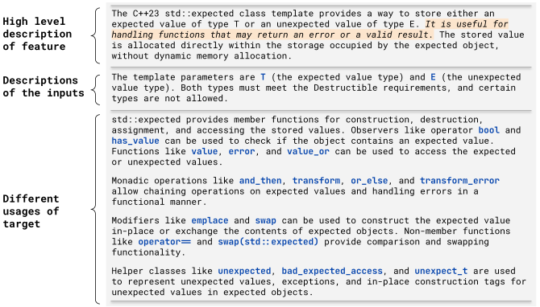

 Figure 2. Autoprompting result for std::expected.

Figure [2](https://arxiv.org/html/2308.04748#S3.F2 "Figure 2 ‣ 3.1.2. Example: Autoprompting ‣ 3.1. Autoprompting ‣ 3. Fuzz4All Approach ‣ Fuzz4All: Universal Fuzzing with Large Language Models") shows an example of an input prompt generated by our autoprompting algorithm. The example is for fuzzing C++ compilers while focusing specifically on std::expected, a new feature introduced in C++23. As the user input, we pass the original cppreference documentation ([cpp, 2023](https://arxiv.org/html/2308.04748#bib.bib3)) to Fuzz4All, which spans multiple screen lengths with small tables and verbose descriptions (498 words, 3,262 characters). In contrast, the distilled input prompt created by the autoprompting algorithm provides a more concise natural language description of the targeted feature (214 words, 1,410 characters). The input prompt contains a high-level description of how std::expected is to be used. For example, the input prompt contains a concise sentence (highlighted in orange) that summarizes the situations the feature is useful in. Additionally, the input prompt contains descriptions of the inputs, as well as the different usages (i.e., member functions) of the feature. For example, functions and_then, transform, or_else, and transform_error have very similar descriptions in the original documentation, which is repeated for each function. Instead, in the distilled input prompt, these functions are grouped together in a concise manner that still illustrates how they can be used. Using the distilled input prompt, Fuzz4All can generate fuzzing inputs that effectively target the std::expected feature of C++ compilers.

#### 3.1.3. Comparison with Existing Autoprompting Techniques

To the best of our knowledge, we are the first to automatically distill knowledge from arbitrary user inputs for a software engineering task using black-box autoprompting. Compared to prior work on autoprompting in NLP ([Shin et al., 2020](https://arxiv.org/html/2308.04748#bib.bib69)) and software engineering ([Wang et al., 2022](https://arxiv.org/html/2308.04748#bib.bib76)), which optimize the prompt by accessing model gradients, our autoprompting needs only black-box, sampling access to the distillation LLM. While the use of a scoring function to evaluate each prompt is similar to recent work in NLP ([Zhou et al., 2022](https://arxiv.org/html/2308.04748#bib.bib88)), our scoring function directly evaluates the prompt on the exact downstream task of generating valid code snippets, instead of using an approximate proxy scoring function.

### 3.2. Fuzzing Loop

Given the input prompt created in the first step of Fuzz4All, the goal of the fuzzing loop is to generate diverse fuzzing inputs using a generation LLM. However, due to the probabilistic nature of LLMs, sampling multiple times using the same input would produce the same or similar code snippets. For fuzzing, we aim to avoid such repeated inputs and instead want to generate a diverse set of fuzzing inputs that cover new code and discover new bugs. To accomplish this goal, we exploit the ability of LLMs to utilize both examples and natural language instructions to guide the generation.

The high-level idea of the fuzzing loop is to continuously augment the original input prompt by selecting an example fuzzing input from previous iterations and by specifying a generation strategy. The goal of using an example is to demonstrate the kind of code snippet we want the generation LLM to produce. The generation strategies are designed as instructions on what to do with the provided code example. These strategies are inspired by traditional fuzzers, mimicking their ability to synthesize new fuzzing inputs (as in generation-based fuzzers) and to produce variants of previously generated inputs (as in mutation-based fuzzers). Before each new iteration of the fuzzing loop, Fuzz4All appends both an example and a generation strategy to the input prompt, enabling the generation LLM to continuously create new fuzzing inputs.

Algorithm 2 Fuzzing loop

1 Function _FuzzingLoop _:

Input : inputPrompt, timeBudget

Output : bugs

2 genStrats \(\leftarrow\) [ generate-new, mutate-existing, semantic-equiv ] 

3 fuzzingInputs \(\leftarrow\) \(\mathcal{M_{G}}\) (inputPrompt \+ generate-new) 

4 bugs \(\leftarrow\) Oracle (fuzzingInputs, SUT) 

5 while _timeElapsed < timeBudget _ do

6 example \(\leftarrow\) \(\mathit{sample}\) (fuzzingInputs, SUT) 

7 instruction \(\leftarrow\) \(\mathit{sample}\) (genStrats) 

8 fuzzingInputs \(\leftarrow\) \(\mathcal{M_{G}}\) (inputPrompt \+ example \+ instruction) 

9 bugs \(\leftarrow\) bugs \+ Oracle (fuzzingInputs, SUT) 

10 return bugs

#### 3.2.1. Fuzzing Loop Algorithm

Algorithm [2](https://arxiv.org/html/2308.04748#alg2 "In 3.2. Fuzzing Loop ‣ 3. Fuzz4All Approach ‣ Fuzz4All: Universal Fuzzing with Large Language Models") describes the fuzzing loop. The inputs are the initial input prompt and the fuzzing budget. The final output is a set of bugs identified by the user-defined oracle. First, the algorithm initializes the generation strategies (generate-new, mutate-existing, and semantic-equiv), which will be used to modify the input prompt during the fuzzing loop (line [2](https://arxiv.org/html/2308.04748#alg2 "In 3.2. Fuzzing Loop ‣ 3. Fuzz4All Approach ‣ Fuzz4All: Universal Fuzzing with Large Language Models")). Figure [3](https://arxiv.org/html/2308.04748#S3.F3 "Figure 3 ‣ 3.2.1. Fuzzing Loop Algorithm ‣ 3.2. Fuzzing Loop ‣ 3. Fuzz4All Approach ‣ Fuzz4All: Universal Fuzzing with Large Language Models") (top-right) lists our three generation strategies along with their corresponding instructions. For the first invocation of the generation LLM, denoted with \(\mathcal{M_{G}}\), the algorithm does not yet have any examples of fuzzing inputs. Hence, it appends to the input prompt the generate-new generation instruction, which guides the model toward producing a first batch of fuzzing inputs (line [2](https://arxiv.org/html/2308.04748#alg2 "In 3.2. Fuzzing Loop ‣ 3. Fuzz4All Approach ‣ Fuzz4All: Universal Fuzzing with Large Language Models")).

Next, the algorithm enters the main fuzzing loop (lines [2](https://arxiv.org/html/2308.04748#alg2 "In 3.2. Fuzzing Loop ‣ 3. Fuzz4All Approach ‣ Fuzz4All: Universal Fuzzing with Large Language Models")–[2](https://arxiv.org/html/2308.04748#alg2 "In 3.2. Fuzzing Loop ‣ 3. Fuzz4All Approach ‣ Fuzz4All: Universal Fuzzing with Large Language Models")), which continuously updates the prompt to create new fuzzing inputs. To this end, the algorithm selects an example from the previous batch of generated fuzzing inputs, randomly picking from all those fuzzing inputs that are valid for the SUT (line [2](https://arxiv.org/html/2308.04748#alg2 "In 3.2. Fuzzing Loop ‣ 3. Fuzz4All Approach ‣ Fuzz4All: Universal Fuzzing with Large Language Models")). In addition to the example, the algorithm also randomly picks one of the three generation strategies (line [2](https://arxiv.org/html/2308.04748#alg2 "In 3.2. Fuzzing Loop ‣ 3. Fuzz4All Approach ‣ Fuzz4All: Universal Fuzzing with Large Language Models")). The generation strategy either instructs the model to mutate the selected example (mutate-existing), to produce a fuzzing input that is semantically equivalent to the example (semantic-equiv), or to come up with a new fuzzing input (generate-new). The algorithm concatenates the initial input prompt, the selected example, and the selected generation strategy into a new prompt, and then queries the generation LLM with this prompt to produce another batch of fuzzing inputs (line [2](https://arxiv.org/html/2308.04748#alg2 "In 3.2. Fuzzing Loop ‣ 3. Fuzz4All Approach ‣ Fuzz4All: Universal Fuzzing with Large Language Models")).

The main fuzzing loop is repeated until the algorithm has exhausted the fuzzing budget. For each created fuzzing input, Fuzz4All passes the input to the SUT. If the user-defined oracle identifies an unexpected behavior, e.g., a crash, then the algorithm adds a report to the set of detected bugs (lines [2](https://arxiv.org/html/2308.04748#alg2 "In 3.2. Fuzzing Loop ‣ 3. Fuzz4All Approach ‣ Fuzz4All: Universal Fuzzing with Large Language Models") and [2](https://arxiv.org/html/2308.04748#alg2 "In 3.2. Fuzzing Loop ‣ 3. Fuzz4All Approach ‣ Fuzz4All: Universal Fuzzing with Large Language Models")).

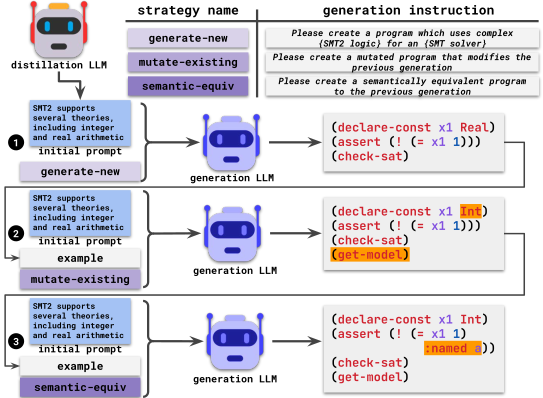

 Figure 3. Fuzzing strategies and example of fuzzing loop.

#### 3.2.2. Example: Fuzzing Loop

Figure [3](https://arxiv.org/html/2308.04748#S3.F3 "Figure 3 ‣ 3.2.1. Fuzzing Loop Algorithm ‣ 3.2. Fuzzing Loop ‣ 3. Fuzz4All Approach ‣ Fuzz4All: Universal Fuzzing with Large Language Models") illustrates how our fuzzing loop uses input examples and the generation strategies to create different fuzzing inputs. In this case, we are fuzzing an SMT solver where the inputs are logic formulas written in the SMT2 language. Initially  

  , there are no examples, and hence, the algorithm uses the generate-new strategy to synthesize new fuzzing inputs. Next, taking a generated, valid fuzzing input as an example, the algorithm queries the model to create a new input  

  based on the mutate-existing strategy, which aims to mutate the selected example. We observe that the new fuzzing input subtly modifies the previous input by swapping the type of a variable as well as adding some computation. In the next fuzzing iteration  

  , the algorithm selects the previously generated fuzzing input as the example and uses the semantic-equiv generation strategy, which aims to create an input that does not modify the semantics of the given example. This time, we observe that the new fuzzing input simply adds a syntax tag to the selected example. In fact, the combination of generation strategies shown in the example helps Fuzz4All to generate a fuzzing input that causes an unexpected crash in the SMT solver. The crash exposes one of the real-world bugs detected by Fuzz4All during our evaluation, which has been confirmed and fixed by developers.

#### 3.2.3. Oracle

The fuzzing inputs produced by Fuzz4All during the fuzzing loop can be used to check the behavior of the SUT against an oracle to detect bugs. The oracle is custom for each SUT, and it can be fully defined and customized by the user. For example, when fuzzing C compilers, a user could define a differential testing oracle that compares the compiler behavior under different optimization levels ([Yang et al., 2011](https://arxiv.org/html/2308.04748#bib.bib82)). In this paper, we focus on simple and easy-to-define oracles, such as crashes due to segmentation faults and internal assertion failures, with more details discussed in Section [4.2](https://arxiv.org/html/2308.04748#S4.SS2 "4.2. Systems Under Test and Baselines ‣ 4. Experimental Design ‣ Fuzz4All: Universal Fuzzing with Large Language Models").

## 4\. Experimental Design

We evaluate Fuzz4All on the following research questions:

  * RQ1: How does Fuzz4All compare against existing fuzzers? 
  * RQ2: How effective is Fuzz4All in performing targeted fuzzing? 
  * RQ3: How do different components contribute to Fuzz4All’s effectiveness? 
  * RQ4: What real-world bugs does Fuzz4All find? 

### 4.1. Implementation

Fuzz4All is primarily implemented in Python. The autoprompting and fuzzing loop components of Fuzz4All contain only 872 LoC. Compared to traditional fuzzers, such as Csmith (>80K LoC), which need high manual effort to implement generators, Fuzz4All has a very lightweight implementation. Fuzz4All uses GPT4 ([OpenAI, 2023](https://arxiv.org/html/2308.04748#bib.bib56)) as the distillation LLM to perform autoprompting since this model is the state-of-the-art for a wide range of NLP-based reasoning tasks ([Bubeck et al., 2023](https://arxiv.org/html/2308.04748#bib.bib10)). Specifically, we use the gpt-4-0613 checkpoint with max_token of 500 provided via the OpenAI API ([gpt4endpoint, 2023](https://arxiv.org/html/2308.04748#bib.bib28)). max_token forces the prompts to always fit within the context window of the generation LLM. For autoprompting, we sample four candidate prompts, generate 30 fuzzing inputs each, and evaluate using a scoring function based on validity rate (as described in Section [3.1.1](https://arxiv.org/html/2308.04748#S3.SS1.SSS1 "3.1.1. Autoprompting Algorithm ‣ 3.1. Autoprompting ‣ 3. Fuzz4All Approach ‣ Fuzz4All: Universal Fuzzing with Large Language Models")). For the fuzzing loop, we use the Hugging Face implementation of the StarCoder ([Li et al., 2023](https://arxiv.org/html/2308.04748#bib.bib42)) model as the generation LLM, which is trained on over one trillion code tokens across over 80 languages. Our default setting when generating fuzzing inputs uses a temperature of 1, a batch size of 30, a maximum output length of 1,024 using nucleus sampling ([Holtzman et al., 2019](https://arxiv.org/html/2308.04748#bib.bib33)) with a top-p of 1.

### 4.2. Systems Under Test and Baselines

Table 1. SUTs and baseline tools.

Language | SUT(s) | Baseline tool(s) | Version  
---|---|---|---  
C | GCC, Clang | GrayC ([Even-Mendoza et al., 2023](https://arxiv.org/html/2308.04748#bib.bib22)), Csmith ([Yang et al., 2011](https://arxiv.org/html/2308.04748#bib.bib82)) | GCC-13.1.1  
C++ | G++, Clang++ | YARPGen ([Livinskii et al., 2020](https://arxiv.org/html/2308.04748#bib.bib50)) | G++-13.1.1  
SMT2 | Z3, CVC5 | TypeFuzz ([Park et al., 2021](https://arxiv.org/html/2308.04748#bib.bib60)) | CVC5-1.0.5  
Go | Go | go-fuzz ([go-fuzz, 2023](https://arxiv.org/html/2308.04748#bib.bib26)) | go-1.20.6  
Java | javac | Hephaestus ([Chaliasos et al., 2022](https://arxiv.org/html/2308.04748#bib.bib12)) | OpenJDK-javac-18  
Python | Qiskit | MorphQ ([Paltenghi and Pradel, 2023](https://arxiv.org/html/2308.04748#bib.bib59)) | qiskit-0.43.1

 

To demonstrate the generality of Fuzz4All, we evaluate it on six input languages and nine SUTs. Table [1](https://arxiv.org/html/2308.04748#S4.T1 "Table 1 ‣ 4.2. Systems Under Test and Baselines ‣ 4. Experimental Design ‣ Fuzz4All: Universal Fuzzing with Large Language Models") shows each of the languages, SUTs, and the corresponding baseline tools. Note that we compare coverage on one SUT per language, with the SUT versions used for coverage measurements shown in the last column of Table [1](https://arxiv.org/html/2308.04748#S4.T1 "Table 1 ‣ 4.2. Systems Under Test and Baselines ‣ 4. Experimental Design ‣ Fuzz4All: Universal Fuzzing with Large Language Models"). Except for the coverage experiments, we perform fuzzing on the nightly release of each target. Unless otherwise mentioned, we use unexpected compiler crashes as the oracle and consider a fuzzing input as valid if it compiles successfully. Each baseline fuzzer is run with its default settings. For baseline fuzzers that require input seeds, we use the default seed corpus provided in their replication repository. We now present more evaluation details for each SUT.

#### 4.2.1. C/C++ Compilers

We target the popular GCC and Clang compilers and provide the standard C library documentation as user input to Fuzz4All by default. Our baselines include Csmith ([Yang et al., 2011](https://arxiv.org/html/2308.04748#bib.bib82)), a classic generation-based C compiler fuzzer, and GrayC ([Even-Mendoza et al., 2023](https://arxiv.org/html/2308.04748#bib.bib22)), a recent mutation-based fuzzer that uses coverage feedback together with specialized mutation operators. For C++, we target new C++23 features by providing the C++23 standard documentation as input to Fuzz4All. Our baseline is YARPGen ([Livinskii et al., 2020](https://arxiv.org/html/2308.04748#bib.bib50)), a generation-based fuzzer that extends Csmith with new language features in C++ and generation policies to trigger different compiler optimizations.

#### 4.2.2. SMT Solvers

We run Fuzz4All on Z3 and CVC5 with commonly enabled developer settings, such as debug and assertion, following prior work ([Park et al., 2021](https://arxiv.org/html/2308.04748#bib.bib60); [Winterer et al., 2020a](https://arxiv.org/html/2308.04748#bib.bib78); [Winterer et al., 2020b](https://arxiv.org/html/2308.04748#bib.bib79)). Fuzz4All generates SMT formulas as fuzzing inputs using an overview documentation of the SMT2 language and SMT solver as input by default. A fuzzing input is considered valid if the SMT solver returns either SAT or UNSAT without any error. Our baseline is state-of-the-art TypeFuzz ([Park et al., 2021](https://arxiv.org/html/2308.04748#bib.bib60)), which mutates existing SMT expressions based on newly generated expressions of the same type.

#### 4.2.3. Go Toolchain

We run Fuzz4All on the most recent version of Go. By default, we use the Go standard library documentation as input to Fuzz4All. As a baseline, we use go-fuzz ([go-fuzz, 2023](https://arxiv.org/html/2308.04748#bib.bib26)), a coverage-guided, mutation-based fuzzer designed for Go, which generates inputs for various Go standard libraries using handwritten templates.

#### 4.2.4. Java Compiler

We evaluate Fuzz4All on the OpenJDK Java compiler, javac, which compiles source code into bytecode. Our default input is the latest standard Java API documentation page. We compare against Hephaestus ([Chaliasos et al., 2022](https://arxiv.org/html/2308.04748#bib.bib12)), a recent combined generation- and mutation-based fuzzer designed for JVM compilers and targeting type-related bugs.

#### 4.2.5. Quantum Computing Platform.

We target Qiskit ([Qis, 2021](https://arxiv.org/html/2308.04748#bib.bib2)), a popular quantum computing framework ([Fingerhuth et al., 2018](https://arxiv.org/html/2308.04748#bib.bib24)). Qiskit is built on top of Python, i.e., both the input program and the compilation are defined in Python code. Thus, creating a valid input for Qiskit means using the Qiskit Python APIs in a meaningful way, e.g., to create a quantum circuit. It is challenging for traditional synthesis tools to handle dynamically typed general-purpose languages (like Python) ([Shi et al., 2022](https://arxiv.org/html/2308.04748#bib.bib68); [Gulwani et al., 2017](https://arxiv.org/html/2308.04748#bib.bib30)), not to mention the additional API constraints and quantum-specific nature of many bugs ([Paltenghi and Pradel, 2022](https://arxiv.org/html/2308.04748#bib.bib58)), making fuzzing Qiskit a particularly difficult challenge. Our baseline is MorphQ ([Paltenghi and Pradel, 2023](https://arxiv.org/html/2308.04748#bib.bib59)), a recent fuzzer that uses a template- and grammar-based approach to generate valid quantum programs and then applies metamorphic transformations.

Unlike for the other SUTs, which receive fuzzing inputs in a file, to invoke Qiskit, we must run the generated Python program itself. As an oracle, we add statements at the end of the generated Python file, which collect all QuantumCircuit objects via Python’s built-in introspection APIs and then apply two oracles on each circuit. The two oracles are directly borrowed from previous work for a fair comparison ([Paltenghi and Pradel, 2023](https://arxiv.org/html/2308.04748#bib.bib59)). The first oracle compiles the circuit via a transpile call with different optimization levels and reports any crash. The second oracle converts the circuit to its lower-level QASM ([Cross et al., 2017](https://arxiv.org/html/2308.04748#bib.bib17)) representation and then reads it back, reporting any crash.

### 4.3. Experimental Setup and Metrics

Fuzzing campaigns. For RQ1, we use a fuzzing budget of 24 hours (including autoprompting), which is used commonly in prior work ([Klees et al., 2018](https://arxiv.org/html/2308.04748#bib.bib37)). To account for variance, we repeat the experiment for both Fuzz4All and the baselines five times. Due to the high cost of experiments, for later RQs, we use a fuzzing budget of 10,000 generated fuzzing inputs and repeat four times for the ablation study.

Environment. Experiments are conducted on a 64-core workstation with 256 GB RAM running Ubuntu 20.04.5 LTS with 4 NVIDIA RTX A6000 GPUs (only one GPU is used per fuzzing run).

Metrics. We use the widely adopted measure of _code coverage_ for evaluating fuzzing tools ([Böhme et al., 2022](https://arxiv.org/html/2308.04748#bib.bib8); [Klees et al., 2018](https://arxiv.org/html/2308.04748#bib.bib37); [Wei et al., 2022](https://arxiv.org/html/2308.04748#bib.bib77)). To be uniform, we report the line coverage for each of the targets studied in the evaluation. Following prior work ([Klees et al., 2018](https://arxiv.org/html/2308.04748#bib.bib37)), we use the Mann-Whitney U-test ([Mann and Whitney, 1947](https://arxiv.org/html/2308.04748#bib.bib53)) to compute statistical significance and indicate significant (p < 0.05) coverage results in applicable tables (Tables [2](https://arxiv.org/html/2308.04748#S5.T2 "Table 2 ‣ 5.1. RQ1: Comparison against Existing Fuzzers ‣ 5. Results ‣ Fuzz4All: Universal Fuzzing with Large Language Models") and [4](https://arxiv.org/html/2308.04748#S5.T4 "Table 4 ‣ 5.3. RQ3: Ablation Study ‣ 5. Results ‣ Fuzz4All: Universal Fuzzing with Large Language Models")) with *. We additionally measure the _validity rate_ (% valid) of inputs as the percentage of fuzzing inputs generated that are valid and unique. As Fuzz4All supports both general and targeted fuzzing, to assess the effectiveness of targeted fuzzing, we report the _hit rate_ , i.e., the percentage of fuzzing inputs that use a specific target feature (checked with simple regular expressions). Finally, we also report the most important metric and goal of fuzzing: the number of bugs detected by Fuzz4All for each of our nine SUTs.

## 5\. Results

### 5.1. RQ1: Comparison against Existing Fuzzers

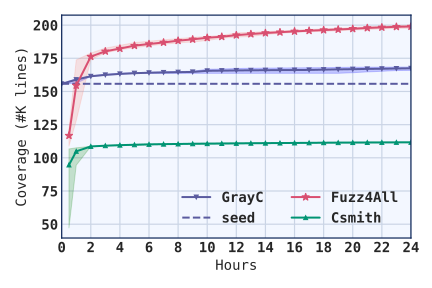

 (a) GCC

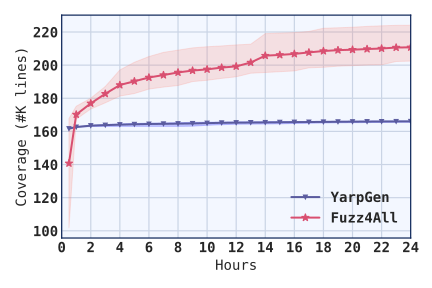

 (b) G++

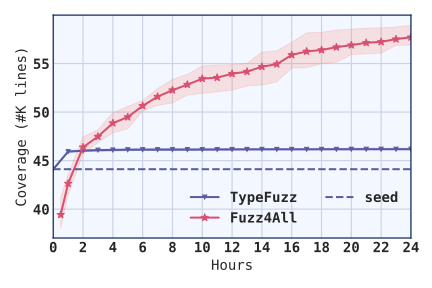

 (c) CVC5

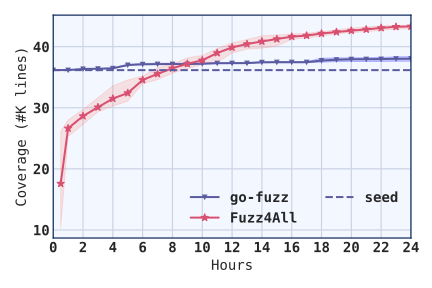

 (d) Go

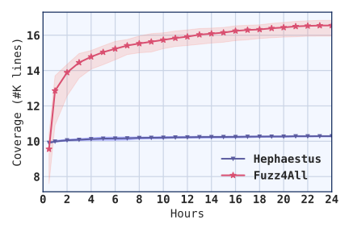

 (e) javac

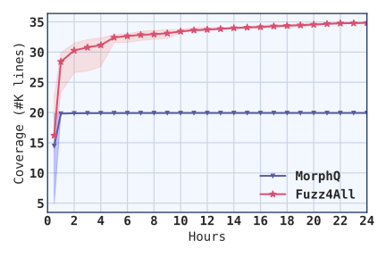

 (f) Qiskit

Figure 4. Coverage trend of Fuzz4All against state-of-the-art fuzzers in a 24-hour fuzzing campaign. Table 2. Fuzz4All against state-of-the-art fuzzers (* indicates statistically significant coverage improvement).

<table id="S5.T2.6.1" class="ltx_tabular ltx_align_middle">
<tr id="S5.T2.6.1.1" class="ltx_tr">
<td id="S5.T2.6.1.1.1" class="ltx_td ltx_align_left ltx_border_tt">Target</td>
<td id="S5.T2.6.1.1.2" class="ltx_td ltx_align_right ltx_border_tt">Fuzzer</td>
<td id="S5.T2.6.1.1.3" class="ltx_td ltx_align_right ltx_border_tt"># programs</td>
<td id="S5.T2.6.1.1.4" class="ltx_td ltx_align_right ltx_border_tt">% valid</td>
<td id="S5.T2.6.1.1.5" class="ltx_td ltx_align_center ltx_border_tt" colspan="2">Coverage</td></tr>
<tr id="S5.T2.6.1.2" class="ltx_tr">
<td id="S5.T2.6.1.2.1" class="ltx_td ltx_align_left ltx_border_t" rowspan="3">GCC</td>
<td id="S5.T2.6.1.2.2" class="ltx_td ltx_align_right ltx_border_t">GrayC</td>
<td id="S5.T2.6.1.2.3" class="ltx_td ltx_align_right ltx_border_t">104,326</td>
<td id="S5.T2.6.1.2.4" class="ltx_td ltx_align_right ltx_border_t">95.96%</td>
<td id="S5.T2.6.1.2.5" class="ltx_td ltx_align_right ltx_border_t">167,453</td>
<td id="S5.T2.6.1.2.6" class="ltx_td ltx_border_t"></td></tr>
<tr id="S5.T2.6.1.3" class="ltx_tr">
<td id="S5.T2.6.1.3.1" class="ltx_td ltx_align_right">Csmith</td>
<td id="S5.T2.6.1.3.2" class="ltx_td ltx_align_right">61,883</td>
<td id="S5.T2.6.1.3.3" class="ltx_td ltx_align_right">99.99%</td>
<td id="S5.T2.6.1.3.4" class="ltx_td ltx_align_right">111,668</td>
<td id="S5.T2.6.1.3.5" class="ltx_td"></td></tr>
<tr id="S5.T2.6.1.4" class="ltx_tr">
<td id="S5.T2.6.1.4.1" class="ltx_td ltx_align_right">Fuzz4All</td>
<td id="S5.T2.6.1.4.2" class="ltx_td ltx_align_right">44,324</td>
<td id="S5.T2.6.1.4.3" class="ltx_td ltx_align_right">37.26%</td>
<td id="S5.T2.6.1.4.4" class="ltx_td ltx_align_right">*198,927</td>
<td id="S5.T2.6.1.4.5" class="ltx_td ltx_align_right">+18.8%</td></tr>
<tr id="S5.T2.6.1.5" class="ltx_tr">
<td id="S5.T2.6.1.5.1" class="ltx_td"></td>
<td id="S5.T2.6.1.5.2" class="ltx_td ltx_align_right" style="--ltx-bg-color:#E1ECFF;">YARPGen</td>
<td id="S5.T2.6.1.5.3" class="ltx_td ltx_align_right" style="--ltx-bg-color:#E1ECFF;">255,581</td>
<td id="S5.T2.6.1.5.4" class="ltx_td ltx_align_right" style="--ltx-bg-color:#E1ECFF;">99.99%</td>
<td id="S5.T2.6.1.5.5" class="ltx_td ltx_align_right" style="--ltx-bg-color:#E1ECFF;">166,614</td>
<td id="S5.T2.6.1.5.6" class="ltx_td"></td></tr>
<tr id="S5.T2.6.1.6" class="ltx_tr">
<td id="S5.T2.6.1.6.1" class="ltx_td ltx_align_left" style="--ltx-bg-color:#E1ECFF;">G++</td>
<td id="S5.T2.6.1.6.2" class="ltx_td ltx_align_right" style="--ltx-bg-color:#E1ECFF;">Fuzz4All</td>
<td id="S5.T2.6.1.6.3" class="ltx_td ltx_align_right" style="--ltx-bg-color:#E1ECFF;">26,365</td>
<td id="S5.T2.6.1.6.4" class="ltx_td ltx_align_right" style="--ltx-bg-color:#E1ECFF;">40.74%</td>
<td id="S5.T2.6.1.6.5" class="ltx_td ltx_align_right" style="--ltx-bg-color:#E1ECFF;">*210,743</td>
<td id="S5.T2.6.1.6.6" class="ltx_td ltx_align_right" style="--ltx-bg-color:#E1ECFF;">+26.5%</td></tr>
<tr id="S5.T2.6.1.7" class="ltx_tr">
<td id="S5.T2.6.1.7.1" class="ltx_td ltx_align_left" rowspan="2">CVC5</td>
<td id="S5.T2.6.1.7.2" class="ltx_td ltx_align_right">TypeFuzz</td>
<td id="S5.T2.6.1.7.3" class="ltx_td ltx_align_right">43,001</td>
<td id="S5.T2.6.1.7.4" class="ltx_td ltx_align_right">93.24%</td>
<td id="S5.T2.6.1.7.5" class="ltx_td ltx_align_right">46,174</td>
<td id="S5.T2.6.1.7.6" class="ltx_td"></td></tr>
<tr id="S5.T2.6.1.8" class="ltx_tr">
<td id="S5.T2.6.1.8.1" class="ltx_td ltx_align_right">Fuzz4All</td>
<td id="S5.T2.6.1.8.2" class="ltx_td ltx_align_right">36,054</td>
<td id="S5.T2.6.1.8.3" class="ltx_td ltx_align_right">47.63%</td>
<td id="S5.T2.6.1.8.4" class="ltx_td ltx_align_right">*57,674</td>
<td id="S5.T2.6.1.8.5" class="ltx_td ltx_align_right">+24.9%</td></tr>
<tr id="S5.T2.6.1.9" class="ltx_tr">
<td id="S5.T2.6.1.9.1" class="ltx_td"></td>
<td id="S5.T2.6.1.9.2" class="ltx_td ltx_align_right" style="--ltx-bg-color:#E1ECFF;">go-fuzz</td>
<td id="S5.T2.6.1.9.3" class="ltx_td ltx_align_right" style="--ltx-bg-color:#E1ECFF;">20,002</td>
<td id="S5.T2.6.1.9.4" class="ltx_td ltx_align_right" style="--ltx-bg-color:#E1ECFF;">100.00%</td>
<td id="S5.T2.6.1.9.5" class="ltx_td ltx_align_right" style="--ltx-bg-color:#E1ECFF;">38,024</td>
<td id="S5.T2.6.1.9.6" class="ltx_td"></td></tr>
<tr id="S5.T2.6.1.10" class="ltx_tr">
<td id="S5.T2.6.1.10.1" class="ltx_td ltx_align_left" style="--ltx-bg-color:#E1ECFF;">Go</td>
<td id="S5.T2.6.1.10.2" class="ltx_td ltx_align_right" style="--ltx-bg-color:#E1ECFF;">Fuzz4All</td>
<td id="S5.T2.6.1.10.3" class="ltx_td ltx_align_right" style="--ltx-bg-color:#E1ECFF;">22,817</td>
<td id="S5.T2.6.1.10.4" class="ltx_td ltx_align_right" style="--ltx-bg-color:#E1ECFF;">23.02%</td>
<td id="S5.T2.6.1.10.5" class="ltx_td ltx_align_right" style="--ltx-bg-color:#E1ECFF;">*43,317</td>
<td id="S5.T2.6.1.10.6" class="ltx_td ltx_align_right" style="--ltx-bg-color:#E1ECFF;">+13.7%</td></tr>
<tr id="S5.T2.6.1.11" class="ltx_tr">
<td id="S5.T2.6.1.11.1" class="ltx_td ltx_align_left" rowspan="2">javac</td>
<td id="S5.T2.6.1.11.2" class="ltx_td ltx_align_right">Hephaestus</td>
<td id="S5.T2.6.1.11.3" class="ltx_td ltx_align_right">728,217</td>
<td id="S5.T2.6.1.11.4" class="ltx_td ltx_align_right">57.22%</td>
<td id="S5.T2.6.1.11.5" class="ltx_td ltx_align_right">10,285</td>
<td id="S5.T2.6.1.11.6" class="ltx_td"></td></tr>
<tr id="S5.T2.6.1.12" class="ltx_tr">
<td id="S5.T2.6.1.12.1" class="ltx_td ltx_align_right">Fuzz4All</td>
<td id="S5.T2.6.1.12.2" class="ltx_td ltx_align_right">31,967</td>
<td id="S5.T2.6.1.12.3" class="ltx_td ltx_align_right">49.05%</td>
<td id="S5.T2.6.1.12.4" class="ltx_td ltx_align_right">*16,552</td>
<td id="S5.T2.6.1.12.5" class="ltx_td ltx_align_right">+60.9%</td></tr>
<tr id="S5.T2.6.1.13" class="ltx_tr">
<td id="S5.T2.6.1.13.1" class="ltx_td"></td>
<td id="S5.T2.6.1.13.2" class="ltx_td ltx_align_right" style="--ltx-bg-color:#E1ECFF;">MorphQ</td>
<td id="S5.T2.6.1.13.3" class="ltx_td ltx_align_right" style="--ltx-bg-color:#E1ECFF;">38,474</td>
<td id="S5.T2.6.1.13.4" class="ltx_td ltx_align_right" style="--ltx-bg-color:#E1ECFF;">100.00%</td>
<td id="S5.T2.6.1.13.5" class="ltx_td ltx_align_right" style="--ltx-bg-color:#E1ECFF;">19,929</td>
<td id="S5.T2.6.1.13.6" class="ltx_td"></td></tr>
<tr id="S5.T2.6.1.14" class="ltx_tr">
<td id="S5.T2.6.1.14.1" class="ltx_td ltx_align_left ltx_border_bb" style="--ltx-bg-color:#E1ECFF;">Qiskit</td>
<td id="S5.T2.6.1.14.2" class="ltx_td ltx_align_right ltx_border_bb" style="--ltx-bg-color:#E1ECFF;">Fuzz4All</td>
<td id="S5.T2.6.1.14.3" class="ltx_td ltx_align_right ltx_border_bb" style="--ltx-bg-color:#E1ECFF;">33,454</td>
<td id="S5.T2.6.1.14.4" class="ltx_td ltx_align_right ltx_border_bb" style="--ltx-bg-color:#E1ECFF;">24.90%</td>
<td id="S5.T2.6.1.14.5" class="ltx_td ltx_align_right ltx_border_bb" style="--ltx-bg-color:#E1ECFF;">*34,988</td>
<td id="S5.T2.6.1.14.6" class="ltx_td ltx_align_right ltx_border_bb" style="--ltx-bg-color:#E1ECFF;">+75.6%</td></tr>
</table>

 

#### 5.1.1. Coverage over Time

Figure [4](https://arxiv.org/html/2308.04748#S5.F4 "Figure 4 ‣ 5.1. RQ1: Comparison against Existing Fuzzers ‣ 5. Results ‣ Fuzz4All: Universal Fuzzing with Large Language Models") shows the 24-hour coverage trend of Fuzz4All compared with the baselines, where the solid line shows average coverage and the area indicates the minimum and maximum across five runs. We observe that Fuzz4All achieves the highest coverage by the end of the fuzzing campaign across all targets, with an average improvement of 36.8% compared to the top performing baselines. Contrasting with generation-based fuzzers (i.e., YARPGen and MorphQ), Fuzz4All is able to almost immediately achieve higher coverage, demonstrating the powerful generative ability of LLMs in producing diverse code snippets compared to traditional program generation techniques. While mutation-based fuzzers (i.e., go-fuzz and GrayC) are able to achieve higher coverage in the beginning through the use of high quality seeds, the coverage gained via mutations rapidly falls off and Fuzz4All is able to slowly but surely cover more code. Note that we include the autoprompting time as part of the fuzzing budget for a fair comparison, which incurs negligible overhead (avg. 2.3 minutes per fuzzing campaign).

Unlike the baseline fuzzers, which reach a coverage plateau by the end of the 24-hour period, Fuzz4All keeps finding inputs that cover new code, even near the end of the fuzzing campaign. Recall that during each iteration of Fuzz4All’s fuzzing loop, the original input prompt is updated with both a new example and a generation strategy (Section [3.2](https://arxiv.org/html/2308.04748#S3.SS2 "3.2. Fuzzing Loop ‣ 3. Fuzz4All Approach ‣ Fuzz4All: Universal Fuzzing with Large Language Models")), nudging the LLM to generate new fuzzing inputs. We hypothesize that this allows Fuzz4All to effectively generate new and diverse fuzzing inputs even after a long period of fuzzing, leading to sustained coverage increase.

#### 5.1.2. Generation Validity, Number, and Coverage

We examine the number of fuzzing inputs generated and their validity rate across our studied SUTs. In Table [2](https://arxiv.org/html/2308.04748#S5.T2 "Table 2 ‣ 5.1. RQ1: Comparison against Existing Fuzzers ‣ 5. Results ‣ Fuzz4All: Universal Fuzzing with Large Language Models"), Column “# programs” represents the number of unique inputs generated, “% valid” is the percentage of fuzzing inputs that are valid, and “Coverage” shows the final coverage obtained by each fuzzer along with the relative improvement over the best baseline. We first observe that almost all traditional fuzzing tools can achieve a very high validity rate apart from Hephaestus, which purposefully generates invalid code (focused on incorrect types) to check for miscompilation bugs. In contrast, Fuzz4All has a lower percentage of valid fuzzing inputs generated (56.0% average reduction compared to baseline tools). Furthermore, the raw number of fuzzing inputs generated by baseline tools are also much higher. By using an LLM as the generation engine, Fuzz4All is bottlenecked by GPU inference, leading to 43.0% fewer fuzzing inputs compared to traditional fuzzers.

In spite of the lower validity rate and number of fuzzing inputs, Fuzz4All generates much more diverse programs compared to traditional fuzzing tools, as evidenced by the high coverage obtained (+36.8% average increase). Additionally, even invalid code snippets that are close to valid can be useful for fuzzing, as they allow for finding bugs in the validation logic of the SUT. In Section [5.4](https://arxiv.org/html/2308.04748#S5.SS4 "5.4. RQ4: Bug Finding ‣ 5. Results ‣ Fuzz4All: Universal Fuzzing with Large Language Models"), we further describe the various types of bugs detected by Fuzz4All, with both valid and invalid code snippets, to additionally showcase the benefit of generating diverse fuzzing inputs.

We note that Fuzz4All achieves a wide range of validity rates and numbers of fuzzing inputs across different SUTs. The number of fuzzing inputs varies across targets due to the varying cost to invoke the SUT after each fuzzing iteration for bug detection. Regarding validity rate, a general-purpose programming language, such as C, has a relatively lower validity rate compared to domain-specific languages, such as the SMT2 language used for SMT solvers. A more rigorous language, e.g., Go, which does not allow any declared but unused variables, has an even lower validity rate. We also observe a low validity rate for fuzzing quantum computing platforms. As quantum computing is an emerging area with its own set of library APIs, the generation LLM may not have seen as many examples of quantum programs during its training as for more established languages. Nevertheless, Fuzz4All is still able to leverage user-provided documentation to generate interesting fuzzing inputs that use quantum library APIs and achieve an impressive coverage improvement (+75.6%) compared to the state-of-the-art fuzzer.

### 5.2. RQ2: Effectiveness of Targeted Fuzzing

Table 3. Hit rate and coverage during targeted fuzzing.

<table id="S5.T3.5.1" class="ltx_tabular ltx_align_middle">
<tr id="S5.T3.5.1.1" class="ltx_tr">
<td id="S5.T3.5.1.1.1" class="ltx_td ltx_border_tt"></td>
<td id="S5.T3.5.1.1.2" class="ltx_td ltx_align_center ltx_border_tt" colspan="5">C targeted campaign (keywords)</td></tr>
<tr id="S5.T3.5.1.2" class="ltx_tr">
<td id="S5.T3.5.1.2.1" class="ltx_td"></td>
<td id="S5.T3.5.1.2.2" class="ltx_td"></td>
<td id="S5.T3.5.1.2.3" class="ltx_td ltx_align_right">typedef</td>
<td id="S5.T3.5.1.2.4" class="ltx_td ltx_align_right">union</td>
<td id="S5.T3.5.1.2.5" class="ltx_td ltx_align_right">goto</td>
<td id="S5.T3.5.1.2.6" class="ltx_td ltx_align_right">General</td></tr>
<tr id="S5.T3.5.1.3" class="ltx_tr">
<td id="S5.T3.5.1.3.1" class="ltx_td ltx_align_left ltx_border_t" rowspan="3">

Hit rate
</td>
<td id="S5.T3.5.1.3.2" class="ltx_td ltx_align_left ltx_border_t">typedef</td>
<td id="S5.T3.5.1.3.3" class="ltx_td ltx_align_right ltx_border_t" style="--ltx-bg-color:#E1ECFF;">83.11%</td>
<td id="S5.T3.5.1.3.4" class="ltx_td ltx_align_right ltx_border_t">47.16%</td>
<td id="S5.T3.5.1.3.5" class="ltx_td ltx_align_right ltx_border_t">0.48%</td>
<td id="S5.T3.5.1.3.6" class="ltx_td ltx_align_right ltx_border_t">4.38%</td></tr>
<tr id="S5.T3.5.1.4" class="ltx_tr">
<td id="S5.T3.5.1.4.1" class="ltx_td ltx_align_left">union</td>
<td id="S5.T3.5.1.4.2" class="ltx_td ltx_align_right">10.80%</td>
<td id="S5.T3.5.1.4.3" class="ltx_td ltx_align_right" style="--ltx-bg-color:#E1ECFF;">80.43%</td>
<td id="S5.T3.5.1.4.4" class="ltx_td ltx_align_right">0.10%</td>
<td id="S5.T3.5.1.4.5" class="ltx_td ltx_align_right">0.32%</td></tr>
<tr id="S5.T3.5.1.5" class="ltx_tr">
<td id="S5.T3.5.1.5.1" class="ltx_td ltx_align_left">goto</td>
<td id="S5.T3.5.1.5.2" class="ltx_td ltx_align_right">0.22%</td>
<td id="S5.T3.5.1.5.3" class="ltx_td ltx_align_right">0.11%</td>
<td id="S5.T3.5.1.5.4" class="ltx_td ltx_align_right" style="--ltx-bg-color:#E1ECFF;">77.62%</td>
<td id="S5.T3.5.1.5.5" class="ltx_td ltx_align_right">1.16%</td></tr>
<tr id="S5.T3.5.1.6" class="ltx_tr">
<td id="S5.T3.5.1.6.1" class="ltx_td ltx_align_left ltx_border_t" colspan="2">Coverage</td>
<td id="S5.T3.5.1.6.2" class="ltx_td ltx_align_right ltx_border_t">123,226</td>
<td id="S5.T3.5.1.6.3" class="ltx_td ltx_align_right ltx_border_t">125,041</td>
<td id="S5.T3.5.1.6.4" class="ltx_td ltx_align_right ltx_border_t">120,452</td>
<td id="S5.T3.5.1.6.5" class="ltx_td ltx_align_right ltx_border_t">188,148</td></tr>
<tr id="S5.T3.5.1.7" class="ltx_tr">
<td id="S5.T3.5.1.7.1" class="ltx_td ltx_border_t"></td>
<td id="S5.T3.5.1.7.2" class="ltx_td ltx_align_center ltx_border_t" colspan="5">C++ targeted campaign (built-in functions)</td></tr>
<tr id="S5.T3.5.1.8" class="ltx_tr">
<td id="S5.T3.5.1.8.1" class="ltx_td"></td>
<td id="S5.T3.5.1.8.2" class="ltx_td"></td>
<td id="S5.T3.5.1.8.3" class="ltx_td ltx_align_right">apply</td>
<td id="S5.T3.5.1.8.4" class="ltx_td ltx_align_right">expected</td>
<td id="S5.T3.5.1.8.5" class="ltx_td ltx_align_right">variant</td>
<td id="S5.T3.5.1.8.6" class="ltx_td ltx_align_right">General</td></tr>
<tr id="S5.T3.5.1.9" class="ltx_tr">
<td id="S5.T3.5.1.9.1" class="ltx_td ltx_align_left ltx_border_t" rowspan="3">

Hit rate
</td>
<td id="S5.T3.5.1.9.2" class="ltx_td ltx_align_left ltx_border_t">apply</td>
<td id="S5.T3.5.1.9.3" class="ltx_td ltx_align_right ltx_border_t" style="--ltx-bg-color:#E1ECFF;">70.23%</td>
<td id="S5.T3.5.1.9.4" class="ltx_td ltx_align_right ltx_border_t">0.41%</td>
<td id="S5.T3.5.1.9.5" class="ltx_td ltx_align_right ltx_border_t">0.68%</td>
<td id="S5.T3.5.1.9.6" class="ltx_td ltx_align_right ltx_border_t">0.32%</td></tr>
<tr id="S5.T3.5.1.10" class="ltx_tr">
<td id="S5.T3.5.1.10.1" class="ltx_td ltx_align_left">expected</td>
<td id="S5.T3.5.1.10.2" class="ltx_td ltx_align_right">0.26%</td>
<td id="S5.T3.5.1.10.3" class="ltx_td ltx_align_right" style="--ltx-bg-color:#E1ECFF;">79.72%</td>
<td id="S5.T3.5.1.10.4" class="ltx_td ltx_align_right">0.94%</td>
<td id="S5.T3.5.1.10.5" class="ltx_td ltx_align_right">1.33%</td></tr>
<tr id="S5.T3.5.1.11" class="ltx_tr">
<td id="S5.T3.5.1.11.1" class="ltx_td ltx_align_left">variant</td>
<td id="S5.T3.5.1.11.2" class="ltx_td ltx_align_right">1.16%</td>
<td id="S5.T3.5.1.11.3" class="ltx_td ltx_align_right">5.98%</td>
<td id="S5.T3.5.1.11.4" class="ltx_td ltx_align_right" style="--ltx-bg-color:#E1ECFF;">93.19%</td>
<td id="S5.T3.5.1.11.5" class="ltx_td ltx_align_right">3.63%</td></tr>
<tr id="S5.T3.5.1.12" class="ltx_tr">
<td id="S5.T3.5.1.12.1" class="ltx_td ltx_align_left ltx_border_t" colspan="2">Coverage</td>
<td id="S5.T3.5.1.12.2" class="ltx_td ltx_align_right ltx_border_t">182,261</td>
<td id="S5.T3.5.1.12.3" class="ltx_td ltx_align_right ltx_border_t">175,963</td>
<td id="S5.T3.5.1.12.4" class="ltx_td ltx_align_right ltx_border_t">182,333</td>
<td id="S5.T3.5.1.12.5" class="ltx_td ltx_align_right ltx_border_t">193,254</td></tr>
<tr id="S5.T3.5.1.13" class="ltx_tr">
<td id="S5.T3.5.1.13.1" class="ltx_td ltx_border_t"></td>
<td id="S5.T3.5.1.13.2" class="ltx_td ltx_align_center ltx_border_t" colspan="5">SMT targeted campaign (theories)</td></tr>
<tr id="S5.T3.5.1.14" class="ltx_tr">
<td id="S5.T3.5.1.14.1" class="ltx_td"></td>
<td id="S5.T3.5.1.14.2" class="ltx_td"></td>
<td id="S5.T3.5.1.14.3" class="ltx_td ltx_align_right">Array</td>
<td id="S5.T3.5.1.14.4" class="ltx_td ltx_align_right">BitVec</td>
<td id="S5.T3.5.1.14.5" class="ltx_td ltx_align_right">Real</td>
<td id="S5.T3.5.1.14.6" class="ltx_td ltx_align_right">General</td></tr>
<tr id="S5.T3.5.1.15" class="ltx_tr">
<td id="S5.T3.5.1.15.1" class="ltx_td ltx_align_left ltx_border_t" rowspan="3">

Hit rate
</td>
<td id="S5.T3.5.1.15.2" class="ltx_td ltx_align_left ltx_border_t">Array</td>
<td id="S5.T3.5.1.15.3" class="ltx_td ltx_align_right ltx_border_t" style="--ltx-bg-color:#E1ECFF;">82.23%</td>
<td id="S5.T3.5.1.15.4" class="ltx_td ltx_align_right ltx_border_t">2.08%</td>
<td id="S5.T3.5.1.15.5" class="ltx_td ltx_align_right ltx_border_t">1.44%</td>
<td id="S5.T3.5.1.15.6" class="ltx_td ltx_align_right ltx_border_t">11.07%</td></tr>
<tr id="S5.T3.5.1.16" class="ltx_tr">
<td id="S5.T3.5.1.16.1" class="ltx_td ltx_align_left">BitVec</td>
<td id="S5.T3.5.1.16.2" class="ltx_td ltx_align_right">2.57%</td>
<td id="S5.T3.5.1.16.3" class="ltx_td ltx_align_right" style="--ltx-bg-color:#E1ECFF;">88.48%</td>
<td id="S5.T3.5.1.16.4" class="ltx_td ltx_align_right">0.86%</td>
<td id="S5.T3.5.1.16.5" class="ltx_td ltx_align_right">5.46%</td></tr>
<tr id="S5.T3.5.1.17" class="ltx_tr">
<td id="S5.T3.5.1.17.1" class="ltx_td ltx_align_left">Real</td>
<td id="S5.T3.5.1.17.2" class="ltx_td ltx_align_right">1.45%</td>
<td id="S5.T3.5.1.17.3" class="ltx_td ltx_align_right">0.17%</td>
<td id="S5.T3.5.1.17.4" class="ltx_td ltx_align_right" style="--ltx-bg-color:#E1ECFF;">96.01%</td>
<td id="S5.T3.5.1.17.5" class="ltx_td ltx_align_right">17.36%</td></tr>
<tr id="S5.T3.5.1.18" class="ltx_tr">
<td id="S5.T3.5.1.18.1" class="ltx_td ltx_align_left ltx_border_t" colspan="2">Coverage</td>
<td id="S5.T3.5.1.18.2" class="ltx_td ltx_align_right ltx_border_t">46,392</td>
<td id="S5.T3.5.1.18.3" class="ltx_td ltx_align_right ltx_border_t">48,841</td>
<td id="S5.T3.5.1.18.4" class="ltx_td ltx_align_right ltx_border_t">47,619</td>
<td id="S5.T3.5.1.18.5" class="ltx_td ltx_align_right ltx_border_t">52,449</td></tr>
<tr id="S5.T3.5.1.19" class="ltx_tr">
<td id="S5.T3.5.1.19.1" class="ltx_td ltx_border_t"></td>
<td id="S5.T3.5.1.19.2" class="ltx_td ltx_align_center ltx_border_t" colspan="5">Go targeted campaign (built-in libraries)</td></tr>
<tr id="S5.T3.5.1.20" class="ltx_tr">
<td id="S5.T3.5.1.20.1" class="ltx_td"></td>
<td id="S5.T3.5.1.20.2" class="ltx_td"></td>
<td id="S5.T3.5.1.20.3" class="ltx_td ltx_align_right">atomic</td>
<td id="S5.T3.5.1.20.4" class="ltx_td ltx_align_right">atomic</td>
<td id="S5.T3.5.1.20.5" class="ltx_td ltx_align_right">heap</td>
<td id="S5.T3.5.1.20.6" class="ltx_td ltx_align_right">General</td></tr>
<tr id="S5.T3.5.1.21" class="ltx_tr">
<td id="S5.T3.5.1.21.1" class="ltx_td ltx_align_left ltx_border_t" rowspan="3">

Hit rate
</td>
<td id="S5.T3.5.1.21.2" class="ltx_td ltx_align_left ltx_border_t">atomic</td>
<td id="S5.T3.5.1.21.3" class="ltx_td ltx_align_right ltx_border_t" style="--ltx-bg-color:#E1ECFF;">90.09%</td>
<td id="S5.T3.5.1.21.4" class="ltx_td ltx_align_right ltx_border_t">0.04%</td>
<td id="S5.T3.5.1.21.5" class="ltx_td ltx_align_right ltx_border_t">0.06%</td>
<td id="S5.T3.5.1.21.6" class="ltx_td ltx_align_right ltx_border_t">1.01%</td></tr>
<tr id="S5.T3.5.1.22" class="ltx_tr">
<td id="S5.T3.5.1.22.1" class="ltx_td ltx_align_left">big</td>
<td id="S5.T3.5.1.22.2" class="ltx_td ltx_align_right">0.18%</td>
<td id="S5.T3.5.1.22.3" class="ltx_td ltx_align_right" style="--ltx-bg-color:#E1ECFF;">97.20%</td>
<td id="S5.T3.5.1.22.4" class="ltx_td ltx_align_right">0.23%</td>
<td id="S5.T3.5.1.22.5" class="ltx_td ltx_align_right">3.63%</td></tr>
<tr id="S5.T3.5.1.23" class="ltx_tr">
<td id="S5.T3.5.1.23.1" class="ltx_td ltx_align_left">heap</td>
<td id="S5.T3.5.1.23.2" class="ltx_td ltx_align_right">0.30%</td>
<td id="S5.T3.5.1.23.3" class="ltx_td ltx_align_right">0.04%</td>
<td id="S5.T3.5.1.23.4" class="ltx_td ltx_align_right" style="--ltx-bg-color:#E1ECFF;">91.18%</td>
<td id="S5.T3.5.1.23.5" class="ltx_td ltx_align_right">2.22%</td></tr>
<tr id="S5.T3.5.1.24" class="ltx_tr">
<td id="S5.T3.5.1.24.1" class="ltx_td ltx_align_left ltx_border_t" colspan="2">Coverage</td>
<td id="S5.T3.5.1.24.2" class="ltx_td ltx_align_right ltx_border_t">10,156</td>
<td id="S5.T3.5.1.24.3" class="ltx_td ltx_align_right ltx_border_t">12,986</td>
<td id="S5.T3.5.1.24.4" class="ltx_td ltx_align_right ltx_border_t">9,790</td>
<td id="S5.T3.5.1.24.5" class="ltx_td ltx_align_right ltx_border_t">37,561</td></tr>
<tr id="S5.T3.5.1.25" class="ltx_tr">
<td id="S5.T3.5.1.25.1" class="ltx_td ltx_border_t"></td>
<td id="S5.T3.5.1.25.2" class="ltx_td ltx_align_center ltx_border_t" colspan="5">Java targeted campaign (keywords)</td></tr>
<tr id="S5.T3.5.1.26" class="ltx_tr">
<td id="S5.T3.5.1.26.1" class="ltx_td"></td>
<td id="S5.T3.5.1.26.2" class="ltx_td"></td>
<td id="S5.T3.5.1.26.3" class="ltx_td ltx_align_right">instanceof</td>
<td id="S5.T3.5.1.26.4" class="ltx_td ltx_align_right">synchronized</td>
<td id="S5.T3.5.1.26.5" class="ltx_td ltx_align_right">finally</td>
<td id="S5.T3.5.1.26.6" class="ltx_td ltx_align_right">General</td></tr>
<tr id="S5.T3.5.1.27" class="ltx_tr">
<td id="S5.T3.5.1.27.1" class="ltx_td ltx_align_left ltx_border_t" rowspan="3">

Hit rate
</td>
<td id="S5.T3.5.1.27.2" class="ltx_td ltx_align_left ltx_border_t">instanceof</td>
<td id="S5.T3.5.1.27.3" class="ltx_td ltx_align_right ltx_border_t" style="--ltx-bg-color:#E1ECFF;">88.00%</td>
<td id="S5.T3.5.1.27.4" class="ltx_td ltx_align_right ltx_border_t">0.08%</td>
<td id="S5.T3.5.1.27.5" class="ltx_td ltx_align_right ltx_border_t">0.85%</td>
<td id="S5.T3.5.1.27.6" class="ltx_td ltx_align_right ltx_border_t">1.86%</td></tr>
<tr id="S5.T3.5.1.28" class="ltx_tr">
<td id="S5.T3.5.1.28.1" class="ltx_td ltx_align_left">synchronized</td>
<td id="S5.T3.5.1.28.2" class="ltx_td ltx_align_right">0.16%</td>
<td id="S5.T3.5.1.28.3" class="ltx_td ltx_align_right" style="--ltx-bg-color:#E1ECFF;">94.80%</td>
<td id="S5.T3.5.1.28.4" class="ltx_td ltx_align_right">0.16%</td>
<td id="S5.T3.5.1.28.5" class="ltx_td ltx_align_right">0.85%</td></tr>
<tr id="S5.T3.5.1.29" class="ltx_tr">
<td id="S5.T3.5.1.29.1" class="ltx_td ltx_align_left">finally</td>
<td id="S5.T3.5.1.29.2" class="ltx_td ltx_align_right">0.51%</td>
<td id="S5.T3.5.1.29.3" class="ltx_td ltx_align_right">3.17%</td>
<td id="S5.T3.5.1.29.4" class="ltx_td ltx_align_right" style="--ltx-bg-color:#E1ECFF;">78.62%</td>
<td id="S5.T3.5.1.29.5" class="ltx_td ltx_align_right">0.82%</td></tr>
<tr id="S5.T3.5.1.30" class="ltx_tr">
<td id="S5.T3.5.1.30.1" class="ltx_td ltx_align_left ltx_border_t" colspan="2">Coverage</td>
<td id="S5.T3.5.1.30.2" class="ltx_td ltx_align_right ltx_border_t">14,546</td>
<td id="S5.T3.5.1.30.3" class="ltx_td ltx_align_right ltx_border_t">13,972</td>
<td id="S5.T3.5.1.30.4" class="ltx_td ltx_align_right ltx_border_t">13,203</td>
<td id="S5.T3.5.1.30.5" class="ltx_td ltx_align_right ltx_border_t">16,128</td></tr>
<tr id="S5.T3.5.1.31" class="ltx_tr">
<td id="S5.T3.5.1.31.1" class="ltx_td ltx_border_t"></td>
<td id="S5.T3.5.1.31.2" class="ltx_td ltx_align_center ltx_border_t" colspan="5">Qiskit targeted campaign (APIs)</td></tr>
<tr id="S5.T3.5.1.32" class="ltx_tr">
<td id="S5.T3.5.1.32.1" class="ltx_td"></td>
<td id="S5.T3.5.1.32.2" class="ltx_td"></td>
<td id="S5.T3.5.1.32.3" class="ltx_td ltx_align_right">switch</td>
<td id="S5.T3.5.1.32.4" class="ltx_td ltx_align_right">for loop</td>
<td id="S5.T3.5.1.32.5" class="ltx_td ltx_align_right">linear</td>
<td id="S5.T3.5.1.32.6" class="ltx_td ltx_align_right">General</td></tr>
<tr id="S5.T3.5.1.33" class="ltx_tr">
<td id="S5.T3.5.1.33.1" class="ltx_td ltx_align_left ltx_border_t" rowspan="3">

Hit rate
</td>
<td id="S5.T3.5.1.33.2" class="ltx_td ltx_align_left ltx_border_t">switch</td>
<td id="S5.T3.5.1.33.3" class="ltx_td ltx_align_right ltx_border_t" style="--ltx-bg-color:#E1ECFF;">71.76%</td>
<td id="S5.T3.5.1.33.4" class="ltx_td ltx_align_right ltx_border_t">0.00%</td>
<td id="S5.T3.5.1.33.5" class="ltx_td ltx_align_right ltx_border_t">0.00%</td>
<td id="S5.T3.5.1.33.6" class="ltx_td ltx_align_right ltx_border_t">0.00%</td></tr>
<tr id="S5.T3.5.1.34" class="ltx_tr">
<td id="S5.T3.5.1.34.1" class="ltx_td ltx_align_left">for loop</td>
<td id="S5.T3.5.1.34.2" class="ltx_td ltx_align_right">0.17%</td>
<td id="S5.T3.5.1.34.3" class="ltx_td ltx_align_right" style="--ltx-bg-color:#E1ECFF;">75.97%</td>
<td id="S5.T3.5.1.34.4" class="ltx_td ltx_align_right">0.00%</td>
<td id="S5.T3.5.1.34.5" class="ltx_td ltx_align_right">0.00%</td></tr>
<tr id="S5.T3.5.1.35" class="ltx_tr">
<td id="S5.T3.5.1.35.1" class="ltx_td ltx_align_left">linear</td>
<td id="S5.T3.5.1.35.2" class="ltx_td ltx_align_right">0.00%</td>
<td id="S5.T3.5.1.35.3" class="ltx_td ltx_align_right">0.00%</td>
<td id="S5.T3.5.1.35.4" class="ltx_td ltx_align_right" style="--ltx-bg-color:#E1ECFF;">54.79%</td>
<td id="S5.T3.5.1.35.5" class="ltx_td ltx_align_right">0.00%</td></tr>
<tr id="S5.T3.5.1.36" class="ltx_tr">
<td id="S5.T3.5.1.36.1" class="ltx_td ltx_align_left ltx_border_bb ltx_border_t" colspan="2">Coverage</td>
<td id="S5.T3.5.1.36.2" class="ltx_td ltx_align_right ltx_border_bb ltx_border_t">30,597</td>
<td id="S5.T3.5.1.36.3" class="ltx_td ltx_align_right ltx_border_bb ltx_border_t">26,703</td>
<td id="S5.T3.5.1.36.4" class="ltx_td ltx_align_right ltx_border_bb ltx_border_t">29,535</td>
<td id="S5.T3.5.1.36.5" class="ltx_td ltx_align_right ltx_border_bb ltx_border_t">33,853</td></tr>
</table>

 

We now evaluate the ability of Fuzz4All to perform targeted fuzzing, i.e., to generate fuzzing inputs that focus on a particular feature. For each target SUT and language, we target three different example features and compare them to the setup with general user input, as used for RQ1 (described in Section [4.3](https://arxiv.org/html/2308.04748#S4.SS3 "4.3. Experimental Setup and Metrics ‣ 4. Experimental Design ‣ Fuzz4All: Universal Fuzzing with Large Language Models")). These features are built-in libraries or functions/APIs (Go, C++ and Qiskit), language keywords (C and Java), and theories (SMT). The user input for the targeted fuzzing runs is documentation of the particular feature we are focusing on. Table [3](https://arxiv.org/html/2308.04748#S5.T3 "Table 3 ‣ 5.2. RQ2: Effectiveness of Targeted Fuzzing ‣ 5. Results ‣ Fuzz4All: Universal Fuzzing with Large Language Models") shows the results of targeted fuzzing as well as the default general fuzzing used in RQ1. Each column represents a targeted fuzzing run where we focus on one feature. The value in each cell shows the hit rate of the feature (Section [4.3](https://arxiv.org/html/2308.04748#S4.SS3 "4.3. Experimental Setup and Metrics ‣ 4. Experimental Design ‣ Fuzz4All: Universal Fuzzing with Large Language Models")) for a particular fuzzing run. We also include the coverage results obtained.

We observe that targeting a specific feature yields a high amount of fuzzing inputs that directly use the feature, with an average hit rate of 83.0%. This result demonstrates that Fuzz4All indeed performs targeted fuzzing by prompting the generation LLM with an input prompt that describes a particular feature. Furthermore, we observe that fuzzing on features that are related can lead to a moderately high cross-feature hit rate (i.e., hit rate of feature X on fuzzing run for feature Y). For example, the C keywords typedef and union are both related to type operations, and hence, their cross-feature hit rate is high compared to an unrelated feature, such as goto. As shown in Table [3](https://arxiv.org/html/2308.04748#S5.T3 "Table 3 ‣ 5.2. RQ2: Effectiveness of Targeted Fuzzing ‣ 5. Results ‣ Fuzz4All: Universal Fuzzing with Large Language Models"), a general fuzzing approach, while achieving the highest overall code coverage, can be extremely inefficient in targeting a specific feature (average 96.0% reduction in hit rate compared with Fuzz4All’s targeted fuzzing). For example, in Qiskit, the general fuzzing campaign has a 0% hit rate of the three target features. This can be explained by the fact that these features were added recently to Qiskit and are not yet widely used, thus being extremely rare in the LLM training data. However, by providing suitable user input during the targeted fuzzing campaign, Fuzz4All can successfully generate fuzzing inputs that use these new features. This ability of Fuzz4All will be valuable to developers who want to test novel features or components of a SUT.

### 5.3. RQ3: Ablation Study

Table 4. Effectiveness of variants (* indicates statistically significant coverage improvement compared w/ 2nd best variant).

<table id="S5.T4.5.1" class="ltx_tabular ltx_align_middle">
<tr id="S5.T4.5.1.1" class="ltx_tr">
<td id="S5.T4.5.1.1.1" class="ltx_td ltx_border_tt" rowspan="2"></td>
<td id="S5.T4.5.1.1.2" class="ltx_td ltx_align_left ltx_border_tt" rowspan="2">Variants</td>
<td id="S5.T4.5.1.1.3" class="ltx_td ltx_align_left ltx_border_tt" rowspan="2">Description</td>
<td id="S5.T4.5.1.1.4" class="ltx_td ltx_align_center ltx_border_tt" colspan="2">C</td>
<td id="S5.T4.5.1.1.5" class="ltx_td ltx_align_center ltx_border_tt" style="--ltx-bg-color:#E1ECFF;" colspan="2">C++</td>
<td id="S5.T4.5.1.1.6" class="ltx_td ltx_align_center ltx_border_tt" colspan="2">SMT</td>
<td id="S5.T4.5.1.1.7" class="ltx_td ltx_align_center ltx_border_tt" style="--ltx-bg-color:#E1ECFF;" colspan="2">Go</td>
<td id="S5.T4.5.1.1.8" class="ltx_td ltx_align_center ltx_border_tt" colspan="2">Java</td>
<td id="S5.T4.5.1.1.9" class="ltx_td ltx_align_center ltx_border_tt" style="--ltx-bg-color:#E1ECFF;" colspan="2">Qiskit</td></tr>
<tr id="S5.T4.5.1.2" class="ltx_tr">
<td id="S5.T4.5.1.2.1" class="ltx_td ltx_align_right ltx_border_t">Cov.</td>
<td id="S5.T4.5.1.2.2" class="ltx_td ltx_align_right ltx_border_t">% valid</td>
<td id="S5.T4.5.1.2.3" class="ltx_td ltx_align_right ltx_border_t" style="--ltx-bg-color:#E1ECFF;">Cov.</td>
<td id="S5.T4.5.1.2.4" class="ltx_td ltx_align_right ltx_border_t" style="--ltx-bg-color:#E1ECFF;">% valid</td>
<td id="S5.T4.5.1.2.5" class="ltx_td ltx_align_right ltx_border_t">Cov.</td>
<td id="S5.T4.5.1.2.6" class="ltx_td ltx_align_right ltx_border_t">% valid</td>
<td id="S5.T4.5.1.2.7" class="ltx_td ltx_align_right ltx_border_t" style="--ltx-bg-color:#E1ECFF;">Cov.</td>
<td id="S5.T4.5.1.2.8" class="ltx_td ltx_align_right ltx_border_t" style="--ltx-bg-color:#E1ECFF;">% valid</td>
<td id="S5.T4.5.1.2.9" class="ltx_td ltx_align_right ltx_border_t">Cov.</td>
<td id="S5.T4.5.1.2.10" class="ltx_td ltx_align_right ltx_border_t">% valid</td>
<td id="S5.T4.5.1.2.11" class="ltx_td ltx_align_right ltx_border_t" style="--ltx-bg-color:#E1ECFF;">Cov.</td>
<td id="S5.T4.5.1.2.12" class="ltx_td ltx_align_right ltx_border_t" style="--ltx-bg-color:#E1ECFF;">% valid</td></tr>
<tr id="S5.T4.5.1.3" class="ltx_tr">
<td id="S5.T4.5.1.3.1" class="ltx_td ltx_align_left ltx_border_t" rowspan="3">

 

Auto

prompt.

</td>
<td id="S5.T4.5.1.3.2" class="ltx_td ltx_align_left ltx_border_t">no input</td>
<td id="S5.T4.5.1.3.3" class="ltx_td ltx_align_left ltx_border_t">no initial prompt</td>
<td id="S5.T4.5.1.3.4" class="ltx_td ltx_align_right ltx_border_t">127,261</td>
<td id="S5.T4.5.1.3.5" class="ltx_td ltx_align_right ltx_border_t">42.57%</td>
<td id="S5.T4.5.1.3.6" class="ltx_td ltx_align_right ltx_border_t" style="--ltx-bg-color:#E1ECFF;">181,493</td>
<td id="S5.T4.5.1.3.7" class="ltx_td ltx_align_right ltx_border_t" style="--ltx-bg-color:#E1ECFF;">51.63%</td>
<td id="S5.T4.5.1.3.8" class="ltx_td ltx_align_right ltx_border_t">50,838</td>
<td id="S5.T4.5.1.3.9" class="ltx_td ltx_align_right ltx_border_t">49.49%</td>
<td id="S5.T4.5.1.3.10" class="ltx_td ltx_align_right ltx_border_t" style="--ltx-bg-color:#E1ECFF;">35,765</td>
<td id="S5.T4.5.1.3.11" class="ltx_td ltx_align_right ltx_border_t" style="--ltx-bg-color:#E1ECFF;">39.54%</td>
<td id="S5.T4.5.1.3.12" class="ltx_td ltx_align_right ltx_border_t">14,374</td>
<td id="S5.T4.5.1.3.13" class="ltx_td ltx_align_right ltx_border_t">50.25%</td>
<td id="S5.T4.5.1.3.14" class="ltx_td ltx_align_right ltx_border_t" style="--ltx-bg-color:#E1ECFF;">31,701</td>
<td id="S5.T4.5.1.3.15" class="ltx_td ltx_align_right ltx_border_t" style="--ltx-bg-color:#E1ECFF;">34.63%</td></tr>
<tr id="S5.T4.5.1.4" class="ltx_tr">
<td id="S5.T4.5.1.4.1" class="ltx_td ltx_align_left">raw prompt</td>
<td id="S5.T4.5.1.4.2" class="ltx_td ltx_align_left">use user-provided input</td>
<td id="S5.T4.5.1.4.3" class="ltx_td ltx_align_right">137,204</td>
<td id="S5.T4.5.1.4.4" class="ltx_td ltx_align_right">33.95%</td>
<td id="S5.T4.5.1.4.5" class="ltx_td ltx_align_right" style="--ltx-bg-color:#E1ECFF;">189,030</td>
<td id="S5.T4.5.1.4.6" class="ltx_td ltx_align_right" style="--ltx-bg-color:#E1ECFF;">33.79%</td>
<td id="S5.T4.5.1.4.7" class="ltx_td ltx_align_right">49,697</td>
<td id="S5.T4.5.1.4.8" class="ltx_td ltx_align_right">39.49%</td>
<td id="S5.T4.5.1.4.9" class="ltx_td ltx_align_right" style="--ltx-bg-color:#E1ECFF;">36,168</td>
<td id="S5.T4.5.1.4.10" class="ltx_td ltx_align_right" style="--ltx-bg-color:#E1ECFF;">16.84%</td>
<td id="S5.T4.5.1.4.11" class="ltx_td ltx_align_right">15,445</td>
<td id="S5.T4.5.1.4.12" class="ltx_td ltx_align_right">37.64%</td>
<td id="S5.T4.5.1.4.13" class="ltx_td ltx_align_right" style="--ltx-bg-color:#E1ECFF;">31,922</td>
<td id="S5.T4.5.1.4.14" class="ltx_td ltx_align_right" style="--ltx-bg-color:#E1ECFF;">22.74%</td></tr>
<tr id="S5.T4.5.1.5" class="ltx_tr">
<td id="S5.T4.5.1.5.1" class="ltx_td ltx_align_left">autoprompt</td>
<td id="S5.T4.5.1.5.2" class="ltx_td ltx_align_left">apply autoprompting</td>
<td id="S5.T4.5.1.5.3" class="ltx_td ltx_align_right">182,530</td>
<td id="S5.T4.5.1.5.4" class="ltx_td ltx_align_right">39.09%</td>
<td id="S5.T4.5.1.5.5" class="ltx_td ltx_align_right" style="--ltx-bg-color:#E1ECFF;">190,318</td>
<td id="S5.T4.5.1.5.6" class="ltx_td ltx_align_right" style="--ltx-bg-color:#E1ECFF;">36.62%</td>
<td id="S5.T4.5.1.5.7" class="ltx_td ltx_align_right">51,496</td>
<td id="S5.T4.5.1.5.8" class="ltx_td ltx_align_right">45.04%</td>
<td id="S5.T4.5.1.5.9" class="ltx_td ltx_align_right" style="--ltx-bg-color:#E1ECFF;">36,732</td>
<td id="S5.T4.5.1.5.10" class="ltx_td ltx_align_right" style="--ltx-bg-color:#E1ECFF;">24.87%</td>
<td id="S5.T4.5.1.5.11" class="ltx_td ltx_align_right">15,838</td>
<td id="S5.T4.5.1.5.12" class="ltx_td ltx_align_right">45.54%</td>
<td id="S5.T4.5.1.5.13" class="ltx_td ltx_align_right" style="--ltx-bg-color:#E1ECFF;">32,691</td>
<td id="S5.T4.5.1.5.14" class="ltx_td ltx_align_right" style="--ltx-bg-color:#E1ECFF;">29.12%</td></tr>
<tr id="S5.T4.5.1.6" class="ltx_tr">
<td id="S5.T4.5.1.6.1" class="ltx_td ltx_align_left ltx_border_bb ltx_border_t" rowspan="3">

 

Fuzzing

loop

</td>
<td id="S5.T4.5.1.6.2" class="ltx_td ltx_align_left ltx_border_t">w/o example</td>
<td id="S5.T4.5.1.6.3" class="ltx_td ltx_align_left ltx_border_t">generate-new w/o example</td>
<td id="S5.T4.5.1.6.4" class="ltx_td ltx_align_right ltx_border_t">143,349</td>
<td id="S5.T4.5.1.6.5" class="ltx_td ltx_align_right ltx_border_t">34.23%</td>
<td id="S5.T4.5.1.6.6" class="ltx_td ltx_align_right ltx_border_t" style="--ltx-bg-color:#E1ECFF;">190,288</td>
<td id="S5.T4.5.1.6.7" class="ltx_td ltx_align_right ltx_border_t" style="--ltx-bg-color:#E1ECFF;">28.25%</td>
<td id="S5.T4.5.1.6.8" class="ltx_td ltx_align_right ltx_border_t">50,089</td>
<td id="S5.T4.5.1.6.9" class="ltx_td ltx_align_right ltx_border_t">18.41%</td>
<td id="S5.T4.5.1.6.10" class="ltx_td ltx_align_right ltx_border_t" style="--ltx-bg-color:#E1ECFF;">35,839</td>
<td id="S5.T4.5.1.6.11" class="ltx_td ltx_align_right ltx_border_t" style="--ltx-bg-color:#E1ECFF;">19.38%</td>
<td id="S5.T4.5.1.6.12" class="ltx_td ltx_align_right ltx_border_t">15,444</td>
<td id="S5.T4.5.1.6.13" class="ltx_td ltx_align_right ltx_border_t">44.69%</td>
<td id="S5.T4.5.1.6.14" class="ltx_td ltx_align_right ltx_border_t" style="--ltx-bg-color:#E1ECFF;">32,663</td>
<td id="S5.T4.5.1.6.15" class="ltx_td ltx_align_right ltx_border_t" style="--ltx-bg-color:#E1ECFF;">24.04%</td></tr>
<tr id="S5.T4.5.1.7" class="ltx_tr">
<td id="S5.T4.5.1.7.1" class="ltx_td ltx_align_left">w/ example</td>
<td id="S5.T4.5.1.7.2" class="ltx_td ltx_align_left">generate-new w/ example</td>
<td id="S5.T4.5.1.7.3" class="ltx_td ltx_align_right">182,530</td>
<td id="S5.T4.5.1.7.4" class="ltx_td ltx_align_right">39.09%</td>
<td id="S5.T4.5.1.7.5" class="ltx_td ltx_align_right" style="--ltx-bg-color:#E1ECFF;">190,318</td>
<td id="S5.T4.5.1.7.6" class="ltx_td ltx_align_right" style="--ltx-bg-color:#E1ECFF;">36.62%</td>
<td id="S5.T4.5.1.7.7" class="ltx_td ltx_align_right">51,496</td>
<td id="S5.T4.5.1.7.8" class="ltx_td ltx_align_right">45.04%</td>
<td id="S5.T4.5.1.7.9" class="ltx_td ltx_align_right" style="--ltx-bg-color:#E1ECFF;">36,732</td>
<td id="S5.T4.5.1.7.10" class="ltx_td ltx_align_right" style="--ltx-bg-color:#E1ECFF;">24.87%</td>
<td id="S5.T4.5.1.7.11" class="ltx_td ltx_align_right">15,838</td>
<td id="S5.T4.5.1.7.12" class="ltx_td ltx_align_right">45.54%</td>
<td id="S5.T4.5.1.7.13" class="ltx_td ltx_align_right" style="--ltx-bg-color:#E1ECFF;">32,691</td>
<td id="S5.T4.5.1.7.14" class="ltx_td ltx_align_right" style="--ltx-bg-color:#E1ECFF;">29.12%</td></tr>
<tr id="S5.T4.5.1.8" class="ltx_tr">
<td id="S5.T4.5.1.8.1" class="ltx_td ltx_align_left ltx_border_bb">Fuzz4All</td>
<td id="S5.T4.5.1.8.2" class="ltx_td ltx_align_left ltx_border_bb">all strategies w/ example</td>
<td id="S5.T4.5.1.8.3" class="ltx_td ltx_align_right ltx_border_bb">185,491</td>
<td id="S5.T4.5.1.8.4" class="ltx_td ltx_align_right ltx_border_bb">40.58%</td>
<td id="S5.T4.5.1.8.5" class="ltx_td ltx_align_right ltx_border_bb" style="--ltx-bg-color:#E1ECFF;">*193,845</td>
<td id="S5.T4.5.1.8.6" class="ltx_td ltx_align_right ltx_border_bb" style="--ltx-bg-color:#E1ECFF;">41.22%</td>
<td id="S5.T4.5.1.8.7" class="ltx_td ltx_align_right ltx_border_bb">*53,069</td>
<td id="S5.T4.5.1.8.8" class="ltx_td ltx_align_right ltx_border_bb">50.06%</td>
<td id="S5.T4.5.1.8.9" class="ltx_td ltx_align_right ltx_border_bb" style="--ltx-bg-color:#E1ECFF;">*37,981</td>
<td id="S5.T4.5.1.8.10" class="ltx_td ltx_align_right ltx_border_bb" style="--ltx-bg-color:#E1ECFF;">32.00%</td>
<td id="S5.T4.5.1.8.11" class="ltx_td ltx_align_right ltx_border_bb">*16,209</td>
<td id="S5.T4.5.1.8.12" class="ltx_td ltx_align_right ltx_border_bb">50.99%</td>
<td id="S5.T4.5.1.8.13" class="ltx_td ltx_align_right ltx_border_bb" style="--ltx-bg-color:#E1ECFF;">*33,913</td>
<td id="S5.T4.5.1.8.14" class="ltx_td ltx_align_right ltx_border_bb" style="--ltx-bg-color:#E1ECFF;">27.45%</td></tr>
</table>

 

To study how each component of Fuzz4All contributes to the overall fuzzing effectiveness, we conduct an ablation study based on the two key components of Fuzz4All: (a) Autoprompting, the type of initial input prompt provided to the generation LLM; (b) Fuzzing loop, the use of selected examples and generation strategies. We study three variants for each of the two key components. Table [4](https://arxiv.org/html/2308.04748#S5.T4 "Table 4 ‣ 5.3. RQ3: Ablation Study ‣ 5. Results ‣ Fuzz4All: Universal Fuzzing with Large Language Models") shows the coverage and validity rate of our studied variants.

#### 5.3.1. Autoprompting

First, we examine the effect of different initial inputs provided to the generation LLM. To reduce the impact of additional factors, we fix the generation strategy to only use generate-new and study three variants11 1 The impact of additional generation strategies can be found in Section [5.3.2](https://arxiv.org/html/2308.04748#S5.SS3.SSS2 "5.3.2. Fuzzing loop. ‣ 5.3. RQ3: Ablation Study ‣ 5. Results ‣ Fuzz4All: Universal Fuzzing with Large Language Models").: 1) no input does not use any initial prompts2) raw prompt directly uses the raw user input as the initial prompt, 3) autoprompt applies autoprompting to generate the initial prompt. We observe that across all studied languages, the no input variant achieves the lowest coverage. In no input, we do not provide any initial prompt, which provides useful information on the features we want to generate fuzzing inputs for. As such, the LLM can only generate simple code snippets with high validity rate but is less effective in covering the SUT. We observe a coverage boost as we use the raw prompt variant, where we provide the raw documentation as the initial prompt. However, we can further improve both the code coverage and the validity rate by using our autoprompting stage to distill the user input into a concise but informative prompt (autoprompt), instead of using the raw user input. Directly using the user-provided input may include information that is irrelevant for fuzzing, leading to both a lower validity rate (as the generation LLM may struggle to understand the raw documentation) and lower coverage (since, unlike our autoprompting generated prompt, the raw documentation is not designed to be used for LLM generation).

#### 5.3.2. Fuzzing loop.

Next, we examine the different variants of our fuzzing loop setup by keeping the initial prompt the same (by using the default autoprompting): 1) w/o example does not select an example during the fuzzing loop (i.e., it continuously samples from the same initial prompt), 2) w/ example selects an example but only uses the generate-new instruction22 2 Note that autoprompt and w/ example are the same variant, but we include them separately for ease of comparison., 3) Fuzz4All is the full approach with all generation strategies used. We first observe that by only sampling from the same input (w/o example), LLMs will often repeatedly generate the same or similar fuzzing inputs. On average, 8.0% of the fuzzing inputs generated are repeated in w/o example compared to only 4.7% when using the full Fuzz4All approach. Adding an example to the input prompt (w/ example) avoids sampling from the same distribution and improves both the coverage and the validity rate. Finally, the full Fuzz4All approach achieves the highest coverage across all SUTs. Compared to the w/ example variant (the second-best), the full Fuzz4All adds additional generation strategies, semantic-equiv and mutate-existing, which provide useful instructions to the generation LLM.

### 5.4. RQ4: Bug Finding

Table 5. Summary of Fuzz4All-detected bugs.

<table id="S5.T5.6.1" class="ltx_tabular ltx_align_middle">
<tr id="S5.T5.6.1.1" class="ltx_tr">
<td id="S5.T5.6.1.1.1" class="ltx_td ltx_border_tt"></td>
<td id="S5.T5.6.1.1.2" class="ltx_td ltx_align_right ltx_border_tt" rowspan="2">Total</td>
<td id="S5.T5.6.1.1.3" class="ltx_td ltx_align_center ltx_border_tt" colspan="2">Confirmed</td>
<td id="S5.T5.6.1.1.4" class="ltx_td ltx_align_right ltx_border_tt" rowspan="2">Pending</td>
<td id="S5.T5.6.1.1.5" class="ltx_td ltx_align_right ltx_border_tt" rowspan="2">Won’t fix</td></tr>
<tr id="S5.T5.6.1.2" class="ltx_tr">
<td id="S5.T5.6.1.2.1" class="ltx_td"></td>
<td id="S5.T5.6.1.2.2" class="ltx_td ltx_align_right ltx_border_t">Unknown</td>
<td id="S5.T5.6.1.2.3" class="ltx_td ltx_align_right ltx_border_t">Known</td></tr>
<tr id="S5.T5.6.1.3" class="ltx_tr">
<td id="S5.T5.6.1.3.1" class="ltx_td ltx_align_left ltx_border_t">GCC</td>
<td id="S5.T5.6.1.3.2" class="ltx_td ltx_align_right ltx_border_t">30</td>
<td id="S5.T5.6.1.3.3" class="ltx_td ltx_align_right ltx_border_t">14</td>
<td id="S5.T5.6.1.3.4" class="ltx_td ltx_align_right ltx_border_t">11</td>
<td id="S5.T5.6.1.3.5" class="ltx_td ltx_align_right ltx_border_t">5</td>
<td id="S5.T5.6.1.3.6" class="ltx_td ltx_align_right ltx_border_t">0</td></tr>
<tr id="S5.T5.6.1.4" class="ltx_tr">
<td id="S5.T5.6.1.4.1" class="ltx_td ltx_align_left">Clang</td>
<td id="S5.T5.6.1.4.2" class="ltx_td ltx_align_right">27</td>
<td id="S5.T5.6.1.4.3" class="ltx_td ltx_align_right">18</td>
<td id="S5.T5.6.1.4.4" class="ltx_td ltx_align_right">9</td>
<td id="S5.T5.6.1.4.5" class="ltx_td ltx_align_right">0</td>
<td id="S5.T5.6.1.4.6" class="ltx_td ltx_align_right">0</td></tr>
<tr id="S5.T5.6.1.5" class="ltx_tr">
<td id="S5.T5.6.1.5.1" class="ltx_td ltx_align_left">CVC5</td>
<td id="S5.T5.6.1.5.2" class="ltx_td ltx_align_right">9</td>
<td id="S5.T5.6.1.5.3" class="ltx_td ltx_align_right">7</td>
<td id="S5.T5.6.1.5.4" class="ltx_td ltx_align_right">2</td>
<td id="S5.T5.6.1.5.5" class="ltx_td ltx_align_right">0</td>
<td id="S5.T5.6.1.5.6" class="ltx_td ltx_align_right">0</td></tr>
<tr id="S5.T5.6.1.6" class="ltx_tr">
<td id="S5.T5.6.1.6.1" class="ltx_td ltx_align_left">Z3</td>
<td id="S5.T5.6.1.6.2" class="ltx_td ltx_align_right">14</td>
<td id="S5.T5.6.1.6.3" class="ltx_td ltx_align_right">12</td>
<td id="S5.T5.6.1.6.4" class="ltx_td ltx_align_right">0</td>
<td id="S5.T5.6.1.6.5" class="ltx_td ltx_align_right">0</td>
<td id="S5.T5.6.1.6.6" class="ltx_td ltx_align_right">2</td></tr>
<tr id="S5.T5.6.1.7" class="ltx_tr">
<td id="S5.T5.6.1.7.1" class="ltx_td ltx_align_left">Go</td>
<td id="S5.T5.6.1.7.2" class="ltx_td ltx_align_right">4</td>
<td id="S5.T5.6.1.7.3" class="ltx_td ltx_align_right">2</td>
<td id="S5.T5.6.1.7.4" class="ltx_td ltx_align_right">2</td>
<td id="S5.T5.6.1.7.5" class="ltx_td ltx_align_right">0</td>
<td id="S5.T5.6.1.7.6" class="ltx_td ltx_align_right">0</td></tr>
<tr id="S5.T5.6.1.8" class="ltx_tr">
<td id="S5.T5.6.1.8.1" class="ltx_td ltx_align_left">Java</td>
<td id="S5.T5.6.1.8.2" class="ltx_td ltx_align_right">3</td>
<td id="S5.T5.6.1.8.3" class="ltx_td ltx_align_right">3</td>
<td id="S5.T5.6.1.8.4" class="ltx_td ltx_align_right">0</td>
<td id="S5.T5.6.1.8.5" class="ltx_td ltx_align_right">0</td>
<td id="S5.T5.6.1.8.6" class="ltx_td ltx_align_right">0</td></tr>
<tr id="S5.T5.6.1.9" class="ltx_tr">
<td id="S5.T5.6.1.9.1" class="ltx_td ltx_align_left">Qiskit</td>
<td id="S5.T5.6.1.9.2" class="ltx_td ltx_align_right">11</td>
<td id="S5.T5.6.1.9.3" class="ltx_td ltx_align_right">8</td>
<td id="S5.T5.6.1.9.4" class="ltx_td ltx_align_right">2</td>
<td id="S5.T5.6.1.9.5" class="ltx_td ltx_align_right">1</td>
<td id="S5.T5.6.1.9.6" class="ltx_td ltx_align_right">0</td></tr>
<tr id="S5.T5.6.1.10" class="ltx_tr">
<td id="S5.T5.6.1.10.1" class="ltx_td ltx_align_left ltx_border_bb ltx_border_t">Total</td>
<td id="S5.T5.6.1.10.2" class="ltx_td ltx_align_right ltx_border_bb ltx_border_t">98</td>
<td id="S5.T5.6.1.10.3" class="ltx_td ltx_align_right ltx_border_bb ltx_border_t">64</td>
<td id="S5.T5.6.1.10.4" class="ltx_td ltx_align_right ltx_border_bb ltx_border_t">26</td>
<td id="S5.T5.6.1.10.5" class="ltx_td ltx_align_right ltx_border_bb ltx_border_t">6</td>
<td id="S5.T5.6.1.10.6" class="ltx_td ltx_align_right ltx_border_bb ltx_border_t">2</td></tr>
</table>

 

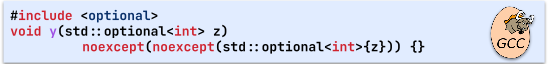

 (a) GCC bug: Internal compiler error (segmentation fault)

 (b) Clang bug: Segmentation fault

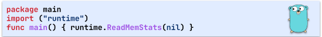

 (c) Go bug: Segmentation violation

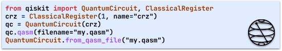

 (d) Qiskit bug: Crash

Figure 5. Exemplary bugs found by Fuzz4All.

Table [5](https://arxiv.org/html/2308.04748#S5.T5 "Table 5 ‣ 5.4. RQ4: Bug Finding ‣ 5. Results ‣ Fuzz4All: Universal Fuzzing with Large Language Models") summarizes the bugs found by Fuzz4All on our nine studied SUTs. In total, Fuzz4All detects 98 bugs, with 64 bugs already confirmed by the developers as previously unknown. These results not only demonstrate the practical effectiveness of Fuzz4All in finding large amounts of bugs but also the promised generality of Fuzz4All across languages and SUTs. A detailed list of reported bugs and issue links can be found in our artifact.

#### 5.4.1. Examples

Figure [5(a)](https://arxiv.org/html/2308.04748#S5.F5.sf1 "In Figure 5 ‣ 5.4. RQ4: Bug Finding ‣ 5. Results ‣ Fuzz4All: Universal Fuzzing with Large Language Models") shows a bug found in GCC when using noexcept(x), a C++ feature that specifies a function is non-throwing if x evaluates to true. In this example bug, Fuzz4All generates a rather complex code using std::optional, which indicates that a particular value may or may not be present at runtime. While this code is valid and should compile correctly, this combination of difficult runtime dependencies cause GCC to crash with an internal compiler error. We note that this bug cannot be found by prior techniques since they simply do not support the noexcept feature. The developers have already confirmed and fixed this bug. Interestingly, they even added a slightly modified version of our submitted code snippet to the official test suite of GCC.

Figure [5(b)](https://arxiv.org/html/2308.04748#S5.F5.sf2 "In Figure 5 ‣ 5.4. RQ4: Bug Finding ‣ 5. Results ‣ Fuzz4All: Universal Fuzzing with Large Language Models") shows a bug found in Clang, where the invalid code leads to a segmentation fault. Fuzz4All uses an unusual syntax for function declaration (i.e., auto x (...) -> return_type ), which makes use of the decltype operation in C++. However, the bug occurs when the throw statement inside of the decltype is evaluated first, skipping the evaluation of the return type since throw exits the scope early and crashes Clang. This code, while invalid, is still useful to reveal a bug in the Clang frontend as confirmed by the developers. Additionally, prior fuzzing tools can hardly find this bug since they typically focus on generating valid code only and do not handle the especially difficult-to-model decltype function.

Figure [5(c)](https://arxiv.org/html/2308.04748#S5.F5.sf3 "In Figure 5 ‣ 5.4. RQ4: Bug Finding ‣ 5. Results ‣ Fuzz4All: Universal Fuzzing with Large Language Models") shows a bug found in Go where a nil input causes a segmentation fault instead of producing a useful failure message. This bug is found by targeting the runtime Go standard library, where we provide the documentation, which includes the description of the ReadMemStats function. The bug has been confirmed and fixed by the developers. While this bug might look simple (invoking a singular function), it cannot be found by the go-fuzz baseline simply because go-fuzz requires manually written templates to target specific libraries, and runtime is not a part of any such template. With Fuzz4All, users can directly target any Go standard libraries by providing relevant input information (e.g., documentation).

Figure [5(d)](https://arxiv.org/html/2308.04748#S5.F5.sf4 "In Figure 5 ‣ 5.4. RQ4: Bug Finding ‣ 5. Results ‣ Fuzz4All: Universal Fuzzing with Large Language Models") shows a bug found in Qiskit’s QASM exporter. A quantum program, represented by the qc variable, is exported to QASM, a low level representation, silently generating an invalid output file, which leads to a crash when being reimported. The problem is that the exporter represents the register in QASM using its name as identifier, i.e., "crz", which also is the name of a well-known operation of the QASM language, thus making the generated code ambiguous. Note that prior work ([Paltenghi and Pradel, 2023](https://arxiv.org/html/2308.04748#bib.bib59)) could not find this bug because they use pre-defined templates with only anonymous registers, whereas Fuzz4All effectively leverages the quantum knowledge of LLMs to inject a meaningful string literal for detecting this bug.

## 6\. Threats to Validity

Internal. The main internal threat comes from the implementation of Fuzz4All. To address this, we performed code reviews and testing to ensure correctness. Furthermore, we run each baseline from their provided replication package whenever possible.

External. The main external threat is our evaluation targets. To support our generality claim, we apply Fuzz4All on nine different SUTs across six languages. Additionally, to account for variance in long fuzzing runs, we repeat the 24-hour fuzzing campaign five times and check for statistically significant results. Since the generation LLM leverages the knowledge acquired during its training done within the last year, reapplying Fuzz4All using the exact checkpoint of the LLM (StarCoder) used in this work might degrade the effectiveness in the future due to data-shift. Fuzz4All can mitigate this using the autoprompting step where more up-to-date documentation/example code allows the model to also generate up-to-date fuzzing inputs. One additional threat comes from the use of the distillation LLM to generate the initial inputs, where the LLM may “hallucinate”, i.e., produce made-up or inaccurate information ([Guo et al., 2022](https://arxiv.org/html/2308.04748#bib.bib31)) . This limitation is common to most pipelines that use LLMs, and we hope to address it in our future work.

## 7\. Conclusion

We present Fuzz4All, a universal fuzzer leveraging LLMs to support both general and targeted fuzzing of arbitrary SUTs that take in a multitude of programming languages. Fuzz4All uses a novel autoprompting stage to produce input prompts that concisely summarize the user-provided inputs. In its fuzzing loop, Fuzz4All iteratively updates the initial input prompt with both code examples and generation strategies aimed at producing diverse fuzzing inputs. Evaluation results on nine different SUTs across six different languages demonstrate that Fuzz4All is able to significantly improve coverage compared to state-of-the-art tools. Furthermore, Fuzz4All is able to detect 98 bugs with 64 already confirmed by developers as previously unknown.

## Data Availability

Our code and data are available at: <https://doi.org/10.5281/zenodo.10456883> and <https://github.com/fuzz4all/fuzz4all>

## Acknowledgment

This work was supported by the National Science Foundation (grants CCF-2131943 and CCF-2141474), Kwai Inc., the European Research Council (ERC, grant agreement 851895), and the German Research Foundation within the ConcSys and DeMoCo projects.

## References

  * Qis (2021) 2021\.  Qiskit/Qiskit.  https://github.com/Qiskit/qiskit. 
  * cpp (2023) 2023\.  std::expected.  <https://en.cppreference.com/w/cpp/utility/expected>. 
  * Aschermann et al. (2019) Cornelius Aschermann, Tommaso Frassetto, Thorsten Holz, Patrick Jauernig, Ahmad-Reza Sadeghi, and Daniel Teuchert. 2019.  NAUTILUS: Fishing for Deep Bugs with Grammars.. In _NDSS_. 
  * Bang et al. (2023) Yejin Bang, Samuel Cahyawijaya, Nayeon Lee, Wenliang Dai, Dan Su, Bryan Wilie, Holy Lovenia, Ziwei Ji, Tiezheng Yu, Willy Chung, et al. 2023\.  A multitask, multilingual, multimodal evaluation of chatgpt on reasoning, hallucination, and interactivity.  _arXiv preprint arXiv:2302.04023_ (2023). 
  * Bareiß et al. (2022) Patrick Bareiß, Beatriz Souza, Marcelo d’Amorim, and Michael Pradel. 2022.  Code Generation Tools (Almost) for Free? A Study of Few-Shot, Pre-Trained Language Models on Code.  _CoRR_ abs/2206.01335 (2022).  <https://doi.org/10.48550/arXiv.2206.01335> arXiv:2206.01335 
  * Böhme et al. (2020) Marcel Böhme, Cristian Cadar, and Abhik Roychoudhury. 2020\.  Fuzzing: Challenges and reflections.  _IEEE Software_ 38, 3 (2020), 79–86. 
  * Böhme et al. (2022) Marcel Böhme, László Szekeres, and Jonathan Metzman. 2022.  On the reliability of coverage-based fuzzer benchmarking. In _Proceedings of the 44th International Conference on Software Engineering_. 1621–1633. 
  * Brown et al. (2020) Tom B. Brown, Benjamin Mann, Nick Ryder, Melanie Subbiah, Jared Kaplan, Prafulla Dhariwal, Arvind Neelakantan, Pranav Shyam, Girish Sastry, Amanda Askell, Sandhini Agarwal, Ariel Herbert-Voss, Gretchen Krueger, Tom Henighan, Rewon Child, Aditya Ramesh, Daniel M. Ziegler, Jeffrey Wu, Clemens Winter, Christopher Hesse, Mark Chen, Eric Sigler, Mateusz Litwin, Scott Gray, Benjamin Chess, Jack Clark, Christopher Berner, Sam McCandlish, Alec Radford, Ilya Sutskever, and Dario Amodei. 2020.  Language Models are Few-Shot Learners.  arXiv:2005.14165. 
  * Bubeck et al. (2023) Sébastien Bubeck, Varun Chandrasekaran, Ronen Eldan, Johannes Gehrke, Eric Horvitz, Ece Kamar, Peter Lee, Yin Tat Lee, Yuanzhi Li, Scott Lundberg, et al. 2023\.  Sparks of artificial general intelligence: Early experiments with gpt-4.  _arXiv preprint arXiv:2303.12712_ (2023). 
  * Bulekov et al. (2023) Alexander Bulekov, Bandan Das, Stefan Hajnoczi, and Manuel Egele. 2023.  No Grammar, No Problem: Towards Fuzzing the Linux Kernel without System-Call Descriptions. In _Network and Distributed System Security (NDSS) Symposium 2023_. 
  * Chaliasos et al. (2022) Stefanos Chaliasos, Thodoris Sotiropoulos, Diomidis Spinellis, Arthur Gervais, Benjamin Livshits, and Dimitris Mitropoulos. 2022\.  Finding typing compiler bugs. In _Proceedings of the 43rd ACM SIGPLAN International Conference on Programming Language Design and Implementation_. 183–198. 
  * Chen et al. (2020) Junjie Chen, Jibesh Patra, Michael Pradel, Yingfei Xiong, Hongyu Zhang, Dan Hao, and Lu Zhang. 2020.  A survey of compiler testing.  _ACM Computing Surveys (CSUR)_ 53, 1 (2020), 1–36. 
  * Chen et al. (2021a) Mark Chen, Jerry Tworek, Heewoo Jun, Qiming Yuan, Henrique Ponde de Oliveira Pinto, Jared Kaplan, Harri Edwards, Yuri Burda, Nicholas Joseph, Greg Brockman, et al. 2021a.  Evaluating large language models trained on code.  _arXiv preprint arXiv:2107.03374_ (2021). 
  * Chen et al. (2021b) Yongheng Chen, Rui Zhong, Hong Hu, Hangfan Zhang, Yupeng Yang, Dinghao Wu, and Wenke Lee. 2021b.  One engine to fuzz’em all: Generic language processor testing with semantic validation. In _2021 IEEE Symposium on Security and Privacy (SP)_. IEEE, 642–658. 
  * Chowdhery et al. (2022) Aakanksha Chowdhery, Sharan Narang, Jacob Devlin, Maarten Bosma, Gaurav Mishra, Adam Roberts, Paul Barham, Hyung Won Chung, Charles Sutton, Sebastian Gehrmann, Parker Schuh, Kensen Shi, Sasha Tsvyashchenko, Joshua Maynez, Abhishek Rao, Parker Barnes, Yi Tay, Noam Shazeer, Vinodkumar Prabhakaran, Emily Reif, Nan Du, Ben Hutchinson, Reiner Pope, James Bradbury, Jacob Austin, Michael Isard, Guy Gur-Ari, Pengcheng Yin, Toju Duke, Anselm Levskaya, Sanjay Ghemawat, Sunipa Dev, Henryk Michalewski, Xavier Garcia, Vedant Misra, Kevin Robinson, Liam Fedus, Denny Zhou, Daphne Ippolito, David Luan, Hyeontaek Lim, Barret Zoph, Alexander Spiridonov, Ryan Sepassi, David Dohan, Shivani Agrawal, Mark Omernick, Andrew M. Dai, Thanumalayan Sankaranarayana Pillai, Marie Pellat, Aitor Lewkowycz, Erica Moreira, Rewon Child, Oleksandr Polozov, Katherine Lee, Zongwei Zhou, Xuezhi Wang, Brennan Saeta, Mark Diaz, Orhan Firat, Michele Catasta, Jason Wei, Kathy Meier-Hellstern, Douglas Eck, Jeff Dean, Slav Petrov, and Noah Fiedel. 2022.  PaLM: Scaling Language Modeling with Pathways.  arXiv:2204.02311 [cs.CL] 
  * Cross et al. (2017) Andrew W. Cross, Lev S. Bishop, John A. Smolin, and Jay M. Gambetta. 2017.  Open Quantum Assembly Language.  _arXiv:1707.03429 [quant-ph]_ (July 2017).  arXiv:1707.03429 [quant-ph] 
  * Cummins et al. (2018) Chris Cummins, Pavlos Petoumenos, Alastair Murray, and Hugh Leather. 2018.  Compiler fuzzing through deep learning. In _Proceedings of the 27th ACM SIGSOFT International Symposium on Software Testing and Analysis_. 95–105. 
  * Deng et al. (2023) Yinlin Deng, Chunqiu Steven Xia, Haoran Peng, Chenyuan Yang, and Lingming Zhang. 2023\.  Large Language Models are Zero-Shot Fuzzers: Fuzzing Deep-Learning Libraries via Large Language Models. In _Proceedings of the 32nd ACM SIGSOFT International Symposium on Software Testing and Analysis_. 423–435. 
  * Devlin et al. (2018) Jacob Devlin, Ming-Wei Chang, Kenton Lee, and Kristina Toutanova. 2018.  Bert: Pre-training of deep bidirectional transformers for language understanding.  _arXiv preprint arXiv:1810.04805_ (2018). 
  * Even-Mendoza et al. (2022) Karine Even-Mendoza, Cristian Cadar, and Alastair F Donaldson. 2022.  CsmithEdge: more effective compiler testing by handling undefined behaviour less conservatively.  _Empirical Software Engineering_ 27, 6 (2022), 129\. 
  * Even-Mendoza et al. (2023) Karine Even-Mendoza, Arindam Sharma, Alastair F. Donaldson, and Cristian Cadar. 2023.  GrayC: Greybox Fuzzing of Compilers and Analysers for C _(ISSTA 2023)_. Association for Computing Machinery, New York, NY, USA, 1219–1231.  <https://doi.org/10.1145/3597926.3598130>
  * Feng et al. (2020) Zhangyin Feng, Daya Guo, Duyu Tang, Nan Duan, Xiaocheng Feng, Ming Gong, Linjun Shou, Bing Qin, Ting Liu, Daxin Jiang, and Ming Zhou. 2020.  CodeBERT: A Pre-Trained Model for Programming and Natural Languages.  arXiv:2002.08155. 
  * Fingerhuth et al. (2018) Mark Fingerhuth, Tomáš Babej, and Peter Wittek. 2018.  Open Source Software in Quantum Computing.  _PLOS ONE_ 13, 12 (Dec. 2018), e0208561.  <https://doi.org/10.1371/journal.pone.0208561>
  * Fried et al. (2022) Daniel Fried, Armen Aghajanyan, Jessy Lin, Sida Wang, Eric Wallace, Freda Shi, Ruiqi Zhong, Wen-tau Yih, Luke Zettlemoyer, and Mike Lewis. 2022\.  Incoder: A generative model for code infilling and synthesis.  _arXiv preprint arXiv:2204.05999_ (2022). 
  * go-fuzz (2023) go-fuzz 2023.  go-fuzz: randomized testing for Go.  <https://github.com/dvyukov/go-fuzz>. 
  * Godefroid et al. (2017) Patrice Godefroid, Hila Peleg, and Rishabh Singh. 2017\.  Learn&fuzz: Machine learning for input fuzzing. In _2017 32nd IEEE/ACM International Conference on Automated Software Engineering (ASE)_. IEEE, 50–59. 
  * gpt4endpoint (2023) gpt4endpoint 2023.  Models - GPT-4.  <https://platform.openai.com/docs/models/gpt-4>. 
  * Groce et al. (2022) Alex Groce, Rijnard van Tonder, Goutamkumar Tulajappa Kalburgi, and Claire Le Goues. 2022.  Making no-fuss compiler fuzzing effective. In _Proceedings of the 31st ACM SIGPLAN International Conference on Compiler Construction_. 194–204. 
  * Gulwani et al. (2017) Sumit Gulwani, Oleksandr Polozov, Rishabh Singh, et al. 2017\.  Program synthesis.  _Foundations and Trends® in Programming Languages_ 4, 1-2 (2017), 1–119. 
  * Guo et al. (2022) Zhijiang Guo, Michael Schlichtkrull, and Andreas Vlachos. 2022\.  A survey on automated fact-checking.  _Transactions of the Association for Computational Linguistics_ 10 (2022), 178–206. 
  * Holler et al. (2012) Christian Holler, Kim Herzig, and Andreas Zeller. 2012\.  Fuzzing with code fragments. In _21st USENIX Security Symposium (USENIX Security 12)_. 445–458. 
  * Holtzman et al. (2019) Ari Holtzman, Jan Buys, Li Du, Maxwell Forbes, and Yejin Choi. 2019.  The Curious Case of Neural Text Degeneration.  arXiv:1904.09751. 
  * Jiang et al. (2020) Bo Jiang, Xiaoyan Wang, Wing Kwong Chan, TH Tse, Na Li, Yongfeng Yin, and Zhenyu Zhang. 2020.  Cudasmith: A fuzzer for CUDA compilers. In _2020 IEEE 44th Annual Computers, Software, and Applications Conference (COMPSAC)_. IEEE, 861–871. 
  * jsfunfuzz (2017) jsfunfuzz 2017.  Introducing jsfunfuzz.  <https://www.squarefree.com/2007/08/02/introducing-jsfunfuzz/>. 
  * Kaplan et al. (2020) Jared Kaplan, Sam McCandlish, Tom Henighan, Tom B Brown, Benjamin Chess, Rewon Child, Scott Gray, Alec Radford, Jeffrey Wu, and Dario Amodei. 2020\.  Scaling laws for neural language models.  _arXiv preprint arXiv:2001.08361_ (2020). 
  * Klees et al. (2018) George Klees, Andrew Ruef, Benji Cooper, Shiyi Wei, and Michael Hicks. 2018.  Evaluating Fuzz Testing. In _Proceedings of the 2018 ACM SIGSAC Conference on Computer and Communications Security_ _(CCS ’18)_. Association for Computing Machinery, New York, NY, USA, 2123–2138.  <https://doi.org/10.1145/3243734.3243804>
  * Lee et al. (2020) Suyoung Lee, HyungSeok Han, Sang Kil Cha, and Sooel Son. 2020\.  Montage: A Neural Network Language \(\{\)Model-Guided\(\}\)\(\{\)JavaScript\(\}\) Engine Fuzzer. In _29th USENIX Security Symposium (USENIX Security 20)_. 2613–2630. 
  * Lehmann and Pradel (2018) Daniel Lehmann and Michael Pradel. 2018.  Feedback-directed differential testing of interactive debuggers. In _ESEC/SIGSOFT FSE_. 610–620. 
  * Lemieux et al. (2023) Caroline Lemieux, Jeevana Priya Inala, Shuvendu K Lahiri, and Siddhartha Sen. 2023.  CODAMOSA: Escaping Coverage Plateaus in Test Generation with Pre-trained Large Language Models. In _45th International Conference on Software Engineering_. 
  * Lewis et al. (2019) Mike Lewis, Yinhan Liu, Naman Goyal, Marjan Ghazvininejad, Abdelrahman Mohamed, Omer Levy, Ves Stoyanov, and Luke Zettlemoyer. 2019\.  Bart: Denoising sequence-to-sequence pre-training for natural language generation, translation, and comprehension.  _arXiv preprint arXiv:1910.13461_ (2019). 
  * Li et al. (2023) Raymond Li, Loubna Ben Allal, Yangtian Zi, Niklas Muennighoff, Denis Kocetkov, Chenghao Mou, Marc Marone, Christopher Akiki, Jia Li, Jenny Chim, et al. 2023\.  StarCoder: may the source be with you!  _arXiv preprint arXiv:2305.06161_ (2023). 
  * Li and Liang (2021) Xiang Lisa Li and Percy Liang. 2021.  Prefix-tuning: Optimizing continuous prompts for generation.  _arXiv preprint arXiv:2101.00190_ (2021). 
  * libFuzzer (2023) libFuzzer 2023.  libFuzzer – a library for coverage-guided fuzz testing.  <https://llvm.org/docs/LibFuzzer.html>. 
  * Lidbury et al. (2015) Christopher Lidbury, Andrei Lascu, Nathan Chong, and Alastair F Donaldson. 2015.  Many-core compiler fuzzing.  _ACM SIGPLAN Notices_ 50, 6 (2015), 65–76. 
  * Liu et al. (2023) Jiawei Liu, Jinkun Lin, Fabian Ruffy, Cheng Tan, Jinyang Li, Aurojit Panda, and Lingming Zhang. 2023.  Nnsmith: Generating diverse and valid test cases for deep learning compilers. In _Proceedings of the 28th ACM International Conference on Architectural Support for Programming Languages and Operating Systems, Volume 2_. 530–543. 
  * Liu et al. (2022) Jiawei Liu, Yuxiang Wei, Sen Yang, Yinlin Deng, and Lingming Zhang. 2022.  Coverage-guided tensor compiler fuzzing with joint ir-pass mutation.  _Proceedings of the ACM on Programming Languages_ 6, OOPSLA1 (2022), 1–26. 
  * Liu et al. (2021) Pengfei Liu, Weizhe Yuan, Jinlan Fu, Zhengbao Jiang, Hiroaki Hayashi, and Graham Neubig. 2021\.  Pre-train, Prompt, and Predict: A Systematic Survey of Prompting Methods in Natural Language Processing.  _CoRR_ abs/2107.13586 (2021).  arXiv:2107.13586 <https://arxiv.org/abs/2107.13586>
  * Liu et al. (2019) Xiao Liu, Xiaoting Li, Rupesh Prajapati, and Dinghao Wu. 2019\.  Deepfuzz: Automatic generation of syntax valid c programs for fuzz testing. In _Proceedings of the AAAI Conference on Artificial Intelligence_ , Vol. 33. 1044–1051. 
  * Livinskii et al. (2020) Vsevolod Livinskii, Dmitry Babokin, and John Regehr. 2020\.  Random testing for C and C++ compilers with YARPGen.  _Proceedings of the ACM on Programming Languages_ 4, OOPSLA (2020), 1–25. 
  * M. Zalewski (2016) M. Zalewski 2016.  American Fuzzy Lop - Whitepaper.  <https://lcamtuf.coredump.cx/afl/technical_details.txt>. 
  * Ma (2023) Haoyang Ma. 2023\.  A Survey of Modern Compiler Fuzzing.  _arXiv preprint arXiv:2306.06884_ (2023). 
  * Mann and Whitney (1947) Henry B Mann and Donald R Whitney. 1947.  On a test of whether one of two random variables is stochastically larger than the other.  _The annals of mathematical statistics_ (1947), 50–60. 
  * Mansur et al. (2021) Muhammad Numair Mansur, Maria Christakis, and Valentin Wüstholz. 2021.  Metamorphic testing of Datalog engines. In _ESEC/FSE ’21: 29th ACM Joint European Software Engineering Conference and Symposium on the Foundations of Software Engineering_. 639–650.  <https://doi.org/10.1145/3468264.3468573>
  * Nie et al. (2023) Pengyu Nie, Rahul Banerjee, Junyi Jessy Li, Raymond J. Mooney, and Milos Gligoric. 2023\.  Learning Deep Semantics for Test Completion. In _45th International Conference on Software Engineering_. 
  * OpenAI (2023) OpenAI. 2023.  GPT-4 Technical Report.  arXiv:2303.08774 [cs.CL] 
  * Ouyang et al. (2022) Long Ouyang, Jeffrey Wu, Xu Jiang, Diogo Almeida, Carroll Wainwright, Pamela Mishkin, Chong Zhang, Sandhini Agarwal, Katarina Slama, Alex Ray, et al. 2022\.  Training language models to follow instructions with human feedback.  _Advances in Neural Information Processing Systems_ 35 (2022), 27730–27744. 
  * Paltenghi and Pradel (2022) Matteo Paltenghi and Michael Pradel. 2022.  Bugs in Quantum computing platforms: an empirical study.  _Proc. ACM Program. Lang._ 6, OOPSLA (2022), 1–27.  <https://doi.org/10.1145/3527330>
  * Paltenghi and Pradel (2023) Matteo Paltenghi and Michael Pradel. 2023.  MorphQ: Metamorphic Testing of the Qiskit Quantum Computing Platform. In _2023 IEEE/ACM 45th International Conference on Software Engineering (ICSE)_. IEEE Computer Society, 2413–2424.  <https://doi.org/10.1109/ICSE48619.2023.00202>
  * Park et al. (2021) Jiwon Park, Dominik Winterer, Chengyu Zhang, and Zhendong Su. 2021.  Generative type-aware mutation for testing SMT solvers.  _Proceedings of the ACM on Programming Languages_ 5, OOPSLA (2021), 1–19. 
  * Patra and Pradel (2016) Jibesh Patra and Michael Pradel. 2016.  Learning to fuzz: Application-independent fuzz testing with probabilistic, generative models of input data.  (2016). 
  * PyTorch (2023) PyTorch 2023.  PyTorch.  <http://pytorch.org>. 
  * Qin and Eisner (2021) Guanghui Qin and Jason Eisner. 2021.  Learning How to Ask: Querying LMs with Mixtures of Soft Prompts. In _Proceedings of the 2021 Conference of the North American Chapter of the Association for Computational Linguistics: Human Language Technologies (NAACL-HLT)_. 
  * Radford et al. (2018) Alec Radford, Karthik Narasimhan, Tim Salimans, Ilya Sutskever, et al. 2018\.  Improving language understanding by generative pre-training.  (2018). 
  * Schick and Schütze (2020) Timo Schick and Hinrich Schütze. 2020.  Exploiting cloze questions for few shot text classification and natural language inference.  _arXiv preprint arXiv:2001.07676_ (2020). 
  * Schulman et al. (2022) John Schulman, Barret Zoph, Jacob Hilton Christina Kim, Jacob Menick, Jiayi Weng, Juan Felipe Ceron Uribe, Liam Fedus, Luke Metz, Michael Pokorny, Rapha Gontijo Lopes, Shengjia Zhao, Arun Vijayvergiya, Eric Sigler, Adam Perelman, Chelsea Voss, Mike Heaton, Joel Parish, Dave Cummings, Rajeev Nayak, Valerie Balcom, David Schnurr, Tomer Kaftan, Chris Hallacy, Nicholas Turley, Noah Deutsch, Vik Goel, Jonathan Ward, Aris Konstantinidis, Wojciech Zaremba, Long Ouyang, Leonard Bogdonoff, Joshua Gross, David Medina, Sarah Yoo, Teddy Lee, Ryan Lowe, Dan Mossing, Joost Huizinga, Roger Jiang, Carroll Wainwright, Diogo Almeida, Steph Lin, Marvin Zhang, Kai Xiao, Katarina Slama, Steven Bills, Alex Gray, Jan Leike, Jakub Pachocki, Phil Tillet, Shantanu Jain, Greg Brockman, and Nick Ryder. 2022.  ChatGPT: Optimizing Language Models for Dialogue.  (2022).  <https://openai.com/blog/chatgpt/>. 
  * Schäfer et al. (2023) Max Schäfer, Sarah Nadi, Aryaz Eghbali, and Frank Tip. 2023\.  Adaptive Test Generation Using a Large Language Model.  arXiv:2302.06527 [cs.SE] 
  * Shi et al. (2022) Kensen Shi, David Bieber, and Rishabh Singh. 2022.  Tf-coder: Program synthesis for tensor manipulations.  _ACM Transactions on Programming Languages and Systems (TOPLAS)_ 44, 2 (2022), 1–36. 
  * Shin et al. (2020) Taylor Shin, Yasaman Razeghi, Robert L Logan IV, Eric Wallace, and Sameer Singh. 2020\.  Autoprompt: Eliciting knowledge from language models with automatically generated prompts.  _arXiv preprint arXiv:2010.15980_ (2020). 
  * Sutton et al. (2007) Michael Sutton, Adam Greene, and Pedram Amini. 2007\.  _Fuzzing: Brute Force Vulnerability Discovery_.  Addison-Wesley Professional. 
  * syzkaller (2023) syzkaller 2023.  syzkaller - kernel fuzzer.  <https://github.com/google/syzkaller>. 
  * Tam et al. (2021) Derek Tam, Rakesh R Menon, Mohit Bansal, Shashank Srivastava, and Colin Raffel. 2021\.  Improving and simplifying pattern exploiting training.  _arXiv preprint arXiv:2103.11955_ (2021). 
  * TensorFlow (2023) TensorFlow 2023.  TensorFlow.  <https://www.tensorflow.org>. 
  * Vaswani et al. (2017) Ashish Vaswani, Noam Shazeer, Niki Parmar, Jakob Uszkoreit, Llion Jones, Aidan N Gomez, Łukasz Kaiser, and Illia Polosukhin. 2017.  Attention is all you need.  _Advances in neural information processing systems_ 30 (2017). 
  * Vikram et al. (2023) Vasudev Vikram, Caroline Lemieux, and Rohan Padhye. 2023\.  Can Large Language Models Write Good Property-Based Tests?  _arXiv preprint arXiv:2307.04346_ (2023). 
  * Wang et al. (2022) Chaozheng Wang, Yuanhang Yang, Cuiyun Gao, Yun Peng, Hongyu Zhang, and Michael R Lyu. 2022\.  No more fine-tuning? an experimental evaluation of prompt tuning in code intelligence. In _Proceedings of the 30th ACM Joint European Software Engineering Conference and Symposium on the Foundations of Software Engineering_. 382–394. 
  * Wei et al. (2022) Anjiang Wei, Yinlin Deng, Chenyuan Yang, and Lingming Zhang. 2022\.  Free lunch for testing: Fuzzing deep-learning libraries from open source. In _Proceedings of the 44th International Conference on Software Engineering_. 995–1007. 
  * Winterer et al. (2020a) Dominik Winterer, Chengyu Zhang, and Zhendong Su. 2020a.  On the unusual effectiveness of type-aware operator mutations for testing SMT solvers.  _Proc. ACM Program. Lang._ 4, OOPSLA (2020), 193:1–193:25. 
  * Winterer et al. (2020b) Dominik Winterer, Chengyu Zhang, and Zhendong Su. 2020b.  Validating SMT Solvers via Semantic Fusion. In _Proceedings of the 41st ACM SIGPLAN Conference on Programming Language Design and Implementation_. 718–730. 
  * Xia and Zhang (2023) Chunqiu Steven Xia and Lingming Zhang. 2023.  Keep the Conversation Going: Fixing 162 out of 337 bugs for $0.42 each using ChatGPT.  _arXiv preprint arXiv:2304.00385_ (2023). 
  * Xu et al. (2022) Frank F. Xu, Uri Alon, Graham Neubig, and Vincent Josua Hellendoorn. 2022.  A Systematic Evaluation of Large Language Models of Code. In _Proceedings of the 6th ACM SIGPLAN International Symposium on Machine Programming_ (San Diego, CA, USA) _(MAPS 2022)_. Association for Computing Machinery, New York, NY, USA, 1–10. 
  * Yang et al. (2011) Xuejun Yang, Yang Chen, Eric Eide, and John Regehr. 2011\.  Finding and understanding bugs in C compilers. In _Proceedings of the 32nd ACM SIGPLAN conference on Programming language design and implementation_. 283–294. 
  * Yuan et al. (2023) Zhiqiang Yuan, Yiling Lou, Mingwei Liu, Shiji Ding, Kaixin Wang, Yixuan Chen, and Xin Peng. 2023.  No More Manual Tests? Evaluating and Improving ChatGPT for Unit Test Generation.  arXiv:2305.04207 [cs.SE] 
  * Yue Wang and Hoi (2021) Shafiq Joty Yue Wang, Weishi Wang and Steven C.H. Hoi. 2021.  CodeT5: Identifier-aware Unified Pre-trained Encoder-Decoder Models for Code Understanding and Generation. In _Proceedings of the 2021 Conference on Empirical Methods in Natural Language Processing, EMNLP 2021_. 
  * Zeller et al. (2019) Andreas Zeller, Rahul Gopinath, Marcel Böhme, Gordon Fraser, and Christian Holler. 2019\.  The fuzzing book. 
  * Zhao et al. (2019) Hui Zhao, Zhihui Li, Hansheng Wei, Jianqi Shi, and Yanhong Huang. 2019.  SeqFuzzer: An Industrial Protocol Fuzzing Framework from a Deep Learning Perspective. In _2019 12th IEEE Conference on Software Testing, Validation and Verification (ICST)_. 59–67.  <https://doi.org/10.1109/ICST.2019.00016>
  * Zhao et al. (2022) Yingquan Zhao, Zan Wang, Junjie Chen, Mengdi Liu, Mingyuan Wu, Yuqun Zhang, and Lingming Zhang. 2022.  History-Driven Test Program Synthesis for JVM Testing. In _Proceedings of the 44th International Conference on Software Engineering_ (Pittsburgh, Pennsylvania) _(ICSE ’22)_. 1133–1144. 
  * Zhou et al. (2022) Yongchao Zhou, Andrei Ioan Muresanu, Ziwen Han, Keiran Paster, Silviu Pitis, Harris Chan, and Jimmy Ba. 2022.  Large language models are human-level prompt engineers.  _arXiv preprint arXiv:2211.01910_ (2022). 
  * Ziegler et al. (2019) Daniel M. Ziegler, Nisan Stiennon, Jeffrey Wu, Tom B. Brown, Alec Radford, Dario Amodei, Paul Christiano, and Geoffrey Irving. 2019\.  Fine-Tuning Language Models from Human Preferences.  arXiv:1909.08593. 

