**Source:** *Predictive Mutation Testing* — [PDF](https://discovery.ucl.ac.uk/10051793/1/bare_adv.pdf)

# Predictive Mutation Testing

Jie Zhang, Lingming Zhang, Mark Harman, Dan Hao, Yue Jia and Lu Zhang

**Abstract**—Test suites play a key role in ensuring software quality. A good test suite may detect more faults than a poor-quality one. Mutation testing is a powerful methodology for evaluating the fault-detection ability of test suites. In mutation testing, a large number of mutants may be generated and need to be executed against the test suite under evaluation to check how many mutants the test suite is able to detect, as well as the kind of mutants that the current test suite fails to detect. Consequently, although highly effective, mutation testing is widely recognized to be also computationally expensive, inhibiting wider uptake. To alleviate this efficiency concern, we propose *Predictive Mutation Testing* (PMT): the first approach to predicting mutation testing results without executing mutants. In particular, PMT constructs a classification model, based on a series of features related to mutants and tests, and uses the model to predict whether a mutant would be killed or remain alive without executing it. PMT has been evaluated on 163 real-world projects under two application scenarios (cross-version and cross-project). The experimental results demonstrate that PMT improves the efficiency of mutation testing by up to 151.4X while incurring only a small accuracy loss. It achieves above 0.80 AUC values for the majority of projects, indicating a good tradeoff between the efficiency and effectiveness of predictive mutation testing. Also, PMT is shown to perform well on different tools and tests, be robust in the presence of imbalanced data, and have high predictability (over 60% confidence) when predicting the execution results of the majority of mutants.

| Index Terms—PMT, mutation testing, machine learning, binary classification. |   |
|-----------------------------------------------------------------------------|---|
|                                                                             | ✦ |

## **1 INTRODUCTION**

Software testing plays a key role in ensuring software quality. In software testing, test suites are usually used to check the quality of projects under test. The tester also needs to know the power of the test suites in detecting faults (i.e., abbreviated as "test power" in this paper), since a strongpower test suite may detect more bugs than a weak-power one. Code coverage has traditionally been widely used as a proxy for test power. It can be used to quickly check the proportion of code executed by the test inputs. However, empirical results suggest that code coverage, alone, is inefficient to capture test power [\[1\]](#page-19-0), [\[2\]](#page-19-1), [\[3\]](#page-19-2).

Mutation testing [\[4\]](#page-19-3), [\[5\]](#page-19-4), [\[6\]](#page-19-5) is a methodology for checking test power that addresses the short-comings of coverage. By contrast with code coverage, mutation testing generates faulty programs and checks whether the test suite can detect these faults. Recent results have confirmed the superiority of mutation testing (in terms of its ability to reveal real faults) compared to coverage criteria [\[3\]](#page-19-2). Aiming at evaluating the test power, mutation testing may alleviate the weakness of code coverage in effectiveness. Specifically, in (first order [\[7\]](#page-19-6), [\[8\]](#page-19-7)) mutation testing, a set of program variants (i.e., *mutants*) are generated from the original program based on a set of transformation rules (i.e., *mutation operators*) that seed one syntactic change (e.g., deleting a statement) at a time to generate one mutant. A mutant is said to be *killed* by a test

• *Jie Zhang, Dan Hao and Lu Zhang are with the Institute of Software, EECS, Peking University, Beijing, China. Dan is the corresponding author.*

*E-mail: zhangjie marina,haodan,zhanglucs@pku.edu.cn*

• *Lingming Zhang is with the Department of Computer Science, University of Texas at Dallas, USA. E-mail: lingming.zhang@utdallas.edu*

• *Mark Harman and Yue Jia are with the University College London and Facebook, London, United Kingdom. E-mail: mark.harman,yue.jia@cs.ucl.ac.uk*

suite if at least one test from the suite has different execution results on the mutant and the original program. Otherwise, the mutant is said to *survive* (i.e., or *to be alive*). Based on such mutant execution results, the ratio of killed mutants to all the non-equivalent mutants[1](#page-0-0) is defined as *mutation score*. Test suites with higher score are usually considers as owning stronger test power. At the same time, information about live mutants may also help developers to locate the weaknesses in the current test suite and to add new test cases accordingly.

Except for evaluating test power, mutation testing has also been shown to be suitable for simulating real faults in software testing experimentation [\[9\]](#page-19-8), [\[10\]](#page-19-9), [\[11\]](#page-19-10), localizing faults [\[12\]](#page-19-11), [\[13\]](#page-19-12), [\[14\]](#page-19-13), performing model transformations [\[15\]](#page-19-14), and guiding test generation [\[16\]](#page-19-15), [\[17\]](#page-19-16), [\[18\]](#page-19-17), [\[19\]](#page-19-18), [\[20\]](#page-19-19), [\[21\]](#page-19-20).

Despite its evident usefulness, mutation testing can be extremely expensive [\[22\]](#page-19-21): it requires the generation and execution of each mutant against the test suite. For example, Proteum, a mutation testing tool for C, includes 108 mutation operators that generate 23,847 mutants for a small C program with only 513 lines of code [\[23\]](#page-19-22). The generation and execution of the large number of mutants can be costly. Mutant generation cost has been greatly reduced by various techniques [\[24\]](#page-19-23), [\[25\]](#page-19-24), while mutant execution remains expensive in spite of various refinement techniques [\[22\]](#page-19-21), e.g., selective mutation testing [\[26\]](#page-19-25), [\[27\]](#page-19-26), weak mutation testing [\[28\]](#page-19-27), high-order mutation testing [\[29\]](#page-19-28), and optimized mutation testing [\[30\]](#page-19-29), [\[31\]](#page-19-30). Moreover, developers also complain about the high cost of mutation testing, seeking a compromise with respect to early feedback and efficiency [\[32\]](#page-19-31). Thus, by contrast with code coverage, mutation testing is more effective, yet currently, less efficient.

1 The mutants semantically equivalent to the original program are called equivalent mutants, which can never be killed.

To address this, we seek an approach to mutation testing that reduces its effectiveness, yet improves its efficiency. Motivated by this purpose, we ask – **"Can we obtain mutation testing results without mutant execution?"**, and propose *Predictive Mutation Testing* (PMT) as the affirmative answer and incarnation of this question. PMT is the first mutation testing approach that predicts mutant execution results (killed or alive) without mutant execution. Specifically, in this paper, PMT applies machine learning to build a predictive model: collecting a series of easy-to-access features (e.g., coverage and mutation operator) on already executed mutants of earlier versions of the project (i.e., *crossversion* prediction) or even other projects (i.e., *cross-project* prediction). That is, the classification model is built offline based on the mutation-testing information (including the features of each mutant and its execution result) of existing versions or projects. Based on this model, PMT predicts the mutation testing results (i.e., whether each mutant is killed or not by the total set of test cases) for a new version or project without executing its mutants at all.

PMT has been evaluated on 163 projects under two application scenarios: *cross-version* and *cross-project*. Under each scenario, we evaluate PMT's effectiveness and efficiency. First, we use a set of metrics (i.e., precision, recall, F-measure, and AUC) to evaluate the effectiveness of PMT in predicting mutant execution results (i.e., killed or alive). PMT can also be used to predict the mutation score of the whole project based on the proportion of the mutants it predicts will be killed. Therefore, we also use the absolute prediction error (i.e., the absolute value of the difference between predicted and real mutation scores) to evaluate the effectiveness of PMT in predicting mutation scores. We also record the overhead of computing PMT to evaluate its efficiency. Except for the evaluation on the performance of PMT, to better understand and apply PMT, we perform investigations on different aspects of implementing PMT: the influence of different application factors (i.e., mutation tools and types of test suites), the influence of different configurations (i.e., classification algorithms and imbalance data strategy), the influence of features, and the predictability distribution of all the predictions (i.e., on predicting the execution results of each mutant).

Our experimental results support the claim that PMT performs well: on effectiveness, for the cross-version scenario, PMT achieves over 0.90 precision, recall, F-measure, and AUC for 37 out of 39 predictions; for the cross-project scenario, PMT achieves over 0.85 AUC on classifying mutant execution results for 144 out of the 163 projects, and lower than 15% error on predicted mutation scores for 143 out of the 163 projects. Furthermore, PMT is shown to be more accurate than coverage-based testing in predicting mutation scores. On efficiency, PMT is shown to be much more efficient than traditional mutation testing (with speedups between 15.2X to 151.4X). Therefore, when predicting mutation testing results, PMT dramatically improves the efficiency of mutation testing to a large extent while incurring only a small accuracy issue, demonstrating a good tradeoff between efficiency and effectiveness in mutation testing, and a promising future in measuring test power.

The paper makes the following contributions.

• **Dimension.** The paper opens a new dimension in mu-

- tation testing which predicts mutation testing results without mutant execution.
- **Approach.** The paper proposes PMT, a machinelearning-based approach to predicting mutation testing results using easy-to-access features, e.g., coverage information, oracle information, and code complexity.
- **Study.** The paper includes an extensive empirical study of PMT on 163 real-world Java projects under two application scenarios.
- **Analysis.** The paper includes detailed analysis of the effectiveness of the various choices in implementing PMT, the impact of its application factors and features, as well as the distribution of predictability among all the predictions.

As this work is an extended version of our conference paper [\[33\]](#page-19-32), we list below, the primary novel scientific contributions of this extension:

- **(1) Investigation into features.** We add a new research question that specially investigates the contribution of the 14 individual features. We also compare the effectiveness of different categories of features. Results show that Execution features and test code related features contribute more.
- **(2) Investigation into predictability.** We add a new research question that specially investigates the predictability of the mutants under PMT. In particular, the majority of mutants have a good predictability of over 60%. Additionally, mutants that are easier to kill tend to be easier to predict as well.
- **(3) Practical guidelines.** We draw more conclusions which can provide practical guidelines from the experimental results, including the guidelines on feature selection, mutant selection, mutant reduction, and so on.
- **(4) Improvement in effectiveness.** We optimize the process of coverage-related feature collection and further improve the effectiveness of PMT, e.g., an additional 2.7% improvement over the average AUC values is achieved under the cross-project scenario.

The rest of this paper is organized as follows. Section [2](#page-1-0) introduces the details of our approach. Section [4](#page-5-0) introduces the empirical design. Section [5](#page-7-0) presents the result analysis. Section [6](#page-17-0) discusses some related issues. Section [7](#page-17-1) discusses the related work. Section [8](#page-18-0) concludes the paper.

## **2 APPROACH**

Mutation testing is widely recognized to be expensive [\[22\]](#page-19-21) due to the expensive mutant execution procedure. To alleviate this issue, we present a new dimension of mutation testing - predictive mutation testing (PMT) - which predicts mutation testing results without mutant execution. Typically, a mutant has two alternative execution results, killed or alive, and thus we simplify the prediction of mutant execution results as a binary classification problem.

In this paper, we adopt machine learning to solve this problem. To better illustrate our approach, we present the general framework of PMT in Figure [1.](#page-2-0) As shown in the figure, PMT builds a classification model offline by analyzing the training mutants each of which has a label representing its mutant execution result (i.e., killed or alive) and some easy-to-access features (i.e., measurable properties or characteristics that could have associations with labels [\[34\]](#page-19-33)).

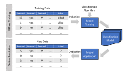

Fig. 1 The general framework of PMT.

Then the classification model can be used to predict whether any new mutant is killed or has survived based on the same types of features.

Next, we controduce two key aspects in building a predictive model: (1) what features are used to build the classification model, regarding which we should use information that is related to mutation testing results, and is easy to access due to the efficiency concern (see Section [2.1\)](#page-2-1); (2) what classification algorithm is used to build the classification model (see Section [2.2\)](#page-3-0). Furthermore, we consider the impact of imbalanced data (see Section [2.3\)](#page-4-0).

#### **2.1 Identified Features**

We identify various features that are related to mutation testing results based on the PIE theory [\[35\]](#page-19-34), [\[36\]](#page-19-35), according to which a mutant can be killed by a test only if the following three conditions are satisfied: (1) *execution,* the mutated statement is executed by the test; (2) *infection,* the program state is affected immediately after the execution of the mutated statement so as the test could distinguish the mutant from the original program; and (3) *propagation,* the infected program state propagates to the test output so that the test output of the mutant is different from that of the original program. PMT predicts whether a mutant is killed by analyzing whether it may satisfy these conditions. In other words, PMT needs to identify features that have connections with the preceding three conditions and to predict whether a mutant is killed.

Note that when choosing features, we do not seek the universal set of useful features representing each condition. Instead, considering the major goal of predictive mutation testing – to reduce the cost of traditional mutation testing – we adopt features that are easy to fetch and could improve the predictive effectiveness at the same time. As a result, except for dynamic features (i.e., the features collected through executing the original program), we also adopt some static code information as features to indicate dynamic mutant execution information. Such information could complement dynamic features for precise prediction of software engineering problems, which is also replete in the literature [\[37\]](#page-19-36), [\[38\]](#page-19-37), [\[39\]](#page-19-38). Actually, the entire static analysis area in the end aims to guarantee that dynamic program executions satisfy certain properties. For example, a type checker would not work if static information were not useful in determining dynamic properties; the static Terminator tool[2](#page-2-2) predicts (indeed, proves) the termination of programs during dynamic execution. Of course, static analyses cannot offer 100% precision and recall, but they suffice for safely predicting dynamic properties in sufficiently many situations to be useful and do so statically.

When choosing features for each condition of the PIE theory, intuitively, we extract features from both mutants and test code (e.g., whether and how frequently test cases/assertions can execute/check certain mutant-related source code elements), since those features directly show the correlation between tests and mutants. Different mutant features may indicate different mutant killing probability in case of even similar tests. For example, even if two program elements (e.g., statements, methods, or classes) are executed by the same tests or checked by the same assertions, mutants in one element may be much easier to kill than mutants in another element, because one element may have many connections with other elements (e.g., used by many other elements), making it rather easy for the infected states to propagate to the final program state (thus being killed).

Next, we introduce the features we adopted coping with the three conditions of the PIE theory.

## *2.1.1 Execution Features*

For the first condition (execution), we must identify features that are necessarily related to the execution of the mutated statements, which are grouped as a set of execution features. In particular, we consider the following two specific features:

- **(1)** *numExecuteCovered*, which refers to how many times the mutated statement is executed by the whole test suite.
- **(2)** *numTestCovered*, which refers to how many tests from the test suite cover the mutated statement.

These two features characterize the execution of mutated statements by the test suite as a whole and by each individual test, analyzing the execution information of the original program rather than the mutants themselves. In particular, the original program is executed against the given test suite, recording whether each statement is executed by each test and how many times each statement is executed by each test, which is used to calculate *numExecuteCovered* and *numTestCovered*. Clearly, if a mutant is not covered by any test, it cannot be killed at all since no test is even able to reach the mutation location; on the contrary, if a mutant is covered by many tests, it may have a high probability to be killed since any test covering the mutant may be able to kill it.

## *2.1.2 Infection Features*

In terms of the second condition (infection), we must identify some features that are related to the infection of the mutated statements, which are grouped as a set of infection features. Intuitively, the modification on a statement does not necessarily change the program state. However, the possibility of state changes may depend on the types of the statements and the types of changes. For example, changing statement "int x=10" to "int x=Math.abs(10)" based on the absolute value insertion (ABS) mutation operator

2 Byron Cook et al:<https://vimeo.com/81641895>

cannot change the program state during execution. Additionally, deleting a method invocation may probably have a huge impact on the program execution, while simply mutating one constant variable value inside a method invocation may have less impact. This has also be demonstrated by previous work in the literature [\[40\]](#page-19-39), in which Yao et al. observed that some mutation operators (i.e., different styles of statement modification [\[22\]](#page-19-21)) affect program states more easily than other mutation operators. After careful manual inspection, Yao et al. found that the ABS mutation operator generates few stubborn mutants (i.e., non-equivalent mutants that are hard to kill), while the logical connector replacement (LCR) mutation operator generates many stubborn mutants. This indicates that different mutation operators may have different abilities to infect the program states.

To sum up, we consider the following two specific features that may have associations with the statement infection:

- **(3)** *typeStatement*, which refers to the type of the mutated statement, e.g., assignment statement, conditional statement, return statement, or method invocation. Note that for Java they can be easily categorized by analyzing bytecode instruction types. To illustrate, INVOKEVIRTUAL, INVOKESTATIC, and INVOKESPECIAL denote method invocation while IRETURN, ARETURN, DRETURN, and FRETURN denote return statements.
- **(4)** *typeOperator*, which refers to the type of the mutation operator. Note that mutation testing tools usually record the mutation operators used to generate each mutant, and it is easy to fetch such information.

These two features characterize the infection of mutated statements, and can be easily collected through static analysis on generated mutants.

#### *2.1.3 Propagation Features*

In terms of the third condition (propagation), we must identify some features that are related to the propagation of infected program states. Intuitively, whether the program state propagates is related to the complexity of the program under test. In particular, when the structural units (i.e., methods, classes) containing the mutation are complex, the infected program state may not propagate. Therefore, PMT uses the following set of complexity features to characterize to what extent infected program states propagate during execution:

- **(5)** *infoComplexity*, which refers to the McCabe Complexity [\[41\]](#page-19-40) of the mutated method.
- **(6)** *depInheritance*, which refers to the maximum length of a path from the mutated class to a root class in the inheritance structure.
- **(7)** *depNestblock*, which refers to the depth of nested blocks of the mutated method.
- **(8)** *numChildren*, which refers to the total number of direct subclasses of the mutated class.
- **(9)** *LOC*, which refers to the number of lines of code in the mutated method.
- **(10)** *Ca*, which refers to the number of classes outside the mutated package that depend on classes inside the package. **(11)** *Ce*, which refers to the number of classes inside the mutated package that depend on classes outside the package.

**(12)** *instability*, which is an indicator of the package's resilience to change, and is computed based on the *Ca* and *Ce* values, i.e., Ce/(Ce + Ca).

Furthermore, to learn whether a mutant is killed or has survived, it is necessary to know whether the tests are equipped with effective oracles so as to be capable of observing the behavior difference between the mutant and the original program. A test oracle is a mechanism to determine whether the program under test behaves as expected [\[42\]](#page-19-41). In practice, developers usually write test assertions in tests, which are actually one type of test oracles. Except for the program outputs, these assertions aid to distinguish the execution results of mutants from the original program. If a test has no assertion and the program has no output, the difference between the execution results of mutants and the original program will not be observed. Therefore, in order to characterize the extent to which the behavior difference (between the mutant and the original program) can be observed, our approach uses a set of features that are related to test oracles, which includes:

- **(13)** *typeReturn*, which refers to the return type of the mutated method.
- **(14)** *numMutantAssertion*, which refers to the total number of assertions in the test methods that cover each mutant.
- **(15)** *numClassAssertion*, which refers to the total number of test assertions inside the mutated class's corresponding test class.

These three features all characterizes program outputs but are different in the following aspects. The feature *type-Return* characterizes the ability of the final program output on observing the execution difference between mutants and the original program, whereas the features *numMutantAssertion* and *numClassAssertion* characterize the ability of test assertions on observing the execution results, i.e., the oracle information. For example, if a method is a void method, it may still impact the test oracles/assertions, e.g., via modifying global variables.

## **2.2 Classification Algorithm**

Machine learning is a technique that gives computers the capability to learn without being explicitly programmed [\[43\]](#page-19-42). Machine learning could devise complex models leading themselves to prediction, and has been widely used for solving software engineering problems [\[44\]](#page-19-43), [\[45\]](#page-19-44). In this paper we use classification methodology that learns a classification model from instances and then classifies new instances into different categories. There are many classification algorithms available, such as decision tree classifiers, neural networks, and Support Vector Machines (SVM) [\[46\]](#page-19-45). In this paper, we adopt *Random Forest*, which is a generalization of tree-based classification, as our default classification technique, because *Random Forest* greatly improves the robustness of classification models by maintaining the power, flexibility, and interpretability of tree-based classifiers [\[47\]](#page-19-46), and has been shown to be more effective in dealing with imbalanced data [\[34\]](#page-19-33).

*Random Forest* constructs a multitude of decision trees at training time and output the class based on the voting of these decision trees. Specifically, *Random Forest* first generates a series of decision trees, each of which is generated

based on the values of a set of random vectors (denoted as Θk (k=1,. . .)), independent of the past random vectors Θ1, . . . , Θk−1 but with the same distribution. The decision tree is denoted as H(X, Θk), where X is an input vector representing the set of instances used to build the decision tree. For any input X, each decision tree of *Random Forest* gives its classification result and *Random Forest* decides the final classification result of X based on these decision trees. That is, *Random Forest* can be viewed as a classifier on a set of decision tree classifiers {H(X, Θk), k = 1, . . . } [\[47\]](#page-19-46).

Note that although we use *Random Forest* as the default algorithm in this work, PMT is not specific to *Random Forest* and our experimental study (in Section [4\)](#page-5-0) also investigates the choice of other classification algorithms, such as *Naive Bayers*, *SVM*, and *J48*.

#### **2.3 Imbalanced Data Issue**

In practical mutation testing, the proportion of killed mutants may vary greatly (see Table [1\)](#page-7-1). This is a typical "imbalanced data" problem for machine learning, which is mostly solved through the following two strategies. First, *cost sensitive*, which assigns different costs to labels (e.g., killed or alive) according to the distribution of the training data. Second, *undersampling*, which arrives at balanced data by removing some instances of the dominant category from the training set. However, these strategies also have weak points: they may decrease the effectiveness of a classification model by assigning higher costs to essential instances or removing essential instances.

We investigate the choice of these strategies (i.e, *naive*, *cost sensitive*, and *undersampling*) in Section [4.](#page-5-0) In particular, we use the *naive* strategy by default, which uses imbalanced data directly without any further handling.

#### **2.4 Predictability of Mutants**

In predictive problems, predictability usually refers to the property of a system to describe how predictable this system is [\[48\]](#page-19-47) using a specific predictive model. Predictability can be used to quantify the certainty of decisions. It is useful in providing flexibility in adjusting the decision criteria: one may choose to examine specific cases with higher risk (i.e., lower predictability) to get more accurate results.

In this paper, when talking about the predictability of a mutant, we refer to the certainty score or probability of PMT to correctly predict this mutant's execution result. With such information, developers may learn the degree of certainty of the prediction on each mutant and choose to either believe in the predictive result when the predictability is high, or to doubt the predictive result and run the mutant against the tests to get more accurate results when the predictability is low.

In classification using *Random Forest*, for each instance the classifier would provide an array containing the estimated membership probabilities for each class. Suppose that Set X = {x1, x2, ...xm} represents the total set of instances to be predicted, set Y = {y1, y2, ...yn} represents the set of different classes, then the array can be represented as P r(xi |Y ), meaning that for a given instance xiX, the classifier assign probabilities to each class yiY . The values of these probabilities are always between zero and one. For

each instance, the probability values of all class labels would sum up to one.

For binary classification problem, the distribution array would contain two variables, the first one is the probability for class label "yes" (i.e., corresponding to "killed" in this work), the second one is the probability for class label "no"(i.e., corresponding to "alive" in this work). Each variable in the distribution array is between zero and one. The classifier would classify the instance to the corresponding label whose variable is over a threshold (usually valued 0.5). For example, if an instance has a distribution array [0.9, 0.1] assigned by the classifier, it means that the classifier deems 90% probability that this instance belongs to the "yes" label, and 10% probability that this instance belongs to the "no" label. Consequently, the classification model would classify this instance to the "yes" label.

In this work, we collect each mutant's predictability in the following way: we use the distance between the probability values and 0.5 as a indicator of the predictability. For example, for the instance above with a distribution array of [0.9, 0.1], 0.4 (= 0.9 − 0.5) would be its predictability. In this way, each instance would have a predictability value between 0.0 and 0.5. The closer the predictability is to 0.5, the more confident the classifier is in classifying this instance.

## **3 APPLICATION MODE**

For any project, PMT can predict the execution results of all its mutants based on a classification model, built in advance. The classification model can be built either based on the previous versions of this project or based on other projects. Thus, there are two major application scenarios for PMT: (1) *cross-version*, where PMT uses the mutation testing results of old versions to predict the mutation testing results of a new version. During the development cycle of the new version, the classification model can be built beforehand based on the earlier version(s). When the new version is ready, only the features are needed to be collected for the new version and the corresponding mutation testing results can be predicted directly. (2) *cross-project*, where PMT uses the mutation testing results of other projects to predict the mutation testing results of a new project. The users can train a classification model based on other projects beforehand, and then use that model to predict the test power for a new project. Under both scenarios, the cost for a new project lies in collecting those easy-to-access features and making prediction.

It is worth mentioning that different programs and their corresponding test suites are designed and implemented differently by different developers or teams, and thus crossproject prediction is not an easy task. However, it is still applicable out of two aspects. First, mutants of different programs may still have similar properties. For example, mutants generated by the logical connector replacement (LCR) mutation operator may be hard to kill regardless of the program under analysis [\[40\]](#page-19-39). Second, test suites with good fault-revealing ability may have some common features although each test suite is designed to test its own program. For example, test suites covering program source code elements intensively may have high probability to kill many mutants. To tackle this challenging but applicable cross-project prediction problem, we ensure that all our features are general and not project specific, and can be directly used to extract useful source code and test information for precise mutant execution result prediction. In this way, with practical machine learning techniques, the predictive models built on those general features can be used for crossproject prediction.

In the near future we will also release the online PMT service in the cloud, in which a large number of realworld projects from various open-source communities (e.g., Github and SourceForge) are used to build a classification model, so that developers across the world can get the predictive mutation testing results of a project by only uploading its source code. Concerned with the property of source code, developers can also use this service by uploading the required features of a project (even a subset of features) rather than its source code.

## **4 EXPERIMENTAL SETUP**

Our experimental study is designed to answer the following research questions. The first three research questions are those explored in the conference version of this paper [\[33\]](#page-19-32), the last two research questions are new research questions added in this journal extension.

**RQ1:** How does PMT perform in predicting mutation testing results under the two application scenarios in terms of effectiveness and efficiency? This research question investigates whether PMT predicts mutation testing results accurately and efficiently.

**RQ2:** How do different application factors (i.e., mutation tools and test types) influence the effectiveness of PMT? This research question investigates the application artifacts to which PMT fits its predictive model, so as to explore whether PMT is widely applicable.

**RQ3:** How do different configurations (i.e., classification algorithms and imbalance strategies) of PMT influence its effectiveness? This research question investigates the impacts of different configurations on PMT, so as to find out the best configuration with the best effectiveness.

**RQ4:** How do different categories of features impact the effectiveness of PMT? This research question investigates the impact of individual features as well as the performance of different combinations of features. It explores the possibility of further reducing the cost of PMT by focusing on fewer features. It also seeks to identify what categories of features play key roles in order to provide guidelines for adding new features that might thereby improve PMT's effectiveness.

**RQ5:** What is the predictability of the mutants when using PMT to predict their execution results? This research question aims to investigate the kind of mutants that are easier/harder to predict, so as to give developers more information when they need more accurate predictive results. Such findings concerning predictability may also shed light on the relative usefulness of different mutants, thereby improving future mutant selection and reduction strategies.

#### **4.1 Implementation and Supporting Tools**

Our tools can be categorized into three types: mutation testing tools which are used to generate and execute mutants

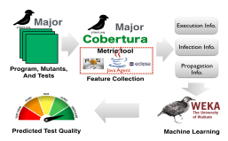

Fig. 2 The tools used in the implementation of PMT.

to collect training instances; feature collection tools which are used to collect features; machine learning framework which is used to build the classification model. We present the three types of tools in Figure [2,](#page-5-1) and introduce the details as follows.

**Mutation testing tools.** We use two popular Java mutation tools: PIT[3](#page-5-2) *[\[49\]](#page-19-48)* and Major[4](#page-5-3) , both of which have been widely used in mutation testing research [\[50\]](#page-19-49), [\[51\]](#page-19-50). As our work targets the cost problem of mutation testing, we choose *PIT* as the primary mutation testing tool since it is evaluated to be very efficient [\[52\]](#page-19-51). Moreover, *PIT* has been demonstrated to be very robust [\[52\]](#page-19-51), enabling large-scale experimental study. Additionally, to further investigate PMT's performance on different tools, we use *Major* as an auxiliary tool, because it is also widely adopted and can generate mutants that represent real faults [\[10\]](#page-19-9).

Note that we use all the 14 operators of *PIT* and 8 operators of *Major*. *PIT* and *Major* only support method-level mutation operators [\[53\]](#page-19-52), and thus the mutants explored in this paper are method-level mutants. We discuss the implications and possibilities of using class-level mutation operators in Section [5.2.](#page-9-0)

**Feature collection tools.** We use *Cobertura*[5](#page-5-4) to collect information for the coverage-related features (i.e., *numExecuteCovered* and *numTestCovered*). For the infection features, we directly obtain them from the adopted mutation testing tools. When collecting the *typeStatement* and *typeOperator* features, we find that different mutation operators of mutation tools correspond to different statement types perfectly. Thus, we collect only the mutation operation type in this study. For the various static-metric-related features (e.g., *depInheritance* and *numChildren*), we implement our own tool based on the abstract syntax tree (AST) analysis provided by the *Eclipse JDT toolkit*[6](#page-5-5) (as shown in the red square in Figure [2\)](#page-5-1). To obtain the remaining features related to the oracle information (i.e., *numMutantAssertion* and *numClassAssertion*), we develop our own tool based on bytecode analysis using the *ASM bytecode manipulation and analysis framework*[7](#page-5-6) . The detailed information about our own tools is disclosed online [\[54\]](#page-19-53).

- 3 <http://pitest.org/>
- 4 <http://mutation-testing.org/>
- 5 <http://cobertura.github.io/cobertura/>
- 6 <http://www.eclipse.org/jdt/>
- 7 <http://asm.ow2.org/>

**Machine learning framework.** We use *Weka*[8](#page-6-0) , the most widely-used machine learning library, to build and evaluate our classification model.

All the experiments were performed on a platform with 4-core Intel Xeon E5620 CPU (2.4GHz) and 24 Gigabyte RAM running JVM 1.8.0-20 on Ubuntu Linux 12.04.5.

#### **4.2 Subject Systems**

We use 9 projects that have been widely used in previous software testing research [\[50\]](#page-19-49), [\[55\]](#page-19-54), [\[56\]](#page-20-0) as the cross-project scenario subjects to evaluate PMT. In particular, we use the latest versions (i.e., the HEAD commit) of these projects as the base subjects. To facilitate the evaluation of PMT in the cross-version scenario, we prepare multiple versions for each base subject as in existing work [\[50\]](#page-19-49). More specifically, we select each version by counting backwards 30 commits at a time from the latest version commit of each project and generate up to 10 versions per project. Note that projects may have fewer than 10 versions due to the limited version history or execution problems for our mutation testing or feature extraction tools. The information of these base projects is shown in Table [1.](#page-7-1) The number of lines of code is the executable code reported by LocMetrics[9](#page-6-1) .

To further extensively evaluate PMT, we collect another 154 projects. We started with the first 1000 most popular Java projects[10](#page-6-2) from Github in June 2015; 388 of these projects were saved because they are single-packaged, and were successfully built with Maven[11](#page-6-3) and passed all their JUnit tests; then, 234 projects were further removed because they cannot be handled by the *PIT* tool or the other supporting tools used in our study.

The sizes of the final 154 projects range from 172 to 92,176 lines of code. The mutation score distribution of these projects is shown in Figure [3.](#page-6-4) From the figure, the 154 projects have various distribution on the proportion of killed mutants. 24 projects have notably imbalanced data that the proportion of killed mutants is below 0.2 or above 0.8. More details of all these subjects (e.g., the subject name, version number and the statistics) are available at our project homepage[12](#page-6-5) .

#### **4.3 Independent Variables**

First, we consider two independent variables related to the application of PMT, which are mutation testing tools (i.e., *PIT* and *Major*) and test types (i.e., manually written and automatically generated tests). Second, we consider two independent variables related to the implementation of PMT, which are classification algorithms (i.e., *Random Forest*, *Naive Bayes* [\[60\]](#page-20-1), *SVM* [\[61\]](#page-20-2), and *J48* [\[60\]](#page-20-1)) and imbalanced data processing strategies (i.e., the three strategies mentioned in Section [2.3\)](#page-4-0). Third, we investigate the features of PMT from two perspectives, which are the PIE features (see more details in Section [2.1\)](#page-2-1) and the source-code-related and testcode-related features.

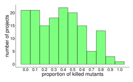

Fig. 3 **The mutation score distribution for 154 Github projects.** The x axis represents the range on the proportion of killed mutants. The y axis represents the number of projects belonging to each distribution range.

## **4.4 Dependent Variables**

We consider the following common metrics to measure the performance of PMT: T P, F P, F N, and T N, which denotes true positive, false positive, false negative, and true negative, respectively. All these metric values[13](#page-6-6) are between 0 and 1. In PMT, when predicting the killing label, a true positive means a killed mutant which is also predicted as killed, a false positive means a live mutant predicted as killed, a false negative means a live mutant also predicted as alive, a true negative means a killed mutant predicted as alive.

**DV1:** *Precision.* The fraction of true positive instances in the instances that are predicted to be positive: T P/(T P + F P). Higher precision means fewer false positive errors.

**DV2:** *Recall.* The fraction of true positive instances in the instances that are actual positive: T P/(T P + F N). The higher the recall is, the fewer false negative errors there are. **DV3:** *F-measure.* The harmonic mean between recall and precision: 2 ∗ precision ∗ recall/(precision + recall). A high F-measure insures that both precision and recall are reasonably high.

**DV4:** *AUC.* The area under ROC curve [\[63\]](#page-20-6)[14](#page-6-7), which measures the overall discrimination ability of a classifier. It is a widely used measurements in evaluating classification algorithms on imbalanced data [\[64\]](#page-20-7), [\[65\]](#page-20-8). The AUC score for a perfect model would be 1, for a random guessing would be 0.5.

We also consider the following metric specific to mutation testing since mutation score calculation is an important goal of mutation testing.

**DV5:** *Absolute Prediction Error.* The absolute error of the predicted mutation score, which is the absolute value of the difference between the actual mutation score MS and the

8 <https://weka.wikispaces.com/>

9 <http://www.locmetrics.com/>

10 As in previous work [\[57\]](#page-20-3), [\[58\]](#page-20-4), [\[59\]](#page-20-5), we select the most popular projects based on their number of stars.

11 <https://maven.apache.org/>

12 <https://github.com/sei-pku/PredictiveMutationTesting>

13 As PMT predicts both killed and live mutants, following previous work [\[62\]](#page-20-9), we use the weighted average of all metrics, each metric is weighted according to the number of instances with the particular class label.

14 The ROC curve is created by plotting the true positive rate against the false positive rate at various threshold settings.

TABLE 1 **The information of the 9 base subjects.** Column "#Ver." lists the number of versions that we used; Column "Size (LOC)" lists the minimum and maximum numbers of lines of executable code for each subject considering its various versions; Column "#Tests" shows the minimum and maximum numbers of manual tests of each version; Column "# All Mutants" shows the minimum and maximum numbers of mutants generated by *PIT* for each subject; Column "# Killed Mutants" shows the minimum and maximum numbers of mutants killed by tests for different versions of each subject; Column "Time" shows the commit time of the latest version of each subject; finally, Column "Distri" shows the data distribution (i.e., proportion of killed mutants to all mutants) of the latest version of each subject. "Coverage" presents the statement coverage information.

| Abbr. | Subjects                     | #Ver. | Size (LOC) |        | # Tests |       | # All Mutants |        | # Killed Mutants |        | Time    | Distri | Coverage |
|-------|------------------------------|-------|------------|--------|---------|-------|---------------|--------|------------------|--------|---------|--------|----------|
|       |                              |       | Min.       | Max.   | Min.    | Max.  | Min.          | Max.   | Min.             | Max.   |         |        |          |
| apns  | Java APNS                    | 5     | 666        | 1,503  | 65      | 87    | 341           | 953    | 177              | 361    | 01/2013 | 0.37   | 0.58     |
| assj  | AssertJ                      | 6     | 11,326     | 13,372 | 4,708   | 5,229 | 6,819         | 8,112  | 4,821            | 6572   | 02/2014 | 0.71   | 0.78     |
| joda  | Joda-Time                    | 4     | 29,205     | 29,702 | 3,834   | 4,033 | 22,878        | 23,216 | 13,101           | 13,132 | 01/2014 | 0.57   | 0.83     |
| lafj  | Linear Algebra for Java      | 7     | 5,810      | 7,016  | 245     | 625   | 6,607         | 8,426  | 2,859            | 5,181  | 02/2014 | 0.54   | 0.68     |
| lang  | Apache Commons Lang          | 7     | 22,357     | 25,774 | 2,309   | 2,376 | 22,762        | 23,118 | 15,276           | 15,503 | 02/2014 | 0.67   | 0.91     |
| msg   | Message Pack for Java        | 7     | 8,171      | 13,481 | 658     | 1,145 | 5,801         | 10,058 | 2,635            | 2,870  | 06/2012 | 0.43   | 0.58     |
| uaa   | UAA                          | 4     | 5,691      | 8,081  | 223     | 470   | 4,070         | 5,913  | 880              | 1,073  | 02/2014 | 0.20   | 0.38     |
| vrap  | Vraptor                      | 3     | 13,636     | 14,093 | 985     | 1,124 | 7,018         | 8,262  | 4,161            | 5,674  | 01/2014 | 0.64   | 0.81     |
| wire  | Wire Mobile Protocol Buffers | 4     | 1,788      | 2,382  | 19      | 61    | 1,958         | 2,433  | 546              | 745    | 01/2014 | 0.31   | 0.53     |

predicted mutation score MSp (i.e., |MS − MSp|) [15](#page-7-2)

We also consider the following two metrics specific to the measurement of mutants to help future mutant selection or reduction strategies, except for those general metrics above for evaluating classification algorithms.

**DV6:** *Predictability.* The "easiness" of predicting mutant execution results with a predictive model. The value is between 0 and 0.5. Mutants with higher predictability would be easier for the predictive model to predict (more details in Section [2.4\)](#page-4-1).

**DV7:** *Killability.* The "easiness" of getting killed for a given mutant. In this paper we use the proportion of test cases that kill a mutant against all the test cases to measure this mutant's killabiity. The value is between 0 and 1. Mutants with higher killability tend to be killed more easily.

## **5 RESULT ANALYSIS**

#### **5.1 RQ1: Performance of PMT**

To answer this RQ, for each application scenario (i.e., crossversion and cross-project), we present the performance of PMT with the default configuration (i.e., using the *Random Forest* algorithm and the *naive* imbalanced data processing strategy) in terms of effectiveness and efficiency.

## *5.1.1 Effectiveness*

**Cross-version:** in this scenario, for each of the nine base projects, we apply PMT to predict the mutation testing results of each version based on the data of the previous versions.

First, for each version, we use its immediate previous version to build the classification model. Thus, for a project with v versions, we perform v − 1 predictions: using one version as the training set, and the next version as the test set. The detailed experimental results are shown in Table [2.](#page-7-3) From the table, PMT performs extremely well under this scenario. In particular, the absolute values of prediction

TABLE 2 **The effectiveness of PMT under the cross-version scenario.** For each project, we use the mutant execution results of the mutants from an older version (i.e., vi) to predict the execution results for the mutants in the next version (i.e., vi+1). Column "changes" represents the changes in the number of lines of code between two versions. The rest columns show the values of the metrics that we used for indicating the predictive effectiveness.

| Sub. | Ver.        | changes | Prec. | Recall F. |       | AUC   | Err.(%) |
|------|-------------|---------|-------|-----------|-------|-------|---------|
|      | apns v0-v1  | 193     | 0.960 | 0.957     | 0.957 | 0.989 | 3.448   |
|      | v1-v2       | 362     | 0.950 | 0.947     | 0.947 | 0.990 | 3.187   |
|      | v2-v3       | 0       | 0.972 | 0.972     | 0.972 | 0.997 | 0.398   |
|      | v3-v4       | 67      | 0.954 | 0.953     | 0.953 | 0.993 | 1.921   |
|      | v4-v5       | 215     | 0.912 | 0.912     | 0.911 | 0.981 | 2.099   |
| assj | v0-v1       | 997     | 0.983 | 0.982     | 0.982 | 0.999 | 1.072   |
|      | v1-v2       | 20      | 0.988 | 0.988     | 0.988 | 0.999 | 0.644   |
|      | v2-v3       | 964     | 0.985 | 0.985     | 0.985 | 0.998 | 0.862   |
|      | v3-v4       | 555     | 0.975 | 0.974     | 0.974 | 0.990 | 1.804   |
|      | v4-v5       | 738     | 0.976 | 0.976     | 0.976 | 0.994 | 1.381   |
| joda | v0-v1       | 85      | 0.958 | 0.957     | 0.957 | 0.992 | 2.475   |
|      | v1-v2       | 355     | 0.956 | 0.956     | 0.956 | 0.992 | 1.796   |
|      | v2-v3       | 169     | 0.958 | 0.957     | 0.957 | 0.992 | 2.867   |
| lafj | v0-v1       | 994     | 0.915 | 0.913     | 0.913 | 0.970 | 3.414   |
|      | v1-v2       | 270     | 0.921 | 0.917     | 0.916 | 0.987 | 5.632   |
|      | v2-v3       | 190     | 0.913 | 0.908     | 0.908 | 0.970 | 4.967   |
|      | v3-v4       | 938     | 0.841 | 0.826     | 0.828 | 0.941 | 8.007   |
|      | v4-v5       | 167     | 0.913 | 0.912     | 0.911 | 0.964 | 4.118   |
|      | v5-v6       | 949     | 0.933 | 0.932     | 0.931 | 0.975 | 3.909   |
| lang | v0-v1       | 49      | 0.972 | 0.972     | 0.972 | 0.997 | 1.105   |
|      | v1-v2       | 120     | 0.972 | 0.972     | 0.972 | 0.997 | 1.164   |
|      | v2-v3       | 13      | 0.972 | 0.972     | 0.971 | 0.997 | 1.047   |
|      | v3-v4       | 14      | 0.972 | 0.972     | 0.972 | 0.997 | 1.115   |
|      | v4-v5       | 171     | 0.969 | 0.969     | 0.969 | 0.996 | 1.748   |
|      | v5-v6       | 6,556   | 0.968 | 0.967     | 0.967 | 0.996 | 1.515   |
| msg  | v0-v1       | 240     | 0.936 | 0.935     | 0.935 | 0.986 | 2.017   |
|      | v1-v2       | 519     | 0.957 | 0.956     | 0.956 | 0.992 | 2.271   |
|      | v2-v3       | 4,551   | 0.959 | 0.957     | 0.957 | 0.991 | 1.949   |
|      | v3-v4       | 4,302   | 0.960 | 0.958     | 0.959 | 0.992 | 2.695   |
|      | v4-v5       | 331     | 0.963 | 0.963     | 0.963 | 0.996 | 0.285   |
|      | v5-v6       | 228     | 0.970 | 0.970     | 0.970 | 0.997 | 0.605   |
| uaa  | v0-v1       | 1,042   | 0.960 | 0.957     | 0.958 | 0.991 | 2.097   |
|      | v1-v2       | 97      | 0.973 | 0.972     | 0.972 | 0.994 | 1.152   |
|      | v2-v3       | 1,162   | 0.930 | 0.928     | 0.929 | 0.976 | 0.812   |
|      | vrapt v0-v1 | 553     | 0.971 | 0.971     | 0.971 | 0.995 | 1.895   |
|      | v1-v2       | 87      | 0.931 | 0.930     | 0.929 | 0.969 | 3.801   |
| wire | v0-v1       | 527     | 0.890 | 0.891     | 0.889 | 0.967 | 3.933   |
|      | v1-v2       | 28      | 0.976 | 0.976     | 0.976 | 0.997 | 1.179   |
|      | v2-v3       | 39      | 0.967 | 0.966     | 0.966 | 0.994 | 2.096   |

15 As equivalent mutants are inherently resistent to guarantee automated identification, due to undecidability of equivalence [\[40\]](#page-19-39), [\[66\]](#page-20-10), [\[67\]](#page-20-11), we calculate the mutation score for traditional mutation testing and predictive mutation testing by ignoring the influence of equivalent mutants. This approach is also widely adopted in related work with [\[68\]](#page-20-12), [\[69\]](#page-20-13), [\[70\]](#page-20-14), [\[71\]](#page-20-15).

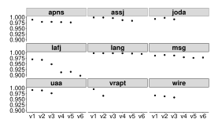

Fig. 4 The impact of version intervals. For each project, we use the first version  $(v_0)$  as the training set, and each of the remaining versions as the test set. The x axis represents the versions used as the test set and the y axis represents the AUC values. The results show that PMT is effective under cross-version prediction even using the mutation information of a very old version.

errors are all below 5% except 2 predictions, and almost all the other metric values are above 0.9.

Second, to investigate how version intervals impact the performance of PMT, for each project, we use the first version  $(v_0)$  as the training set, and each of the remaining versions as the test set. The results are shown in Figure 4. We present only the AUC values here because all the metrics demonstrate the same pattern. The other metric values are published on our homepage16. From the figure, when the version intervals increase, the AUC values decline. This observation is as expected: large version intervals usually lead to large difference between the two versions, which may decrease the effectiveness of PMT. However, AUC values decline in a very low speed and are still all above 0.90. For example, when using  $v_0$  to predict  $v_3$  for uaa, the AUC value is still above 0.95 although the project size has evolved from 5,691 to 8,081 and the test suite size has evolved from 223 to 470. This finding indicates that PMT is effective for cross-version prediction, even when using the mutation information of an old version far away from the current version in the code repository.

**Cross-project:** to investigate the effectiveness of PMT in the cross-project scenario, for the latest versions of the nine base projects, we use PMT to build a classification model based on any 8 base projects to predict the mutation testing results of the remaining base project. Note that when constructing the training data, in case that the data of large projects might otherwise overwhelm those of small projects, we assign weights to each instance. These weights reflect the sizes of projects following the standard way used in machine learning. Suppose the total training data contain s instances, while training project A contains s instances, we then set the weight of project A as s/a, thus each project's weight multiplying its number of instances is a constant [72]. The results are shown in Table 3. From the table, PMT performs

16 https://github.com/sei-pku/PredictiveMutationTesting

TABLE 3 **The effectiveness of PMT under the cross-project scenario.** For the latest versions of the nine base projects, we use PMT to build a classification model based on any 8 base projects to predict the mutation testing results of the remaining base project.

| Sub.  | Prec. | Recall | F.    | AUC   | Err.(%) |
|-------|-------|--------|-------|-------|---------|
| apns  | 0.915 | 0.901  | 0.903 | 0.951 | 7.765   |
| assj  | 0.935 | 0.937  | 0.934 | 0.898 | 3.686   |
| joďa  | 0.923 | 0.912  | 0.911 | 0.939 | 8.325   |
| lafj  | 0.887 | 0.877  | 0.871 | 0.880 | 10.155  |
| lang  | 0.912 | 0.909  | 0.906 | 0.916 | 6.163   |
| msg   | 0.933 | 0.925  | 0.925 | 0.944 | 6.813   |
| uaa   | 0.945 | 0.931  | 0.935 | 0.973 | 5.243   |
| vrapt | 0.917 | 0.912  | 0.910 | 0.928 | 6.676   |
| wire  | 0.888 | 0.883  | 0.885 | 0.943 | 2.877   |

well for all the nine base projects: all the metric values are above 0.85, and almost all the absolute values of prediction errors of mutation scores are below 10.0%.

When comparing the predictive results between cross-version and cross-project scenario, it is obvious that immediate cross-version prediction has the best predictive effectiveness, muti-interval cross-version prediction ranks the next, while cross-project performs the worst. This is because the more diverse the training data and testing data are, the more challenging it is for the predictive model to get good results. Fortunately, even for cross-project scenario, PMT is able to get good effectiveness with AUC values above 0.85.

In summary, compared to traditional mutation testing, PMT incurs only a small accuracy penalty for most of the projects in both cross-version and cross-project scenarios.

#### 5.1.2 Efficiency

We present the cost of PMT, and make comparison with traditional mutation testing. As discussed in Section 3, the classification model can be built off-line ahead of time17. Thus, the cost of PMT in predicting any new upcoming project contains two parts: feature collection time and prediction time.

Table 4 lists the major findings regarding the latest version of each nine base project. Column 2 lists the execution time by *PIT* with the default execution setting that the remaining tests will not run against a mutant once the mutant has already been killed. For the cross-version scenario, the classification model is built from the last nearest version. From the table, compared with traditional mutation testing using *PIT*, PMT requires notably less time under both scenarios. Especially, PMT requires less than one minute almost for all subjects, while the mutation testing tool *PIT* costs from 228 seconds to as much as 9,540 seconds (i.e., over two and a half hour). Furthermore, the time of *PIT* increases dramatically when the program size increases, while the time of PMT remains almost stable, indicating a much better scalability of PMT.

PIT has embodied a number of optimizations and is currently one of the fastest mutation testing tools [52], which indicates that PMT may outperform other mutation testing tools even more. Of course, there remains scope for further improving the efficiency of PMT. For example, the

 $^{17}$  According to our experiments, the training time takes less than 5 minutes normally.

TABLE 4 Performance comparison between PMT and PIT. Column 2 lists the execution time by PIT with the default execution setting. Columns 3 and 4 list the time by PMT under two application scenarios, including feature collection and prediction time (i.e., shown in brackets). The right side of each column lists speedup that PMT achieves compared with PIT. Columns 5, 6, and 7 show the absolute prediction errors of PMT under cross-version and cross-project scenarios and PIT respectively. The results demonstrate that PMT improves the efficiency a great deal, while incurring only a relatively small accuracy loss.

| Sub   |       |                   | Time   | Err.(%)           |        |                   |                   |      |
|-------|-------|-------------------|--------|-------------------|--------|-------------------|-------------------|------|
|       | PIT   | PMT:cross-version |        | PMT:cross-project |        | PMT:cross-version | PMT:cross-project | Cov. |
| apns  | 803s  | 25s (1s)          | 32.1X  | 28s (4s)          | 28.7X  | 2.1               | 7.7               | 21.0 |
| assj  | 2667s | 41s (1s)          | 65.0X  | 43s (3s)          | 62.0X  | 1.4               | 3.7               | 7.3  |
| joda  | 3120s | 60s (2s)          | 52.0X  | 63s (5s)          | 49.5X  | 2.9               | 8.3               | 26.0 |
| lafj  | 786s  | 15s (1s)          | 52.4X  | 19s (5s)          | 41.4X  | 3.9               | 10.2              | 14.4 |
| lang  | 9540s | 63s (2s)          | 151.4X | 66s (5s)          | 144.5X | 1.5               | 6.2               | 24.2 |
| msg   | 4980s | 45s (1s)          | 110.7X | 49s (5s)          | 101.6X | 0.6               | 6.8               | 14.8 |
| uaa   | 939s  | 26s (1s)          | 36.1X  | 29s (4s)          | 32.4X  | 0.8               | 5.2               | 17.8 |
| vrapt | 6000s | 40s (1s)          | 150.0X | 42s (3s)          | 142.8X | 3.8               | 6.7               | 16.4 |
| wire  | 228s  | 12s (1s)          | 19.0X  | 15s (4s)          | 15.2X  | 2.1               | 2.9               | 23.2 |

prediction time is less than or equal to 5 seconds for all projects, and we can further speed up the feature collection time (details shown in Section 6).

#### 5.1.3 Comparison with Coverage-based Testing

In addition, as statement coverage has been shown to be effective in predicting test effectiveness in terms of mutation score [73], we directly apply statement coverage to predict mutation scores for the 9 base subjects and record absolute prediction errors in the last column of Table 4. We also show the absolute prediction errors of PMT under cross-version and cross-project scenarios in Columns 5 and 6, respectively.

From the table, the errors for both scenarios of PMT can be seen to be much smaller and more stable than those of coverage-based testing: the largest error for PMT under cross-version/cross-project scenario is only 3.9%/10.2% while it is 14.6% for statement coverage. For example, for subject wire, PMT is able to predict the mutation score with only 2.1%/2.9% error while statement coverage has an error of 13.3%. Of course PMT is designed to have greater information available to it, precisely with the hope that such reduced errors would be observed.

To conclude, in the first research question, we find that PMT has good effectiveness as well as efficiency in evaluating test power, indicating a promising application for developers when they seek high effectiveness and efficiency at the same time.

#### 5.2 RQ2: Application Factors

In this section, we investigate how application factors influence the effectiveness of default PMT, to find out what application artifacts PMT fits for.

## 5.2.1 Mutation Testing Tools

Different mutation testing tools vary in several aspects (e.g., operators, environment support) [52], and may even yield different mutation scores for the same project. Therefore, it is important to learn whether PMT is also effective when using mutation tools besides PIT. In this paper, we take the widely used tool called Major and evaluate its effectiveness based on the same base projects. Major fails to generate mutants for joda, vrapt, and assj, so we use the remaining 6 base subjects instead, and predict the mutation testing results of 18 http://mernst.github.io/randoop/

each subject using the remaining 5 subjects. The results are shown in Figure 5. From the figure, almost all the values of the metrics are above 0.8 for both PMT and Major. Also, there is no obvious difference between the performance of PMT using PIT and Major.

In general, the results above indicate that PMT may achieve good performance on different mutation tools.

#### 5.2.2 Test Types

We also investigate how PMT performs when predicting the mutation testing results of manually written and automatically generated tests. For each of the 9 base projects, we first generate tests using randoop18, collect the related features introduced in Section 2.1, and construct a new set based on those automatically generated tests for testing the classification model. Then, we use the remaining 8 projects with manually written tests to construct the training set, which is used to predict both the new test set (constructed with automatically generated tests) and the original test set (constructed with manually written tests). randoop fails to generate compilable tests for 5 base subjects, so we compare only the results on the remaining 4 base subjects.

The comparison results are shown by Figure 6, where it is evident that PMT performs almost comparably between automatically generated and manually written tests. The performance regarding manually written tests is a bit inferior for most bar pairs (e.g., for the manually written tests of project apns, the AUC value is around 0.1 lower than that of automatically generated tests.). We suspect the reason to be that automatically generated tests are more uniform and less sophisticated (e.g., with standard test body and assertion usage), and thus are easier to predict.

To conclude, in the second research question, we find that PMT can well fit different mutation tools and predict the mutant execution results against different types of tests.

#### 5.3 RQ3: Configuration Impact

In this section, we further extend our experiments with another 154 Github projects to investigate the influence of internal factors of PMT so as to investigate how to achieve better performance. The latest versions of the 9 base

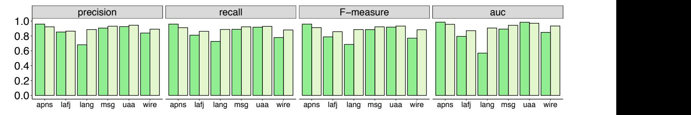

Fig. 5 **The effectiveness of PMT on** *PIT* **(i.e., shown by the light green bars) and** *Major* **(i.e., shown by the dark green bars) under cross-project scenario.** The x axis represents different projects under prediction. The y axis represents the values of different metrics. PMT performs good on both *PIT* and *Major*.

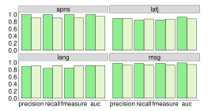

Fig. 6 **The effectiveness of PMT when predicting the execution results regarding manually written (i.e., shown by the light green bars) and automatically generated (shown by the dark green bars) tests.** For each project, the predictive model is built using the other 8 projects with manually written tests. PMT performs good on predicting the execution results of both kinds of tests.

subjects are used to build a classification model, whereas the remaining 154 Github subjects are used to evaluate the classification model. The detailed experimental results are shown in Figure [7.](#page-11-0) From Figure [7,](#page-11-0) for the vast majority of the 154 Github projects PMT is able to predict the mutation testing results with over 0.85 precision, recall, and F-measure, and over 0.90 AUC, and is able to predict the mutation scores with errors lower than 15%. This further demonstrates PMT's effectiveness.

**Classification algorithms:** we first investigate whether PMT predicts better than random guessing. We compare the prediction results of the default PMT classification algorithm (i.e., *Random Forest*) with those of the baseline model in machine learning (i.e., *ZeroR* [\[74\]](#page-20-18)) on our 154 Github projects. The results are shown in Figure [8.](#page-12-0) From the first three subfigures, most of the black points are much lower than bars, indicating that PMT is much better than random guess in precision, recall, and F-meausre; from the last subfigure, random guess always has a AUC value of 0.5, while PMT is much better than that.

We then investigate the effectiveness of PMT by varying its classification algorithms, including *Random Forest*, *Naive Bayes* [\[75\]](#page-20-19), *SVM* [\[61\]](#page-20-2), and *J48* [\[60\]](#page-20-1). The comparison results

are shown by Figure [9.](#page-12-1) From the figure, *Random Forest* performs the best; *J48* is slightly inferior to *Random Forest*; *SVM* performs worse than *J48*; *Naive Bayes* performs the worst. As both *Random Forest* and *J48* belong to decision tree algorithms, we suspect that as different features in PMT obviously contribute differently (e.g., execution features contribute most), decision tree algorithms have the advantage by putting these key features on the top of decision trees, and thus will get definite decision solutions based on those key feature conditions [\[76\]](#page-20-20), which is different from other algorithms.

**Imbalanced data processing strategies:** to learn how PMT performs on very imbalanced test sets, we choose the 24 Github subjects whose proportion of killed mutants are below 0.2 or above 0.8 as representatives of imbalanced test sets. The *AUC* results of PMT are given by Figure [11.](#page-12-2) From the figure, the default *naive* imbalanced data processing strategy of PMT already performs well even for those very imbalanced projects. We further compare all the three imbalanced data processing strategies mentioned in Section [2.3](#page-4-0) to deal with the training data, whose results are shown by Figure [10.](#page-12-3) From the figure, there is little difference among the three strategies. This indicates that PMT is robust to imbalanced data, as the *Random Forest* algorithm handles imbalanced data well [\[34\]](#page-19-33).

To conclude, in the third research question, we find that with *Random Forest* algorithm, PMT will have the best performance. Additionally, PMT is robust to imbalanced data.

## **5.4 RQ4: Feature Impact**

## *5.4.1 Rank of Features' Contribution*

PMT builds a classification model based on a set of features, which may have different contributions to the classification model. In this section, we study the contribution of these features so as to better understand PMT. More specifically, we rank all the features based on their information gain (through the *InfoGainAttributeEval* class in Weka), which measures the contribution of a feature to the decision outcome in a decision tree [\[77\]](#page-20-21). The higher information gain a feature has, the more preferred it is to other features[19](#page-10-2) .

19 In this paper, for a feature we used *InfoGainAttributeEval* in *Weka* to get the information gain of a dataset constructed by all our projects.

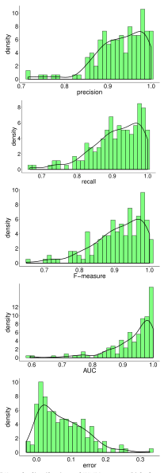

Fig. 7 **Result distribution of PMT on 154 Github projects under the cross-project scenario.** The classification model is built with the latest versions of the 9 base subjects. The x axis represents the distribution ranges of different metrics. The y axis represents the counts of projects belonging to each distribution range. For the majority of projects, PMT is able to predict the mutant execution results with high accuracy and low mutation score error.

The detailed results are shown in Figure [12.](#page-13-0) According to the figure, the coverage features (*numExecuteCovered* and *numTestCovered*) are the most important features in predicting mutant execution results. This observation can be explained by that coverage is a necessary condition for mutant killing according to the PIE theory [\[35\]](#page-19-34). The oraclerelated features, *numMutantAssertion* and *numClassAssertion*, also offer high contribution to decisions, because they indicate detailed information about how many assertions may have checked a mutant. Furthermore, the *instability* feature, which describes how the mutated class interacts with outside classes, also ranks high, because mutated classes with more dependents may have more tunnels to propagate the internal state change to final output.

From Figure [12,](#page-13-0) the top-three features have much higher merit values than other features. It is worth explaining that this observation does not mean that there is no need to adopt other features: the rank results shown in the figure are general results combining all the instances through all the projects, while for each single project the rank results may be different. We further explore the performance of using different number of features in the next Section.

#### *5.4.2 Feature Selection*

We investigate how PMT performs with different number of selected features, to further check whether there are any redundant features so as to minimize the feature set and further reduce the cost of feature collection as well as the training cost. For the default experimental configuration under the cross-project application scenario (i.e., to use any 8 base projects to build the classification model and predict the mutation testing results of the remaining base project), according to the rank using *InfoGainAttributeEval*, we build the classification models using the top−n (n = 1, 2, 3, ..., 14) features, and then compare the effectiveness of each prediction. Each classification model has its own feature ranking results, but the general ranking would be consistent with what we have shown in Section [5.4.1.](#page-10-3)

Figure [13](#page-13-1) shows the final results of feature selection. The x axis represents the number of features, the y axis represents the AUC values of each prediction. For each project, there are 14 points, representing the 14 prediction with features counting from 1 to 14. From the figure, we have the following observations.

First, the AUC values increase overall when the number of features increase, indicating that more features usually yield higher effectiveness. This observation also indicates that although the three coverage metrics work well, adding more features can clearly improve the prediction results (shown in Figure 11). However, there are also fluctuations. Sometimes adding one more feature would decrease the effectiveness on some projects a little bit (e.g., add the third feature for project apns). The reason is that the added feature, although generally constructive, may do not fit that project properly.

Second, we observe three distribution patterns on the nine base projects. (a) For projects apns, assj, msg, and uaa, the effectiveness increases steadily as the number of selected features increases. (b) For projects joda, lang, and laf j, there is an obvious jump in the AUC values when adding the 10th feature. The reason is that the test sets in

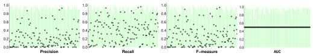

Fig. 8 **Comparison results with random guess.** The x axis represents the 154 Github projects, bars represent the metric values of PMT, and black points represent the metric values of random guess. From this figure, PMT is much better than random guess considering all the classification measurements.

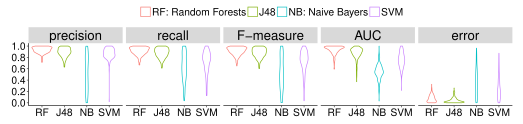

Fig. 9 **Comparison results of using different classification algorithms.** The x axis represents all the four algorithms and the y axis represents different metric values. The width of each metric value represents the density of this value (i.e., larger density represents that more projects have this value) among all the 154 projects. From this figure, *Random Forest* performs the best among all the algorithms.

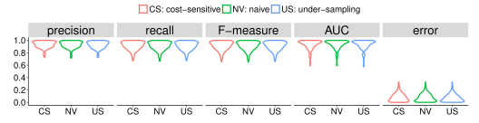

Fig. 10 **Comparison results of using different imbalanced strategies.** The x axis represents all the three strategies and the y axis represents different metric values. From this figure, there are no obvious differences between the performance of the three strategies.

Fig. 11 **AUC values of the 24 most imbalanced projects, whose proportion of killed mutants are below 0.2 or above 0.8.** From the figure, PMT performs good even with very imbalanced data.

these three projects are more sensitive to the newly added

feature (i.e., *infoComplexity*), and thus the effectiveness of corresponding predictive models is quite different with and without that feature. (c) For projects msg, uaa, and wire, the effectiveness achieves very near to the peak at the very beginning with only two or three features, then increases slowly when adding more features. The reason is that the first several features (i.e., *numExecuteCovered*, *numTestCovered*, and *numMutantAssertion*) play a key role on these test sets.

Based on the observations above, as well as our conclusions drawn from Figure [12,](#page-13-0) all the 14 features we adopted are useful. However, if the developers care much about the feature collection time, they may choose 10 features, which will reduce the cost of feature collection without

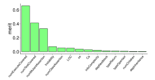

Fig. 12 The rank of feature contribution in terms of their information gain. The x axis lists all the features used in our work and the y axis lists all merit values for each feature

affecting much of the effectiveness. According to Figure 12, the four features developers may consider abandoning in a general level are: *typeReturn*, *typeOperator*, *numChildren*, and *depInheritance*.

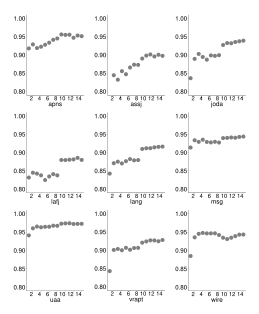

Fig. 13 AUC values of using different number (i.e., from 1 to 14) of features selected based on the information gain. The x axis represents the number of features. The y axis represents the AUC values. Each point represents a prediction with different number of features.

## 5.4.3 Comparison: Execution, Infection, and Propagation Features

In this section, we compare the contribution of the three categories of features we collected based on the PIE principle. In particular, to investigate the contribution of each category

(i.e., execution, infection, and propagation), we compare the predictive effectiveness of the classification model built with or without the features belonging to that category (more details about the three categories are introduced in Section 2.1).

Figure 14 presents the final results. From the table, for the features that we used to build the classification model, the performance drop the most without execution features, indicating that execution features contribute the most among the three categories of features. The performance of infection features, however, is not good, because the performance is almost not affected when infection features are not included. The contribution of propagation features is between execution features and infection features.

The observations above indicate that execution and propagation features may have more impact on the detection of a fault, which may provide direct guidelines for test case generation. The poor performance of infection features is due to the fact that the design of OO features and JUnit tests/assertions for modern Java programs makes infections harder to propagate to the test outcomes than the traditional procedural languages.

#### 5.4.4 Comparison: Source Code and Test Code Features

We are also interested in the comparison between source-code-related features and test-code-related features. In this paper, we refer to the features that are collected through analyzing only the source code (also called production code) as source-code-related features, and the features that cannot be successfully collected without "running test cases" or analyzing the test code as test-code-related features. For example, <code>numExecutedCovered</code> is a test-code-related feature, because we can collect the coverage information of each mutant only through running the test cases. Among the 14 features that we used in this work, the test-code-related features include: <code>numExecutedCovered</code>, <code>numTestCovered</code>, <code>numMutantAssertion</code>, and <code>numClassAssertion</code>. The remaining features (e.g.,<code>typeStatement</code> and the complexity metrics) are all source-code-related features.

The comparison results are shown in Figure 15. From the figure, test-code-related features perform much better than source-code-related features. This is consistent with our expectation, because from Figure 12, among the top-5 features, four of them are test-code-related.

From the observations above, we find that test code features are important, because mutation testing aims to measure test code quality, e.g., without test code features we cannot predict mutation testing results at all. In some other application scenarios, such as bug prediction, we may also consider using test code related features, instead of only using source code metrics.

To conclude, in the fourth research question, features related to coverage information contribute most to PMT. Test code features perform better than source code features, and should be paid more attention to in other applications such as bug localization.

#### 5.5 RQ5: Predictability of Mutants

We investigate the level of the predictability of the mutants to learn the general confidence level of PMT in predicting

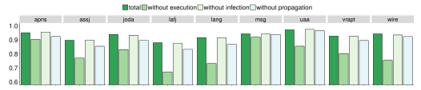

Fig. 14 **Comparison of the contribution of the three categories of features.** The y axis represents the AUC values. Different bars indicate the effectiveness without execution features (i.e., *numExecutedCovered* and *numTestCovered*), infection features (i.e., *typeStatement* and *typeOperator*), and propagation features (i.e., the remaining features). Execution features contribute the most.

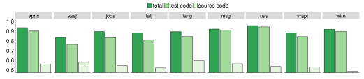

Fig. 15 **Comparison of source code features and test code features. The** y **axis represents the AUC values.** Different bars indicate the total effectiveness, as well as the effectiveness with only source code features or test code features. Test code related features perform much better than source code related features.

mutant execution results (see Section [5.5.1\)](#page-14-2). We also study the correlation between predictability and some main mutant features to investigate what type of mutants would have high predictability (so as to provide guidelines in generating or optimizing mutants, see Section [5.5.2\)](#page-14-3). To learn whether predictability can be regarded as mutant effectiveness measurement, we study the correlation between killability (i.e., how easy is a mutant to be killed) and predictability (see Section [5.5.3\)](#page-15-0).

#### *5.5.1 Distribution of Predictability*

We are interested in the general level of mutant predictability in our experiments. In the cross-project application scenario, for each project, we record the probability of PMT on predicting the each mutant's execution results correctly, and compute the predictability (see more details in Section [2.4\)](#page-4-1). The final distribution results are shown in Figure [16.](#page-15-1)

From the figure, most mutants have high predictability (of over 0.4), indicating that the classification model in PMT is of good quality and has high confidence when classifying most of the mutants.

Different projects have different distribution patterns. However, when comparing the predictability distribution (shown in Figure [16\)](#page-15-1) with the effectiveness of PMT on each project (shown in Figure [3\)](#page-8-2), we observe high level of consistency: projects with higher proportion of highpredictability mutants tend to have better predictive effectiveness. For example, project *assj* and *lafj* have higher proportion of the mutants with a predictability lower than 0.3, and from Table [3](#page-8-2) these two projects also have the lowest AUC values. These kinds of observations indicate that a higher predictability may indicate better prediction.

#### *5.5.2 Correlation Analysis of Predictability*

In this section, we are interested in the internal common properties of mutants with high or low predictability. With this knowledge, we may learn what kind of mutants are easier to predict, so as to better understand mutants and provide help in generating mutants. In particular, we investigate the top-3 features which contribute the most to the predictive model (based on Figure [12\)](#page-13-0).

Firstly, we are interested in feature *numExecutedCovered*, which refers to how many times the mutated statement is executed by the whole test suite. This feature also makes the most contribution to the classification model according to Figure [12.](#page-13-0) For each project, we use plot figures to present the correlation between the predictability and the value of *numExecutedCovered* of each mutant, which is shown in Figure [17.](#page-16-0)

From the figure, there is no obvious linear correlation between how many times a mutated statement is executed by the whole test suite and the predictability of the mutant. However, we could observe a rough pattern that higher execution times would yield higher predictability, and instances with very low predictability (i.e., close to 0) usually have very small execution times. From the figure, we observe high predictability (i.e., close to 0.5) on many instances when the execution times are low (i.e., around 0). One reason is that when a mutant remains uncovered (i.e., the value of *numExecutedCovered* is 0), the mutant is alive by definition

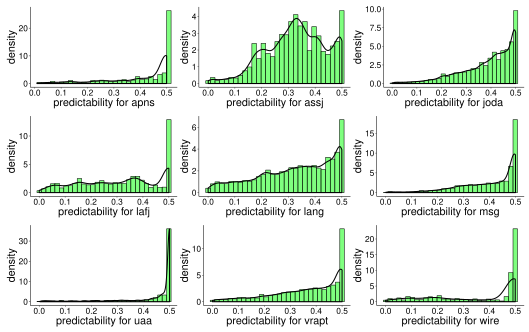

Fig. 16 **Predictability distribution under the cross-project scenario.** Each sub-figure is for each of our base project. The x axis represents predictability. The bars present the density of the mutants that own the corresponding predictability. The black curves represent kernel density estimation (KDE), which is a non-parametric way to estimate the density function [\[78\]](#page-20-22). From this figure, the majority of mutants have good predictability with PMT as the predictive model.

, and thus this value, 0, makes the outcome (alive) very predictable.

We conclude that the predictions on the mutants with smaller number of execution times (except 0 execution time) may have higher risk to be unreliable.

We then investigate feature *numTestsCovered* (i.e., the number of test cases that cover the mutated statement) and *numMutantAssertion* (i.e., the total number of assertions in the tests that cover the mutated statement). These two features show similar pattern, as shown in Figure [18](#page-16-1) and Figure [19.](#page-16-2) From the figures, we can also conclude that the predictions on the mutants with smaller number of covered tests or test assertions (except the uncovered mutants) may have higher risk to be unreliable.

#### *5.5.3 Correlation Between Killability and Predictablity*

Figure [20](#page-16-3) shows the correlation between the predictability and killability of the mutants (which are predicted to be killed by PMT). Each point represents an instance (i.e., mutant). Note that some mutants are killed due to "Timed Out", "Memory Error", or "Run Error"[20](#page-15-2). For these three kinds of mutants, *PIT* does not report which specific tests cause the killing status, and thus we remove them from the total mutant set in this study.

From the two sub-figures, although there is no obvious linear relationship between the killability and predictability of the mutants, a mutant with higher killability tends to own higher predictability. In other words, mutants that are easier to kill tend to be easier to predict as well. However, mutants that are easier to predict (i.e., with high predictability) are not necessarily easier to kill.

What's more, an interesting point worth mentioning is that from Figure [20,](#page-16-3) some mutants would have low killability as well as low predictability. According to recent work [\[79\]](#page-20-23), [\[80\]](#page-20-24), different mutants may have different contributions on evaluating the test power of detecting faults, and it would be meaningful to investigate whether choosing mutants with both low killability and predictability is a better choice.

To conclude, in the last research question, in our experiments the mutants have good predictability with PMT, and a higher predictability may indicate better prediction. Mutants with low number of execution times or covered tests may suffer high risk regarding the reliability of prediction.

## **5.6 Threats to Validity**

The threat to internal validity lies in the implementation of PMT. To reduce this threat, we reused the widely adopted libraries and frameworks (e.g., *Weka*, *ASM*, and *Eclipse JDT*) to aid the implementation and reviewed all our code.

20 [http://pitest.org/quickstart/basic](http://pitest.org/quickstart/basic_concepts/) concepts/

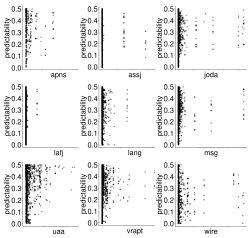

Fig. 17 The correlation between feature numExecutedCovered and predictability. The x axis represents numExecutedCovered in order of the values from small to big. The y axis represents the predictability. Each point represents one instance. In general, the performance of PMT improves when adding new features.

Fig. 18 The correlation between feature numTestsCovered and predictability. The x axis represents numTestsCovered in order of the values from small to big. The y axis represents the predictability. Each point represents one instance.

The threats to external validity mainly lie in the subjects and mutants. To reduce the threat resulting from subjects, we selected our base project versions following the same procedure as that used in the prior work [50] and used a large number of Java projects to cater for the project variability. To reduce the threat of mutation tools, we used both *PIT* and *Major* in our study because the former is efficient

Fig. 19 The correlation between feature numMutantAssertion and predictability. The x axis represents numMutantAssertion in order of the values from small to big. The y axis represents the predictability. Each point represents one instance.

Fig. 20 The correlation between predictability and killability of mutants. Each sub-figure is for each of our base project. The x axis represents predictability. The y axis presents the killability. Each point represents a mutant that is predicted to be killed by PMT. The results demonstrate that mutants with higher killability tend to have higher predictability.

whereas the latter is proved to be effective in generating representative mutants.

The threat to construct validity lies in the metrics used

to measure the classification model. To reduce this threat, we used various widely used measurement metrics for classification models (e.g., *precision, recall, F-measure*, and *AUC*).

## **6 DISCUSSION**

In this section, we discuss implementation issues and the tradeoffs of PMT, as well as its impact on software testing.

#### **(1) Implementation**

Feature optimization may help to refine the effectiveness or reduce PMT's cost. We use 14 features in this paper. More effective features (e.g., semantic information based on advanced control/data flow analysis) may contribute to a more effective predictive model. Also, we choose features without considering their overlap. Based on our results in Section [5.4,](#page-10-4) feature selection techniques can be applied, and thus developers may use fewer features (i.e., 10 features is suggested) to achieve the same effectiveness. Furthermore, the current feature collection of PMT can also be sped up to make the process faster, e.g., the current static metric collection is based on the costly Eclipse JDT analysis and we plan to reimplement that based on bytecode analysis.

Training set size is another internal factor of PMT, which may influence its effectiveness. Intuitively, a bigger training set may improve the effectiveness of PMT by sacrificing some efficiency on classification model construction, which actually occurs before prediction and can be constructed offline. However, from Table [3,](#page-8-2) the prediction results of PMT on a training set constructed by only 8 projects are already satisfactory. The reason is that even a single training project can provide a large number of training instances for PMT. For example, the lang project alone already contains more than 26,000 training instances.

Currently PMT is implemented for Java programs with JUnit tests. Although the implementation frameworks and the detailed feature sets may vary across different languages, the idea can be applied to programs written in different languages with different test paradigms.

Additionally, in this paper both *PIT* and *Major* support only method-level mutation operators and generate only method-level mutants consequently. For the consideration of experiment scalability and popularity, we do not explore class-level mutants generated by some other mutation tools (e.g., *muJava* [\[81\]](#page-20-25). However, we could infer the possibilities of class-level mutants and their differences with methodlevel mutants. For example, because class-level mutants are mutants particular for object-oriented programs and contain injected faults related to inheritance, polymorphism, encapsulation, and so on, they maybe easier to predict. When considering the contribution of different features, mutation operators do not belong to *Infection Features* but belong to *Propagation Features*. The contributions of *Propagation Features* would be larger than those of method-level mutants.

#### **(2) Tradeoff: Efficiency v.s. Effectiveness**

Although we propose PMT to address the efficiency problem in mutation testing, it potentially raises its own accuracy concerns. Fortunately, PMT makes a good tradeoff between efficiency and accuracy; it improves the efficiency of mutation testing (i.e., 15.2X-151.4X) while only incurring a small accuracy penalty (e.g., over 0.85 AUC in most cases). Therefore, for projects that traditional mutation testing is unacceptably long, PMT is typically useful and applicable. For such projects, developers may tend to give up mutation testing in the past, but now can use PMT as an alternative: PMT can provide both mutation score information as well as killing/survival info for each mutant. Therefore, PMT can be used to measure test power (based on mutation score) as well as guide the test augmentation process to kill more mutants (based on detailed mutant killing info). Sometimes, developers may wish to know the rough fault-revealing ability of their test suites as soon as possible, under which circumstance PMT is also a good choice.

Furthermore, with PMT, developers may choose to accept the total predictive results, or choose to execute the mutants with low predictability. Based on our results shown in Section [5.5.1,](#page-14-2) the majority mutants own high predictability, and thus developers are expected to rerun only a small proportion of mutants, for example, 10%, to get high-quality results with low risks.

#### **(3) Impacts in Software Testing**

From the microscopic view, PMT can be viewed as an improvement over traditional mutation testing. In particular, the machine-learning based process in PMT facilitates assessment of mutation testing results, so that it is not necessary to obtain mutation testing results through mutant execution. Thus, predictive mutation testing is more lightweight than traditional mutation testing, yet retains reasonably accurate results. From the macroscopic view, PMT may be viewed as a new measurement for test suite quality. That is, the predicted mutation score based on PMT can be directly used to evaluate the test power rather than being treated as a replacement of the traditional mutation testing score. Compared with the widely used coverage criterion, the predicted mutation score may be more useful because it characterizes the execution, infection, and propagation of faults whereas coverage criterion characterizes only the execution (confirmed by experimental results in Section [5.2.1\)](#page-9-3). Compared with the traditional mutation score, the predicted mutation score is more light-weight because it does not require the costly mutant execution.

## **7 RELATED WORK**

#### **7.1 Mutation Testing**

Mutation testing is a powerful methodology to evaluate the effectiveness of test suites. It was first proposed by Demillo et al. [\[4\]](#page-19-3) and Hamlet [\[5\]](#page-19-4), and has gained increasing popularity [\[19\]](#page-19-18), [\[27\]](#page-19-26), [\[82\]](#page-20-26). Despite its effectiveness, mutation testing has a main limitation, i.e., it is extremely expensive since it needs to execute the test suite on each mutant. Therefore, many researchers have focused on presenting various techniques to reduce the cost of mutation testing.

Some techniques focus on reducing the number of mutants: Mathur and Wong [\[83\]](#page-20-27) analyzed 22 mutation operators used by Mothra [\[84\]](#page-20-28) and observed that several operators contribute to most of the generated mutants.

Based on this, Offutt et al. [\[26\]](#page-19-25) proposed *N-selective mutation*, which reduces the number of mutants by omitting the N most prevalent operators. Following their work, many researchers focused on detecting *sufficient mutation operators* [\[26\]](#page-19-25), [\[27\]](#page-19-26), [\[85\]](#page-20-29), [\[86\]](#page-20-30), [\[87\]](#page-20-31), [\[88\]](#page-20-32), [\[89\]](#page-20-33).

Zhang et al. [\[23\]](#page-19-22) conducted an empirical study on comparing random mutant selection and operator-based mutant selection, and found that random mutant selection is as effective as operator-based mutation selection.

Other techniques focus on reducing the mutant execution time. Howden [\[28\]](#page-19-27) proposed the concept of *weak mutation testing*, which executes a mutant partially to speed up mutant execution. Later, Woodward and Halewood [\[90\]](#page-20-34) proposed *firm mutation testing*, which is a compromise of weak mutation testing and traditional mutation testing.

Offutt and Lee [\[91\]](#page-20-35) conducted an empirical study on weak mutation testing and found that weak mutation testing can be better applied in unit testing of non-critical applications. Emillo et al. [\[24\]](#page-19-23) and Untch et al. [\[25\]](#page-19-24) changed a compiler to enable to compile all mutants at one time.

Krauser et al. [\[92\]](#page-20-36) and Offutt et al. [\[93\]](#page-20-37) ran mutants in parallel to speed up mutation testing. Just et al. [\[94\]](#page-20-38) found that redundant mutants would affect mutation score as well as increasing the cost. Zhang et.al. [\[95\]](#page-20-39) found that selective mutation testing has good scalability, and the proportion of selected mutants is predictable. To facilitate mutation testing for evolving programs, Zhang et al. [\[31\]](#page-19-30) proposed to speed up mutation testing by reusing the execution results of some mutants on the previous program.

Wang et.al. [\[96\]](#page-20-40) proposes a novel approach which removes redundancies in executions by exploiting the equivalence of statements modulo the current state. The approach accelerates mutation analysis with a speedup of 2.56x on average.

Although the existing techniques can speed up mutation testing, they still need to execute the mutants to get each mutant's execution result and are still costly. In contrast, PMT opens a new dimension in mutation testing which does not require mutant execution, and has been shown to be more efficient than state-of-the-art techniques that embody various existing optimizations. Note that Jalbert [\[97\]](#page-20-41) also applied machine learning to mutation testing, while their technique only classifies the mutation score of a source code unit into three categories: low, medium, and high.

#### **7.2 Coverage-based Testing**

Besides mutation testing, code coverage is another widely used methodology for measuring test suite effectiveness in both academia and industry [\[73\]](#page-20-17), [\[98\]](#page-20-42), [\[99\]](#page-20-43), [\[100\]](#page-20-44), [\[101\]](#page-20-45). A huge body of research has been dedicated to study the relationship between test coverage and test effectiveness. Namin and Andrews [\[102\]](#page-20-46) reported that block coverage, decision coverage, and other two data-flow criteria can influence test suite effectiveness. Gligoric et al. [\[101\]](#page-20-45) found that branch coverage correlates well with test effectiveness. Later on, Gopinath et al. [\[73\]](#page-20-17) performed a larger scale empirical study, and observed that statement coverage correlates the best with test effectiveness.

However, recently, more and more people realized that code coverage may not have high correlation with test suite effectiveness. Inozemtseva and Holmes [\[2\]](#page-19-1) conducted several studies to evaluate such correlation, and found the correlation to be weak. They suggest that code coverage should not be used as a quality target. Later on, Zhang and Mesbah [\[103\]](#page-20-47) further found that one possible reason for the low correlation is that code coverage usually does not consider assertion information. Thierry et al. [\[3\]](#page-19-2) found that branch coverage is less effective in fault revelation than (strong) mutation testing. In industry, many developers also start to doubt test coverage.

In fact, though code coverage is widely used, it does not consider the oracle information at all, while a test suite could be useless if it has no oracle, even if it achieves 100% coverage. Considering test oracle information, Schuler and Zeller [\[104\]](#page-20-48) proposed checked coverage (i.e., the proportion of statements dynamically checked by test assertions) to indicate test effectiveness. Although powerful at measuring test effectiveness in detecting faults captured by assertions, checked coverage cannot precisely measure test effectiveness in detecting faults captured by other exceptions. In the near future, we plan to include checked coverage as one feature in PMT.

PMT costs comparatively with code coverage, but has been demonstrated to be effective in measuring test effectiveness (also more powerful than the most effective statement coverage identified by Gopinath et al. [\[73\]](#page-20-17) recently).

## **8 CONCLUSION**

In this paper, we propose and extensively evaluate *predictive mutation testing*, the first approach that predicts mutation testing results without any mutant execution. We have implemented the proposed approach using the *Random Forest* algorithm. The experimental results on 163 real-world Java projects demonstrate that PMT can predict mutant execution results accurately. The comparison with traditional testing methodologies also shows that PMT is able to predict mutation testing results accurately with small overhead, demonstrating a good tradeoff between efficiency and effectiveness of mutation testing.

In the extended experiments, we find that the execution and test code related features contribute more to the predictive model than other categories of features; the majority of mutants have a good predictability; mutants that are easier to kill tend to be also easier to predict.

In future, we plan to investigate how the training data size would impact the effectiveness of PMT. Furthermore, we would like to investigate the possibility of predicting the mutant execution results of each mutant against each single test case. We will also explore how to choose features considering more test properties [\[105\]](#page-20-49) as well as the characteristics of different projects (in different domains) under cross-project scenario, in order to further improve the effectiveness of PMT.

## **ACKNOWLEDGMENTS**

This work is mainly supported by the National Key Research and Development Program 2016YFB1000801, the National Natural Science Foundation of China under Grants No. 61522201 and 61529201. It is also supported in part by NSF Grant No. CCF-1566589, UT Dallas faculty start-up fund, Google Faculty Research Award. During the process of this research that took place while at UCL full time, Mark Harman and Yue Jia were part funded by the EPSRC grant DAASE – Dynamic Adaptive Automated Software Engineering (EP/J017515/).

## **REFERENCES**

- [1] M. Staats, G. Gay, M. Whalen, and M. Heimdahl, "On the danger of coverage directed test case generation," in *Proc. FASE*, pp. 409– 424, 2012.
- [2] L. Inozemtseva and R. Holmes, "Coverage is not strongly correlated with test suite effectiveness," in *Proc. ICSE*, pp. 435–445, 2014.
- [3] T. C. Thierry, M. Papadakis, Y. L. Traon, and M. Harman, "Empirical study on mutation, statement and branch coverage fault revelation that avoids the unreliable clean program assumption," in *Proc. ICSE*, p. To appear, 2017.
- [4] R. A. DeMillo, R. J. Lipton, and F. G. Sayward, "Hints on test data selection: Help for the practicing programmer," *Computer*, vol. 11, no. 4, pp. 34–41, 1978.
- [5] R. G. Hamlet, "Testing programs with the aid of a compiler," *TSE*, no. 4, pp. 279–290, 1977.
- [6] M. Papadakis, M. Kintis, J. Zhang, Y. Jia, Y. Le Traon, and M. Harman, "Mutation testing advances: an analysis and survey," *Advances in Computers*, 2017.
- [7] M. Harman, Y. Jia, P. Reales Mateo, and M. Polo, "Angels and monsters: An empirical investigation of potential test effectiveness and efficiency improvement from strongly subsuming higher order mutation," in *Proc. ASE*, pp. 397–408, 2014.
- [8] F. Wu, M. Harman, Y. Jia, and J. Krinke, "Homi: Searching higher order mutants for software improvement," in *International Symposium on Search Based Software Engineering*, pp. 18–33, Springer, 2016.
- [9] J. H. Andrews, L. C. Briand, and Y. Labiche, "Is mutation an appropriate tool for testing experiments?," in *Proc. ICSE*, pp. 402– 411, 2005.
- [10] R. Just, D. Jalali, L. Inozemtseva, M. D. Ernst, R. Holmes, and G. Fraser, "Are mutants a valid substitute for real faults in software testing?," in *Proc. FSE*, pp. 654–665, 2014.
- [11] Y. Lou, D. Hao, and L. Zhang, "Mutation-based test-case prioritization in software evolution," in *Proc. ISSRE*, pp. 46–57, 2015.
- [12] M. Papadakis and Y. Le Traon, "Using mutants to locate unknown faults," in *ICSTW*, pp. 691–700, 2012.
- [13] L. Zhang, L. Zhang, and S. Khurshid, "Injecting mechanical faults to localize developer faults for evolving software," in *OOPSLA*, pp. 765–784, 2013.
- [14] S. Moon, Y. Kim, M. Kim, and S. Yoo, "Ask the mutants: Mutating faulty programs for fault localization," in *Proc. ICST*, pp. 153–162, 2014.
- [15] J.-M. Mottu, B. Baudry, and Y. Le Traon, "Mutation analysis testing for model transformations," in *Proc. ECMDA*, pp. 376– 390, Springer, 2006.
- [16] A. Brillout, N. He, M. Mazzucchi, D. Kroening, M. Purandare, P. Rummer, and G. Weissenbacher, "Mutation-based test case ¨ generation for Simulink models," in *Proc. FMCO*, pp. 208–227, 2010.
- [17] L. Zhang, T. Xie, L. Zhang, N. Tillmann, J. De Halleux, and H. Mei, "Test generation via dynamic symbolic execution for mutation testing," in *Proc. ICSM*, pp. 1–10, 2010.
- [18] M. Papadakis, N. Malevris, and M. Kallia, "Towards automating the generation of mutation tests," in *Proc. AST*, pp. 111–118, 2010.
- [19] G. Fraser and A. Arcuri, "Achieving scalable mutation-based generation of whole test suites," *Empirical Software Engineering*, pp. 1–30, 2014.
- [20] J. Xuan, X. Xie, and M. Monperrus, "Crash reproduction via test case mutation: Let existing test cases help," in *Proc. FSE*, pp. 910– 913, 2015.
- [21] D. Hao, L. Zhang, M.-H. Liu, H. Li, and J.-S. Sun, "Test-data generation guided by static defect detection," *JCST*, vol. 24, no. 2, pp. 284–293, 2009.
- [22] Y. Jia and M. Harman, "An analysis and survey of the development of mutation testing," *TSE*, vol. 37, no. 5, pp. 649–678, 2011.
- [23] L. Zhang, S.-S. Hou, J.-J. Hu, T. Xie, and H. Mei, "Is operatorbased mutant selection superior to random mutant selection?," in *Proc. ICSE*, pp. 435–444, 2010.
- [24] R. A. DeMillo, E. W. Krauser, and A. P. Mathur, "Compilerintegrated program mutation," in *Proc. COMPSAC*, pp. 351–356, 1991.
- [25] R. H. Untch, A. J. Offutt, and M. J. Harrold, "Mutation analysis using mutant schemata," in *Proc. ISSTA*, pp. 139–148, 1993.
- [26] A. J. Offutt, G. Rothermel, and C. Zapf, "An experimental evaluation of selective mutation," in *Proc. ICSE*, pp. 100–107, 1993.

- [27] M. Gligoric, L. Zhang, C. Pereira, and G. Pokam, "Selective mutation testing for concurrent code," in *Proc. ISSTA*, pp. 224– 234, 2013.
- [28] W. E. Howden, "Weak mutation testing and completeness of test sets," *TSE*, no. 4, pp. 371–379, 1982.
- [29] M. Harman, Y. Jia, and W. B. Langdon, "Strong higher order mutation-based test data generation," in *Proc. FSE*, pp. 212–222, 2011.
- [30] L. Zhang, D. Marinov, and S. Khurshid, "Faster mutation testing inspired by test prioritization and reduction," in *Proc. ISSTA*, pp. 235–245, 2013.
- [31] L. Zhang, D. Marinov, L. Zhang, and S. Khurshid, "Regression mutation testing," in *Proc. ISSTA*, pp. 331–341, 2012.
- [32] [http://www.codeaffine.com/2015/10/05/](http://www.codeaffine.com/2015/10/05/what-the-heck-is-mutation-testing/) [what-the-heck-is-mutation-testing/.](http://www.codeaffine.com/2015/10/05/what-the-heck-is-mutation-testing/)
- [33] J. Zhang, Z. Wang, L. Zhang, D. Hao, L. Zang, S. Cheng, and L. Zhang, "Predictive mutation testing," in *Proc. ISSTA*, pp. 342– 353, ACM, 2016.
- [34] M. Liu, M. Wang, J. Wang, and D. Li, "Comparison of random forest, support vector machine and back propagation neural network for electronic tongue data classification," *SABC*, vol. 177, pp. 970–980, 2013.
- [35] J. M. Voas, "Pie: A dynamic failure-based technique," *TSE*, vol. 18, no. 8, pp. 717–727, 1992.
- [36] R. Just, M. D. Ernst, and G. Fraser, "Efficient mutation analysis by propagating and partitioning infected execution states," in *Proc. ISSTA*, pp. 315–326, 2014.
- [37] B. Cook, A. Podelski, and A. Rybalchenko, *Terminator: Beyond Safety*, pp. 415–418. 2006.
- [38] J. Zheng, "Cost-sensitive boosting neural networks for software defect prediction," *ESA*, vol. 37, no. 6, pp. 4537–4543, 2010.
- [39] L. Pelayo and S. Dick, "Applying novel resampling strategies to software defect prediction," in *Proc. NAFIPS*, pp. 69–72, 2007.
- [40] X. Yao, M. Harman, and Y. Jia, "A study of equivalent and stubborn mutation operators using human analysis of equivalence," in *Proc. ICSE*, pp. 919–930, ACM, 2014.
- [41] T. J. McCabe, "A complexity measure," *TSE*, no. 4, pp. 308–320, 1976.
- [42] J. Zhang, J. Chen, D. Hao, Y. Xiong, B. Xie, L. Zhang, and H. Mei, "Search-based inference of polynomial metamorphic relations," in *Proc. ASE*, pp. 701–712, 2014.
- [43] A. L. Samuel, "Some studies in machine learning using the game of checkers," *IBM Journal of Research and Development*, vol. 3, pp. 210–229, July 1959.
- [44] Y. Brun and M. D. Ernst, "Finding latent code errors via machine learning over program executions," in *Proc. ICSE*, pp. 480–490, 2004.
- [45] J. Zhang, X. Wang, D. Hao, B. Xie, L. Zhang, and H. Mei, "A survey on bug-report analysis," *SCIS*, vol. 58, no. 2, pp. 1–24, 2015.
- [46] D. Michie, D. J. Spiegelhalter, and C. C. Taylor, "Machine learning, neural and statistical classification," 1994.
- [47] L. Breiman, "Random forests," *Machine Learning*, vol. 45, no. 1, pp. 5–32, 2001.
- [48] P. J. Webster, V. O. Magana, T. Palmer, J. Shukla, R. Tomas, M. Yanai, and T. Yasunari, "Monsoons: Processes, predictability, and the prospects for prediction," *Journal of Geophysical Research: Oceans*, vol. 103, no. C7, pp. 14451–14510, 1998.
- [49] H. Coles, T. Laurent, C. Henard, M. Papadakis, and A. Ventresque, "Pit: a practical mutation testing tool for java," in *Proc. ISSTA*, pp. 449–452, ACM, 2016.
- [50] A. Shi, A. Gyori, M. Gligoric, A. Zaytsev, and D. Marinov, "Balancing trade-offs in test-suite reduction," in *Proc. FSE*, pp. 246– 256, 2014.
- [51] L. Inozemtseva, H. Hemmati, and R. Holmes, "Using fault history to improve mutation reduction," in *Proc. FSE*, pp. 639–642, 2013.
- [52] M. Delahaye and L. du Bousquet, "A comparison of mutation analysis tools for Java," in *Proc. QSIC*, pp. 187–195, 2013.
- [53] Y.-S. Ma, Y.-R. Kwon, and J. Offutt, "Inter-class mutation operators for java," in *Proc. ISSRE*, pp. 352–363, IEEE, 2002.
- [54] "PMT homepage." [https://github.com/sei-pku/](https://github.com/sei-pku/PredictiveMutationTesting) [PredictiveMutationTesting.](https://github.com/sei-pku/PredictiveMutationTesting)
- [55] L. Zhang, M. Gligoric, D. Marinov, and S. Khurshid, "Operatorbased and random mutant selection: Better together," in *Proc. ASE*, pp. 92–102, 2013.

- [56] A. Shi, T. Yung, A. Gyori, and D. Marinov, "Comparing and combining test-suite reduction and regression test selection," in *FSE*, pp. 237–247, 2015.
- [57] "Github developer document." [https://developer.github.com/](https://developer.github.com/v3/search/#search-repositories) [v3/search/#search-repositories.](https://developer.github.com/v3/search/#search-repositories)
- [58] B. Ray, D. Posnett, V. Filkov, and P. Devanbu, "A large scale study of programming languages and code quality in github," in *Proc. FSE*, pp. 155–165, ACM, 2014.
- [59] P. Bhattacharya and I. Neamtiu, "Assessing programming language impact on development and maintenance: A study on c and c++," in *Proc. ICSE*, pp. 171–180, IEEE, 2011.
- [60] T. R. Patil and S. Sherekar, "Performance analysis of naive bayes and J48 classification algorithm for data classification," *IJCSA*, vol. 6, no. 2, pp. 256–261, 2013.
- [61] T. Joachims, "Advances in kernel methods," ch. Making Largescale Support Vector Machine Learning Practical, pp. 169–184, MIT Press, 1999.
- [62] T. Gyimothy, R. Ferenc, and I. Siket, "Empirical validation of object-oriented metrics on open source software for fault prediction," *TSE*, vol. 31, no. 10, pp. 897–910, 2005.
- [63] J. A. Hanley and B. J. McNeil, "The meaning and use of the area under a receiver operating characteristic curve.," *Radiology*, vol. 143, no. 1, pp. 29–36, 1982.
- [64] C. G. Weng and J. Poon, "A new evaluation measure for imbalanced datasets," in *AusDM*, pp. 27–32, 2008.
- [65] J. Huang and C. X. Ling, "Using AUC and accuracy in evaluating learning algorithms," *TKDE*, vol. 17, no. 3, pp. 299–310, 2005.
- [66] K. Adamopoulos, M. Harman, and R. M. Hierons, "How to overcome the equivalent mutant problem and achieve tailored selective mutation using co-evolution," in *Proc. GECCO*, pp. 1338– 1349, 2004.
- [67] M. Papadakis, Y. Jia, M. Harman, and Y. LeTraon, "Trivial compiler equivalence: A large scale empirical study of a simple, fast and effective equivalent mutant detection technique," in *Proc. ICSE*, 2015.
- [68] D. Schuler and A. Zeller, "Javalanche:efficient mutation testing for java," in *FSE*, pp. 297–298, 2009.
- [69] "Major: An efficient and extensible tool for mutation analysis in a java compiler,"
- [70] W. E. Wong, ed., *Mutation Testing for the New Century*. Kluwer Academic Publishers, 2001.
- [71] L. Madeyski, "The impact of test-first programming on branch coverage and mutation score indicator of unit tests: An experiment," *IST*, vol. 52, no. 2, pp. 169–184, 2010.
- [72] [http://nestor.coventry.ac.uk/](http://nestor.coventry.ac.uk/~nhunt/meths/strati.html)∼nhunt/meths/strati.html.
- [73] R. Gopinath, C. Jensen, and A. Groce, "Code coverage for suite evaluation by developers," in *Proc. ICSE*, pp. 72–82, 2014.
- [74] L. Lu, H. Jiang, and H. Zhang, "A robust audio classification and segmentation method," in *Proc. ACMMM*, pp. 203–211, ACM, 2001.
- [75] A. McCallum, K. Nigam, *et al.*, "A comparison of event models for naive bayes text classification," in *Proc. AAAI*, vol. 752, pp. 41– 48, 1998.
- [76] J. R. Quinlan, "Induction of decision trees," *Machine learning*, vol. 1, no. 1, pp. 81–106, 1986.
- [77] J. T. Kent, "Information gain and a general measure of correlation," *Biometrika*, vol. 70, no. 1, pp. 163–173, 1983.
- [78] S. J. Sheather and M. C. Jones, "A reliable data-based bandwidth selection method for kernel density estimation," *Journal of the Royal Statistical Society. Series B (Methodological)*, pp. 683–690, 1991.
- [79] M. Papadakis, C. Henard, M. Harman, Y. Jia, and Y. Le Traon, "Threats to the validity of mutation-based test assessment," in *Proc. ISSTA*, pp. 354–365, ACM, 2016.
- [80] B. Kurtz, "On the utility of dominator mutants for mutation testing," in *Proc. FSE*, pp. 1088–1090, ACM, 2016.
- [81] Y.-S. Ma, J. Offutt, and Y. R. Kwon, "Mujava: An automated class mutation system," *Software Testing, Verification and Reliability*, vol. 15, no. 2, pp. 97–133, 2005.
- [82] M. Delamaro, M. Pezze, A. M. R. Vincenzi, and J. C. Maldonado, ` "Mutant operators for testing concurrent java programs," in *Proc. SBES*, pp. 272–285, 2001.
- [83] W. E. Wong and A. P. Mathur, "Reducing the cost of mutation testing: An empirical study," *JSS*, vol. 31, no. 3, pp. 185–196, 1995.
- [84] B. Choi, R. A. DeMillo, E. W. Krauser, R. Martin, A. Mathur, A. J. Offutt, H. Pan, and E. H. Spafford, "The mothra tool set (software testing)," in *Proc. ICSS*, pp. 275–284, 1989.

- [85] W. E. Wong, A. P. Mathur, and J. C. Maldonado, "Mutation versus all-uses: An empirical evaluation of cost, strength and effectiveness," in *Software Quality and Productivity: Theory, Practice and Training*, pp. 258–265, 1995.
- [86] E. F. Barbosa, J. C. Maldonado, and A. M. R. Vincenzi, "Toward the determination of sufficient mutant operators for C," *STVR*, vol. 11, no. 2, pp. 113–136, 2001.
- [87] A. Siami Namin, J. H. Andrews, and D. J. Murdoch, "Sufficient mutation operators for measuring test effectiveness," in *Proc. ICSE*, pp. 351–360, 2008.
- [88] Y. Jiang, S.-S. Hou, J. Shan, L. Zhang, and B. Xie, "An approach to testing black-box components using contract-based mutation," *IJSEKE*, vol. 18, no. 1, pp. 93–117, 2008.
- [89] J. Nanavati, F. Wu, M. Harman, Y. Jia, and J. Krinke, "Mutation testing of memory-related operators," in *Software testing, verification and validation workshops (ICSTW)*, pp. 1–10, IEEE, 2015.
- [90] M. Woodward and K. Halewood, "From weak to strong, dead or alive? an analysis of some mutation testing issues," in *Proc. STVA*, pp. 152–158, 1988.
- [91] A. J. Offutt and S. D. Lee, "An empirical evaluation of weak mutation," *TSE*, vol. 20, no. 5, pp. 337–344, 1994.
- [92] E. W. Krauser, A. P. Mathur, and V. J. Rego, "High performance software testing on simd machines," *TSE*, vol. 17, no. 5, pp. 403– 423, 1991.
- [93] A. J. Offutt, R. P. Pargas, S. V. Fichter, and P. K. Khambekar, "Mutation testing of software using a mimd computer," in *Proc. ICPP*, 1992.
- [94] R. Just, G. M. Kapfhammer, and F. Schweiggert, "Do redundant mutants affect the effectiveness and efficiency of mutation analysis?," in *Proc. ICST*, pp. 720–725, 2012.
- [95] J. Zhang, M. Zhu, D. Hao, and L. Zhang, "An empirical study on the scalability of selective mutation testing," in *Proc. ISSRE*, pp. 277–287, 2014.
- [96] B. Wang, Y. Xiong, Y. Shi, L. Zhang, and D. Hao, "Faster mutation analysis via equivalence modulo states," in *Proc. ISSTA*, pp. 295– 306, 2017.
- [97] K. Jalbert and J. S. Bradbury, "Predicting mutation score using source code and test suite metrics," in *Proc. RAISE'*, pp. 42–46, 2012.
- [98] S. Rayadurgam and M. P. E. Heimdahl, "Coverage based testcase generation using model checkers," in *Proc. ECBS*, pp. 83–91, 2001.
- [99] S. Fine and A. Ziv, "Coverage directed test generation for functional verification using bayesian networks," in *Proc. DAS*, pp. 286–291, 2003.
- [100] R. Gupta, A. P. Mathur, and M. L. Soffa, "Generating test data for branch coverage," in *Proc. ASE*, pp. 219–227, 2000.
- [101] M. Gligoric, A. Groce, C. Zhang, R. Sharma, M. A. Alipour, and D. Marinov, "Comparing non-adequate test suites using coverage criteria," in *Proc. ISSTA*, pp. 302–313, 2013.
- [102] A. S. Namin and J. H. Andrews, "The influence of size and coverage on test suite effectiveness," in *Proc. ISSTA*, pp. 57–68, 2009.
- [103] Y. Zhang and A. Mesbah, "Assertions are strongly correlated with test suite effectiveness," in *Proc. FSE*, pp. 214–224, 2015.
- [104] D. Schuler and A. Zeller, "Assessing oracle quality with checked coverage," in *ICST*, pp. 90–99, 2011.
- [105] C. Henard, M. Papadakis, M. Harman, Y. Jia, and Y. Le Traon, "Comparing white-box and black-box test prioritization," in *Proc. ICSE*, pp. 523–534, ACM, 2016.

**Jie Zhang** Jie Zhang is a PhD candidate at the School of Electronics Engineering and Computer Science, Peking University, P.R. China, supervised by Lu Zhang. She is also a research associate in CREST, UCL, supervised by Earl Barr and Mark Harman. She has won the 2016 Fellowship at Microsoft Research Asia, the Top-ten Research Excellence Award of EECS, Peking University, the Lee Wai Wing Scholarship at Peking University, the 2015 National Scholarship, and so on. She served on the program

committees of Mutation 2017 and Mutation 2018. Her major research interests are software testing, program analysis, end-user programming, and API mining.

**Yue Jia** Yue Jia is a software engineer at Facebook London and a part-time lecturer of Software Engineering in the Department of Computer Science at University College London. His research interests cover software testing, app store analysis and search-based software engineering. Dr. Jia was the co-founder and the director of MaJiCKe Ltd., an automated test data generation start up and the co-founder of Appredict Ltd., an app store analytics company, spun out from UCL's UCLappA group.

**Lingming Zhang** Dr. Lingming Zhang is an assistant professor in the Computer Science Department at the University of Texas at Dallas. He obtained his Ph.D. degree from the Department of Electrical and Computer Engineering in the University of Texas at Austin in May 2014. He received his MS degree and BS degree in Computer Science from Peking University (2010) and Nanjing University (2007), respectively. His research interests lie broadly in software engineering and programming languages, including

automated software analysis, testing, debugging, and verification, as well as software evolution and mobile computing. He has authored over 40 papers in premier software engineering or programming language conferences and transactions. He has also served on the program committee or artifact evaluation committee for various international conferences (including ASE, ICST, ICSM, OOPSLA, and ISSTA). His research is being supported by NSF, Google, Huawei and Samsung. More information available at: [http://www.utdallas.edu/](http://www.utdallas.edu/~lxz144130/)∼lxz144130/.

**Lu Zhang** Lu Zhang is a professor at the School of Electronics Engineering and Computer Science, Peking University, P.R. China. He received both PhD and BSc in Computer Science from Peking University in 2000 and 1995 respectively. He was a postdoctoral researcher in Oxford Brookes University and University of Liverpool, UK. He served on the program committees of many prestigious conferences, such FSE, OOP-SLA, ISSTA, and ASE. He was a program cochair of SCAM2008 and a program co-chair of

ICSME17. He has been on the editorial boards of Journal of Software Maintenance and Evolution: Research and Practice and Software Testing, Verification and Reliability. His current research interests include software testing and analysis, program comprehension, software maintenance and evolution, software reuse and component-based software development, and service computing

**Mark Harman** Mark Harman is an engineering manager at Facebook London, where he manages a team, working on Search Based Software Engineering (SBSE). He is also a part time professor of Software Engineering in the Department of Computer Science at University College London, where he directed the CREST centre for ten years (2006-2017) and was Head of Software Systems Engineering (2012-2017). He is known for work on source code analysis, software testing, app store analysis and empirical

software engineering. He was the co-founder of the field SBSE, which has grown rapidly with over 1,700 scientific publications from authors spread over more than 40 countries. SBSE research and practice is now the primary focus of his current work in both the industrial and scientific communities. Prof. Harman, together with his colleagues Dr. Jia and Dr. Mao from the SBSE testing start-up Majicke, were acquired by Facebook in February 2017 [\(http://www.engineering.ucl.ac.uk/news/](http://www.engineering.ucl.ac.uk/news/bug-finding-majicke-finds-home-facebook/) [bug-finding-majicke-finds-home-facebook/\)](http://www.engineering.ucl.ac.uk/news/bug-finding-majicke-finds-home-facebook/).

**Dan Hao** Dan Hao is an Associate professor at the School of Electronics Engineering and Computer Science, Peking University, P.R.China. She received her Ph.D. in Computer Science from Peking University in 2008, and the B.S. in Computer Science from the Harbin Institute of Technology in 2002. She was a general co-chair of SPLC 2018, in the organization team of ICST 2017, ICST 2019 and ISSTA 2019, the program committees of many prestigious conferences such as ICSE and ASE. Her current re-

search interests include software testing and debugging.