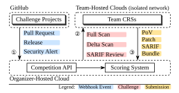
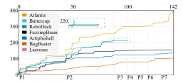
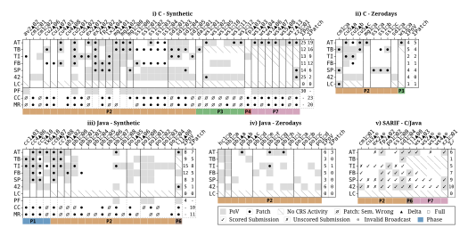

**Source:** *SoK: DARPA's AI Cyber Challenge (AIxCC): Competition Design, Architectures, and Lessons Learned* — [PDF](https://arxiv.org/pdf/2602.07666) · [arXiv](https://arxiv.org/abs/2602.07666)

# SoK: DARPA's AI Cyber Challenge (AIxCC): Competition Design, Architectures, and Lessons Learned

*Cen Zhang*†∗§ *Younggi Park*♮ *Fabian Fleischer*† *Yu-Fu Fu*† *Jiho Kim*† *Dongkwan Kim*∗§ *Youngjoon Kim*† *Qingxiao Xu*‡ *Andrew Chin*† *Ze Sheng*‡ *Hanqing Zhao*† *Michael Pelican*¶ *David J. Musliner*¶ *Jeff Huang*‡ *Jon Silliman*∥ *Mikel Mcdaniel*∥ *Jefferson Casavant*∥ *Isaac Goldthwaite*∥ *Nicholas Vidovich*∥ *Matthew Lehman*∥ *Taesoo Kim*†∗

† Georgia Institute of Technology*,* ‡ Texas A&M University*,* ♮ Independent Researcher*,* ¶ Smart Information Flow Technologies (SIFT)*,* ∥ Kudu Dynamics*,* ∗ Microsoft

### Abstract

DARPA's AI Cyber Challenge (AIxCC, 2023–2025) is the largest competition to date for building fully autonomous Cyber Reasoning Systems (CRSs) that leverage recent advances in AI—particularly large language models (LLMs)—to discover and remediate vulnerabilities in real-world open-source software. This paper presents the first systematic analysis of AIxCC. Drawing on design documents, source code, execution traces, and discussions with organizers and all finalist teams, we examine the competition's structure and key design decisions, characterize the architectural approaches of finalist CRSs, and analyze competition results beyond the final scoreboard. Our analysis reveals the factors that truly drove CRS performance, identifies genuine technical advances achieved by teams, and exposes limitations that remain open for future research. We conclude with lessons for organizing future competitions and broader insights toward deploying autonomous CRSs in practice.

### 1 Introduction

Open-source software (OSS) underpins critical infrastructure, yet scaling vulnerability discovery and remediation remains challenging. DARPA's AI Cyber Challenge (AIxCC, 2023–2025) addresses this by challenging teams to build fully autonomous Cyber Reasoning Systems (CRSs) that leverage large language models (LLMs) to discover and patch vulnerabilities in real-world C and Java projects. The final competition in August 2025 represents the largest-scale evaluation of autonomous vulnerability analysis to date: around 143 hours of fully autonomous operation, CRSs from seven finalist teams analyzed 53 challenge projects derived from critical infrastructure software, each equipped with \$85K in cloud compute and \$50K in LLM API credits.

Despite the competition's completion, no systematic study has examined AIxCC's design rationale, the technical approaches employed by participating teams, or the lessons that

emerged from this large-scale competition. Such an analysis would benefit multiple communities: competition organizers designing future challenges, security researchers developing advanced vulnerability detection and patching techniques, and practitioners seeking AI-driven security solutions.

To fill this gap, we conducted a systematic study of the final competition, drawing on multiple primary sources: all seven finalist CRS codebases and whitepapers, the complete competition database (challenges, results, and execution traces) from organizers, and discussions with organizers and all finalist teams. Our analysis examines AIxCC from three perspectives: the design decisions that shaped the competition, the architectural and technical choices made by finalist teams, and competition results and their implications. Specifically, we address the following research questions:

- RQ1: How is AIxCC designed to guide and evaluate AI-driven vulnerability discovery and patching?
- RQ2: What architectural and technical approaches did finalist teams employ?
- RQ3: What insights emerge from the results?
- RQ4: What are the lessons and future directions?

Our work makes the following contributions:

- A systematic analysis of AIxCC's competition design, covering design and scoring principles, challenge construction, and execution guidelines.
- A taxonomy of CRS architectures and techniques across all seven finalist teams, spanning vulnerability discovery, patching, report triage, and bundling.
- In-depth result analysis that reveals the true factors behind CRS performance, with per-vulnerability analysis for technical insights.
- Lessons on translating competition outcomes to industry deployment and research, plus future directions.

§Work primarily conducted at Georgia Institute of Technology.

All data and artifacts will be released publicly upon acceptance (some subject to DARPA's timeline; see §10).

#### 2 Background: AIxCC as Competition

AIxCC. AIxCC [20] (2023–2025) is a DARPA/ARPA-H competition to advance fully autonomous vulnerability discovery and remediation for open-source software, in collaboration with AI providers (Anthropic, Google, Microsoft, OpenAI), Linux Foundation, OpenSSF, Black Hat USA, and DEF CON. From 42 entrants, seven teams advanced through the semifinal (ASC, DEF CON 2024) [18] to the final (AFC, DEF CON 2025), the focus of this paper. The final ran for around 143 hours across seven phases (P1–P7), during which the finalists deployed CRSs autonomously to analyze 53 challenge projects (CPs) in C and Java under \$85,000 in Azure compute and \$50,000 in LLM API credits per team. All finalist CRSs, challenges, and infrastructure are being open-sourced [21].

Comparison with CGC. AIxCC is a spiritual successor to DARPA's Cyber Grand Challenge (CGC, 2014–2016) [19] after a near-decade gap; each marks a pivotal inflection point for fully autonomous CRSs. The two differ in two ways. ① *Scope*: CGC focused on binary exploitation on DECREE OS [63], while AIxCC targets vulnerability discovery and remediation for real-world OSS in C and Java. ② *AI emphasis*: AIxCC provides LLM infrastructure from AI providers, highlighting LLM-based techniques unavailable during CGC.

**Acronyms.** Appendix B provides the mappings and rules for abbreviations used in this paper.

**Our Methodology.** ① *Competition design* (§3): we extract the design rationale from the organizers' reflection documents and whitepapers, refined through online discussions and confirmed by them. ② CRS technique taxonomy (§5, §6): each team's profile is grounded primarily in the enabled functionalities of its submission-version code; at least two security experts independently reviewed each codebase and crossvalidated the resulting profile. Team whitepapers, blogs, and a structured questionnaire serve as supplementary sources. The questionnaire covers common competition reflections and team-specific technical designs; one team responded by email and the others through dedicated meetings. ③ Outcome analysis (§7): per-team outcomes are derived from the official competition database (logs, traces, scores, etc.), challenge code, and vulnerability data; patch outcome labels (§7.2) are additionally cross-validated by at least two security experts, as with the taxonomy.

#### 3 Competition Design

AIxCC grounds its CRS evaluation in real-world OSS development workflows: the final competition embeds in GitHub,

Figure 1: Final competition workflow: ① triggered by webhook, ② challenge dispatched, ③ result submitted.

with each CRS capability triggered by an actual development event. Figure 1 shows the workflow. The four CRS capabilities each address a real development moment:

- *Full Scan*: when developers tag a new release, detect and patch vulnerabilities across the full codebase.
- Delta Scan: when new code is merged via pull requests, conduct targeted analysis on the incremental changes.
- SARIF Review: when developers receive static-analyzer security alerts in SARIF2 format, classify each as valid (a real vulnerability) or invalid.
- Report Synthesis: after analysis, correlate all above findings into per-vulnerability reports.

Organizers send two kinds of challenges (Full Scan or Delta Scan), some accompanied by SARIF broadcasts for review. A CRS may submit up to four kinds of evidence per challenge:

- *Proof of Vulnerability (PoV)* ([1,2] pts): an input that triggers abnormal execution (e.g., a crash).
- *Patch* ([3,6] pts): a fix that resolves the vulnerability while preserving functionality.
- *SARIF assessment* ([0.5, 1] pt): a judgment on whether a SARIF report is valid.
- Bundle ([-7,7] pts): a grouping that links related findings for the same vulnerability.

Scoring: Defining a "Good CRS". Each submission's weight reflects how much developer time and effort it saves (or wastes, when wrong): ① Patch scores high since it provides a direct solution for the security issue; ② PoV scores lower since it only proves the bug exists; ③ SARIF scores lowest since it judges a statically-identified security issue; ④

&lt;sup>1This artifact represents the authors' own statements and does not constitute an official DARPA statement.

&lt;sup>2SARIF (Static Analysis Results Interchange Format) [44] is a JSON format for static analysis tool output; each report identifies a potential vulnerability with file path, code region, description, and CWE classification.

Bundle scores both extremes, up to +7 for fully correct linkage or a penalty for any incorrect, since correct linkage saves the most triage effort and wrong linkage wastes the most.

Two further mechanisms reward fast and correct submissions. *Time-decay* grants full points for immediate submissions and half for last-minute ones. The *accuracy multiplier* penalizes a CRS's per-challenge total by its accuracy rate on that challenge, with a non-linear shape that balances technique exploration with practicality: high accuracy is barely affected (*e.g.*, 90%  $\rightarrow$  negligible penalty), while low accuracy is steeply penalized (50%  $\rightarrow$  6% reduction; 40%  $\rightarrow$  13% reduction). See [9] for full scoring details.

**Execution: Surfacing Problems Early.** AIxCC stretched across two years and 100+ collaborating organizations, in a field where AI capability evolved rapidly. Perfecting the design in advance was unrealistic, so organizers iterated at two scales to surface and fix issues before the scored competition.

From semifinal to final. The semifinal narrowed 42 teams to 7 finalists while exposing two design flaws that the final corrected: ① the semifinal's self-PoV requirement disadvantaged CRSs strong at patching but weak at discovery; the final scored patches against all PoVs from all teams. ② Per-repository challenge adoption demanded significant engineering; the final adopted OSS-Fuzz instead. With fewer teams to support, the final granted broader team autonomy (per-team budgets and self-managed Azure infrastructure) and dedicated pre-competition support, in place of the semifinal's constrained sandbox.

Within the final. Beyond internal infrastructure testing, the final ran exhibition rounds with the finalist teams. Three unscored rounds used a separate challenge set that mirrored the scored setting, letting both teams and organizers iterate on their systems and processes.

#### 4 Challenge Projects

The final comprised 48 scored challenge projects (CPs) drawn from 24 OSS-Fuzz [5] repositories, together containing 63 challenge project vulnerabilities (CPVs) (Table 1). Five additional CPs lacked fuzzing harnesses and were excluded from scoring. Organizers selected critical-infrastructure and healthcare-critical OSS, onboarding new projects to OSS-Fuzz where needed. To avoid AI training contamination, most CPVs are hand-crafted synthetics inspired by historical N-day issues, with a few genuine 0-days surfaced during challenge development.

**Repositories.** The 24 repositories (14 C and 10 Java) span diverse application categories, from image-processing libraries to healthcare-critical software. The number of harnesses per repository varies considerably, from a single harness (dav1d, libavif, etc.) to 55 (ndpi), and repository sizes range from 16K (libexif) to 4.9M (wireshark) lines of code.

**Challenge Projects.** The 48 CPs comprise 16 full-mode (vulnerabilities anywhere in the repository) and 32 delta-mode

Table 1: Overview of open-source repositories and challenge projects (CPs) in the final. □: full-mode; **\( \Delta\)**: delta-mode. \*5 unharnessed CPs are excluded: freertos-kernel, jt808, lwip, openssl, sms4j. †Averaged across CPs.

| Lang. | Project                           | Abbr. | # C   | Ps   | # CPVs | # Harn. | SLOC  |
|-------|-----------------------------------|-------|-------|------|--------|---------|-------|
|       | curl                              | cu    |       | 5 ▲  | 6      | 17      | 240K  |
|       | dav1d                             | da    | 1 □   |      | 1      | 1       | 261K  |
|       | freerdp                           | fp    |       | 3 ▲  | 2      | 7       | 457K  |
|       | little-cms                        | cm    | 1 🗆   | 1 ▲  | 2      | 15      | 87K   |
|       | libavif                           | av    |       | 2 ▲  | 1      | 8       | 44K   |
|       | libexif                           | ex    |       | 2 ▲  | 2      | 2       | 16K   |
| C     | libxml2                           | lx    |       | 1 ▲  | 1      | 11      | 201K  |
| C     | mongoose                          | mg    | 1 □   | 3 ▲  | 3      | 1       | 364K  |
|       | ndpi                              | nd    | 1 □   |      | 0      | 55      | 136K  |
|       | openssl                           | os    | 1 □   |      | 0      | 30      | 909K  |
|       | shadowsocks-libev                 | SS    | 1 🗆   |      | 5      | 1       | 19K   |
|       | systemd                           | sd    | 1 🗆   |      | 4      | 47      | 740K  |
|       | wireshark                         | WS    | 1 🗆   | 6 ▲  | 12     | 47      | 4901K |
|       | XZ                                | XZ    | 1 🗆   |      | 1      | 4       | 41K   |
|       | commons-compress                  | сс    |       | 5 ▲  | 5      | 16      | 76K   |
|       | dcm4che                           | dc    | 1 🗆   |      | 0      | 1       | 105K  |
|       | dicoogle                          | dg    | 1 □   |      | 0      | 1       | 21K   |
|       | healthcare- data-harmonization | hc    | 1 🗆   |      | 0      | 1       | 53K   |
| -     | hertzbeat                         | hb    | 1 □   |      | 0      | 1       | 78K   |
| Java  | jsoup                             | js    | 1 □   |      | 0      | 2       | 36K   |
|       | logging-log4j2                    | 1j    |       | 1 ▲  | 1      | 1       | 54K   |
|       | pdfbox                            | pb    | 1 🗆   | 1 ▲  | 9      | 6       | 167K  |
|       | poi                               | po    | 1 □   | 1 ▲  | 7      | 17      | 433K  |
|       | tika                              | tk    |       | 1 ▲  | 1      | 9       | 188K  |
| Total | 24*                               |       | 16* □ | 32 ▲ | 63     | 301     |       |

(vulnerabilities within a PR diff) challenges, of which eight contain no injected CPV and serve solely as 0-day discovery targets. For delta challenges, CPV-containing delta commits are relatively compact, ranging from 163 (cc5 $\blacktriangle$ ) to 1,407 changed lines (av2 $\blacktriangle$ ), whereas no-CPV delta commits are substantially larger, from 3.2K (av3 $\blacktriangle$ ) to over one million lines (mg3 $\blacktriangle$ ). Project build times range from 16 s (mg3 $\blacktriangle$ ) to 492 s (ws1 $\blacksquare$ ), and harness sizes from 2.4 KB (av3 $\blacktriangle$ ) to over 20 GB (ws1 $\blacktriangle$ ). See [9] for more details.

Challenge Project Vulnerabilities. The 63 CPVs (33 in full-mode and 30 in delta-mode) split into 40 C and 23 Java vulnerabilities, covering 34 unique CWE types including memory corruption, path traversal, and command injection. Organizers also issued 13 SARIF broadcasts (8 valid and 5 invalid) to test CRS triage capability. See [9] for full details.

#### 5 Cyber Reasoning Systems

Table 2 summarizes the background information behind each team's CRS. While all teams built systems targeting the same CRS core capabilities (§3), their architectural approaches varied widely, shaped by team expertise, resource constraints, and strategic priorities. We briefly introduce each team's design philosophy, providing context for understanding their technical choices in subsequent sections.

Table 2: CRS Teams, ordered top-to-bottom by final score (descending; see Table 7). †: Full name "All You Need IS A Fuzzing Brain". ‡: Orchestration code only. §: Uses LiteLLM [10] for multi-provider routing.

| ID | Team                       | CRS          | Bg       | Lang ‡ | LLM Lib         |
|----|----------------------------|--------------|----------|-------------------|-----------------|
| AT | Team Atlanta               | Atlantis     | Mixed    | Py,Rust           | LangGraph [33]§ |
| TB | Trail of Bits              | BUTTERCUP    | Industry | Py                | LangGraph       |
| TI | Theori                     | RoboDuck     | Industry | Py,Rust           | Self-built§     |
| FB | Fuzzing Brain † | FUZZINGBRAIN | Academic | Py,Go             | × §             |
| SP | Shellphish                 | ARTIPHISHELL | Academic | Py                | Self-built§     |
| 42 | 42-b3yond-6ug              | BUGBUSTER    | Academic | Py,Go             | LangChain [13]§ |
| LC | Lacrosse                   | LACROSSE     | Industry | Py,Lisp           | DSPy            |

Atlantis: Ensemble-First Design. AT is built around the ensemble philosophy [14, 26, 32]: any technique demonstrating unique contribution is worth incorporating, and combining multiple independent approaches enhances overall robustness. This leads to multiple independent bug-finding modules collaborating through seed sharing, and eight patching agents with diverse repair strategies.

**Buttercup:** Expertise-Driven Decomposition. TB leverages domain expertise to design deterministic workflows that decompose challenges into well-defined subtasks, with LLMs integrated only where traditional tools fall short. Notably, TB avoids high-end reasoning models, believing that well-decomposed problems paired with mid-tier models suffice.

**RoboDuck: Agentic Design around Bug Candidates.** TI embodies an agentic-first philosophy, building on a custom agent library that maximizes autonomous LLM operation. The entire system revolves around bug candidates: from identification and filtering, through PoV generation and patching, to SARIF validation and bundling.

FuzzingBrain: Simple Architecture, Diverse LLM Strategies. FB balances engineering effort against performance by simplifying architectural design while maximizing LLM strategy diversity. Notably, over 90% of its codebase is vibecoded [31]. It implements 23 independent strategies, each as a standalone Python script with minimal dependencies, varying in scope, depth, and language-specific handling.

**Artiphishell: Comprehensive Technical Coverage.** SP achieves the most comprehensive technical coverage, implementing diverse techniques across all four core capabilities. To coordinate these techniques (53 components), the team built a custom orchestration platform that launches them ondemand and facilitates inter-component communication.

**BugBuster: Pragmatic Technology Choices.** 42 follows a pragmatic philosophy, preferring simple and stable technology choices. For bug finding, the design is traditional fuzzing and program analysis centric, with LLMs limited to auxiliary roles like seed generation. When adopting academic techniques [50, 69], the team consistently simplifies them to be practical, replacing sophisticated optimizations.

Lacrosse: DSPy-Based Multi-LLM Workflow. LC uses a Lisp-based task distributor to coordinate fuzzing [41,

Table 3: PoV Generation Techniques Beyond OSS-Fuzz Defaults. ○: non-LLM; •: LLM-enhanced; ✓: present; blank: absent. Extended details: Table 11.

|          |                                        | AT       | TB       | TI           | FB       | SP           | 42 | LC |
|----------|----------------------------------------|----------|----------|--------------|----------|--------------|----|----|
|          | Pre-Comp Corpus                        | •        |          | 0            |          | •            | •  | 0  |
|          | Seed Gen Agent                         | •        | •        | •            |          | •            | •  | •  |
|          | — Bootstrap                            | •        | •        |              |          | •            | •  | •  |
|          | <ul> <li>Solve cov blocker</li> </ul>  | •        | •        | •            |          | •            |    |    |
|          | <ul><li>Mutator/generator</li></ul>    | •        |          |              |          |              |    |    |
|          | └ Grammar-aware                        | •        |          | •            |          | •            |    |    |
|          | Engine Refinement                      | •        |          |              |          | •            | 0  | 0  |
| Fuzzing  | <ul> <li>Semantic feedback</li> </ul>  |          |          |              |          | •            |    |    |
| Pipeline | <ul> <li>Improved sanitizer</li> </ul> | 0        |          |              |          | 0            |    |    |
|          | — Dict Gen                             | •        |          |              |          | 0            | 0  | 0  |
|          | Directed fuzzing                       | 0        |          |              |          |              | 0  |    |
|          | Concolic Fuzzing                       | 0        |          |              |          |              |    |    |
|          | Parallel Fuzzing                       | 0        | 0        | 0            | 0        | 0            | 0  | 0  |
|          | Corpus sync                            | 0        | 0        | 0            |          | 0            | 0  | 0  |
|          | Added C fuzzers                        | 0        |          |              |          | 0            | 0  | 0  |
|          | └ Added JVM fuzzers                    | 0        |          |              |          |              |    |    |
| LLM-     | Bug Cand. I.D.                         | •        |          | •            | •        | •            |    | •  |
| Based    | <ul> <li>Candidate filter</li> </ul>   | •        |          | •            | •        | 0            |    | •  |
| PoV      | └ Non-PoV Gen usage                    | ✓        |          | ✓            |          | $\checkmark$ |    | ✓  |
| Gen      | PoV Gen Agent                          | •        | •        | •            | •        | •            |    |    |
| Pipeline | With CWE guidance                      | •        | •        |              | •        | •            |    |    |
| ripeille | Reach-then-exploit                     | •        |          | •            |          | •            |    |    |
| Pipeline | LLM PoV Gen $\rightarrow$ Fuzz         | <b>√</b> | <b>√</b> | <b>√</b>     | <b>√</b> | <b>√</b>     |    |    |
| Со-ор    | $Fuzz \to LLM \; PoV \; Gen$           | ✓        |          | $\checkmark$ |          | ✓            |    |    |
| PoV      | Deduplication                          | 0        | 0        | •            | •        | 0            | 0  | 0  |
| Sub.     | ASAP Submission                        | ✓        | ✓        | ✓            | ✓        | ✓            | ✓  | ✓  |

42], patching, and analysis in a multi-agent system [43]. DSPy [53] manages diverse LLMs in parallel or as fallbacks, with patch failures refining vulnerability analysis.

#### 6 Taxonomy of CRS Techniques

#### **6.1 PoV Generation**

**Two Complementary Pipelines.** In Table 3, two complementary discovery pipelines emerge as the first two row groups: a *Fuzzing Pipeline* that extends traditional fuzzing with LLM-assisted components, and an *LLM-Based PoV Generation Pipeline* that directly leverages LLMs to identify vulnerabilities and generate exploit inputs. The other two row groups capture how teams couple them (*Pipeline Cooperation*) and how PoVs are deduplicated and submitted (*PoV Submission*). Both pipelines reinforce each other: fuzzing supplies coverage and inputs to LLM-based generation, while LLM-generated outputs (even failures) seed fuzzers.

**Fuzzing Pipeline.** Most teams (5/7) explored both pipelines, while 42 and LC focused on fuzzing alone. Of the five, AT and SP explored most comprehensively; TB and TI targeted fuzzing-seed techniques (reuse, generation, sharing); and FB ran only parallel fuzzing.

*Pre-competition corpus.* Five teams reused pre-collected corpora to bootstrap fuzzer coverage, typically with two steps: ① collecting and grouping seeds from public databases (Clus-

terFuzz [29], OSS-Fuzz [5], GitHub, etc.) before the competition; ② pairing seeds with harnesses by coverage-based ranking or by similarity matching against harness names and LLM-inferred input formats.

Seed generation agent. Six teams use LLMs to generate seeds in two scenarios: early-stage bootstrap (analyzing harness code for input formats) and troubleshooting (generating inputs for coverage blockers [59]). The agents typically incorporate conventional program analysis tools for better performance. Interestingly, despite the goal being harness input generation, all teams chose to have LLMs generate Python scripts that produce inputs upon execution. Additionally, AT, TI, and SP explored generating input generators/mutators and explicit grammars (testlang and libFDP [37] for AT, Python decoders for TI, and Nautilus [6] grammars for SP).

Engine refinement. Beyond existing fuzzers, teams (AT, SP, and 42; primarily from university research labs) refined internal components (feedback, oracle, dict, scheduler). SP added semantic feedback by having LLMs generate IJON [7]-style annotations, the only team to do so. AT and SP improved the Java sanitizers to strengthen fuzzer guidance toward valid PoCs. For dictionary generation, four teams produced fuzzing dictionaries to break input-format barriers: AT via on-the-fly LLM prompts, SP via AFL++ [23] dict2file plus CodeQL [28], and 42 and LC via custom extraction. Finally, AT and 42 customized scheduling with directed fuzzing: AT used a custom distance metric, while 42 used LLVM and WALA [62] program slicing to selectively instrument paths to sinks.

Concolic fuzzing. AT explored building hybrid fuzzers: SymCC [47]-based for C and a from-scratch engine for Java.

Parallel fuzzing. All teams run multiple fuzzer instances in parallel and synchronize corpora across them (except FB). Beyond the OSS-Fuzz defaults, AT, SP, 42, and LC added custom C fuzzers (AFL++ [23], libAFL [24], or custom implementations), with AT also covering JVM via libAFL.

**LLM-Based PoV Generation Pipeline.** Six teams explored this LLM-driven alternative to fuzzing. The typical workflow involves two steps: ① identifying and filtering bug candidates; ② generating PoVs targeting these candidates. LC performs only step ① and feeds results to no-PoV patch generation (§6.2) rather than PoV generation. TB skips step ①, letting its agent autonomously judge during PoV generation.

Bug candidate identification. Five teams build agent systems combining LLMs, static analysis tools (CodeQL [28], Semgrep [48], Infer [38]), and predefined sink lists to identify and filter candidates. Two distinctive filtering techniques stand out: TI uses LLM logprobs [45] as a token-efficient confidence signal, exposing them to its classification agent as a tool; SP and LC instead aggregate weighted votes [64] across multiple tools and LLMs to rank candidates.

PoV Generation Agent. Five teams construct PoV-generation agents over static and dynamic analysis tools. Beyond source code, agents receive call paths, coverage, runtime logs, and debugger access (GDB [25]/JDB [46]). Four teams

(AT, TB, FB, SP) inject CWE-specific guidance [40] to steer exploit construction. Three (AT, TI, SP) further decompose generation: a reach agent drives execution to the target sink, and an exploit agent crafts the trigger.

**Pipeline Cooperation.** Teams cooperate between pipelines in both directions, though more invest in one than the other. On one side (LLM PoV Gen  $\rightarrow$  Fuzz, five teams), successful, failed, and intermediate results from LLM PoV generation are shared with fuzzers, expecting fuzzers to extend coverage or mutate these near-solutions into actual PoVs. On the other side (Fuzz  $\rightarrow$  LLM PoV Gen, three teams), fuzzers provide coverage information to guide LLM generation; for teams with separate exploit agents, fuzzer-found reached-but-unexploited inputs are also forwarded for exploitation.

**PoV Submission.** All teams adopt straightforward strategies: submit unique PoVs as soon as possible. This simplicity stems from the scoring rules: correct but duplicate submissions incur only time-decay penalties, not accuracy penalties, making early submission always preferable. To minimize redundant submissions, all teams implement deduplication using crash stack traces, input hashing, sanitizer signatures, etc. TI and FB further use LLMs to group semantically equivalent PoVs.

#### **6.2** Patch Generation

All CRSs follow a de facto patch pipeline as shown below, where RCA denotes Root Cause Analysis and brackets indicate optional steps.

loop([RCA] → Generate → Validate) → Dedup → Submit

Within this pipeline, teams explore different LLM-centric designs to make patching effective. Table 4 organizes their design choices into five row groups. Agent Arch. captures the overall agentic design of the patch system. The other four mirror the pipeline steps: RCA, Generation, Validation, and Dedup. & Sub. The last two steps are grouped together because deduplication primarily prepares for submission.

Agent Architecture. CRSs' designs split into three patterns. *Multi-Arch*. Multi-Arch is an ensemble strategy where the CRS patch system runs multiple distinct patcher architectures to combine their benefits. AT ensembles eight patcher agents [32] spanning diverse designs: workflow-based pipelines with ReAct-style [68] tool use, autonomous agents with iterative context retrieval, multi-agent systems for handling context limitations, and off-the-shelf coding agents (Aider [27], SWE-Agent [67]). SP instead pairs a fully agentic LLM patcher with a program-analysis-assisted, one-shot minimal LLM patcher. When generating, AT stops once any agent produces a valid patch, while SP retains all candidates, then ranks and strategically selects the final patches (see *Deduplication and Submission* below).

*Multi-Agent*. Multi-Agent is a decomposition strategy where a single patcher contains multiple coordinating subagents. TB organizes its four agents into a pipeline of RCA,

Table 4: Patch Generation Techniques. ●: present; blank: no custom implementation; –: not applicable; 1/N/\*: single/multiple/all PoVs; †all teams use sanitizer/crash reports and failed patch feedback. Extended details: Table 12.

|                  |                                                                                                                                                                           | AT          | TB                    | TI | FB            | SP                                      | 42 | LC     |
|------------------|---------------------------------------------------------------------------------------------------------------------------------------------------------------------------|-------------|-----------------------|----|---------------|-----------------------------------------|----|--------|
| Agent Arch.   | Multi-Arch Multi-Agent Single-Agent                                                                                                                                 | •           | •                     | •  | •             | •                                       | •  | •      |
| RCA              | Standalone RCA  - Multi-PoV RCA - Non-LLM RCA                                                                                                                             | •           | •                     | •  |               | •                                       |    |        |
| Gener- ation  | Contextualization†  - Code Indexer  - SAST  - CWE Guidance  - Fine-tuned LLM  - Agentic Code Search  - Dynamic Info  - PoV Bytes  LLM Reflection  No-PoV Patch Generation | •           | •                     | •  | •             | •                                       | •  | •      |
| Vali- dation  | Basic Checks  Build PoV Test (Gen) Proj. Tests  PoV Test (Submit)  LLM as Judge  Post-patch Fuzz  Rebuild Optimization                                                    | • • 1 • * • | • • N • N | *  | • 1 • N • • • | • N • * • • • • • • • • • • • • • • • • | *  | 1 • |
| Dedup. & Sub. | Min. Patch Set Calc. No-PoV Delayed Sub.                                                                                                                               | •           | •                     | •  | •             | •                                       | •  | •      |

fix strategy, patch creation, and reflection, each handing off to the next. TI instead uses a hierarchical design: a ReAct-style outer loop generates patches, invoking SourceQuestionsAgent as an inner tool for code understanding.

Single-Agent. Three CRSs adopt single-agent designs with varying degrees of agentic customization. FB implements 23 strategies spanning delta-scan and full-scan modes, differentiated by context scope and knowledge injection. 42 maximizes configuration diversity, exploring 16 combinations of temperature and prompt context (failed cases, stack traces, etc) within a single agent architecture. LC uses a DSPy-based workflow with model escalation from cheaper to expensive models.

Root Cause Analysis. Four CRSs (AT, TB, TI, SP) implement standalone RCA components, allowing LLMs to separately focus on root cause analysis and patch synthesis as distinct sub-problems. All four build LLM agents for RCA; TB, TI, and SP further leverage information from multiple PoVs for more accurate root cause analysis. SP additionally incorporates a non-LLM RCA component that combines multi-source signals (SAST reports, stack traces, fuzzing invariants, etc.) with weighted voting to rank root cause candidates.

**Generation.** Within the Generate step, CRSs employ various techniques to improve patch quality.

Contextualization. This presents the information sources supplied to the LLM's prompt for patch generation. The crash/sanitizer output and agentic code search over project code are used by all teams. Optional augmentations, by descending popularity: pre-built code indexers for symbol lookups (5 teams); SAST reports static analysis outcomes (4 teams); runtime probes (debugger, coverage instrumentation) for inspecting actual execution (4 teams); the PoV bytes that triggered the bug (3 teams); CWE-specific vulnerability domain knowledges (2 teams); and LLM fine-tuning (Llama [60]) for context retrieval (1 team).

LLM Reflection. LLM reflection [51] enables agents to learn from failed attempts; five CRSs adopted it. One typical example is TB, which implements a dedicated reflection agent that analyzes failures at each generation step and provides corrective guidance.

No-PoV Patch Generation. Three CRSs (TI, FB, LC) attempt patch generation for a vulnerability candidate whose PoV has not been created by the CRS. Without dynamic evidence, this approach carries risk, but can address vulnerabilities that are obvious to identify yet difficult to trigger with a PoV. The generation technique is similar to but more limited than PoV-based techniques, while all teams focus on risk mitigation by limiting no-PoV patch quantities per challenge and imposing stricter submission conditions (e.g., delayed submission, gated by prior success rate, etc).

**Validation.** CRSs employ several checks within each iteration before accepting a candidate patch.

Basic Checks. All CRSs share three basic checks: build verification, PoV reproduction during generation (*PoV Test (Gen)*), and project test suites (42 skips project tests). The number of PoVs used during generation varies (1/N/\* in Table 4); most teams use only a subset to keep the iteration loop fast, then revalidate against more before submission (see *PoV Test (Submit)* below).

PoV Test (Submit). Before submission, most CRSs revalidate patches against a broader PoV set than was used during generation, catching incomplete fixes that a partial generation-time set may miss. AT and FB expand from a single PoV in generation to multiple PoVs before submission, TB uses multiple throughout, and LC uses a single PoV throughout.

*LLM-as-Judge*. Three CRSs incorporate LLM-based evaluation [30], including judging whether patches correctly address the root cause and follow the prescribed fix strategy (AT), and self-reflecting on whether patches genuinely fix vulnerabilities rather than being superficial, easily-bypassed, or having side effects (FB/SP for No-PoV/all patches).

*Post-patch Fuzz.* FB and SP adopt short-term fuzzing on patched projects for incomplete patch detection.

Rebuild Optimization. AT and SP employ build caching to accelerate iterative patch refinement (ccache [12] for C/C++, Maven [4] caching for Java).

**Deduplication and Submission.** Naively submitting a patch for each PoV incurs many duplicate submissions and patch-score penalties, so teams must balance deduplication and submission timing. Since the two strategies are tightly coupled, we discuss them together.

Table 5: SARIF Submission Strategies.  $\sqrt{\times}$ : submit *Correct/Incorrect*. Full details at [9].

| CRS    | Category          | Submission Strategy Overview                                                                                                                                                                                                                         |
|--------|-------------------|------------------------------------------------------------------------------------------------------------------------------------------------------------------------------------------------------------------------------------------------------|
| AT, TB | PoV-centric       | $ \begin{array}{c} N \\ \hline \text{Match Any PoV} & Y \end{array} $                                                                                                                                                                                |
| FB     | PoV-centric       | $ \begin{array}{c c}  & \text{Match Any PoV} & \xrightarrow{Y} & \checkmark \\ N & \downarrow N & & \\ & \text{LLM As Judge} & \xrightarrow{Y} & \checkmark \end{array} $                                                                            |
| TI     | Bug-cand-centric  | $ \begin{array}{c} \text{Match Bug Cand.} & Y/N \\ \hline N & \downarrow N \\ \hline N & \text{Match Bug Cand.} & Y \end{array} $ $ \begin{array}{c} \checkmark/\times \\ \text{(1st)} \end{array} $ $ \begin{array}{c} \checkmark \\ \text{(2nd)} $ |
| SP, LC | LLM-judge-centric | LLM As Judge $\xrightarrow{Y/N} \checkmark/\times$                                                                                                                                                                                                   |
| 42     | LLM-judge-centric | LLM As Judge $\xrightarrow{Y/N} \checkmark/\times$ $N \downarrow UNK$ $\longrightarrow$ Match Any PoV $\xrightarrow{Y} \checkmark$                                                                                                                   |

Minimal Patch Set Calculation. Four CRSs (AT, TB, SP, and 42) leverage the fact that a single patch can fix multiple PoVs sharing the same root cause, and compute a minimal patch set that covers all known PoVs to avoid duplicate submissions. These CRSs differ in three dimensions: ① Calc. timing: on each new PoV (AT, TB, SP) for faster response, or hourly (42) for better global optimization. ② Calc. mode: incremental over uncovered PoVs only (AT, 42) for simplicity, or recompute over all PoVs (TB, SP) for better optimization at the risk of duplicate submissions. ③ Submission timing: immediate (AT, TB, 42), or delayed (SP, ≥60min) for better global minima. For SP, the candidates retained from its Multi-Arch ensemble (§6.2) are submitted ranked by PoV count.

No-PoV Patch Delayed Submission. All three CRSs with No-PoV patch generation capability (TI, FB, LC) delay submission to reduce imperfect patch penalties: TI waits ≥45min and gates on PoV patch success history, FB waits until 50% of challenge time, and LC submits 30min before deadline.

#### **6.3 SARIF Validation**

The SARIF validation task requires CRSs to assess each static analysis report as valid or invalid, submitting a verdict of *Correct* or *Incorrect*. CRSs can resubmit to revise verdicts while incurring penalties in both time and accuracy.

**Key Evidence for Validation.** Table 5 summarizes each team's core submission strategy. Teams primarily relied on three types of evidence: ① Match Any PoV: matching SARIF locations against crash information from exploited vulnerabilities; ② Match Bug Cand.: matching any bug candidate (inferred from LLM, static analysis, PoV, etc.); ③ LLM As Judge: agentic prompting to directly assess its correctness.

Table 6: Bundling Pairing Strategies. ●: used; blank: not used.

| Pairing     | Source                                 | AT | TB | TI | FB | SP | 42 | LC |
|-------------|----------------------------------------|----|----|----|----|----|----|----|
| PoV-Patch   | PoV-based Patch Match No-PoV Patch  | •  | •  | •  | •  | •  | •  | •  |
| PoV-SARIF   | SARIF Validation SARIF-guided PoV   | •  | •  | •  | •  | •  |    |    |
| Patch-SARIF | Bug Candidate DB SARIF-guided Patch |    |    | •  | •  |    |    |    |

Validation Strategies. Teams adopted three strategies.

*PoV-centric.* AT, TB, and FB primarily rely on PoV matching, submitting *Correct* only when a match is found and withholding unmatched reports. FB additionally uses a fallback LLM judgement, but only submits *Correct* from it.

*LLM-judge-centric*. SP, 42, and LC rely on LLM judgement, submitting both *Correct* and *Incorrect* based on the model's assessment. 42 falls back to PoV matching when the model replies with uncertainty.

*Bug-cand-centric*. TI matches SARIF reports against its bug candidate database, initially submitting *Incorrect* for unmatched reports and revising to *Correct* on new evidence.

#### **6.4 Bundling Strategy**

Bundling pairs PoVs, patches, and SARIF assessments into coherent vulnerability reports. Unlike other submissions with time decay, bundling allows free updates until the deadline, with scoring based solely on final results. A bundle can contain any two of three pairings, PoV-Patch, PoV-SARIF, and Patch-SARIF, to form a complete scoring bundle, while any incorrect pairing will penalize the entire bundle.

Table 6 summarizes each team's bundling pairing strategies. Given the risk of score penalties, teams tend to derive pairings from existing workflows rather than inferring relationships independently. ① All teams naturally derive PoV-Patch relationships from PoV-based patch generation. For No-PoV patches (§6.2), TI retroactively links PoVs once discovered, while FB does not. ② For SARIF pairings, teams either reuse their SARIF validation results (§6.3) or use SARIF reports to generate PoVs/patches, pairing them upon success. 42 and LC do not participate in SARIF pairing, while only teams with No-PoV patch capability can submit Patch-SARIF bundles.

#### 7 Competition Result Analysis

#### 7.1 What Scores Reveal (and Conceal)

We analyze the final scores (Figure 2, Table 7) to understand what differentiated the finalists. The competition spanned 142.7 hours across seven phases (P1–P7), with tasks released concurrently within each phase.3

&lt;sup>3Phases are non-overlapping time windows during which CPs are released to teams; the CP-to-phase assignment has no intentional structure.

Figure 2: Score per time (top) and phase (bottom) axes.

System stability. Stability accounts for most of the score gap. As [Figure 2](#page-7-1) shows, three teams experienced severe stability issues at this scale of autonomous evaluation. AT (392.8 points, nearly 80% more than second-place TB at 219.4) sustained activity across all phases, while TB and TI were competitive early but plateaued after P3 and P4 respectively, visibly dropping out of contention. LC, unfortunately, contributed only in early phases and was largely inactive afterward.

Pinpointing the cause of each stability failure is inherently difficult: CRSs are highly parallel distributed systems, and teams selectively uploaded telemetry to the organizers. The most likely hypotheses are as follows. TB and TI's plateaus likely share a common trigger in P3's wireshark CP, which required about 1 TB of disk for compiled artifacts (20.9 GB across 47 harnesses) and can crash CRSs lacking robust disk management. We also found a CP-cleanup issue in TI's telemetry (reporting P1 CP LLM activities during P3), which could have worsened the situation. LC's postmortem identifies an unrecoverable OOM crash on their master scheduler node, after which their system stopped working and the only output was 1,200+ PoVs against a single CPV.

Even teams that reported activity throughout were not free from stability bugs. Per their own analyses, 42's submission bug [\[56\]](#page-16-17) cost most of its patch points (14.2), SP reported multiple system issues in their postmortem [\[58\]](#page-16-18), such as incorrect LLM budget configuration, and AT silently failed on all poi Java challenges (heartbeat telemetry activities only).

Submission accuracy. Accuracy was another major factor in the final ranking [\(Table 10\)](#page-17-5): the competition's accuracy multiplier [\(§3\)](#page-1-1) directly scales each team's total by their perchallenge accuracy rate. While most CRSs reach high submission accuracy (PoV >80%, Patch >75%), TI and FB show significantly lower rates (PoV at 61.8% and 80.0%, Patch at 31.7% and 23.3% respectively), mostly driven by bursts of invalid submissions on a few challenges rather than a uniformly weak pipeline [\(§7.4\)](#page-10-0). These result in the two largest accuracy penalties (−16.3 and −13.5), and for TI the penalty was decisive: its pre-penalty score was higher than TB's, but the penalty dropped TI to third, behind TB by 8.7 points.

Technical capability. A direct comparison of technical capability would be the most interesting result here, but the factors

Table 7: AFC Score Breakdown. Columns are ordered left-toright by final score (descending). Pen. stands for penalties.

|        |       | AT    | TB    | TI    | FB    | SP    | 42    | LC   |
|--------|-------|-------|-------|-------|-------|-------|-------|------|
|        | C     | 52.6  | 31.0  | 22.7  | 22.6  | 31.4  | 49.1  | 1.5  |
| PoV    | Java  | 27.0  | 21.3  | 31.6  | 29.7  | 16.5  | 21.1  | 0.0  |
|        | Sum   | 79.6  | 52.4  | 54.3  | 52.3  | 47.8  | 70.1  | 1.5  |
|        | C     | 113.5 | 74.2  | 51.8  | 45.3  | 40.5  | 9.7   | 4.9  |
| Patch  | Java  | 57.5  | 26.7  | 49.8  | 23.5  | 13.8  | 4.5   | 0.0  |
|        | Sum   | 171.0 | 100.9 | 101.6 | 68.8  | 54.3  | 14.2  | 4.9  |
|        | C     | 5.0   | 1.0   | 3.9   | 4.7   | 7.5   | 8.7   | 0.0  |
| SARIF  | Java  | 1.0   | 0.0   | 1.0   | 1.5   | 1.0   | 1.0   | 0.0  |
|        | Sum   | 6.0   | 1.0   | 4.9   | 6.2   | 8.5   | 9.7   | 0.0  |
|        | C     | 99.6  | 49.4  | 26.0  | 27.6  | 18.3  | 7.8   | 3.2  |
| Bundle | Java  | 36.6  | 15.7  | 23.8  | -1.1  | 7.0   | 3.2   | 0.0  |
|        | Sum   | 136.2 | 65.1  | 49.8  | 26.4  | 25.3  | 11.0  | 3.2  |
|        | C     | 270.6 | 155.6 | 104.4 | 100.2 | 97.6  | 75.4  | 9.6  |
|        | Java  | 122.1 | 63.8  | 106.3 | 53.5  | 38.3  | 29.7  | 0.0  |
| Total  | Pen.  | -0.4  | -0.6  | -16.3 | -13.5 | -0.1  | -0.3  | -1.1 |
|        | Final | 392.8 | 219.4 | 210.7 | 153.7 | 135.9 | 105.0 | 9.6  |

discussed above undermine the score-based conclusion validity. A low score may indicate a real capability gap, or it may simply reflect outages or strategy choices, and we cannot tell them apart. A high score is informative to some extent: the team's design must have had corresponding effectiveness. Reading the leaders on this basis [\(Table 7\)](#page-7-0), AT shows strong performance on C PoV (52.6), Patch (171.0), and Bundle (136.2); TI on Java PoV (31.6); 42 on SARIF (9.7); and SP on per-submission accuracy (smallest penalty, −0.1).

The AIxCC trifecta. AIxCC is fundamentally a test of three intertwined capabilities: *research*, *engineering*, and *strategy*. Winning required balancing all three, and the finalists illustrate contrasting trade-offs. TI built the most agentic architecture with advanced technique designs, but its aggressive strategy led to the largest accuracy penalty. FB, among the smallest teams, combined a focused strategy with vibe coding and LLM-assisted expertise to ship an effective system on minimal resources. SP and AT pursued similar broad-coverage approaches (both large research teams investing heavily in engineering and exploring many research directions), with different execution outcomes. SP encountered reliability issues that limited how much of its broad coverage reached the scoreboard, while AT's ensemble executed reliably, sustaining scoring across all seven phases. In all cases, technique capability alone did not decide the outcome; strategy and engineering shaped it as much.

Key Finding (KF) 1. Winning AIxCC requires balancing research, engineering, and strategy. Stability proved the most fundamental requirement, yet many teams failed.

Figure 3: Team performance per CPV. Matrices i)—iv): detected/patched CPVs and 0-days; v): SARIF assessment. Diagonal: no CRS log messages. PF/CC/MR rows are annotations of 3-run union results. In patch:  $\bullet$  valid;  $\varnothing$ /blank: failed manual/automated validation. SARIF: invalid ( $\odot$ ) expects *Incorrect*;  $\checkmark/x = \text{CRS}$  judgment *Incorrect/Correct*; CPV abbreviations in Appendix B.

### 7.2 Auxiliary CPV Annotation

Unknown CRS Capability Boundaries. Beyond surfacelevel score comparison, we want deeper insight into CRS performance on each CPV. However, per-CPV analysis faces a key question: where do CRSs' true capability boundaries lie? This is hard to answer because a CRS failure on a CPV can stem from either a capability limit or an engineering/strategy issue, and the existing logs/telemetry infrastructure cannot support such accurate root-cause analysis (as detailed in §7.1). We therefore shift the angle: rather than diagnosing CRSs directly, we characterize the CPVs through independent experiments. Specifically, we run representative bug-finding and patching techniques on each CPV under ideal laboratory conditions with competition-level resources, annotating what should be CRS-solvable. Thus, comparing CRS outcomes against this reference exposes advances beyond representative techniques, obstacles on CPVs that should have been solvable, and boundaries that current techniques cannot cross. Annotation Techniques. To annotate which CPVs CRSs should be able to solve, we select techniques every finalist CRS has invested in, per §6. For bug finding, we use parallel fuzzing (PF), the de facto standard non-LLM bug-finding approach. For patching, we use MultiRetrieval (MR) [55], a minimal agentic code-search-and-patch loop. We also evaluate Claude Code (CC) [2], the most capable general-purpose coding agent, as a patching reference.

This annotation setup is an approximation of what CRSs

should solve, not an exhaustive characterization of their technical boundary. Specifically: ① each technique runs in an ideal lab environment, isolated from end-to-end system-level challenges (scheduling, multi-harness coordination, PoV/patch deduplication/pairing); ② resource budgets approximate a reasonable CRS resource allocation (per-harness bug-finding budget; per-crash patching budget); ③ the LLM used in annotation is contamination-free and accessible during competition (claude-3-7-sonnet-20250219, training cutoff October 2024, predating AIxCC's final challenge); CC uses the closest still-available release.

*PF* (atlantis-multilang-given\_fuzzer [52]). PF runs on vulnerable harnesses using 16 cores each, with shared-memory seed sharing and OSS-Fuzz configurations from the final competition. Each run lasts up to 6 hours per harness, stopping early when all organizer-synthesized CPVs in that harness are found. Total: 8,906 CPU-hours across 3 runs.

MR (from AT, in OSS-CRS [52]). It is a minimal patch agent using AST-based code search [61]. It receives ground-truth PoVs, sanitizer reports, and crash stacks, generating up to 3 patches per run across 3 runs per CPV. Patches are validated automatically (build, PoV reproduction, functional tests), then cross-validated by two experts for semantic correctness. Cost: \$221.69 (LLM), one person-week (manual cross-validation).

*CC* (v1.0.88, 2025-08-21). A general-purpose coding agent; otherwise per MR. Cost: \$119.53 (LLM), one person-week. **Annotated Overview.** Figure 3 presents per-CPV outcomes for all CRSs alongside our annotations. Overall, the annota-

tion results reflect that the final's challenges do not primarily reward solving exceptionally difficult problems: around half are solvable by a single annotation technique (PF: 34/63 PoV; MR: 31/63 patches; CC: 33/63 patches).

Combining these annotations with CRS performance, two contrasting patterns emerge. On one hand, most CRSs demonstrate genuine improvements beyond annotation techniques, finding and patching many non-annotated CPVs, particularly in P1-P2 C and Java challenges where LLM-based reasoning proves essential. On the other hand, CRSs also unexpectedly underperform on annotated solvable challenges. The causes are multifaceted: system-wide failures (TB, TI ceased after P3-P4), critical bugs (42's patch submission issue, SP's configuration issue, AT's Java poi failure, etc), and the long tail of real-world edge cases that automated systems cannot generically handle. This leads to an interesting observation: a CRS that reliably applies annotation techniques in real-world conditions would rank among the top three. Besides, AT's dominance concentrated in P3-P7 (Figure 3), where many teams underperformed against annotation expectations.

**KF 2.** AIxCC's challenges favor real-world coverage over difficulty. Annotation techniques plus strong system-level solutions could have secured top-three.

# 7.3 PoV Generation Analysis

**PF-Solvable CPVs.** PF annotates 34 of 63 CPVs (54%) as solvable, but C and Java differ sharply: 30/40 in C (75%) versus only 4/23 in Java (17%). Three factors make Java harder for fuzzing: ① inputs have richer semantic constraints (*e.g.*, XML); ② many timeout/OOM CPVs are fuzzer-unfriendly; ③ default OSS-Fuzz seeds for Java are lower quality. Interestingly, on the C side, wireshark (ws\*), shadowsocks (ss\*), and systemd (sd\*) contain mostly PF-solvable CPVs by design. The organizer's challenge notes in these projects indicate they were intended to evaluate patching and deduplication, not PoV difficulty. Since they appear in P3–P7, scoring on them required sustained stability.

CRS over PF. Six CRSs solved 7–16 CPVs that PF could not (totaling 8/14 in C/Java), indicating substantial improvement over PF alone. This advantage can be largely attributed to LLM components, since LLM-based generation is the most widely developed addition beyond PF, while non-LLM fuzzing enhancements were explored by only a few teams (§6.1). Another direct example: TB, TI, and FB built bug-finding stacks consisting mostly of basic parallel fuzzing plus LLM components, yet all solved multiple CPVs PF missed. Overall, CRSs exhibit three distinct capabilities.

Strong targeted detection. Delta challenges dominate non-PF-solvable CPVs solved by CRSs (15/22). Given diff-based hints about vulnerability locations, CRSs analyze code changes and generate triggering inputs directly. Representative cases include fp2 \( \Delta 02, mg1 \( \Delta 01 \) (C), and cc1 \( \Delta 03, po1 \( \Delta 05 \)

(Java). Specifically, this targeted capability is driven primarily by LLM reasoning: AT and 42, the two CRSs that included classic directed fuzzing, found no uniquely-discovered deltamode bugs over CRSs without it. Notably, several such CPVs involve indirect calls (cu2▲06, cu4▲03), where function pointers obscure the path to vulnerable code yet CRSs reason through them to reach the bug.

Overcoming input grammar obstacles. Some CPVs require inputs conforming to complex grammars that random mutation cannot satisfy. Examples include cur1 protocol exploitation requiring TLV-formatted inputs [16] (cu2▲06), and structured file formats like PDF with embedded XFA (pb1□01) or XLSX for SSRF (po1▲05). CRSs can extract format specifications from the source code and use them to generate syntactically valid inputs.

Solving logical constraints. Some CPVs guard vulnerable paths with constraints that defeat fuzzer feedback mechanisms: regex patterns (cc1▲03, po1▲06), encoding transformations like URL encoding (cc4▲06), Unicode normalization (cc6▲07, po1□02), or zlib compression (pb1▲02), symlink-based path obfuscation (cc7▲08), and mathematical guards (cc5▲10, tk6▲10). LLMs can reason about these transformations and generate constraint-satisfying inputs.

**KF 3.** LLMs complement coverage-based fuzzing in directed (delta-mode) and constraint-heavy contexts.

**PF-Solvable CPVs Missed by CRSs.** In contrast, these misses stem not from detection capability, but from trivial yet critical pipeline gaps in handling real-world complexity.

Broken system dependencies. Some CPs deviate from standard OSS-Fuzz setups and break CRS initialization: av2▲02 uses FuzzTest with its own fuzzer instantiation, while pdfbox CPs ship their own jazzer that overrides the CRS's preinstalled copy.

Heavy build process. Unexpected resource demands can exhaust CRS nodes. Typically, wireshark (4.9M LoC) produces 47 harnesses of ~20.9 GB each (~1 TB total), causing disk exhaustion or OOM.

Reproduction behavior mismatch. CRSs' reproduction criteria can differ subtly from organizer criteria. Some stateful bugs require multiple executions to trigger: sd1□05 crashes on the second execution, and the organizer runs 100 times by default. Thus, CRSs verifying with a single execution discarded valid PoVs.

Incorrect sanitizer: Some vulnerability classes require specific sanitizers: da1□01 (signed integer overflow) needs UB-San [36], not ASan [49]. Several teams included UBSan, yet only TB handled this CPV correctly.

Crash deduplication granularity. ss1□00-ss1□04 are distinct heap-buffer-overflows in json\_parse\_ex, differing only by line number. Coarse-grained deduplication (libfuzzer tokens, function-level grouping, similarity) failed to distinguish them as separate vulnerabilities. Engineering can fix these

gaps, but at the cost of domain expertise and careful per-case verification. This raises an open question that no team has tried: can LLM integration lower the expertise cost and generalize robustness more broadly?

KF 4. Robust pipeline construction (build, sanitizers, dedup, reproduction) is non-trivial, yet agentic solutions remain under-explored.

CPVs Unsolved by Both PF and CRSs. These CPVs indicate two distinct limits. ➀ *Reasoning gaps.* Multi-step cryptographic transformations (cu3▲07: XOR/shift; cu4▲08: AES with Base64 encoding) accumulate LLM errors end-toend, where tool-assisted verification could help. ➁ *Fuzzing pipeline limitations.* The pdfbox ExtractTextFuzzer harness embeds four timeout and two OOM CPVs (pb1□03–pb1□08) that expose two coupled weaknesses. First, timeouts produce near-identical crash signatures, so deduplication collapses distinct bugs into one. Second, a shallow timeout, once hit, keeps re-firing and prevents the fuzzer from reaching deeper bugs: once pb1□07 triggers, repeated timeouts block exploration of pb1□05 and pb1□06. No CRS attempted on-the-fly patching to bypass shallow timeouts or fine-grained timeout deduplication, yielding minimal coverage on this harness.

KF 5. Unresolved bugs reveal either reasoning gaps or fuzzing pipeline limitations.

### 7.4 Patch Generation Analysis

MR/CC Patchable CPVs. MR and CC annotate 31 and 33 of 63 CPVs as patchable, respectively, with 36 unique CPVs covered in total. Although more than half of all CPVs are covered, this does not indicate superior patching capability; rather, it reflects that MR and CC can solve basic fix challenges where the root cause is directly surfaced by the sanitizer report and the local code context suffices to derive a fix without cross-reference reasoning: textbook vulnerabilities with well-known fix patterns. Typical examples include boundary checks for buffer overflows (fp2▲02, ss1□00– ss1□04), secure XML parser configuration for XML External Entity (XXE) (pb1□00, pb1□01), decode-then-normalize reordering for path traversal (cc4▲06, cc6▲07), single-line fixes such as null checks and format-string corrections (cm1□01, cu5▲01), and CTF-style backdoors labelled by a "flag" string that simply need deletion (cu2▲06, sd1□03, cc5▲10).

Semantically Incorrect Patches from MR/CC. A notable fact is that a significant fraction of generated patches pass all automatic validation, yet contain semantic issues caught only by manual review (CC: 20/53, 37.7%, MR: 26/57, 45.6%). *Wrong root cause.* Agents may suppress the crash symptom rather than addressing the underlying defect. One typical pattern is defensive patching in parsing logic, when root cause and crash location are distant (av2▲02, sd1□05, pb1□03, pb1□04). For timeout CPVs (pb1□03, pb1□04, po1▲06, pb1□08), a common error is inserting a hard-coded iteration limit instead of fixing the infinite loop root cause.

*Incomplete fix.* Agents can fix the specific crashing path instead of completely remediating the underlying bug. In mongoose (mg1□00, mg1▲01, mg2▲02), #line directives hide the amalgamated compilation unit from the sanitizer reports, so agents patched the reported files but missed it. Other cases include the XXE-parser hardening of pb1□00 that omits a critical security setting, and the dangling-pointer cases (sd1□05, ex2▲01) where patches go at the call site instead of inside the buggy memory API.

*Functionality deviation.* Some patches eliminate the crash but subtly alter program semantics in ways that functional tests do not cover (*e*.*g*., ws2□04, ws1□02, ws1□05, ws1□11, lx3▲04, sd1□01, tk6▲10, fp3▲03). In av2▲02, a patch produces incorrect edge colors because YUV-to-RGB conversion depends on neighboring pixels that the patch mishandles. In cc7▲08, a patch resolves relative symbolic links to absolute paths during archive extraction, when it should only validate against path traversal without modifying the link target.

*Introducing new bugs.* In ss1□00, an extra break renders part of the encoding logic unreachable; in sd1□05, removing a mfree call introduces a memory leak.

*Missing domain knowledge.* In ws7▲13, correct patching requires understanding how GVCP [\[1\]](#page-14-6) bootstrap registers, which are standardized memory-mapped addresses for device discovery, are managed within the project. In ws1□01, patches confused self-reported packet lengths with verified ones, missing the knowledge to tell them apart.

KF 6. Claude Code slightly outperforms MultiRetrieval, but both suffer 38–46% semantic incorrectness.

CRS over MR/CC. On one hand, CRSs solved 16 cases where MR/CC failed, demonstrating capabilities beyond foundational agents, such as the correct fixes for incomplete remediations (sd1□05, ex2▲01), functionality deviations (ws1□11, lx3▲04, sd1□01, tk6▲10), and misleading sanitizer reports (mg2▲02, mg1□00) listed in the previous paragraph. On the other hand, CRSs also suffer from semantically incorrect patches, though mostly at lower rates than MR/CC [\(Table 10\)](#page-17-5). AT and TB achieve 83.8% and 79.2% patch accuracy, respectively; SP reaches 100%, though this likely reflects strict patch filtering (*e*.*g*., its 5-minute post-patch fuzzing step) and patched challenge distribution rather than full mitigation of semantic correctness. In contrast, TI and FB fall to 31.7% and 23.3% accuracy, concentrated in bursts of invalid submissions on one or two challenges, likely tied to strategy issues such as parallel generation without adequate deduplication. Despite these differences, a common factor among higher-accuracy CRSs is the adoption of multi-PoV validation, post-patch fuzzing, or LLM-based reflection [\(§6.2\)](#page-4-0), yet incorrect patches remain prevalent overall.

**KF 7.** High-accuracy CRSs can achieve 16–21% semantic incorrectness, substantially below MultiRetrieval/ Claude Code's 38–46% but still non-negligible.

MR/CC Patchable CPVs Failed by CRSs. Most CRSs incorporate comparable patch agents, so these 9 failures likely stem not from capability gaps but from other factors: missing PoVs that never triggered patch generation, scheduling pressure from too many concurrent PoVs, and system-wide stability issues discussed earlier. Interestingly, one identifiable cause is *deployment-time configuration trade-offs*. For example, ws5▲08 is locally patchable by MR (one agent in AT), but AT's 30-minute per-CPV timeout, necessary to manage dozens of concurrent challenges, is largely consumed by the wireshark build alone, leaving insufficient time for the patch loop to complete.

**KF 8.** Pipeline construction challenges and patch-strategy tradeoffs can limit CRSs' performance.

CPVs Failed by both CRSs and MR/CC. Seven Java CPVs were never patched: 4 infinite loops (pb1□03, pb1□04, pb1□08, po1□00), 1 integer overflow (pb1□06), 1 ReDoS (po1▲06), and 1 JVM crash via obfuscated backdoor (po1□03). These cases reveal two limitations of current patching. ① Reasoning gaps. For example, ReDoS (po1406) requires regex worstcase reasoning that agents cannot perform reliably end-to-end; integrating non-LLM regex analysis tools such as symbolic regex repair [35] could help. 2 Patch pipeline limitations. Current patch pipelines rely heavily on crash stack traces from the PoV/fuzzing side for root cause analysis, which degrades sharply when such signals are absent. The pdfbox infinite-loop CPVs and po1003 demonstrate this: timeouts and JVM-level crashes give only minimal localization, and most CRSs failed on these cases. Approaches that go beyond this limitation remain to be explored.

**KF 9.** As with bug finding, unresolved patches face either reasoning gaps or patch pipeline limitations.

**Noteworthy No-PoV Patches in shadowsocks.** In shadowsocks (ss1\(\to\$00\)—ss1\(\to\$04\)), three CRSs patched CPVs for which they had no PoV, even though two of them require PoVs to generate patches. This was possible because all five heap-buffer-overflows represent the same bug pattern repeated at different locations within a large JSON parsing function; some CRSs recognized the pattern and generated patches that fixed all instances together.

#### 7.5 Other Analyses

**SARIF Validation.** Figure 3 (v) presents SARIF validation results across 13 broadcasts (8 valid, 5 invalid). PoV-centric teams (§6.3) can only submit *Correct* when a PoV matches; thus, they were unable to assess the 5 invalid reports, leading

Table 8: Bundle strategies and results. Team abbr: Table 2.

|                 | AT    | TB    | TI    | FB   | SP   | 42   | LC  | Total |
|-----------------|-------|-------|-------|------|------|------|-----|-------|
| PoV-Patch       | 27/28 | 18/18 | 16/18 | 6/9  | 7/7  | 4/4  | 1/1 | 79/85 |
| PoV-SARIF       | 1/1   | _     | -     | _    | _    | _    | -   | 1/1   |
| Patch-SARIF     | -     | -     | 1/1   | 0/2  | -    | -    | -   | 1/3   |
| PoV-Patch-SARIF | 7/7   | 1/1   | -     | 2/2  | -    | -    | -   | 10/10 |
| Accuracy        | 35/36 | 19/19 | 17/19 | 8/13 | 7/7  | 4/4  | 1/1 | 91/99 |
| Score           | 136.2 | 65.1  | 49.8  | 26.4 | 25.3 | 11.0 | 3.2 | 316.9 |
|                 |       |       |       |      |      |      |     |       |

to fewer submissions (AT: 8, FB: 7, TB: 1). With PoV evidence, FB and TB achieved 100% accuracy, but AT falsely matched PoVs to 2 invalid reports. In contrast, non-PoV-centric teams can assess all broadcasts but risk wrong answers: 42 scored 10/13 and SP 9/13.

**Bundle Results.** Table 8 shows bundle outcomes. Overall accuracy is high (91/99, 92%): all seven teams adopted PoV-based patch generation (§6.4) that naturally pairs PoVs with their patches, accounting for 86% of bundles with 93% accuracy. Patch-SARIF, the only non-PoV pairing, achieved 1/3 accuracy. Of the 8 incorrect bundles, only one is a true pairing mismatch; the other 7 failed due to unsuccessful patches, confirming patch quality as the practical bottleneck.

**Resource Usage and Efficiency.** No team consumed the full quota of either resource; Table 9 reports per-team breakdowns. ① LLM spending concentrates in two providers:  $\sim$ 94% on Anthropic and OpenAI,  $\sim$ 6% on Gemini and xAI. ② LLM spend rank closely tracks the final score, with only FB and TI flipping the order. ③ From a cost-efficiency view (score per \$K total spend), TI, TB, and AT lead.

**0-Day Discovery.** All seven teams discovered at least one 0-day, yielding 25 distinct vulnerabilities across 10 OSS projects, of which 12 (48%) were patched (Figure 3 (ii, iv)). See [9] for more details. Responsible disclosure was coordinated by Kudu Dynamics with OSTIF and ADALogics.

### 8 Lessons and Future Directions

**From Competition to Industry Deployment.** Reflecting on the competition, we identify several areas where future efforts could further ease the path to practical deployment.

In the final, CRSs operated on self-provisioned Azure clusters with budgets of hundreds of dollars per challenge, ensuring resource availability would not limit technical exploration. This contrasts with individual developers or small teams who need lightweight, single-machine solutions at minimal cost. Although finalist CRSs have been open-sourced, their resource usage models and runtime environments differ substantially from typical deployment settings, posing barriers to post-competition adoption. Future work could develop resource-efficient CRS variants that remain effective under constrained environments; future competitions could also introduce resource-limited tracks that account for the needs of individual developers and small teams.

Beyond resource constraints, OSS communities need time to adapt their pipelines for CRS integration, such as provisioning LLM services, standardizing CRS interfaces for broader OSS applications, defining end-to-end workflows from AIassisted bug finding to patch submission, and ensembling multiple CRSs for combined effectiveness. Considering these needs at the design stage would lower adoption barriers for OSS maintainers and practitioners. On the post-competition side, initiatives like OSS-CRS [\[52\]](#page-16-20) have begun to address these needs; future competitions could learn from this by codesigning deployment pathways with OSS communities for smoother transition to real-world adoption.

From Competition to Research Advancement. The competition design and team-built systems hold significant research value, yet certain design improvements could be made to further enlarge their value as research assets.

AIxCC is intrinsically a substantial experimental investment, yet its telemetry primarily serves real-time monitoring and scoring rather than retrospective analysis of *why* systems behaved as they did. Designing telemetry with post-hoc analysis as a first-class goal—logging intermediate outputs, decision traces, and environmental snapshots—would enable systematic studies of failure modes and technique effectiveness. Organizer-built baseline CRSs participating alongside teams would further enrich such analysis by providing reference points for comparison.

The competition's exploration of open-source LLMs was minimal: although two teams fine-tuned open-source models, only one ultimately deployed them. The competition structure offered little incentive to invest in open-source models, as the uncertainty, cost, and data-acquisition difficulty of finetuning made prompt-based techniques on frontier commercial models a more predictable and cost-effective strategy. While advancing frontier AI for cybersecurity is a natural focus, open-source models offer distinct value to the OSS community through lower cost, customizability, and transparency. A dedicated sub-track comparing CRS performance under opensource models would encourage exploration in this direction. Areas of Expansion. As the first large-scale competition of its kind, AIxCC necessarily scoped its focus. Several directions not covered in this iteration are worth exploring in future editions: *full autonomy* (generating harnesses and handling arbitrary build systems), *multi-CRS settings* (collaborative analysis or adversarial formats where CRSs attack competitors' patches), and *semantic correctness evaluation* (approaches for patch semantic correctness).

AI-Powered Vulnerability Scanning. Early 2026 has seen notable advances in frontier LLMs' cybersecurity capabilities, with works like Claude Mythos Preview [\[3\]](#page-14-7) and coding agent patch evaluation [\[57\]](#page-16-23) showing striking performance in bug finding and repair. The capability jump signals further rapid progress in both offensive and defensive automation, which is exactly the future AIxCC was set up to prepare for. Technically, AIxCC's exploration and this LLM capability surge

are complementary and mutually beneficial. On one hand, pure-LLM pipelines still carry fundamental limitations such as hallucination and nondeterminism, so the LLM–non-LLM cooperation patterns established in AIxCC remain a direct and meaningful reference for CRSs built on top of stronger base models. On the other hand, stronger LLMs also open room for the next generation of CRSs to simplify their architectures and push autonomy further.

### 9 Limitations

Our study has three notable limitations. ➀ *Taxonomy interpretation.* We strictly follow enabled functionalities in submission-version code, treating code as authoritative when it conflicts with questionnaire or meeting records; two security experts cross-validated each profile, and the final taxonomy was shared with all seven teams (three had bandwidth and confirmed). Still, any misreading of the source would propagate as taxonomy misinterpretation. ➁ *Annotation accuracy.* PF/MR/CC annotation is an approximation under estimated resources and selected techniques. On the PoV side, longer fuzzing, a different fuzzer framework, or some teams' private initial corpora could each mark additional CPVs as solvable; the annotation is thus an approximation of what this representative configuration would solve in AIxCC, not a general claim about fuzzing capability. We run each technique three times and take the union as a stable lower bound. ➂ *No ablation study.* The most accurate way to understand the techniques used by these teams would be to migrate them into a single platform and measure their contributions under controlled resources. We believe this is out of scope for a SoK given the resource cost (CRSs use LLMs heavily) and engineering cost (CRSs are large, heterogeneous systems). Post-competition efforts such as OSS-CRS [\[52\]](#page-16-20) are working on this direction.

### 10 Conclusion

AIxCC represents a milestone in autonomous cybersecurity research, demonstrating that AI-powered CRSs can discover and patch vulnerabilities in real-world software at scale. Through systematic analysis of competition design, CRS architectures, and results, we summarized technical insights of those systems, revealed both their genuine performance advances and the persistent gap between technique capability and system reliability. We hope this work serves as a foundation for future competition designs, CRS development, and practical deployment of autonomous cybersecurity systems.

### Acknowledgments

This work is a joint effort of multiple teams and organizations involving dozens of contributors, who collectively aim to provide a systematic and insightful view of the AIxCC

competition. We are grateful to every one of them for making this work possible and highlight their primary contributions.

This work was initiated and directed by Taesoo Kim, who supervised the entire research process. Cen Zhang led the structure design, the CRS code study and team meetings, cross-team collaboration, coordination with contributors to distill the core findings of each part, and the paper drafting. Younggi Park implemented the patch analysis framework, conducted the experiments, manually validated agent-generated patches, and helped analyze and draft the patch analysis findings. Fabian Fleischer verified and integrated competition data, visualized the results (such as [Figure 3\)](#page-8-1), helped validate patches and drafted patch analysis, and prepared the artifact. Yu-Fu Fu compiled team statistics, studied and summarized CRS patch systems of all teams, and helped draft the patch techniques. Jiho Kim conducted PoV generation analysis in [§7.3](#page-9-0) and contributed to the discussions in [§8.](#page-11-1) Dongkwan Kim contributed in team meeting discussions, conducted the parallel fuzzing experiments, authored [§7.5,](#page-11-2) studied teams' bundling strategies, and helped draft [§6.4.](#page-6-6) Youngjoon Kim studied CRS SARIF techniques of all teams and some teams' CRSs during the early code study, authored [§4,](#page-2-2) and helped draft [§6.3.](#page-6-3) Qingxiao Xu analyzed the inaccurate patch submissions across teams, and both Qingxiao Xu and Ze Sheng assisted with the analysis in [§7.5.](#page-11-2) Andrew Chin studied some CRSs' bug finding techniques during the early code study, cross-validated the technique taxonomy in [§6,](#page-3-0) and helped check and refine the paper during the final stages. The above Team Atlanta authors, along with Hanqing Zhao, authors from Team Fuzzing Brain (Jeff Huang, Ze Sheng, and Qingxiao Xu), and Team Lacrosse (Michael Pelican, David J. Musliner), cross-validated the technique taxonomy in [§6](#page-3-0) and conducted proofreading. We also thank external contributors: Joshua Wang for help with taxonomy cross-validation and proofreading, and Brian J. Lee for help preparing the artifact.

We sincerely thank the remaining four AIxCC teams—Trail of Bits (Michael Brown), Theori (Tyler Nighswander), Shellphish (Wil Gibbs and Yan Shoshitaishvili), and 42-b3yond-6ug (Xinyu Xing)—for their support, feedback, discussions, and meetings, as well as the internal materials they shared (*e.g.*, Wil Gibbs shared Shellphish's internal white paper), which helped shape our understanding of each CRS's overall design motivations. Xinyu Xing also shared his insights and reflections on the competition, such as the gap between research and practice, during early discussions of this work.

Kudu Dynamics, as the competition organizer, provided raw materials on competition design from the organizer's perspective, shared competition data and continually updated it as our analysis needs evolved, and held weekly meetings for communication and coordination. Nicholas Vidovich and Matthew Lehman led the organizer collaboration effort and contributed organizer-side content and review. Isaac Goldthwaite contributed content on competition rules, challenges, and scoring. Jefferson Casavant contributed content on competition

infrastructure and implementation. Jon Silliman and Mikel Mcdaniel ensured the paper statistics and data aligned with the competition dataset and results. We also thank DARPA for its generous support and prompt responses to our inquiries, including granting full access to the challenge source code and competition data.

This research was supported by the Advanced Research Projects Agency for Health (ARPA-H) under Other Transaction Agreement No. 140D042590046, and by a gift from Team Atlanta.

# Ethical Considerations

Stakeholder Identification. We identify three primary stakeholder groups. *(1) Researchers and practitioners*: the seven finalist teams, competition organizers (DARPA, ARPA-H, and Kudu Dynamics), and security researchers who may build upon our findings, whose system designs, performance data, and strategic decisions are analyzed in detail. *(2) Open-source community*: developers and maintainers of the 24 open-source projects from which challenge projects were derived, as well as the broader OSS ecosystem that depends on the security of these projects. *(3) LLM vendors*: whose models were used by competing teams and whose API usage patterns are discussed. Ethical Principles. *Beneficence.* This work advances the understanding of autonomous Cyber Reasoning Systems and their application to real-world vulnerability detection. By systematically analyzing competition design, CRS architectures, and performance outcomes, we provide actionable insights for the OSS security community, future competition organizers, and researchers building autonomous security systems.

*Respect for Persons.* We had discussions with organizers and competing teams to gather firsthand accounts of design decisions and operational experiences, and maintained ongoing communication throughout the writing process to ensure accurate representation of their work. The AIxCC competition rules permitted publication of CRS source code, performance data, and architectural details; all finalist teams were aware that their systems and results would be analyzed, and were given draft sections for review (3 confirmed).

*Justice.* All seven finalist teams are analyzed with equal rigor and presented with consistent methodology. No team is singled out or unfairly characterized. We did not re-evaluate any team's CRS independently; all performance data originates from the final competition results. The organizers have no conflict of interest with any of the seven finalist teams and conducted fair evaluation through extensive communication and documentation. Competition data will be publicly released to ensure transparency and reproducibility, subject to DARPA's approval and disclosure guidelines.

*Respect for Law and Public Interest.* The AIxCC competition operated under DARPA and ARPA-H research frameworks, with all teams agreeing to rules governing data handling and disclosure. 0-day vulnerabilities were reported

through responsible disclosure processes in compliance with applicable laws. We document our methodology and data sources to enable reproducibility; competition data will be publicly released to ensure transparency and accountability.

Potential Harms. This work does not involve human subjects or private user data. Discussions with teams focused on technical methodology and system architecture, not personal or sensitive information. We identify three potential tangible harms. First, *misinterpretation of performance data* could cause reputational or financial harm to specific teams if rankings or analyses are taken out of context. Second, *0-day vulnerability exposure* could be exploited by malicious actors before patches are available. Third, *dual-use concerns* arise on multiple paths: adapting CRS architectures for automated exploit generation, leveraging our taxonomy to accelerate offensive tool development, and misusing competition data (particularly team-found 0-day PoCs) for real-world attacks before patches reach end users.

Mitigations. We took the following steps to address these risks. For *misinterpretation of performance data*, each section was cross-validated by at least two authors. We also had discussions with all seven finalist teams and maintained regular communication throughout the writing process to ensure accurate representation. For *0-day vulnerability exposure*, all 0-day vulnerability data originates exclusively from the final competition environment. Disclosure began shortly after the August 2025 final and remains ongoing through standard responsible disclosure protocols: Kudu Dynamics, OSTIF, and ADALogics coordinate with each affected upstream maintainer via private channels (typically email or security mailing lists), share PoVs and remediation guidance, and embargo public details until fixes are released or a standard 90-day window elapses. All discovered 0-day vulnerabilities have been reported through this process; detailed 0-day information is not included in this paper or its artifacts. For *dual-use concerns*, CRS performs not only vulnerability detection but also vulnerability repair. This aligns with the philosophy of OSS-Fuzz: by enabling defenders to find and patch vulnerabilities faster than malicious actors can exploit them, CRS contributes positively to defense.

Team Well-being. AIxCC spanned two years, demanding long-term commitment across both cutting-edge research and production-grade engineering, with inherent burnout risks. Evolving competition rules and rapidly advancing AI capabilities required teams to continuously adapt, adding further pressure. Some teams' final outcomes were undermined by system instability rather than capability gaps, which can be particularly frustrating after such sustained investment. For this study, all participating teams consented to questionnaires in flexible formats depending on their availability, and draft sections were shared with all seven teams for review.

Decision to Conduct and Publish. *Decision to research.* AIxCC represents the largest competition to date for LLMbased autonomous vulnerability detection and repair, yet no

systematic analysis of its design, CRS approaches, or outcomes existed prior to this work. We determined that the research was justified by the need to document lessons learned, identify genuine technical advances, and surface open challenges for security research.

*Decision to publish.* The decision to publish was made after communicating with all participating teams, competition organizers, and sponsoring agencies. We believe our insights on CRS design and implementation will benefit future CRS developers and software security researchers. Since we also provide insights into vulnerability repair techniques, the security benefits outweigh potential dual-use risks.

### Open Science

All data, scripts, finalist team questionnaires, and meeting notes are archived in our artifact [\[8\]](#page-14-8), with a companion website [\[9\]](#page-15-4) indexing the artifact, our extended analysis, public finalist documentation, and official challenge set access links; competition data and the analysis framework await DARPA's official release.

### References

- [1] AIA (Association for Advancing Automation). GigE Vision standard. URL: [https://www.automate.org](https://www.automate.org/vision/vision-standards/vision-standards-gige-vision) [/vision/vision-standards/vision-standards](https://www.automate.org/vision/vision-standards/vision-standards-gige-vision) [-gige-vision](https://www.automate.org/vision/vision-standards/vision-standards-gige-vision).
- [2] Anthropic. Claude Code: An agentic coding tool that lives in your terminal, 2025. [https://github.com/a](https://github.com/anthropics/claude-code) [nthropics/claude-code](https://github.com/anthropics/claude-code).
- [3] Anthropic. Claude Mythos Preview, 2026. [https:](https://red.anthropic.com/2026/mythos-preview/) [//red.anthropic.com/2026/mythos-preview/](https://red.anthropic.com/2026/mythos-preview/).
- [4] Apache Software Foundation. Apache Maven Project. <https://maven.apache.org/>, 2025.
- [5] Abhishek Arya, Oliver Chang, Jonathan Metzman, Kostya Serebryany, and Dongge Liu. OSS-Fuzz. [https:](https://github.com/google/oss-fuzz) [//github.com/google/oss-fuzz](https://github.com/google/oss-fuzz).
- [6] Cornelius Aschermann, Tommaso Frassetto, Thorsten Holz, Patrick Jauernig, Ahmad-Reza Sadeghi, and Daniel Teuchert. Nautilus: Fishing for deep bugs with grammars. In *NDSS*, volume 19, 2019.
- [7] Cornelius Aschermann, Sergej Schumilo, Ali Abbasi, and Thorsten Holz. IJON: Exploring deep state spaces via fuzzing. In *2020 IEEE Symposium on Security and Privacy (SP)*, 2020.
- [8] Authors. AIxCC SoK Artifact. [https://zenodo.org](https://zenodo.org/records/20367274) [/records/20367274](https://zenodo.org/records/20367274), 2026.

- [9] Authors. AIxCC SoK Companion Website. [https:](https://occia.github.io/aixcc-sok-webpage/) [//occia.github.io/aixcc-sok-webpage/](https://occia.github.io/aixcc-sok-webpage/), 2026.
- [10] BerriAI. LiteLLM: Call 100+ LLM APIs in OpenAI format. <https://github.com/BerriAI/litellm>.
- [11] Tim Blazytko, Moritz Schlögel, Cornelius Aschermann, Ali Abbasi, Joel Frank, Simon Wörner, and Thorsten Holz. AURORA: Statistical crash analysis for automated root cause explanation. In *29th USENIX Security Symposium*, 2020.
- [12] ccache developers. ccache: A fast C/C++ compiler cache. <https://ccache.dev/>, 2025.
- [13] Harrison Chase. LangChain, 2022. [https://github](https://github.com/langchain-ai/langchain) [.com/langchain-ai/langchain](https://github.com/langchain-ai/langchain).
- [14] Yuanliang Chen, Yu Jiang, Fuchen Ma, Jie Liang, Mingzhe Wang, Chijin Zhou, Xun Jiao, and Zhuo Su. Enfuzz: Ensemble fuzzing with seed synchronization among diverse fuzzers. In *28th USENIX Security Symposium (Security)*, 2019.
- [15] Universal Ctags. ctags. [https://github.com/uni](https://github.com/universal-ctags/ctags) [versal-ctags/ctags](https://github.com/universal-ctags/ctags), 2025.
- [16] curl project. curl-fuzzer: Quality assurance testing for the curl project. [https://github.com/curl/curl](https://github.com/curl/curl-fuzzer) [-fuzzer](https://github.com/curl/curl-fuzzer), 2025.
- [17] Herrington Darkholme. ast-grep: A cli tool for code structural search, lint, and rewriting. [https://github](https://github.com/ast-grep/ast-grep) [.com/ast-grep/ast-grep](https://github.com/ast-grep/ast-grep), 2026.
- [18] DARPA. AIxCC Semifinal Competition. [https://ai](https://aicyberchallenge.com/semifinal-competition/) [cyberchallenge.com/semifinal-competition/](https://aicyberchallenge.com/semifinal-competition/).
- [19] DARPA. Cyber Grand Challenge, 2016. [https://ww](https://www.darpa.mil/research/programs/cyber-grand-challenge) [w.darpa.mil/research/programs/cyber-grand](https://www.darpa.mil/research/programs/cyber-grand-challenge) [-challenge](https://www.darpa.mil/research/programs/cyber-grand-challenge).
- [20] DARPA. AI Cyber Challenge (AIxCC), 2025. [https:](https://aicyberchallenge.com/) [//aicyberchallenge.com/](https://aicyberchallenge.com/).
- [21] DARPA. AIxCC Archive, 2025. [https://archive.](https://archive.aicyberchallenge.com/) [aicyberchallenge.com/](https://archive.aicyberchallenge.com/).
- [22] EclEmma. JaCoCo: Java code coverage library. [https:](https://www.eclemma.org/jacoco/) [//www.eclemma.org/jacoco/](https://www.eclemma.org/jacoco/), 2026.
- [23] Andrea Fioraldi, Dominik Maier, Heiko Eißfeldt, and Marc Heuse. AFL++: Combining incremental steps of fuzzing research. In *14th USENIX Workshop on Offensive Technologies*, 2020.
- [24] Andrea Fioraldi, Dominik Maier, Dongjia Zhang, and Davide Balzarotti. LibAFL: A Framework to Build Modular and Reusable Fuzzers. In *29th ACM Conference on Computer and Communications Security*, CCS '22, 2022.

- [25] Free Software Foundation. GDB: The GNU project debugger. <https://sourceware.org/gdb/>, 2026.
- [26] Yu-Fu Fu, Jaehyuk Lee, and Taesoo Kim. autofz: Automated Fuzzer Composition at Runtime. In *32nd USENIX Security Symposium (Security)*, 2023.
- [27] Paul Gauthier. Aider: AI pair programming in your terminal, 2025. <https://aider.chat/>.
- [28] GitHub. CodeQL: The libraries and queries that power security researchers around the world, as well as code scanning in GitHub Advanced Security, 2025. [https:](https://codeql.github.com/) [//codeql.github.com/](https://codeql.github.com/).
- [29] Google. Clusterfuzz: Scalable fuzzing infrastructure. [ht](https://github.com/google/clusterfuzz) [tps://github.com/google/clusterfuzz](https://github.com/google/clusterfuzz), 2026.
- [30] Jiawei Gu, Xuhui Jiang, Zhichao Shi, Hexiang Tan, Xuehao Zhai, Chengjin Xu, Wei Li, Yinghan Shen, Shengjie Ma, Honghao Liu, et al. A survey on llm-as-a-judge. *arXiv preprint arXiv:2411.15594*, 2024.
- [31] Andrej Karpathy. Vibe Coding, 2025. [https://x.co](https://x.com/karpathy/status/1886192184808149383) [m/karpathy/status/1886192184808149383](https://x.com/karpathy/status/1886192184808149383).
- [32] Wonyoung Kim, Seunggi Min, Minjae Gwon, Dowoo Baik, Haein Lee, Hyeon Heo, Minjae Lee, Min Woo Baek, Yonghwi Jin, Younggi Park, Yunjae Choi, Taesoo Kim, Sangdon Park, and Insu Yun. Patchisland: Orchestration of llm agents for continuous vulnerability repair, 2026. [arXiv:2601.17471](https://arxiv.org/abs/2601.17471).
- [33] LangChain, Inc. LangGraph: Build resilient language agents as graphs, 2024. [https://github.com/lan](https://github.com/langchain-ai/langgraph) [gchain-ai/langgraph](https://github.com/langchain-ai/langgraph).
- [34] Chris Lattner and Vikram Adve. LLVM: A compilation framework for lifelong program analysis and transformation. In *International Symposium on Code Generation and Optimization*, 2004.
- [35] Yeting Li, Yecheng Sun, Zhiwu Xu, Haiming Chen, Xinyi Wang, Hengyu Yang, Huina Chao, Cen Zhang, Yang Xiao, Yanyan Zou, et al. VULCANBOOST: Boosting ReDoS Fixes through Symbolic Representation and Feature Normalization. In *34th USENIX Security Symposium*, 2025.
- [36] LLVM Project. UndefinedBehaviorSanitizer, 2025. [ht](https://clang.llvm.org/docs/UndefinedBehaviorSanitizer.html) [tps://clang.llvm.org/docs/UndefinedBehav](https://clang.llvm.org/docs/UndefinedBehaviorSanitizer.html) [iorSanitizer.html](https://clang.llvm.org/docs/UndefinedBehaviorSanitizer.html).
- [37] LLVM Project. FuzzedDataProvider: A helper class for fuzz targets. [https://github.com/llvm/llvm-p](https://github.com/llvm/llvm-project/blob/main/compiler-rt/include/fuzzer/FuzzedDataProvider.h) [roject/blob/main/compiler-rt/include/fuzz](https://github.com/llvm/llvm-project/blob/main/compiler-rt/include/fuzzer/FuzzedDataProvider.h) [er/FuzzedDataProvider.h](https://github.com/llvm/llvm-project/blob/main/compiler-rt/include/fuzzer/FuzzedDataProvider.h), 2026.

- [38] Meta. Infer: A static analyzer for Java, C, C++, and Objective-C, 2025. <https://fbinfer.com/>.
- [39] Microsoft. Language Server Protocol specification. [ht](https://microsoft.github.io/language-server-protocol/) [tps://microsoft.github.io/language-serve](https://microsoft.github.io/language-server-protocol/) [r-protocol/](https://microsoft.github.io/language-server-protocol/), 2026.
- [40] MITRE. Common Weakness Enumeration (CWE). [ht](https://cwe.mitre.org/) [tps://cwe.mitre.org/](https://cwe.mitre.org/), 2026.
- [41] David J Musliner, Scott E Friedman, Michael Boldt, J Benton, Max Schuchard, and Peter Keller. Fuzzbomb: Fully-autonomous detection and repair of cyber vulnerabilities. *International Journal on Advances in Security*, 9(3-4), 2016.
- [42] David J. Musliner, Scott E. Friedman, Jeffrey M. Rye, and Tom Marble. Meta-control for adaptive cybersecurity in FUZZBUSTER. In *Proc. IEEE Int'l Conf. on Self-Adaptive and Self-Organizing Systems*, 2013.
- [43] David J. Musliner, Michael J. S. Pelican, Matthew McLure, Steven Johnston, Richard G. Freedman, and Corey Knutson. OpenMIND: Planning and adapting in domains with novelty. In *Advances in Cognitive Systems*, 2021. URL: [https://www.sift.net/sites](https://www.sift.net/sites/default/files/publications/main_5.pdf) [/default/files/publications/main\\_5.pdf](https://www.sift.net/sites/default/files/publications/main_5.pdf).
- [44] OASIS. Static Analysis Results Interchange Format (SARIF) v2.1.0, 2020. [https://docs.oasis-open.](https://docs.oasis-open.org/sarif/sarif/v2.1.0/sarif-v2.1.0.html) [org/sarif/sarif/v2.1.0/sarif-v2.1.0.html](https://docs.oasis-open.org/sarif/sarif/v2.1.0/sarif-v2.1.0.html).
- [45] OpenAI. Using Logprobs. [https://developers.o](https://developers.openai.com/cookbook/examples/using_logprobs) [penai.com/cookbook/examples/using\\_logpro](https://developers.openai.com/cookbook/examples/using_logprobs) [bs](https://developers.openai.com/cookbook/examples/using_logprobs), 2023.
- [46] Oracle. jdb: The Java debugger. [https://docs.ora](https://docs.oracle.com/en/java/javase/21/docs/specs/man/jdb.html) [cle.com/en/java/javase/21/docs/specs/man](https://docs.oracle.com/en/java/javase/21/docs/specs/man/jdb.html) [/jdb.html](https://docs.oracle.com/en/java/javase/21/docs/specs/man/jdb.html), 2026.
- [47] Sebastian Poeplau and Aurélien Francillon. Symbolic execution with SymCC: Don't interpret, compile! In *29th USENIX Security Symposium*, 2020.
- [48] Semgrep, Inc. Semgrep: Lightweight static analysis for many languages, 2025. <https://semgrep.dev/>.
- [49] Konstantin Serebryany, Derek Bruening, Alexander Potapenko, and Dmitriy Vyukov. {AddressSanitizer}: A fast address sanity checker. In *2012 USENIX annual technical conference (USENIX ATC 12)*, 2012.
- [50] Wenxuan Shi, Hongwei Li, Jiahao Yu, Xinqian Sun, Wenbo Guo, and Xinyu Xing. Bandfuzz: An mlpowered collaborative fuzzing framework, 2025. [arXiv:](https://arxiv.org/abs/2507.10845) [2507.10845](https://arxiv.org/abs/2507.10845).

- [51] Noah Shinn, Federico Cassano, Ashwin Gopinath, Karthik R Narasimhan, and Shunyu Yao. Reflexion: language agents with verbal reinforcement learning. In *Thirty-seventh Conference on Neural Information Processing Systems*, 2023.
- [52] SSLab, Georgia Tech. OSS-CRS: Open-Source Software Cyber Reasoning System. [https://github.c](https://github.com/sslab-gatech/oss-crs) [om/sslab-gatech/oss-crs](https://github.com/sslab-gatech/oss-crs), 2025.
- [53] Stanford NLP. DSPy: The framework for programming—not prompting—language models, 2025. [https:](https://github.com/stanfordnlp/dspy) [//github.com/stanfordnlp/dspy](https://github.com/stanfordnlp/dspy).
- [54] Yulei Sui and Jingling Xue. SVF: Interprocedural static value-flow analysis in LLVM. In *25th International Conference on Compiler Construction*, CC '16, 2016.
- [55] Taesoo Kim et al. (Team Atlanta). Atlantis: Ai-driven threat localization, analysis, and triage intelligence system, 2025. Cross-listed in cs.AI. [arXiv:2509.14589](https://arxiv.org/abs/2509.14589).
- [56] Team 42 (b3yond 6ug). 42-b3yond-6ug Open Letter. [https://docs.google.com/document/d/1-1Te](https://docs.google.com/document/d/1-1TexnOwQGj2KJ8rrLtk-Vgl-PqO5MZe7k0qrHQPC_0/) [xnOwQGj2KJ8rrLtk-Vgl-PqO5MZe7k0qrHQPC\\_0/](https://docs.google.com/document/d/1-1TexnOwQGj2KJ8rrLtk-Vgl-PqO5MZe7k0qrHQPC_0/).
- [57] Team Atlanta. Patching Vulnerabilities with Coding Agents in 2026, 2026. [https://team-atlanta.git](https://team-atlanta.github.io/blog/post-patch-2026-ensemble/) [hub.io/blog/post-patch-2026-ensemble/](https://team-atlanta.github.io/blog/post-patch-2026-ensemble/).
- [58] Team Shellphish (Artiphishell). Shellphish x AIxCC Post-Mortem. [https://support.shellphish.net](https://support.shellphish.net/blog/2025/08/22/shellphish-x-aixcc-pm/) [/blog/2025/08/22/shellphish-x-aixcc-pm/](https://support.shellphish.net/blog/2025/08/22/shellphish-x-aixcc-pm/).
- [59] Theori. Branch Flipper: Unlocking fuzz blockers with coverage-grounded LLMs. [https://theori-io.gi](https://theori-io.github.io/aixcc-public/afc/Branch%20Flipper.pdf) [thub.io/aixcc-public/afc/Branch%20Flipper](https://theori-io.github.io/aixcc-public/afc/Branch%20Flipper.pdf) [.pdf](https://theori-io.github.io/aixcc-public/afc/Branch%20Flipper.pdf), 2025. AIxCC Technical Report.
- [60] Hugo Touvron, Thibaut Lavril, Gautier Izacard, Xavier Martinet, Marie-Anne Lachaux, Timothée Lacroix, Baptiste Rozière, Naman Goyal, Eric Hambro, Faisal Azhar, Aurelien Rodriguez, Armand Joulin, Edouard Grave, and Guillaume Lample. LLaMA: Open and efficient foundation language models. *arXiv preprint arXiv:2302.13971*, 2023.
- [61] Tree-sitter. Tree-sitter: An incremental parsing system for programming tools, 2025. [https://github.com](https://github.com/tree-sitter/tree-sitter) [/tree-sitter/tree-sitter](https://github.com/tree-sitter/tree-sitter).
- [62] WALA. WALA: T.J. Watson libraries for analysis. [ht](https://github.com/wala/WALA) [tps://github.com/wala/WALA](https://github.com/wala/WALA), 2026.
- [63] Mike Walker. Machine vs. Machine: Lessons from the First Year of Cyber Grand Challenge. In *24th USENIX Security Symposium*, 2015.

- [64] Xuezhi Wang, Jason Wei, Dale Schuurmans, Quoc Le, Ed Chi, Sharan Narang, Aakanksha Chowdhery, and Denny Zhou. Self-Consistency Improves Chain of Thought Reasoning in Language Models. In *International Conference on Learning Representations (ICLR)*, 2023.
- [65] Fabian Yamaguchi, Nico Golde, Daniel Arp, and Konrad Rieck. Modeling and Discovering Vulnerabilities with Code Property Graphs. In *2014 IEEE Symposium on Security and Privacy*, 2014.
- [66] Shigio Yamaguchi. GNU Global: Source code tagging system. [https://www.gnu.org/software/globa](https://www.gnu.org/software/global/) [l/](https://www.gnu.org/software/global/), 2026.
- [67] John Yang, Carlos E. Jimenez, Alexander Wettig, Kilian Lieret, Shunyu Yao, Karthik Narasimhan, and Ofir Press. Swe-agent: agent-computer interfaces enable automated software engineering. In *38th International Conference on Neural Information Processing Systems*, NIPS '24, 2024.
- [68] Shunyu Yao, Jeffrey Zhao, Dian Yu, Nan Du, Izhak Shafran, Karthik Narasimhan, and Yuan Cao. ReAct: Synergizing reasoning and acting in language models. In *International Conference on Learning Representations (ICLR)*, 2023.
- [69] Zheng Yu, Ziyi Guo, Yuhang Wu, Jiahao Yu, Meng Xu, Dongliang Mu, Yan Chen, and Xinyu Xing. Patchagent: A practical program repair agent mimicking human expertise. In *34rd USENIX Security Symposium*, 2025.

# A Per-Team Details

Resource Usage. [Table 9](#page-17-6) reports per-team consumption of Azure compute and LLM API budgets.

Table 9: Resource Utilization. Team abbr: [Table 2.](#page-3-1)

|                 | AT    | TB   | TI   | FB   | SP   | 42   | LC   |
|-----------------|-------|------|------|------|------|------|------|
| Azure (\$K)     | 73.9  | 18.5 | 20.3 | 63.2 | 54.9 | 38.7 | 7.1  |
| OpenAI (\$K)    | 6.6   | 0.6  | 8.2  | 3.1  | 0.4  | 0.4  | 0.4  |
| Anthropic (\$K) | 20.0  | 20.6 | 3.1  | 7.5  | 2.6  | 0.7  | 0.3  |
| Gemini (\$K)    | 2.8   | –    | 0.2  | 1.6  | –    | –    | <0.1 |
| xAI (\$K)       | <0.1  | –    | –    | –    | –    | –    | –    |
| All LLMs (\$K)  | 29.4  | 21.1 | 11.5 | 12.2 | 2.9  | 1.1  | 0.6  |
| Total (\$K)     | 103.3 | 39.6 | 31.8 | 75.4 | 57.8 | 39.8 | 7.8  |
| Score / \$K     | 3.80  | 5.54 | 6.63 | 2.04 | 2.35 | 2.64 | 1.25 |

Submission Accuracy. [Table 10](#page-17-5) reports per-team counted submissions (correct and incorrect, excluding duplicates) and accuracy rates by scoring category.

PoV Generation Techniques. [Table 11](#page-18-0) extends [Table 3](#page-3-9) with per-team tool and parameter details. Teams generally fall into

Table 10: Submission statistics.

|      |     |       | Counted Submissions |      |      | Accuracy (%) |       |      |         |  |
|------|-----|-------|---------------------|------|------|--------------|-------|------|---------|--|
| Team | PoV | Patch | SARIF               | Bndl | PoV  | Patch        | SARIF | Bndl | Penalty |  |
| AT   | 43  | 37    | 8                   | 36   | 100  | 83.8         | 75.0  | 97.2 | 0.1%    |  |
| TB   | 31  | 24    | 1                   | 19   | 90.3 | 79.2         | 100   | 100  | 0.3%    |  |
| TI   | 55  | 63    | 7                   | 19   | 61.8 | 31.7         | 62.5  | 89.5 | 7.2%    |  |
| FB   | 35  | 60    | 7                   | 13   | 80.0 | 23.3         | 87.5  | 61.5 | 8.1%    |  |
| SP   | 31  | 11    | 12                  | 7    | 90.3 | 100          | 69.2  | 100  | 0.1%    |  |
| 42   | 45  | 4     | 13                  | 4    | 91.1 | 75.0         | 76.9  | 100  | 0.3%    |  |
| LC   | 1   | 3     | 0                   | 1    | 100  | 33.3         | —     | 100  | 10.7%   |  |

the structure of [§6.1,](#page-3-10) but apply language- and challenge-modespecific adaptations. Java's logical vulnerabilities often stem from unsafe sink function usage, prompting teams to adopt sink-targeted PoV generation, directed fuzzing toward sinks, and improved sanitizers. For delta-mode challenges, teams narrow scope from the full codebase to the diff and related code for more targeted bug detection. For SARIF broadcasts received mid-competition, teams treat them as pre-specified bug candidates and use them to guide the PoV generation.

Patch Generation Techniques. [Table 12](#page-19-0) extends [Table 4](#page-5-0) with per-team tool and configuration details. Teams generally fall into the structure of [§6.2,](#page-4-0) adapting to challenge types by adjusting language-specific tooling and prompts, along with CWE- or bug-type-specific guidance. For delta mode, most CRSs focus vulnerability analysis on modified code from diff files. Additionally, TI runs two diff-analysis agents in parallel, one filtering out compiler-unused files and one using the complete diff, to broaden analysis from immediate change sites to all affected code.

### B Abbreviations

CP/CPV naming rule. A CP is identified as <project><cp-idx><mode>, and a CPV as <project><cp-idx><mode><cpv-idx>, where <project> follows the *Abbr.* column of [Table 1;](#page-2-1) <mode> is □ for full-mode or ▲ for delta-mode; <cp-idx> and <cpv-idx> are numeric indices within the project and CP, respectively.

Cheat sheet. The following shows acronyms used in paper.

| 42 AFC ASC AT CC CP CPV CRS | BUGBUSTER AIxCC Final Competition PF AIxCC Semifinal Comp. ATLANTIS Claude Code Challenge Project Challenge Project Vuln. Cyber Reasoning System | MR PoV RCA SAST | MultiRetrieval Parallel Fuzzing Proof of Vulnerability Root Cause Analysis Static Application Security Testing SARIF Static Analysis Results Interchange Format |
|--------------------------------------------------|-----------------------------------------------------------------------------------------------------------------------------------------------------------------------|--------------------------|--------------------------------------------------------------------------------------------------------------------------------------------------------------------------------------|
|                                                  |                                                                                                                                                                       |                          |                                                                                                                                                                                      |
|                                                  | CWE Common Weakness Enum. SP                                                                                                                                          |                          | ARTIPHISHELL                                                                                                                                                                         |
| FB                                               | FUZZINGBRAIN                                                                                                                                                          | TB                       | BUTTERCUP                                                                                                                                                                            |
| LC                                               | LACROSSE                                                                                                                                                              | TI                       | ROBODUCK                                                                                                                                                                             |
|                                                  |                                                                                                                                                                       |                          |                                                                                                                                                                                      |

Table 11: PoV Generation Techniques Across Teams. Blank: no custom implementation; † all non-blank teams have used SARIF and Diff.

|                   |                                                                                                     | AT                                             | ТВ               | TI                           | FB                           | SP                                             | 42                                 | LC                         |
|-------------------|-----------------------------------------------------------------------------------------------------|------------------------------------------------|------------------|------------------------------|------------------------------|------------------------------------------------|------------------------------------|----------------------------|
|                   | Pre-Comp Corpus                                                                                     | ✓                                              |                  | ✓                            |                              | ✓                                              | <b>√</b>                           | <b>√</b>                   |
|                   | - Source                                                                                            | OSS-Fuzz; GitHub                            |                  | ClusterFuzz; GitHub       |                              | ClusterFuzz; GitHub                         | OSS-Fuzz                           | Samples                    |
|                   | Matcher                                                                                             | Input Format                                   |                  | Cov-Based                    |                              | Name; Input Format                          | Name; Input Format              | Always                     |
|                   | LLM-Based Seed Gen                                                                                  | ✓                                              | ✓                | ✓                            |                              | ✓                                              | ✓                                  | ✓                          |
|                   | — Bootstrap                                                                                         | ✓                                              | $\checkmark$     |                              |                              | $\checkmark$                                   | ✓                                  | ✓                          |
|                   | Solve cov blocker                                                                                   | Stuck Seeds                                    | Frontier Func    | Frontier Func                |                              | LLM-Picked                                     |                                    |                            |
|                   | Mutator/generator     Input Grammar                                                                 | √ Testlang; libFDP [37]                        |                  | Python Decoder               |                              | Nautilus [6] Grammar                        |                                    |                            |
|                   | Output format                                                                                       | Blob; Script                                   | Script           | Script                       |                              | Script                                         | Script                             | Blob                       |
|                   | Engine Refinement                                                                                   | ✓ Sico, senipr                                 | Seript           | Seript                       |                              | √                                              | √                                  | √ ·                        |
| Fuzzing           | Semantic feedback                                                                                   |                                                |                  |                              |                              | LLM for IJON [7] Annot.                     |                                    |                            |
| Pipeline          | <ul> <li>Improved sanitizer</li> </ul>                                                              | Patched (Java)                                 |                  |                              |                              | Loosened (Java)                                |                                    |                            |
| •                 | — Dict Gen                                                                                          | On-the-fly LLM                                 |                  |                              |                              | AFL++ [23] Dict2File; CodeQL [28]        | AFL++ [23] Dict2File; Custom | Custom                     |
|                   | Directed fuzzing                                                                                    | Custom distance                             |                  |                              |                              |                                                | LLVM Slicing; WALA [62]         |                            |
|                   | Concolic Fuzzing                                                                                    | SymCC [47]; Custom                          |                  | ,                            |                              | ,                                              |                                    |                            |
|                   | Parallel Fuzzing                                                                                    | <b>√</b>                                       | <b>√</b>         | <b>√</b>                     | ✓                            | <b>√</b>                                       | <b>√</b>                           | <b>√</b>                   |
|                   | — Corpus sync — added C fuzzers                                                                     | √ AFL++; libAFL [24]; Custom                   | ✓                | ✓                            |                              | √ AFL++                                     | √ AFL++                         | √ AFL++                 |
|                   | added JVM fuzzers                                                                                   | libAFL [24]                                    |                  |                              |                              |                                                |                                    |                            |
|                   | Bug Cand. I.D.                                                                                      | ✓                                              |                  | ✓                            | ✓                            | ✓                                              |                                    | ✓                          |
|                   | Candidate source †                                                                                  | LLM; CodeQL [28]; Sinks                  |                  | LLM; Infer [38]              | LLM                          | LLM; Entropy; CodeQL [28]; Semgrep [48]  |                                    | LLM                        |
| LLM-Based         | — Candidate filter                                                                                  | Agentic pick; Reachability                  |                  | LLM confidence ranking | LLM pick                     | Multi-source weighted vote                  |                                    | Multi-LLM weighted vote |
| PoV Gen           | Non-PoV Gen usage                                                                                   | ✓                                              |                  | ✓                            |                              | ✓                                              |                                    | ✓                          |
| Pipeline          | PoV Gen Agent                                                                                       | ✓                                              | ✓                | ✓                            | ✓                            | ✓                                              |                                    |                            |
|                   | Key context/tool †                                                                                  | Code; CWE; Call Path; Cov; Log; Debugger | Code; CWE        | Code; Cov; Log; Debugger  | Code; CWE; Call Path; Log | Code; CWE; Call Path; Cov; Log; Debugger |                                    |                            |
|                   | — Main method                                                                                       | Iterative; Reach→Exploit                    | Iterative        | Iterative; Reach→Exploit  | Iterative                    | Iterative; Reach→Exploit                    |                                    |                            |
|                   | Output format                                                                                       | Blob; Script                                   | Script           | Script                       | Script                       | Script                                         |                                    |                            |
| Pipeline Co-op | $\begin{array}{c} LLM \ PoV \ Gen \rightarrow Fuzz \\ Fuzz \rightarrow LLM \ PoV \ Gen \end{array}$ | √ √                                         | ✓                | <b>√</b>                     | ✓                            | <b>√</b>                                       |                                    |                            |
| PoV               | Deduplication                                                                                       | Stack                                          | ClusterFuzz [29] | Stack→LLM classifier      | Crash sig→LLM             | ClusterFuzz [29]                               | ClusterFuzz [29]                   | PoV hash                   |
| Submission        |                                                                                                     |                                                |                  |                              |                              |                                                |                                    |                            |

Table 12: Patching Techniques Used by each CRS. Blank: no custom implementation; -: not applicable;  $^{\dagger}$ all teams use sanitizer/crash reports and failed patch feedback.

|                      |                                                | AT                                                                                    | TB                                    | TI                                                | FB                                                                                                           | SP                                                                                      | 42                                                        | LC                                    |
|----------------------|------------------------------------------------|---------------------------------------------------------------------------------------|---------------------------------------|---------------------------------------------------|--------------------------------------------------------------------------------------------------------------|-----------------------------------------------------------------------------------------|-----------------------------------------------------------|---------------------------------------|
| Agent Architecture   | Arch Category Design Detail                 | Multi-Arch 6 standalone patching agents + AIDER [27] + SWE- AGENT [67] | Reflection                            | Multi-Agent Analyzer; Patcher; Questions | Single-Agent Same arch with 23 strategies: 12 Full-mode 8 Delta-mode 2 SARIF 1 Unharnessed | Multi-Arch Triage; Programmer; Critic; Traditional + Agentic pipelines   | Single-Agent Test; Context; RCA; Strategy; QE    | Single-Agent Multi-LLM workflow |
|                      | Diversified Hyperparams Diversified LLMs | GPT; Claude; Gemini                                                                | Temp.  GPT; Claude                    | GPT; Claude; Gemini                            | Claude; GPT; Gemini                                                                                       | Temp. Claude; GPT                                                                       | Temp.; No. of failed patches GPT; Claude; Gemini | Temp.  GPT; Claude; Gemini            |
| Root                 | Standalone RCA  — Multi-PoV  RCA               | ✓                                                                                     | √ Up to 15 variants                | Up to 3 ranked PoVs                               |                                                                                                              | ✓ Crash statistics (AURORA [11]) based                                                  |                                                           |                                       |
| Cause Analysis    | Non-LLM RCA                                    |                                                                                       |                                       |                                                   |                                                                                                              | Agent with static & dynamic analysis; ensembled ranking of multi-sources |                                                           |                                       |
|                      | Contextualization †                 | <b>√</b>                                                                              | ✓                                     | ✓                                                 | ✓                                                                                                            | ✓                                                                                       | ✓                                                         | ✓                                     |
|                      | Code Indexer                                   | ctags [15]; ast-grep [17]                                                          | tree-sitter [61]                      | gtags [66]                                        | •                                                                                                            | tree-sitter [61]                                                                        | ctags; LSP [39]                                           | •                                     |
|                      | — SAST Report                                  |                                                                                       |                                       | Infer [38]; Joern [65]                         | SVF [54]; CodeQL [28]                                                                                     | Semgrep [48]; CodeQL [28]                                                            |                                                           |                                       |
|                      | CWE Guidance                                   |                                                                                       |                                       |                                                   | 40+ CWE catalog                                                                                           |                                                                                         | 40+ CWE repair advice                                  |                                       |
| Generation           | Fine-tuned                                     | Llama [60] for contextualization                                                      |                                       |                                                   |                                                                                                              |                                                                                         |                                                           |                                       |
|                      | Agentic Code     Search                        | ✓                                                                                     | ✓                                     | ✓                                                 | ✓                                                                                                            | ✓                                                                                       | ✓                                                         | ✓                                     |
|                      | — Dynamic Info                                 | GDB [25]/JDB [46                                                                      | ]                                     | LLVM-cov [34]; JaCoCo [22]                     | LLVM- cov/JaCoCo                                                                                          | GDB/JDB                                                                                 |                                                           |                                       |
|                      | PoV Bytes                                      | ✓                                                                                     |                                       | ✓                                                 |                                                                                                              |                                                                                         |                                                           | ✓                                     |
|                      | LLM Reflection                                 | ✓                                                                                     | ✓                                     | √                                              | 0.500 0.400                                                                                                  | ✓                                                                                       |                                                           | √ 2 1 1 1 2 0 0                    |
|                      | No-PoV Patch Generation                     |                                                                                       |                                       | @45min; Delta diff; SAST                       | @50%; SAST; LLM vuln ranking                                                                           |                                                                                         |                                                           | Delta diff                            |
|                      | Basic Checks                                   | ✓                                                                                     | ✓                                     | ✓                                                 | ✓                                                                                                            | ✓                                                                                       | ✓                                                         | ✓                                     |
|                      | — Build                                        | $\checkmark$                                                                          | ✓                                     | ✓                                                 | ✓                                                                                                            | ✓                                                                                       | ✓                                                         | ✓                                     |
|                      | - PoV Test (Gen)                               | Single                                                                                | Up to 15/san                          | All                                               | Single                                                                                                       | Up to 20/vuln                                                                           | All                                                       | Single                                |
| Validation           | └─ Proj. Tests PoV Test (Submit)            | √ All & cross-block                                                                | √ Un to 15/san                     | √ All                                          | √ Max 5                                                                                                   | √ Up to 20/vuln                                                                      | All                                                       | √ Single                           |
|                      | LLM as Judge                                   | √ C1055-010CK                                                                         | Cp to 15/saii                         | 7 111                                             | ✓                                                                                                            | ✓                                                                                       | 7.111                                                     | Single                                |
|                      | Post-patch Fuzz                                |                                                                                       |                                       |                                                   | 25s Fuzz (No PoV Patch Only)                                                                              | 5min Fuzz                                                                               |                                                           |                                       |
|                      | Rebuild Optimization                           | ccache [12]; Maven [4] cache                                                       |                                       |                                                   | PoV Patch Only)                                                                                              | ccache; Maven cache                                                                     |                                                           |                                       |
|                      | Min. Patch Set Calc.                           | ✓                                                                                     | ✓                                     |                                                   |                                                                                                              | ✓                                                                                       | ✓                                                         |                                       |
| Dedupli- cation & | — Calc. Timing — Calc. Mode                    | On new PoV Incremental; Uncovered PoVs                                          | On new PoV Recompute; All PoVs  |                                                   |                                                                                                              | On new PoV Recompute; All PoVs                                                    | Every hour Incremental; Uncovered PoVs              |                                       |
| Submis- sion      | Submit                                         | Right after calc.; New patch                                                       | Right after calc.; All unsubmitted |                                                   |                                                                                                              | ≥60min; by PoV count; All                                                               | Right after calc.; New patch                           |                                       |
|                      | No-PoV Patch Sub.                              | -                                                                                     | -                                     | >45min; gated by PoV success                   | @50% time                                                                                                    | unsubmitted –                                                                        | -                                                         | @DDL-30min                            |