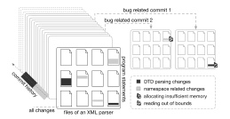
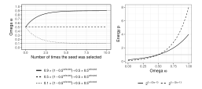
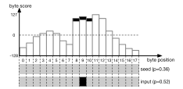
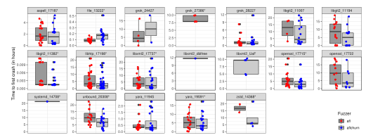
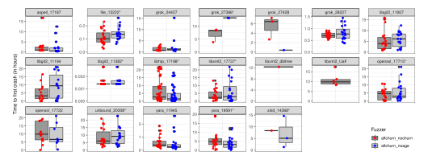
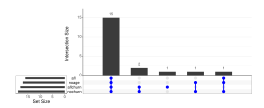
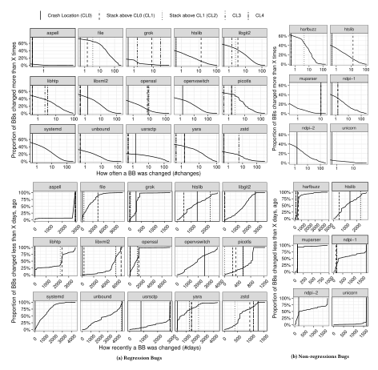
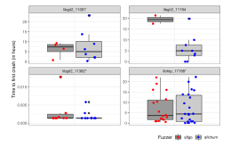

**Source:** *Regression Greybox Fuzzing* — [PDF](https://mboehme.github.io/paper/CCS21.pdf)

## **Regression Greybox Fuzzing**

## Xiaogang Zhu xiaogangzhu@swin.edu.au Swinburne University of Technology & CSIRO's Data61 Australia

### **ABSTRACT**

What you change is what you fuzz! In an empirical study of *all* fuzzer-generated bug reports in OSSFuzz, we found that four in every five bugs have been introduced by recent code changes. That is, 77% of 23k bugs are *regressions*. For a newly added project, there is usually an initial burst of new reports at 2-3 bugs per day. However, after that initial burst, and after weeding out most of the existing bugs, we still get a *constant rate* of 3-4 bug reports per week. The constant rate can only be explained by an increasing regression rate. Indeed, the probability that a reported bug is a regression (i.e., we could identify the bug-introducing commit) increases from 20% for the first bug to 92% after a few hundred bug reports.

In this paper, we introduce regression greybox fuzzing (RGF) a fuzzing approach that focuses on code that has changed more recently or more often. However, for any active software project, it is impractical to fuzz sufficiently each code commit individually. Instead, we propose to fuzz all commits simultaneously, but code present in more (recent) commits with higher priority. We observe that most code is never changed and relatively old. So, we identify means to strengthen the signal from executed code-of-interest. We also extend the concept of power schedules to the bytes of a seed and introduce Ant Colony Optimization to assign more energy to those bytes which promise to generate more interesting inputs.

Our large-scale fuzzing experiment demonstrates the validity of our main hypothesis and the efficiency of regression greybox fuzzing. We conducted our experiments in a reproducible manner within Fuzzbench, an extensible fuzzer evaluation platform. Our experiments involved 3+ CPU-years worth of fuzzing campaigns and 20 bugs in 15 open-source C programs available on OSSFuzz.

### 1 INTRODUCTION

Greybox fuzzing has become one of the most successful methods to discover security flaws in programs [3]. Well-known software companies, such as Google [7] and Microsoft [2], are utilizing the abundance of computational resources to amplify, by orders of magnitude, the human resources that are available for vulnerability discovery. For instance, within the OSSFuzz project, a small team of Google employees is utilizing 100k machines and three greybox fuzzers (incl. AFL) to find bugs in more than 300 open-source projects.

Permission to make digital or hard copies of all or part of this work for personal or classroom use is granted without fee provided that copies are not made or distributed for profit or commercial advantage and that copies bear this notice and the full citation on the first page. Copyrights for components of this work owned by others than ACM must be honored. Abstracting with credit is permitted. To copy otherwise, or republish, to post on servers or to redistribute to lists, requires prior specific permission and/or a fee. Request permissions from permissions@acm.org.

CCS'21, November 14–19, 2021, Seoul, South Korea © 2021 Association for Computing Machinery. ACM ISBN 978-1-4503-XXXX-X/18/06...\$15.00 https://doi.org/10.1145/1122445.1122456

## Marcel Böhme marcel.boehme@acm.org Monash University Australia

<span id="page-0-0"></span>

(a) Probability that the x-th reported bug is a regression.


**(b)** Number of days between the first and x-th bug report.

Figure 1: Empirical investigation of bug reports in OSSFuzz.

We analyzed the 23k fuzzer-generated bug reports from OSSFuzz to understand how we can automatic vulnerability discovery even more efficient. We found that most of the reported bugs are actually introduced by changes to code that was working perfectly fine. For the average project, almost four in five bug reports (77%) were marked as regressions, i.e., a bug-introducing commit could be identified. The majority of regressions were introduced five days or more prior to being reported (2 months on average). This motivates the need for faster regression fuzzing approaches.

In OSSFuzz, the probability for a new bug report to be a regression increases from 20% for the first bug to 92% after a few hundred bug reports. Why? Once onboarded, a project in OSSFuzz is continuously fuzzed. A few weeks after the onboarding, most of the source code of the project remains unchanged. After many fuzzing campaigns, most (non-regression) bugs in this code have now been discovered. Only changes to the project's source code can introduce new bugs. In comparison, the code that has been changed since the onboarding has also been fuzzed much less often.

So then, why should we continue to fuzz every piece of code with equal priority? Can we somehow prioritize the fuzzing of code that has changed more recently or more frequently to counterbalance how often each piece of code has been fuzzed throughout the project's lifetime within OSSFuzz?

<span id="page-1-0"></span>

Figure 2: Development of LibXML2. It is insufficient to focus on each commit individually.

We could focus the fuzzer on a *specific commit* [5, 6, 17, 19, 34]. Figure 2 illustrates the challenges of this approach. Suppose, we deploy the AFLGo directed fuzzer [6] to fuzz *every* commit during the development of an XML parser library. In the past week, the developer has been working on the proper handling of *name spaces* and submitted several commits. In the week before, the developer was working on the *parser of Document Type Definitions* (DTD).

With a strict focus on the given commit, bugs that are introduced in untested commits or across several commits cannot be found. Suppose, in an earlier commit, a new array was added but, due to an integer overflow, insufficient memory was allocated. Because the array is never accessed in this particular commit, AFLGo could never find this bug. In one of the later commits, a memory access is added. A fuzzer that also triggers the integer overflow and the insufficient memory allocation in the earlier commit would also discover a read-out-of-bounds. However, AFLGo—being directed only to the changes in *this* commit—would exercise the memory-access but may not discover the out-of-bounds read. In fact, it would be impractical if the developer ran AFLGo on every commit, thus missing the bug entirely. It is also common to terminate a CI action that takes more than one hour, while the current recommendation for a reasonable fuzzing campaign length is 24 hours [16].

In this paper, we develop regression greybox fuzzing (RGF) and propose to fuzz all commits simultaneously, but code present in more (recent) commits with higher priority. An RGF focuses on code that is under development (i.e., the recent name space changes get more priority than on the older DTD parser changes). Specifically, a RGF's power schedule assigns more energy to seeds that execute code that has changed more recently or more frequently. In vanilla greybox fuzzing, the search process can be controlled using a power schedule, which distributes energy across the seeds in the corpus. A seeds with higher energy is also fuzzed more often.

Efficient fitness function. Like in directed greybox fuzzing, we propose to conduct the heavy program analysis at compile time to enable an efficient search at runtime. Unlike in directed greybox fuzzing, every basic block (BB) becomes a target; only the weight varies. Every BB is assigned a numerical weight that measures how recently or how often it has been changed. This information can be derived from a project's versioning system. The instrumentation also adds code to amplify and aggregate these

weights during execution. In our experiments, the instrumentation overhead is negligible. *At run time*, the RGF collects the aggregated fitness value for each executed input and normalizes it between the minimum and maximum values. Using a simulated annealing-based power schedule, the RGF maximizes the probability to generate inputs with a higher normalized fitness value.

Amplifying weak signals. During our investigation, we noticed that most BBs have never been changed (foundational code [27]), and only a tiny proportion of BBs have been changed recently (in the last commit) or frequently (one hundred times or more). If we computed the average across BBs in an input's execution trace, the signal from the interesting (low-age, high-churn) BBs would be very weak. Hence, we develop a methodology to amplify the signal which involves the logarithm and the inverse.

**Byte-level power schedule**. During our experiments, we also noticed that most bytes in any given seed have no or negligible impact on the BBs of interest. We develop a lightweight technique that learns a distribution over the bytes of a seed that describes the degree of impact. We extend the concept of power schedules to the assign energy to bytes of a seed. We develop a *byte-level power schedule* based on Ant Colony Optimization [12] that assigns more energy to bytes that generate more "interesting" inputs, and that uses the alias method [38] for efficient weighted sampling.

**Experiments**. To investigate our hypothesis, we implemented our technique into AFL [1] and conducted large-scale experiments on the Fuzzbench fuzzer evaluation platform [21]. We call our tool AFLChurn. For our experiments, we identified 20 regression bugs in 15 open-source C programs using the OSSFuzz bug tracker. With the kind and generous assistance of the Fuzzbench team, we conducted 3+ CPU-years worth of fuzzing campaigns in an entirely reproducible fashion.

**Results**. Our experiments demonstrate the validity of our main hypothesis and the efficiency of RGF. AFLChurn discovers a regression about 1.5x faster and in more campaigns than AFL. In one case, AFLChurn reduces the time to produce the first crash from 17 to 9 hours. Investigating each heuristic individually, we found that neither heuristic has a general edge over the other heuristic. However, in particular cases one heuristic clearly outperforms the other which motivates the combination of both heuristics. We also found that the code that is part of a crash's stack trace often lives in code that has been change more recently or more often.

**Contributions**. The main contributions of this work are:

- Empirical Motivation. We analyse 23k fuzzer-generated bug reports in OSSFuzz [7] and identify regressions as a major class of bugs. Once a project is well-fuzzed, most bugs are found in the code that is currently under development. We find no evidence that OSS Security improves over time.
- Technique. We propose regression greybox fuzzing which fuzzes with higher priority code that has changed more recently/often. We extend the concept of power schedule to individual bytes in a seed and propose ACO [12] as suitable search heuristic and the alias method for weighted sampling.
- *Implementation and experiments*. We conduct an evaluation involving 20 bugs in 15 open-source C programs that were available at OSSFuzz. We make our experiment infrastructure, implementation, data, and scripts publicly available.

<span id="page-1-1"></span> $<sup>^{1}</sup> https://docs.gitlab.com/ee/ci/pipelines/settings.html\#timeout$ 

#### <span id="page-2-4"></span>2 EMPIRICAL STUDY: OSSFUZZ BUG REPORTS

We are interested in the prevalence and reporting rate of regression bugs among the fuzzer-generated bug reports in the OSSFuzz continuous fuzzing platform [7]. In the past five years, OSSFuzz has automatically discovered and reported 22,582 bugs in 376 open source software (OSS) projects. OSS maintainers are welcome to onboard their project at any time. Once onboarded, fully automatically, bugs are reported, deduplicated, and the corresponding bug-introducing commit (BIC) identified. To identify BIC, OSSFuzz employs an efficient delta debugging approach [42]. We note that we can only analyze bugs that are automatically discovered by the available greybox fuzzers in the master branch of a OSS project. We do not analyze project-specific bug reports for bugs that are discovered by other means (e.g., by a manual security audit).

**Methodology**. We used the bug tracker's publicly accessible interface to collect the data from all bug reports available on 30.12.2020.<sup>2</sup> Each bug report also lists the OSS project, the report date, and the date of the bug-introducing commit (if any). If a regression date was available, we marked the corresponding bug as *regression*.

**Format of Figure 1** (two scatter plots). We grouped the bug reports by project and ordered them by report date. The x-axis shows the rank of the bug report across all projects. The size of each point illustrates the number of projects that have bug reports with this rank. For instance, only 50 of the 376 projects have 100 bug reports (i.e., x=100). Note that the x-axis on top is on a log-scale while that on the bottom is on a linear scale. The y-axis shows mean values across all projects with a given report rank. For instance, in Fig. 1.a for those 50 projects that have 100 bug reports, 77% of bug reports are regressions.

## 2.1 Prevalence of Regression Bugs

Our analysis shows that 77.2% of the 23k bug reports in OSSFuzz are regressions. That is, a bug-introducing commit (BIC) was identified and the bug cannot be observed before the BIC. This means that most bugs found by OSSFuzz are, in fact, introduced by recent code changes. We also find, on average, it takes 68 days from the BIC to discovery and *automatic* reporting (5 days on the median). This means that regressions are difficult to find.

Figure 1.a shows the probability that a reported bug is a regression as the number of project-specific bug reports increases. We can see that the *first reported bug* is a regression only for one in five projects (20.2%). However, as more bugs are reported (and old bugs are fixed), the regression probability increases. The empirical probability that the 1000*th* bug is a regression, is greater than 99%.

Four in five reported bugs are introduced by recent code changes. The probability for a bug report to be a regression increases from 20% for the first bug report to over 99% for the 1000*th* reported bug. This demonstrates the need for focusing later fuzzing efforts on recently changed code. On average, it takes 2 months to discover a regression (5 days on the median).

## 2.2 Bug Reporting Rate Across Projects

Figure 1.b shows the rate at which new bugs are reported across all projects in OSSFuzz. The *dashed lines* show linear regressions, for ranks in [1,100] and  $[300,\infty]$ , resp.. The color represents the probability that the report with a given rank is marked as a regression. We show the number of days that have passed since the first bug report as the number of project-specific bug reports increases.

Once a project is onboarded at OSSFuzz, new bugs are reported at a constant rate of 2.5 bugs per day. For many of the early reported bugs of a project no bug-introducing commit can be identified. After a while new bugs are reported at a much lower pace. This is consistent with our own experience. Fuzzing is very successful in finding bugs particularly in new targets that have not been fuzzed before. Once the bugs are fixed, less new bugs are found. The code has already been fuzzed and most bugs have been found.

However, after this initial burst of new bugs reported, we were surprised to find that subsequent bugs continue to be reported at a constant rate of about 3.5 bugs per week. Our only explanation was that these bugs must have been introduced by recent changes. Indeed, mapping the probability of a reported bug to be a regression onto the curve, we can see that almost all of the newly reported bugs in this second phase are regressions (green color).

Once a new project is onboarded at OSSFuzz, there is an initial burst of new bug reports at a rate of 2.5 per day. After this burst, the rate drops but remains constant at 3.5 reports per week. This demonstrates how fuzzing unchanged code over and over while another part of the project changes is a waste of compute.

## <span id="page-2-3"></span>2.3 OSS Security

Fifteen years ago, Ozment and Schechter examined the code base of the OpenBSD operating system to determine how many of the vulnerabilities existed since the initial version and whether its security had increased over time [27]. They found that 62% of reported vulnerabilities existed since the initial version 7.5 years prior (i.e., 38% were regressions). They call these vulnerabilities as foundational. The authors identified a downward trend in the rate of vulnerability discovery, so that they described the security of OpenBSD releases like wine (unlike milk), as improving over time.

In contrast, for the 350+ open source software (OSS) projects we studied, <sup>3</sup> new bugs are being discovered in the master branch at a *constant rate*. In fact, we only measure the bugs found by the three fuzzers that are continuously run within the OSSFuzz project. There are also non-fuzzing bugs that are discovered downstream, or during manual security auditing which we do not measure. We find that only 23% of the fuzzer-reported bugs are foundational <sup>4</sup> and the probability that a fuzzer-reported bug is due to recent changes increases over time.

### 2.4 Threats to Validity

As threat to external validity, we note that we only consider bugs that were discovered by the greybox fuzzers and code sanitizers available in OSSFuzz. As a threat to internal validity, we note that

<span id="page-2-0"></span><sup>&</sup>lt;sup>2</sup>OSSFuzz bug tracker @ https://bugs.chromium.org/p/oss-fuzz/issues.

<span id="page-2-1"></span><sup>&</sup>lt;sup>3</sup>https://github.com/google/oss-fuzz/tree/master/projects

<span id="page-2-2"></span><sup>&</sup>lt;sup>4</sup>To be precise, for 23% of bugs no bug-introducing commit could be found.

the OSSFuzz fuzzing campaigns may be started up to 24 hours after the bug-introducing commit was submitted. OSSFuzz builds some OSS projects at most once a day. Moreover, we cannot guarantee there are no bugs in the algorithm used to determine the bugintroducing commit.

## 3 REGRESSION GREYBOX FUZZING

## <span id="page-3-2"></span>3.1 Code History-based Instrumentation

Conceptually, we need to associate an input with a quantity that measures how old the executed code is or how often it has been changed. To compute this quantity during the execution of the input, we instrument the program. The regression greybox fuzzer (RGF) uses this quantity to steer the fuzzer towards more recently and more frequently changed code.

#### <span id="page-3-0"></span>Algorithm 1 Code History-based Instrumentation

```
Input: Program P
```

- 1: Inject  $\alpha$ , count as global, shared variables into P and set to 0
- 2: **for each** Basic Block  $BB \in P$  **do**
- 3: age = LASTCHANGED(BB) // in #days or #commits
- 4: churn = NUMBEROFCHANGES(BB)
- 5: (age', churn') = AMPLIFY(age, churn)
- 6: Inject " $\alpha = \alpha + (age' \cdot churn')$ " into BB
- 7: Inject "count = count + 1" into BB
- 8: end for

**Output:** Instrumented program P'

Algorithm 1 sketches our instrumentation procedure. First, our instrumentation pass introduces two new global variables,  $\alpha$  and count (Line 1). After the execution of the input on the instrumented program, the RGF can read the values of these variables. For instance, our RGF tool AFLChurn, implements an LLVM instrumentation pass that is loaded by the clang compiler. AFLChurn reserves two times 32bit (or 64bit) at the end of a shared memory to store the values of  $\alpha$  and count. The 64 kilobyte shared memory is already shared between the program and vanilla AFL to capture coverage information.

LASTCHANGED (Line 3). For every basic block  $BB \in P$ , RGF computes the age value. Conceptually, the age of a basic block indicates how recently it has been changed. AFLCHURN uses git blame to identify the commit C for a given  $line\ L$  and subtracts the date of C from date of the (current) head commit to compute  $the\ number$  of days since line  $L \in BB$  was last changed. AFLCHURN uses git rev-list to count the number of commits since commit C. The average age of each line  $L \in BB$  gives the age of the basic block BB. The number of days and number of commits since C are both used as independent measures of the age of a basic block.

NumberOfChanges (Line 4). For all basic blocks  $BB \in P$ , RGF computes the *churn* value. Conceptually, the churn of a basic block indicates how frequently it has been changed. AFLChurn finds all commits to the file containing BB. A *commit* C' is the syntactic difference between two successive revisions  $C' = dif f(\underline{R}, \overline{R})$ . For each commit C' prior to the most recent revision H (head), RGF determines whether C' changed BB in H as follows. Suppose, there are three revisions, the most recent revision H and the commitrelated revisions  $\underline{R}$  and  $\overline{R}$  such that  $C' = dif f(\underline{R}, \overline{R})$ . By computing

the difference  $diff(\underline{R}, H)$  between  $\underline{R}$  and the current revision, we get two pieces of information: (a) whether BB has changed since  $\underline{R}$  and which lines in  $\underline{R}$  the given basic block BB corresponds to. Using the commit  $C' = diff(\underline{R}, \overline{R})$ , we find whether those lines in  $\underline{R}$ —that BB corresponds to—have been changed in C'. By counting all such commits C', we can compute how often BB has been changed.

AMPLIFY (Line 5). After computing age and churn values for a basic block *BB*, we amplify these values. Our observation is that there are a large number of "foundational" basic blocks that have never been changed. If we just computed the average across basic blocks in the execution trace of an input, the signal from the interesting basic blocks would be very weak. Very recently or more frequently changed basic blocks are relatively rare. So, how can we *amplify the signal* from those interesting basic blocks?

We conducted preliminary experiments with several amplifier functions (see Appendix B). We found that the *inverse* of the number of days  $age' = \frac{1}{age}$  and the *logarithm* of the number of changes  $churn' = \log(churn)$  provides the most effective amplification. The regression greybox fuzzer will multiply the aggregated, amplified age and churn values and maximize the resulting quantity.

INJECT (Line 6–8). Finally, for all basic blocks  $BB \in P$ , our instrumentation pass injects new instructions at the end of BB. The added trampoline makes P' aggregate that amplified values  $(\alpha, \beta)$  and count the number of executed basic blocks (count).

## 3.2 Simulated Annealing-based Power Schedule

Regression greybox fuzzing (RGF) steers the input generation toward code regions that have been changed more recently and more frequently. To this end, RGF uses the instrumented program to compute the age and churn values during the execution of an input. RGF is an *optimization problem* which requires to carefully balance exploration and exploitation. If RGF only explores and never uses the age and churn value, then it cannot be any better than normal greybox fuzzing. If RGF only exploits and only fuzzes the seed with optimal age or churn values, then it will miss opportunities to discover bugs in other (slightly older) code. Global search techniques allow us to manage this trade-off.

We propose to solve RGF's optimization problem using *simulated annealing*. It begins with an exploration phase and quickly moves to an exploitation phase. In greybox fuzzing, we can adjust such search parameters using the power schedule. A *power schedule* assigns energy to all seeds in the seed corpus. A seed's *energy* determines the time spent fuzzing the seed.

## <span id="page-3-1"></span>Algorithm 2 Simulated Annealing-based Power Schedule

```
Input: Instrumented Program P', Seed Corpus C, Input t

1: (\alpha, count) = \text{EXECUTE}(P', t)

2: \bar{\alpha} = \alpha/count // compute BB \ average

3: \hat{\alpha} = \text{NORMALIZE}(\bar{\alpha}, C)

4: \omega = (1 - T_{\text{exp}})\hat{\alpha} + T_{\text{exp}} // where \ T_{\text{exp}} is the temperature

5: p = p_{\text{afl}} \cdot 2^{r(2\omega - 1)} // such \ that \ p \in [2^{-r}, 2^r]

Output: Energy p of t
```

Algorithm 2 shows the RGF power schedule. Given an input t and the instrumented program P', the execution of t on P' produces the average amplified weight value  $\bar{\alpha}$ ; Lines 1–2).

<span id="page-4-0"></span>

Figure 3: Functional behavior of Simulated Annealing (left) and Power Schedule (right). On the left, we see omega  $\omega$  for three different values of the product  $\hat{\alpha} \in \{0,1,0.5,0.9\}$ . As the seed is selected more often (thus, as  $T_{\rm exp}$  increases),  $\omega$  approaches  $\hat{\alpha}$ . On the right, we see the seed's energy factor  $p/p_{\rm afl}$  for two different values of  $r \in \{2,3\}$ . As the seed's weight  $\omega$  goes towards 0, the factor tends towards  $2^{-r}$ . As  $\omega$  goes towards 1, the factor tends towards  $2^r$ .

NORMALIZE (Line 3). In order to make the weight value subject to simulated annealing, we need to *normalize* the value into the range between zero and one. Given the seed corpus C and the weight value  $\alpha(t)$  for input t, we compute the normalized value  $\alpha'$  as

$$\hat{\alpha} = \frac{\alpha(t) - \min_{s \in C} (\alpha(s))}{\max_{s \in C} (\alpha(s)) - \min_{s \in C} (\alpha(s))} \quad \text{such that } \hat{\alpha} \in [0, 1]. \quad (1)$$

Omega  $\omega$  (Line 4) is computed to address the exploration versus exploitation trade-off when RGF is searching for inputs that execute code that has changed more recently or more frequently. The formula is  $(1-T_{\rm exp})\hat{\alpha}+0.5T_{\rm exp}$  where  $T_{\rm exp}=0.05^{t.selected}$  is the temperature function for our simulated annealing. As the number of times that the seed  $t\in C$  has been selected before increases,  $\omega$  decreases ("cools"). The concrete behavior is shown in Figure 3 (left). During exploration (low temperature  $T_{\rm exp}$ ), low- and high-fitness seeds get the same weight  $\omega$ . That is, when the seed has never been chosen,  $\omega=0.5$ . As the seed input t is chosen more often (high-temperature),  $\omega$  approaches the product  $\hat{\alpha}$ .

Power schedule p(t) (Line 5). Based on the annealed product of the normalized, average amplified age and churn value ω, RGF computes the energy p of seed t as  $p = p_{afl} \cdot 2^{r(2ω-1)}$  where  $p_{afl}$  is the energy that the greybox fuzzer already assigns to the seed, e.g., based on execution time and coverage information and where r determines the range of p as  $p \in [2^{-r}, 2^r]$ . The behavior of the factor  $p_{RGF} = p/p_{afl}$  (independent of the original power schedule  $p_{afl}$ ) is shown in Figure 3 (right). As the annealed product of the normalized, average amplified age and churn value ω increases from 0.5 to 1, the factor  $p_{RGF}$  approaches  $2^r$ . As ω decreases from 0.5 to 0, the factor  $p_{RGF}$  approaches  $\frac{1}{2^r}$ .

## 3.3 Ant Colony Optimisation (ACO)-based Byte-Level Power Schedule

Instead of selecting all bytes with equal probability, we suggest to *learn* the distribution of selection probabilities over the input bytes, so as to increase the probability to yield inputs with better scores.

<span id="page-4-1"></span>

Figure 4: Byte-level Energy Assignment. The distribution of scores for each byte in the seed is shown on top. The bytes of the seed and input are shown at the bottom. The input was generated by changing the ninth byte of the seed. As the fitness p of the generated input is greater than that of the seed (0.52 > 0.36), the scores of that byte and both of its direct neighbors are incremented (shown as black rectangles above bytes 8–10).

In our experiments, we observed that some bytes in the seed are related more and others less to the execution of code that has changed more often or more frequently. Suppose, we are fuzzing ImageMagick which is widely used to process user-uploaded images on web servers, and most recently the developers have worked on the image transparency feature.

A common approach to trace input bytes to a given set of code locations is called *tainting* [35]. Conceptually, different parts of the input are assigned a color. In dynamic tainting, these colors are then propagated along the execution through the source code, instruction by instruction. However, tainting comes with much analysis overhead while performance is a key contributor to the success of greybox fuzzing. Moreover, in our case there is no concrete set of target code locations. There is only code that is more or less "interesting". Thus tainting is impractical for our use case.

Instead, we suggest that RGF adaptively learns a distribution over the inputs bytes that are related to generating inputs that exercise "more interesting" code. For our ImageMagic example, RGF selects image bytes with higher probability which are related to the more recently changed image transparency (e.g., the alpha value). An illustration of such a byte selection distribution is shown in Figure 4. We can see that the probability to select bytes 8–12 is substantially higher than the probability to select bytes 15–17. For our ImageMagick example, bytes 8–12 might be related to the recently changed image transparency feature while bytes 15–17 are unrelated.

A key challenge of learning a distribution over the input bytes is that the selection of bytes in later fuzzing iterations depends on the selection of bytes in the earlier iterations. For instance, if, in the very first iteration, we happened to choose the first three bytes, were successful, increased the score of the first three bytes, and repeated this, we might reinforce a spurious distribution with most of the probability weight on the first three bytes.

To overcome this challenge, we propose to use the general idea of Ant Colony Optimization (ACO)[12] where the individually byte scores, over time, gravitate to a neutral zero score. The metaphor stems from ants finding trails to a target by random movement. Ants

leave pheromones on their trails which make other ants follow this trail. Successful trails are travelled on by more ants which also leave more pheromone. However, over time the pheromone evaporates which re-opens the opportunity to find better trails. Similarly, RGF assigns a score to the bytes of an input based on the input's fitness relative to the seed. However, at constant intervals the score of all bytes is multiplied by 0.9 to slowly "evaporate" old scores.

The *concrete procedure* is as follows.

- (1) When a new input t is added to the seed corpus,
  - RGF computes the fitness â for seed t, i.e., the product of the normalized, average amplified age and churn values, and
  - RGF sets the score for all bytes in *t* to the neutral score of zero. At this point, all bytes have equal probability of being selected.
- (2) When a new input t' is generated by fuzzing the seed t,
  - RGF computes the fitness  $\hat{\alpha}$  for input t',
  - RGF computes the fuzzed bytes in t as the syntactic difference between t and t'.
  - If the fitness for t' is higher than that of seed t, RGF increments the byte score for all fuzzed bytes.
- (3) When the seed t is chosen for fuzzing, RGF selects byte i for fuzzing with probability  $score(i)/\sum_{j=1}^{B(t)} score(j)$  where B(t) is the number of bytes in t. In order to efficiently sample from a discrete distribution, RGF uses the *alias method* [38], as explained below.
- (4) In regular intervals, RGF multiplies all byte scores by a constant smaller than one to slowly gravitate older byte scores towards the neutral zero again.

For Step 3, we need to efficiently choose a random byte  $B_j$  from a seed t of size N according to the probability weights  $\{p_i\}_1^N$ , such that  $j:1\leq j\leq N$ . A simple and intuitive approach is to generate a random number r in range  $\left[1,\sum_{i=1}^S p_i\right]$  and to find the *first* index j, such that  $r>=\sum_{i=1}^j p_i$ . However, the secret source of success of greybox fuzzing is the swift generation of hundreds of thousands of executions per second. The complexity of this simple method is O(N) which is too much overhead.

Instead, we propose to use the alias method which has a complexity of O(1). To capture the distribution of weights over the bytes, an alias table is precomputed. Each element A[i] in the alias table corresponds to a byte  $B_i$  in seed t. The element A[i] in the alias table includes two values: the probability  $p_i$  to choose  $B_i$  and the alias byte  $B_j$ . Suppose, A[i] is selected uniformly at random. We compare  $p_i$  to a number that is sampled uniformly at random from the interval [0,1]. If  $p_i$  is larger than that number, we select  $B_i$ . Otherwise, we select  $B_j$ . This gives a complexity that is constant in the number of bytes N.

## 4 EXPERIMENTAL SETUP

Our *main hypothesis* is that a fuzzer that is guided towards code that has changed more recently or more often is also more efficient in finding regression bugs. In our experiments, we evaluate this hypothesis and test each heuristic individually.

## 4.1 Research Questions

- RQ.1 Does the guidance towards code regions that have been changed more recently or more frequently improve the efficiency of greybox fuzzing? We compare AFL to AFLCHURN and measure (a) the average time to the first crash (overall and per bug), (b) the number of crashing trials, and (c) the number of unique bugs found.
- RQ.2 What is the individual contribution of both heuristics, i.e., focusing on more recently changed code versus focusing on frequently changed code? We compare the efficiency of AFLChurn (a) guided only by age, (b) guided only by the number of changes, and (c) guided by both.
- RQ.3 Are crash locations typically changed more recently than the average basic block? Are crash locations typically changed more often than the average basic block?

## <span id="page-5-2"></span>4.2 Benchmark Subjects

**Fuzzbench** [21]. We conduct our evaluation within the Fuzzbench fuzzer evaluation framework and used subjects with known regressions from OSSFuzz [7]. *Fuzzbench* provides the computational resources and software infrastructure to conduct an empirical evaluation of fuzzer efficiency (in terms of code coverage). We extended our fork of Fuzzbench in several ways:

- New fuzzers. We added AFLChurn and its variants.<sup>6</sup>
- New benchmarks. We added our own regression benchmarks
  as per the selection criteria stated below. We use the provided script to import a specific version of that project from
  OSSFuzz to our Fuzzbench fork. To mitigate another threat
  to validity, we maximize the number of unrelated changes
  after the bug was introduced and import the specific revision
  right before the bug is fixed.
- Deduplication. We integrated a simple but automated deduplication method based on the Top-3 methods of the stack trace. In our experiments, this method was quite reliable. To be sure, we manually checked the deduped bugs and linked them to OSSFuzz bug reports.
- Regression Analysis. We integrated scripts to automatically extract the relevant data and write them as CSV files. We wrote R scripts to automatically generate, from those CSV files, graphs and tables for this paper.

**Selection Criteria**. In order to select our regression benchmark subjects from the OSSFuzz repository, we chose the most recent reports of regression bugs on the OSSFuzz bug tracker (as of Oct'20). The bug report should be marked as a *regression* (i.e., the bugintroducing commit has been identified and linked) and as *verified* (i.e., the bug-fixing commit is available and has been linked). For diversity, we chose at most one bug per project.

We select security-critical regressions and select bug reports that were marked as such (*Bug-Security*). All bugs are memory-corruption bugs, such as buffer overflows or use-after-frees. This also mitigates a threat to validity when determining the age and churn values for the root cause of the bugs. For buffer overflows, root cause and crash location are often co-located.

<span id="page-5-0"></span><sup>&</sup>lt;sup>5</sup>Common mutation operators—that require the selection of random bytes—are bit flipping, adding, deleting, substituting bytes or chunks of bytes.

<span id="page-5-1"></span> $<sup>^6</sup>$ We also added both iterations of AFLGo. One "fuzzer" derives the distance information. The other actually instruments and fuzzes the program.

<span id="page-6-0"></span>Table 1: Regression Benchmark. Fifteen regression bugs in fifteen open-source C programs.

| Project O'flow     | OSSFuzz | Regression | Reported (days) Fixed (days)      |
|--------------------|---------|------------|-----------------------------------|
| libgit2 (read)     | 11382   | 07.Nov'18  | 14.Nov'18 (+7) 14.Nov'18 (+0)     |
| file (read)        | 13222   | 19.Feb'19  | 20.Feb'19 (+1) 20.Feb'19 (+0)     |
| picotls (read)     | 13837   | 14.Mar'19  | 21.Mar'19 (+6) 13.Apr'19 (+23)    |
| zstd (read)        | 14368   | 18.Apr'19  | 20.Apr'19 (+1) 20.Apr'19 (+0)     |
| systemd (write)    | 14708   | 10.May'19  | 12.May'19 (+2) 17.May'19 (+5)     |
| libhtp (read)      | 17198   | 14.Sep'19  | 16.Sep'19 (+2) 17.Sep'19 (+1)     |
| openssl (write)    | 17715   | 24.Sep'19  | 25.Sep'19 (+1) 04.Nov'19 (+40)    |
| libxml2 (read)     | 17737   | 25.Sep'19  | 26.Sep'19 (+1) 28.Sep'19 (+2)     |
| usrsctp (write)    | 18080   | 06.Oct'19  | 09.Oct'19 (+3) 12.Oct'19 (+3)     |
| aspell (write)     | 18462   | 05.Aug'19  | 23.Oct'19 (+79) 20.Dec'19 (+58)   |
| yara (read)        | 19591   | 07.Nov'18  | 20.Dec'19 (+408) 01.Dec'20 (+347) |
| openvswitch (read) | 20003   | 05.Jan'20  | 11.Jan'20 (+6) 16.Nov'20 (+310)   |
| unbound (read)     | 20308   | 13.Jan'20  | 24.Jan'20 (+11) 19.May'20 (+120)  |
| neomutt (write)    | 21873   | 24.Apr'20  | 25.Apr'20 (+1) 03.Jun'20 (+39)    |
| grok (read)        | 27386   | 17.Apr'20  | 11.Nov'20 (+208) 11.Nov'20 (+0)   |

We select the version (that can be built) right before the regression is fixed. In order to prevent AFLCHURN from gaining an unfair advantage, we seek to *maximize* the number of *unrelated changes* since a bug was introduced. For each subject, instead of choosing the version right after the bug was introduced, we choose the version right before the bug was fixed.

We skip non-reproducible bugs as well as bugs that crash within the first 10 seconds. For each bug report, OSSFuzz provides a witness of the bug, i.e., a crashing test input. It is straight-forward to validate that this test input is still crashing. Very rarely, bugs were not reproducible. Fuzzbench provides an option to test-run a subject compiled for a fuzzer (make test-run-[fuzzer]-[subject]). This test-run takes about ten seconds. If this very short fuzzing campaign produces at least one crashing input, we skip the subject.

We skip projects with submodules. A *submodule* is a specific revision of another Git project that is imported into the current Git project. For instance, we maintain pointers to the AFLChurn repository in our fork of Fuzzbench to consistently update all references whenever needed. However, we cannot properly instrument such code during compilation, which is a threat to construct validity. So, we decided to skip projects that import other projects.

**Subjects**. Table 1 shows the selected subjects together with some details. We have selected security critical-bugs in 15 different open source C projects. Five of those allow to write to unallocated memory, which may facilitate arbitrary code execution attacks. The majority of those regression bugs were found in less than three days after they were introduced. For four of fifteen regressions, it took more than a week (between 11 and 408 days) to discover them. During deduplication, we found another eight regression bugs in those 15 subjects all of which are known and associated with OSSFuzz bug reports.

With our selection criteria, we identify 15 regression bugs in 15 programs (Table 1). In our experiments, after de-duplication, we find that we have discovered 20 regression bugs (10 of the 15 identified bugs, plus 8 bugs we were *not* looking for, and 2 double-free and use-after-free bugs related to libxml2\_17737 that are more likely exploitable. *In total*, we discovered 20 regression bugs in 15 open-source C programs.

Concretely, we selected the following subjects. LibGit2 is a Gitversioning library. File is tool and library to identify the file format for a file. Picotls is a TLS protocol implementation. Zstd is a compression library written by Facebook developers. Systemd is widely used across Linux operating systems to configure and access OS components. Libhtp is an HTTP protocol implementation. Libxml2 is a ubiquitous XML parser library. Usrsctp is a SCTP protocol implementation. Aspell is a spell checker. Yara is a Malware pattern detector. Openvswitch is a switching stack for hardware virtualization environments. Unbound is a DNS resolver. OpenSSL is a well-known SSL / TLS protocol implementation. Neomutt is a command-line email client. Grok is an image compression library.

#### <span id="page-6-2"></span>4.3 Baseline

**AFL** [1]. We implemented regression greybox fuzzing into the greybox fuzzer AFL and call our tool AFLChurn. As all changes in AFLChurn are related only to regression greybox fuzzing, using AFL as a *baseline* allows us to conduct a fair evaluation with minimal risk to construct validity.

AFLGo [6]. In order to compare regression greybox fuzzing to directed greybox fuzzing, we chose a state-of-the-art directed greybox fuzzer, called AFLGo. While many papers have since been published on the topic of directed greybox fuzzing, none of the implementations are publicly available for our comparison. We spent several weeks to set up AFLGo for all 15 subjects (and more), but failed, except for three subjects (see Appendix A)—despite the kind help of the AFLGo authors. We succeeded for libgit2, libhtp, and htslib. However, for five of fifteen subjects we failed to compile them. These subjects either require a newer compiler version, or their build process does not allow additional compiler flags. We failed for the remaining seven subjects to compute the distance information for the given commits, e.g., because the compiler-generated call graph or control flow graphs are incomplete [9]. We make our integration of AFLGo into Fuzzbench publicly available.

## 4.4 Setup and Infrastructure

The experiments are fully reproducible and where conducted with the kind and generous assistance of the Fuzzbench team. According to the default setup, each fuzzing campaign *runs for 20 trials of 23 hours*. Repeating each experiment 20 times reduces the impact of randomness [16]. There is one fuzzing campaign for each subject-fuzzer-trial combination. We run 4 fuzzers on 15 subjects 20 times.

We conduct over 3 CPU-years worth of fuzzing campaigns.

Each fuzzing campaign runs on its own machine, called runner. A runner instance is a Google Cloud Platform (GCP) instance (e2-standard-2), which has 2 virtual CPUs, 8GB of memory, and 30GB of disk space. The dispatch of all runner machines, and collection of various fuzzer performance metrics is conducted on a separate machine, called dispatcher. A dispatcher instance is a much bigger GCP instance (n1-highmem-96) with 96 virtual CPUs, 624 GB of main memory, and 4TB of fast SSD disk storage. This virtual setup is fully specified in our fork of Fuzzbench, which facilitates to apply the repository and versioning concept to our experiments.

<span id="page-6-1"></span><sup>&</sup>lt;sup>7</sup>AFLGo supports up to Clang version 4.0.

The entire network of dispatcher and runners is deployed and teared down fully automatically. The generated corpus, the crashing inputs, and the fuzzer logs are copied onto cloud storage (GCP buckets). We collect all our performance metrics from there.

## 4.5 Reproducibility

We believe that reproducibility is a fundamental building block of open science and hope that other researchers and practitioners can reproduce and build on our work. For this reason, we make all our tools, data, scripts, and even the experimental infrastructure publicly available.

- https://github.com/aflchurn/aflchurnbench (infrastructure)
- https://github.com/aflchurn/aflchurn (tools)
- https://kaggle.com/marcelbhme/aflchurn-ccs21 (data+scripts)

### 4.6 Threats to Validity

Like for any empirical investigation there are threats to the validity of the claims that we derive from these results. The first concern is *external validity* and notably generality. First, our results may not hold for subjects outside of this study. However, we conduct experiments on a large variety of open-source C projects that are critical enough that they were added to OSSFuzz. Our random sample of subjects is representative of such open-source C projects. In order to mitigate selection bias, we explicitly specify selection criteria and follow a concrete protocol (Section 4.2). To further support independent tests of generality, we make our entire experimental infrastructure publicly available.

The second concern is *internal validity*, i.e., the degree to which a study minimizes systematic error. Like for implementations of other techniques, we cannot guarantee that our implementation of regression greybox fuzzing into AFLCHURN is without bugs. However, we make the code publicly available for everyone to scrutinize our code. To minimize errors during experimentation, we use and extend an existing tool [1] and infrastructure [21]. In order to account for the impact of randomness, we repeat each experiment 20 times.

The third concern is *construct validity*, i.e., the degree to which an evaluation measures what it claims, or purports, to be measuring. To minimize the impact of irrelevant factors onto the evaluation of our main hypothesis, we implement our technique into an existing tool and use the existing tool as a baseline. Thus, the difference in results can be attributed fully to these changes. To prevent AFLChurn from gaining an unfair advantage, we *maximize* the number of unrelated changes since the bug was introduced. For each subject, instead of choosing the version right after the bug was introduced, we choose the version right before the bug was fixed.

#### 5 EXPERIMENT RESULTS

### <span id="page-7-1"></span>5.1 Presentation

For each of the first two research questions RQ.1 and RQ.2, we summarize our main results in a table and a graph.

Tables 2 and 3 show the mean time-to-error, the number of crashing trials, and the average number of unique crashes. The *mean time-to-error* (Mean TTE) measures how long it took to find the first crash in the given subject across all successful campaigns. However,

<span id="page-7-0"></span>Table 2: Effectiveness of Regression Greybox Fuzzing

|             | N       | Aean TTE    | #Cr   | ashing Tr | ials    | Mean #Crashes |        |          |                  |
|-------------|---------|-------------|-------|-----------|---------|---------------|--------|----------|------------------|
| Subject     | AFL     | AFLChurn Fa | actor | AFL A     | FLChurn | Factor        | AFL    | AFLChurn | Factor           |
| libgit2     | 00h 00m | 00h 00m     | 0.5   | 20        | 20      | 1.0           | 48.05  | 71.50    | 1.5              |
| file        | 00h 05m | 00h 10m     | 2.0   | 20        | 20      | 1.0           | 4.70   | 5.25     | 1.1              |
| yara        | 00h 10m | 00h 13m     | 1.3   | 20        | 20      | 1.0           | 25.70  | 20.45    | 0.8              |
| libxml2     | 00h 43m | 00h 44m     | 1.0   | 20        | 20      | 1.0           | 777.95 | 704.20   | 0.9              |
| aspell      | 02h 03m | 01h 44m     | 0.8   | 20        | 20      | 1.0           | 7.60   | 7.65     | 1.0              |
| libhtp      | 03h 38m | 02h 01m     | 0.6   | 20        | 20      | 1.0           | 55.95  | 156.50   | 2.8              |
| openssl     | 05h 29m | 03h 01m     | 0.6   | 20        | 20      | 1.0           | 8.70   | 6.60     | 0.8              |
| grok        | 01h 37m | 01h 37m     | 1.0   | 18        | 19      | 1.1           | 9.85   | 4.20     | $^{0.4}_{1.6}$ ② |
| unbound     | 10h 22m | 06h 15m     | 0.6   | 17        | 18      | 1.1           | 5.90   | 9.25     | 1.6 🕗            |
| zstd        | 16h 44m | 09h 25m     | 0.6   | 2         | 4       | 2.0           | 0.10   | 0.25     | 2.5              |
| systemd     | -       | 21h 18m     | 00    | 0         | 1       | 00            | 0.00   | 0.05     | -                |
| usrsctp     | -       | 12h 46m     | 00    | 0         | 8       | 00            | 0.00   | 2.05     | -                |
| neomutt     | -       | -           | -     | -         | -       | -             | 0      | 0        | -                |
| openvswitch | -       | -           | -     | -         | -       | -             | 0      | 0        | - (3)            |
| picotls     | -       | -           | -     | -         | -       | -             | 0      | 0        |                  |

not all campaigns may be successful. Hence, the *number of crashing trials* (#Crashing Trials) measures the number of successful campaigns. In addition, in related work, we found it is common to report the number of unique crashes. AFL clusters crashing inputs according to the program branches they exercise. The *mean number of unique crashes* (Mean #Crashes) reports this number.

Figures 5 and 6 show the results of our deduplication. For each crashing input, we found the corresponding bug report in OSSFuzz. For each deduplicated bug, fuzzer, and fuzzing campaign, we measure the time to discover the first crashing input that witnesses the bug. The box plot summarizes the time-to-error across all campaigns. For usrsctp, we were unable to reproduce the crashes during deduplication (and it is not counted among the 20 regression bugs we found). This is a well-known problem in OSSFuzz and relates to the statefulness of a subject. In a stateful subject, the outcome of the execution of an input depends on the current program state which can be changed during the execution of previous inputs.

## **RQ1. Efficiency of Regression Greybox Fuzzing**

Our *main hypothesis* is that a fuzzer that is guided towards code that has changed more recently or more often is also more efficient in finding regression bugs. We evaluated this hypothesis by implementing AFLCHURN and measuring various bug finding performance variables on 15 different open-source C projects that are available at OSSFuzz.

Table 2 shows the performance for AFL and AFLCHURN. For three subjects ③, neither AFL nor AFLCHURN produces a crash in the allotted time. For four subjects ①, both fuzzers produce the first crash before the first full cycle is completed. AFL (and AFLCHURN) maintain the seed corpus in a circular queue. New seeds are added to the end of the queue; once the fuzzer reaches the end of the queue, it wraps around. Without even the first cycle completed, there is not much guidance that AFLCHURN can provide.

For the remaining eight subjects ②, the results are as follows.

AFLCHURN discovers a regression about 1.5x faster and in more campaigns than AFL. In one case, AFLCHURN reduces the time to produce the first crash from 17 to 9 hours. AFLCHURN also typically discovers the bug in more campaigns than AFL. For two of the eight subjects, only AFLCHURN finds the bug within the allotted time—no doubt due to better efficiency. For most subjects, AFLCHURN produces more unique crashes than AFL.

<span id="page-8-1"></span>

Figure 5: Deduplication results (AFL versus AFLCHURN). Effectiveness of Regression Greybox Fuzzing

**Figure 5** shows the results of our deduplication. We wanted to investigate whether the observed crashes are related to our selected regression. We also wanted to determine whether other bugs have been discovered, as well. To this end, we identified the bug report in OSSFuzz that corresponds to each of the produced stack trace. We found that *all of the reported bugs are regressions*, i.e., a bugintroducing commit could be identified. We also found that our fuzzers discovered *up to four distinct bugs in a subject* and that *shallow bugs mask deeper bugs* in a subject.

After deduplication, we have 17+2 bugs, all of which are regressions. There are two (+2) additional variants of bug 17737 in libxml2, called UaF for use-after-free, and dblfree for double-free. Bug 17737 is a heap use-after-free bug, which crashes at a particular statement that reads from free'd (unallocated) memory. However, only AFLCHURN finds other locations in LibXML2 that read from the free'd memory or free memory that has already been freed, which yields different stack traces.

There are very few exceptions where AFLCHURN does not outperform AFL. The lower performance in file is explained by the short time-to-error. In under six minutes, neither fuzzer can complete a full queue cycle, which removes the edge that AFLCHURN only gains over several queue cycles. We explain the lower performance in grok by the randomness. Only four of twenty trials of AFL actually discover 27386 and 28227 where AFL outperforms AFLCHURN. In all other cases, AFLCHURN outperforms AFL.

AFLChurn detects almost all regression bugs significantly faster than AFL for the majority of fuzzing campaigns (i.e., for 16 of 19 regressions there is a positive difference in medians). Our empirical results support our hypothesis that a fuzzer which is guided towards code that has changed more recently ore more often is also more efficient.

Such improved efficiency is particularly important when fuzzing under a limited testing budget. For instance, during continuous integration, a fuzzing campaign may be cut short after just a few

<span id="page-8-0"></span>Table 3: Individual effectiveness of our heuristics.

|             | M       | ean TTE              | #Crash | ing Trial: | s        | Mean #Crashes |                      |        |                |  |
|-------------|---------|----------------------|--------|------------|----------|---------------|----------------------|--------|----------------|--|
| Subject     | NoAge   | NoAge NoChurn Factor |        |            | Churn Fa | actor         | NoAge NoChurn Factor |        |                |  |
| libgit2     | 00h 00m | 00h 00m              | 1.1    | 20         | 20       | 1.0           | 70.80                | 68.55  | 1.0            |  |
| file        | 00h 08m | 00h 07m              | 0.8    | 20         | 20       | 1.0           | 5.90                 | 4.80   | 0.8            |  |
| yara        | 00h 14m | 00h 12m              | 0.9    | 20         | 20       | 1.0           | 20.80                | 17.90  | $_{0.9}$ $(1)$ |  |
| libxml2     | 00h 30m | 01h 39m              | 3.3    | 20         | 20       | 1.0           | 754.85               | 712.70 | 0.9            |  |
| aspell      | 02h 09m | 02h 21m              | 1.1    | 20         | 20       | 1.0           | 6.40                 | 6.75   | 1.1            |  |
| libhtp      | 01h 42m | 03h 20m              | 2.0    | 20         | 19       | 1.0           | 164.45               | 98.85  | 0.6            |  |
| openssl     | 04h 40m | 04h 18m              | 0.9    | 20         | 20       | 1.0           | 7.20                 | 6.45   | 0.9            |  |
| grok        | 00h 47m | 00h 43m              | 0.9    | 20         | 20       | 1.0           | 11.60                | 12.25  | 1.1 ②          |  |
| unbound     | 08h 57m | 08h 42m              | 1.0    | 18         | 19       | 1.1           | 4.30                 | 6.10   | 1.4            |  |
| zstd        | 07h 03m | 08h 22m              | 1.2    | 3          | 1        | 0.3           | 0.15                 | 0.05   | 0.3            |  |
| usrsctp     | 12h 20m | 11h 50m              | 1.0    | 2          | 9        | 4.5           | 0.60                 | 7.00   | 11.7           |  |
| systemd     | -       | -                    | -      | -          | -        | -             | 0                    | 0      | -              |  |
| neomutt     | -       | -                    | -      | -          | -        | -             | 0                    | 0      | - (3)          |  |
| openvswitch | -       | -                    | -      | -          | -        | -             | 0                    | 0      |                |  |
| picotls     | -       | -                    | -      | -          | -        | -             | 0                    | 0      | -              |  |

hundred thousand generated test inputs, or after one or two hours. If we focus the limited testing budget on the error-prone regions in the source code, we also increase the likelihood of finding a bug within the given constraints.

# **RQ2. Contribution of Age and Churn Individually**

In order to understand the contribution of each heuristic individually, we investigated disabled either the age heuristic which prioritizes younger code (NoAge) or the churn heuristic which prioritizes more frequently changed code (NoChurn).

Table 3 shows different performance measures for the AFLChurn variants, NoAge and NoChurn. Again, we exclude from discussion ① the subjects where a crash is found before the first queue cycle completes and ③ the subjects that do not crash for any of the two fuzzers. Notice that neither NoAge nor NoChurn find the regression in systemd. For ②, the remaining seven subjects, there is no clear winner. In terms of time-to-error, we observe a notable difference only for libhtp, where NoAge finds the regression in half the time. Indeed, as we can see in Figure 8, CL2–CL6 are all among the one-third of basic blocks that have been changed more than three or four times. On the other hand, most of the stack trace lives in code

<span id="page-9-0"></span>

Figure 6: Deduplication Results (NoAge and NoChurn). Individual effectiveness of the two heuristics: NoAge is a variant of AFLCHURN that is guided only by how frequently the executed code has been changed. NoChurn is a variant that is guided only by how recently the executed code has been changed.

<span id="page-9-2"></span>

Figure 7: Intersecting Sets (UpsetR). Number of bugs found jointly by different sets of fuzzers. Not showing empty intersections. The two bugs in second position are the additional UaF and double-free bugs in LibXML2.

that is between one and six years old. This might explain why the churn and not the age heuristic is effective for libhtp. In terms of crashing trials and the mean number of unique crashes, one notable subject is usrsctp where NoChurn substantially outperforms NoAge. However, in Figure 8, neither age nor churn stand particularly out for usrsctp.<sup>8</sup>

**Figure 6** shows the deduplication results for NoAge and NoChurn. Only NoChurn finds the additional UaF and double-free bugs in LibXML2. Otherwise, both variants find the same bugs. Across all subjects, NoChurn has a higher median than NoAge for roughly the same number of subjects as NoAge has a higher median than NoChurn.

Between theAFLCHURN variants NoChurn and NoAge, there is no clear winner. However, there are certain cases where we observed a substantial performance difference from either one of them. This also motivates the combination of both heuristics. Figure 7 summarizes the bug finding results for the deduplicated bugs as a matrix of intersecting sets. 15 regression bugs are found by each and every fuzzer. AFLCHURN is the only fuzzer finding the regression in systemd. NoAge and NoChurn together, but neither AFL nor AFLCHURN find one bug in Grok. Only AFLCHURN and NoChurn find the additional double-free and use-after-free bugs in libxml2.

## 5.2 RQ3. Churn and Age of Crash Locations

Another way of evaluating our main hypothesis is by asking: *Are crash locations changed more recently or more often*? In order to answer this question, we generated the stack traces for all the bugs in the OSSFuzz bug reports for our subjects. A *stack trace* is a chain of function calls that starts with the main entry point (e.g., main) and ends with the exact statement where the program crashes.

In addition to the regression bugs in Table 1, we generated the stack traces for six more bugs in OSSFuzz that are *not* regressions. This allows us to determine if there is a different answer for (preexisting) bugs that were not introduced by changes (non-regressions).

We used our AFLCHURN LLVM compiler pass to compute age and churn values for all basic blocks in a subject. We used OSSFuzz to download the crashing input from the corresponding bug report and FuzzBench to reproduce the bug. We implemented a simple script to compute age and churn values for the resulting stack trace (which is made available).

**Figure 8** shows the distribution of age and churn values across the basic blocks of each subject. *On the top*, we can see the proportion of basic blocks that have been changed more than X times, where X increases with the x-axis (log-scale).

Our first observation is that the majority of basic blocks is never changed. On the other hand, for almost all subjects there is a very small proportion of code that has been changed one hundred times or more. *This motivated our technique to amplify the signal* of the few basic blocks that have a high churn value (Section 3.1).

<span id="page-9-1"></span> $<sup>^8{\</sup>rm Recall}$  from Section 5.1, that we were unable to reproduce the crashes in usrsctp during deduplication. Hence, usrsctp is not shown in Figures 5 or 6.

<span id="page-10-0"></span>

Figure 8: Cumulative distribution of age and churn values across the basic blocks of each program corresponding to a selected regression or non-regression bug. For instance, 50% of BBs in libgit2 have been changed at least once and less than 4.6 years (1700 days), ago. We also show the age and churn values of the crash location of the corresponding (non-) regression. Apart from the crash location (CL0), the top five locations in the stack trace (CL1-4) appear in code that is less than a week old.

Many elements in the stack trace live in source code that has changed more often than most other code. In many cases, one or two elements in the stack trace live in code that has never changed. However, while statistically speaking more unlikely, apart from three subjects (aspell, systemd, unbound) for all subjects at least one member of the stack trace lives in code that has been changed at least once; in five cases more than ten times. There is no obvious difference between (a) regressions and (b) non-regressions.

On the bottom, we can see the proportion of basic blocks that have been changed less than X days ago, where X increases with the x-axis. Our first observation is that many projects are very old, between eight and sixteen years. The distribution of age values is quite irregular with identifiable productivity bursts. For instance, for LibHTP about half of the basic blocks have been changed or added six years prior, but have not been changed since.

The top elements in the stack trace live in source code that has changed more recently than most other code.

We find that particularly the crash location (where the program execution aborts) lives in code that has changed less than a week ago. There are only a few exceptions, like aspell, unbound, and unicorn, where all members of the stack trace live in old code that has changed many years back. There is no obvious difference in the results for (a) regressions and (b) non-regressions.

## 6 RELATED WORK

The general observation—that code which has changed more recently or more frequently is more likely to be buggy—is well known in the defect prediction community [22, 23, 33]. For instance, the survey by Radjenovic et al. [33] concludes that, among many defect predictors, the number of changes and the age of a module have the strongest correlation with post-release faults. Nagappan et al. [23] investigate "change bursts" as defect predictors and introduce several other change-related measures of defectiveness.

However, defect prediction only provides a value that measures how likely it is that a given component contains a fault. No actual evidence of the defectiveness is generated. Moreover, to complement existing work on defect prediction, we also present empirical results on the rate at which new bugs are reported throughout the lifetime of a project across 300+ open-source projects. We also report the proportion of bugs reported over time that are regressions, i.e., introduced by previous commits. While we focus specifically on the prevalence and discovery rate of regression bugs in OSSFuzz, Ding and Le Goues [11] provide an extended, general discussion of bugs in OSSFuzz. Ozment and Schechter [27] report that the security of the OpenBSD operating system improved over the study period of 7.5 years since the creation of the project. However, as discussed in Section 2.3, in the context of 350+ projects in OSSFuzz, we find *no evidence* the state of software security improves.

The stream of works that is most related to our regression grey-box fuzzing develops fuzzing techniques to find bugs in a *specific code commit* (see Figure 2). Given a set of changed statements as targets, the objective is to generate inputs that reach these changes and make the behavioral differences observable. Early work cast the reachability of the changed code as a constraint satisfaction problem. Several symbolic execution-based directed and regression test generation techniques were proposed [4, 18, 20, 34, 41]. Recent work cast the reachability of a given set of statements as an optimization problem to alleviate the required program analysis during test generation (e.g., by moving it to compile time) [6, 9, 40, 43]. Others have combined symbolic execution-based and search-based techniques [25, 31].

In contrast to existing work, (i) we generalize the binary distribution (a statement is either a target or not) to a numeric distribution (every statement is a target, but to varying degrees), and (ii) we propose to test all commits simultaneously but recent commits with higher priority. The benefits of our approach over the previous work which focuses only on a specific commit are illustrated in Figure 2 and further discussed in Appendix A. In contrast to directed greybox fuzzing [6] where the analyzed call graph and control flow graphs, that are used to compute distance information, are often incomplete [9], our regression greybox fuzzing only requires access to the versioning system of the instrumented program. Regression greybox fuzzing instruments all code. No distance computation is required to steer the fuzzer towards code-of-interest.

To improve the bug finding ability of fuzzing, researchers have proposed other targets for directed greybox fuzzing. For instance, the fuzzer can be steered towards *dangerous program locations*, such as potential memory-corruption locations [15, 39], resource-consuming locations [30], race-condition locations [8], or exercise sequences of targets [32], e.g., to expose use-after-free vulnerabilities [24], or to construct an exploit from a given patch [28]. Some researchers propose to focus on sanitizer locations [10, 26]. A *sanitizer* turns an unobservable bug into a crash that can be identified and flagged by the fuzzer [14, 36, 37]. Others have proposed to steer the fuzzer towards code that is predicted as potentially defective [13, 29]. In contrast, a regression greybox fuzzer is directed towards code that is changed more recently or more frequently.

### 7 DISCUSSION

Our findings in our empirical investigation are daunting (Section 2).

For the 350+ open source software (OSS) projects we studied, <sup>a</sup> in the master branch new bugs are discovered at a *constant rate*. In fact, we only measure bugs found by fuzzers continuously run within the OSSFuzz project. There are also non-fuzzing bugs that are discovered downstream, or during manual security auditing which we do not measure. The constant rate of 3-4 *new* bug reports per week in the master branch is a lower bound.

<span id="page-11-0"></span><sup>a</sup>https://github.com/google/oss-fuzz/tree/master/projects

Our only explanation for the constant bug discovery rate is that recent changes introduced new bugs. Indeed, three in every four fuzzer-reported bugs (77%) are regressions, and the probability increases the longer a project is subjected to continuous fuzzing.

Regressions are a major class of bugs! Yet, our greybox fuzzers stress all code with equal priority. Most of the code in a project has never been touched. This code has been fuzzed since the onboarding to OSSFuzz. Nevertheless, it is treated with equal priority as code that is currently under development. We believe that the bit of code which is currently under active development deserves a lot more focus from the fuzzer—not a specific commit, mind you, but all the code has recently been under development. Regression greybox fuzzing is the first approach to exploit this observation.

In future work, we plan to investigate other change-based measures that have previously been associated with defectiveness. For instance, code that has been changed in short but intensive bursts, or code that was involved in larger commits might deserve more focus. We could also direct the fuzzer focus towards code that was involved in more patches of security vulnerabilities. Regression greybox fuzzing is a first but substantial step in this direction.

#### **ACKNOWLEDGMENTS**

We thank the anonymous reviewers and our shepherd Jun Xu for their valuable feedback. We are grateful to the Google Fuzzbench team, particularly Jonathan Metzmann and Abhishek Arya, for the kind and generous help with our experiments. We thank Christian Holler for feedback on early versions of this paper. This work was partly funded by the Australian Research Council (DE190100046) and by a Google Faculty Research Award. We thank Prof Yang Xiang and CSIRO Data61 for their financial support of the first author.

#### REFERENCES

- <span id="page-12-12"></span>[1] [n.d.]. AFL. https://github.com/google/AFL accessed 21-January-2021.
- <span id="page-12-2"></span>[2] [n.d.]. OneFuzz: A self-hosted Fuzzing-As-A-Service platform. https://github.com/microsoft/onefuzz accessed 21-January-2021.
- <span id="page-12-0"></span>[3] Marcel Böhme, Cristian Cadar, and Abhik Roychoudhury. 2021. Fuzzing: Challenges and Opportunities. IEEE Software (2021), 1–9. https://doi.org/10.1109/MS. 2020.3016773
- <span id="page-12-22"></span>[4] Marcel Böhme, Bruno C.d.S. Oliveira, and Abhik Roychoudhury. 2013. Partition-based Regression Verification. In Proceedings of the 35th International Conference on Software Engineering (San Francisco, California, USA) (ICSE 2013). 301–310. https://doi.org/10.5555/2486788.2486829
- <span id="page-12-3"></span>[5] Marcel Böhme, Bruno C. d. S. Oliveira, and Abhik Roychoudhury. 2013. Regression Tests to Expose Change Interaction Errors. In Proceedings of the 2013 9th Joint Meeting on Foundations of Software Engineering (ESEC/FSE 2013). 334–344. https://doi.org/10.1145/2491411.2491430
- <span id="page-12-4"></span>[6] Marcel Böhme, Van-Thuan Pham, Manh-Dung Nguyen, and Abhik Roychoudhury. 2017. Directed greybox fuzzing. In Proceedings of the 2017 ACM SIGSAC Conference on Computer and Communications Security. ACM, 2329–2344.
- <span id="page-12-1"></span> [7] Oliver Chang, Jonathan Metzman, Max Moroz, Martin Barbella, and Abhishek Arya. 2016. OSS-Fuzz: Continuous Fuzzing for Open Source Software. https://github.com/google/oss-fuzz [Online; accessed 19-January-2021].
- <span id="page-12-33"></span>[8] Hongxu Chen, Shengjian Guo, Yinxing Xue, Yulei Sui, Cen Zhang, Yuekang Li, Haijun Wang, and Yang Liu. 2020. MUZZ: Thread-aware Grey-box Fuzzing for Effective Bug Hunting in Multithreaded Programs. In 29th USENIX Security Symposium (USENIX Security 20). USENIX Association, 2325–2342.
- <span id="page-12-17"></span>[9] Hongxu Chen, Yinxing Xue, Yuekang Li, Bihuan Chen, Xiaofei Xie, Xiuheng Wu, and Yang Liu. 2018. Hawkeye: Towards a Desired Directed Grey-box Fuzzer. In Proceedings of the 2018 ACM SIGSAC Conference on Computer and Communications Security. ACM. 2095–2108.
- <span id="page-12-37"></span>[10] Yaohui Chen, Peng Li, Jun Xu, Shengjian Guo, Rundong Zhou, Yulong Zhang, Long Lu, et al. 2020. SAVIOR: Towards Bug-Driven Hybrid Testing. In IEEE Symposium on Security and Privacy (SP). IEEE Computer Society.
- <span id="page-12-21"></span>[11] Zhen Yu Ding and Claire Le Goues. 2021. An Empirical Study of OSS-Fuzz Bugs. In Proceedings of the 18th International Conference on Mining Software Repositories (MSR), 1–12.
- <span id="page-12-10"></span>[12] Marco Dorigo, Mauro Birattari, and Thomas Stutzle. 2006. Ant colony optimization. IEEE computational intelligence magazine 1, 4 (2006), 28–39.
- <span id="page-12-42"></span>[13] Xiaoning Du, Bihuan Chen, Yuekang Li, Jianmin Guo, Yaqin Zhou, Yang Liu, and Yu Jiang. 2019. Leopard: Identifying Vulnerable Code for Vulnerability Assessment through Program Metrics. In Proceedings of the 41st International Conference on Software Engineering (ICSE '19). 60–71. https://doi.org/10.1109/ICSE.2019.00024
- <span id="page-12-39"></span>[14] Istvan Haller, Yuseok Jeon, Hui Peng, Mathias Payer, Cristiano Giuffrida, Herbert Bos, and Erik van der Kouwe. 2016. TypeSan: Practical Type Confusion Detection. In CCS. 517–528.
- <span id="page-12-30"></span>[15] Istvan Haller, Asia Slowinska, Matthias Neugschwandtner, and Herbert Bos. 2013. Dowsing for Overflows: A Guided Fuzzer to Find Buffer Boundary Violations. In USENIX. 49–64.
- <span id="page-12-8"></span>[16] George Klees, Andrew Ruef, Benji Cooper, Shiyi Wei, and Michael Hicks. 2018. Evaluating Fuzz Testing. In Proceedings of the 2018 ACM SIGSAC Conference on Computer and Communications Security. ACM, 2123–2138.
- <span id="page-12-5"></span>[17] Tomasz Kuchta, Hristina Palikareva, and Cristian Cadar. 2018. Shadow symbolic execution for testing software patches. ACM Transactions on Software Engineering and Methodology (TOSEM) 27, 3 (2018), 1–32.
- <span id="page-12-23"></span>[18] Kin-Keung Ma, Khoo Yit Phang, Jeffrey S. Foster, and Michael Hicks. 2011. Directed Symbolic Execution. In Proceedings of the 18th International Conference on Static Analysis (SAS'11). 95–111.
- <span id="page-12-6"></span>[19] Paul Dan Marinescu and Cristian Cadar. 2013. KATCH: High-Coverage Testing of Software Patches. In ESEC/FSE. 235–245.
- <span id="page-12-24"></span>[20] Paul Dan Marinescu and Cristian Cadar. 2013. KATCH: High-Coverage Testing of Software Patches. In European Software Engineering Conference / ACM SIGSOFT Symposium on the Foundations of Software Engineering (ESEC/FSE 2013) (Saint Petersburg, Russia). 235–245.
- <span id="page-12-13"></span>[21] Jonathan Metzman, Abhishek Arya, and Laszlo Szekeres. 2020. FuzzBench: Fuzzer Benchmarking as a Service. https://security.googleblog.com/2020/03/fuzzbench-fuzzer-benchmarking-as-service.html
- <span id="page-12-18"></span>[22] Raimund Moser, Witold Pedrycz, and Giancarlo Succi. 2008. A Comparative Analysis of the Efficiency of Change Metrics and Static Code Attributes for Defect Prediction. In ICSE. 181–190.
- <span id="page-12-19"></span>[23] Nachiappan Nagappan, Andreas Zeller, Thomas Zimmermann, Kim Herzig, and Brendan Murphy. 2010. Change bursts as defect predictors. In 2010 IEEE 21st International Symposium on Software Reliability Engineering. 309–318.
- <span id="page-12-35"></span>[24] Manh-Dung Nguyen, Sébastien Bardin, Richard Bonichon, Roland Groz, and Matthieu Lemerre. 2020. Binary-level Directed Fuzzing for Use-After-Free Vulnerabilities. In 23rd International Symposium on Research in Attacks, Intrusions and Defenses (RAID). USENIX Association, 47–62.

- <span id="page-12-28"></span>[25] Yannic Noller, Corina Pasareanu, Marcel Böhme, Youcheng Sun, Hoang Lam Nguyen, and Lars Grunske. 2020. HyDiff: Hybrid Differential Software Analysis. In Proceedings of the 42nd ACM/IEEE International Conference on Software Engineering (ICSE 2020). 1273–1285.
- <span id="page-12-38"></span>[26] Sebastian Österlund, Kaveh Razavi, Herbert Bos, and Cristiano Giuffrida. 2020. ParmeSan: Sanitizer-guided Greybox Fuzzing. In 29th USENIX Security Symposium (USENIX Security 20). USENIX Association, Boston, MA.
- <span id="page-12-9"></span>[27] Andy Ozment and Stuart E Schechter. 2006. Milk or wine: does software security improve with age?. In USENIX Security, Vol. 6.
- <span id="page-12-36"></span>[28] J. Peng, F. Li, B. Liu, L. Xu, B. Liu, K. Chen, and W. Huo. 2019. 1dVul: Discovering 1-Day Vulnerabilities through Binary Patches. In 2019 49th Annual IEEE/IFIP International Conference on Dependable Systems and Networks (DSN). 605–616. https://doi.org/10.1109/DSN.2019.00066
- <span id="page-12-43"></span>[29] Anjana Perera, Aldeida Aleti, Marcel Böhme, and Burak Turhan. 2020. Defect Prediction Guided Search-Based Software Testing. In Proceedings of the 35th IEEE/ACM International Conference on Automated Software Engineering (ASE). 1–13. https://doi.org/10.1145/3324884.3416612
- <span id="page-12-32"></span>[30] Theofilos Petsios, Jason Zhao, Angelos D Keromytis, and Suman Jana. 2017. Slowfuzz: Automated domain-independent detection of algorithmic complexity vulnerabilities. In Proceedings of the 2017 ACM SIGSAC Conference on Computer and Communications Security. ACM, 2155–2168.
- <span id="page-12-29"></span>[31] Van-Thuan Pham, Marcel Böhme, and Abhik Roychoudhury. 2016. Model-based Whitebox Fuzzing for Program Binaries. In Proceedings of the 31st IEEE/ACM International Conference on Automated Software Engineering (ASE). 552–562.
- <span id="page-12-34"></span>[32] Van-Thuan Pham, Marcel Böhme, and Abhik Roychoudhury. 2020. AFLNet: A Greybox Fuzzer for Network Protocols. In Proceedings of the 2020 IEEE International Conference on Software Testing, Verification and Validation (ICST 2020). 460–465
- <span id="page-12-20"></span>[33] Danijel Radjenović, Marjan Heričko, Richard Torkar, and Aleš Živkovič. 2013. Software fault prediction metrics: A systematic literature review. Information and software technology 55, 8 (2013), 1397–1418.
- <span id="page-12-7"></span>[34] David A Ramos and Dawson Engler. 2015. Under-constrained symbolic execution: Correctness checking for real code. In USENIX Security. 49–64.
- <span id="page-12-15"></span>[35] E. J. Schwartz, T. Avgerinos, and D. Brumley. 2010. All You Ever Wanted to Know about Dynamic Taint Analysis and Forward Symbolic Execution (but Might Have Been Afraid to Ask). In 2010 IEEE Symbosium on Security and Privacy, 317–331.
- <span id="page-12-40"></span>[36] Konstantin Serebryany, Derek Bruening, Alexander Potapenko, and Dmitry Vyukov. 2012. AddressSanitizer: A Fast Address Sanity Checker. In USENIX ATC. 28.
- <span id="page-12-41"></span>[37] Erik van der Kouwe, Vinod Nigade, and Cristiano Giuffrida. 2017. DangSan: Scalable Use-after-Free Detection. In EuroSys '17. 405–419.
- <span id="page-12-11"></span>[38] Alastair J. Walker. 1977. An Efficient Method for Generating Discrete Random Variables with General Distributions. ACM Trans. Math. Software 3, 3 (Sept. 1977), 253–256.
- <span id="page-12-31"></span>[39] Yanhao Wang, Xiangkun Jia, Yuwei Liu, Kyle Zeng, Tiffany Bao, Dinghao Wu, and Purui Su. 2020. Not All Coverage Measurements Are Equal: Fuzzing by Coverage Accounting for Input Prioritization. In NDSS.
- <span id="page-12-26"></span>[40] Valentin Wüstholz and Maria Christakis. 2020. Targeted greybox fuzzing with static lookahead analysis. In ICSE. 789–800.
- <span id="page-12-25"></span>[41] Guowei Yang, Suzette Person, Neha Rungta, and Sarfraz Khurshid. 2014. Directed Incremental Symbolic Execution. ACM Trans. Softw. Eng. Methodol. 24, 1, Article 3 (Oct. 2014), 42 pages. https://doi.org/10.1145/2629536
- <span id="page-12-14"></span>[42] Andreas Zeller. 1999. Yesterday, My Program Worked. Today, It Does Not. Why?. In ESEC'FSE. 253–267.
- <span id="page-12-27"></span>[43] Peiyuan Zong, Tao Lv, Dawei Wang, Zizhuang Deng, Ruigang Liang, and Kai Chen. 2020. FuzzGuard: Filtering out Unreachable Inputs in Directed Grey-box Fuzzing through Deep Learning. In USENIX 2020.

## <span id="page-12-16"></span>A EXPERIMENTAL COMPARISON OF AFLGO VERSUS AFLCHURN

As we explain in Section 4.3, for technical results we could get experimental results for AFLGo only for three subjects. While these results do not facilitate an empirical evaluation, the produce the results here as a case study. We run experiment locally and repeat 24 hour fuzzing campaign ten (10) times.

Figure 9 and Figure 10 show the results in terms of bug finding efficiency. AFLChurn finds the three bugs in libgit2 faster than AFLGo. For libhtp, only AFLChurn finds the bug in all ten trials. On average, AFLChurn finds the libhtp bug one hour faster than AFLGo.

<span id="page-13-3"></span>Table 4: Comparison of amplifier functions for #changes (x = #changes). The numbers are factors whose baseline is log(x).

|          | [      | ı TTE            | #Cı     | ashi  | ng Trials |                  | Mean #Crashes |       |        |     |         |       |
|----------|--------|------------------|---------|-------|-----------|------------------|---------------|-------|--------|-----|---------|-------|
| Subject  | log(x) | $\boldsymbol{x}$ | xlog(x) | $x^2$ | log(x)    | $\boldsymbol{x}$ | xlog(x)       | $x^2$ | log(x) | x   | xlog(x) | $x^2$ |
| libgit2  | 1.0    | 1.4              | 0.9     | 1.3   | 1.0       | 1.0              | 1.0           | 1.0   | 1.0    | 1.0 | 1.0     | 0.9   |
| ndpi     | 1.0    | 1.4              | 0.7     | 1.6   | 1.0       | 1.0              | 1.0           | 1.0   | 1.0    | 0.9 | 1.1     | 0.9   |
| file     | 1.0    | 1.0              | 1.0     | 1.0   | 1.0       | 1.0              | 1.0           | 1.0   | 1.0    | 1.0 | 1.0     | 1.1   |
| libxml2  | 1.0    | 1.8              | 2.1     | 0.9   | 1.0       | 1.0              | 1.0           | 1.0   | 1.0    | 0.9 | 0.9     | 1.0   |
| grok     | 1.0    | 1.7              | 2.1     | 1.7   | 1.0       | 1.0              | 1.1           | 1.1   | 1.0    | 0.6 | 3.6     | 1.5   |
| aspell   | 1.0    | 1.1              | 1.0     | 1.7   | 1.0       | 1.1              | 1.0           | 0.9   | 1.0    | 0.6 | 1.2     | 0.6   |
| openssl  | 1.0    | 0.8              | 1.4     | 0.9   | 1.0       | 1.0              | 1.0           | 1.2   | 1.0    | 1.0 | 1.1     | 1.5   |
| libhtp   | 1.0    | 0.9              | 0.8     | 1.6   | 1.0       | 1.0              | 1.0           | 1.0   | 1.0    | 1.4 | 1.1     | 1.1   |
| harfbuzz | 1.0    | 1.2              | 1.2     | 0.8   | 1.0       | 1.0              | 1.2           | 0.8   | 1.0    | 1.3 | 4.9     | 0.4   |
| unicorn  | 1.0    | 1.0              | 1.0     | 0.6   | 1.0       | 1.0              | 1.0           | 1.0   | 1.0    | 0.9 | 0.6     | 0.9   |
| unbound  | 1.0    | 1.2              | 0.8     | 1.9   | 1.0       | 1.1              | 1.1           | 0.6   | 1.0    | 1.7 | 1.0     | 0.4   |
| usrsctp  | 1.0    | 1.1              | 0.9     | 1.1   | 1.0       | 0.8              | 1.2           | 0.8   | 1.0    | 0.9 | 0.7     | 0.6   |

<span id="page-13-4"></span>Table 5: Comparison of amplifier functions for ages (x = ages). The numbers are factors whose baseline is 1/x.

|          | Mean TTE |        |          |              |     | #Cra   | shing Tri | ials         | Mean #Crashes |        |          |              |
|----------|----------|--------|----------|--------------|-----|--------|-----------|--------------|---------------|--------|----------|--------------|
| Subject  | 1/x      | log(x) | 1/log(x) | $1/log^2(x)$ | 1/x | log(x) | 1/log(x)  | $1/log^2(x)$ | 1/x           | log(x) | 1/log(x) | $1/log^2(x)$ |
| libgit2  | 1.0      | 1.2    | 1.0      | 1.3          | 1.0 | 1.0    | 1.0       | 1.0          | 1.0           | 0.9    | 0.9      | 0.9          |
| ndpi     | 1.0      | 0.8    | 0.6      | 0.3          | 1.0 | 1.0    | 1.0       | 1.1          | 1.0           | 1.0    | 1.1      | 1.1          |
| libhtp   | 1.0      | 2.5    | 3.5      | 1.0          | 1.0 | 1.0    | 1.0       | 1.0          | 1.0           | 1.1    | 0.9      | 0.8          |
| grok     | 1.0      | 1.2    | 1.7      | 0.9          | 1.0 | 1.0    | 0.9       | 1.0          | 1.0           | 1.1    | 0.7      | 1.0          |
| harfbuzz | 1.0      | 1.0    | 0.5      | 0.7          | 1.0 | 1.8    | 1.5       | 0.5          | 1.0           | 5.5    | 2.2      | 1.3          |
| unicorn  | 1.0      | 1.5    | 1.6      | 1.0          | 1.0 | 0.9    | 0.8       | 1.0          | 1.0           | 0.3    | 0.5      | 0.8          |
| openssl  | 1.0      | 0.9    | 1.1      | 0.8          | 1.0 | 1.0    | 0.9       | 0.8          | 1.0           | 1.0    | 0.8      | 0.6          |
| zstd     | 1.0      | 1.3    | 0.13     | 0.5          | 1.0 | 0.5    | 0.5       | 1.5          | 1.0           | 0.5    | 0.5      | 1.5          |

<span id="page-13-1"></span>

|         | l I    | Mean TTE   | #Crashing Trials |           |              |  |  |
|---------|--------|------------|------------------|-----------|--------------|--|--|
| Subject | AFLGo  | AFLChurn F | actor            | AFLGo AFL | Churn Factor |  |  |
| libgit2 | 15s    | 10s        | 0.67             | 10        | 10 1.0       |  |  |
| libhtp  | 3h 12m | 2h 21m     | 0.72             | 9         | 10 1.1       |  |  |
| htslib  | -      | -          | -                | -         |              |  |  |

Figure 9: Bug finding efficiency of AFLGo vs. AFLChurn

<span id="page-13-2"></span>

Figure 10: Deduplication results for AFLGo vs. AFLChurn.

#### <span id="page-13-0"></span>B ANALYSIS OF AMPLIFIER FUNCTIONS

In Section 3.1, we discussed the utility of amplifier functions to amplify the signal of "interesting" basic blocks (BBs), i.e., BBs that have

been changed more recently or more often. We presented our decision to choose the inverse of the number of days and the logarithm of the number of changes as amplifier functions. In the following, we present a simple evaluation of various amplifier functions.

In order to determine the amplifier functions for calculating fitness of ages and churns, some experiments are conducted. As for #changes, we examine functions including log(x), x, xlog(x), and  $x^2$ . As for ages, we examine functions including 1/x, log(x), 1/log(x), and  $1/log^2(x)$ .

Tables 4 and 5 show the results for our experiments that were repeated twenty times (20 trials). RGF steers computing resources towards code regions that are changed more often. However, this does not mean that the most frequent changed code regions must contain bugs. Therefore, the amplifier function  $x^2$  for #changes is too aggressive, and spends too much time for a small part of a program. As shown in Table 4, the amplifier  $x^2$  spends more time to expose the first crash (*Mean TTE*) than log(x), and finds less crashes (*Mean #Crashes*). For the amplifier x, it also spends more time to find TTE, and exposes less crashes than log(x). Although log(x) and xlog(x) have a similar performance, we want to select a simpler amplifier.

Similarly, RGF guides fuzzing towards code regions that are changed more recently. For the *Mean TTE* in Table 5, 1/x performs better than log(x) and 1/log(x), but worse than  $1/log^2(x)$ . As to #Crashing Trials, the performance of the four amplifiers are close to each other. 1/x performs the best among all the four amplifiers in terms of *Mean #Crashes*. Therefore, 1/x is considered as the amplifier function used by AFLChurn. On the other hand, 1/x is the most simplest function among the four amplifiers.