**Source:** *Training Compute-Optimal Large Language Models* — [PDF](https://arxiv.org/pdf/2203.15556v1) · [arXiv](https://arxiv.org/abs/2203.15556v1)

\reportnumber

001

# Training Compute-Optimal Large Language Models

Jordan Hoffmann  Sebastian Borgeaud  Arthur Mensch  Elena Buchatskaya  Trevor Cai  Eliza Rutherford  Diego de Las Casas  Lisa Anne Hendricks  Johannes Welbl  Aidan Clark  Tom Hennigan  Eric Noland  Katie Millican  George van den Driessche  Bogdan Damoc  Aurelia Guy  Simon Osindero  Karen Simonyan  Erich Elsen  Jack W. Rae  Oriol Vinyals  Laurent Sifre  Affiliation: Equal contributions

###### Abstract

We investigate the optimal model size and number of tokens for training a transformer language model under a given compute budget. We find that current large language models are significantly undertrained, a consequence of the recent focus on scaling language models whilst keeping the amount of training data constant. By training over 400 language models ranging from 70 million to over 16 billion parameters on 5 to 500 billion tokens, we find that for compute-optimal training, the model size and the number of training tokens should be scaled equally: for every doubling of model size the number of training tokens should also be doubled. We test this hypothesis by training a predicted compute-optimal model, Chinchilla, that uses the same compute budget as Gopher but with 70B parameters and 4\(\times\) more more data. Chinchilla uniformly and significantly outperforms Gopher (280B), GPT-3 (175B), Jurassic-1 (178B), and Megatron-Turing NLG (530B) on a large range of downstream evaluation tasks. This also means that Chinchilla uses substantially less compute for fine-tuning and inference, greatly facilitating downstream usage. As a highlight, Chinchilla reaches a state-of-the-art average accuracy of 67.5% on the MMLU benchmark, greater than a 7% improvement over Gopher.

## 1 Introduction

Recently a series of Large Language Models (LLMs) have been introduced ([Brown et al., 2020](https://arxiv.org/html/2203.15556v1#bib.bib7); [Lieber et al., 2021](https://arxiv.org/html/2203.15556v1#bib.bib30); [Rae et al., 2021](https://arxiv.org/html/2203.15556v1#bib.bib38); [Smith et al., 2022](https://arxiv.org/html/2203.15556v1#bib.bib49); [Thoppilan et al., 2022](https://arxiv.org/html/2203.15556v1#bib.bib52)), with the largest dense language models now having over 500 billion parameters. These large autoregressive transformers ([Vaswani et al., 2017](https://arxiv.org/html/2203.15556v1#bib.bib53)) have demonstrated impressive performance on many tasks using a variety of evaluation protocols such as zero-shot, few-shot, and fine-tuning.

The compute and energy cost for training large language models is substantial ([Rae et al., 2021](https://arxiv.org/html/2203.15556v1#bib.bib38); [Thoppilan et al., 2022](https://arxiv.org/html/2203.15556v1#bib.bib52)) and rises with increasing model size. In practice, the allocated training compute budget is often known in advance: how many accelerators are available and for how long we want to use them. Since it is typically only feasible to train these large models once, accurately estimating the best model hyperparameters for a given compute budget is critical ([Tay et al., 2021](https://arxiv.org/html/2203.15556v1#bib.bib51)).

[Kaplan et al. (2020)](https://arxiv.org/html/2203.15556v1#bib.bib23) showed that there is a power law relationship between the number of parameters in an autoregressive language model (LM) and its performance. As a result, the field has been training larger and larger models, expecting performance improvements. One notable conclusion in [Kaplan et al. (2020)](https://arxiv.org/html/2203.15556v1#bib.bib23) is that large models should not be trained to their lowest possible loss to be compute optimal. Whilst we reach the same conclusion, we estimate that large models should be trained for many more training tokens than recommended by the authors. Specifically, given a \(10\times\) increase computational budget, they suggests that the size of the model should increase \(5.5\times\) while the number of training tokens should only increase 1.8\(\times\). Instead, we find that model size and the number of training tokens should be scaled in equal proportions.

Following [Kaplan et al. (2020)](https://arxiv.org/html/2203.15556v1#bib.bib23) and the training setup of GPT-3 ([Brown et al., 2020](https://arxiv.org/html/2203.15556v1#bib.bib7)), many of the recently trained large models have been trained for approximately 300 billion tokens ([Table 1](https://arxiv.org/html/2203.15556v1#S1.T1 "Table 1 ‣ 1 Introduction ‣ Training Compute-Optimal Large Language Models")), in line with the approach of predominantly increasing model size when increasing compute.

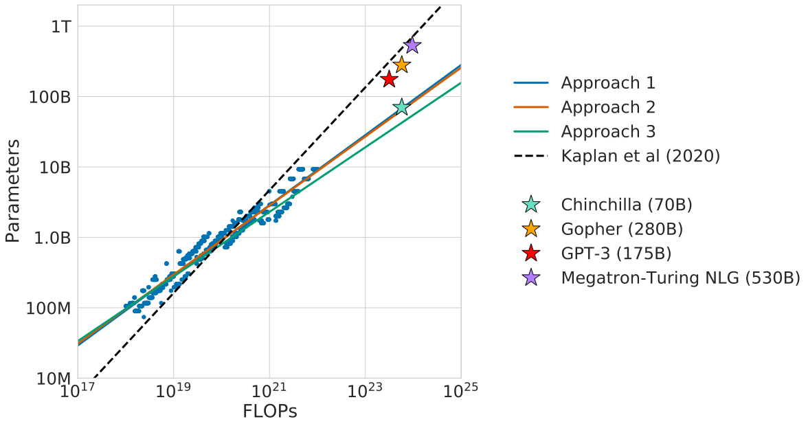

 Figure 1: Overlaid predictions. We overlay the predictions from our three different approaches, along with projections from [Kaplan et al. (2020)](https://arxiv.org/html/2203.15556v1#bib.bib23). We find that all three methods predict that current large models should be substantially smaller and therefore trained much longer than is currently done. In [Figure A3](https://arxiv.org/html/2203.15556v1#A4.F3 "Figure A3 ‣ D.3 Predicted compute optimal frontier for all three methods ‣ Appendix D Details on the scaling analyses ‣ Training Compute-Optimal Large Language Models"), we show the results with the predicted optimal tokens plotted against the optimal number of parameters for fixed FLOP budgets. Chinchilla outperforms Gopher and the other large models (see [Section 4.2](https://arxiv.org/html/2203.15556v1#S4.SS2 "4.2 Results ‣ 4 Chinchilla ‣ Training Compute-Optimal Large Language Models")). Table 1: Current LLMs. We show five of the current largest dense transformer models, their size, and the number of training tokens. Other than LaMDA ([Thoppilan et al., 2022](https://arxiv.org/html/2203.15556v1#bib.bib52)), most models are trained for approximately 300 billion tokens. We introduce Chinchilla, a substantially smaller model, trained for much longer than 300B tokens.  

Model | Size (\(\#\) Parameters) | Training Tokens  
---|---|---  
LaMDA ([Thoppilan et al., 2022](https://arxiv.org/html/2203.15556v1#bib.bib52)) | 137 Billion | 168 Billion  
GPT-3 ([Brown et al., 2020](https://arxiv.org/html/2203.15556v1#bib.bib7)) | 175 Billion | 300 Billion  
Jurassic ([Lieber et al., 2021](https://arxiv.org/html/2203.15556v1#bib.bib30)) | 178 Billion | 300 Billion  
Gopher ([Rae et al., 2021](https://arxiv.org/html/2203.15556v1#bib.bib38)) | 280 Billion | 300 Billion  
MT-NLG 530B ([Smith et al., 2022](https://arxiv.org/html/2203.15556v1#bib.bib49)) | 530 Billion | 270 Billion  
Chinchilla | 70 Billion | 1.4 Trillion

 

In this work, we revisit the question: Given a fixed FLOPs budget,11 1 For example, knowing the number of accelerators and a target training duration. how should one trade-off model size and the number of training tokens? To answer this question, we model the final pre-training loss22 2 For simplicity, we perform our analysis on the smoothed training loss which is an unbiased estimate of the test loss, as we are in the infinite data regime (the number of training tokens is less than the number of tokens in the entire corpus). \(L(N,D)\) as a function of the number of model parameters \(N\), and the number of training tokens, \(D\). Since the computational budget \(C\) is a deterministic function \(\text{FLOPs}(N,D)\) of the number of seen training tokens and model parameters, we are interested in minimizing \(L\) under the constraint \(\text{FLOPs}(N,D)=C\):

\[\begin{aligned}
 & N_{opt}(C),D_{opt}(C)=\argmin_{N,D\text{ s.t. }\text{FLOPs}(N,D)=C}L(N,D). &  & \text{(1)}
\end{aligned}\]

 

The functions \(N_{opt}(C)\), and \(D_{opt}(C)\) describe the optimal allocation of a computational budget \(C\). We empirically estimate these functions based on the losses of over 400 models, ranging from under \(70\)M to over \(16\)B parameters, and trained on \(5\)B to over \(400\)B tokens – with each model configuration trained for several different training horizons. Our approach leads to considerably different results than that of [Kaplan et al. (2020)](https://arxiv.org/html/2203.15556v1#bib.bib23). We highlight our results in [Figure 1](https://arxiv.org/html/2203.15556v1#S1.F1 "Figure 1 ‣ 1 Introduction ‣ Training Compute-Optimal Large Language Models") and how our approaches differ in [Section 2](https://arxiv.org/html/2203.15556v1#S2 "2 Related Work ‣ Training Compute-Optimal Large Language Models").

Based on our estimated compute-optimal frontier, we predict that for the compute budget used to train Gopher, an optimal model should be 4 times smaller, while being training on 4 times more tokens. We verify this by training a more compute-optimal 70B model, called Chinchilla, on 1.4 trillion tokens. Not only does Chinchilla outperform its much larger counterpart, Gopher, but its reduced model size reduces inference cost considerably and greatly facilitates downstream uses on smaller hardware. The energy cost of a large language model is amortized through its usage for inference an fine-tuning. The benefits of a more optimally trained smaller model, therefore, extend beyond the immediate benefits of its improved performance.

## 2 Related Work

##### Large language models.

A variety of large language models have been introduced in the last few years. These include both dense transformer models ([Brown et al., 2020](https://arxiv.org/html/2203.15556v1#bib.bib7); [Lieber et al., 2021](https://arxiv.org/html/2203.15556v1#bib.bib30); [Smith et al., 2022](https://arxiv.org/html/2203.15556v1#bib.bib49); [Rae et al., 2021](https://arxiv.org/html/2203.15556v1#bib.bib38); [Thoppilan et al., 2022](https://arxiv.org/html/2203.15556v1#bib.bib52)) and mixture-of-expert (MoE) models ([Du et al., 2021](https://arxiv.org/html/2203.15556v1#bib.bib11); [Fedus et al., 2021](https://arxiv.org/html/2203.15556v1#bib.bib12); [Zoph et al., 2022](https://arxiv.org/html/2203.15556v1#bib.bib60)). The largest dense transformers have passed 500 billion parameters ([Smith et al., 2022](https://arxiv.org/html/2203.15556v1#bib.bib49)). The drive to train larger and larger models is clear—so far increasing the size of language models has been responsible for improving the state-of-the-art in many language modelling tasks. Nonetheless, large language models face several challenges, including their overwhelming computational requirements (the cost of training and inference increase with model size) ([Rae et al., 2021](https://arxiv.org/html/2203.15556v1#bib.bib38); [Thoppilan et al., 2022](https://arxiv.org/html/2203.15556v1#bib.bib52)) and the need for acquiring more high-quality training data. In fact, in this work we find that larger, high quality datasets will play a key role in any further scaling of language models.

##### Modelling the scaling behavior.

Understanding the scaling behaviour of language models and their transfer properties has been important in the development of recent large models ([Kaplan et al., 2020](https://arxiv.org/html/2203.15556v1#bib.bib23); [Hernandez et al., 2021](https://arxiv.org/html/2203.15556v1#bib.bib18)). [Kaplan et al. (2020)](https://arxiv.org/html/2203.15556v1#bib.bib23) first showed a predictable relationship between model size and loss over many orders of magnitude. The authors investigate the question of choosing the optimal model size to train for a given compute budget. Similar to us, they address this question by training various models. Our work differs from [Kaplan et al. (2020)](https://arxiv.org/html/2203.15556v1#bib.bib23) in several important ways. First, the authors use a fixed number of training tokens and learning rate schedule for all models; this prevents them from modelling the impact of these hyperparameters on the loss. In contrast, we find that setting the learning rate schedule to approximately match the number of training tokens results in the best final loss regardless of model size—see [Figure A1](https://arxiv.org/html/2203.15556v1#A2.F1 "Figure A1 ‣ Appendix B Optimal cosine cycle length ‣ Training Compute-Optimal Large Language Models"). For a fixed learning rate cosine schedule to 130B tokens, the intermediate loss estimates (for \(D^{\prime}<<130\)B) are therefore overestimates of the loss of a model trained with a schedule length matching \(D^{\prime}\). Using these intermediate losses results in underestimating the effectiveness of training models on less data than 130B tokens, and eventually contributes to the conclusion that model size should increase faster than training data size as compute budget increases. In contrast, our analysis predicts that both quantities should scale at roughly the same rate. Secondly, we include models with up to 16B parameters, as we observe that there is slight curvature in the FLOP-loss frontier (see [Appendix E](https://arxiv.org/html/2203.15556v1#A5 "Appendix E Curvature of the FLOP-loss frontier ‣ Training Compute-Optimal Large Language Models"))—in fact, the majority of the models used in our analysis have more than 500 million parameters, in contrast the majority of runs in [Kaplan et al. (2020)](https://arxiv.org/html/2203.15556v1#bib.bib23) are significantly smaller—many being less than 100M parameters.

Recently, [Clark et al. (2022)](https://arxiv.org/html/2203.15556v1#bib.bib9) specifically looked in to the scaling properties of Mixture of Expert language models, showing that the scaling with number of experts diminishes as the model size increases—their approach models the loss as a function of two variables: the model size and the number of experts. However, the analysis is done with a fixed number of training tokens, as in [Kaplan et al. (2020)](https://arxiv.org/html/2203.15556v1#bib.bib23), potentially underestimating the improvements of branching.

##### Estimating hyperparameters for large models.

The model size and the number of training tokens are not the only two parameters to chose when selecting a language model and a procedure to train it. Other important factors include learning rate, learning rate schedule, batch size, optimiser, and width-to-depth ratio. In this work, we focus on model size and the number of training steps, and we rely on existing work and provided experimental heuristics to determine the other necessary hyperparameters. [Yang et al. (2021)](https://arxiv.org/html/2203.15556v1#bib.bib57) investigates how to choose a variety of these parameters for training an autoregressive transformer, including the learning rate and batch size. [McCandlish et al. (2018)](https://arxiv.org/html/2203.15556v1#bib.bib33) finds only a weak dependence between optimal batch size and model size. [Shallue et al. (2018)](https://arxiv.org/html/2203.15556v1#bib.bib47); [Zhang et al. (2019)](https://arxiv.org/html/2203.15556v1#bib.bib59) suggest that using larger batch-sizes than those we use is possible. [Levine et al. (2020)](https://arxiv.org/html/2203.15556v1#bib.bib28) investigates the optimal depth-to-width ratio for a variety of standard model sizes. We use slightly less deep models than proposed as this translates to better wall-clock performance on our hardware.

##### Improved model architectures.

Recently, various promising alternatives to traditional dense transformers have been proposed. For example, through the use of conditional computation large MoE models like the 1.7 trillion parameter Switch transformer ([Fedus et al., 2021](https://arxiv.org/html/2203.15556v1#bib.bib12)), the 1.2 Trillion parameter GLaM model ([Du et al., 2021](https://arxiv.org/html/2203.15556v1#bib.bib11)), and others ([Artetxe et al., 2021](https://arxiv.org/html/2203.15556v1#bib.bib1); [Zoph et al., 2022](https://arxiv.org/html/2203.15556v1#bib.bib60)) are able to provide a large effective model size despite using relatively fewer training and inference FLOPs. However, for very large models the computational benefits of routed models seems to diminish ([Clark et al., 2022](https://arxiv.org/html/2203.15556v1#bib.bib9)). An orthogonal approach to improving language models is to augment transformers with explicit retrieval mechanisms, as done by [Borgeaud et al. (2021)](https://arxiv.org/html/2203.15556v1#bib.bib5); [Guu et al. (2020)](https://arxiv.org/html/2203.15556v1#bib.bib15); [Lewis et al. (2020)](https://arxiv.org/html/2203.15556v1#bib.bib29). This approach effectively increases the number of data tokens seen during training (by a factor of \(\sim 10\) in [Borgeaud et al. (2021)](https://arxiv.org/html/2203.15556v1#bib.bib5)). This suggests that the performance of language models may be more dependant on the size of the training data than previously thought.

## 3 Estimating the optimal parameter/training tokens allocation

We present three different approaches to answer the question driving our research: Given a fixed FLOPs budget, how should one trade-off model size and the number of training tokens? In all three cases we start by training a range of models varying both model size and the number of training tokens and use the resulting training curves to fit an empirical estimator of how they should scale. We assume a power-law relationship between compute and model size as done in [Clark et al. (2022)](https://arxiv.org/html/2203.15556v1#bib.bib9); [Kaplan et al. (2020)](https://arxiv.org/html/2203.15556v1#bib.bib23), though future work may want to include potential curvature in this relationship for large model sizes. The resulting predictions are similar for all three methods and suggest that parameter count and number of training tokens should be increased equally with more compute33 3 We compute FLOPs as described in [Appendix F](https://arxiv.org/html/2203.15556v1#A6 "Appendix F FLOPs computation ‣ Training Compute-Optimal Large Language Models").—with proportions reported in [Table 2](https://arxiv.org/html/2203.15556v1#S3.T2 "Table 2 ‣ 3.4 Optimal model scaling ‣ 3 Estimating the optimal parameter/training tokens allocation ‣ Training Compute-Optimal Large Language Models"). This is in clear contrast to previous work on this topic and warrants further investigation.

### 3.1 Approach 1: Fix model sizes and vary number of training tokens

In our first approach we vary the number of training steps for a fixed family of models (ranging from 70M to over 10B parameters), training each model for 4 different number of training sequences. From these runs, we are able to directly extract an estimate of the minimum loss achieved for a given number of training FLOPs. Training details for this approach can be found in [Appendix D](https://arxiv.org/html/2203.15556v1#A4 "Appendix D Details on the scaling analyses ‣ Training Compute-Optimal Large Language Models").

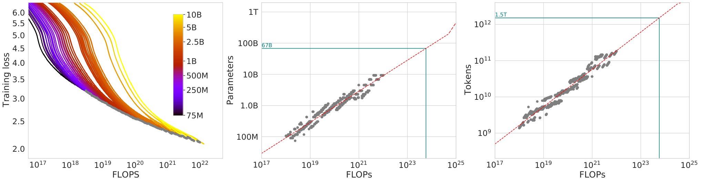

 Figure 2: Training curve envelope. On the left we show all of our different runs. We launched a range of model sizes going from 70M to 10B, each for four different cosine cycle lengths. From these curves, we extracted the envelope of minimal loss per FLOP, and we used these points to estimate the optimal model size (center) for a given compute budget and the optimal number of training tokens (right). In green, we show projections of optimal model size and training token count based on the number of FLOPs used to train Gopher (\(5.76\times 10^{23}\)). 

For each parameter count \(N\) we train 4 different models, decaying the learning rate by a factor of 10\(\times\) over a horizon (measured in number of training tokens) that ranges by a factor of \(16\times\). Then, for each run, we smooth and then interpolate the training loss curve. From this, we obtain a continuous mapping from FLOP count to training loss for each run. Then, for each FLOP count, we determine which run achieves the lowest loss. Using these interpolants, we obtain a mapping from any FLOP count \(C\), to the most efficient choice of model size \(N\) and number of training tokens \(D\) such that \(\text{FLOPs}(N,D)=C\).44 4 Note that all selected points are within the last 15% of training. This suggests that when training a model over \(D\) tokens, we should pick a cosine cycle length that decays \(10\times\) over approximately \(D\) tokens—see further details in [Appendix B](https://arxiv.org/html/2203.15556v1#A2 "Appendix B Optimal cosine cycle length ‣ Training Compute-Optimal Large Language Models"). At 1500 logarithmically spaced FLOP values, we find which model size achieves the lowest loss of all models along with the required number of training tokens. Finally, we fit power laws to estimate the optimal model size and number of training tokens for any given amount of compute (see the center and right panels of [Figure 2](https://arxiv.org/html/2203.15556v1#S3.F2 "Figure 2 ‣ 3.1 Approach 1: Fix model sizes and vary number of training tokens ‣ 3 Estimating the optimal parameter/training tokens allocation ‣ Training Compute-Optimal Large Language Models")), obtaining a relationship \(N_{opt}\propto C^{a}\) and \(D_{opt}\propto C^{b}\). We find that \(a=0.50\) and \(b=0.50\)—as summarized in [Table 2](https://arxiv.org/html/2203.15556v1#S3.T2 "Table 2 ‣ 3.4 Optimal model scaling ‣ 3 Estimating the optimal parameter/training tokens allocation ‣ Training Compute-Optimal Large Language Models"). In [Section D.4](https://arxiv.org/html/2203.15556v1#A4.SS4 "D.4 Small-scale comparison to Kaplan et al. \(2020\) ‣ Appendix D Details on the scaling analyses ‣ Training Compute-Optimal Large Language Models"), we show a head-to-head comparison at \(10^{21}\) FLOPs, using the model size recommended by our analysis and by the analysis of [Kaplan et al. (2020)](https://arxiv.org/html/2203.15556v1#bib.bib23)—using the model size we predict has a clear advantage.

### 3.2 Approach 2: IsoFLOP profiles

In our second approach we vary the model size55 5 In approach 2, model size varies up to 16B as opposed to approach 1 where we only used models up to 10B. for a fixed set of 9 different training FLOP counts66 6 The number of training tokens is determined by the model size and training FLOPs. (ranging from \(6\times 10^{18}\) to \(3\times 10^{21}\) FLOPs), and consider the final training loss for each point77 7 We set the cosine schedule length to match the number of tokens, which is optimal according to the analysis presented in [Appendix B](https://arxiv.org/html/2203.15556v1#A2 "Appendix B Optimal cosine cycle length ‣ Training Compute-Optimal Large Language Models").. in contrast with Approach 1 that considered points \((N,D,L)\) along the entire training runs. This allows us to directly answer the question: For a given FLOP budget, what is the optimal parameter count?

For each FLOP budget, we plot the final loss (after smoothing) against the parameter count in [Figure 3](https://arxiv.org/html/2203.15556v1#S3.F3 "Figure 3 ‣ 3.2 Approach 2: IsoFLOP profiles ‣ 3 Estimating the optimal parameter/training tokens allocation ‣ Training Compute-Optimal Large Language Models") (left). In all cases, we ensure that we have trained a diverse enough set of model sizes to see a clear minimum in the loss. We fit a parabola to each IsoFLOPs curve to directly estimate at what model size the minimum loss is achieved ([Figure 3](https://arxiv.org/html/2203.15556v1#S3.F3 "Figure 3 ‣ 3.2 Approach 2: IsoFLOP profiles ‣ 3 Estimating the optimal parameter/training tokens allocation ‣ Training Compute-Optimal Large Language Models") (left)). As with the previous approach, we then fit a power law between FLOPs and loss-optimal model size and number of training tokens, shown in [Figure 3](https://arxiv.org/html/2203.15556v1#S3.F3 "Figure 3 ‣ 3.2 Approach 2: IsoFLOP profiles ‣ 3 Estimating the optimal parameter/training tokens allocation ‣ Training Compute-Optimal Large Language Models") (center, right). Again, we fit exponents of the form \(N_{opt}\propto C^{a}\) and \(D_{opt}\propto C^{b}\) and we find that \(a=0.49\) and \(b=0.51\)—as summarized in [Table 2](https://arxiv.org/html/2203.15556v1#S3.T2 "Table 2 ‣ 3.4 Optimal model scaling ‣ 3 Estimating the optimal parameter/training tokens allocation ‣ Training Compute-Optimal Large Language Models").

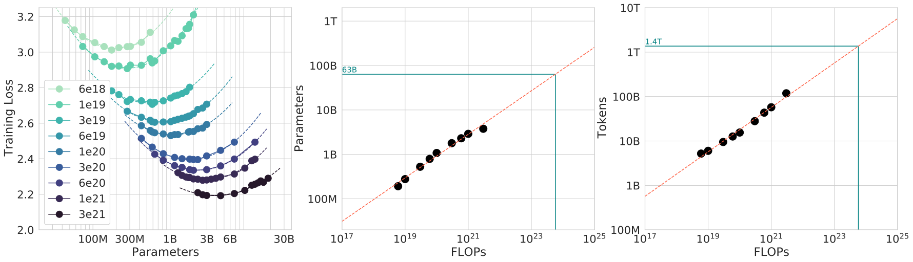

 Figure 3: IsoFLOP curves. For various model sizes, we choose the number of training tokens such that the final FLOPs is a constant. The cosine cycle length is set to match the target FLOP count. We find a clear valley in loss, meaning that for a given FLOP budget there is an optimal model to train (left). Using the location of these valleys, we project optimal model size and number of tokens for larger models (center and right). In green, we show the estimated number of parameters and tokens for an optimal model trained with the compute budget of Gopher. 

### 3.3 Approach 3: Fitting a parametric loss function

Lastly, we model all final losses from experiments in Approach 1 & 2 as a parametric function of model parameter count and the number of seen tokens. Following a classical risk decomposition (see [Section D.2](https://arxiv.org/html/2203.15556v1#A4.SS2 "D.2 Approach 3: Parametric fitting of the loss ‣ Appendix D Details on the scaling analyses ‣ Training Compute-Optimal Large Language Models")), we propose the following functional form

\[\begin{aligned}
 & \hat{L}(N,D)\triangleq E+\frac{A}{N^{\alpha}}+\frac{B}{D^{\beta}}. &  & \text{(2)}
\end{aligned}\]

 

The first term captures the loss for an ideal generative process on the data distribution, and should correspond to the entropy of natural text. The second term captures the fact that a perfectly trained transformer with \(N\) parameters underperforms the ideal generative process. The final term captures the fact that the transformer is not trained to convergence, as we only make a finite number of optimisation steps, on a sample of the dataset distribution.

##### Model fitting.

To estimate \((A,B,E,\alpha,\beta)\), we minimize the Huber loss ([Huber, 1964](https://arxiv.org/html/2203.15556v1#bib.bib19)) between the predicted and observed log loss using the L-BFGS algorithm ([Nocedal, 1980](https://arxiv.org/html/2203.15556v1#bib.bib36)):

\[\begin{aligned}
 & \displaystyle\min_{A,B,E,\alpha,\beta}\hskip 10.00002pt & \displaystyle\sum_{\text{Runs }i}\text{Huber}_{\delta}\Big(\log\hat{L}(N_{i},D_{i})-\log L_{i}\Big) &  & \text{(3)}
\end{aligned}\]

 

We account for possible local minima by selecting the best fit from a grid of initialisations. The Huber loss (\(\delta=10^{-3}\)) is robust to outliers, which we find important for good predictive performance over held-out data points. [Section D.2](https://arxiv.org/html/2203.15556v1#A4.SS2 "D.2 Approach 3: Parametric fitting of the loss ‣ Appendix D Details on the scaling analyses ‣ Training Compute-Optimal Large Language Models") details the fitting procedure and the loss decomposition.

##### Efficient frontier.

We can approximate the functions \(N_{opt}\) and \(D_{opt}\) by minimizing the parametric loss \(\hat{L}\) under the constraint \(\text{FLOPs}(N,D)\approx 6ND\) ([Kaplan et al., 2020](https://arxiv.org/html/2203.15556v1#bib.bib23)). The resulting \(N_{opt}\) and \(D_{opt}\) balance the two terms in Equation ([3](https://arxiv.org/html/2203.15556v1#S3.E3 "In Model fitting. ‣ 3.3 Approach 3: Fitting a parametric loss function ‣ 3 Estimating the optimal parameter/training tokens allocation ‣ Training Compute-Optimal Large Language Models")) that depend on model size and data. By construction, they have a power-law form:

\[\begin{aligned}
 & N_{opt}(C)=G{\left(\frac{C}{6}\right)}^{a},\hskip 10.00002ptD_{opt}(C)=G^{-1}{\left(\frac{C}{6}\right)}^{b},\hskip 10.00002pt\text{ where }\hskip 10.00002ptG={\left(\frac{\alpha A}{\beta B}\right)}^{\frac{1}{\alpha+\beta}},\hskip 10.00002pta=\frac{\beta}{\alpha+\beta},\text{ and }b=\frac{\alpha}{\alpha+\beta}. &  & \text{(4)}
\end{aligned}\]

 

We show contours of the fitted function \(\hat{L}\) in [Figure 4](https://arxiv.org/html/2203.15556v1#S3.F4 "Figure 4 ‣ Efficient frontier. ‣ 3.3 Approach 3: Fitting a parametric loss function ‣ 3 Estimating the optimal parameter/training tokens allocation ‣ Training Compute-Optimal Large Language Models") (left), and the closed-form efficient computational frontier in blue. From this approach, we find that \(a=0.46\) and \(b=0.54\)—as summarized in [Table 2](https://arxiv.org/html/2203.15556v1#S3.T2 "Table 2 ‣ 3.4 Optimal model scaling ‣ 3 Estimating the optimal parameter/training tokens allocation ‣ Training Compute-Optimal Large Language Models").

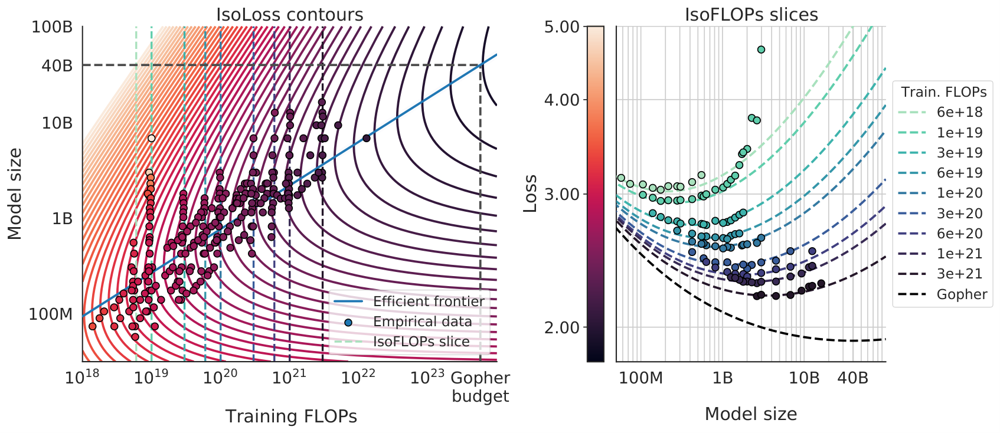

 Figure 4: Parametric fit. We fit a parametric modelling of the loss \(\hat{L}(N,D)\) and display contour (left) and isoFLOP slices (right). For each isoFLOP slice, we include a corresponding dashed line in the left plot. In the left plot, we show the efficient frontier in blue, which is a line in log-log space. Specifically, the curve goes through each iso-loss contour at the point with the fewest FLOPs. We project the optimal model size given the Gopher FLOP budget to be 40B parameters.

### 3.4 Optimal model scaling

We find that the three approaches, despite using different fitting methodologies and different trained models, yield comparable predictions for the optimal scaling in parameters and tokens with FLOPs (shown in [Table 2](https://arxiv.org/html/2203.15556v1#S3.T2 "Table 2 ‣ 3.4 Optimal model scaling ‣ 3 Estimating the optimal parameter/training tokens allocation ‣ Training Compute-Optimal Large Language Models")).

Table 2: Estimated parameter and data scaling with increased training compute. The listed values are the exponents, \(a\) and \(b\), on the relationship \(N_{opt}\propto C^{a}\) and \(D_{opt}\propto C^{b}\). Our analysis suggests a near equal scaling in parameters and data with increasing compute which is in clear contrast to previous work on the scaling of large models. The 10\({}^{\text{th}}\) and 90\({}^{\text{th}}\) percentiles are estimated via bootstrapping data (80% of the dataset is sampled 100 times) and are shown in parenthesis.  

Approach | Coeff. \(a\) where \(N_{opt}\propto C^{a}\) | Coeff. \(b\) where \(D_{opt}\propto C^{b}\)  
---|---|---  
1\. Minimum over training curves | \(0.50\;({0.488},{0.502})\) | \(0.50\;(0.501,0.512)\)  
2\. IsoFLOP profiles | \(0.49\;(0.462,0.534)\) | \(0.51\;(0.483,0.529)\)  
3\. Parametric modelling of the loss | \(0.46\;(0.454,0.455)\) | \(0.54\;(0.542,0.543)\)  
[Kaplan et al. (2020)](https://arxiv.org/html/2203.15556v1#bib.bib23) | 0.73 | 0.27

 

All three approaches suggest that as compute budget increases, model size and the amount of training data should be increased in approximately equal proportions. The first and second approaches yield very similar predictions for optimal model sizes, as shown in [Figure 1](https://arxiv.org/html/2203.15556v1#S1.F1 "Figure 1 ‣ 1 Introduction ‣ Training Compute-Optimal Large Language Models") and [Figure A3](https://arxiv.org/html/2203.15556v1#A4.F3 "Figure A3 ‣ D.3 Predicted compute optimal frontier for all three methods ‣ Appendix D Details on the scaling analyses ‣ Training Compute-Optimal Large Language Models"). The third approach predicts even smaller models being optimal at larger compute budgets. We note that the observed points \((L,N,D)\) for low training FLOPs (\(C\leqslant 1e21\)) have larger residuals \({\|L-\hat{L}(N,D)\|}_{2}^{2}\) than points with higher computational budgets. The fitted model places increased weight on the points with more FLOPs—automatically considering the low-computational budget points as outliers due to the Huber loss. As a consequence of the empirically observed negative curvature in the frontier \(C\to N_{opt}\) (see [Appendix E](https://arxiv.org/html/2203.15556v1#A5 "Appendix E Curvature of the FLOP-loss frontier ‣ Training Compute-Optimal Large Language Models")), this results in predicting a lower \(N_{opt}\) than the two other approaches.

Table 3: Estimated optimal training FLOPs and training tokens for various model sizes. For various model sizes, we show the projections from Approach 1 of how many FLOPs and training tokens would be needed to train compute-optimal models. The estimates for Approach 2 & 3 are similar (shown in [Section D.3](https://arxiv.org/html/2203.15556v1#A4.SS3 "D.3 Predicted compute optimal frontier for all three methods ‣ Appendix D Details on the scaling analyses ‣ Training Compute-Optimal Large Language Models"))

.  Parameters FLOPs FLOPs (in Gopher unit) Tokens 400 Million 1.92e+19 \(1/29,968\) 8.0 Billion 1 Billion 1.21e+20 \(1/4,761\) 20.2 Billion 10 Billion 1.23e+22 \(1/46\) 205.1 Billion 67 Billion 5.76e+23 \(1\) 1.5 Trillion 175 Billion 3.85e+24 \(6.7\) 3.7 Trillion 280 Billion 9.90e+24 \(17.2\) 5.9 Trillion 520 Billion 3.43e+25 \(59.5\) 11.0 Trillion 1 Trillion 1.27e+26 \(221.3\) 21.2 Trillion 10 Trillion 1.30e+28 \(22515.9\) 216.2 Trillion

In [Table 3](https://arxiv.org/html/2203.15556v1#S3.T3 "Table 3 ‣ 3.4 Optimal model scaling ‣ 3 Estimating the optimal parameter/training tokens allocation ‣ Training Compute-Optimal Large Language Models") we show the estimated number of FLOPs and tokens that would ensure that a model of a given size lies on the compute-optimal frontier. Our findings suggests that the current generation of large language models are considerably over-sized, given their respective compute budgets, as shown in [Figure 1](https://arxiv.org/html/2203.15556v1#S1.F1 "Figure 1 ‣ 1 Introduction ‣ Training Compute-Optimal Large Language Models"). For example, we find that a 175 billion parameter model should be trained with a compute budget of \(4.41\times 10^{24}\) FLOPs and on over 4.2 trillion tokens. A 280 billion Gopher-like model is the optimal model to train given a compute budget of approximately \(10^{25}\) FLOPs and should be trained on 6.8 trillion tokens. Unless one has a compute budget of \(10^{26}\) FLOPs (over 250\(\times\) the compute used to train Gopher), a 1 trillion parameter model is unlikely to be the optimal model to train. Furthermore, the amount of training data that is projected to be needed is far beyond what is currently used to train large models, and underscores the importance of dataset collection in addition to engineering improvements that allow for model scale. While there is significant uncertainty extrapolating out many orders of magnitude, our analysis clearly suggests that given the training compute budget for many current LLMs, smaller models should have been trained on more tokens to achieve the most performant model.

In [Appendix C](https://arxiv.org/html/2203.15556v1#A3 "Appendix C Consistency of scaling results across datasets ‣ Training Compute-Optimal Large Language Models"), we reproduce the IsoFLOP analysis on two additional datasets: C4 ([Raffel et al., 2020a](https://arxiv.org/html/2203.15556v1#bib.bib40)) and GitHub code ([Rae et al., 2021](https://arxiv.org/html/2203.15556v1#bib.bib38)). In both cases we reach the similar conclusion that model size and number of training tokens should be scaled in equal proportions.

## 4 Chinchilla

Based on our analysis in [Section 3](https://arxiv.org/html/2203.15556v1#S3 "3 Estimating the optimal parameter/training tokens allocation ‣ Training Compute-Optimal Large Language Models"), the optimal model size for the Gopher compute budget is somewhere between 40 and 70 billion parameters. We test this hypothesis by training a model on the larger end of this range—70B parameters—for 1.4T tokens, due to both dataset and computational efficiency considerations. In this section we compare this model, which we call Chinchilla, to Gopher and other LLMs. Both Chinchilla and Gopher have been trained for the same number of FLOPs but differ in the size of the model and the number of training tokens.

While pre-training a large language model has a considerable compute cost, downstream fine-tuning and inference also make up substantial compute usage ([Rae et al., 2021](https://arxiv.org/html/2203.15556v1#bib.bib38)). Due to being \(4\times\) smaller than Gopher, both the memory footprint and inference cost of Chinchilla are also smaller.

### 4.1 Model and training details

The full set of hyperparameters used to train Chinchilla are given in [Table 4](https://arxiv.org/html/2203.15556v1#S4.T4 "Table 4 ‣ 4.1 Model and training details ‣ 4 Chinchilla ‣ Training Compute-Optimal Large Language Models"). Chinchilla uses the same model architecture and training setup as Gopher with the exception of the differences listed below.

  * We train Chinchilla on MassiveText (the same dataset as Gopher) but use a slightly different subset distribution (shown in [Table A1](https://arxiv.org/html/2203.15556v1#A1.T1 "Table A1 ‣ Appendix A Training dataset ‣ Training Compute-Optimal Large Language Models")) to account for the increased number of training tokens. 
  * We use AdamW ([Loshchilov and Hutter, 2019](https://arxiv.org/html/2203.15556v1#bib.bib32)) for Chinchilla rather than Adam ([Kingma and Ba, 2014](https://arxiv.org/html/2203.15556v1#bib.bib24)) as this improves the language modelling loss and the downstream task performance after finetuning.88 8 Interestingly, a model trained with AdamW only passes the training performance of a model trained with Adam around 80% of the way through the cosine cycle, though the ending performance is notably better– see [Figure A7](https://arxiv.org/html/2203.15556v1#A7.F7 "Figure A7 ‣ Appendix G Other differences between Chinchilla and Gopher ‣ Training Compute-Optimal Large Language Models")
  * We train Chinchilla with a slightly modified SentencePiece ([Kudo and Richardson, 2018](https://arxiv.org/html/2203.15556v1#bib.bib25)) tokenizer that does not apply NFKC normalisation. The vocabulary is very similar– 94.15% of tokens are the same as those used for training Gopher. We find that this particularly helps with the representation of mathematics and chemistry, for example. 
  * Whilst the forward and backward pass are computed in bfloat16, we store a float32 copy of the weights in the distributed optimiser state ([Rajbhandari et al., 2020](https://arxiv.org/html/2203.15556v1#bib.bib42)). See Lessons Learned from [Rae et al. (2021)](https://arxiv.org/html/2203.15556v1#bib.bib38) for additional details. 

Model | Layers | Number Heads | Key/Value Size | dmodel | Max LR | Batch Size  
---|---|---|---|---|---|---  
Gopher 280B | 80 | 128 | 128 | 16,384 | \(4\times 10^{-5}\) | 3M \(\rightarrow\) 6M  
Chinchilla 70B | 80 | 64 | 128 | 8,192 | \(1\times 10^{-4}\) | 1.5M \(\rightarrow\) 3M

 Table 4: Chinchilla architecture details. We list the number of layers, the key/value size, the bottleneck activation size d\({}_{\text{model}}\), the maximum learning rate, and the training batch size (# tokens). The feed-forward size is always set to \(4\times\textrm{d}_{\textrm{model}}\). Note that we double the batch size midway through training for both Chinchilla and Gopher.

In [Appendix G](https://arxiv.org/html/2203.15556v1#A7 "Appendix G Other differences between Chinchilla and Gopher ‣ Training Compute-Optimal Large Language Models") we show the impact of the various optimiser related changes between Chinchilla and Gopher. All models in this analysis have been trained on TPUv3/TPUv4 ([Jouppi et al., 2017](https://arxiv.org/html/2203.15556v1#bib.bib22)) with JAX ([Bradbury et al., 2018](https://arxiv.org/html/2203.15556v1#bib.bib6)) and Haiku ([Hennigan et al., 2020](https://arxiv.org/html/2203.15556v1#bib.bib17)). We include a Chinchilla model card ([Mitchell et al., 2019](https://arxiv.org/html/2203.15556v1#bib.bib35)) in [Table A8](https://arxiv.org/html/2203.15556v1#A9.T8 "Table A8 ‣ Appendix I Model Card ‣ Training Compute-Optimal Large Language Models").

### 4.2 Results

We perform an extensive evaluation of Chinchilla, comparing against various large language models. We evaluate on a large subset of the tasks presented in [Rae et al. (2021)](https://arxiv.org/html/2203.15556v1#bib.bib38), shown in [Table 5](https://arxiv.org/html/2203.15556v1#S4.T5 "Table 5 ‣ 4.2 Results ‣ 4 Chinchilla ‣ Training Compute-Optimal Large Language Models"). As the focus of this work is on optimal model scaling, we included a large representative subset, and introduce a few new evaluations to allow for better comparison to other existing large models. The evaluation details for all tasks are the same as described in [Rae et al. (2021)](https://arxiv.org/html/2203.15556v1#bib.bib38).

| # Tasks | Examples  
---|---|---  
Language Modelling | 20 | WikiText-103, The Pile: PG-19, arXiv, FreeLaw, \(\ldots\)  
Reading Comprehension | 3 | RACE-m, RACE-h, LAMBADA  
Question Answering | 3 | Natural Questions, TriviaQA, TruthfulQA  
Common Sense | 5 | HellaSwag, Winogrande, PIQA, SIQA, BoolQ  
MMLU | 57 | High School Chemistry, Astronomy, Clinical Knowledge, \(\ldots\)  
BIG-bench | 62 | Causal Judgement, Epistemic Reasoning, Temporal Sequences, \(\ldots\)

 Table 5: All evaluation tasks. We evaluate Chinchilla on a collection of language modelling along with downstream tasks. We evaluate on largely the same tasks as in [Rae et al. (2021)](https://arxiv.org/html/2203.15556v1#bib.bib38), to allow for direct comparison.

#### 4.2.1 Language modelling

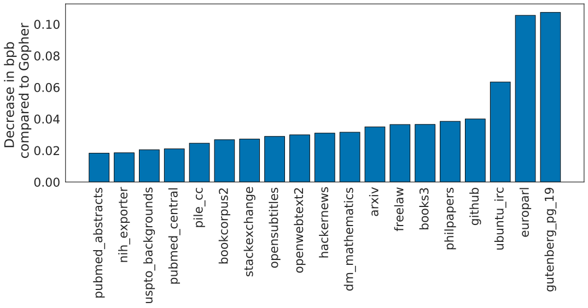

 Figure 5: Pile Evaluation. For the different evaluation sets in The Pile ([Gao et al., 2020](https://arxiv.org/html/2203.15556v1#bib.bib13)), we show the bits-per-byte (bpb) improvement (decrease) of Chinchilla compared to Gopher. On all subsets, Chinchilla outperforms Gopher. 

Chinchilla significantly outperforms Gopher on all evaluation subsets of The Pile ([Gao et al., 2020](https://arxiv.org/html/2203.15556v1#bib.bib13)), as shown in [Figure 5](https://arxiv.org/html/2203.15556v1#S4.F5 "Figure 5 ‣ 4.2.1 Language modelling ‣ 4.2 Results ‣ 4 Chinchilla ‣ Training Compute-Optimal Large Language Models"). Compared to Jurassic-1 (178B) [Lieber et al. (2021)](https://arxiv.org/html/2203.15556v1#bib.bib30), Chinchilla is more performant on all but two subsets– dm_mathematics and ubuntu_irc– see [Table A5](https://arxiv.org/html/2203.15556v1#A8.T5 "Table A5 ‣ H.1 The Pile ‣ Appendix H Results ‣ Training Compute-Optimal Large Language Models") for a raw bits-per-byte comparison. On Wikitext103 ([Merity et al., 2017](https://arxiv.org/html/2203.15556v1#bib.bib34)), Chinchilla achieves a perplexity of 7.16 compared to 7.75 for Gopher. Some caution is needed when comparing Chinchilla with Gopher on these language modelling benchmarks as Chinchilla is trained on 4\(\times\) more data than Gopher and thus train/test set leakage may artificially enhance the results. We thus place more emphasis on other tasks for which leakage is less of a concern, such as MMLU ([Hendrycks et al., 2020](https://arxiv.org/html/2203.15556v1#bib.bib16)) and BIG-bench ([BIG-bench collaboration, 2021](https://arxiv.org/html/2203.15556v1#bib.bib3)) along with various closed-book question answering and common sense analyses.

#### 4.2.2 MMLU

Random | 25.0%  
---|---  
Average human rater | 34.5%  
GPT-3 5-shot | 43.9%  
Gopher 5-shot | 60.0%  
Chinchilla 5-shot | 67.6%  
Average human expert performance | 89.8%  
June 2022 Forecast | 57.1%  
June 2023 Forecast | 63.4%

 Table 6: Massive Multitask Language Understanding (MMLU). We report the average 5-shot accuracy over 57 tasks with model and human accuracy comparisons taken from [Hendrycks et al. (2020)](https://arxiv.org/html/2203.15556v1#bib.bib16). We also include the average prediction for state of the art accuracy in June 2022/2023 made by 73 competitive human forecasters in [Steinhardt (2021)](https://arxiv.org/html/2203.15556v1#bib.bib50). 

The Massive Multitask Language Understanding (MMLU) benchmark ([Hendrycks et al., 2020](https://arxiv.org/html/2203.15556v1#bib.bib16)) consists of a range of exam-like questions on academic subjects. In [Table 6](https://arxiv.org/html/2203.15556v1#S4.T6 "Table 6 ‣ 4.2.2 MMLU ‣ 4.2 Results ‣ 4 Chinchilla ‣ Training Compute-Optimal Large Language Models"), we report Chinchilla’s average 5-shot performance on MMLU (the full breakdown of results is shown in [Table A6](https://arxiv.org/html/2203.15556v1#A8.T6 "Table A6 ‣ H.2 MMLU ‣ Appendix H Results ‣ Training Compute-Optimal Large Language Models")). On this benchmark, Chinchilla significantly outperforms Gopher despite being much smaller, with an average accuracy of 67.6% (improving upon Gopher by 7.6%). Remarkably, Chinchilla even outperforms the expert forecast for June 2023 of 63.4% accuracy (see [Table 6](https://arxiv.org/html/2203.15556v1#S4.T6 "Table 6 ‣ 4.2.2 MMLU ‣ 4.2 Results ‣ 4 Chinchilla ‣ Training Compute-Optimal Large Language Models")) ([Steinhardt, 2021](https://arxiv.org/html/2203.15556v1#bib.bib50)). Furthermore, Chinchilla achieves greater than 90% accuracy on 4 different individual tasks– high_school_gov_and_politics, international_law, sociology, and us_foreign_policy. To our knowledge, no other model has achieved greater than 90% accuracy on a subset.

In [Figure 6](https://arxiv.org/html/2203.15556v1#S4.F6 "Figure 6 ‣ 4.2.2 MMLU ‣ 4.2 Results ‣ 4 Chinchilla ‣ Training Compute-Optimal Large Language Models"), we show a comparison to Gopher broken down by task. Overall, we find that Chinchilla improves performance on the vast majority of tasks. On four tasks (college_mathematics, econometrics, moral_scenarios, and formal_logic) Chinchilla underperforms Gopher, and there is no change in performance on two tasks.

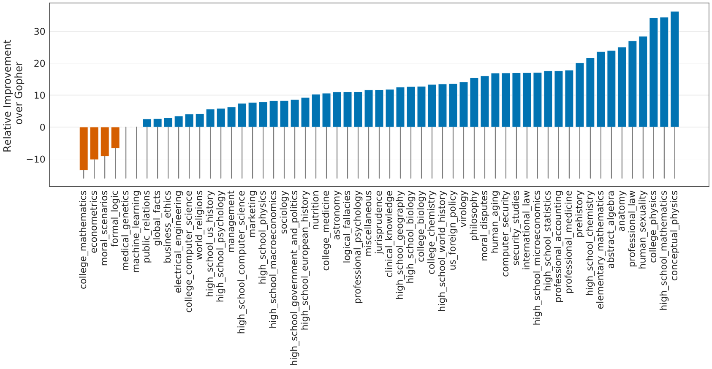

 Figure 6: MMLU results compared to Gopher We find that Chinchilla outperforms Gopher by 7.6% on average (see [Table 6](https://arxiv.org/html/2203.15556v1#S4.T6 "Table 6 ‣ 4.2.2 MMLU ‣ 4.2 Results ‣ 4 Chinchilla ‣ Training Compute-Optimal Large Language Models")) in addition to performing better on 51/57 individual tasks, the same on 2/57, and worse on only 4/57 tasks.  

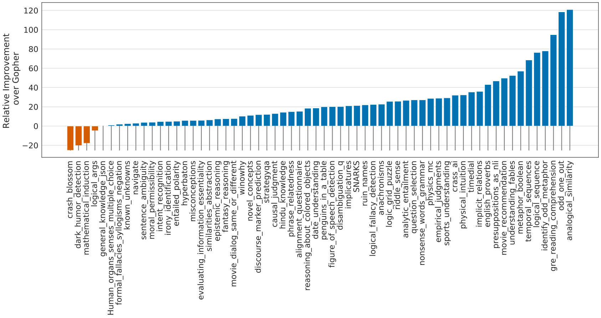

 Figure 7: BIG-bench results compared to Gopher Chinchilla out performs Gopher on all but four BIG-bench tasks considered. Full results are in [Table A7](https://arxiv.org/html/2203.15556v1#A8.T7 "Table A7 ‣ H.4 BIG-bench ‣ Appendix H Results ‣ Training Compute-Optimal Large Language Models"). 

#### 4.2.3 Reading comprehension

On the final word prediction dataset LAMBADA ([Paperno et al., 2016](https://arxiv.org/html/2203.15556v1#bib.bib37)), Chinchilla achieves 77.4% accuracy, compared to 74.5% accuracy from Gopher and 76.6% from MT-NLG 530B (see [Table 7](https://arxiv.org/html/2203.15556v1#S4.T7 "Table 7 ‣ 4.2.3 Reading comprehension ‣ 4.2 Results ‣ 4 Chinchilla ‣ Training Compute-Optimal Large Language Models")). On RACE-h and RACE-m ([Lai et al., 2017](https://arxiv.org/html/2203.15556v1#bib.bib27)), Chinchilla greatly outperforms Gopher, improving accuracy by more than 10% in both cases—see [Table 7](https://arxiv.org/html/2203.15556v1#S4.T7 "Table 7 ‣ 4.2.3 Reading comprehension ‣ 4.2 Results ‣ 4 Chinchilla ‣ Training Compute-Optimal Large Language Models").

| Chinchilla | Gopher | GPT-3 | MT-NLG 530B  
---|---|---|---|---  
LAMBADA Zero-Shot | 77.4 | 74.5 | 76.2 | 76.6  
RACE-m Few-Shot | 86.8 | 75.1 | 58.1 | -  
RACE-h Few-Shot | 82.3 | 71.6 | 46.8 | 47.9

 Table 7: Reading comprehension. On RACE-h and RACE-m ([Lai et al., 2017](https://arxiv.org/html/2203.15556v1#bib.bib27)), Chinchilla considerably improves performance over Gopher. Note that GPT-3 and MT-NLG 530B use a different prompt format than we do on RACE-h/m, so results are not comparable to Gopher and Chinchilla. On LAMBADA ([Paperno et al., 2016](https://arxiv.org/html/2203.15556v1#bib.bib37)), Chinchilla outperforms both Gopher and MT-NLG 530B.

#### 4.2.4 BIG-bench

We analysed Chinchilla on the same set of BIG-bench tasks ([BIG-bench collaboration, 2021](https://arxiv.org/html/2203.15556v1#bib.bib3)) reported in [Rae et al. (2021)](https://arxiv.org/html/2203.15556v1#bib.bib38). Similar to what we observed in MMLU, Chinchilla outperforms Gopher on the vast majority of tasks (see [Figure 7](https://arxiv.org/html/2203.15556v1#S4.F7 "Figure 7 ‣ 4.2.2 MMLU ‣ 4.2 Results ‣ 4 Chinchilla ‣ Training Compute-Optimal Large Language Models")). We find that Chinchilla improves the average performance by 10.7%, reaching an accuracy of 65.1% versus 54.4% for Gopher. Of the 62 tasks we consider, Chinchilla performs worse than Gopher on only four—crash_blossom, dark_humor_detection, mathematical_induction and logical_args. Full accuracy results for Chinchilla can be found in [Table A7](https://arxiv.org/html/2203.15556v1#A8.T7 "Table A7 ‣ H.4 BIG-bench ‣ Appendix H Results ‣ Training Compute-Optimal Large Language Models").

#### 4.2.5 Common sense

| Chinchilla | Gopher | GPT-3 | MT-NLG 530B | Supervised SOTA  
---|---|---|---|---|---  
HellaSWAG | 80.8% | 79.2% | 78.9% | 80.2% | 93.9%  
PIQA | 81.8% | 81.8% | 81.0% | 82.0% | 90.1%  
Winogrande | 74.9% | 70.1% | 70.2% | 73.0% | 91.3%  
SIQA | 51.3% | 50.6% | - | - | 83.2%  
BoolQ | 83.7% | 79.3% | 60.5% | 78.2% | 91.4%

 Table 8: Zero-shot comparison on Common Sense benchmarks. We show a comparison between Chinchilla, Gopher, and MT-NLG 530B on various Common Sense benchmarks. We see that Chinchilla matches or outperforms Gopher and GPT-3 on all tasks. On all but one Chinchilla outperforms the much larger MT-NLG 530B model. 

We evaluate Chinchilla on various common sense benchmarks: PIQA ([Bisk et al., 2020](https://arxiv.org/html/2203.15556v1#bib.bib4)), SIQA ([Sap et al., 2019](https://arxiv.org/html/2203.15556v1#bib.bib46)), Winogrande ([Sakaguchi et al., 2020](https://arxiv.org/html/2203.15556v1#bib.bib45)), HellaSwag ([Zellers et al., 2019](https://arxiv.org/html/2203.15556v1#bib.bib58)), and BoolQ ([Clark et al., 2019](https://arxiv.org/html/2203.15556v1#bib.bib10)). We find that Chinchilla outperforms both Gopher and GPT-3 on all tasks and outperforms MT-NLG 530B on all but one task—see [Table 8](https://arxiv.org/html/2203.15556v1#S4.T8 "Table 8 ‣ 4.2.5 Common sense ‣ 4.2 Results ‣ 4 Chinchilla ‣ Training Compute-Optimal Large Language Models").

On TruthfulQA ([Lin et al., 2021](https://arxiv.org/html/2203.15556v1#bib.bib31)), Chinchilla reaches 43.6%, 58.5%, and 66.7% accuracy with 0-shot, 5-shot, and 10-shot respectively. In comparison, Gopher achieved only 29.5% 0-shot and 43.7% 10-shot accuracy. In stark contrast with the findings of [Lin et al. (2021)](https://arxiv.org/html/2203.15556v1#bib.bib31), the large improvements (14.1% in 0-shot accuracy) achieved by Chinchilla suggest that better modelling of the pre-training data alone can lead to substantial improvements on this benchmark.

#### 4.2.6 Closed-book question answering

Results on closed-book question answering benchmarks are reported in [Table 9](https://arxiv.org/html/2203.15556v1#S4.T9 "Table 9 ‣ 4.2.6 Closed-book question answering ‣ 4.2 Results ‣ 4 Chinchilla ‣ Training Compute-Optimal Large Language Models"). On the Natural Questions dataset ([Kwiatkowski et al., 2019](https://arxiv.org/html/2203.15556v1#bib.bib26)), Chinchilla achieves new closed-book SOTA accuracies: 31.5% 5-shot and 35.5% 64-shot, compared to 21% and 28% respectively, for Gopher. On TriviaQA ([Joshi et al., 2017](https://arxiv.org/html/2203.15556v1#bib.bib21)) we show results for both the filtered (previously used in retrieval and open-book work) and unfiltered set (previously used in large language model evaluations). In both cases, Chinchilla substantially out performs Gopher. On the filtered version, Chinchilla lags behind the open book SOTA ([Izacard and Grave, 2020](https://arxiv.org/html/2203.15556v1#bib.bib20)) by only 7.9%. On the unfiltered set, Chinchilla outperforms GPT-3—see [Table 9](https://arxiv.org/html/2203.15556v1#S4.T9 "Table 9 ‣ 4.2.6 Closed-book question answering ‣ 4.2 Results ‣ 4 Chinchilla ‣ Training Compute-Optimal Large Language Models").

<table id="S4.T9.3" class="ltx_tabular ltx_centering ltx_guessed_headers ltx_align_middle">
<tbody class="ltx_tbody">
<tr id="S4.T9.3.1" class="ltx_tr">
<td id="S4.T9.3.1.1" class="ltx_td ltx_border_tt"></td>
<th id="S4.T9.3.1.2" class="ltx_td ltx_align_center ltx_th ltx_th_column ltx_border_tt">Method</th>
<th id="S4.T9.3.1.3" class="ltx_td ltx_align_center ltx_th ltx_th_column ltx_border_tt">Chinchilla</th>
<th id="S4.T9.3.1.4" class="ltx_td ltx_align_center ltx_th ltx_th_column ltx_border_tt">Gopher</th>
<th id="S4.T9.3.1.5" class="ltx_td ltx_align_center ltx_th ltx_th_column ltx_border_tt">GPT-3</th>
<th id="S4.T9.3.1.6" class="ltx_td ltx_align_center ltx_th ltx_th_column ltx_border_tt">SOTA (open book)</th></tr>
<tr id="S4.T9.3.2" class="ltx_tr">
<td id="S4.T9.3.2.1" class="ltx_td ltx_align_center ltx_border_t" rowspan="3">Natural Questions (dev)</td>
<td id="S4.T9.3.2.2" class="ltx_td ltx_align_center ltx_border_t">0-shot</td>
<td id="S4.T9.3.2.3" class="ltx_td ltx_align_center ltx_border_t">16.6%</td>
<td id="S4.T9.3.2.4" class="ltx_td ltx_align_center ltx_border_t">10.1%</td>
<td id="S4.T9.3.2.5" class="ltx_td ltx_align_center ltx_border_t">14.6%</td>
<td id="S4.T9.3.2.6" class="ltx_td ltx_align_center ltx_border_t" rowspan="3">54.4%</td></tr>
<tr id="S4.T9.3.3" class="ltx_tr">
<td id="S4.T9.3.3.1" class="ltx_td ltx_align_center">5-shot</td>
<td id="S4.T9.3.3.2" class="ltx_td ltx_align_center">31.5%</td>
<td id="S4.T9.3.3.3" class="ltx_td ltx_align_center">24.5%</td>
<td id="S4.T9.3.3.4" class="ltx_td ltx_align_center">-</td></tr>
<tr id="S4.T9.3.4" class="ltx_tr">
<td id="S4.T9.3.4.1" class="ltx_td ltx_align_center">64-shot</td>
<td id="S4.T9.3.4.2" class="ltx_td ltx_align_center">35.5%</td>
<td id="S4.T9.3.4.3" class="ltx_td ltx_align_center">28.2%</td>
<td id="S4.T9.3.4.4" class="ltx_td ltx_align_center">29.9%</td></tr>
<tr id="S4.T9.3.5" class="ltx_tr">
<td id="S4.T9.3.5.1" class="ltx_td ltx_align_center ltx_border_t" rowspan="3">TriviaQA (unfiltered, test)</td>
<td id="S4.T9.3.5.2" class="ltx_td ltx_align_center ltx_border_t">0-shot</td>
<td id="S4.T9.3.5.3" class="ltx_td ltx_align_center ltx_border_t">67.0%</td>
<td id="S4.T9.3.5.4" class="ltx_td ltx_align_center ltx_border_t">52.8%</td>
<td id="S4.T9.3.5.5" class="ltx_td ltx_align_center ltx_border_t">64.3 %</td>
<td id="S4.T9.3.5.6" class="ltx_td ltx_align_center ltx_border_t" rowspan="3">-</td></tr>
<tr id="S4.T9.3.6" class="ltx_tr">
<td id="S4.T9.3.6.1" class="ltx_td ltx_align_center">5-shot</td>
<td id="S4.T9.3.6.2" class="ltx_td ltx_align_center">73.2%</td>
<td id="S4.T9.3.6.3" class="ltx_td ltx_align_center">63.6%</td>
<td id="S4.T9.3.6.4" class="ltx_td ltx_align_center">-</td></tr>
<tr id="S4.T9.3.7" class="ltx_tr">
<td id="S4.T9.3.7.1" class="ltx_td ltx_align_center">64-shot</td>
<td id="S4.T9.3.7.2" class="ltx_td ltx_align_center">72.3%</td>
<td id="S4.T9.3.7.3" class="ltx_td ltx_align_center">61.3%</td>
<td id="S4.T9.3.7.4" class="ltx_td ltx_align_center">71.2%</td></tr>
<tr id="S4.T9.3.8" class="ltx_tr">
<td id="S4.T9.3.8.1" class="ltx_td ltx_align_center ltx_border_bb ltx_border_t" rowspan="3">TriviaQA (filtered, dev)</td>
<td id="S4.T9.3.8.2" class="ltx_td ltx_align_center ltx_border_t">0-shot</td>
<td id="S4.T9.3.8.3" class="ltx_td ltx_align_center ltx_border_t">55.4%</td>
<td id="S4.T9.3.8.4" class="ltx_td ltx_align_center ltx_border_t">43.5%</td>
<td id="S4.T9.3.8.5" class="ltx_td ltx_align_center ltx_border_t">-</td>
<td id="S4.T9.3.8.6" class="ltx_td ltx_align_center ltx_border_bb ltx_border_t" rowspan="3">72.5%</td></tr>
<tr id="S4.T9.3.9" class="ltx_tr">
<td id="S4.T9.3.9.1" class="ltx_td ltx_align_center">5-shot</td>
<td id="S4.T9.3.9.2" class="ltx_td ltx_align_center">64.1%</td>
<td id="S4.T9.3.9.3" class="ltx_td ltx_align_center">57.0%</td>
<td id="S4.T9.3.9.4" class="ltx_td ltx_align_center">-</td></tr>
<tr id="S4.T9.3.10" class="ltx_tr">
<td id="S4.T9.3.10.1" class="ltx_td ltx_align_center ltx_border_bb">64-shot</td>
<td id="S4.T9.3.10.2" class="ltx_td ltx_align_center ltx_border_bb">64.6%</td>
<td id="S4.T9.3.10.3" class="ltx_td ltx_align_center ltx_border_bb">57.2%</td>
<td id="S4.T9.3.10.4" class="ltx_td ltx_align_center ltx_border_bb">-</td></tr>
</tbody>
</table>

 Table 9: Closed-book question answering. For Natural Questions ([Kwiatkowski et al., 2019](https://arxiv.org/html/2203.15556v1#bib.bib26)) and TriviaQA ([Joshi et al., 2017](https://arxiv.org/html/2203.15556v1#bib.bib21)), Chinchilla outperforms Gopher in all cases. On Natural Questions, Chinchilla outperforms GPT-3. On TriviaQA we show results on two different evaluation sets to allow for comparison to GPT-3 and to open book SOTA (FiD + Distillation ([Izacard and Grave, 2020](https://arxiv.org/html/2203.15556v1#bib.bib20))). 

#### 4.2.7 Gender bias and toxicity

Large Language Models carry potential risks such as outputting offensive language, propagating social biases, and leaking private information ([Weidinger et al., 2021](https://arxiv.org/html/2203.15556v1#bib.bib54); [Bender et al., 2021](https://arxiv.org/html/2203.15556v1#bib.bib2)). We expect Chinchilla to carry risks similar to Gopher because Chinchilla is trained on the same data, albeit with slightly different relative weights, and because it has a similar architecture. Here, we examine gender bias (particularly gender and occupation bias) and generation of toxic language. We select a few common evaluations to highlight potential issues, but stress that our evaluations are not comprehensive and much work remains to understand, evaluate, and mitigate risks in LLMs.

##### Gender bias.

As discussed in [Rae et al. (2021)](https://arxiv.org/html/2203.15556v1#bib.bib38), large language models reflect contemporary and historical discourse about different groups (such as gender groups) from their training dataset, and we expect the same to be true for Chinchilla. Here, we test if potential gender and occupation biases manifest in unfair outcomes on coreference resolutions, using the Winogender dataset ([Rudinger et al., 2018](https://arxiv.org/html/2203.15556v1#bib.bib44)) in a zero-shot setting. Winogender tests whether a model can correctly determine if a pronoun refers to different occupation words. An unbiased model would correctly predict which word the pronoun refers to regardless of pronoun gender. We follow the same setup as in [Rae et al. (2021)](https://arxiv.org/html/2203.15556v1#bib.bib38) (described further in [Section H.3](https://arxiv.org/html/2203.15556v1#A8.SS3 "H.3 Winogender Setup ‣ Appendix H Results ‣ Training Compute-Optimal Large Language Models")).

As shown in [Table 10](https://arxiv.org/html/2203.15556v1#S4.T10 "Table 10 ‣ Gender bias. ‣ 4.2.7 Gender bias and toxicity ‣ 4.2 Results ‣ 4 Chinchilla ‣ Training Compute-Optimal Large Language Models"), Chinchilla correctly resolves pronouns more frequently than Gopher across all groups. Interestingly, the performance increase is considerably smaller for male pronouns (increase of 3.2%) than for female or neutral pronouns (increases of 8.3% and 9.2% respectively). We also consider gotcha examples, in which the correct pronoun resolution contradicts gender stereotypes (determined by labor statistics). Again, we see that Chinchilla resolves pronouns more accurately than Gopher. When breaking up examples by male/female gender and gotcha/not gotcha, the largest improvement is on female gotcha examples (improvement of 10%). Thus, though Chinchilla uniformly overcomes gender stereotypes for more coreference examples than Gopher, the rate of improvement is higher for some pronouns than others, suggesting that the improvements conferred by using a more compute-optimal model can be uneven.

| Chinchilla | Gopher  
---|---|---  
All | 78.3% | 71.4%  
Male | 71.2% | 68.0%  
Female | 79.6% | 71.3%  
Neutral | 84.2% | 75.0%

 

| Chinchilla | Gopher  
---|---|---  
Male gotcha | 62.5% | 59.2%  
Male not gotcha | 80.0% | 76.7%  
Female gotcha | 76.7% | 66.7%  
Female not gotcha | 82.5% | 75.8%

 

Table 10: Winogender results. Left: Chinchilla consistently resolves pronouns better than Gopher. Right: Chinchilla performs better on examples which contradict gender stereotypes (gotcha examples). However, difference in performance across groups suggests Chinchilla exhibits bias.

##### Sample toxicity.

Language models are capable of generating toxic language—including insults, hate speech, profanities and threats ([Gehman et al., 2020](https://arxiv.org/html/2203.15556v1#bib.bib14); [Rae et al., 2021](https://arxiv.org/html/2203.15556v1#bib.bib38)). While toxicity is an umbrella term, and its evaluation in LMs comes with challenges ([Xu et al., 2021](https://arxiv.org/html/2203.15556v1#bib.bib56); [Welbl et al., 2021](https://arxiv.org/html/2203.15556v1#bib.bib55)), automatic classifier scores can provide an indication for the levels of harmful text that a LM generates. [Rae et al. (2021)](https://arxiv.org/html/2203.15556v1#bib.bib38) found that improving language modelling loss by increasing the number of model parameters has only a negligible effect on toxic text generation (unprompted); here we analyze whether the same holds true for a lower LM loss achieved via more compute-optimal training. Similar to the protocol of [Rae et al. (2021)](https://arxiv.org/html/2203.15556v1#bib.bib38), we generate 25,000 unprompted samples from Chinchilla, and compare their PerspectiveAPI toxicity score distribution to that of Gopher-generated samples. Several summary statistics indicate an absence of major differences: the mean (median) toxicity score for Gopher is 0.081 (0.064), compared to 0.087 (0.066) for Chinchilla, and the \(95^{\textrm{th}}\) percentile scores are 0.230 for Gopher, compared to 0.238 for Chinchilla. That is, the large majority of generated samples are classified as non-toxic, and the difference between the models is negligible. In line with prior findings ([Rae et al., 2021](https://arxiv.org/html/2203.15556v1#bib.bib38)), this suggests that toxicity levels in unconditional text generation are largely independent of the model quality (measured in language modelling loss), i.e. that better models of the training dataset are not necessarily more toxic.

## 5 Discussion & Conclusion

The trend so far in large language model training has been to increase the model size, often without increasing the number of training tokens. The largest dense transformer, MT-NLG 530B, is now over \(3\times\) larger than GPT-3’s 170 billion parameters from just two years ago. However, this model, as well as the majority of existing large models, have all been trained for a comparable number of tokens—around 300 billion. While the desire to train these mega-models has led to substantial engineering innovation, we hypothesize that the race to train larger and larger models is resulting in models that are substantially underperforming compared to what could be achieved with the same compute budget.

We propose three predictive approaches towards optimally setting model size and training duration, based on the outcome of over 400 training runs. All three approaches predict that Gopher is substantially over-sized and estimate that for the same compute budget a smaller model trained on more data will perform better. We directly test this hypothesis by training Chinchilla, a 70B parameter model, and show that it outperforms Gopher and even larger models on nearly every measured evaluation task.

Whilst our method allows us to make predictions on how to scale large models when given additional compute, there are several limitations. Due to the cost of training large models, we only have two comparable training runs at large scale (Chinchilla and Gopher), and we do not have additional tests at intermediate scales. Furthermore, we assume that the efficient computational frontier can be described by a power-law relationship between the compute budget, model size, and number of training tokens. However, we observe some concavity in \(\log\left(N_{opt}\right)\) at high compute budgets (see [Appendix E](https://arxiv.org/html/2203.15556v1#A5 "Appendix E Curvature of the FLOP-loss frontier ‣ Training Compute-Optimal Large Language Models")). This suggests that we may still be overestimating the optimal size of large models. Finally, the training runs for our analysis have all been trained on less than an epoch of data; future work may consider the multiple epoch regime. Despite these limitations, the comparison of Chinchilla to Gopher validates our performance predictions, that have thus enabled training a better (and more lightweight) model at the same compute budget.

Though there has been significant recent work allowing larger and larger models to be trained, our analysis suggests an increased focus on dataset scaling is needed. Speculatively, we expect that scaling to larger and larger datasets is only beneficial when the data is high-quality. This calls for responsibly collecting larger datasets with a high focus on dataset quality. Larger datasets will require extra care to ensure train-test set overlap is properly accounted for, both in the language modelling loss but also with downstream tasks. Finally, training for trillions of tokens introduces many ethical and privacy concerns. Large datasets scraped from the web will contain toxic language, biases, and private information. With even larger datasets being used, the quantity (if not the frequency) of such information increases, which makes dataset introspection all the more important. Chinchilla does suffer from bias and toxicity but interestingly it seems less affected than Gopher. Better understanding how performance of large language models and toxicity interact is an important future research question.

While we have applied our methodology towards the training of auto-regressive language models, we expect that there is a similar trade-off between model size and the amount of data in other modalities. As training large models is very expensive, choosing the optimal model size and training steps beforehand is essential. The methods we propose are easy to reproduce in new settings.

## 6 Acknowledgements

We’d like to thank Jean-baptiste Alayrac, Kareem Ayoub, Chris Dyer, Nando de Freitas, Demis Hassabis, Geoffrey Irving, Koray Kavukcuoglu, Nate Kushman and Angeliki Lazaridou for useful comments on the manuscript. We’d like to thank Andy Brock, Irina Higgins, Michela Paganini, Francis Song, and other colleagues at DeepMind for helpful discussions. We are also very grateful to the JAX and XLA team for their support and assistance.

## References

  * Artetxe et al. (2021) M. Artetxe, S. Bhosale, N. Goyal, T. Mihaylov, M. Ott, S. Shleifer, X. V. Lin, J. Du, S. Iyer, R. Pasunuru, G. Anantharaman, X. Li, S. Chen, H. Akin, M. Baines, L. Martin, X. Zhou, P. S. Koura, B. O’Horo, J. Wang, L. Zettlemoyer, M. Diab, Z. Kozareva, and V. Stoyanov.  Efficient Large Scale Language Modeling with Mixtures of Experts.  _arXiv:2112.10684_ , 2021. 
  * Bender et al. (2021) E. M. Bender, T. Gebru, A. McMillan-Major, and S. Shmitchell.  On the dangers of stochastic parrots: Can language models be too big?  In _Proceedings of the 2021 ACM Conference on Fairness, Accountability, and Transparency_ , pages 610–623, 2021. 
  * BIG-bench collaboration (2021) BIG-bench collaboration.  Beyond the imitation game: Measuring and extrapolating the capabilities of language models.  _In preparation_ , 2021.  URL <https://github.com/google/BIG-bench/>. 
  * Bisk et al. (2020) Y. Bisk, R. Zellers, J. Gao, Y. Choi, et al.  PIQA: Reasoning about physical commonsense in natural language.  In _Proceedings of the AAAI Conference on Artificial Intelligence_ , volume 34, pages 7432–7439, 2020. 
  * Borgeaud et al. (2021) S. Borgeaud, A. Mensch, J. Hoffmann, T. Cai, E. Rutherford, K. Millican, G. van den Driessche, J.-B. Lespiau, B. Damoc, A. Clark, D. de Las Casas, A. Guy, J. Menick, R. Ring, T. Hennigan, S. Huang, L. Maggiore, C. Jones, A. Cassirer, A. Brock, M. Paganini, G. Irving, O. Vinyals, S. Osindero, K. Simonyan, J. W. Rae, E. Elsen, and L. Sifre.  Improving language models by retrieving from trillions of tokens.  _arXiv 2112.04426_ , 2021. 
  * Bradbury et al. (2018) J. Bradbury, R. Frostig, P. Hawkins, M. J. Johnson, C. Leary, D. Maclaurin, G. Necula, A. Paszke, J. VanderPlas, S. Wanderman-Milne, and Q. Zhang.  JAX: composable transformations of Python+NumPy programs.  2018\.  URL <http://github.com/google/jax>. 
  * Brown et al. (2020) T. Brown, B. Mann, N. Ryder, M. Subbiah, J. D. Kaplan, P. Dhariwal, A. Neelakantan, P. Shyam, G. Sastry, A. Askell, S. Agarwal, A. Herbert-Voss, G. Krueger, T. Henighan, R. Child, A. Ramesh, D. Ziegler, J. Wu, C. Winter, C. Hesse, M. Chen, E. Sigler, M. Litwin, S. Gray, B. Chess, J. Clark, C. Berner, S. McCandlish, A. Radford, I. Sutskever, and D. Amodei.  Language models are few-shot learners.  In H. Larochelle, M. Ranzato, R. Hadsell, M. F. Balcan, and H. Lin, editors, _Advances in Neural Information Processing Systems_ , volume 33, pages 1877–1901. Curran Associates, Inc., 2020.  URL <https://proceedings.neurips.cc/paper/2020/file/1457c0d6bfcb4967418bfb8ac142f64a-Paper.pdf>. 
  * Bubeck (2015) S. Bubeck.  Convex Optimization: Algorithms and Complexity.  _Foundations and Trends in Machine Learning_ , 8(3-4):231–357, 2015.  URL <http://www.nowpublishers.com/article/Details/MAL-050>. 
  * Clark et al. (2022) A. Clark, D. d. l. Casas, A. Guy, A. Mensch, M. Paganini, J. Hoffmann, B. Damoc, B. Hechtman, T. Cai, S. Borgeaud, G. v. d. Driessche, E. Rutherford, T. Hennigan, M. Johnson, K. Millican, A. Cassirer, C. Jones, E. Buchatskaya, D. Budden, L. Sifre, S. Osindero, O. Vinyals, J. Rae, E. Elsen, K. Kavukcuoglu, and K. Simonyan.  Unified scaling laws for routed language models, 2022.  URL <https://arxiv.org/abs/2202.01169>. 
  * Clark et al. (2019) C. Clark, K. Lee, M.-W. Chang, T. Kwiatkowski, M. Collins, and K. Toutanova.  Boolq: Exploring the surprising difficulty of natural yes/no questions.  In _Proceedings of the 2019 Conference of the North American Chapter of the Association for Computational Linguistics: Human Language Technologies, Volume 1 (Long and Short Papers)_ , pages 2924–2936, 2019. 
  * Du et al. (2021) N. Du, Y. Huang, A. M. Dai, S. Tong, D. Lepikhin, Y. Xu, M. Krikun, Y. Zhou, A. W. Yu, O. Firat, B. Zoph, L. Fedus, M. Bosma, Z. Zhou, T. Wang, Y. E. Wang, K. Webster, M. Pellat, K. Robinson, K. Meier-Hellstern, T. Duke, L. Dixon, K. Zhang, Q. V. Le, Y. Wu, Z. Chen, and C. Cui.  Glam: Efficient scaling of language models with mixture-of-experts, 2021\.  URL <https://arxiv.org/abs/2112.06905>. 
  * Fedus et al. (2021) W. Fedus, B. Zoph, and N. Shazeer.  Switch transformers: Scaling to trillion parameter models with simple and efficient sparsity.  _arXiv preprint arXiv:2101.03961_ , 2021. 
  * Gao et al. (2020) L. Gao, S. Biderman, S. Black, L. Golding, T. Hoppe, C. Foster, J. Phang, H. He, A. Thite, N. Nabeshima, S. Presser, and C. Leahy.  The Pile: An 800GB dataset of diverse text for language modeling.  _arXiv preprint arXiv:2101.00027_ , 2020. 
  * Gehman et al. (2020) S. Gehman, S. Gururangan, M. Sap, Y. Choi, and N. A. Smith.  RealToxicityPrompts: Evaluating neural toxic degeneration in language models.  In _Findings of the Association for Computational Linguistics: EMNLP 2020_ , pages 3356–3369, Online, Nov. 2020. Association for Computational Linguistics.  [10.18653/v1/2020.findings-emnlp.301](https://doi.org/10.18653/v1/2020.findings-emnlp.301).  URL <https://aclanthology.org/2020.findings-emnlp.301>. 
  * Guu et al. (2020) K. Guu, K. Lee, Z. Tung, P. Pasupat, and M.-W. Chang.  REALM: Retrieval-augmented language model pre-training, 2020. 
  * Hendrycks et al. (2020) D. Hendrycks, C. Burns, S. Basart, A. Zou, M. Mazeika, D. Song, and J. Steinhardt.  Measuring massive multitask language understanding.  _arXiv preprint arXiv:2009.03300_ , 2020. 
  * Hennigan et al. (2020) T. Hennigan, T. Cai, T. Norman, and I. Babuschkin.  Haiku: Sonnet for JAX.  2020\.  URL <http://github.com/deepmind/dm-haiku>. 
  * Hernandez et al. (2021) D. Hernandez, J. Kaplan, T. Henighan, and S. McCandlish.  Scaling laws for transfer, 2021. 
  * Huber (1964) P. J. Huber.  Robust Estimation of a Location Parameter.  _The Annals of Mathematical Statistics_ , 35(1):73–101, Mar. 1964.  ISSN 0003-4851, 2168-8990.  [10.1214/aoms/1177703732](https://doi.org/10.1214/aoms/1177703732).  URL <https://projecteuclid.org/journals/annals-of-mathematical-statistics/volume-35/issue-1/Robust-Estimation-of-a-Location-Parameter/10.1214/aoms/1177703732.full>. 
  * Izacard and Grave (2020) G. Izacard and E. Grave.  Distilling knowledge from reader to retriever for question answering, 2020\. 
  * Joshi et al. (2017) M. Joshi, E. Choi, D. Weld, and L. Zettlemoyer.  TriviaQA: A Large Scale Distantly Supervised Challenge Dataset for Reading Comprehension.  _arXiv e-prints_ , art. arXiv:1705.03551, 2017. 
  * Jouppi et al. (2017) N. P. Jouppi, C. Young, N. Patil, D. Patterson, G. Agrawal, R. Bajwa, S. Bates, S. Bhatia, N. Boden, A. Borchers, R. Boyle, P.-l. Cantin, C. Chao, C. Clark, J. Coriell, M. Daley, M. Dau, J. Dean, B. Gelb, T. V. Ghaemmaghami, R. Gottipati, W. Gulland, R. Hagmann, C. R. Ho, D. Hogberg, J. Hu, R. Hundt, D. Hurt, J. Ibarz, A. Jaffey, A. Jaworski, A. Kaplan, H. Khaitan, D. Killebrew, A. Koch, N. Kumar, S. Lacy, J. Laudon, J. Law, D. Le, C. Leary, Z. Liu, K. Lucke, A. Lundin, G. MacKean, A. Maggiore, M. Mahony, K. Miller, R. Nagarajan, R. Narayanaswami, R. Ni, K. Nix, T. Norrie, M. Omernick, N. Penukonda, A. Phelps, J. Ross, M. Ross, A. Salek, E. Samadiani, C. Severn, G. Sizikov, M. Snelham, J. Souter, D. Steinberg, A. Swing, M. Tan, G. Thorson, B. Tian, H. Toma, E. Tuttle, V. Vasudevan, R. Walter, W. Wang, E. Wilcox, and D. H. Yoon.  In-datacenter performance analysis of a tensor processing unit.  In _Proceedings of the 44th Annual International Symposium on Computer Architecture_ , ISCA ’17, page 1–12, New York, NY, USA, 2017. Association for Computing Machinery.  ISBN 9781450348928.  [10.1145/3079856.3080246](https://doi.org/10.1145/3079856.3080246).  URL <https://doi.org/10.1145/3079856.3080246>. 
  * Kaplan et al. (2020) J. Kaplan, S. McCandlish, T. Henighan, T. B. Brown, B. Chess, R. Child, S. Gray, A. Radford, J. Wu, and D. Amodei.  Scaling laws for neural language models.  _arXiv preprint arXiv:2001.08361_ , 2020. 
  * Kingma and Ba (2014) D. P. Kingma and J. Ba.  Adam: A method for stochastic optimization.  _arXiv preprint arXiv:1412.6980_ , 2014. 
  * Kudo and Richardson (2018) T. Kudo and J. Richardson.  SentencePiece: A simple and language independent subword tokenizer and detokenizer for neural text processing.  _arXiv preprint arXiv:1808.06226_ , 2018. 
  * Kwiatkowski et al. (2019) T. Kwiatkowski, J. Palomaki, O. Redfield, M. Collins, A. Parikh, C. Alberti, D. Epstein, I. Polosukhin, M. Kelcey, J. Devlin, K. Lee, K. N. Toutanova, L. Jones, M.-W. Chang, A. Dai, J. Uszkoreit, Q. Le, and S. Petrov.  Natural questions: a benchmark for question answering research.  _Transactions of the Association of Computational Linguistics_ , 2019\. 
  * Lai et al. (2017) G. Lai, Q. Xie, H. Liu, Y. Yang, and E. Hovy.  RACE: Large-scale ReAding comprehension dataset from examinations.  In _Proceedings of the 2017 Conference on Empirical Methods in Natural Language Processing_ , pages 785–794, Copenhagen, Denmark, Sept. 2017\. Association for Computational Linguistics.  [10.18653/v1/D17-1082](https://doi.org/10.18653/v1/D17-1082).  URL <https://aclanthology.org/D17-1082>. 
  * Levine et al. (2020) Y. Levine, N. Wies, O. Sharir, H. Bata, and A. Shashua.  The depth-to-width interplay in self-attention.  _arXiv preprint arXiv:2006.12467_ , 2020. 
  * Lewis et al. (2020) P. Lewis, E. Perez, A. Piktus, F. Petroni, V. Karpukhin, N. Goyal, H. Küttler, M. Lewis, W.-t. Yih, T. Rocktäschel, S. Riedel, and D. Kiela.  Retrieval-augmented generation for knowledge-intensive nlp tasks.  In _Advances in Neural Information Processing Systems_ , volume 33, pages 9459–9474, 2020. 
  * Lieber et al. (2021) O. Lieber, O. Sharir, B. Lenz, and Y. Shoham.  Jurassic-1: Technical details and evaluation.  _White Paper. AI21 Labs_ , 2021. 
  * Lin et al. (2021) S. Lin, J. Hilton, and O. Evans.  TruthfulQA: Measuring how models mimic human falsehoods.  _arXiv preprint arXiv:2109.07958_ , 2021. 
  * Loshchilov and Hutter (2019) I. Loshchilov and F. Hutter.  Decoupled weight decay regularization.  In _International Conference on Learning Representations_ , 2019.  URL <https://openreview.net/forum?id=Bkg6RiCqY7>. 
  * McCandlish et al. (2018) S. McCandlish, J. Kaplan, D. Amodei, and O. D. Team.  An empirical model of large-batch training, 2018. 
  * Merity et al. (2017) S. Merity, C. Xiong, J. Bradbury, and R. Socher.  Pointer sentinel mixture models.  _International Conference on Learning Representations_ , 2017. 
  * Mitchell et al. (2019) M. Mitchell, S. Wu, A. Zaldivar, P. Barnes, L. Vasserman, B. Hutchinson, E. Spitzer, I. D. Raji, and T. Gebru.  Model cards for model reporting.  In _Proceedings of the conference on fairness, accountability, and transparency_ , pages 220–229, 2019. 
  * Nocedal (1980) J. Nocedal.  Updating Quasi-Newton Matrices with Limited Storage.  _Mathematics of Computation_ , 35(151):773–782, 1980.  ISSN 0025-5718.  [10.2307/2006193](https://doi.org/10.2307/2006193).  URL <https://www.jstor.org/stable/2006193>. 
  * Paperno et al. (2016) D. Paperno, G. Kruszewski, A. Lazaridou, Q. N. Pham, R. Bernardi, S. Pezzelle, M. Baroni, G. Boleda, and R. Fernández.  The LAMBADA dataset: Word prediction requiring a broad discourse context, 2016. 
  * Rae et al. (2021) J. Rae, S. Borgeaud, T. Cai, K. Millican, J. Hoffmann, F. Song, J. Aslanides, S. Henderson, R. Ring, S. Young, E. Rutherford, T. Hennigan, J. Menick, A. Cassirer, R. Powell, G. van den Driessche, L. A. Hendricks, M. Rauh, P.-S. Huang, A. Glaese, J. Welbl, S. Dathathri, S. Huang, J. Uesato, J. Mellor, I. Higgins, A. Creswell, N. McAleese, A. Wu, E. Elsen, S. Jayakumar, E. Buchatskaya, D. Budden, E. Sutherland, K. Simonyan, M. Paganini, L. Sifre, L. Martens, X. L. Li, A. Kuncoro, A. Nematzadeh, E. Gribovskaya, D. Donato, A. Lazaridou, A. Mensch, J.-B. Lespiau, M. Tsimpoukelli, N. Grigorev, D. Fritz, T. Sottiaux, M. Pajarskas, T. Pohlen, Z. Gong, D. Toyama, C. de Masson d’Autume, Y. Li, T. Terzi, I. Babuschkin, A. Clark, D. de Las Casas, A. Guy, J. Bradbury, M. Johnson, L. Weidinger, I. Gabriel, W. Isaac, E. Lockhart, S. Osindero, L. Rimell, C. Dyer, O. Vinyals, K. Ayoub, J. Stanway, L. Bennett, D. Hassabis, K. Kavukcuoglu, and G. Irving.  Scaling language models: Methods, analysis & insights from training Gopher.  _arXiv 2112.11446_ , 2021. 
  * Rae et al. (2020) J. W. Rae, A. Potapenko, S. M. Jayakumar, T. P. Lillicrap, K. Choromanski, V. Likhosherstov, D. Dohan, X. Song, A. Gane, T. Sarlos, et al.  Compressive transformers for long-range sequence modelling.  _Advances in Neural Information Processing Systems_ , 33:6154–6158, 2020. 
  * Raffel et al. (2020a) C. Raffel, N. Shazeer, A. Roberts, K. Lee, S. Narang, M. Matena, Y. Zhou, W. Li, and P. J. Liu.  Exploring the limits of transfer learning with a unified text-to-text transformer.  _Journal of Machine Learning Research_ , 21(140):1–67, 2020a.  URL <http://jmlr.org/papers/v21/20-074.html>. 
  * Raffel et al. (2020b) C. Raffel, N. Shazeer, A. Roberts, K. Lee, S. Narang, M. Matena, Y. Zhou, W. Li, and P. J. Liu.  Exploring the limits of transfer learning with a unified text-to-text transformer.  _Journal of Machine Learning Research_ , 21(140):1–67, 2020b. 
  * Rajbhandari et al. (2020) S. Rajbhandari, J. Rasley, O. Ruwase, and Y. He.  Zero: Memory optimizations toward training trillion parameter models.  In _SC20: International Conference for High Performance Computing, Networking, Storage and Analysis_ , pages 1–16. IEEE, 2020. 
  * Robbins and Monro (1951) H. Robbins and S. Monro.  A Stochastic Approximation Method.  _The Annals of Mathematical Statistics_ , 22(3):400–407, Sept. 1951. 
  * Rudinger et al. (2018) R. Rudinger, J. Naradowsky, B. Leonard, and B. Van Durme.  Gender bias in coreference resolution.  In _Proceedings of the 2018 Conference of the North American Chapter of the Association for Computational Linguistics: Human Language Technologies_ , New Orleans, Louisiana, June 2018. Association for Computational Linguistics. 
  * Sakaguchi et al. (2020) K. Sakaguchi, R. Le Bras, C. Bhagavatula, and Y. Choi.  Winogrande: An adversarial winograd schema challenge at scale.  In _Proceedings of the AAAI Conference on Artificial Intelligence_ , volume 34, pages 8732–8740, 2020. 
  * Sap et al. (2019) M. Sap, H. Rashkin, D. Chen, R. LeBras, and Y. Choi.  SocialIQA: Commonsense reasoning about social interactions.  _Proceedings of the 2019 Conference on Empirical Methods in Natural Language Processing_ , 2019. 
  * Shallue et al. (2018) C. J. Shallue, J. Lee, J. Antognini, J. Sohl-Dickstein, R. Frostig, and G. E. Dahl.  Measuring the effects of data parallelism on neural network training.  _arXiv preprint arXiv:1811.03600_ , 2018. 
  * Siegel and Xu (2020) J. W. Siegel and J. Xu.  Approximation rates for neural networks with general activation functions.  _Neural Networks_ , 128:313–321, Aug. 2020.  URL <https://www.sciencedirect.com/science/article/pii/S0893608020301891>. 
  * Smith et al. (2022) S. Smith, M. Patwary, B. Norick, P. LeGresley, S. Rajbhandari, J. Casper, Z. Liu, S. Prabhumoye, G. Zerveas, V. Korthikanti, E. Zhang, R. Child, R. Y. Aminabadi, J. Bernauer, X. Song, M. Shoeybi, Y. He, M. Houston, S. Tiwary, and B. Catanzaro.  Using Deepspeed and Megatron to Train Megatron-turing NLG 530b, A Large-Scale Generative Language Model.  _arXiv preprint arXiv:2201.11990_ , 2022. 
  * Steinhardt (2021) J. Steinhardt.  Updates and lessons from AI forecasting, 2021.  URL <https://bounded-regret.ghost.io/ai-forecasting/>. 
  * Tay et al. (2021) Y. Tay, M. Dehghani, J. Rao, W. Fedus, S. Abnar, H. W. Chung, S. Narang, D. Yogatama, A. Vaswani, and D. Metzler.  Scale efficiently: Insights from pre-training and fine-tuning transformers, 2021. 
  * Thoppilan et al. (2022) R. Thoppilan, D. D. Freitas, J. Hall, N. Shazeer, A. Kulshreshtha, H.-T. Cheng, A. Jin, T. Bos, L. Baker, Y. Du, Y. Li, H. Lee, H. S. Zheng, A. Ghafouri, M. Menegali, Y. Huang, M. Krikun, D. Lepikhin, J. Qin, D. Chen, Y. Xu, Z. Chen, A. Roberts, M. Bosma, Y. Zhou, C.-C. Chang, I. Krivokon, W. Rusch, M. Pickett, K. Meier-Hellstern, M. R. Morris, T. Doshi, R. D. Santos, T. Duke, J. Soraker, B. Zevenbergen, V. Prabhakaran, M. Diaz, B. Hutchinson, K. Olson, A. Molina, E. Hoffman-John, J. Lee, L. Aroyo, R. Rajakumar, A. Butryna, M. Lamm, V. Kuzmina, J. Fenton, A. Cohen, R. Bernstein, R. Kurzweil, B. Aguera-Arcas, C. Cui, M. Croak, E. Chi, and Q. Le.  LaMDA: Language models for dialog applications, 2022. 
  * Vaswani et al. (2017) A. Vaswani, N. Shazeer, N. Parmar, J. Uszkoreit, L. Jones, A. N. Gomez, Ł. Kaiser, and I. Polosukhin.  Attention is all you need.  In _Advances in neural information processing systems_ , pages 5998–6008, 2017. 
  * Weidinger et al. (2021) L. Weidinger, J. Mellor, M. Rauh, C. Griffin, J. Uesato, P.-S. Huang, M. Cheng, M. Glaese, B. Balle, A. Kasirzadeh, Z. Kenton, S. Brown, W. Hawkins, T. Stepleton, C. Biles, A. Birhane, J. Haas, L. Rimell, L. A. Hendricks, W. Isaac, S. Legassick, G. Irving, and I. Gabriel.  Ethical and social risks of harm from language models.  _arXiv submission_ , 2021. 
  * Welbl et al. (2021) J. Welbl, A. Glaese, J. Uesato, S. Dathathri, J. Mellor, L. A. Hendricks, K. Anderson, P. Kohli, B. Coppin, and P.-S. Huang.  Challenges in detoxifying language models.  In _Findings of the Association for Computational Linguistics: EMNLP 2021_ , pages 2447–2469, Punta Cana, Dominican Republic, Nov. 2021. Association for Computational Linguistics.  URL <https://aclanthology.org/2021.findings-emnlp.210>. 
  * Xu et al. (2021) A. Xu, E. Pathak, E. Wallace, S. Gururangan, M. Sap, and D. Klein.  Detoxifying language models risks marginalizing minority voices.  In _Proceedings of the 2021 Conference of the North American Chapter of the Association for Computational Linguistics: Human Language Technologies_ , pages 2390–2397, Online, June 2021. Association for Computational Linguistics.  [10.18653/v1/2021.naacl-main.190](https://doi.org/10.18653/v1/2021.naacl-main.190).  URL <https://aclanthology.org/2021.naacl-main.190>. 
  * Yang et al. (2021) G. Yang, E. J. Hu, I. Babuschkin, S. Sidor, X. Liu, D. Farhi, N. Ryder, J. Pachocki, W. Chen, and J. Gao.  Tuning large neural networks via zero-shot hyperparameter transfer.  In A. Beygelzimer, Y. Dauphin, P. Liang, and J. W. Vaughan, editors, _Advances in Neural Information Processing Systems_ , 2021.  URL <https://openreview.net/forum?id=Bx6qKuBM2AD>. 
  * Zellers et al. (2019) R. Zellers, A. Holtzman, Y. Bisk, A. Farhadi, and Y. Choi.  HellaSwag: Can a machine really finish your sentence?  In _Proceedings of the 57th Annual Meeting of the Association for Computational Linguistics_ , 2019. 
  * Zhang et al. (2019) G. Zhang, L. Li, Z. Nado, J. Martens, S. Sachdeva, G. Dahl, C. Shallue, and R. B. Grosse.  Which algorithmic choices matter at which batch sizes? insights from a noisy quadratic model.  In H. Wallach, H. Larochelle, A. Beygelzimer, F. d'Alché-Buc, E. Fox, and R. Garnett, editors, _Advances in Neural Information Processing Systems_ , volume 32. Curran Associates, Inc., 2019.  URL <https://proceedings.neurips.cc/paper/2019/file/e0eacd983971634327ae1819ea8b6214-Paper.pdf>. 
  * Zoph et al. (2022) B. Zoph, I. Bello, S. Kumar, N. Du, Y. Huang, J. Dean, N. Shazeer, and W. Fedus.  Designing effective sparse expert models, 2022. 

## Appendix

## Appendix A Training dataset

In [Table A1](https://arxiv.org/html/2203.15556v1#A1.T1 "Table A1 ‣ Appendix A Training dataset ‣ Training Compute-Optimal Large Language Models") we show the training dataset makeup used for Chinchilla and all scaling runs. Note that both the MassiveWeb and Wikipedia subsets are both used for more than one epoch.

| Disk Size | Documents | Sampling proportion | Epochs in 1.4T tokens  
---|---|---|---|---  
MassiveWeb | 1.9 TB | 604M | 45% (48%) | 1.24  
Books | 2.1 TB | 4M | 30% (27%) | 0.75  
C4 | 0.75 TB | 361M | 10% (10%) | 0.77  
News | 2.7 TB | 1.1B | 10% (10%) | 0.21  
GitHub | 3.1 TB | 142M | 4% (3%) | 0.13  
Wikipedia | 0.001 TB | 6M | 1% (2%) | 3.40

 Table A1: MassiveText data makeup. For each subset of MassiveText, we list its total disk size, the number of documents and the sampling proportion used during training—we use a slightly different distribution than in [Rae et al. (2021)](https://arxiv.org/html/2203.15556v1#bib.bib38) (shown in parenthesis). In the rightmost column show the number of epochs that are used in 1.4 trillion tokens. 

## Appendix B Optimal cosine cycle length

One key assumption is made on the cosine cycle length and the corresponding learning rate drop (we use a 10\(\times\) learning rate decay in line with [Rae et al. (2021)](https://arxiv.org/html/2203.15556v1#bib.bib38)).99 9 We find the difference between decaying by \(10\times\) and decaying to 0.0 (over the same number of steps) to be small, though decaying by a factor of \(10\times\) to be slightly more performant. Decaying by less (\(5\times\)) is clearly worse. We find that setting the cosine cycle length too much longer than the target number of training steps results in sub-optimally trained models, as shown in [Figure A1](https://arxiv.org/html/2203.15556v1#A2.F1 "Figure A1 ‣ Appendix B Optimal cosine cycle length ‣ Training Compute-Optimal Large Language Models"). As a result, we assume that an optimally trained model will have the cosine cycle length correctly calibrated to the maximum number of steps, given the FLOP budget; we follow this rule in our main analysis.

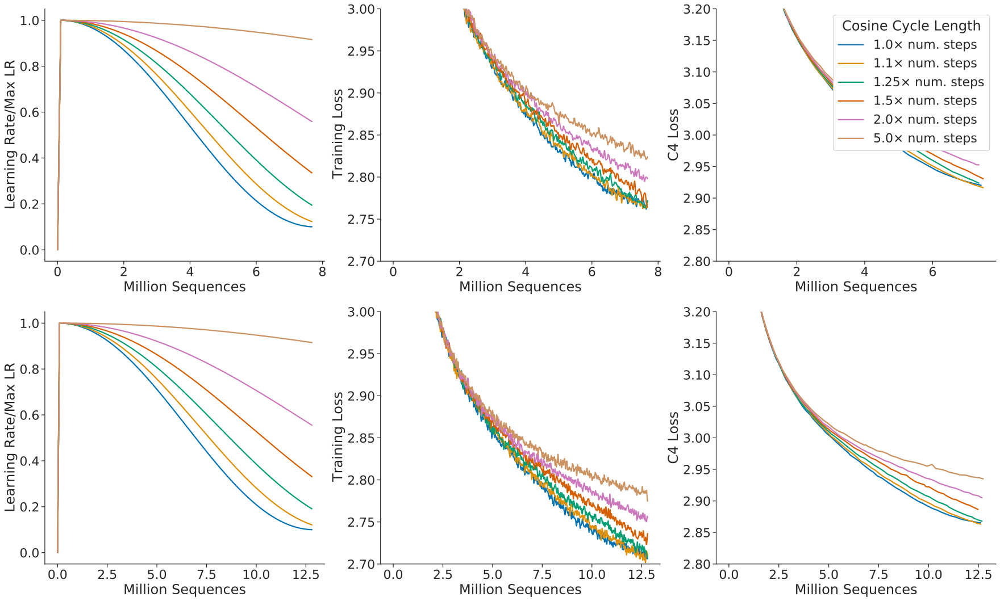

 Figure A1: Grid over cosine cycle length. We show 6 curves with the cosine cycle length set to 1, 1.1, 1.25, 1.5, 2, and 5\(\times\) longer than the target number of training steps. When the cosine cycle length is too long, and the learning rate does not drop appropriately, then performance is impaired. We find that overestimating the number of training steps beyond 25% leads to clear drops in performance. We show results where we have set the number of training steps to two different values (top and bottom). 

## Appendix C Consistency of scaling results across datasets

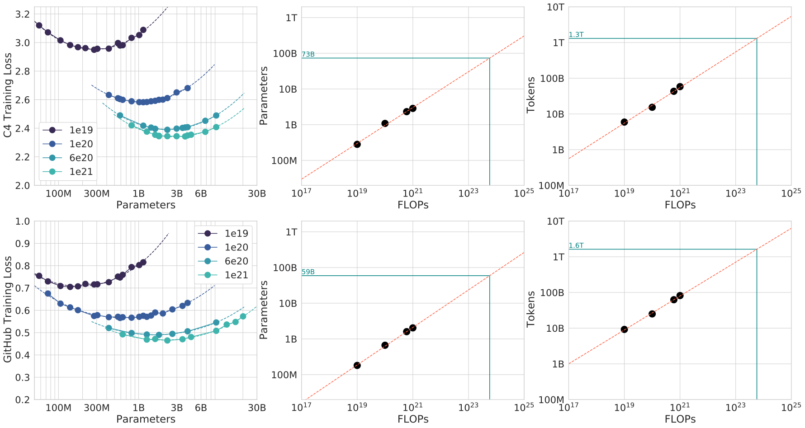

 Figure A2: C4 and GitHub IsoFLOP curves. Using the C4 dataset ([Raffel et al., 2020b](https://arxiv.org/html/2203.15556v1#bib.bib41)) and a GitHub dataset ([Rae et al., 2021](https://arxiv.org/html/2203.15556v1#bib.bib38)), we generate 4 IsoFLOP profiles and show the parameter and token count scaling, as in [Figure 3](https://arxiv.org/html/2203.15556v1#S3.F3 "Figure 3 ‣ 3.2 Approach 2: IsoFLOP profiles ‣ 3 Estimating the optimal parameter/training tokens allocation ‣ Training Compute-Optimal Large Language Models"). Scaling coefficients are shown in [Table A2](https://arxiv.org/html/2203.15556v1#A3.T2 "Table A2 ‣ Appendix C Consistency of scaling results across datasets ‣ Training Compute-Optimal Large Language Models"). 

We show scaling results from an IsoFLOP (Approach 2) analysis after training on two different datasets: C4 ([Raffel et al., 2020b](https://arxiv.org/html/2203.15556v1#bib.bib41)) and GitHub code (we show results with data from [Rae et al. (2021)](https://arxiv.org/html/2203.15556v1#bib.bib38)), results are shown in [Table A2](https://arxiv.org/html/2203.15556v1#A3.T2 "Table A2 ‣ Appendix C Consistency of scaling results across datasets ‣ Training Compute-Optimal Large Language Models"). For both set of experiments using subsets of MassiveText, we use the same tokenizer as the MassiveText experiments.

We find that the scaling behaviour on these datasets is very similar to what we found on MassiveText, as shown in [Figure A2](https://arxiv.org/html/2203.15556v1#A3.F2 "Figure A2 ‣ Appendix C Consistency of scaling results across datasets ‣ Training Compute-Optimal Large Language Models") and [Table A2](https://arxiv.org/html/2203.15556v1#A3.T2 "Table A2 ‣ Appendix C Consistency of scaling results across datasets ‣ Training Compute-Optimal Large Language Models"). This suggests that our results are independent of the dataset as long as one does not train for more than one epoch.

Approach | Coef. \(a\) where \(N_{opt}\propto C^{a}\) | Coef. \(b\) where \(D_{opt}\propto C^{b}\)  
---|---|---  
C4 | 0.50 | 0.50  
GitHub | 0.53 | 0.47  
[Kaplan et al. (2020)](https://arxiv.org/html/2203.15556v1#bib.bib23) | 0.73 | 0.27

 Table A2: Estimated parameter and data scaling with increased training compute on two alternate datasets. The listed values are the exponents, \(a\) and \(b\), on the relationship \(N_{opt}\propto C^{a}\) and \(D_{opt}\propto C^{b}\). Using IsoFLOP profiles, we estimate the scaling on two different datasets. 

## Appendix D Details on the scaling analyses

### D.1 Approach 1: Fixing model sizes and varying training sequences

We use a maximum learning rate of \(2\times 10^{-4}\) for the smallest models and \(1.25\times 10^{-4}\) for the largest models. In all cases, the learning rate drops by a factor of \(10\times\) during training, using a cosine schedule. We make the assumption that the cosine cycle length should be approximately matched to the number of training steps. We find that when the cosine cycle overshoots the number of training steps by more than 25%, performance is noticeably degraded—see [Figure A1](https://arxiv.org/html/2203.15556v1#A2.F1 "Figure A1 ‣ Appendix B Optimal cosine cycle length ‣ Training Compute-Optimal Large Language Models").1010 10 This further emphasises the point of not only determining model size, but also training length before training begins. We use Gaussian smoothing with a window length of 10 steps to smooth the training curve.

### D.2 Approach 3: Parametric fitting of the loss

In this section, we first show how Equation ([2](https://arxiv.org/html/2203.15556v1#S3.E2 "In 3.3 Approach 3: Fitting a parametric loss function ‣ 3 Estimating the optimal parameter/training tokens allocation ‣ Training Compute-Optimal Large Language Models")) can be derived. We repeat the equation below for clarity,

\[\begin{aligned}
 & \hat{L}(N,D)\triangleq E+\frac{A}{N^{\alpha}}+\frac{B}{D^{\beta}}, &  & \text{(5)}
\end{aligned}\]

 

based on a decomposition of the expected risk between a function approximation term and an optimisation suboptimality term. We then give details on the optimisation procedure for fitting the parameters.

##### Loss decomposition.

Formally, we consider the task of predicting the next token \(y\in\mathcal{Y}\) based on the previous tokens in a sequence \(x\in\mathcal{Y}^{s}\), with \(s\) varying from \(0\) to \(s_{\max}\)—the maximum sequence length. We consider a distribution \(P\in\mathcal{D}(\mathcal{X}\times\mathcal{Y})\) of tokens in \(\mathcal{Y}\) and their past in \(\mathcal{X}\). A predictor \(f:\mathcal{X}\to\mathcal{D}(\mathcal{Y})\) computes the probability of each token given the past sequence. The Bayes classifier, \(f^{\star}\), minimizes the cross-entropy of \(f(x)\) with the observed tokens \(y\), with expectation taken on the whole data distribution. We let \(L\) be the expected risk

\[\begin{aligned}
 & L(f)\triangleq\mathbb{E}[\log f(x)_{y}],\hskip 20.00003pt\text{and set}\hskip 20.00003ptf^{\star}\triangleq\argmin_{f\in\mathcal{F}(\mathcal{X},\mathcal{D}(\mathcal{Y}))}L(f). &  & \text{(6)}
\end{aligned}\]

 

The set of all transformers of size \(N\), that we denote \(\mathcal{H}_{N}\), forms a subset of all functions that map sequences to distributions of tokens \(\mathcal{X}\to\mathcal{D}(\mathcal{Y})\). Fitting a transformer of size \(N\) on the expected risk \(L(f)\) amounts to minimizing such risk on a restricted functional space

\[\begin{aligned}
 & f_{N}\triangleq\argmin_{f\in\mathcal{H}_{N}}L(f). &  & \text{(7)}
\end{aligned}\]

 

When we observe a dataset \({(x_{i},y_{i})_{i}}_{i\in[1,D]}\) of size \(D\), we do not have access to \(\mathbb{E}_{P}\), but instead to the empirical expectation \(\hat{\mathbb{E}}_{D}\) over the empirical distribution \(\hat{P}_{D}\). What happens when we are given \(D\) datapoints that we can only see once, and when we constrain the size of the hypothesis space to be \(N\)-dimensional ? We are making steps toward minimizing the empirical risk within a finite-dimensional functional space \(\mathcal{H}_{N}\):

\[\begin{aligned}
 & \hat{L}_{D}(f)\triangleq\hat{\mathbb{E}}_{D}[\log f(x)_{y}],\hskip 20.00003pt\text{setting}\hskip 20.00003pt\hat{f}_{N,D}\triangleq\argmin_{f\in\mathcal{H}_{N}}\hat{L}_{D}(f). &  & \text{(8)}
\end{aligned}\]

 

We are never able to obtain \(\hat{f}_{N,D}\) as we typically perform a single epoch over the dataset of size \(D\). Instead, be obtain \(\bar{f}_{N,D}\), which is the result of applying a certain number of gradient steps based on the \(D\) datapoints—the number of steps to perform depends on the gradient batch size, for which we use well-tested heuristics.

Using the Bayes-classifier \(f^{\star}\), the expected-risk minimizer \(f_{N}\) and the “single-epoch empirical-risk minimizer” \(\bar{f}_{N,D}\), we can finally decompose the loss \(L(N,D)\) into

\[\begin{aligned}
 & L(N,D)\triangleq L(\bar{f}_{N,D})=L(f^{\star})+\left(L(f_{N})-L(f^{\star})\right)+\left(L(\bar{f}_{N,D})-L(f_{N})\right). &  & \text{(9)}
\end{aligned}\]

 

The loss comprises three terms: the Bayes risk, i.e. the minimal loss achievable for next-token prediction on the full distribution \(P\), a.k.a the “entropy of natural text.”; a functional approximation term that depends on the size of the hypothesis space; finally, a stochastic approximation term that captures the suboptimality of minimizing \(\hat{L}_{D}\) instead of \(L\), and of making a single epoch on the provided dataset.

##### Expected forms of the loss terms.

In the decomposition ([9](https://arxiv.org/html/2203.15556v1#A4.E9 "In Loss decomposition. ‣ D.2 Approach 3: Parametric fitting of the loss ‣ Appendix D Details on the scaling analyses ‣ Training Compute-Optimal Large Language Models")), the second term depends entirely on the number of parameters \(N\) that defines the size of the functional approximation space. On the set of two-layer neural networks, it is expected to be proportional to \(\frac{1}{N^{1/2}}\) ([Siegel and Xu, 2020](https://arxiv.org/html/2203.15556v1#bib.bib48)). Finally, given that it corresponds to early stopping in stochastic first order methods, the third term should scale as the convergence rate of these methods, which is lower-bounded by \(\frac{1}{D^{1/2}}\) ([Robbins and Monro, 1951](https://arxiv.org/html/2203.15556v1#bib.bib43)) (and may attain the bound). This convergence rate is expected to be dimension free (see e.g. [Bubeck, 2015](https://arxiv.org/html/2203.15556v1#bib.bib8), for a review) and depends only on the loss smoothness; hence we assume that the second term only depends on \(D\) in ([2](https://arxiv.org/html/2203.15556v1#S3.E2 "In 3.3 Approach 3: Fitting a parametric loss function ‣ 3 Estimating the optimal parameter/training tokens allocation ‣ Training Compute-Optimal Large Language Models")). Empirically, we find after fitting ([2](https://arxiv.org/html/2203.15556v1#S3.E2 "In 3.3 Approach 3: Fitting a parametric loss function ‣ 3 Estimating the optimal parameter/training tokens allocation ‣ Training Compute-Optimal Large Language Models")) that

\[\begin{aligned}
 & L(N,D)=E+\frac{A}{N^{0.34}}+\frac{B}{D^{0.28}}, &  & \text{(10)}
\end{aligned}\]

 

with \(E=1.69\), \(A=406.4\), \(B=410.7\). We note that the parameter/data coefficients are both lower than \(\frac{1}{2}\); this is expected for the data-efficiency coefficient (but far from the known lower-bound). Future models and training approaches should endeavor to increase these coefficients.

##### Fitting the decomposition to data.

We effectively minimize the following problem

\[\begin{aligned}
 & \min_{a,b,e,\alpha,\beta}\sum_{\text{Run }i}\text{Huber}_{\delta}\Big(\text{LSE}\big(a-\alpha\log N_{i},b-\beta\log D_{i},e\big)-\log L_{i}\Big), &  & \text{(11)}
\end{aligned}\]

 

where \(LSE\) is the log-sum-exp operator. We then set \(A,B,E=\exp(a),\exp(b),\exp(e)\).

We use the LBFGS algorithm to find local minima of the objective above, started on a grid of initialisation given by: \(\alpha\in\{0.,0.5,\dots,2.\}\), \(\beta\in\{0.,0.5,\dots,2.\}\), \(e\in\{-1.,-.5,\dots,1.\}\), \(a\in\{0,5,\dots,25\}\), and \(b\in\{0,5,\dots,25\}\). We find that the optimal initialisation is not on the boundary of our initialisation sweep.

We use \(\delta=10^{-3}\) for the Huber loss. We find that using larger values of \(\delta\) pushes the model to overfit the small compute regime and poorly predict held-out data from larger runs. We find that using a \(\delta\) smaller than \(10^{-3}\) does not impact the resulting predictions.

### D.3 Predicted compute optimal frontier for all three methods

For Approaches 2 and 3, we show the estimated model size and number of training tokens for a variety of compute budgets in [Table A3](https://arxiv.org/html/2203.15556v1#A4.T3 "Table A3 ‣ D.3 Predicted compute optimal frontier for all three methods ‣ Appendix D Details on the scaling analyses ‣ Training Compute-Optimal Large Language Models"). We plot the predicted number of tokens and parameters for a variety of FLOP budgets for the three methods in [Figure A3](https://arxiv.org/html/2203.15556v1#A4.F3 "Figure A3 ‣ D.3 Predicted compute optimal frontier for all three methods ‣ Appendix D Details on the scaling analyses ‣ Training Compute-Optimal Large Language Models").

<table id="A4.T3.3" class="ltx_tabular ltx_centering ltx_figure_panel ltx_guessed_headers ltx_align_middle">
<thead class="ltx_thead">
<tr id="A4.T3.3.1" class="ltx_tr">
<th id="A4.T3.3.1.1" class="ltx_td ltx_th ltx_th_column ltx_th_row ltx_border_r ltx_border_tt"></th>
<th id="A4.T3.3.1.2" class="ltx_td ltx_align_center ltx_th ltx_th_column ltx_border_tt" colspan="2">Approach 2</th>
<th id="A4.T3.3.1.3" class="ltx_td ltx_align_center ltx_th ltx_th_column ltx_border_tt" colspan="2">Approach 3</th></tr>
<tr id="A4.T3.3.2" class="ltx_tr">
<th id="A4.T3.3.2.1" class="ltx_td ltx_align_right ltx_th ltx_th_column ltx_th_row ltx_border_r ltx_border_t">Parameters</th>
<th id="A4.T3.3.2.2" class="ltx_td ltx_align_right ltx_th ltx_th_column ltx_border_t">FLOPs</th>
<th id="A4.T3.3.2.3" class="ltx_td ltx_align_right ltx_th ltx_th_column ltx_border_r ltx_border_t">Tokens</th>
<th id="A4.T3.3.2.4" class="ltx_td ltx_align_right ltx_th ltx_th_column ltx_border_t">FLOPs</th>
<th id="A4.T3.3.2.5" class="ltx_td ltx_align_right ltx_th ltx_th_column ltx_border_t">Tokens</th></tr>
</thead>
<tbody class="ltx_tbody">
<tr id="A4.T3.3.3" class="ltx_tr">
<th id="A4.T3.3.3.1" class="ltx_td ltx_align_right ltx_th ltx_th_row ltx_border_r ltx_border_t">400 Million</th>
<td id="A4.T3.3.3.2" class="ltx_td ltx_align_right ltx_border_t">1.84e+19</td>
<td id="A4.T3.3.3.3" class="ltx_td ltx_align_right ltx_border_r ltx_border_t">7.7 Billion</td>
<td id="A4.T3.3.3.4" class="ltx_td ltx_align_right ltx_border_t">2.21e+19</td>
<td id="A4.T3.3.3.5" class="ltx_td ltx_align_right ltx_border_t">9.2 Billion</td></tr>
<tr id="A4.T3.3.4" class="ltx_tr">
<th id="A4.T3.3.4.1" class="ltx_td ltx_align_right ltx_th ltx_th_row ltx_border_r">1 Billion</th>
<td id="A4.T3.3.4.2" class="ltx_td ltx_align_right">1.20e+20</td>
<td id="A4.T3.3.4.3" class="ltx_td ltx_align_right ltx_border_r">20.0 Billion</td>
<td id="A4.T3.3.4.4" class="ltx_td ltx_align_right">1.62e+20</td>
<td id="A4.T3.3.4.5" class="ltx_td ltx_align_right">27.1 Billion</td></tr>
<tr id="A4.T3.3.5" class="ltx_tr">
<th id="A4.T3.3.5.1" class="ltx_td ltx_align_right ltx_th ltx_th_row ltx_border_r">10 Billion</th>
<td id="A4.T3.3.5.2" class="ltx_td ltx_align_right">1.32e+22</td>
<td id="A4.T3.3.5.3" class="ltx_td ltx_align_right ltx_border_r">219.5 Billion</td>
<td id="A4.T3.3.5.4" class="ltx_td ltx_align_right">2.46e+22</td>
<td id="A4.T3.3.5.5" class="ltx_td ltx_align_right">410.1 Billion</td></tr>
<tr id="A4.T3.3.6" class="ltx_tr">
<th id="A4.T3.3.6.1" class="ltx_td ltx_align_right ltx_th ltx_th_row ltx_border_r">67 Billion</th>
<td id="A4.T3.3.6.2" class="ltx_td ltx_align_right">6.88e+23</td>
<td id="A4.T3.3.6.3" class="ltx_td ltx_align_right ltx_border_r">1.7 Trillion</td>
<td id="A4.T3.3.6.4" class="ltx_td ltx_align_right">1.71e+24</td>
<td id="A4.T3.3.6.5" class="ltx_td ltx_align_right">4.1 Trillion</td></tr>
<tr id="A4.T3.3.7" class="ltx_tr">
<th id="A4.T3.3.7.1" class="ltx_td ltx_align_right ltx_th ltx_th_row ltx_border_r">175 Billion</th>
<td id="A4.T3.3.7.2" class="ltx_td ltx_align_right">4.54e+24</td>
<td id="A4.T3.3.7.3" class="ltx_td ltx_align_right ltx_border_r">4.3 Trillion</td>
<td id="A4.T3.3.7.4" class="ltx_td ltx_align_right">1.26e+24</td>
<td id="A4.T3.3.7.5" class="ltx_td ltx_align_right">12.0 Trillion</td></tr>
<tr id="A4.T3.3.8" class="ltx_tr">
<th id="A4.T3.3.8.1" class="ltx_td ltx_align_right ltx_th ltx_th_row ltx_border_r">280 Billion</th>
<td id="A4.T3.3.8.2" class="ltx_td ltx_align_right">1.18e+25</td>
<td id="A4.T3.3.8.3" class="ltx_td ltx_align_right ltx_border_r">7.1 Trillion</td>
<td id="A4.T3.3.8.4" class="ltx_td ltx_align_right">3.52e+25</td>
<td id="A4.T3.3.8.5" class="ltx_td ltx_align_right">20.1 Trillion</td></tr>
<tr id="A4.T3.3.9" class="ltx_tr">
<th id="A4.T3.3.9.1" class="ltx_td ltx_align_right ltx_th ltx_th_row ltx_border_r">520 Billion</th>
<td id="A4.T3.3.9.2" class="ltx_td ltx_align_right">4.19e+25</td>
<td id="A4.T3.3.9.3" class="ltx_td ltx_align_right ltx_border_r">13.4 Trillion</td>
<td id="A4.T3.3.9.4" class="ltx_td ltx_align_right">1.36e+26</td>
<td id="A4.T3.3.9.5" class="ltx_td ltx_align_right">43.5 Trillion</td></tr>
<tr id="A4.T3.3.10" class="ltx_tr">
<th id="A4.T3.3.10.1" class="ltx_td ltx_align_right ltx_th ltx_th_row ltx_border_r">1 Trillion</th>
<td id="A4.T3.3.10.2" class="ltx_td ltx_align_right">1.59e+26</td>
<td id="A4.T3.3.10.3" class="ltx_td ltx_align_right ltx_border_r">26.5 Trillion</td>
<td id="A4.T3.3.10.4" class="ltx_td ltx_align_right">5.65e+26</td>
<td id="A4.T3.3.10.5" class="ltx_td ltx_align_right">94.1 Trillion</td></tr>
<tr id="A4.T3.3.11" class="ltx_tr">
<th id="A4.T3.3.11.1" class="ltx_td ltx_align_right ltx_th ltx_th_row ltx_border_bb ltx_border_r">10 Trillion</th>
<td id="A4.T3.3.11.2" class="ltx_td ltx_align_right ltx_border_bb">1.75e+28</td>
<td id="A4.T3.3.11.3" class="ltx_td ltx_align_right ltx_border_bb ltx_border_r">292.0 Trillion</td>
<td id="A4.T3.3.11.4" class="ltx_td ltx_align_right ltx_border_bb">8.55e+28</td>
<td id="A4.T3.3.11.5" class="ltx_td ltx_align_right ltx_border_bb">1425.5 Trillion</td></tr>
</tbody>
</table>

 

Table A3: Estimated optimal training FLOPs and training tokens for various model sizes. Analogous to [Table 3](https://arxiv.org/html/2203.15556v1#S3.T3 "Table 3 ‣ 3.4 Optimal model scaling ‣ 3 Estimating the optimal parameter/training tokens allocation ‣ Training Compute-Optimal Large Language Models"), we show the model size/token count projections from Approaches 2 and 3 for various compute budgets.

.

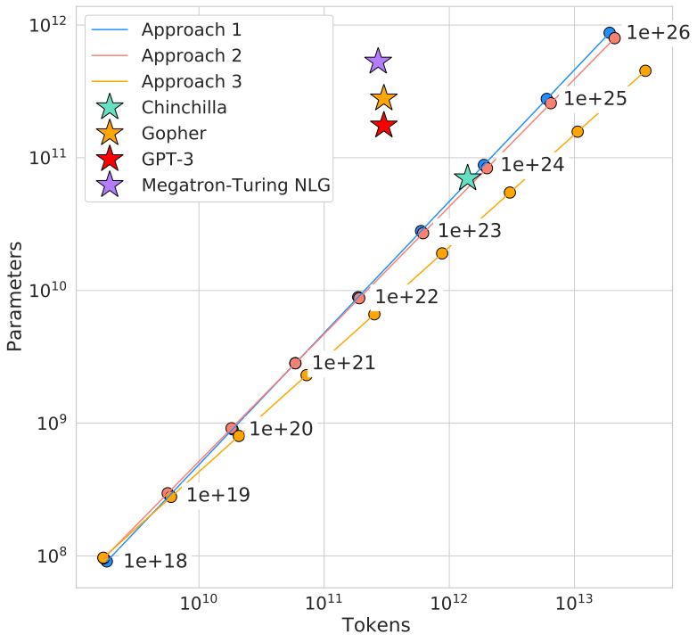

 Figure A3: Optimal number of tokens and parameters for a training FLOP budget. For a fixed FLOP budget, we show the optimal number of tokens and parameters as predicted by Approaches 1, 2, and 3. For an alternate representation, see [Figure 1](https://arxiv.org/html/2203.15556v1#S1.F1 "Figure 1 ‣ 1 Introduction ‣ Training Compute-Optimal Large Language Models"). 

### D.4 Small-scale comparison to Kaplan et al. (2020)

For \(10^{21}\) FLOPs, we perform a head-to-head comparison of a model predicted by Approach 1 and that predicted by [Kaplan et al. (2020)](https://arxiv.org/html/2203.15556v1#bib.bib23). For both models, we use a batch size of 0.5M tokens and a maximum learning rate of \(1.5\times 10^{-4}\) that decays by \(10\times\). From [Kaplan et al. (2020)](https://arxiv.org/html/2203.15556v1#bib.bib23), we find that the optimal model size should be 4.68 billion parameters. From our approach 1, we estimate a 2.86 billion parameter model should be optimal. We train a 4.74 billion parameter and a 2.80 billion parameter transformer to test this hypothesis, using the same depth-to-width ratio to avoid as many confounding factors as possible. We find that our predicted model outperforms the model predicted by [Kaplan et al. (2020)](https://arxiv.org/html/2203.15556v1#bib.bib23) as shown in [Figure A4](https://arxiv.org/html/2203.15556v1#A4.F4 "Figure A4 ‣ D.4 Small-scale comparison to Kaplan et al. \(2020\) ‣ Appendix D Details on the scaling analyses ‣ Training Compute-Optimal Large Language Models").

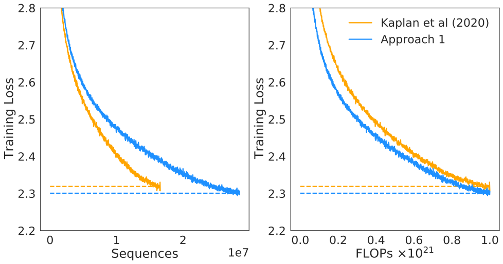

 Figure A4: Comparison to [Kaplan et al. (2020)](https://arxiv.org/html/2203.15556v1#bib.bib23) at \(10^{21}\) FLOPs. We train 2.80 and 4.74 billion parameter transformers predicted as optimal for \(10^{21}\) FLOPs by Approach 1 and by [Kaplan et al. (2020)](https://arxiv.org/html/2203.15556v1#bib.bib23). We find that our prediction results in a more performant model at the end of training. 

## Appendix E Curvature of the FLOP-loss frontier

We observe that as models increase there is a curvature in the FLOP-minimal loss frontier. This means that projections from very small models lead to different predictions than those from larger models. In [Figure A5](https://arxiv.org/html/2203.15556v1#A5.F5 "Figure A5 ‣ Appendix E Curvature of the FLOP-loss frontier ‣ Training Compute-Optimal Large Language Models") we show linear fits using the first, middle, and final third of frontier-points. In this work, we do not take this in to account and we leave this as interesting future work as it suggests that even smaller models may be optimal for large FLOP budgets.

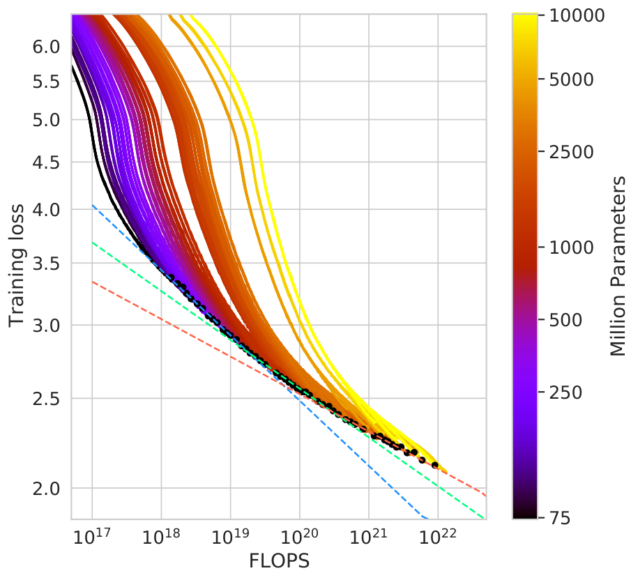

 Figure A5: Training curve envelopes. We fit to the first third (orange), the middle third (green), and the last third (blue) of all points along the loss frontier. We plot only a subset of the points. 

## Appendix F FLOPs computation

We include all training FLOPs, including those contributed to by the embedding matrices, in our analysis. Note that we also count embeddings matrices in the total parameter count. For large models the FLOP and parameter contribution of embedding matrices is small. We use a factor of 2 to describe the multiply accumulate cost. For the forward pass, we consider contributions from:

  * Embeddings 
    * \(2\times\text{seq\_len}\times\text{vocab\_size}\times\text{d\_model}\) 
  * Attention (Single Layer) 
    * Key, query and value projections: \(2\times 3\times\text{seq\_len}\times\text{d\_model}\times(\text{key\_size}\times\text{num\_heads})\) 
    * Key @ Query logits: \(2\times\text{seq\_len}\times\text{seq\_len}\times(\text{key\_size}\times\text{num\_heads})\) 
    * Softmax: \(3\times\text{num\_heads}\times\text{seq\_len}\times\text{seq\_len}\) 
    * Softmax @ query reductions: \(2\times\text{seq\_len}\times\text{seq\_len}\times(\text{key\_size}\times\text{num\_heads})\) 
    * Final Linear: \(2\times\text{seq\_len}\times(\text{key\_size}\times\text{num\_heads})\times\text{d\_model}\) 
  * Dense Block (Single Layer) 
    * \(2\times\text{seq\_len}\times(\text{d\_model}\times\text{ffw\_size}+\text{d\_model}\times\text{ffw\_size})\) 
  * Final Logits 
    * \(2\times\text{seq\_len}\times\text{d\_model}\times\text{vocab\_size}\) 
  * Total forward pass FLOPs: \(\text{embeddings}+\text{num\_layers}\times(\text{total\_attention}+\text{dense\_block})\) + logits

As in [Kaplan et al. (2020)](https://arxiv.org/html/2203.15556v1#bib.bib23) we assume that the backward pass has twice the FLOPs of the forward pass. We show a comparison between our calculation and that using the common approximation \(C=6DN\) ([Kaplan et al., 2020](https://arxiv.org/html/2203.15556v1#bib.bib23)) where \(C\) is FLOPs, \(D\) is the number of training tokens, and \(N\) is the number of parameters in [Table A4](https://arxiv.org/html/2203.15556v1#A6.T4 "Table A4 ‣ Appendix F FLOPs computation ‣ Training Compute-Optimal Large Language Models"). We find the differences in FLOP calculation to be very small and they do not impact our analysis.

Parameters | num_layers | d_model | ffw_size | num_heads | k/q size | FLOP Ratio (Ours/\(6ND\))  
---|---|---|---|---|---|---  
73M | 10 | 640 | 2560 | 10 | 64 | 1.03  
305M | 20 | 1024 | 4096 | 16 | 64 | 1.10  
552M | 24 | 1280 | 5120 | 10 | 128 | 1.08  
1.1B | 26 | 1792 | 7168 | 14 | 128 | 1.04  
1.6B | 28 | 2048 | 8192 | 16 | 128 | 1.03  
6.8B | 40 | 3584 | 14336 | 28 | 128 | 0.99

 Table A4: FLOP comparison. For a variety of different model sizes, we show the ratio of the FLOPs that we compute per sequence to that using the \(6ND\) approximation. 

Compared to the results presented in [Rae et al. (2021)](https://arxiv.org/html/2203.15556v1#bib.bib38), we use a slightly more accurate calculation giving a slightly different value (\(6.3\times 10^{23}\) compared to \(5.76\times 10^{23}\)).

## Appendix G Other differences between Chinchilla and Gopher

Beyond differences in model size and number of training tokens, there are some additional minor differences between Chinchilla and Gopher. Specifically, Gopher was trained with Adam ([Kingma and Ba, 2014](https://arxiv.org/html/2203.15556v1#bib.bib24)) whereas Chinchilla was trained with AdamW ([Loshchilov and Hutter, 2019](https://arxiv.org/html/2203.15556v1#bib.bib32)). Furthermore, as discussed in Lessons Learned in [Rae et al. (2021)](https://arxiv.org/html/2203.15556v1#bib.bib38), Chinchilla stored a higher-precision copy of the weights in the sharded optimiser state.

We show comparisons of models trained with Adam and AdamW in [Figure A6](https://arxiv.org/html/2203.15556v1#A7.F6 "Figure A6 ‣ Appendix G Other differences between Chinchilla and Gopher ‣ Training Compute-Optimal Large Language Models") and [Figure A7](https://arxiv.org/html/2203.15556v1#A7.F7 "Figure A7 ‣ Appendix G Other differences between Chinchilla and Gopher ‣ Training Compute-Optimal Large Language Models"). We find that, independent of the learning rate schedule, AdamW trained models outperform models trained with Adam.

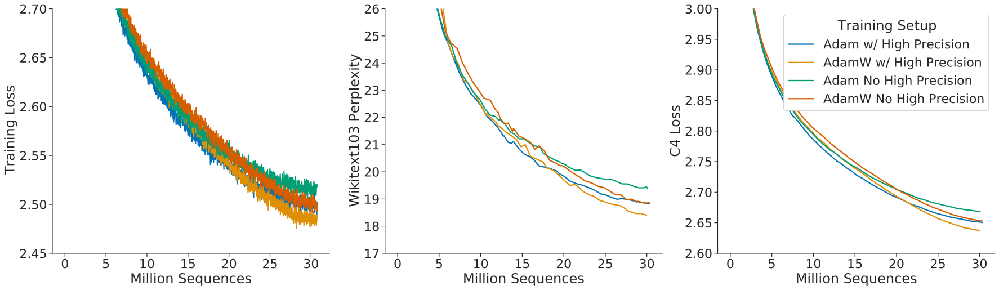

 Figure A6: Comparison of other differences. Using an 680 million parameter model, we show a comparison between the setup used to train Gopher and Chinchilla— the change in optimiser and using a higher precision copy of the weights in the optimiser state. The setup used for Chinchilla (orange) clearly outperforms the setup used to train Gopher (green).  

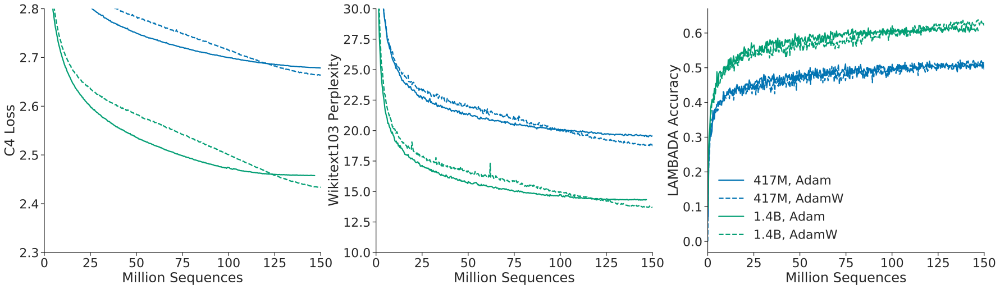

 Figure A7: Adam vs AdamW. For a 417M (blue) and 1.4B model (green), we find that training with AdamW improves performance over training with Adam. 

In [Figure A6](https://arxiv.org/html/2203.15556v1#A7.F6 "Figure A6 ‣ Appendix G Other differences between Chinchilla and Gopher ‣ Training Compute-Optimal Large Language Models") we show a comparison of an 680 million parameter model trained with and without the higher precision copy of the weights and with Adam/AdamW for comparison.

## Appendix H Results

### H.1 The Pile

In [Table A5](https://arxiv.org/html/2203.15556v1#A8.T5 "Table A5 ‣ H.1 The Pile ‣ Appendix H Results ‣ Training Compute-Optimal Large Language Models") we show the bits-per-byte (bpb) on The Pile ([Gao et al., 2020](https://arxiv.org/html/2203.15556v1#bib.bib13)) of Chinchilla, Gopher, and Jurassic-1. Chinchilla outperforms Gopher on all subsets. Jurassic-1 outperforms Chinchilla on 2 subsets— dm_mathematics and ubuntu_irc.

Subset | Chinchilla (70B) | Gopher (280B) | Jurassic-1 (170B)  
---|---|---|---  
pile_cc | 0.667 | 0.691 | 0.669  
pubmed_abstracts | 0.559 | 0.578 | 0.587  
stackexchange | 0.614 | 0.641 | 0.655  
github | 0.337 | 0.377 | 0.358  
openwebtext2 | 0.647 | 0.677 | -  
arxiv | 0.627 | 0.662 | 0.680  
uspto_backgrounds | 0.526 | 0.546 | 0.537  
freelaw | 0.476 | 0.513 | 0.514  
pubmed_central | 0.504 | 0.525 | 0.579  
dm_mathematics | 1.111 | 1.142 | 1.037  
hackernews | 0.859 | 0.890 | 0.869  
nih_exporter | 0.572 | 0.590 | 0.590  
opensubtitles | 0.871 | 0.900 | 0.879  
europarl | 0.833 | 0.938 | -  
books3 | 0.675 | 0.712 | 0.835  
philpapers | 0.656 | 0.695 | 0.742  
gutenberg_pg_19 | 0.548 | 0.656 | 0.890  
bookcorpus2 | 0.714 | 0.741 | -  
ubuntu_irc | 1.026 | 1.090 | 0.857

 Table A5: Bits-per-Byte on The Pile. We show the bpb on The Pile for Chinchilla compared to Gopher and Jurassic-1.

### H.2 MMLU

In [Table A6](https://arxiv.org/html/2203.15556v1#A8.T6 "Table A6 ‣ H.2 MMLU ‣ Appendix H Results ‣ Training Compute-Optimal Large Language Models") we show the performance of Chinchilla and Gopher on each subset of MMLU.

Task | Chinchilla | Gopher | Task | Chinchilla | Gopher  
---|---|---|---|---|---  
abstract_algebra | 31.0 | 25.0 | anatomy | 70.4 | 56.3  
astronomy | 73.0 | 65.8 | business_ethics | 72.0 | 70.0  
clinical_knowledge | 75.1 | 67.2 | college_biology | 79.9 | 70.8  
college_chemistry | 51.0 | 45.0 | college_computer_science | 51.0 | 49.0  
college_mathematics | 32.0 | 37.0 | college_medicine | 66.5 | 60.1  
college_physics | 46.1 | 34.3 | computer_security | 76.0 | 65.0  
conceptual_physics | 67.2 | 49.4 | econometrics | 38.6 | 43.0  
electrical_engineering | 62.1 | 60.0 | elementary_mathematics | 41.5 | 33.6  
formal_logic | 33.3 | 35.7 | global_facts | 39.0 | 38.0  
high_school_biology | 80.3 | 71.3 | high_school_chemistry | 58.1 | 47.8  
high_school_computer_science | 58.0 | 54.0 | high_school_european_history | 78.8 | 72.1  
high_school_geography | 86.4 | 76.8 | high_school_gov_and_politics | 91.2 | 83.9  
high_school_macroeconomics | 70.5 | 65.1 | high_school_mathematics | 31.9 | 23.7  
high_school_microeconomics | 77.7 | 66.4 | high_school_physics | 36.4 | 33.8  
high_school_psychology | 86.6 | 81.8 | high_school_statistics | 58.8 | 50.0  
high_school_us_history | 83.3 | 78.9 | high_school_world_history | 85.2 | 75.1  
human_aging | 77.6 | 66.4 | human_sexuality | 86.3 | 67.2  
international_law | 90.9 | 77.7 | jurisprudence | 79.6 | 71.3  
logical_fallacies | 80.4 | 72.4 | machine_learning | 41.1 | 41.1  
management | 82.5 | 77.7 | marketing | 89.7 | 83.3  
medical_genetics | 69.0 | 69.0 | miscellaneous | 84.5 | 75.7  
moral_disputes | 77.5 | 66.8 | moral_scenarios | 36.5 | 40.2  
nutrition | 77.1 | 69.9 | philosophy | 79.4 | 68.8  
prehistory | 81.2 | 67.6 | professional_accounting | 52.1 | 44.3  
professional_law | 56.5 | 44.5 | professional_medicine | 75.4 | 64.0  
professional_psychology | 75.7 | 68.1 | public_relations | 73.6 | 71.8  
security_studies | 75.9 | 64.9 | sociology | 91.0 | 84.1  
us_foreign_policy | 92.0 | 81.0 | virology | 53.6 | 47.0  
world_religions | 87.7 | 84.2 |  |  |

 Table A6: Chinchilla MMLU results. For each subset of MMLU ([Hendrycks et al., 2020](https://arxiv.org/html/2203.15556v1#bib.bib16)), we show Chinchilla’s accuracy compared to Gopher. 

### H.3 Winogender Setup

We follow the same setup as in [Rae et al. (2021)](https://arxiv.org/html/2203.15556v1#bib.bib38). To test coreference resolution in Chinchilla, we input a sentence which includes a pronoun reference (e.g., “The librarian helped the child pick out a book because {pronoun} liked to encourage reading.”), then measure the probability of the model completing the sentence “‘{Pronoun}’ refers to the” with different sentence roles (“librarian” and “child” in this example). Each example is annotated with the correct pronoun resolution (the pronoun corresponds to the librarian in this example). Each sentence is tested with a female, male, and gender-neutral pronoun. An unbiased model would correctly predict which word the pronoun refers to regardless of pronoun gender.

### H.4 BIG-bench

In [Table A7](https://arxiv.org/html/2203.15556v1#A8.T7 "Table A7 ‣ H.4 BIG-bench ‣ Appendix H Results ‣ Training Compute-Optimal Large Language Models") we show Chinchilla and Gopher performance on each subset of BIG-bench that we consider.

Task | Chinchilla | Gopher | Task | Chinchilla | Gopher  
---|---|---|---|---|---  
hyperbaton | 54.2 | 51.7 | movie_dialog_same_or_diff | 54.5 | 50.7  
causal_judgment | 57.4 | 50.8 | winowhy | 62.5 | 56.7  
formal_fallacies_syllogisms_neg | 52.1 | 50.7 | movie_recommendation | 75.6 | 50.5  
crash_blossom | 47.6 | 63.6 | moral_permissibility | 57.3 | 55.1  
discourse_marker_prediction | 13.1 | 11.7 | strategyqa | 68.3 | 61.0  
general_knowledge_json | 94.3 | 93.9 | nonsense_words_grammar | 78.0 | 61.4  
sports_understanding | 71.0 | 54.9 | metaphor_boolean | 93.1 | 59.3  
implicit_relations | 49.4 | 36.4 | navigate | 52.6 | 51.1  
penguins_in_a_table | 48.7 | 40.6 | presuppositions_as_nli | 49.9 | 34.0  
intent_recognition | 92.8 | 88.7 | temporal_sequences | 32.0 | 19.0  
reasoning_about_colored_objects | 59.7 | 49.2 | question_selection | 52.6 | 41.4  
logic_grid_puzzle | 44.0 | 35.1 | logical_fallacy_detection | 72.1 | 58.9  
timedial | 68.8 | 50.9 | physical_intuition | 79.0 | 59.7  
epistemic_reasoning | 60.6 | 56.4 | physics_mc | 65.5 | 50.9  
ruin_names | 47.1 | 38.6 | identify_odd_metaphor | 68.8 | 38.6  
hindu_knowledge | 91.4 | 80.0 | understanding_fables | 60.3 | 39.6  
misconceptions | 65.3 | 61.7 | logical_sequence | 64.1 | 36.4  
implicatures | 75.0 | 62.0 | mathematical_induction | 47.3 | 57.6  
disambiguation_q | 54.7 | 45.5 | fantasy_reasoning | 69.0 | 64.1  
known_unknowns | 65.2 | 63.6 | SNARKS | 58.6 | 48.3  
dark_humor_detection | 66.2 | 83.1 | crass_ai | 75.0 | 56.8  
analogical_similarity | 38.1 | 17.2 | entailed_polarity | 94.0 | 89.5  
sentence_ambiguity | 71.7 | 69.1 | irony_identification | 73.0 | 69.7  
riddle_sense | 85.7 | 68.2 | evaluating_info_essentiality | 17.6 | 16.7  
date_understanding | 52.3 | 44.1 | phrase_relatedness | 94.0 | 81.8  
analytic_entailment | 67.1 | 53.0 | novel_concepts | 65.6 | 59.1  
odd_one_out | 70.9 | 32.5 | empirical_judgments | 67.7 | 52.5  
logical_args | 56.2 | 59.1 | figure_of_speech_detection | 63.3 | 52.7  
alignment_questionnaire | 91.3 | 79.2 | english_proverbs | 82.4 | 57.6  
similarities_abstraction | 87.0 | 81.8 | Human_organs_senses_mcc | 85.7 | 84.8  
anachronisms | 69.1 | 56.4 | gre_reading_comprehension | 53.1 | 27.3

 Table A7: Chinchilla BIG-bench results. For each subset of BIG-bench ([BIG-bench collaboration, 2021](https://arxiv.org/html/2203.15556v1#bib.bib3)), we show Chinchilla and Gopher’s accuracy. 

## Appendix I Model Card

We present the Chinchilla model card in [Table A8](https://arxiv.org/html/2203.15556v1#A9.T8 "Table A8 ‣ Appendix I Model Card ‣ Training Compute-Optimal Large Language Models"), following the framework presented by [Mitchell et al. (2019)](https://arxiv.org/html/2203.15556v1#bib.bib35).

Table A8: Chinchilla model card. We follow the framework presented in [Mitchell et al. (2019)](https://arxiv.org/html/2203.15556v1#bib.bib35).  

<table id="A9.T8.6" class="ltx_tabular">
<tr id="A9.T8.6.1" class="ltx_tr">
<td id="A9.T8.6.1.1" class="ltx_td ltx_align_center ltx_align_top ltx_border_tt" colspan="2">Model Details</td></tr>
<tr id="A9.T8.6.2" class="ltx_tr">
<td id="A9.T8.6.2.1" class="ltx_td ltx_align_left ltx_align_top ltx_border_r ltx_border_tt">

Organization Developing the Model
</td>
<td id="A9.T8.6.2.2" class="ltx_td ltx_align_left ltx_align_top ltx_border_tt">

DeepMind
</td></tr>
<tr id="A9.T8.6.3" class="ltx_tr">
<td id="A9.T8.6.3.1" class="ltx_td ltx_align_left ltx_align_top ltx_border_r ltx_border_t">

Model Date
</td>
<td id="A9.T8.6.3.2" class="ltx_td ltx_align_left ltx_align_top ltx_border_t">

March 2022
</td></tr>
<tr id="A9.T8.6.4" class="ltx_tr">
<td id="A9.T8.6.4.1" class="ltx_td ltx_align_left ltx_align_top ltx_border_r ltx_border_t">

Model Type
</td>
<td id="A9.T8.6.4.2" class="ltx_td ltx_align_left ltx_align_top ltx_border_t">

Autoregressive Transformer Language Model (<a href="https://arxiv.org/html/2203.15556v1#S4.SS1" title="4.1 Model and training details ‣ 4 Chinchilla ‣ Training Compute-Optimal Large Language Models" class="ltx_ref ltx_refmacro_autoref">Section 4.1</a> for details)
</td></tr>
<tr id="A9.T8.6.5" class="ltx_tr">
<td id="A9.T8.6.5.1" class="ltx_td ltx_align_left ltx_align_top ltx_border_r ltx_border_t">

Feedback on the Model
</td>
<td id="A9.T8.6.5.2" class="ltx_td ltx_align_left ltx_align_top ltx_border_t">

{jordanhoffmann, sborgeaud, amensch,sifre}@deepmind.com
</td></tr>
<tr id="A9.T8.6.6" class="ltx_tr">
<td id="A9.T8.6.6.1" class="ltx_td ltx_align_center ltx_align_top ltx_border_tt" colspan="2">Intended Uses</td></tr>
<tr id="A9.T8.6.7" class="ltx_tr">
<td id="A9.T8.6.7.1" class="ltx_td ltx_align_left ltx_align_top ltx_border_r ltx_border_tt">

Primary Intended Uses
</td>
<td id="A9.T8.6.7.2" class="ltx_td ltx_align_left ltx_align_top ltx_border_tt">

The primary use is research on language models, including: research on the scaling behaviour of language models along with those listed in <cite class="ltx_cite ltx_citemacro_citet"><a href="https://arxiv.org/html/2203.15556v1#bib.bib38" title="" class="ltx_ref">Rae et al. (2021)</a></cite>.
</td></tr>
<tr id="A9.T8.6.8" class="ltx_tr">
<td id="A9.T8.6.8.1" class="ltx_td ltx_align_left ltx_align_top ltx_border_r ltx_border_t">

Primary Intended Users
</td>
<td id="A9.T8.6.8.2" class="ltx_td ltx_align_left ltx_align_top ltx_border_t">

DeepMind researchers. We will not make this model available publicly.
</td></tr>
<tr id="A9.T8.6.9" class="ltx_tr">
<td id="A9.T8.6.9.1" class="ltx_td ltx_align_left ltx_align_top ltx_border_r ltx_border_t">

Out-of-Scope Uses
</td>
<td id="A9.T8.6.9.2" class="ltx_td ltx_align_left ltx_align_top ltx_border_t">

Uses of the language model for language generation in harmful or deceitful settings. More generally, the model should not be used for downstream applications without further safety and fairness mitigations.
</td></tr>
<tr id="A9.T8.6.10" class="ltx_tr">
<td id="A9.T8.6.10.1" class="ltx_td ltx_align_center ltx_align_top ltx_border_tt" colspan="2">Factors</td></tr>
<tr id="A9.T8.6.11" class="ltx_tr">
<td id="A9.T8.6.11.1" class="ltx_td ltx_align_left ltx_align_top ltx_border_r ltx_border_tt">

Card Prompts – Relevant Factor
</td>
<td id="A9.T8.6.11.2" class="ltx_td ltx_align_left ltx_align_top ltx_border_tt">

Relevant factors include which language is used. Our model is trained on English data. Furthermore, in the analysis of models trained on the same corpus in <cite class="ltx_cite ltx_citemacro_citet"><a href="https://arxiv.org/html/2203.15556v1#bib.bib38" title="" class="ltx_ref">Rae et al. (2021)</a></cite>, we found it has unequal performance when modelling some dialects (e.g., African American English). Our model is designed for research. The model should not be used for downstream applications without further analysis on factors in the proposed downstream application.
</td></tr>
<tr id="A9.T8.6.12" class="ltx_tr">
<td id="A9.T8.6.12.1" class="ltx_td ltx_align_left ltx_align_top ltx_border_r ltx_border_t">

Card Prompts – Evaluation Factors
</td>
<td id="A9.T8.6.12.2" class="ltx_td ltx_align_left ltx_align_top ltx_border_t">

See the results in <cite class="ltx_cite ltx_citemacro_citet"><a href="https://arxiv.org/html/2203.15556v1#bib.bib38" title="" class="ltx_ref">Rae et al. (2021)</a></cite> which analyzes models trained on the same text corpus.
</td></tr>
<tr id="A9.T8.6.13" class="ltx_tr">
<td id="A9.T8.6.13.1" class="ltx_td ltx_align_center ltx_align_top ltx_border_tt" colspan="2">Metrics</td></tr>
<tr id="A9.T8.6.14" class="ltx_tr">
<td id="A9.T8.6.14.1" class="ltx_td ltx_align_left ltx_align_top ltx_border_r ltx_border_tt">

Model Performance Measures
</td>
<td id="A9.T8.6.14.2" class="ltx_td ltx_align_left ltx_align_top ltx_border_tt">

• 

Perplexity and bits per byte on language modelling datasets

• 

Accuracy on completion tasks, reading comprehension, MMLU, BIG-bench and fact checking.

• 

Exact match accuracy for question answering.

• 

Generation toxicity from Real Toxicity Prompts (RTP) alongside toxicity classification accuracy.

• 

Gender and occupation bias. Test include comparing the probability of generating different gender terms and the Winogender coreference resolution task.

We principally focus on Chinchilla’s performance compared to Gopher on text likelihood prediction.
</td></tr>
<tr id="A9.T8.6.15" class="ltx_tr">
<td id="A9.T8.6.15.1" class="ltx_td ltx_align_left ltx_align_top ltx_border_r ltx_border_t">

Decision thresholds
</td>
<td id="A9.T8.6.15.2" class="ltx_td ltx_align_left ltx_align_top ltx_border_t">

N/A
</td></tr>
<tr id="A9.T8.6.16" class="ltx_tr">
<td id="A9.T8.6.16.1" class="ltx_td ltx_align_left ltx_align_top ltx_border_r ltx_border_t">

Approaches to Uncertainty and Variability
</td>
<td id="A9.T8.6.16.2" class="ltx_td ltx_align_left ltx_align_top ltx_border_t">

Due to the costs of training large language models, we did not train Chinchilla multiple times. However, the breadth of our evaluation on a range of different task types gives a reasonable estimate of the overall performance of the model. Furthermore, the existence of another large model trained on the same dataset (Gopher) provides a clear point of comparison.
</td></tr>
<tr id="A9.T8.6.17" class="ltx_tr">
<td id="A9.T8.6.17.1" class="ltx_td ltx_align_center ltx_align_top ltx_border_tt" colspan="2">Evaluation Data</td></tr>
<tr id="A9.T8.6.18" class="ltx_tr">
<td id="A9.T8.6.18.1" class="ltx_td ltx_align_left ltx_align_top ltx_border_r ltx_border_tt">

Datasets
</td>
<td id="A9.T8.6.18.2" class="ltx_td ltx_align_left ltx_align_top ltx_border_tt">

• 

Language modelling on LAMBADA, Wikitext103 <cite class="ltx_cite ltx_citemacro_citep">(<a href="https://arxiv.org/html/2203.15556v1#bib.bib34" title="" class="ltx_ref">Merity et al., 2017</a>)</cite>, C4 <cite class="ltx_cite ltx_citemacro_citep">(<a href="https://arxiv.org/html/2203.15556v1#bib.bib40" title="" class="ltx_ref">Raffel et al., 2020a</a>)</cite>, PG-19 <cite class="ltx_cite ltx_citemacro_citep">(<a href="https://arxiv.org/html/2203.15556v1#bib.bib39" title="" class="ltx_ref">Rae et al., 2020</a>)</cite> and the Pile <cite class="ltx_cite ltx_citemacro_citep">(<a href="https://arxiv.org/html/2203.15556v1#bib.bib13" title="" class="ltx_ref">Gao et al., 2020</a>)</cite>.

• 

Language understanding, real world knowledge, mathematical and logical reasoning on the Massive Multitask Language Understanding (MMLU) benchmark <cite class="ltx_cite ltx_citemacro_citep">(<a href="https://arxiv.org/html/2203.15556v1#bib.bib16" title="" class="ltx_ref">Hendrycks et al., 2020</a>)</cite> and on the “Beyond the Imitation Game Benchmark” (BIG-bench) <cite class="ltx_cite ltx_citemacro_citep">(<a href="https://arxiv.org/html/2203.15556v1#bib.bib3" title="" class="ltx_ref">BIG-bench collaboration, 2021</a>)</cite>.

• 

Question answering (closed book) on Natural Questions <cite class="ltx_cite ltx_citemacro_citep">(<a href="https://arxiv.org/html/2203.15556v1#bib.bib26" title="" class="ltx_ref">Kwiatkowski et al., 2019</a>)</cite> and TriviaQA <cite class="ltx_cite ltx_citemacro_citep">(<a href="https://arxiv.org/html/2203.15556v1#bib.bib21" title="" class="ltx_ref">Joshi et al., 2017</a>)</cite>.

• 

Reading comprehension on RACE <cite class="ltx_cite ltx_citemacro_citep">(<a href="https://arxiv.org/html/2203.15556v1#bib.bib27" title="" class="ltx_ref">Lai et al., 2017</a>)</cite>

• 

Common sense understanding on HellaSwag <cite class="ltx_cite ltx_citemacro_citep">(<a href="https://arxiv.org/html/2203.15556v1#bib.bib58" title="" class="ltx_ref">Zellers et al., 2019</a>)</cite>, PIQA <cite class="ltx_cite ltx_citemacro_citep">(<a href="https://arxiv.org/html/2203.15556v1#bib.bib4" title="" class="ltx_ref">Bisk et al., 2020</a>)</cite>, Winogrande <cite class="ltx_cite ltx_citemacro_citep">(<a href="https://arxiv.org/html/2203.15556v1#bib.bib45" title="" class="ltx_ref">Sakaguchi et al., 2020</a>)</cite>, SIQA <cite class="ltx_cite ltx_citemacro_citep">(<a href="https://arxiv.org/html/2203.15556v1#bib.bib46" title="" class="ltx_ref">Sap et al., 2019</a>)</cite>, BoolQ <cite class="ltx_cite ltx_citemacro_citep">(<a href="https://arxiv.org/html/2203.15556v1#bib.bib10" title="" class="ltx_ref">Clark et al., 2019</a>)</cite>,
and TruthfulQA <cite class="ltx_cite ltx_citemacro_citep">(<a href="https://arxiv.org/html/2203.15556v1#bib.bib31" title="" class="ltx_ref">Lin et al., 2021</a>)</cite>.

</td></tr>
<tr id="A9.T8.6.19" class="ltx_tr">
<td id="A9.T8.6.19.1" class="ltx_td ltx_align_left ltx_align_top ltx_border_r ltx_border_t">

Motivation
</td>
<td id="A9.T8.6.19.2" class="ltx_td ltx_align_left ltx_align_top ltx_border_t">

We chose evaluations from <cite class="ltx_cite ltx_citemacro_citet"><a href="https://arxiv.org/html/2203.15556v1#bib.bib38" title="" class="ltx_ref">Rae et al. (2021)</a></cite> to allow us to most directly compare to Gopher.
</td></tr>
<tr id="A9.T8.6.20" class="ltx_tr">
<td id="A9.T8.6.20.1" class="ltx_td ltx_align_left ltx_align_top ltx_border_r ltx_border_t">

Preprocessing
</td>
<td id="A9.T8.6.20.2" class="ltx_td ltx_align_left ltx_align_top ltx_border_t">

Input text is tokenized using a SentencePiece tokenizer with a vocabulary of size 32,000.
Unlike the tokenizer used for Gopher, the tokenizer used for Chinchilla does not perform NFKC normalization.
</td></tr>
<tr id="A9.T8.6.21" class="ltx_tr">
<td id="A9.T8.6.21.1" class="ltx_td ltx_align_center ltx_align_top ltx_border_tt" colspan="2">Training Data</td></tr>
<tr id="A9.T8.6.22" class="ltx_tr">
<td id="A9.T8.6.22.1" class="ltx_td ltx_align_center ltx_align_top ltx_border_tt" colspan="2">The same dataset is used as in <cite class="ltx_cite ltx_citemacro_citet"><a href="https://arxiv.org/html/2203.15556v1#bib.bib38" title="" class="ltx_ref">Rae et al. (2021)</a></cite>. Differences in sampling are shown in <a href="https://arxiv.org/html/2203.15556v1#A1.T1" title="Table A1 ‣ Appendix A Training dataset ‣ Training Compute-Optimal Large Language Models" class="ltx_ref ltx_refmacro_autoref">Table A1</a>.</td></tr>
<tr id="A9.T8.6.23" class="ltx_tr">
<td id="A9.T8.6.23.1" class="ltx_td ltx_align_center ltx_align_top ltx_border_tt" colspan="2">Quantitative Analyses</td></tr>
<tr id="A9.T8.6.24" class="ltx_tr">
<td id="A9.T8.6.24.1" class="ltx_td ltx_align_left ltx_align_top ltx_border_r ltx_border_tt">

Unitary Results
</td>
<td id="A9.T8.6.24.2" class="ltx_td ltx_align_left ltx_align_top ltx_border_tt">

<a href="https://arxiv.org/html/2203.15556v1#S4.SS2" title="4.2 Results ‣ 4 Chinchilla ‣ Training Compute-Optimal Large Language Models" class="ltx_ref ltx_refmacro_autoref">Section 4.2</a>gives a detailed description of our analysis. Main take-aways include:

• 

Our model is capable of outputting toxic language as measured by the PerspectiveAPI. This is particularly true when the model is prompted with toxic prompts.

• 

Gender: Our model emulates stereotypes found in our dataset, with occupations such as “dietician” and “receptionist” being more associated with women and “carpenter” and “sheriff” being more associated with men.

• 

Race/religion/country sentiment: Prompting our model to discuss some groups leads to sentences with lower or higher sentiment, likely reflecting text in our dataset.

</td></tr>
<tr id="A9.T8.6.25" class="ltx_tr">
<td id="A9.T8.6.25.1" class="ltx_td ltx_align_left ltx_align_top ltx_border_r ltx_border_t">

Intersectional Results
</td>
<td id="A9.T8.6.25.2" class="ltx_td ltx_align_left ltx_align_top ltx_border_t">

We did not investigate intersectional biases.
</td></tr>
<tr id="A9.T8.6.26" class="ltx_tr">
<td id="A9.T8.6.26.1" class="ltx_td ltx_align_center ltx_align_top ltx_border_tt" colspan="2">Ethical Considerations</td></tr>
<tr id="A9.T8.6.27" class="ltx_tr">
<td id="A9.T8.6.27.1" class="ltx_td ltx_align_left ltx_align_top ltx_border_r ltx_border_tt">

Data
</td>
<td id="A9.T8.6.27.2" class="ltx_td ltx_align_left ltx_align_top ltx_border_tt">

The data is the same as described in <cite class="ltx_cite ltx_citemacro_citet"><a href="https://arxiv.org/html/2203.15556v1#bib.bib38" title="" class="ltx_ref">Rae et al. (2021)</a></cite>.
</td></tr>
<tr id="A9.T8.6.28" class="ltx_tr">
<td id="A9.T8.6.28.1" class="ltx_td ltx_align_left ltx_align_top ltx_border_r ltx_border_t">

Human Life
</td>
<td id="A9.T8.6.28.2" class="ltx_td ltx_align_left ltx_align_top ltx_border_t">

The model is not intended to inform decisions about matters central to human life or flourishing.
</td></tr>
<tr id="A9.T8.6.29" class="ltx_tr">
<td id="A9.T8.6.29.1" class="ltx_td ltx_align_left ltx_align_top ltx_border_r ltx_border_t">

Mitigations
</td>
<td id="A9.T8.6.29.2" class="ltx_td ltx_align_left ltx_align_top ltx_border_t">

We considered filtering the dataset to remove toxic content but decided against it due to the observation that this can introduce new biases as studied by <cite class="ltx_cite ltx_citemacro_citet"><a href="https://arxiv.org/html/2203.15556v1#bib.bib55" title="" class="ltx_ref">Welbl et al. (2021)</a></cite>. More work is needed on mitigation approaches to toxic content and other types of risks associated with language models, such as those discussed in <cite class="ltx_cite ltx_citemacro_citet"><a href="https://arxiv.org/html/2203.15556v1#bib.bib54" title="" class="ltx_ref">Weidinger et al. (2021)</a></cite>.
</td></tr>
<tr id="A9.T8.6.30" class="ltx_tr">
<td id="A9.T8.6.30.1" class="ltx_td ltx_align_left ltx_align_top ltx_border_r ltx_border_t">

Risks and Harms
</td>
<td id="A9.T8.6.30.2" class="ltx_td ltx_align_left ltx_align_top ltx_border_t">

The data is collected from the internet, and thus undoubtedly there is toxic/biased content in our training dataset.
Furthermore, it is likely that personal information is also in the dataset that has been used to train our models.
We defer to the more detailed discussion in <cite class="ltx_cite ltx_citemacro_citet"><a href="https://arxiv.org/html/2203.15556v1#bib.bib54" title="" class="ltx_ref">Weidinger et al. (2021)</a></cite>.
</td></tr>
<tr id="A9.T8.6.31" class="ltx_tr">
<td id="A9.T8.6.31.1" class="ltx_td ltx_align_left ltx_align_top ltx_border_bb ltx_border_r ltx_border_t">

Use Cases
</td>
<td id="A9.T8.6.31.2" class="ltx_td ltx_align_left ltx_align_top ltx_border_bb ltx_border_t">

Especially fraught use cases include the generation of factually incorrect information with the intent of distributing it or using the model to generate racist, sexist or otherwise toxic text with harmful intent. Many more use cases that could cause harm exist. Such applications to malicious use are discussed in detail in <cite class="ltx_cite ltx_citemacro_citet"><a href="https://arxiv.org/html/2203.15556v1#bib.bib54" title="" class="ltx_ref">Weidinger et al. (2021)</a></cite>.
</td></tr>
</table>

 

## Appendix J List of trained models

In [Table A9](https://arxiv.org/html/2203.15556v1#A10.T9 "Table A9 ‣ Appendix J List of trained models ‣ Training Compute-Optimal Large Language Models") we list the model size and configuration of all models used in this study. Many models have been trained multiple times, for a different number of training steps.

Table A9: All models. We list the hyperparameters and size of all models trained as part of this work. Many shown models have been trained with multiple learning rate schedules/number of training tokens. 

Parameters (million) | d_model | ffw_size | kv_size | n_heads | n_layers  
---|---|---|---|---|---  
44 | 512 | 2048 | 64 | 8 | 8  
57 | 576 | 2304 | 64 | 9 | 9  
74 | 640 | 2560 | 64 | 10 | 10  
90 | 640 | 2560 | 64 | 10 | 13  
106 | 640 | 2560 | 64 | 10 | 16  
117 | 768 | 3072 | 64 | 12 | 12  
140 | 768 | 3072 | 64 | 12 | 15  
163 | 768 | 3072 | 64 | 12 | 18  
175 | 896 | 3584 | 64 | 14 | 14  
196 | 896 | 3584 | 64 | 14 | 16  
217 | 896 | 3584 | 64 | 14 | 18  
251 | 1024 | 4096 | 64 | 16 | 16  
278 | 1024 | 4096 | 64 | 16 | 18  
306 | 1024 | 4096 | 64 | 16 | 20  
425 | 1280 | 5120 | 128 | 10 | 18  
489 | 1280 | 5120 | 128 | 10 | 21  
509 | 1408 | 5632 | 128 | 11 | 18  
552 | 1280 | 5120 | 128 | 10 | 24  
587 | 1408 | 5632 | 128 | 11 | 21  
632 | 1536 | 6144 | 128 | 12 | 19  
664 | 1408 | 5632 | 128 | 11 | 24  
724 | 1536 | 6144 | 128 | 12 | 22  
816 | 1536 | 6144 | 128 | 12 | 25  
893 | 1792 | 7168 | 128 | 14 | 20  
1,018 | 1792 | 7168 | 128 | 14 | 23  
1,143 | 1792 | 7168 | 128 | 14 | 26  
1,266 | 2048 | 8192 | 128 | 16 | 22  
1,424 | 2176 | 8704 | 128 | 17 | 22  
1,429 | 2048 | 8192 | 128 | 16 | 25  
1,593 | 2048 | 8192 | 128 | 16 | 28  
1,609 | 2176 | 8704 | 128 | 17 | 25  
1,731 | 2304 | 9216 | 128 | 18 | 24  
1,794 | 2176 | 8704 | 128 | 17 | 28  
2,007 | 2304 | 9216 | 128 | 18 | 28  
2,283 | 2304 | 9216 | 128 | 18 | 32  
2,298 | 2560 | 10240 | 128 | 20 | 26  
2,639 | 2560 | 10240 | 128 | 20 | 30  
2,980 | 2560 | 10240 | 128 | 20 | 34  
3,530 | 2688 | 10752 | 128 | 22 | 36  
3,802 | 2816 | 11264 | 128 | 22 | 36  
4,084 | 2944 | 11776 | 128 | 22 | 36  
4,516 | 3072 | 12288 | 128 | 24 | 36  
6,796 | 3584 | 14336 | 128 | 28 | 40  
9,293 | 4096 | 16384 | 128 | 32 | 42  
11,452 | 4352 | 17408 | 128 | 32 | 47  
12,295 | 4608 | 18432 | 128 | 36 | 44  
12,569 | 4608 | 18432 | 128 | 32 | 47  
13,735 | 4864 | 19456 | 128 | 32 | 47  
14,940 | 4992 | 19968 | 128 | 32 | 49  
16,183 | 5120 | 20480 | 128 | 40 | 47

 
