**Source:** *Taming the Long-Tail: Efficient Reasoning RL Training with Adaptive Drafter* — [PDF](https://arxiv.org/pdf/2511.16665v1) · [arXiv](https://arxiv.org/abs/2511.16665v1)

# Taming the Long-Tail: Efficient Reasoning RL Training with Adaptive DrafterThanks: \(*\) Equal Contribution. Part of the work was done while Shang Yang was interning at NVIDIA

Qinghao Hu111footnotemark:  1 Shang Yang111footnotemark:  1 Junxian Guo1 Xiaozhe Yao3 Yujun Lin2 Yuxian Gu2   
Han Cai2 Chuang Gan4,5 Ana Klimovic3 Song Han1,2 Affiliation: 1MIT 2NVIDIA 3ETH Zurich 4MIT-IBM Watson AI Lab 5UMass Amherst 

###### Abstract.

The emergence of Large Language Models (LLMs) with strong reasoning capabilities marks a significant milestone, unlocking new frontiers in complex problem-solving. However, training these reasoning models, typically using Reinforcement Learning (RL), encounters critical efficiency bottlenecks: response generation during RL training exhibits a persistent _long-tail_ distribution, where a few very long responses dominate execution time, wasting resources and inflating costs. To address this, we propose TLT, a system that accelerates reasoning RL training losslessly by integrating adaptive speculative decoding. Applying speculative decoding in RL is challenging due to the dynamic workloads, evolving target model, and draft model training overhead. TLT overcomes these obstacles with two synergistic components: (1) Adaptive Drafter, a lightweight draft model trained continuously on idle GPUs during long-tail generation to maintain alignment with the target model at no extra cost; and (2) Adaptive Rollout Engine, which maintains a memory-efficient pool of pre-captured CUDAGraphs and adaptively select suitable SD strategies for each input batch. Evaluations demonstrate that TLT achieves over 1.7\(\times\) end-to-end RL training speedup over state-of-the-art systems, preserves the model accuracy, and yields a high-quality draft model as a free byproduct suitable for efficient deployment. Code is released at <https://github.com/mit-han-lab/fastrl>.

## 1\. Introduction

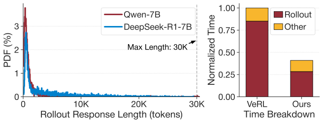

 (a) Distribution of response length and RL step time breakdown.

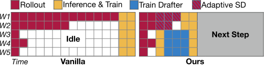

 (b) Illustration of the time line of RL reasoning step w./wo. TLT.

Figure 1. Observed issues of long-tail generation (rollout) and workload imbalance in reasoning RL. TLT system effectively addresses these challenges with adaptive drafter.

Over the past year, we have witnessed the emergence of reasoning LLMs, such as OpenAI-o1 ([OpenAI et al., 2025](https://arxiv.org/html/2511.16665v1#bib.bib45)), DeepSeek-R1 ([DeepSeek-AI et al., 2025](https://arxiv.org/html/2511.16665v1#bib.bib19)) and Gemini-2.5Pro ([Gemini, 2025](https://arxiv.org/html/2511.16665v1#bib.bib29)), exhibiting remarkable capability improvements in mathematical reasoning, programming, and multidisciplinary knowledge tasks ([Chen et al., 2025](https://arxiv.org/html/2511.16665v1#bib.bib55)). A key driver behind these improvements is the use of reinforcement learning (RL), which has become the standard approach for endowing LLMs with strong reasoning capabilities ([Shao et al., 2024](https://arxiv.org/html/2511.16665v1#bib.bib18); [Team, 2025](https://arxiv.org/html/2511.16665v1#bib.bib52); [DeepSeek-AI et al., 2025](https://arxiv.org/html/2511.16665v1#bib.bib19); [Yu et al., 2025](https://arxiv.org/html/2511.16665v1#bib.bib15)). However, this RL approach faces efficiency challenges due to the unique workload characteristics involved. Our analysis of self-collected traces (Figure [1](https://arxiv.org/html/2511.16665v1#S1.F1 "Figure 1 ‣ 1. Introduction ‣ Taming the Long-Tail: Efficient Reasoning RL Training with Adaptive Drafter")) and production traces from ByteDance (Figure [2](https://arxiv.org/html/2511.16665v1#S1.F2 "Figure 2 ‣ 1. Introduction ‣ Taming the Long-Tail: Efficient Reasoning RL Training with Adaptive Drafter")) identifies the following key characteristics of reasoning RL process:

(1) Unbalanced Rollout and Training Time. During RL, the first and most time-consuming stage is _rollout_ , where the model generates numerous candidate responses. These responses are then used in subsequent _inference_ and _training_ stages to update the model. As shown in Figure [1](https://arxiv.org/html/2511.16665v1#S1.F1 "Figure 1 ‣ 1. Introduction ‣ Taming the Long-Tail: Efficient Reasoning RL Training with Adaptive Drafter") (a) , the rollout phase consumes a disproportionately large fraction (\(\sim\)85%) of the total step time, becoming a primary bottleneck.

(2) Persistent Long-Tail Distribution. A major source of RL training inefficiency arises from the _long-tail distribution_ of rollout response lengths. As shown in Figure [1](https://arxiv.org/html/2511.16665v1#S1.F1 "Figure 1 ‣ 1. Introduction ‣ Taming the Long-Tail: Efficient Reasoning RL Training with Adaptive Drafter")(a), although most generated sequences are relatively short, a small fraction extends to extreme lengths. Crucially, this inefficiency is not an occasional occurrence but a persistent pattern observed throughout long-term training, as evidenced by ByteDance’s production traces (Figure [2](https://arxiv.org/html/2511.16665v1#S1.F2 "Figure 2 ‣ 1. Introduction ‣ Taming the Long-Tail: Efficient Reasoning RL Training with Adaptive Drafter")). In most RL steps, a few responses reach the maximum configured length, while the majority remain substantially shorter. The pronounced gap between this maximum length and the 75th percentile (p75) underscores significant resource under-utilization.

(3) Substantial Time and Resource Demands. Figure [2](https://arxiv.org/html/2511.16665v1#S1.F2 "Figure 2 ‣ 1. Introduction ‣ Taming the Long-Tail: Efficient Reasoning RL Training with Adaptive Drafter") shows that reasoning RL training for a 32B model took 11 days to complete only 385 steps, even using 128 GPUs. Individual training steps averaged approximately 40 minutes, while periodic evaluations (conducted every 5 steps) required roughly 20 minutes each, demonstrating the process is extremely time and resource-intensive.

Existing systems ([Sheng et al., 2025](https://arxiv.org/html/2511.16665v1#bib.bib33); [Zhong et al., 2025b](https://arxiv.org/html/2511.16665v1#bib.bib59); [Mei et al., 2024](https://arxiv.org/html/2511.16665v1#bib.bib54); [Yao et al., 2023](https://arxiv.org/html/2511.16665v1#bib.bib20); [Wang et al., 2023](https://arxiv.org/html/2511.16665v1#bib.bib28); [Shen et al., 2024](https://arxiv.org/html/2511.16665v1#bib.bib43); [Xiao et al., 2024b](https://arxiv.org/html/2511.16665v1#bib.bib26)) for RLHF (RL from Human Feedback) primarily focus their optimization efforts on managing multiple models, optimizing data transfer, and orchestrating device allocation across the different phases. However, they neglect tackling the rollout bottleneck, thereby remaining inefficient for reasoning RL tasks. Critically, reasoning rollouts are often over an order of magnitude longer than typical RLHF outputs ([Sheng et al., 2025](https://arxiv.org/html/2511.16665v1#bib.bib33); [Zhong et al., 2025b](https://arxiv.org/html/2511.16665v1#bib.bib59); [Ouyang et al., 2022](https://arxiv.org/html/2511.16665v1#bib.bib36)), giving reasoning RL fundamentally different workload characteristics and demanding distinct system-level optimizations.

While various acceleration techniques exist for LLM serving, many are ill-suited for the RL training context. Methods like quantization ([Lin et al., 2024](https://arxiv.org/html/2511.16665v1#bib.bib11); [Frantar et al., 2023](https://arxiv.org/html/2511.16665v1#bib.bib30)) and model sparsity ([Ma et al., 2023](https://arxiv.org/html/2511.16665v1#bib.bib38); [Xiao et al., 2024a](https://arxiv.org/html/2511.16665v1#bib.bib69)), despite offering speedups, are typically _lossy_ , risking model accuracy degradation and altering output probabilities. We identify Speculative Decoding (SD) ([Leviathan et al., 2023](https://arxiv.org/html/2511.16665v1#bib.bib68); [Chen et al., 2023](https://arxiv.org/html/2511.16665v1#bib.bib12)) as a highly suitable approach. SD utilizes a lightweight draft model to generate token sequences speculatively, which are then verified in parallel by the main target model. SD is particularly well-suited for RL training due to two primary merits: (1) _Mathematically Lossless_. The output distribution remains identical to the target model’s original distribution; (2) _Efficient for Long-Tail_. SD enhances throughput by shifting the process from being memory-bound towards compute-bound, which is particularly effective for the long-tail phase of RL rollouts, where effective batch sizes are typically small.

However, existing speculative decoding techniques ([Cai et al., 2024](https://arxiv.org/html/2511.16665v1#bib.bib42); [Li et al., 2024b](https://arxiv.org/html/2511.16665v1#bib.bib22); [Miao et al., 2024](https://arxiv.org/html/2511.16665v1#bib.bib66); [Zhang et al., 2025](https://arxiv.org/html/2511.16665v1#bib.bib32); [Gao et al., 2025](https://arxiv.org/html/2511.16665v1#bib.bib25); [He et al., 2024](https://arxiv.org/html/2511.16665v1#bib.bib58)) are designed for static inference scenarios, where the target model is fixed. Applying them within the dynamic reasoning RL training is fundamentally non-trivial, presenting significant challenges: (1) _Evolving Target Model_ : the target model’s weights are constantly updated during RL training, making the draft model progressively stale, severely undermining the effectiveness of SD. (2) _Draft Model Training Costs_ : Effective SD often relies on specialized draft models ([Zhang et al., 2025](https://arxiv.org/html/2511.16665v1#bib.bib32); [Li et al., 2024b](https://arxiv.org/html/2511.16665v1#bib.bib22); [Li et al., 2024a](https://arxiv.org/html/2511.16665v1#bib.bib23); [Li et al., 2025a](https://arxiv.org/html/2511.16665v1#bib.bib24); [Gao et al., 2025](https://arxiv.org/html/2511.16665v1#bib.bib25); [Ankner et al., 2024](https://arxiv.org/html/2511.16665v1#bib.bib34)), which require extra training to align with the target model, introducing additional overhead and complexity for users. (3) _Scheduling Complexity_ : SD performance is sensitive to batch size and hyperparameters (e.g., draft depth). Reasoning RL rollouts, however, are characterized by dynamically fluctuating effective batch sizes as sequences complete at different times, necessitating an effective strategy selector for efficient SD deployment.

To address these challenges, we introduce TLT, an efficient system for reasoning RL training featuring adaptive speculative decoding. TLT aims to mitigate the long-tail rollout bottleneck while guaranteeing mathematical losslessness. The core design of TLT derives from the following insights: First, _Exploiting Rollout Bubbles_. The characteristically long duration of RL rollouts provides ample time to utilize GPU resources that progressively become available due to the long-tail nature. Resources freed as sequences complete can thus be repurposed for other tasks, such as draft model training, without additional costs. Second, _Non-Blocking Drafter Training_. Draft model training can be decoupled from full rollout completion; training asynchronously on partial or readily available data allows its computation to be effectively overlapped with ongoing rollouts.

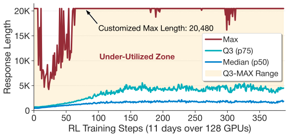

 Figure 2. RL Training trace from ByteDance ([ByteDance, 2025](https://arxiv.org/html/2511.16665v1#bib.bib16)), based on the Qwen2.5-32B model ([Qwen et al., 2025](https://arxiv.org/html/2511.16665v1#bib.bib51)) and executed on H20 96GB GPUs. "p75" denotes the 75th percentile and more granular percentile data were not provided in the original source.

Incorporating aforementioned insights, we build TLT with multiple system optimizations: (1) Adaptive Drafter (§[4](https://arxiv.org/html/2511.16665v1#S4 "4. Adaptive Drafter ‣ Taming the Long-Tail: Efficient Reasoning RL Training with Adaptive Drafter")): We adopt a lightweight draft model continuously adapted via our spot trainer, innovatively addressing the evolving target model challenge arising from RL training. This trainer leverages idle GPU resources during long-tail rollouts for opportunistic, preemptible drafter updates, ensuring alignment with the evolving target model without adding overhead. (2) Adaptive Rollout Engine (§[5](https://arxiv.org/html/2511.16665v1#S5 "5. Adaptive Rollout Engine ‣ Taming the Long-Tail: Efficient Reasoning RL Training with Adaptive Drafter")): TLT maintains a memory-efficient pool of pre-captured CUDAGraphs and leverages the BEG-MAB tuner to adaptively select suitable SD strategies for each input batch. It also supports model-free speculative decoding for early rollout steps. Figure [1](https://arxiv.org/html/2511.16665v1#S1.F1 "Figure 1 ‣ 1. Introduction ‣ Taming the Long-Tail: Efficient Reasoning RL Training with Adaptive Drafter")(b) presents an intuitive illustration of the TLT workflow, where the system automatically leverages idle resources (e.g., workers W3-W5) for opportunistic draft model training (blue blocks), counteracting performance dips caused by target model updating without additional costs. Meanwhile, TLT adaptively enables speculative decoding (blue hatched blocks) during these periods of resource under-utilization for better efficiency.

By synergistically combining an adaptive draft model with coordinated scheduling, TLT effectively mitigates the long-tail issue inherent to RL training. We evaluated TLT on various model architectures and real-world datasets. Experiments demonstrate that TLT significantly accelerates end-to-end training throughput, while preserving model output quality and minimizing resource waste. Furthermore, the process yields an effective draft model suitable for future deployment as a free byproduct.

## 2\. Background and Motivation

### 2.1. Reasoning and Reinforcement Learning

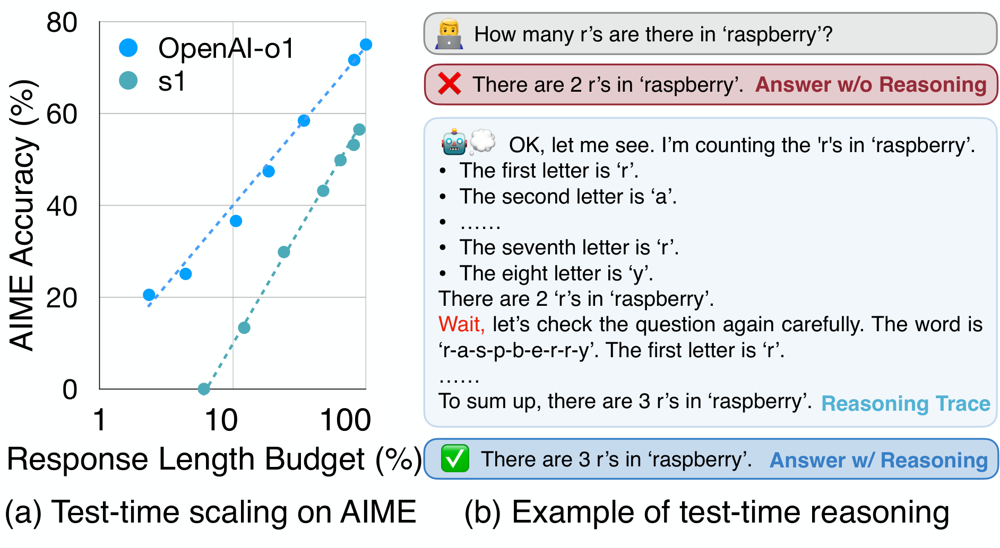

 Figure 3. Test-time scaling of reasoning models. (a) Performance of OpenAI-o1 ([OpenAI et al., 2025](https://arxiv.org/html/2511.16665v1#bib.bib45)) and Stanford s1-32B ([Muennighoff et al., 2025](https://arxiv.org/html/2511.16665v1#bib.bib62)) on the AIME Competition-level Math Benchmark ([MAA, 2024](https://arxiv.org/html/2511.16665v1#bib.bib9)). (b) Example of self-reflection correcting an error within the reasoning.  

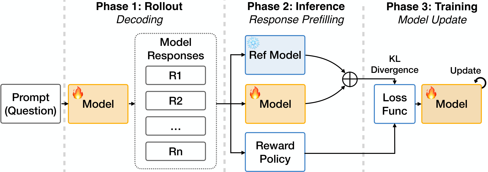

 Figure 4. Overview of the GRPO ([Shao et al., 2024](https://arxiv.org/html/2511.16665v1#bib.bib18)) RL training process.

Reasoning LLMs. Large Language Models (LLMs) have recently shown remarkable performance in complex reasoning domains such as mathematics, logic, and programming. Powerful models such as OpenAI-o1 ([OpenAI et al., 2025](https://arxiv.org/html/2511.16665v1#bib.bib45)) and DeepSeek-R1 ([DeepSeek-AI et al., 2025](https://arxiv.org/html/2511.16665v1#bib.bib19)) achieve impressive accuracy on challenging reasoning benchmarks, including competition-level math and coding challenges. A key factor in their success is _test-time scaling_ ([Wu et al., 2025](https://arxiv.org/html/2511.16665v1#bib.bib35); [Lyzhov et al., 2020](https://arxiv.org/html/2511.16665v1#bib.bib31)), an inference paradigm that enhances accuracy by affording models more generation time to explore complex reasoning paths. These reasoning LLMs typically feature: (1) _Long Chain-of-Thought_ , generating extended intermediate reasoning steps before reaching a final answer; (2) _Self-Reflection_ , the capacity to evaluate, refine, and correct their own reasoning during inference to improve accuracy. As illustrated in Figure [3](https://arxiv.org/html/2511.16665v1#S2.F3 "Figure 3 ‣ 2.1. Reasoning and Reinforcement Learning ‣ 2. Background and Motivation ‣ Taming the Long-Tail: Efficient Reasoning RL Training with Adaptive Drafter") (a), allowing extended generation time enables these models to explore deeper and wider thinking traces ([Chen et al., 2025](https://arxiv.org/html/2511.16665v1#bib.bib55)), thereby enhancing accuracy without additional training costs. More importantly, unlike traditional LLMs, these reasoning models can automatically revisit their generated responses and exhibit self-reflection capabilities (e.g., "_wait_ " in Figure [3](https://arxiv.org/html/2511.16665v1#S2.F3 "Figure 3 ‣ 2.1. Reasoning and Reinforcement Learning ‣ 2. Background and Motivation ‣ Taming the Long-Tail: Efficient Reasoning RL Training with Adaptive Drafter") (b) reasoning trace), which are typically acquired during their RL training stage ([DeepSeek-AI et al., 2025](https://arxiv.org/html/2511.16665v1#bib.bib19)) and are key to performance enhancements.

Reinforcement Learning for Reasoning. Recently, RL algorithm variants such as Group Relative Policy Optimization (GRPO) ([Shao et al., 2024](https://arxiv.org/html/2511.16665v1#bib.bib18)) have proven their success in training reasoning LLMs. Unlike standard Policy Optimization (PPO) ([Schulman et al., 2017](https://arxiv.org/html/2511.16665v1#bib.bib49)), which relies on an extensive critic model, GRPO employs a group-based baseline estimation to streamline the optimization process, significantly reducing training overhead while preserving the robustness of policy updates ([Tie et al., 2025](https://arxiv.org/html/2511.16665v1#bib.bib48)).

Figure [4](https://arxiv.org/html/2511.16665v1#S2.F4 "Figure 4 ‣ 2.1. Reasoning and Reinforcement Learning ‣ 2. Background and Motivation ‣ Taming the Long-Tail: Efficient Reasoning RL Training with Adaptive Drafter") illustrates a single training step in GRPO, which comprises three main stages: (1) _Rollout Stage_ , the target model generates multiple candidate responses for each input prompt; (2) _Inference Stage_ , the generated responses are processed by both the target model (the model undergoing RL training) and a fixed reference model (the initial target model, i.e., RL step=0). This processing yields logits used to compute a KL divergence penalty ([Schulman, 2020](https://arxiv.org/html/2511.16665v1#bib.bib37)), which serves to constrain model updates, ensuring stability and preventing excessive deviation from the reference model. Concurrently within this stage, a reward is calculated with a _rule-based_ policy regarding response characteristics (e.g., correctness), rather than relying on a separate value model; (3) _Training Stage_ , a loss function is constructed using the reward value and KL divergence. The target model’s weights are then updated according to this loss.

### 2.2. Speculative Decoding for Efficient Reasoning RL

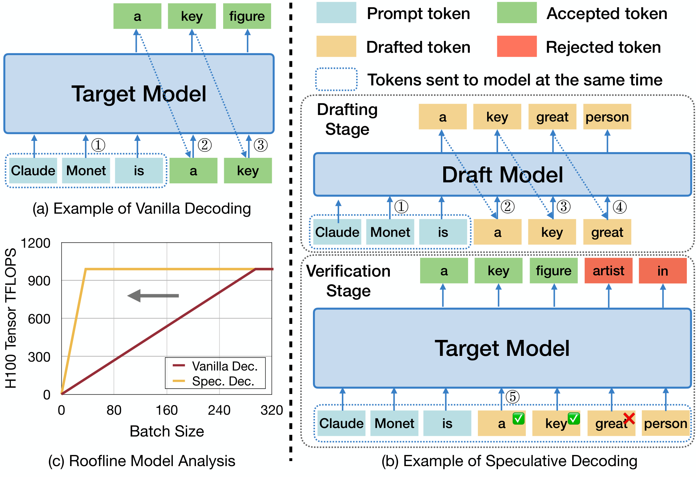

 Figure 5. Overview of Speculative Decoding. (a & b) Comparison between Vanilla and Speculative Decoding. (c) Speculative decoding achieves peak compute throughput (TFLOPS) at significantly smaller batch sizes (gray arrow). 

As mentioned in §[1](https://arxiv.org/html/2511.16665v1#S1 "1. Introduction ‣ Taming the Long-Tail: Efficient Reasoning RL Training with Adaptive Drafter"), the long-tail rollout stage in reasoning RL frequently becomes a performance bottleneck. Consequently, tailored system optimizations for decoding acceleration are essential to improve throughput and resource efficiency. To this end, we identify speculative decoding ([Leviathan et al., 2023](https://arxiv.org/html/2511.16665v1#bib.bib68); [Chen et al., 2023](https://arxiv.org/html/2511.16665v1#bib.bib12)) as a key approach well-suited to tackle these challenges.

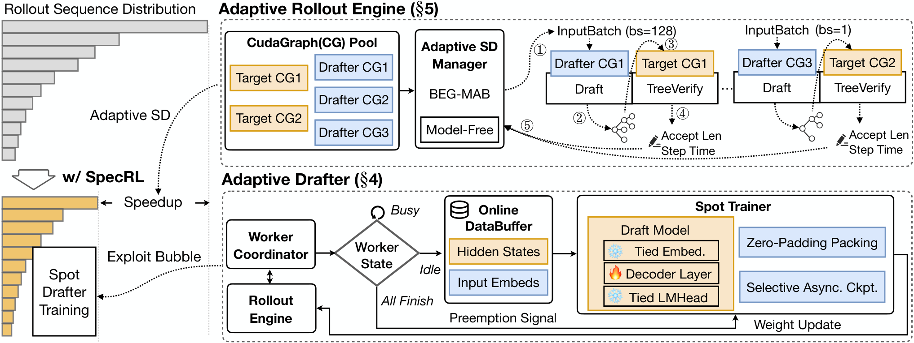

 Figure 6. Overview of TLT architecture and workflow.

Why Speculative Decoding. Among numerous methods accelerating LLM decoding, speculative decoding (SD) appears particularly advantageous for the reasoning RL scenario. Its primary benefit lies in its _lossless_ nature, mathematically ensuring the output distribution remains identical to that of the original target model. This fidelity is paramount in reasoning tasks where the correctness and logical coherence of generated steps are critical for effective reinforcement learning. It directly tackles the throughput bottleneck identified in the long-tail rollout stage by speeding up generation, enhancing sample efficiency without compromising the crucial accuracy needed for reliable reasoning RL training.

Mechanism of Speculative Decoding. In speculative decoding (Figure [5](https://arxiv.org/html/2511.16665v1#S2.F5 "Figure 5 ‣ 2.2. Speculative Decoding for Efficient Reasoning RL ‣ 2. Background and Motivation ‣ Taming the Long-Tail: Efficient Reasoning RL Training with Adaptive Drafter") (b)), a lightweight draft model rapidly generates a sequence of candidate tokens. These candidates are then efficiently verified in parallel by the much larger target model in a single forward pass. The system accepts the drafted sequence up to the first token that mismatches the target model’s prediction, also keeping the single correct token that the target model generated at that position. As shown in the roofline analysis in Figure [5](https://arxiv.org/html/2511.16665v1#S2.F5 "Figure 5 ‣ 2.2. Speculative Decoding for Efficient Reasoning RL ‣ 2. Background and Motivation ‣ Taming the Long-Tail: Efficient Reasoning RL Training with Adaptive Drafter") (c), this process improves throughput by shifting the typically memory-bound autoregressive generation towards a more compute-bound operation, more effectively saturating the GPU resources.

Challenges in Reasoning RL. Despite its effectiveness in alleviating the memory-bound issue and enhancing decoding throughput, adapting existing speculative decoding methods to the context of RL training is fundamentally non-trivial. We identify three key challenges:

C1. Evolving Target Model. Unlike standard inference scenarios where models are fixed, RL training involves continuous target model updates. This constant evolution renders the draft model used in SD progressively "stale", diminishing the acceptance rate of speculated tokens and significantly undermining SD’s effectiveness.

C2. Draft Model Training Costs. Achieving high SD efficiency often requires dedicated draft models (e.g., single-decoder-layer models like Eagle ([Li et al., 2024b](https://arxiv.org/html/2511.16665v1#bib.bib22)), HASS ([Zhang et al., 2025](https://arxiv.org/html/2511.16665v1#bib.bib32))), rather than arbitrary smaller models. Training a specialized drafter for the target model introduces substantial additional cost.

C3. Fluctuating Batch Sizes. As shown in Figure [5](https://arxiv.org/html/2511.16665v1#S2.F5 "Figure 5 ‣ 2.2. Speculative Decoding for Efficient Reasoning RL ‣ 2. Background and Motivation ‣ Taming the Long-Tail: Efficient Reasoning RL Training with Adaptive Drafter") (c), SD is typically optimized for small batch sizes. In contrast, RL rollouts often involve dynamically varying generation batch sizes. Applying SD efficiently in this scenario is challenging, as performance can degrade with larger batches if not managed properly, impacting overall throughput.

To address these challenges, TLT leverages the unique characteristics of the reasoning RL training process. Specifically, we introduce the Adaptive Drafter (§[4](https://arxiv.org/html/2511.16665v1#S4 "4. Adaptive Drafter ‣ Taming the Long-Tail: Efficient Reasoning RL Training with Adaptive Drafter")) to mitigate performance degradation from dynamic model weights (C1), utilizing spare GPU resources for efficient draft model updates and thereby removing training overhead (C2). Furthermore, we design a specialized scheduling strategy (§[5](https://arxiv.org/html/2511.16665v1#S5 "5. Adaptive Rollout Engine ‣ Taming the Long-Tail: Efficient Reasoning RL Training with Adaptive Drafter")) within the reasoning RL system to effectively manage the challenges posed by varying batch sizes (C3).

## 3\. TLT Overview

Design Principles & Goals. To facilitate practical adoption, TLT adheres to four key design principles:

(a) _Lossless Guarantee_. System optimizations must be lossless, preserving the mathematical equivalence in both rollout and training stages compared to the original algorithm, thereby avoiding asynchronous staleness or lossy approximations.

(b) _Interference-Free_. The adaptive drafter workload must not interfere with the primary RL workload. Drafter updates are performed opportunistically (as spot tasks) and can be smoothly preempted to minimize impact on the RL workload.

(c) _Automatic and Simple_. Manually setting up the draft model and configuring its speculative hyperparameters are burdensome and often lead to suboptimal performance. Thus, TLT features an automated workflow for ease of use.

(d) _Generalizable and Scalable_. The design must be adaptable to various popular reasoning RL algorithms (e.g., GRPO ([Shao et al., 2024](https://arxiv.org/html/2511.16665v1#bib.bib18)), RLOO ([Ahmadian et al., 2024](https://arxiv.org/html/2511.16665v1#bib.bib60))). Furthermore, TLT should scale effectively and deliver continuous system performance improvements across different model sizes, architectures, and cluster scales.

In addition, TLT has three primary objectives: (1) Mitigate the long-tail problem to accelerate reasoning RL training; (2) Enhance cluster utilization and minimize resource waste; (3) Produce a high-performance draft model for future deployment with speculative decoding at no extra cost.

Architecture & Workflow. Figure [6](https://arxiv.org/html/2511.16665v1#S2.F6 "Figure 6 ‣ 2.2. Speculative Decoding for Efficient Reasoning RL ‣ 2. Background and Motivation ‣ Taming the Long-Tail: Efficient Reasoning RL Training with Adaptive Drafter") illustrates the overall architecture of TLT and its workflow. The system is composed of two tightly integrated components: the Adaptive Drafter (§[4](https://arxiv.org/html/2511.16665v1#S4 "4. Adaptive Drafter ‣ Taming the Long-Tail: Efficient Reasoning RL Training with Adaptive Drafter")) and the Adaptive Rollout Engine (§[5](https://arxiv.org/html/2511.16665v1#S5 "5. Adaptive Rollout Engine ‣ Taming the Long-Tail: Efficient Reasoning RL Training with Adaptive Drafter")).

The rollout process exhibits two key characteristics: a long-tail distribution of sequence lengths and progressively shrinking batch sizes as responses complete. To adapt to these dynamics, the Adaptive Rollout Engine maintains a pool of pre-captured CUDAGraphs for both target and draft models, managed by the Adaptive SD Manager. This manager leverages the proposed BEG-MAB tuner to automatically select appropriate SD strategies for each input batch. As shown in the top of Figure [6](https://arxiv.org/html/2511.16665v1#S2.F6 "Figure 6 ‣ 2.2. Speculative Decoding for Efficient Reasoning RL ‣ 2. Background and Motivation ‣ Taming the Long-Tail: Efficient Reasoning RL Training with Adaptive Drafter"), the selected drafter CUDAGraph generates candidate tokens (①), which are then passed to the corresponding target CUDAGraph for parallel verification (②-③). The engine measures acceptance length and step latency (④), feeding these signals back to the SD Manager (⑤) to refine strategy selection in real time.

Meanwhile, the Adaptive Drafter module is responsible for continuously updating the lightweight draft model without interfering with the main rollout workload. A centralized Worker Coordinator monitors the state of rollout workers. When idle resources appear during the long-tail stage, the coordinator opportunistically launches Spot Trainer tasks. The training tasks use the Online DataBuffer, which caches hidden states and input embeddings from ongoing and prior steps’ rollout. The draft model receives efficient updates using techniques such as zero-padding packing and selective asynchronous checkpointing. This design ensures that drafter updates can be preempted and resumed seamlessly, exploiting wasted bubbles.

By systematically combining adaptive rollout with opportunistic drafter training, TLT achieves substantial speedups for reasoning RL without compromising model quality, yielding a valuable draft model as a free by-product.

## 4\. Adaptive Drafter

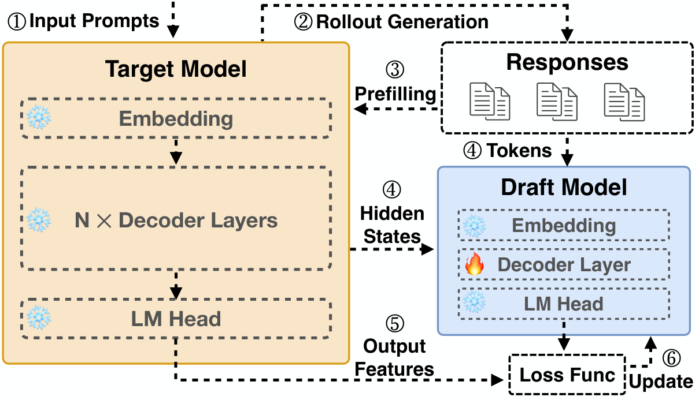

 

Strategies | ④HiddenStates | ⑤LossFunc |  | ⑥Training  
---  
Time Test  
Eagle ([Li et al., 2024b](https://arxiv.org/html/2511.16665v1#bib.bib22)) | Last layer | L1 + CE loss | N.A.  
HASS ([Zhang et al., 2025](https://arxiv.org/html/2511.16665v1#bib.bib32)) | Last layer | L1 + CE loss | 3 steps  
Eagle-3 ([Li et al., 2025a](https://arxiv.org/html/2511.16665v1#bib.bib24)) |  | Top, mid and  
---  
bottom layers  
CE loss only | 7 steps

 

Figure 7. Draft Model Training. _Upper_ : Unified training workflow using target model hidden states. _Lower_ : Specific configurations of different training strategies.

This section introduces the Adaptive Drafter component of TLT, focusing on how it creates, trains, and utilizes draft models to accelerate the reasoning RL process without interference with the primary RL workload.

### 4.1. Draft Model

TLT utilizes a compact, specialized model trained to mimic the target LLM’s token generation behavior, enabling efficient and accurate speculative execution.

Model Architecture. To maximize efficiency, TLT adopts a highly lightweight, _single-layer_ model design for the drafter ([Li et al., 2024b](https://arxiv.org/html/2511.16665v1#bib.bib22); [Zhang et al., 2025](https://arxiv.org/html/2511.16665v1#bib.bib32); [Li et al., 2025a](https://arxiv.org/html/2511.16665v1#bib.bib24)). In this context, a "layer" refers to one complete transformer decoder block, including attention and feed-forward components. This approach differs from vanilla speculative decoding ([Leviathan et al., 2023](https://arxiv.org/html/2511.16665v1#bib.bib68); [Chen et al., 2023](https://arxiv.org/html/2511.16665v1#bib.bib12)), which often uses a separate, smaller multi-layer LLM from the same family (e.g., Qwen2.5-0.5B for a Qwen2.5-32B target). The vanilla approach has drawbacks: suitable and accurate small drafters may not exist for every target LLM, not to mention that these smaller models can still incur substantial drafting latency. For instance, while Qwen2.5-32B has 64 layers, Qwen2.5-0.5B still contains 24 layers. Although the parameter count is reduced significantly (64\(\times\) in this case), latency remains dominated by the sequential computation across multiple layers. Experiments demonstrate that TLT’s single-layer draft model, sharing approximately the same parameter count as the Qwen2.5-0.5B drafter, is significantly faster (2.4\(\times\)).

As illustrated in Figure [7](https://arxiv.org/html/2511.16665v1#S4.F7 "Figure 7 ‣ 4. Adaptive Drafter ‣ Taming the Long-Tail: Efficient Reasoning RL Training with Adaptive Drafter") (blue block), the TLT drafter mirrors the target model’s architecture but incorporates only a single, trainable decoder layer. It reuses the target model’s original Embedding and LM Head layers, keeping their weights frozen during training. Consequently, only the single decoder layer’s parameters are updated, representing a small fraction (approximately 1/layer_num) of the target model’s total parameters. This architectural design significantly reduces both training and inference overhead. The effectiveness of such single-layer drafters is corroborated by prior work ([Zhang et al., 2025](https://arxiv.org/html/2511.16665v1#bib.bib32); [Li et al., 2024b](https://arxiv.org/html/2511.16665v1#bib.bib22); [Li et al., 2024a](https://arxiv.org/html/2511.16665v1#bib.bib23); [Li et al., 2025a](https://arxiv.org/html/2511.16665v1#bib.bib24); [Gao et al., 2025](https://arxiv.org/html/2511.16665v1#bib.bib25); [Ankner et al., 2024](https://arxiv.org/html/2511.16665v1#bib.bib34)), which has shown their capability to closely align with the target model’s auto-regressive distribution and achieve high acceptance rates for speculative tokens. During operation, the trained drafter takes hidden states from the target model and auto-regressively drafts subsequent tokens for verification.

Training Process. TLT builds a unified training framework that supports diverse draft model training strategies and integrates seamlessly with the RL workflow. As depicted in Figure [7](https://arxiv.org/html/2511.16665v1#S4.F7 "Figure 7 ‣ 4. Adaptive Drafter ‣ Taming the Long-Tail: Efficient Reasoning RL Training with Adaptive Drafter"), the training process leverages data generated during the RL workflow. Specifically, input prompts are first processed by the target model to generate rollout responses (①, ②). During the subsequent prefilling (i.e., inference) phase, hidden states are collected from specific layers of the target model (③). These collected hidden states, concatenated with input token embeddings, are then passed through a lightweight linear layer for dimension reduction. Then the output features serve as input to the drafter’s single decoder layer for training (④). Given the target model’s significantly larger size (over 20\(\times\) than the draft model), its prefilling cost can be far more expensive than one drafter training iteration. In TLT, we cache the hidden states generated during the inherent RL inference phase to host memory and reuse them, thereby eliminating this overhead.

TLT also accommodates multiple training objectives. The framework can apply an L1 loss between the hidden states of the target and draft models to align their representations, a cross-entropy (CE) loss on the output logits to match token predictions, or a combination of both (⑤). The computed loss is then backpropagated to update only the drafter’s decoder layer, while embeddings and the LM head remain tied to the target model (⑥).

Additionally, several training strategies are supported within this unified pipeline in TLT. For instance, EAGLE ([Li et al., 2024b](https://arxiv.org/html/2511.16665v1#bib.bib22)) uses only the last layer’s hidden states; HASS ([Zhang et al., 2025](https://arxiv.org/html/2511.16665v1#bib.bib32)) further enhance the training by feeding the output feature of draft model back into itself for multiple time (i.e., training-time test); EAGLE-3 ([Li et al., 2025a](https://arxiv.org/html/2511.16665v1#bib.bib24)) further fuses multi-layer hidden states from the target model, aiming for better acceptance rates. Despite these differences, all these variants can be naturally expressed within our training framework. In this work, we use the EAGLE model as the default, as it offers high accepted lengths and faster convergence with much lower training cost.

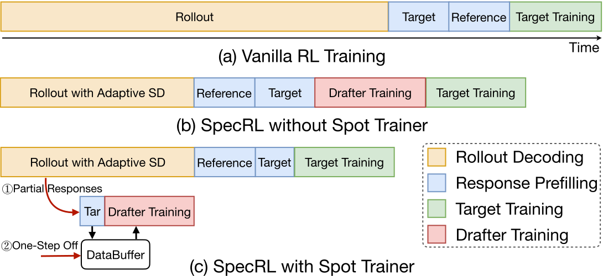

 Figure 8. Spot Trainer Workflow. Block lengths are illustrative and not strictly proportional to execution time. Note that target model prefilling during drafter training is optional since hidden states from the rollout engine can be used directly.

### 4.2. Spot Trainer

The key challenge in applying speculative decoding within RL training is the _evolving target model_ (C1), causing a fixed draft model to quickly become stale and ineffective. Spot Trainer is designed to counteract this drift without hindering the primary RL workflow. To achieve this goal, TLT incorporates the following novel designs:

Worker Coordinator. It aims to bridge the gap between the Rollout Engine and the Spot Trainer, coordinating resource allocation, particularly repurposing GPU resources that become idle during the long-tail phase of rollout. In TLT, a _worker_ is the basic unit of resource management, defined as one rollout instance. For example, when rollout uses a full DGX-H100 node with TP=8, a single worker represents 8 GPUs. The coordinator follows a centralized model implemented with ZeroMQ ([Hintjens, 2013](https://arxiv.org/html/2511.16665v1#bib.bib2)), where a single coordinator process (rank 0) maintains the global state and workers communicate through asynchronous request-reply patterns. By monitoring active request counts and worker states, the coordinator determines when workers can be migrated from rollout to opportunistic drafter training. Each worker cycles between three states— _BUSY_ (serving rollout), _IDLE_ (inference finished and memory released), and _TRAINING_ (engaged in drafter updates)—and notifies the coordinator on every transition. Once the number of idle workers exceeds a configurable threshold, the coordinator promotes them to training mode and initiates drafter training.

Training initiation follows a leader-election pattern, where the first eligible worker sets up the training session and later workers can join if they belong to the same data-parallel group. When rollout completes, the coordinator immediately halts any ongoing drafter training and performs a graceful shutdown to ensure proper cleanup. This design ensures that idle GPU cycles during long-tail rollouts are effectively exploited without interfering with the primary RL workflow.

Spot Training with DataBuffer. Figure [8](https://arxiv.org/html/2511.16665v1#S4.F8 "Figure 8 ‣ 4.1. Draft Model ‣ 4. Adaptive Drafter ‣ Taming the Long-Tail: Efficient Reasoning RL Training with Adaptive Drafter") contrasts our Spot Trainer approach with standard RL workflows. Vanilla RL (a) involves a sequential process: rollout, target & reference model inference for KL divergence calculation, and target model training (reward calculation is fast and omitted for brevity). A naive integration of drafter training (b) typically adds it as another sequential step, although reusing some prefilling computations but still incurs extra overhead.

In contrast, the Spot Trainer (c) operates on the principle that draft model training can proceed effectively without waiting for all generated responses to complete, allowing training to execute in a non-blocking manner. Due to the long-tail distribution in reasoning RL tasks, a majority of responses are generated significantly faster than the longest ones. The Spot Trainer leverages this observation by using partial of responses to train the draft model. However, relying only on early finishes means the drafter rarely sees very long sequences, which can introduce distribution mismatch. To address this, TLT introduces the DataBuffer, which decouples drafter training from rollout completion. The DataBuffer caches hidden states and tokens produced during the inference stage and loads them with minimal overhead. Crucially, it supports _one-step offset_ sampling: we persist the buffer across RL steps and prioritize long sequences from the previous step to compensate for the scarcity of long-tail data in the current partial set. Although these samples are slightly stale, they remain effective for drafter training. Our experiments show that combining partial current-step data with buffered long sequences attains performance comparable to training on the full response set. Drafter updates are scheduled as low-priority “spot tasks” on idle GPUs, effectively harvesting compute freed by the long tail while keeping the main RL workflow non-blocking.

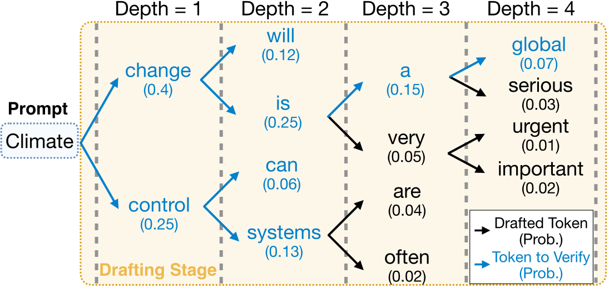

 Figure 9. Example of Tree Decoding. We set topK=2, Draft_Depth=4, and Tokens_to_Verify=8 in this example. Prob. denotes token probability given by the draft model.

Selective Asynchronous Checkpointing. A key design feature of the Spot Trainer is its preemptibility, allowing it to utilize idle resources without blocking the main RL workload. However, preemptions may lead to substantial loss of the draft model’s training progress. To address this, the Spot Trainer utilizes asynchronous checkpointing: when triggered, the process of saving the draft model’s state is offloaded to a background thread. Moreover, we optimize this process by filtering out frozen layers (e.g., embeddings and the LM head) and dumping only the trainable parameters, significantly reducing checkpointing latency. This mechanism minimizes work lost due to preemption through frequent and efficient checkpointing.

Sequence Packing. The training data inherently consists of sequences with variable lengths. Standard batching techniques often require padding sequences to a uniform length, leading to inefficiency of computation, communication, and memory. To maximize GPU utilization during opportunistic drafter training, the Spot Trainer employs sequence packing ([Krell et al., 2022](https://arxiv.org/html/2511.16665v1#bib.bib64)). This technique concatenates multiple variable-length sequences into a single packed sequence, removing padding while using attention masks to preserve sequence integrity during parallel processing. This enables efficient processing of the unbalanced training data within the limited, preemptible time slots available for spot training.

## 5\. Adaptive Rollout Engine

This section presents the Adaptive Rollout Engine, which dynamically adjusts SD strategies in response to real-time workload characteristics. It supports both learning-based and model-free SD, and incorporates a bucketed multi-armed bandit (MAB) tuner to automatically configure strategies.

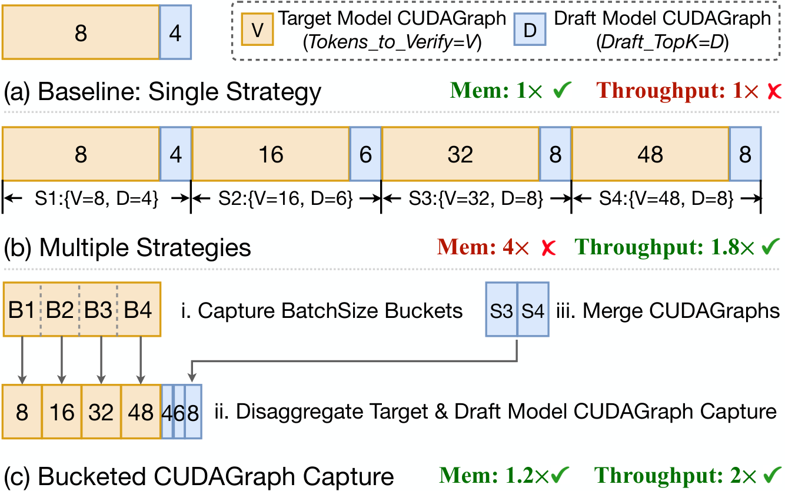

 Figure 10. Memory footprint of CUDA Graph for SD. S1\(\sim\)S4 denote different SD strategies, B1\(\sim\)B4 represent batchsize buckets. Memory and throughput values are illustrative.

### 5.1. Adaptive SD Manager

Tree-based Drafting. Unlike linear drafting, which processes a single sequence, tree-based drafting extends this single-branch paradigm by enabling parallel exploration of multiple speculative paths. Following ([Miao et al., 2024](https://arxiv.org/html/2511.16665v1#bib.bib66); [Li et al., 2024a](https://arxiv.org/html/2511.16665v1#bib.bib23)), we build the candidate tree based on the draft model’s confidence score (token probability), as illustrated in Figure [9](https://arxiv.org/html/2511.16665v1#S4.F9 "Figure 9 ‣ 4.2. Spot Trainer ‣ 4. Adaptive Drafter ‣ Taming the Long-Tail: Efficient Reasoning RL Training with Adaptive Drafter"). Starting from the input prompt ("Climate"), the draft model predicts potential next tokens. The tree-based approach explores the topK most likely options at each step (e.g., topK=2 yields "change" and "control"), and this branching continues for Draft_Depth steps, creating a tree of candidate sequences. Finally, the Tokens_to_Verify=8 highest-confidence tokens within the tree are chosen and submitted to the target model for parallel verification. By exploring and verifying multiple potential sequences simultaneously, tree-based drafting substantially increases the number of accepted tokens per verification step, thereby improving overall generation throughput with more effective utilization of parallel compute resources.

Adaptivity is Necessary. While the SD is primarily designed to accelerate the long-tail stage, we observe that SD can also deliver speedups at moderate batch sizes (Table [2](https://arxiv.org/html/2511.16665v1#S6.T2 "Table 2 ‣ 6.3. Evaluation of Adaptive SD ‣ 6. Evaluation ‣ Taming the Long-Tail: Efficient Reasoning RL Training with Adaptive Drafter")). However, this requires adaptive adjustment of SD strategies according to the decoding batch size and workload characteristics. Prior work ([Li et al., 2024b](https://arxiv.org/html/2511.16665v1#bib.bib22); [Li et al., 2024a](https://arxiv.org/html/2511.16665v1#bib.bib23); [Zhang et al., 2025](https://arxiv.org/html/2511.16665v1#bib.bib32)) mainly focuses on batchsize=1 scenarios, which limits its applicability in real-world scenarios. RL rollout naturally involve highly dynamic batch sizes: they begin large and then shrink rapidly as short responses complete. Static SD strategies are therefore both inefficient and unsafe, as they may cause Out-of-Memory (OOM) failures under large batches. To address this, the Adaptive SD Manager continuously tunes SD parameters—choosing safe strategies to prevent OOM, maximizing throughput by learning effective strategies for each workload, and balancing speculative gains against computational overhead. In addition, to handle large batch sizes where SD offers little benefit, it employs an elastic mechanism that activates SD only when the remaining request count drops below a configurable threshold (default: 32).

Memory-Efficient CUDAGraph Capture. To accelerate LLM decoding, CUDAGraph is commonly adopted, providing substantial speedup by recording CUDA operations and replaying them as a single unit, which reduces per-kernel launch costs during inference. However, CUDAGraph requires capturing a separate static graph for each batch size and strategy, including both target and draft models. This inflexible paradigm leads to a considerable memory footprint. Under the Multiple-Strategy setting (Figure [10](https://arxiv.org/html/2511.16665v1#S5.F10 "Figure 10 ‣ 5. Adaptive Rollout Engine ‣ Taming the Long-Tail: Efficient Reasoning RL Training with Adaptive Drafter") (b)), memory usage grows linearly with the number of strategies, leaving insufficient space for model weights and KV caches, which is unacceptable in practice.

To accommodate more SD strategies without incurring prohibitive memory costs, we propose Bucketed CUDAGraph Capture (Figure [10](https://arxiv.org/html/2511.16665v1#S5.F10 "Figure 10 ‣ 5. Adaptive Rollout Engine ‣ Taming the Long-Tail: Efficient Reasoning RL Training with Adaptive Drafter") (c)), which incorporates three key optimizations: (1) Bucketed batch sizes. Instead of capturing a static graph for every possible batch size, we exploit strategy-specific characteristics (e.g., larger batch sizes typically require verifying fewer tokens) and group batch sizes into several buckets (e.g., B1\(\sim\)B4). (2) Disaggregated capture for target and draft models. Since some configurations affect only one model (e.g., topK impacts only the drafter, while Tokens_to_Verify affects only the target), we capture graphs for target and draft models separately to avoid multiplicative memory consumption. (3) Merged captures across strategies. When different strategies share identical parameter settings, we merge their batchsize buckets into a single captured graph, eliminating redundant memory overhead. By integrating these optimizations, we substantially reduce the CUDAGraph memory footprint (Table [3](https://arxiv.org/html/2511.16665v1#S6.T3 "Table 3 ‣ 6.4. Evaluation of Spot Trainer ‣ 6. Evaluation ‣ Taming the Long-Tail: Efficient Reasoning RL Training with Adaptive Drafter")) while improving rollout throughput. The throughput gain stems from leveraging prior knowledge to avoid evaluating suboptimal strategies that are unsuitable for specific batch sizes.

Algorithm 1 Bucketed-Epsilon-Greedy (BEG) MAB Selector

1: Strategies: \(\mathcal{S}\), Batch Thresholds: \(\mathcal{T}=\{t_{1},\dots,t_{m}\}\), Exploration: \(\epsilon\), Window Size: \(w\)

2: Selected strategy \(s^{*}\)

3: procedure Initialize(\(\mathcal{S},\mathcal{T},\epsilon,w\)) 

4: GroupByVerifyTokens(\(\mathcal{S}\)) \(\rightarrow\) \(\{\mathcal{S}_{1},\dots,\mathcal{S}_{m}\}\) (sorted by Tokens_to_Verify, descending) 

5: Define buckets \(\mathcal{B}_{i}=[t_{i},t_{i+1}\!-\!1]\) for \(i<m\) and \(\mathcal{B}_{m}=[t_{m},\infty)\)

6: Map bucket \(\mathcal{B}_{i}\mapsto\) group \(\mathcal{S}_{i}\)

7: for all \(s\in\mathcal{S}\) do

8: \(R_{s},A_{s}\leftarrow\) deque (\(w\)) \(\vartriangleright\)init double-ended queue (size \(w\))

9: procedure Record( elapsed_time, accept_lens, batch_size) 

10: \(\overline{a}\leftarrow\big(\sum\texttt{accept\_lens}\big)/\texttt{batch\_size}+1\)

11: \(r_{s}\leftarrow\overline{a}\times\texttt{batch\_size}/\texttt{elapsed\_time}\)

12: Append \(r_{s}\) to \(R_{s}\); Append \(\overline{a}\) to \(A_{s}\) \(\vartriangleright\)reward & acc_len

13: procedure SelectStrategy(batch_size) 

14: \(V\leftarrow\{\,s\in\mathcal{S}_{i}\mid\texttt{batch\_size}\in\mathcal{B}_{i}\,\}\) \(\vartriangleright\)candidate strategies

15: if \(|V|=1\) then

16: return the unique \(s\in V\)

17: Draw \(u\sim\mathrm{Uniform}(0,1)\)

18: if \(u<\epsilon\) then

19: return random \(s\in V\) \(\vartriangleright\)explore

20: else

21: return \(\arg\max_{s\in V}\mathrm{Median}(R_{s})\) \(\vartriangleright\)exploit

### 5.2. Auto-Tune Algorithm

Bucketed \(\epsilon\)-Greedy MAB. Multi-Armed Bandit (MAB) algorithms are a classical framework for online decision-making, excelling at maximizing cumulative gains when selecting actions (“arms”) with uncertain rewards ([Thananjeyan et al., 2021](https://arxiv.org/html/2511.16665v1#bib.bib41); [Slivkins and others, 2019](https://arxiv.org/html/2511.16665v1#bib.bib40)). Each "arm" corresponds to a specific speculative decoding configuration tuple: (Draft_Depth, topK, Tokens_to_Verify), and the "reward" reflects the efficiency within the generation step (i.e., \(\text{accepted\_token\_num}/\text{step\_latency}\)).

To automate the selection of SD strategies, we design a new online tuning algorithm, Bucketed-Epsilon-Greedy (BEG) MAB Selector (Algorithm [1](https://arxiv.org/html/2511.16665v1#alg1 "Algorithm 1 ‣ 5.1. Adaptive SD Manager ‣ 5. Adaptive Rollout Engine ‣ Taming the Long-Tail: Efficient Reasoning RL Training with Adaptive Drafter")). BEG adopts an \(\epsilon\)-greedy policy tailored to speculative decoding workloads. It buckets strategies according to their Tokens_to_Verify and dynamically match them to batchsize ranges. Specifically, strategies \(\mathcal{S}\) are grouped by Tokens_to_Verify into \({\mathcal{S}_{1},\dots,\mathcal{S}_{m}}\), and each group is mapped to a batch-size bucket \(\mathcal{B}_{i}\). During rollout, the current batch size determines the relevant candidate set \(V\). If \(|V|=1\), the strategy is fixed; otherwise, BEG selects between exploration and exploitation. With probability \(\epsilon\), a strategy is drawn uniformly at random from \(V\) (exploration). With probability \(1-\epsilon\), BEG selects the strategy maximizing the median reward over a sliding window of size \(w\) (exploitation). The reward (line: [11](https://arxiv.org/html/2511.16665v1#alg1.l11 "In Algorithm 1 ‣ 5.1. Adaptive SD Manager ‣ 5. Adaptive Rollout Engine ‣ Taming the Long-Tail: Efficient Reasoning RL Training with Adaptive Drafter")) balances accept rate and latency cost. Maintaining deques of recent rewards ensures adaptation to non-stationary dynamics across RL training.

By combining bucketed strategy selection, lightweight \(\epsilon\)-greedy exploration, and sliding-window reward estimation, BEG reduces the overhead of exhaustive exploration while adapting efficiently to workload variations. This enables TLT to scale across diverse batchsizes and speculative decoding strategies without manual tuning.

### 5.3. Model-free Drafter

Leveraging Similarity across Rollouts. During the RL rollout stage, candidate responses generated for the same prompt often exhibit evident _sequence similarity_ and contain repetitive patterns, such as common mathematical notation or code syntax structures. This observation suggests that frequent, short-range token dependencies can be predicted effectively using retrieval methods. To leverage this, TLT incorporates a complementary, non-parametric drafting strategy alongside the primary learning-based drafter. This model-free drafter operates by dynamically building an n-gram retrieval database populated from the rollout responses specific to each prompt. Based on the immediate context (the preceding n-grams), it efficiently predicts common subsequent token sequences by querying this database.

Within TLT, the model-free drafter serves as both a robust baseline and an essential fallback mechanism. The Strategy Selector dynamically activates this retrieval-based drafter whenever the learning-based drafter is unavailable (e.g., during initial training steps) or predicted to be inefficient. This dual-drafter approach ensures that speculative decoding acceleration remains active throughout all stages of the RL process, contributing to persistent efficiency gains.

## 6\. Evaluation

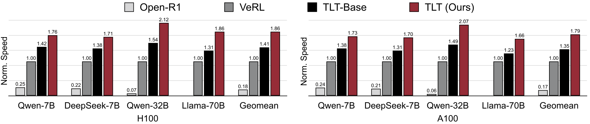

 Figure 11. End-to-end Training Speed Evaluation. The y-axis indicates the relative training throughput of each system running GRPO ([Shao et al., 2024](https://arxiv.org/html/2511.16665v1#bib.bib18)) RL algorithm. TLT achieves 1.7-2.1\(\times\) speedup over the state-of-the-art RL training system VeRL ([Sheng et al., 2025](https://arxiv.org/html/2511.16665v1#bib.bib33)).  

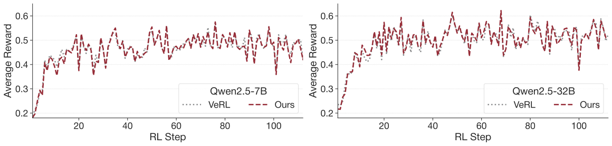

 Figure 12. End-to-end Training Curves. Average reward curves for VeRL and TLT using the Qwen2.5 7B and 32B models. 

### 6.1. Experimental Setup

Implementation. We implement TLT on top of VeRL ([Sheng et al., 2025](https://arxiv.org/html/2511.16665v1#bib.bib33)) and utilizes Ray ([Moritz et al., 2018](https://arxiv.org/html/2511.16665v1#bib.bib53)) for distributed execution. The Worker Coordinator is realized with a centralized controller that employs ZeroMQ ([Hintjens, 2013](https://arxiv.org/html/2511.16665v1#bib.bib2)) messaging. The Adaptive Drafter’s implementation is based on training pipelines from EAGLE and trained with FSDP2 ([PyTorch Team, 2025a](https://arxiv.org/html/2511.16665v1#bib.bib27)). For asynchronous checkpointing, we leverage PyTorch DCP ([PyTorch Team, 2025b](https://arxiv.org/html/2511.16665v1#bib.bib17)). To further improve generation efficiency, we employ SGLang ([Zheng et al., 2024](https://arxiv.org/html/2511.16665v1#bib.bib65)) as the rollout backend, with implementing adaptive enabling of SD, drafter weight update and the BEG-MAB tuner following ([Su, 2025](https://arxiv.org/html/2511.16665v1#bib.bib5)). We additionally use ([Zhao et al., 2024](https://arxiv.org/html/2511.16665v1#bib.bib6)) as our model-free drafter.

Testbed. We conduct experiments on a cluster of 8 NVIDIA DGX H100 ([NVIDIA Corporation, 2025](https://arxiv.org/html/2511.16665v1#bib.bib21)) servers, totaling 64 GPUs. Each server is equipped with 8 NVIDIA H100 GPUs, 2 Intel Xeon Platinum 8480C (112 cores) CPUs and 2TB memory. GPUs are interconnected to each other by 900GB/s NVLink, and inter-node communication is achieved via NVIDIA Mellanox 400Gb/s InfiniBand. To evaluate system’s performance across heterogeneous hardware, we also conduct experiments on a different cluster equipped with NVIDIA DGX A100 servers. Unless otherwise specified, experiments are conducted on H100 GPUs by default.

Models. Following the training procedure introduced in DeepSeek-R1 ([DeepSeek-AI et al., 2025](https://arxiv.org/html/2511.16665v1#bib.bib19)), the reasoning RL process can begin either from a fine-tuned model or directly from a base model without additional fine-tuning. To demonstrate that TLT robustly accommodates different model architectures, scales, and training paradigms, we evaluate the following models:

  1. (1) _Qwen2.5-7B_ (Qwen2.5-7B): a popular base model; 
  2. (2) _DeepSeek-R1-Distill-Qwen-7B_ (DeepSeek-7B): a distilled model exhibiting good initial reasoning capabilities; 
  3. (3) _Qwen2.5-32B_ (Qwen-32B): a larger base model without any additional fine-tuning, as in ([Yu et al., 2025](https://arxiv.org/html/2511.16665v1#bib.bib15)); 
  4. (4) _Llama-3.3-70B-Instruct_ (Llama-70B): a larger instruction-tuned model to assess scalability. 

Datasets. For the primary RL training dataset, we use a subset from Eurus-2-RL ([Cui et al., 2025](https://arxiv.org/html/2511.16665v1#bib.bib50)), a comprehensive dataset curated for reasoning RL. This dataset contains mathematics and coding problems equipped with verifiers (LaTeX answers and test cases, respectively). The coding problems originate from competitive programming sources (e.g., CodeContests ([Lewkowycz et al., 2022](https://arxiv.org/html/2511.16665v1#bib.bib13)), Codeforces ([Codeforces, 2025](https://arxiv.org/html/2511.16665v1#bib.bib14))), while the math problems range from high school to olympiad-level difficulty ([LI et al., 2025](https://arxiv.org/html/2511.16665v1#bib.bib44)). For drafter training, we use a subset from OpenThoughts2-1M ([OpenThoughts, 2025](https://arxiv.org/html/2511.16665v1#bib.bib47)) as the warm-up dataset.

RL Settings. We primarily follow the reasoning RL algorithm GRPO proposed by DeepSeek ([DeepSeek-AI et al., 2025](https://arxiv.org/html/2511.16665v1#bib.bib19); [Shao et al., 2024](https://arxiv.org/html/2511.16665v1#bib.bib18)). Specifically, for each prompt, we set the temperature=0.9, with a maximum generation length of 32K tokens, consistent with common RL training settings. We apply TP= 2, 4, or 8 depending on model scale for the rollout engine. Additionally, all experiments utilize mixed-precision training with the Adam optimizer ([Kingma and Ba, 2015](https://arxiv.org/html/2511.16665v1#bib.bib7)), where BF16 precision is employed during both model rollout and inference stages.

Baselines. We consider the following baselines.

  1. (1) _Open-R1_ ([Face, 2025](https://arxiv.org/html/2511.16665v1#bib.bib46)): a popular RL training framework built upon TRL([von Werra et al., 2025](https://arxiv.org/html/2511.16665v1#bib.bib70)), integrating vLLM ([Kwon et al., 2023](https://arxiv.org/html/2511.16665v1#bib.bib71)) for rollouts and DeepSpeed ([Rajbhandari et al., 2020](https://arxiv.org/html/2511.16665v1#bib.bib72)) for training. Currently, it only supports separate model placement, requiring serving and training to be performed on distinct nodes. 
  2. (2) _VeRL_ ([Sheng et al., 2025](https://arxiv.org/html/2511.16665v1#bib.bib33)): the state-of-the-art open-source RL training framework by ByteDance. It enables colocation of models on shared devices by utilizing GPU time-sharing. 
  3. (3) _TLT-Base_ : Our base implementation with vanilla speculative decoding support. Specifically, we disable adaptive drafter and use the model-free drafter instead. 

Metrics. Following ([Sheng et al., 2025](https://arxiv.org/html/2511.16665v1#bib.bib33)), we use token throughput (tokens/sec) for end-to-end evaluation. This metric is calculated by dividing the total number of tokens in both prompts and responses within a global batch by the duration of a single RL step. We average results over three training steps following an initial warm-up step and use a trained draft model for evaluation.

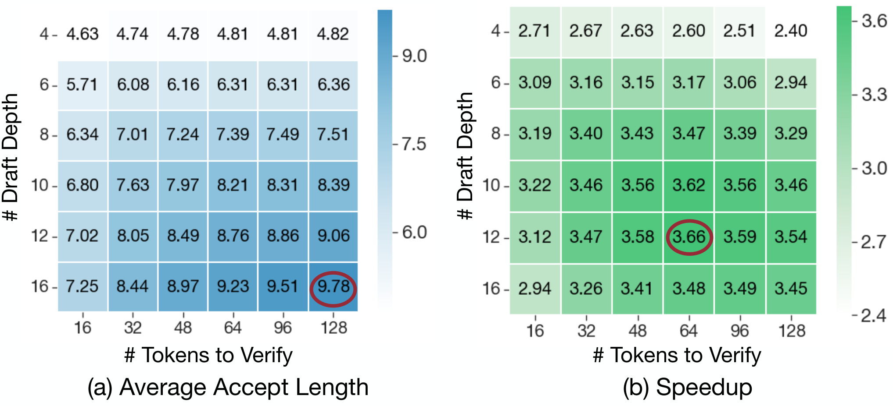

 Figure 13. Effect of hyperparameters for speculative decoding. Measurements performed with Qwen-32B (TP=4).

### 6.2. End-to-End Evaluation

We evaluate TLT against popular RL training frameworks, including Open-R1 ([Face, 2025](https://arxiv.org/html/2511.16665v1#bib.bib46)) and VeRL ([Sheng et al., 2025](https://arxiv.org/html/2511.16665v1#bib.bib33)), across multiple GPU platforms (NVIDIA H100 and A100) and various LLM scales. Figure [11](https://arxiv.org/html/2511.16665v1#S6.F11 "Figure 11 ‣ 6. Evaluation ‣ Taming the Long-Tail: Efficient Reasoning RL Training with Adaptive Drafter") demonstrates that TLT consistently outperforms VeRL. Open-R1 consistently underperforms, primarily because it struggles to fully utilize all available GPUs concurrently and suffers from a tight coupling between its rollout and training batch size. Similar substantial gains are observed on the A100 platform, highlighting its effectiveness across different hardware generations. We also present results for TLT-Base, which utilizes a model-free drafter and yields good benefits, demonstrating that the TLT framework provides continuous efficiency gains throughout the entire training process. These end-to-end performance gains stem directly from TLT’s ability to mitigate the long-tail rollout bottleneck of reasoning RL training.

Moreover, Figure [12](https://arxiv.org/html/2511.16665v1#S6.F12 "Figure 12 ‣ 6. Evaluation ‣ Taming the Long-Tail: Efficient Reasoning RL Training with Adaptive Drafter") illustrates the average reward curves during RL training for both VeRL and TLT using Qwen2.5-7B and Qwen2.5-32B models. It is evident that two curves overlap closely, indicating that TLT preserves model quality. This confirms that TLT’s adaptive drafter and rollout engine effectively accelerate training without compromising the learning dynamics of the underlying RL algorithm.

### 6.3. Evaluation of Adaptive SD

In this section, we provide in-depth analysis on the effectiveness of our design for adaptive speculative decoding.

Effect of Adaptive SD Strategy. Tuning the SD configuration is crucial for achieving optimal speedups. Figure [13](https://arxiv.org/html/2511.16665v1#S6.F13 "Figure 13 ‣ 6.1. Experimental Setup ‣ 6. Evaluation ‣ Taming the Long-Tail: Efficient Reasoning RL Training with Adaptive Drafter") illustrates how Draft_Depth and Tokens_to_Verify influence speculative decoding performance with batch size = 1, topK=8 and CUDA Graph enabled. For more stable accept length in the grid search, we set temperature=0. Increasing the draft depth generally raises the average accept length (a), though this benefit tapers off once the draft depth becomes sufficiently large. (b) reports the resulting speedups over the non-speculative baseline. This demonstrates that maximizing accept length alone is insufficient; drafting parameters must be tuned to optimize real performance rather than intermediate metrics.

Regarding topK, we find that efficiency is relatively insensitive to the value used during drafting (Table [1](https://arxiv.org/html/2511.16665v1#S6.T1 "Table 1 ‣ 6.3. Evaluation of Adaptive SD ‣ 6. Evaluation ‣ Taming the Long-Tail: Efficient Reasoning RL Training with Adaptive Drafter")). To balance overall efficiency with framework simplicity, we fix this hyperparameter for our MAB auto-tuner.

Table 1. Effect of topK for speculative decoding. Results are benchmarked using Qwen-32B on H100 GPUs (TP=4), with Draft_Depth=12 and Tokens_to_Verify=64.

TopK | 4 | 6 | 8 | 10 | 12 | 16  
---|---|---|---|---|---|---  
Accept Length | 8.29 | 8.66 | 8.67 | 8.67 | 8.60 | 8.42  
Speedup | 3.51\(\times\) | 3.65\(\times\) | 3.64\(\times\) | 3.64\(\times\) | 3.56\(\times\) | 3.47\(\times\)

 

Moreover, the optimal configurations for speculative decoding also vary with input batch size (Table [2](https://arxiv.org/html/2511.16665v1#S6.T2 "Table 2 ‣ 6.3. Evaluation of Adaptive SD ‣ 6. Evaluation ‣ Taming the Long-Tail: Efficient Reasoning RL Training with Adaptive Drafter")). Although the speedup decreases as batch size grows, the model still benefits substantially from SD even at batch size 32. Another key observation is that Tokens_to_Verify should be adjusted based on the batch size: larger batches achieve optimal performance when fewer tokens are verified. These findings further demonstrate the effectiveness of our BEG MAB Selector in identifying appropriate configurations across dynamic running request numbers.

Case Study for Adaptive SD. Figure [14](https://arxiv.org/html/2511.16665v1#S6.F14 "Figure 14 ‣ 6.3. Evaluation of Adaptive SD ‣ 6. Evaluation ‣ Taming the Long-Tail: Efficient Reasoning RL Training with Adaptive Drafter") presents a case study of the rollout profile during an RL step with 128 requests using Qwen-32B on H100 GPUs. Instead of consistently applying SD throughout the entire rollout process, leading to potential slowdown during the early phase when the number of running requests is high, TLT switches to SD only when the number of remaining requests drops below a threshold (default 32), where SD becomes beneficial. Within these SD-enabled regions, TLT further dynamically adapts SD configurations based on the current request count to maximize throughput. Overall, TLT delivers a 2.44\(\times\) speedup over the baseline system without speculative decoding.

Bucketed CUDAGraph Capturing. Preparing CUDAGraph for multiple SD strategies can be memory-intensive. As shown in Table [3](https://arxiv.org/html/2511.16665v1#S6.T3 "Table 3 ‣ 6.4. Evaluation of Spot Trainer ‣ 6. Evaluation ‣ Taming the Long-Tail: Efficient Reasoning RL Training with Adaptive Drafter"), naively capturing a separate graph for each of the four candidate strategies inflates memory usage from 7.81 GB to 30.39 GB. Our Bucketed CUDAGraph design addresses this problem by reducing graph memory consumption to just 10.69 GB, a 2.8\(\times\) reduction compared to the naive method and only a marginal increase over the single static strategy, allowing the adaptive tuner to flexibly switch between SD configurations for maximized efficiency.

Table 2. Effect of batch sizes on speculative decoding. Speedup numbers are benchmarked using Qwen-32B on H100 GPUs (TP=4), with Draft_Depth=10 and topK=8.

<table id="S6.T2.8.1" class="ltx_tabular ltx_align_middle">
<tr id="S6.T2.8.1.1" class="ltx_tr">
<td id="S6.T2.8.1.1.1" class="ltx_td ltx_align_center ltx_border_tt" rowspan="2">Speedup</td>
<td id="S6.T2.8.1.1.2" class="ltx_td ltx_align_center ltx_border_tt" colspan="4"># Tokens to Verify</td></tr>
<tr id="S6.T2.8.1.2" class="ltx_tr">
<td id="S6.T2.8.1.2.1" class="ltx_td ltx_align_center ltx_border_t">16</td>
<td id="S6.T2.8.1.2.2" class="ltx_td ltx_align_center ltx_border_t">32</td>
<td id="S6.T2.8.1.2.3" class="ltx_td ltx_align_center ltx_border_t">48</td>
<td id="S6.T2.8.1.2.4" class="ltx_td ltx_align_center ltx_border_t">64</td></tr>
<tr id="S6.T2.8.1.3" class="ltx_tr">
<td id="S6.T2.8.1.3.1" class="ltx_td ltx_align_center ltx_border_t">Batch Size = 1</td>
<td id="S6.T2.8.1.3.2" class="ltx_td ltx_align_center ltx_border_t">3.22<math id="S6.T2.m1" class="ltx_Math" alttext="\times" display="inline" intent=":literal"><semantics><mo>×</mo><annotation encoding="application/x-tex">\times</annotation></semantics></math></td>
<td id="S6.T2.8.1.3.3" class="ltx_td ltx_align_center ltx_border_t">3.46<math id="S6.T2.m2" class="ltx_Math" alttext="\times" display="inline" intent=":literal"><semantics><mo>×</mo><annotation encoding="application/x-tex">\times</annotation></semantics></math></td>
<td id="S6.T2.8.1.3.4" class="ltx_td ltx_align_center ltx_border_t">3.56<math id="S6.T2.m3" class="ltx_Math" alttext="\times" display="inline" intent=":literal"><semantics><mo>×</mo><annotation encoding="application/x-tex">\times</annotation></semantics></math></td>
<td id="S6.T2.8.1.3.5" class="ltx_td ltx_align_center ltx_border_t">3.62<math id="S6.T2.m4" class="ltx_Math" alttext="\times" display="inline" intent=":literal"><semantics><mo>×</mo><annotation encoding="application/x-tex">\times</annotation></semantics></math></td></tr>
<tr id="S6.T2.8.1.4" class="ltx_tr">
<td id="S6.T2.8.1.4.1" class="ltx_td ltx_align_center">Batch Size = 2</td>
<td id="S6.T2.8.1.4.2" class="ltx_td ltx_align_center">3.08<math id="S6.T2.m5" class="ltx_Math" alttext="\times" display="inline" intent=":literal"><semantics><mo>×</mo><annotation encoding="application/x-tex">\times</annotation></semantics></math></td>
<td id="S6.T2.8.1.4.3" class="ltx_td ltx_align_center">3.28<math id="S6.T2.m6" class="ltx_Math" alttext="\times" display="inline" intent=":literal"><semantics><mo>×</mo><annotation encoding="application/x-tex">\times</annotation></semantics></math></td>
<td id="S6.T2.8.1.4.4" class="ltx_td ltx_align_center">3.39<math id="S6.T2.m7" class="ltx_Math" alttext="\times" display="inline" intent=":literal"><semantics><mo>×</mo><annotation encoding="application/x-tex">\times</annotation></semantics></math></td>
<td id="S6.T2.8.1.4.5" class="ltx_td ltx_align_center">3.38<math id="S6.T2.m8" class="ltx_Math" alttext="\times" display="inline" intent=":literal"><semantics><mo>×</mo><annotation encoding="application/x-tex">\times</annotation></semantics></math></td></tr>
<tr id="S6.T2.8.1.5" class="ltx_tr">
<td id="S6.T2.8.1.5.1" class="ltx_td ltx_align_center">Batch Size = 4</td>
<td id="S6.T2.8.1.5.2" class="ltx_td ltx_align_center">3.01<math id="S6.T2.m9" class="ltx_Math" alttext="\times" display="inline" intent=":literal"><semantics><mo>×</mo><annotation encoding="application/x-tex">\times</annotation></semantics></math></td>
<td id="S6.T2.8.1.5.3" class="ltx_td ltx_align_center">3.09<math id="S6.T2.m10" class="ltx_Math" alttext="\times" display="inline" intent=":literal"><semantics><mo>×</mo><annotation encoding="application/x-tex">\times</annotation></semantics></math></td>
<td id="S6.T2.8.1.5.4" class="ltx_td ltx_align_center">3.13<math id="S6.T2.m11" class="ltx_Math" alttext="\times" display="inline" intent=":literal"><semantics><mo>×</mo><annotation encoding="application/x-tex">\times</annotation></semantics></math></td>
<td id="S6.T2.8.1.5.5" class="ltx_td ltx_align_center">2.98<math id="S6.T2.m12" class="ltx_Math" alttext="\times" display="inline" intent=":literal"><semantics><mo>×</mo><annotation encoding="application/x-tex">\times</annotation></semantics></math></td></tr>
<tr id="S6.T2.8.1.6" class="ltx_tr">
<td id="S6.T2.8.1.6.1" class="ltx_td ltx_align_center">Batch Size = 8</td>
<td id="S6.T2.8.1.6.2" class="ltx_td ltx_align_center">2.73<math id="S6.T2.m13" class="ltx_Math" alttext="\times" display="inline" intent=":literal"><semantics><mo>×</mo><annotation encoding="application/x-tex">\times</annotation></semantics></math></td>
<td id="S6.T2.8.1.6.3" class="ltx_td ltx_align_center">2.63<math id="S6.T2.m14" class="ltx_Math" alttext="\times" display="inline" intent=":literal"><semantics><mo>×</mo><annotation encoding="application/x-tex">\times</annotation></semantics></math></td>
<td id="S6.T2.8.1.6.4" class="ltx_td ltx_align_center">2.51<math id="S6.T2.m15" class="ltx_Math" alttext="\times" display="inline" intent=":literal"><semantics><mo>×</mo><annotation encoding="application/x-tex">\times</annotation></semantics></math></td>
<td id="S6.T2.8.1.6.5" class="ltx_td ltx_align_center">2.27<math id="S6.T2.m16" class="ltx_Math" alttext="\times" display="inline" intent=":literal"><semantics><mo>×</mo><annotation encoding="application/x-tex">\times</annotation></semantics></math></td></tr>
<tr id="S6.T2.8.1.7" class="ltx_tr">
<td id="S6.T2.8.1.7.1" class="ltx_td ltx_align_center">Batch Size = 16</td>
<td id="S6.T2.8.1.7.2" class="ltx_td ltx_align_center">2.67<math id="S6.T2.m17" class="ltx_Math" alttext="\times" display="inline" intent=":literal"><semantics><mo>×</mo><annotation encoding="application/x-tex">\times</annotation></semantics></math></td>
<td id="S6.T2.8.1.7.3" class="ltx_td ltx_align_center">2.52<math id="S6.T2.m18" class="ltx_Math" alttext="\times" display="inline" intent=":literal"><semantics><mo>×</mo><annotation encoding="application/x-tex">\times</annotation></semantics></math></td>
<td id="S6.T2.8.1.7.4" class="ltx_td ltx_align_center">2.24<math id="S6.T2.m19" class="ltx_Math" alttext="\times" display="inline" intent=":literal"><semantics><mo>×</mo><annotation encoding="application/x-tex">\times</annotation></semantics></math></td>
<td id="S6.T2.8.1.7.5" class="ltx_td ltx_align_center">1.91<math id="S6.T2.m20" class="ltx_Math" alttext="\times" display="inline" intent=":literal"><semantics><mo>×</mo><annotation encoding="application/x-tex">\times</annotation></semantics></math></td></tr>
<tr id="S6.T2.8.1.8" class="ltx_tr">
<td id="S6.T2.8.1.8.1" class="ltx_td ltx_align_center ltx_border_bb">Batch Size = 32</td>
<td id="S6.T2.8.1.8.2" class="ltx_td ltx_align_center ltx_border_bb">2.48<math id="S6.T2.m21" class="ltx_Math" alttext="\times" display="inline" intent=":literal"><semantics><mo>×</mo><annotation encoding="application/x-tex">\times</annotation></semantics></math></td>
<td id="S6.T2.8.1.8.3" class="ltx_td ltx_align_center ltx_border_bb">2.23<math id="S6.T2.m22" class="ltx_Math" alttext="\times" display="inline" intent=":literal"><semantics><mo>×</mo><annotation encoding="application/x-tex">\times</annotation></semantics></math></td>
<td id="S6.T2.8.1.8.4" class="ltx_td ltx_align_center ltx_border_bb">1.90<math id="S6.T2.m23" class="ltx_Math" alttext="\times" display="inline" intent=":literal"><semantics><mo>×</mo><annotation encoding="application/x-tex">\times</annotation></semantics></math></td>
<td id="S6.T2.8.1.8.5" class="ltx_td ltx_align_center ltx_border_bb">1.70<math id="S6.T2.m24" class="ltx_Math" alttext="\times" display="inline" intent=":literal"><semantics><mo>×</mo><annotation encoding="application/x-tex">\times</annotation></semantics></math></td></tr>
</table>

 

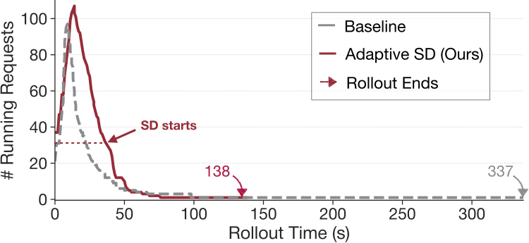

 Figure 14. Rollout running-request profiling. Example of processing 128 requests with and without adaptive decoding using Qwen-32B (TP=4).

### 6.4. Evaluation of Spot Trainer

Training Adaptive Drafter. Figure [15](https://arxiv.org/html/2511.16665v1#S6.F15 "Figure 15 ‣ 6.4. Evaluation of Spot Trainer ‣ 6. Evaluation ‣ Taming the Long-Tail: Efficient Reasoning RL Training with Adaptive Drafter") presents an example training curve illustrating the adaptive drafter’s training process. After initial warm-up, the drafter’s top-3 next-token prediction accuracy increases significantly. When the target model is updated after an RL step, the drafter’s accuracy temporarily dips due to the distribution shift caused by the update. However, this accuracy is rapidly recovered within a few subsequent drafter training iterations, demonstrating the effectiveness and robustness of our adaptive method.

Effectiveness of Adaptive Drafter. Table [4](https://arxiv.org/html/2511.16665v1#S6.T4 "Table 4 ‣ 6.4. Evaluation of Spot Trainer ‣ 6. Evaluation ‣ Taming the Long-Tail: Efficient Reasoning RL Training with Adaptive Drafter") highlights the effectiveness of adaptively training the draft model. With this adaptive training mechanism, TLT consistently achieves higher average accept lengths for the Target-R model across both RL-training tasks and downstream evaluations, demonstrating improved alignment and performance.

Table 3. Bucketed CUDAGraph reduces memory footprint. Numbers measured using Llama-3-8B on H100 GPUs (TP=4). Search space includes 4 different strategies.

Method | Memory Footprint  
---|---  
Single Strategy | 7.81 GB  
Vanilla Multiple Strategies | 30.39 GB  
Bucketed CUDAGraph | 10.69 GB

 

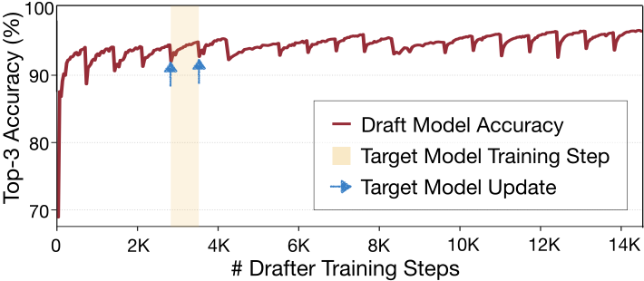

 Figure 15. Accuracy of the draft model during adaptive training. The adaptive drafter’s top-3 accuracy shows a consistent upward trend. While target model updates cause minor dips, the drafter quickly adapts and recovers. 

Figure [16](https://arxiv.org/html/2511.16665v1#S6.F16 "Figure 16 ‣ 6.4. Evaluation of Spot Trainer ‣ 6. Evaluation ‣ Taming the Long-Tail: Efficient Reasoning RL Training with Adaptive Drafter") further corroborates this finding, which shows the acceptance probability at different token positions within the drafted sequence. Due to the output distribution shift of the target model and error accumulation, the vanilla draft model struggles to accurately predict tokens several steps ahead, severely limiting the effective accept length. The adaptive drafter, however, sustains higher acceptance probabilities across these positions, showcasing its ability to mitigate evolving target model and maintain longer accept lengths.

Efficient Spot Trainer. Spot Trainer achieves preemptible, high-throughput training with negligible runtime overheads. Among its optimizations, Selective Asynchronous Checkpointing (Figure [17](https://arxiv.org/html/2511.16665v1#S7.F17 "Figure 17 ‣ 7. Discussion ‣ Taming the Long-Tail: Efficient Reasoning RL Training with Adaptive Drafter") (a)) facilitates the trainer’s preemptible design without significant work loss. Compared to the vanilla synchronous design, our approach reduces the checkpointing latency by 9.2 \(\times\) through both offloading the save process to a background thread and selectively dumping only the trainable parameters of the draft model. Figure [17](https://arxiv.org/html/2511.16665v1#S7.F17 "Figure 17 ‣ 7. Discussion ‣ Taming the Long-Tail: Efficient Reasoning RL Training with Adaptive Drafter") (b) demonstrates the effectiveness of sequence packing. This technique eliminates wasteful computation on padding tokens by concatenating variable-length sequences, improving training throughput by 2.2\(\times\) over vanilla batching.

Table 4. Effectiveness of Adaptive Drafter. Adaptive drafter maintains alignment with the target model. Target-Base denotes Qwen2.5-7B; and Target-R denotes the model after RL. Downstream indicates the collection of math, coding and reasoning domains in MTBench ([Zheng et al., 2023](https://arxiv.org/html/2511.16665v1#bib.bib10)). 

<table id="S6.T4.6.1" class="ltx_tabular ltx_align_middle">
<tr id="S6.T4.6.1.1" class="ltx_tr">
<td id="S6.T4.6.1.1.1" class="ltx_td ltx_border_tt"></td>
<td id="S6.T4.6.1.1.2" class="ltx_td ltx_align_center ltx_border_tt" colspan="2">RL Training</td>
<td id="S6.T4.6.1.1.3" class="ltx_td ltx_align_center ltx_border_tt" colspan="2">Downstream</td></tr>
<tr id="S6.T4.6.1.2" class="ltx_tr">
<td id="S6.T4.6.1.2.1" class="ltx_td"></td>
<td id="S6.T4.6.1.2.2" class="ltx_td ltx_align_center ltx_border_t">Target-Base</td>
<td id="S6.T4.6.1.2.3" class="ltx_td ltx_align_center ltx_border_t">Target-R</td>
<td id="S6.T4.6.1.2.4" class="ltx_td ltx_align_center ltx_border_t">Target-Base</td>
<td id="S6.T4.6.1.2.5" class="ltx_td ltx_align_center ltx_border_t">Target-R</td></tr>
<tr id="S6.T4.6.1.3" class="ltx_tr">
<td id="S6.T4.6.1.3.1" class="ltx_td ltx_align_center ltx_border_bb ltx_border_t">Accept Length</td>
<td id="S6.T4.6.1.3.2" class="ltx_td ltx_align_center ltx_border_bb ltx_border_t">4.59</td>
<td id="S6.T4.6.1.3.3" class="ltx_td ltx_align_center ltx_border_bb ltx_border_t">6.53</td>
<td id="S6.T4.6.1.3.4" class="ltx_td ltx_align_center ltx_border_bb ltx_border_t">3.76</td>
<td id="S6.T4.6.1.3.5" class="ltx_td ltx_align_center ltx_border_bb ltx_border_t">5.15</td></tr>
</table>

 

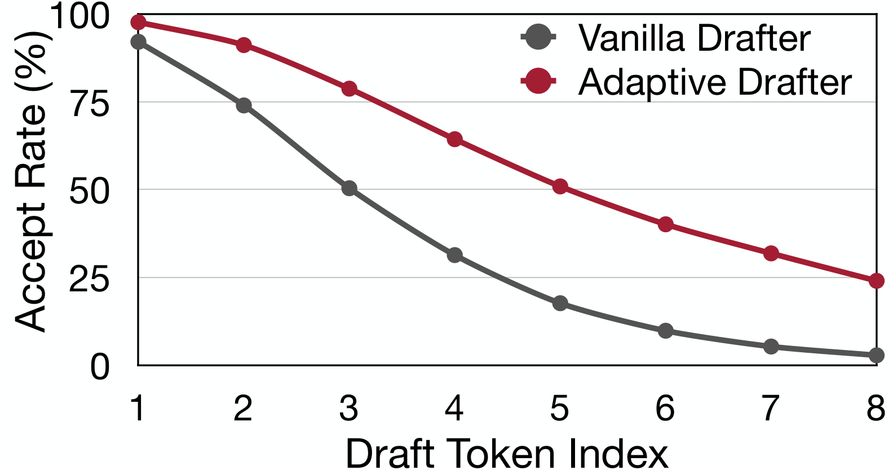

 Figure 16. Token accept rate of different draft models. Our adaptive draft model achieves prominently higher accept rate when predicting distant tokens in rollout scenario.

System Overhead Analysis. We identify three primary sources of overhead in TLT: (1) Stage-transition overhead, introduced by additional the drafter-weight update and optimizer offloading compared to VeRL ([Sheng et al., 2025](https://arxiv.org/html/2511.16665v1#bib.bib33)). This accounts for less than 1% of the RL-step duration due to the much smaller model size. (2) SD switch overhead, incurred when switching from normal decoding to SD. Because the draft model is initially inactive for large batch sizes, we perform a reprefill step to activate SD, which completes within 3 seconds. (3) Drafter-training coordination overhead, caused by occasional contention during spot-trainer execution. However, we find that it is unnecessary to train the drafter every RL step, performing once every 10 steps is sufficient to maintain accuracy. Overall, the performance gains of TLT far outweigh this overhead, yielding end-to-end speedups.

## 7\. Discussion

More Application Scenarios. In this work, we primarily investigate how speculative decoding can accelerate RL training by mitigating long-tail rollouts. We believe this technique also opens promising avenues for broader applications. For example: (1) Uniformly long responses. When all rollouts are long and no tail exists, each request demands substantial KV-cache capacity. This often makes the system KV-cache-bound and triggers request eviction, limiting the running batch size. In such cases, the workload naturally falls into the “sweet spot" of speculative decoding, enabling decoding acceleration. (2) Multi-turn rollouts with tool-calling RL. In multi-turn RL settings involving tool calls, partial requests perform GPU-free tool executions while their KV caches remain resident on the GPU. This reduces the number of active decoding requests and again creates a favorable regime for speculative decoding under our approach. (3) Online serving and edge deployment. When the target model is fixed, a draft model trained via TLT can be directly deployed for inference. Adaptive speculative decoding remains highly effective in these deployment scenarios, especially for handling variable load. Extending our approach to these settings is an exciting direction for future work.

Can We Break RL Synchronization? TLT aims to improve RL training efficiency without modifying on-policy requirements of the underlying algorithm. One may wonder whether it is possible to further accelerate training by asynchronously updating the model with partial rollouts during long decoding phases. While appealing, this approach risks altering the underlying RL algorithm and potentially harming convergence and model performance. Asynchronous RL typically mixes multiple policy versions within a single rollout, potentially biasing gradient estimation and shifting the learning dynamics (e.g., drifting from on-policy to off-policy). Additional algorithmic modifications are required to safely accommodate such paradigm ([Fu et al., 2025](https://arxiv.org/html/2511.16665v1#bib.bib4)). A more balanced approach is to allow limited asynchrony that preserves algorithmic correctness while improving hardware utilization. Even under such settings, the heavy-tail rollout problem remains, and our speculative decoding approach can be combined with limited asynchronous RL to further accelerate training _without_ introducing additional loss or policy staleness, leaving this as an intriguing direction for future work.

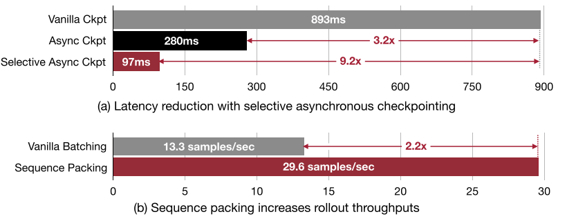

 Figure 17. Effect of selective asynchronous checkpointing and sequence packing.

Can TLT be applied to other RL algorithms? GRPO represents a widely used algorithmic structure for reasoning RL. Alternatives such as RLOO ([Ahmadian et al., 2024](https://arxiv.org/html/2511.16665v1#bib.bib60)), DAPO ([Yu et al., 2025](https://arxiv.org/html/2511.16665v1#bib.bib15)), REINFORCE ([Williams, 1992](https://arxiv.org/html/2511.16665v1#bib.bib56)), and REINFORCE++ ([Hu et al., 2025](https://arxiv.org/html/2511.16665v1#bib.bib57)) generally share the same overall training workflow, differing mainly in their reward formulations and use of KL-regularization. These algorithmic variations remain fully compatible with our adaptive drafter and spot-training design, suggesting that TLT can readily accelerate a broad class of RL methods.

## 8\. Related Work

RL Systems for LLMs. Several systems aim to optimize the training pipeline of Reinforcement Learning from Human Feedback (RLHF) ([Ouyang et al., 2022](https://arxiv.org/html/2511.16665v1#bib.bib36)). Frameworks like DeepSpeed-Chat ([Yao et al., 2023](https://arxiv.org/html/2511.16665v1#bib.bib20)), GEAR ([Wang et al., 2023](https://arxiv.org/html/2511.16665v1#bib.bib28)), VeRL ([Sheng et al., 2025](https://arxiv.org/html/2511.16665v1#bib.bib33)), FlexRLHF ([Xiao et al., 2024b](https://arxiv.org/html/2511.16665v1#bib.bib26)) and NeMo-Aligner ([Shen et al., 2024](https://arxiv.org/html/2511.16665v1#bib.bib43)) provide scalable end-to-end solutions, supporting various alignment algorithms and parallelism techniques. Others focus on specific optimizations within the pipeline. RLHFuse ([Zhong et al., 2025b](https://arxiv.org/html/2511.16665v1#bib.bib59)) employs fine-grained scheduling and stage fusion to improve GPU utilization. ReaLHF ([Mei et al., 2024](https://arxiv.org/html/2511.16665v1#bib.bib54)) introduces dynamic parameter reallocation to flexibly adapt 3D parallelism strategies across RLHF stages. Their optimization efforts primarily target the efficient management of multiple models inherent in the RLHF process. However, they neglect a critical performance bottleneck in the rollout phase. This oversight renders existing systems inefficient for reasoning RL tasks. Our work addresses this gap by concentrating specifically on optimizing the rollout bottleneck, utilizing adaptive drafter which is orthogonal to prior systems. Recent efforts ([Fu et al., 2025](https://arxiv.org/html/2511.16665v1#bib.bib4); [Zhong et al., 2025a](https://arxiv.org/html/2511.16665v1#bib.bib3)) attempt to alleviate the synchronization constraint in RL by allowing stale responses for model updates. While such asynchronous strategies accelerate training, they risk degrading model quality. In contrast, our approach preserves the original RL algorithm, ensuring lossless training performance while achieving significant efficiency gains.

Speculative Decoding. Speculative decoding ([Leviathan et al., 2023](https://arxiv.org/html/2511.16665v1#bib.bib68); [Chen et al., 2023](https://arxiv.org/html/2511.16665v1#bib.bib12); [Li et al., 2025b](https://arxiv.org/html/2511.16665v1#bib.bib8)) accelerates LLM inference by verifying candidate tokens in parallel with the target model, effectively increasing the number of tokens generated per step. Enhancements to speculative decoding encompass diverse strategies. Researchers have explored retrieval-based methods ([He et al., 2024](https://arxiv.org/html/2511.16665v1#bib.bib58); [Saxena, 2023](https://arxiv.org/html/2511.16665v1#bib.bib63); [Fu et al., 2024](https://arxiv.org/html/2511.16665v1#bib.bib39)), which avoid the need to train an extra draft model. Others modify the target model directly: Medusa ([Cai et al., 2024](https://arxiv.org/html/2511.16665v1#bib.bib42)) integrates multiple prediction heads, an approach refined by Hydra ([Ankner et al., 2024](https://arxiv.org/html/2511.16665v1#bib.bib34)) which models correlations between these predictions. Furthermore, SpecInfer ([Miao et al., 2024](https://arxiv.org/html/2511.16665v1#bib.bib66)) innovatively employs tree-based speculative decoding to broaden the candidate search space. OSD ([Liu et al., 2024](https://arxiv.org/html/2511.16665v1#bib.bib1)) leverages knowledge distillation for the drafter model so it remains aligned with distribution shifts in online serving. Additionally, EAGLE ([Li et al., 2024b](https://arxiv.org/html/2511.16665v1#bib.bib22); [Li et al., 2024a](https://arxiv.org/html/2511.16665v1#bib.bib23); [Li et al., 2025a](https://arxiv.org/html/2511.16665v1#bib.bib24)) trains separate, compact auto-regressive models as dedicated draft models. Further refining this approach, HASS ([Zhang et al., 2025](https://arxiv.org/html/2511.16665v1#bib.bib32)) improves draft model accuracy by simulating multi-step predictions during training, mitigating the training-inference inconsistency issue. Recent work also adapts speculative idea for efficient reasoning LLM inference. For example, RSD ([Liao et al., 2025](https://arxiv.org/html/2511.16665v1#bib.bib61)) employs a reward model to guide the speculation, and SpecReason ([Pan et al., 2025](https://arxiv.org/html/2511.16665v1#bib.bib67)) uses a lightweight model to speculatively execute intermediate reasoning steps. Unlike these approaches designed for inference with static models, we focus on the dynamic RL training scenario where the target model is continuously updated.

## 9\. Conclusion

To conclude, TLT alleviates the critical long-tail bottleneck in reasoning RL training through an adaptive drafter. The adaptivity operates on two folds: during training, it adapts to target model updates; during inference, it adapts to varying batchsizes. As a result, TLT achieves substantial throughput improvements while preserving model quality.

## Acknowledgements

We thank MIT-IBM Watson AI Lab, MIT AI Hardware Program, MIT Amazon Science Hub, Hyundai Motor Company, and National Science Foundation for supporting this work.

## References

  * Ahmadian et al. (2024) A. Ahmadian, C. Cremer, M. Gallé, M. Fadaee, J. Kreutzer, O. Pietquin, A. Üstün, and S. Hooker Back to basics: revisiting reinforce style optimization for learning from human feedback in llms.  In Proceedings of the 62nd Annual Meeting of the Association for Computational Linguistics,  ACL ’24.  Cited by: [§3](https://arxiv.org/html/2511.16665v1#S3.p5.1 "3. TLT Overview ‣ Taming the Long-Tail: Efficient Reasoning RL Training with Adaptive Drafter"), [§7](https://arxiv.org/html/2511.16665v1#S7.p3.1 "7. Discussion ‣ Taming the Long-Tail: Efficient Reasoning RL Training with Adaptive Drafter"). 
  * Ankner et al. (2024) Z. Ankner, R. Parthasarathy, A. Nrusimha, C. Rinard, J. Ragan-Kelley, and W. Brandon Hydra: sequentially-dependent draft heads for medusa decoding.  In Conference on Language Modeling,  COLM ’24.  Cited by: [§1](https://arxiv.org/html/2511.16665v1#S1.p7.1 "1. Introduction ‣ Taming the Long-Tail: Efficient Reasoning RL Training with Adaptive Drafter"), [§4.1](https://arxiv.org/html/2511.16665v1#S4.SS1.p3.1 "4.1. Draft Model ‣ 4. Adaptive Drafter ‣ Taming the Long-Tail: Efficient Reasoning RL Training with Adaptive Drafter"), [§8](https://arxiv.org/html/2511.16665v1#S8.p2.1 "8. Related Work ‣ Taming the Long-Tail: Efficient Reasoning RL Training with Adaptive Drafter"). 
  * ByteDance (2025) ByteDance W&B trace of dapo reproduction on verl.  External Links: [Link](https://wandb.ai/verl-org/DAPO%20Reproduction%20on%20verl?nw=u7n2j5sht28) Cited by: [Figure 2](https://arxiv.org/html/2511.16665v1#S1.F2 "In 1. Introduction ‣ Taming the Long-Tail: Efficient Reasoning RL Training with Adaptive Drafter"), [Figure 2](https://arxiv.org/html/2511.16665v1#S1.F2.5.1 "In 1. Introduction ‣ Taming the Long-Tail: Efficient Reasoning RL Training with Adaptive Drafter"). 
  * Cai et al. (2024) T. Cai, Y. Li, Z. Geng, H. Peng, J. D. Lee, D. Chen, and T. Dao Medusa: simple llm inference acceleration framework with multiple decoding heads.  CoRR abs/2401.10774.  External Links: [Link](https://arxiv.org/abs/2401.10774) Cited by: [§1](https://arxiv.org/html/2511.16665v1#S1.p7.1 "1. Introduction ‣ Taming the Long-Tail: Efficient Reasoning RL Training with Adaptive Drafter"), [§8](https://arxiv.org/html/2511.16665v1#S8.p2.1 "8. Related Work ‣ Taming the Long-Tail: Efficient Reasoning RL Training with Adaptive Drafter"). 
  * Chen et al. (2023) C. Chen, S. Borgeaud, G. Irving, J. Lespiau, L. Sifre, and J. Jumper Accelerating large language model decoding with speculative sampling.  CoRR abs/2302.01318.  External Links: [Link](https://arxiv.org/abs/2302.01318) Cited by: [§1](https://arxiv.org/html/2511.16665v1#S1.p6.1 "1. Introduction ‣ Taming the Long-Tail: Efficient Reasoning RL Training with Adaptive Drafter"), [§2.2](https://arxiv.org/html/2511.16665v1#S2.SS2.p1.1 "2.2. Speculative Decoding for Efficient Reasoning RL ‣ 2. Background and Motivation ‣ Taming the Long-Tail: Efficient Reasoning RL Training with Adaptive Drafter"), [§4.1](https://arxiv.org/html/2511.16665v1#S4.SS1.p2.1 "4.1. Draft Model ‣ 4. Adaptive Drafter ‣ Taming the Long-Tail: Efficient Reasoning RL Training with Adaptive Drafter"), [§8](https://arxiv.org/html/2511.16665v1#S8.p2.1 "8. Related Work ‣ Taming the Long-Tail: Efficient Reasoning RL Training with Adaptive Drafter"). 
  * Chen et al. (2025) Q. Chen, L. Qin, J. Liu, D. Peng, J. Guan, P. Wang, M. Hu, Y. Zhou, T. Gao, and W. Che Towards reasoning era: a survey of long chain-of-thought for reasoning large language models.  CoRR abs/2503.09567.  External Links: [Link](https://arxiv.org/abs/2503.09567) Cited by: [§1](https://arxiv.org/html/2511.16665v1#S1.p1.1 "1. Introduction ‣ Taming the Long-Tail: Efficient Reasoning RL Training with Adaptive Drafter"), [§2.1](https://arxiv.org/html/2511.16665v1#S2.SS1.p1.1 "2.1. Reasoning and Reinforcement Learning ‣ 2. Background and Motivation ‣ Taming the Long-Tail: Efficient Reasoning RL Training with Adaptive Drafter"). 
  * Codeforces (2025) Codeforces CodeForces Online Judge.  External Links: [Link](https://codeforces.com/) Cited by: [§6.1](https://arxiv.org/html/2511.16665v1#S6.SS1.p5.1 "6.1. Experimental Setup ‣ 6. Evaluation ‣ Taming the Long-Tail: Efficient Reasoning RL Training with Adaptive Drafter"). 
  * Cui et al. (2025) G. Cui, L. Yuan, Z. Wang, H. Wang, W. Li, B. He, Y. Fan, T. Yu, Q. Xu, W. Chen, J. Yuan, H. Chen, K. Zhang, X. Lv, S. Wang, Y. Yao, X. Han, H. Peng, Y. Cheng, Z. Liu, M. Sun, B. Zhou, and N. Ding Process reinforcement through implicit rewards.  CoRR abs/2502.01456.  External Links: [Link](https://arxiv.org/abs/2502.01456) Cited by: [§6.1](https://arxiv.org/html/2511.16665v1#S6.SS1.p5.1 "6.1. Experimental Setup ‣ 6. Evaluation ‣ Taming the Long-Tail: Efficient Reasoning RL Training with Adaptive Drafter"). 
  * DeepSeek-AI et al. (2025) DeepSeek-AI, D. Guo, D. Yang, H. Zhang, J. Song, R. Zhang, R. Xu, Q. Zhu, S. Ma, P. Wang, X. Bi, X. Zhang, X. Yu, Y. Wu, Z. F. Wu, Z. Gou, Z. Shao, Z. Li, Z. Gao, A. Liu, B. Xue, B. Wang, B. Wu, B. Feng, C. Lu, C. Zhao, C. Deng, C. Zhang, C. Ruan, D. Dai, D. Chen, D. Ji, E. Li, F. Lin, F. Dai, F. Luo, G. Hao, G. Chen, G. Li, H. Zhang, H. Bao, H. Xu, H. Wang, H. Ding, H. Xin, H. Gao, H. Qu, H. Li, J. Guo, J. Li, J. Wang, J. Chen, J. Yuan, J. Qiu, J. Li, J. L. Cai, J. Ni, J. Liang, J. Chen, K. Dong, K. Hu, K. Gao, K. Guan, K. Huang, K. Yu, L. Wang, L. Zhang, L. Zhao, L. Wang, L. Zhang, L. Xu, L. Xia, M. Zhang, M. Zhang, M. Tang, M. Li, M. Wang, M. Li, N. Tian, P. Huang, P. Zhang, Q. Wang, Q. Chen, Q. Du, R. Ge, R. Zhang, R. Pan, R. Wang, R. J. Chen, R. L. Jin, R. Chen, S. Lu, S. Zhou, S. Chen, S. Ye, S. Wang, S. Yu, S. Zhou, S. Pan, S. S. Li, S. Zhou, S. Wu, S. Ye, T. Yun, T. Pei, T. Sun, T. Wang, W. Zeng, W. Zhao, W. Liu, W. Liang, W. Gao, W. Yu, W. Zhang, W. L. Xiao, W. An, X. Liu, X. Wang, X. Chen, X. Nie, X. Cheng, X. Liu, X. Xie, X. Liu, X. Yang, X. Li, X. Su, X. Lin, X. Q. Li, X. Jin, X. Shen, X. Chen, X. Sun, X. Wang, X. Song, X. Zhou, X. Wang, X. Shan, Y. K. Li, Y. Q. Wang, Y. X. Wei, Y. Zhang, Y. Xu, Y. Li, Y. Zhao, Y. Sun, Y. Wang, Y. Yu, Y. Zhang, Y. Shi, Y. Xiong, Y. He, Y. Piao, Y. Wang, Y. Tan, Y. Ma, Y. Liu, Y. Guo, Y. Ou, Y. Wang, Y. Gong, Y. Zou, Y. He, Y. Xiong, Y. Luo, Y. You, Y. Liu, Y. Zhou, Y. X. Zhu, Y. Xu, Y. Huang, Y. Li, Y. Zheng, Y. Zhu, Y. Ma, Y. Tang, Y. Zha, Y. Yan, Z. Z. Ren, Z. Ren, Z. Sha, Z. Fu, Z. Xu, Z. Xie, Z. Zhang, Z. Hao, Z. Ma, Z. Yan, Z. Wu, Z. Gu, Z. Zhu, Z. Liu, Z. Li, Z. Xie, Z. Song, Z. Pan, Z. Huang, Z. Xu, Z. Zhang, and Z. Zhang DeepSeek-r1: incentivizing reasoning capability in llms via reinforcement learning.  CoRR abs/2501.12948.  External Links: [Link](https://arxiv.org/abs/2501.12948) Cited by: [§1](https://arxiv.org/html/2511.16665v1#S1.p1.1 "1. Introduction ‣ Taming the Long-Tail: Efficient Reasoning RL Training with Adaptive Drafter"), [§2.1](https://arxiv.org/html/2511.16665v1#S2.SS1.p1.1 "2.1. Reasoning and Reinforcement Learning ‣ 2. Background and Motivation ‣ Taming the Long-Tail: Efficient Reasoning RL Training with Adaptive Drafter"), [§6.1](https://arxiv.org/html/2511.16665v1#S6.SS1.p3.1 "6.1. Experimental Setup ‣ 6. Evaluation ‣ Taming the Long-Tail: Efficient Reasoning RL Training with Adaptive Drafter"), [§6.1](https://arxiv.org/html/2511.16665v1#S6.SS1.p6.1 "6.1. Experimental Setup ‣ 6. Evaluation ‣ Taming the Long-Tail: Efficient Reasoning RL Training with Adaptive Drafter"). 
  * Face (2025) H. Face Open r1: a fully open reproduction of deepseek-r1.  External Links: [Link](https://github.com/huggingface/open-r1) Cited by: [item (1)](https://arxiv.org/html/2511.16665v1#S6.I2.i1.p1.1 "In 6.1. Experimental Setup ‣ 6. Evaluation ‣ Taming the Long-Tail: Efficient Reasoning RL Training with Adaptive Drafter"), [§6.2](https://arxiv.org/html/2511.16665v1#S6.SS2.p1.1 "6.2. End-to-End Evaluation ‣ 6. Evaluation ‣ Taming the Long-Tail: Efficient Reasoning RL Training with Adaptive Drafter"). 
  * Frantar et al. (2023) E. Frantar, S. Ashkboos, T. Hoefler, and D. Alistarh GPTQ: accurate post-training quantization for generative pre-trained transformers.  CoRR abs/2210.17323.  External Links: [Link](https://arxiv.org/abs/2210.17323) Cited by: [§1](https://arxiv.org/html/2511.16665v1#S1.p6.1 "1. Introduction ‣ Taming the Long-Tail: Efficient Reasoning RL Training with Adaptive Drafter"). 
  * Fu et al. (2025) W. Fu, J. Gao, X. Shen, C. Zhu, Z. Mei, C. He, S. Xu, G. Wei, J. Mei, J. Wang, T. Yang, B. Yuan, and Y. Wu AReaL: a large-scale asynchronous reinforcement learning system for language reasoning.  CoRR abs/2505.24298.  External Links: [Link](https://arxiv.org/abs/2505.24298) Cited by: [§7](https://arxiv.org/html/2511.16665v1#S7.p2.1 "7. Discussion ‣ Taming the Long-Tail: Efficient Reasoning RL Training with Adaptive Drafter"), [§8](https://arxiv.org/html/2511.16665v1#S8.p1.1 "8. Related Work ‣ Taming the Long-Tail: Efficient Reasoning RL Training with Adaptive Drafter"). 
  * Fu et al. (2024) Y. Fu, P. Bailis, I. Stoica, and H. Zhang Break the sequential dependency of llm inference using lookahead decoding.  arXiv preprint arXiv:2402.02057.  Cited by: [§8](https://arxiv.org/html/2511.16665v1#S8.p2.1 "8. Related Work ‣ Taming the Long-Tail: Efficient Reasoning RL Training with Adaptive Drafter"). 
  * Gao et al. (2025) X. Gao, W. Xie, Y. Xiang, and F. Ji Falcon: faster and parallel inference of large language models through enhanced semi-autoregressive drafting and custom-designed decoding tree.  In Proceedings of the AAAI Conference on Artificial Intelligence,  AAAI ’25.  Cited by: [§1](https://arxiv.org/html/2511.16665v1#S1.p7.1 "1. Introduction ‣ Taming the Long-Tail: Efficient Reasoning RL Training with Adaptive Drafter"), [§4.1](https://arxiv.org/html/2511.16665v1#S4.SS1.p3.1 "4.1. Draft Model ‣ 4. Adaptive Drafter ‣ Taming the Long-Tail: Efficient Reasoning RL Training with Adaptive Drafter"). 
  * Gemini (2025) Gemini Gemini 2.5 pro technical report.  External Links: [Link](https://blog.google/technology/google-deepmind/gemini-model-thinking-updates-march-2025/#gemini-2-5-pro) Cited by: [§1](https://arxiv.org/html/2511.16665v1#S1.p1.1 "1. Introduction ‣ Taming the Long-Tail: Efficient Reasoning RL Training with Adaptive Drafter"). 
  * He et al. (2024) Z. He, Z. Zhong, T. Cai, J. D. Lee, and D. He REST: retrieval-based speculative decoding.  CoRR abs/2311.08252.  External Links: [Link](https://arxiv.org/abs/2311.08252) Cited by: [§1](https://arxiv.org/html/2511.16665v1#S1.p7.1 "1. Introduction ‣ Taming the Long-Tail: Efficient Reasoning RL Training with Adaptive Drafter"), [§8](https://arxiv.org/html/2511.16665v1#S8.p2.1 "8. Related Work ‣ Taming the Long-Tail: Efficient Reasoning RL Training with Adaptive Drafter"). 
  * Hintjens (2013) P. Hintjens ZeroMQ: messaging for many applications.  " O’Reilly Media, Inc.".  Cited by: [§4.2](https://arxiv.org/html/2511.16665v1#S4.SS2.p2.1 "4.2. Spot Trainer ‣ 4. Adaptive Drafter ‣ Taming the Long-Tail: Efficient Reasoning RL Training with Adaptive Drafter"), [§6.1](https://arxiv.org/html/2511.16665v1#S6.SS1.p1.1 "6.1. Experimental Setup ‣ 6. Evaluation ‣ Taming the Long-Tail: Efficient Reasoning RL Training with Adaptive Drafter"). 
  * Hu et al. (2025) J. Hu, J. K. Liu, and S. Wei REINFORCE++: an efficient rlhf algorithm with robustness to both prompt and reward models.  CoRR abs/2501.03262.  External Links: [Link](https://arxiv.org/abs/2501.03262) Cited by: [§7](https://arxiv.org/html/2511.16665v1#S7.p3.1 "7. Discussion ‣ Taming the Long-Tail: Efficient Reasoning RL Training with Adaptive Drafter"). 
  * Kingma and Ba (2015) D. P. Kingma and J. Ba Adam: a method for stochastic optimization.  In International Conference on Learning Representations,  ICLR ’15.  Cited by: [§6.1](https://arxiv.org/html/2511.16665v1#S6.SS1.p6.1 "6.1. Experimental Setup ‣ 6. Evaluation ‣ Taming the Long-Tail: Efficient Reasoning RL Training with Adaptive Drafter"). 
  * Krell et al. (2022) M. M. Krell, M. Kosec, S. P. Perez, and A. Fitzgibbon Efficient sequence packing without cross-contamination: accelerating large language models without impacting performance.  CoRR abs/2107.02027.  External Links: [Link](https://arxiv.org/abs/2107.02027) Cited by: [§4.2](https://arxiv.org/html/2511.16665v1#S4.SS2.p7.1 "4.2. Spot Trainer ‣ 4. Adaptive Drafter ‣ Taming the Long-Tail: Efficient Reasoning RL Training with Adaptive Drafter"). 
  * Kwon et al. (2023) W. Kwon, Z. Li, S. Zhuang, Y. Sheng, L. Zheng, C. H. Yu, J. Gonzalez, H. Zhang, and I. Stoica Efficient memory management for large language model serving with pagedattention.  In Proceedings of the ACM SIGOPS 29th Symposium on Operating Systems Principles,  SOSP ’23.  Cited by: [item (1)](https://arxiv.org/html/2511.16665v1#S6.I2.i1.p1.1 "In 6.1. Experimental Setup ‣ 6. Evaluation ‣ Taming the Long-Tail: Efficient Reasoning RL Training with Adaptive Drafter"). 
  * Leviathan et al. (2023) Y. Leviathan, M. Kalman, and Y. Matias Fast inference from transformers via speculative decoding.  In Proceedings of the 40th International Conference on Machine Learning,  ICML ’23, pp. 19274–19286.  Cited by: [§1](https://arxiv.org/html/2511.16665v1#S1.p6.1 "1. Introduction ‣ Taming the Long-Tail: Efficient Reasoning RL Training with Adaptive Drafter"), [§2.2](https://arxiv.org/html/2511.16665v1#S2.SS2.p1.1 "2.2. Speculative Decoding for Efficient Reasoning RL ‣ 2. Background and Motivation ‣ Taming the Long-Tail: Efficient Reasoning RL Training with Adaptive Drafter"), [§4.1](https://arxiv.org/html/2511.16665v1#S4.SS1.p2.1 "4.1. Draft Model ‣ 4. Adaptive Drafter ‣ Taming the Long-Tail: Efficient Reasoning RL Training with Adaptive Drafter"), [§8](https://arxiv.org/html/2511.16665v1#S8.p2.1 "8. Related Work ‣ Taming the Long-Tail: Efficient Reasoning RL Training with Adaptive Drafter"). 
  * Lewkowycz et al. (2022) A. Lewkowycz, A. Andreassen, D. Dohan, E. Dyer, H. Michalewski, V. Ramasesh, A. Slone, C. Anil, I. Schlag, T. Gutman-Solo, Y. Wu, B. Neyshabur, G. Gur-Ari, and V. Misra Solving quantitative reasoning problems with language models.  In Advances in Neural Information Processing Systems,  NeurIPS ’22.  Cited by: [§6.1](https://arxiv.org/html/2511.16665v1#S6.SS1.p5.1 "6.1. Experimental Setup ‣ 6. Evaluation ‣ Taming the Long-Tail: Efficient Reasoning RL Training with Adaptive Drafter"). 
  * LI et al. (2025) J. LI, E. Beeching, L. Tunstall, B. Lipkin, R. Soletskyi, S. C. Huang, K. Rasul, L. Yu, A. Jiang, Z. Shen, Z. Qin, B. Dong, L. Zhou, Y. Fleureau, G. Lample, and S. Polu NuminaMath.  Numina.  Note: <https://huggingface.co/AI-MO/NuminaMath-CoT> Cited by: [§6.1](https://arxiv.org/html/2511.16665v1#S6.SS1.p5.1 "6.1. Experimental Setup ‣ 6. Evaluation ‣ Taming the Long-Tail: Efficient Reasoning RL Training with Adaptive Drafter"). 
  * Li et al. (2024a) Y. Li, F. Wei, C. Zhang, and H. Zhang EAGLE-2: faster inference of language models with dynamic draft trees.  In Proceedings of the 2024 Conference on Empirical Methods in Natural Language Processing,  EMNLP ’24.  Cited by: [§1](https://arxiv.org/html/2511.16665v1#S1.p7.1 "1. Introduction ‣ Taming the Long-Tail: Efficient Reasoning RL Training with Adaptive Drafter"), [§4.1](https://arxiv.org/html/2511.16665v1#S4.SS1.p3.1 "4.1. Draft Model ‣ 4. Adaptive Drafter ‣ Taming the Long-Tail: Efficient Reasoning RL Training with Adaptive Drafter"), [§5.1](https://arxiv.org/html/2511.16665v1#S5.SS1.p1.1 "5.1. Adaptive SD Manager ‣ 5. Adaptive Rollout Engine ‣ Taming the Long-Tail: Efficient Reasoning RL Training with Adaptive Drafter"), [§5.1](https://arxiv.org/html/2511.16665v1#S5.SS1.p2.1 "5.1. Adaptive SD Manager ‣ 5. Adaptive Rollout Engine ‣ Taming the Long-Tail: Efficient Reasoning RL Training with Adaptive Drafter"), [§8](https://arxiv.org/html/2511.16665v1#S8.p2.1 "8. Related Work ‣ Taming the Long-Tail: Efficient Reasoning RL Training with Adaptive Drafter"). 
  * Li et al. (2024b) Y. Li, F. Wei, C. Zhang, and H. Zhang EAGLE: speculative sampling requires rethinking feature uncertainty.  In Proceedings of the 41st International Conference on Machine Learning,  ICML ’24.  Cited by: [§1](https://arxiv.org/html/2511.16665v1#S1.p7.1 "1. Introduction ‣ Taming the Long-Tail: Efficient Reasoning RL Training with Adaptive Drafter"), [§2.2](https://arxiv.org/html/2511.16665v1#S2.SS2.p6.1 "2.2. Speculative Decoding for Efficient Reasoning RL ‣ 2. Background and Motivation ‣ Taming the Long-Tail: Efficient Reasoning RL Training with Adaptive Drafter"), [Figure 7](https://arxiv.org/html/2511.16665v1#S4.F7.3.2.1 "In 4. Adaptive Drafter ‣ Taming the Long-Tail: Efficient Reasoning RL Training with Adaptive Drafter"), [§4.1](https://arxiv.org/html/2511.16665v1#S4.SS1.p2.1 "4.1. Draft Model ‣ 4. Adaptive Drafter ‣ Taming the Long-Tail: Efficient Reasoning RL Training with Adaptive Drafter"), [§4.1](https://arxiv.org/html/2511.16665v1#S4.SS1.p3.1 "4.1. Draft Model ‣ 4. Adaptive Drafter ‣ Taming the Long-Tail: Efficient Reasoning RL Training with Adaptive Drafter"), [§4.1](https://arxiv.org/html/2511.16665v1#S4.SS1.p6.1 "4.1. Draft Model ‣ 4. Adaptive Drafter ‣ Taming the Long-Tail: Efficient Reasoning RL Training with Adaptive Drafter"), [§5.1](https://arxiv.org/html/2511.16665v1#S5.SS1.p2.1 "5.1. Adaptive SD Manager ‣ 5. Adaptive Rollout Engine ‣ Taming the Long-Tail: Efficient Reasoning RL Training with Adaptive Drafter"), [§8](https://arxiv.org/html/2511.16665v1#S8.p2.1 "8. Related Work ‣ Taming the Long-Tail: Efficient Reasoning RL Training with Adaptive Drafter"). 
  * Li et al. (2025a) Y. Li, F. Wei, C. Zhang, and H. Zhang EAGLE-3: scaling up inference acceleration of large language models via training-time test.  CoRR abs/2503.01840.  External Links: [Link](https://arxiv.org/abs/2503.01840) Cited by: [§1](https://arxiv.org/html/2511.16665v1#S1.p7.1 "1. Introduction ‣ Taming the Long-Tail: Efficient Reasoning RL Training with Adaptive Drafter"), [Figure 7](https://arxiv.org/html/2511.16665v1#S4.F7.3.4.1 "In 4. Adaptive Drafter ‣ Taming the Long-Tail: Efficient Reasoning RL Training with Adaptive Drafter"), [§4.1](https://arxiv.org/html/2511.16665v1#S4.SS1.p2.1 "4.1. Draft Model ‣ 4. Adaptive Drafter ‣ Taming the Long-Tail: Efficient Reasoning RL Training with Adaptive Drafter"), [§4.1](https://arxiv.org/html/2511.16665v1#S4.SS1.p3.1 "4.1. Draft Model ‣ 4. Adaptive Drafter ‣ Taming the Long-Tail: Efficient Reasoning RL Training with Adaptive Drafter"), [§4.1](https://arxiv.org/html/2511.16665v1#S4.SS1.p6.1 "4.1. Draft Model ‣ 4. Adaptive Drafter ‣ Taming the Long-Tail: Efficient Reasoning RL Training with Adaptive Drafter"), [§8](https://arxiv.org/html/2511.16665v1#S8.p2.1 "8. Related Work ‣ Taming the Long-Tail: Efficient Reasoning RL Training with Adaptive Drafter"). 
  * Li et al. (2025b) Z. Li, Z. Chen, R. Delacourt, G. Oliaro, Z. Wang, Q. Chen, S. Lin, A. Yang, Z. Zhang, Z. Chen, S. Lai, X. Miao, and Z. Jia AdaServe: slo-customized llm serving with fine-grained speculative decoding.  CoRR abs/2501.12162v1.  External Links: [Link](https://arxiv.org/abs/2501.12162) Cited by: [§8](https://arxiv.org/html/2511.16665v1#S8.p2.1 "8. Related Work ‣ Taming the Long-Tail: Efficient Reasoning RL Training with Adaptive Drafter"). 
  * Liao et al. (2025) B. Liao, Y. Xu, H. Dong, J. Li, C. Monz, S. Savarese, D. Sahoo, and C. Xiong Reward-guided speculative decoding for efficient llm reasoning.  CoRR abs/2501.19324.  External Links: [Link](https://arxiv.org/abs/2501.19324) Cited by: [§8](https://arxiv.org/html/2511.16665v1#S8.p2.1 "8. Related Work ‣ Taming the Long-Tail: Efficient Reasoning RL Training with Adaptive Drafter"). 
  * Lin et al. (2024) J. Lin, J. Tang, H. Tang, S. Yang, W. Chen, W. Wang, G. Xiao, X. Dang, C. Gan, and S. Han AWQ: activation-aware weight quantization for llm compression and acceleration.  CoRR abs/2306.00978.  External Links: [Link](https://arxiv.org/abs/2306.00978) Cited by: [§1](https://arxiv.org/html/2511.16665v1#S1.p6.1 "1. Introduction ‣ Taming the Long-Tail: Efficient Reasoning RL Training with Adaptive Drafter"). 
  * Liu et al. (2024) X. Liu, L. Hu, P. Bailis, A. Cheung, Z. Deng, I. Stoica, and H. Zhang Online speculative decoding.  In International Conference on Learning Representations,  ICML ’24.  Cited by: [§8](https://arxiv.org/html/2511.16665v1#S8.p2.1 "8. Related Work ‣ Taming the Long-Tail: Efficient Reasoning RL Training with Adaptive Drafter"). 
  * Lyzhov et al. (2020) A. Lyzhov, Y. Molchanova, A. Ashukha, D. Molchanov, and D. Vetrov Greedy policy search: a simple baseline for learnable test-time augmentation.  In Proceedings of the 36th Conference on Uncertainty in Artificial Intelligence,  UAI ’20, pp. 1308–1317.  Cited by: [§2.1](https://arxiv.org/html/2511.16665v1#S2.SS1.p1.1 "2.1. Reasoning and Reinforcement Learning ‣ 2. Background and Motivation ‣ Taming the Long-Tail: Efficient Reasoning RL Training with Adaptive Drafter"). 
  * Ma et al. (2023) X. Ma, G. Fang, and X. Wang LLM-pruner: on the structural pruning of large language models.  In Advances in Neural Information Processing Systems,  NeurIPS ’23.  Cited by: [§1](https://arxiv.org/html/2511.16665v1#S1.p6.1 "1. Introduction ‣ Taming the Long-Tail: Efficient Reasoning RL Training with Adaptive Drafter"). 
  * MAA (2024) MAA American invitational mathematics examination - aime.  External Links: [Link](https://artofproblemsolving.com/wiki/index.php/American_Invitational_Mathematics_Examination) Cited by: [Figure 3](https://arxiv.org/html/2511.16665v1#S2.F3 "In 2.1. Reasoning and Reinforcement Learning ‣ 2. Background and Motivation ‣ Taming the Long-Tail: Efficient Reasoning RL Training with Adaptive Drafter"), [Figure 3](https://arxiv.org/html/2511.16665v1#S2.F3.5.1 "In 2.1. Reasoning and Reinforcement Learning ‣ 2. Background and Motivation ‣ Taming the Long-Tail: Efficient Reasoning RL Training with Adaptive Drafter"). 
  * Mei et al. (2024) Z. Mei, W. Fu, K. Li, G. Wang, H. Zhang, and Y. Wu ReaLHF: optimized rlhf training for large language models through parameter reallocation.  CoRR abs/2406.14088.  External Links: [Link](https://arxiv.org/abs/2406.14088) Cited by: [§1](https://arxiv.org/html/2511.16665v1#S1.p5.1 "1. Introduction ‣ Taming the Long-Tail: Efficient Reasoning RL Training with Adaptive Drafter"), [§8](https://arxiv.org/html/2511.16665v1#S8.p1.1 "8. Related Work ‣ Taming the Long-Tail: Efficient Reasoning RL Training with Adaptive Drafter"). 
  * Miao et al. (2024) X. Miao, G. Oliaro, Z. Zhang, X. Cheng, Z. Wang, Z. Zhang, R. Y. Y. Wong, A. Zhu, L. Yang, X. Shi, C. Shi, Z. Chen, D. Arfeen, R. Abhyankar, and Z. Jia SpecInfer: accelerating large language model serving with tree-based speculative inference and verification.  In Proceedings of the 29th ACM International Conference on Architectural Support for Programming Languages and Operating Systems, Volume 3,  ASPLOS ’24.  Cited by: [§1](https://arxiv.org/html/2511.16665v1#S1.p7.1 "1. Introduction ‣ Taming the Long-Tail: Efficient Reasoning RL Training with Adaptive Drafter"), [§5.1](https://arxiv.org/html/2511.16665v1#S5.SS1.p1.1 "5.1. Adaptive SD Manager ‣ 5. Adaptive Rollout Engine ‣ Taming the Long-Tail: Efficient Reasoning RL Training with Adaptive Drafter"), [§8](https://arxiv.org/html/2511.16665v1#S8.p2.1 "8. Related Work ‣ Taming the Long-Tail: Efficient Reasoning RL Training with Adaptive Drafter"). 
  * Moritz et al. (2018) P. Moritz, R. Nishihara, S. Wang, A. Tumanov, R. Liaw, E. Liang, M. Elibol, Z. Yang, W. Paul, M. I. Jordan, and I. Stoica Ray: a distributed framework for emerging AI applications.  In 13th USENIX Symposium on Operating Systems Design and Implementation,  OSDI ’18.  Cited by: [§6.1](https://arxiv.org/html/2511.16665v1#S6.SS1.p1.1 "6.1. Experimental Setup ‣ 6. Evaluation ‣ Taming the Long-Tail: Efficient Reasoning RL Training with Adaptive Drafter"). 
  * Muennighoff et al. (2025) N. Muennighoff, Z. Yang, W. Shi, X. L. Li, L. Fei-Fei, H. Hajishirzi, L. Zettlemoyer, P. Liang, E. Candès, and T. Hashimoto S1: simple test-time scaling.  arXiv preprint arXiv:2501.19393.  Cited by: [Figure 3](https://arxiv.org/html/2511.16665v1#S2.F3 "In 2.1. Reasoning and Reinforcement Learning ‣ 2. Background and Motivation ‣ Taming the Long-Tail: Efficient Reasoning RL Training with Adaptive Drafter"), [Figure 3](https://arxiv.org/html/2511.16665v1#S2.F3.5.1 "In 2.1. Reasoning and Reinforcement Learning ‣ 2. Background and Motivation ‣ Taming the Long-Tail: Efficient Reasoning RL Training with Adaptive Drafter"). 
  * NVIDIA Corporation (2025) NVIDIA Corporation NVIDIA dgx h100.  Note: <https://www.nvidia.com/en-gb/data-center/dgx-h100/> Cited by: [§6.1](https://arxiv.org/html/2511.16665v1#S6.SS1.p2.1 "6.1. Experimental Setup ‣ 6. Evaluation ‣ Taming the Long-Tail: Efficient Reasoning RL Training with Adaptive Drafter"). 
  * OpenAI et al. (2025) OpenAI, A. El-Kishky, A. Wei, A. Saraiva, B. Minaiev, D. Selsam, D. Dohan, F. Song, H. Lightman, I. Clavera, J. Pachocki, J. Tworek, L. Kuhn, L. Kaiser, M. Chen, M. Schwarzer, M. Rohaninejad, N. McAleese, o3 contributors, O. Mürk, R. Garg, R. Shu, S. Sidor, V. Kosaraju, and W. Zhou Competitive programming with large reasoning models.  CoRR abs/2502.06807.  External Links: [Link](https://arxiv.org/abs/2502.06807) Cited by: [§1](https://arxiv.org/html/2511.16665v1#S1.p1.1 "1. Introduction ‣ Taming the Long-Tail: Efficient Reasoning RL Training with Adaptive Drafter"), [Figure 3](https://arxiv.org/html/2511.16665v1#S2.F3 "In 2.1. Reasoning and Reinforcement Learning ‣ 2. Background and Motivation ‣ Taming the Long-Tail: Efficient Reasoning RL Training with Adaptive Drafter"), [Figure 3](https://arxiv.org/html/2511.16665v1#S2.F3.5.1 "In 2.1. Reasoning and Reinforcement Learning ‣ 2. Background and Motivation ‣ Taming the Long-Tail: Efficient Reasoning RL Training with Adaptive Drafter"), [§2.1](https://arxiv.org/html/2511.16665v1#S2.SS1.p1.1 "2.1. Reasoning and Reinforcement Learning ‣ 2. Background and Motivation ‣ Taming the Long-Tail: Efficient Reasoning RL Training with Adaptive Drafter"). 
  * OpenThoughts (2025) OpenThoughts Open-thoughts/openthoughts2-1m.  Note: https://huggingface.co/datasets/open-thoughts/OpenThoughts2-1M Cited by: [§6.1](https://arxiv.org/html/2511.16665v1#S6.SS1.p5.1 "6.1. Experimental Setup ‣ 6. Evaluation ‣ Taming the Long-Tail: Efficient Reasoning RL Training with Adaptive Drafter"). 
  * Ouyang et al. (2022) L. Ouyang, J. Wu, X. Jiang, D. Almeida, C. Wainwright, P. Mishkin, C. Zhang, S. Agarwal, K. Slama, A. Gray, J. Schulman, J. Hilton, F. Kelton, L. Miller, M. Simens, A. Askell, P. Welinder, P. Christiano, J. Leike, and R. Lowe Training language models to follow instructions with human feedback.  In Advances in Neural Information Processing Systems,  NeurIPS ’22.  Cited by: [§1](https://arxiv.org/html/2511.16665v1#S1.p5.1 "1. Introduction ‣ Taming the Long-Tail: Efficient Reasoning RL Training with Adaptive Drafter"), [§8](https://arxiv.org/html/2511.16665v1#S8.p1.1 "8. Related Work ‣ Taming the Long-Tail: Efficient Reasoning RL Training with Adaptive Drafter"). 
  * Pan et al. (2025) R. Pan, Y. Dai, Z. Zhang, G. Oliaro, Z. Jia, and R. Netravali SpecReason: fast and accurate inference-time compute via speculative reasoning.  CoRR pdf/2504.07891.  External Links: [Link](https://arxiv.org/abs/2504.07891) Cited by: [§8](https://arxiv.org/html/2511.16665v1#S8.p2.1 "8. Related Work ‣ Taming the Long-Tail: Efficient Reasoning RL Training with Adaptive Drafter"). 
  * PyTorch Team (2025a) PyTorch Team PyTorch fsdp2.  Note: <https://docs.pytorch.org/docs/stable/distributed.fsdp.fully_shard.html> Cited by: [§6.1](https://arxiv.org/html/2511.16665v1#S6.SS1.p1.1 "6.1. Experimental Setup ‣ 6. Evaluation ‣ Taming the Long-Tail: Efficient Reasoning RL Training with Adaptive Drafter"). 
  * PyTorch Team (2025b) PyTorch Team Torch Distributed Checkpoint Document.  External Links: [Link](https://pytorch.org/docs/stable/distributed.checkpoint.html) Cited by: [§6.1](https://arxiv.org/html/2511.16665v1#S6.SS1.p1.1 "6.1. Experimental Setup ‣ 6. Evaluation ‣ Taming the Long-Tail: Efficient Reasoning RL Training with Adaptive Drafter"). 
  * Qwen et al. (2025) Qwen, :, A. Yang, B. Yang, B. Zhang, B. Hui, B. Zheng, B. Yu, C. Li, D. Liu, F. Huang, H. Wei, H. Lin, J. Yang, J. Tu, J. Zhang, J. Yang, J. Yang, J. Zhou, J. Lin, K. Dang, K. Lu, K. Bao, K. Yang, L. Yu, M. Li, M. Xue, P. Zhang, Q. Zhu, R. Men, R. Lin, T. Li, T. Tang, T. Xia, X. Ren, X. Ren, Y. Fan, Y. Su, Y. Zhang, Y. Wan, Y. Liu, Z. Cui, Z. Zhang, and Z. Qiu Qwen2.5 technical report.  CoRR abs/2412.15115.  External Links: [Link](https://arxiv.org/abs/2412.15115) Cited by: [Figure 2](https://arxiv.org/html/2511.16665v1#S1.F2 "In 1. Introduction ‣ Taming the Long-Tail: Efficient Reasoning RL Training with Adaptive Drafter"), [Figure 2](https://arxiv.org/html/2511.16665v1#S1.F2.5.1 "In 1. Introduction ‣ Taming the Long-Tail: Efficient Reasoning RL Training with Adaptive Drafter"). 
  * Rajbhandari et al. (2020) S. Rajbhandari, J. Rasley, O. Ruwase, and Y. He ZeRO: memory optimizations toward training trillion parameter models.  In Proceedings of the International Conference for High Performance Computing, Networking, Storage and Analysis,  SC ’20.  Cited by: [item (1)](https://arxiv.org/html/2511.16665v1#S6.I2.i1.p1.1 "In 6.1. Experimental Setup ‣ 6. Evaluation ‣ Taming the Long-Tail: Efficient Reasoning RL Training with Adaptive Drafter"). 
  * Saxena (2023) A. Saxena Prompt lookup decoding.  External Links: [Link](https://github.com/apoorvumang/prompt-lookup-decoding/) Cited by: [§8](https://arxiv.org/html/2511.16665v1#S8.p2.1 "8. Related Work ‣ Taming the Long-Tail: Efficient Reasoning RL Training with Adaptive Drafter"). 
  * Schulman et al. (2017) J. Schulman, F. Wolski, P. Dhariwal, A. Radford, and O. Klimov Proximal policy optimization algorithms.  CoRR.  Cited by: [§2.1](https://arxiv.org/html/2511.16665v1#S2.SS1.p2.1 "2.1. Reasoning and Reinforcement Learning ‣ 2. Background and Motivation ‣ Taming the Long-Tail: Efficient Reasoning RL Training with Adaptive Drafter"). 
  * Schulman (2020) J. Schulman Approximating kl divergence.  External Links: [Link](http://joschu.net/blog/kl-app%20rox.html) Cited by: [§2.1](https://arxiv.org/html/2511.16665v1#S2.SS1.p3.1 "2.1. Reasoning and Reinforcement Learning ‣ 2. Background and Motivation ‣ Taming the Long-Tail: Efficient Reasoning RL Training with Adaptive Drafter"). 
  * Shao et al. (2024) Z. Shao, P. Wang, Q. Zhu, R. Xu, J. Song, X. Bi, H. Zhang, M. Zhang, Y. K. Li, Y. Wu, and D. Guo DeepSeekMath: pushing the limits of mathematical reasoning in open language models.  CoRR abs/2402.03300.  External Links: [Link](https://arxiv.org/abs/2402.03300) Cited by: [§1](https://arxiv.org/html/2511.16665v1#S1.p1.1 "1. Introduction ‣ Taming the Long-Tail: Efficient Reasoning RL Training with Adaptive Drafter"), [Figure 4](https://arxiv.org/html/2511.16665v1#S2.F4 "In 2.1. Reasoning and Reinforcement Learning ‣ 2. Background and Motivation ‣ Taming the Long-Tail: Efficient Reasoning RL Training with Adaptive Drafter"), [Figure 4](https://arxiv.org/html/2511.16665v1#S2.F4.4 "In 2.1. Reasoning and Reinforcement Learning ‣ 2. Background and Motivation ‣ Taming the Long-Tail: Efficient Reasoning RL Training with Adaptive Drafter"), [§2.1](https://arxiv.org/html/2511.16665v1#S2.SS1.p2.1 "2.1. Reasoning and Reinforcement Learning ‣ 2. Background and Motivation ‣ Taming the Long-Tail: Efficient Reasoning RL Training with Adaptive Drafter"), [§3](https://arxiv.org/html/2511.16665v1#S3.p5.1 "3. TLT Overview ‣ Taming the Long-Tail: Efficient Reasoning RL Training with Adaptive Drafter"), [Figure 11](https://arxiv.org/html/2511.16665v1#S6.F11 "In 6. Evaluation ‣ Taming the Long-Tail: Efficient Reasoning RL Training with Adaptive Drafter"), [Figure 11](https://arxiv.org/html/2511.16665v1#S6.F11.5.1 "In 6. Evaluation ‣ Taming the Long-Tail: Efficient Reasoning RL Training with Adaptive Drafter"), [§6.1](https://arxiv.org/html/2511.16665v1#S6.SS1.p6.1 "6.1. Experimental Setup ‣ 6. Evaluation ‣ Taming the Long-Tail: Efficient Reasoning RL Training with Adaptive Drafter"). 
  * Shen et al. (2024) G. Shen, Z. Wang, O. Delalleau, J. Zeng, Y. Dong, D. Egert, S. Sun, J. J. Zhang, S. Jain, A. Taghibakhshi, M. S. Ausin, A. Aithal, and O. Kuchaiev NeMo-aligner: scalable toolkit for efficient model alignment.  In Conference on Language Modeling,  COLM ’24.  Cited by: [§1](https://arxiv.org/html/2511.16665v1#S1.p5.1 "1. Introduction ‣ Taming the Long-Tail: Efficient Reasoning RL Training with Adaptive Drafter"), [§8](https://arxiv.org/html/2511.16665v1#S8.p1.1 "8. Related Work ‣ Taming the Long-Tail: Efficient Reasoning RL Training with Adaptive Drafter"). 
  * Sheng et al. (2025) G. Sheng, C. Zhang, Z. Ye, X. Wu, W. Zhang, R. Zhang, Y. Peng, H. Lin, and C. Wu HybridFlow: a flexible and efficient rlhf framework.  In Proceedings of the Twentieth European Conference on Computer Systems,  EuroSys ’25.  Cited by: [§1](https://arxiv.org/html/2511.16665v1#S1.p5.1 "1. Introduction ‣ Taming the Long-Tail: Efficient Reasoning RL Training with Adaptive Drafter"), [Figure 11](https://arxiv.org/html/2511.16665v1#S6.F11 "In 6. Evaluation ‣ Taming the Long-Tail: Efficient Reasoning RL Training with Adaptive Drafter"), [Figure 11](https://arxiv.org/html/2511.16665v1#S6.F11.5.1 "In 6. Evaluation ‣ Taming the Long-Tail: Efficient Reasoning RL Training with Adaptive Drafter"), [item (2)](https://arxiv.org/html/2511.16665v1#S6.I2.i2.p1.1 "In 6.1. Experimental Setup ‣ 6. Evaluation ‣ Taming the Long-Tail: Efficient Reasoning RL Training with Adaptive Drafter"), [§6.1](https://arxiv.org/html/2511.16665v1#S6.SS1.p1.1 "6.1. Experimental Setup ‣ 6. Evaluation ‣ Taming the Long-Tail: Efficient Reasoning RL Training with Adaptive Drafter"), [§6.1](https://arxiv.org/html/2511.16665v1#S6.SS1.p8.1 "6.1. Experimental Setup ‣ 6. Evaluation ‣ Taming the Long-Tail: Efficient Reasoning RL Training with Adaptive Drafter"), [§6.2](https://arxiv.org/html/2511.16665v1#S6.SS2.p1.1 "6.2. End-to-End Evaluation ‣ 6. Evaluation ‣ Taming the Long-Tail: Efficient Reasoning RL Training with Adaptive Drafter"), [§6.4](https://arxiv.org/html/2511.16665v1#S6.SS4.p5.1 "6.4. Evaluation of Spot Trainer ‣ 6. Evaluation ‣ Taming the Long-Tail: Efficient Reasoning RL Training with Adaptive Drafter"), [§8](https://arxiv.org/html/2511.16665v1#S8.p1.1 "8. Related Work ‣ Taming the Long-Tail: Efficient Reasoning RL Training with Adaptive Drafter"). 
  * Slivkins et al. (2019) A. Slivkins et al. Introduction to multi-armed bandits.  Foundations and Trends® in Machine Learning 12 (1-2), pp. 1–286.  Cited by: [§5.2](https://arxiv.org/html/2511.16665v1#S5.SS2.p1.1 "5.2. Auto-Tune Algorithm ‣ 5. Adaptive Rollout Engine ‣ Taming the Long-Tail: Efficient Reasoning RL Training with Adaptive Drafter"). 
  * Su (2025) C. Su Note: <https://github.com/sgl-project/sglang/pull/4732> Cited by: [§6.1](https://arxiv.org/html/2511.16665v1#S6.SS1.p1.1 "6.1. Experimental Setup ‣ 6. Evaluation ‣ Taming the Long-Tail: Efficient Reasoning RL Training with Adaptive Drafter"). 
  * Team (2025) Q. Team QwQ-32b: embracing the power of reinforcement learning.  External Links: [Link](https://qwenlm.github.io/blog/qwq-32b/) Cited by: [§1](https://arxiv.org/html/2511.16665v1#S1.p1.1 "1. Introduction ‣ Taming the Long-Tail: Efficient Reasoning RL Training with Adaptive Drafter"). 
  * Thananjeyan et al. (2021) B. Thananjeyan, K. Kandasamy, I. Stoica, M. I. Jordan, K. Goldberg, and J. E. Gonzalez Resource allocation in multi-armed bandit exploration: overcoming sublinear scaling with adaptive parallelism.  In Proceedings of the 38th International Conference on Machine Learning,  ICML ’21.  Cited by: [§5.2](https://arxiv.org/html/2511.16665v1#S5.SS2.p1.1 "5.2. Auto-Tune Algorithm ‣ 5. Adaptive Rollout Engine ‣ Taming the Long-Tail: Efficient Reasoning RL Training with Adaptive Drafter"). 
  * Tie et al. (2025) G. Tie, Z. Zhao, D. Song, F. Wei, R. Zhou, Y. Dai, W. Yin, Z. Yang, J. Yan, Y. Su, Z. Dai, Y. Xie, Y. Cao, L. Sun, P. Zhou, L. He, H. Chen, Y. Zhang, Q. Wen, T. Liu, N. Z. Gong, J. Tang, C. Xiong, H. Ji, P. S. Yu, and J. Gao A survey on post-training of large language models.  CoRR abs/2503.06072.  External Links: [Link](https://arxiv.org/abs/2503.06072) Cited by: [§2.1](https://arxiv.org/html/2511.16665v1#S2.SS1.p2.1 "2.1. Reasoning and Reinforcement Learning ‣ 2. Background and Motivation ‣ Taming the Long-Tail: Efficient Reasoning RL Training with Adaptive Drafter"). 
  * von Werra et al. (2025) L. von Werra, Y. Belkada, L. Tunstall, E. Beeching, T. Thrush, N. Lambert, S. Huang, K. Rasul, and Q. Gallouédec TRL: transformer reinforcement learning.  Note: <https://github.com/huggingface/trl> Cited by: [item (1)](https://arxiv.org/html/2511.16665v1#S6.I2.i1.p1.1 "In 6.1. Experimental Setup ‣ 6. Evaluation ‣ Taming the Long-Tail: Efficient Reasoning RL Training with Adaptive Drafter"). 
  * Wang et al. (2023) H. Wang, M. Sit, C. He, Y. Wen, W. Zhang, J. Wang, Y. Yang, and L. Mai GEAR: a gpu-centric experience replay system for large reinforcement learning models.  In Proceedings of the 40th International Conference on Machine Learning,  ICML ’23.  Cited by: [§1](https://arxiv.org/html/2511.16665v1#S1.p5.1 "1. Introduction ‣ Taming the Long-Tail: Efficient Reasoning RL Training with Adaptive Drafter"), [§8](https://arxiv.org/html/2511.16665v1#S8.p1.1 "8. Related Work ‣ Taming the Long-Tail: Efficient Reasoning RL Training with Adaptive Drafter"). 
  * Williams (1992) R. J. Williams Simple statistical gradient-following algorithms for connectionist reinforcement learning.  Machine learning.  Cited by: [§7](https://arxiv.org/html/2511.16665v1#S7.p3.1 "7. Discussion ‣ Taming the Long-Tail: Efficient Reasoning RL Training with Adaptive Drafter"). 
  * Wu et al. (2025) Y. Wu, Z. Sun, S. Li, S. Welleck, and Y. Yang Inference scaling laws: an empirical analysis of compute-optimal inference for problem-solving with language models.  CoRR abs/2408.00724.  External Links: [Link](https://arxiv.org/abs/2408.00724) Cited by: [§2.1](https://arxiv.org/html/2511.16665v1#S2.SS1.p1.1 "2.1. Reasoning and Reinforcement Learning ‣ 2. Background and Motivation ‣ Taming the Long-Tail: Efficient Reasoning RL Training with Adaptive Drafter"). 
  * Xiao et al. (2024a) G. Xiao, Y. Tian, B. Chen, S. Han, and M. Lewis Efficient streaming language models with attention sinks.  In International Conference on Learning Representations,  ICLR ’24.  Cited by: [§1](https://arxiv.org/html/2511.16665v1#S1.p6.1 "1. Introduction ‣ Taming the Long-Tail: Efficient Reasoning RL Training with Adaptive Drafter"). 
  * Xiao et al. (2024b) Y. Xiao, Z. Zhou, F. Mao, W. Wu, S. Zhao, L. Ju, L. Liang, X. Zhang, and J. Zhou An adaptive placement and parallelism framework for accelerating rlhf training.  CoRR pdf/2312.11819.  External Links: [Link](https://arxiv.org/abs/2312.11819) Cited by: [§1](https://arxiv.org/html/2511.16665v1#S1.p5.1 "1. Introduction ‣ Taming the Long-Tail: Efficient Reasoning RL Training with Adaptive Drafter"), [§8](https://arxiv.org/html/2511.16665v1#S8.p1.1 "8. Related Work ‣ Taming the Long-Tail: Efficient Reasoning RL Training with Adaptive Drafter"). 
  * Yao et al. (2023) Z. Yao, R. Y. Aminabadi, O. Ruwase, S. Rajbhandari, X. Wu, A. A. Awan, J. Rasley, M. Zhang, C. Li, C. Holmes, Z. Zhou, M. Wyatt, M. Smith, L. Kurilenko, H. Qin, M. Tanaka, S. Che, S. L. Song, and Y. He DeepSpeed-chat: easy, fast and affordable rlhf training of chatgpt-like models at all scales.  CoRR abs/2308.01320.  External Links: [Link](https://arxiv.org/abs/2308.01320) Cited by: [§1](https://arxiv.org/html/2511.16665v1#S1.p5.1 "1. Introduction ‣ Taming the Long-Tail: Efficient Reasoning RL Training with Adaptive Drafter"), [§8](https://arxiv.org/html/2511.16665v1#S8.p1.1 "8. Related Work ‣ Taming the Long-Tail: Efficient Reasoning RL Training with Adaptive Drafter"). 
  * Yu et al. (2025) Q. Yu, Z. Zhang, R. Zhu, Y. Yuan, X. Zuo, Y. Yue, T. Fan, G. Liu, L. Liu, X. Liu, H. Lin, Z. Lin, B. Ma, G. Sheng, Y. Tong, C. Zhang, M. Zhang, W. Zhang, H. Zhu, J. Zhu, J. Chen, J. Chen, C. Wang, H. Yu, W. Dai, Y. Song, X. Wei, H. Zhou, J. Liu, W. Ma, Y. Zhang, L. Yan, M. Qiao, Y. Wu, and M. Wang DAPO: an open-source llm reinforcement learning system at scale.  CoRR pdf/2503.14476.  External Links: [Link](https://arxiv.org/abs/2503.14476) Cited by: [§1](https://arxiv.org/html/2511.16665v1#S1.p1.1 "1. Introduction ‣ Taming the Long-Tail: Efficient Reasoning RL Training with Adaptive Drafter"), [item (3)](https://arxiv.org/html/2511.16665v1#S6.I1.i3.p1.1 "In 6.1. Experimental Setup ‣ 6. Evaluation ‣ Taming the Long-Tail: Efficient Reasoning RL Training with Adaptive Drafter"), [§7](https://arxiv.org/html/2511.16665v1#S7.p3.1 "7. Discussion ‣ Taming the Long-Tail: Efficient Reasoning RL Training with Adaptive Drafter"). 
  * Zhang et al. (2025) L. Zhang, X. Wang, Y. Huang, and R. Xu Learning harmonized representations for speculative sampling.  In International Conference on Learning Representations,  ICLR ’25.  Cited by: [§1](https://arxiv.org/html/2511.16665v1#S1.p7.1 "1. Introduction ‣ Taming the Long-Tail: Efficient Reasoning RL Training with Adaptive Drafter"), [§2.2](https://arxiv.org/html/2511.16665v1#S2.SS2.p6.1 "2.2. Speculative Decoding for Efficient Reasoning RL ‣ 2. Background and Motivation ‣ Taming the Long-Tail: Efficient Reasoning RL Training with Adaptive Drafter"), [Figure 7](https://arxiv.org/html/2511.16665v1#S4.F7.3.3.1 "In 4. Adaptive Drafter ‣ Taming the Long-Tail: Efficient Reasoning RL Training with Adaptive Drafter"), [§4.1](https://arxiv.org/html/2511.16665v1#S4.SS1.p2.1 "4.1. Draft Model ‣ 4. Adaptive Drafter ‣ Taming the Long-Tail: Efficient Reasoning RL Training with Adaptive Drafter"), [§4.1](https://arxiv.org/html/2511.16665v1#S4.SS1.p3.1 "4.1. Draft Model ‣ 4. Adaptive Drafter ‣ Taming the Long-Tail: Efficient Reasoning RL Training with Adaptive Drafter"), [§4.1](https://arxiv.org/html/2511.16665v1#S4.SS1.p6.1 "4.1. Draft Model ‣ 4. Adaptive Drafter ‣ Taming the Long-Tail: Efficient Reasoning RL Training with Adaptive Drafter"), [§5.1](https://arxiv.org/html/2511.16665v1#S5.SS1.p2.1 "5.1. Adaptive SD Manager ‣ 5. Adaptive Rollout Engine ‣ Taming the Long-Tail: Efficient Reasoning RL Training with Adaptive Drafter"), [§8](https://arxiv.org/html/2511.16665v1#S8.p2.1 "8. Related Work ‣ Taming the Long-Tail: Efficient Reasoning RL Training with Adaptive Drafter"). 
  * Zhao et al. (2024) Y. Zhao, Z. Xie, C. Liang, C. Zhuang, and J. Gu Lookahead: an inference acceleration framework for large language model with lossless generation accuracy.  In Proceedings of the 30th ACM SIGKDD Conference on Knowledge Discovery and Data Mining,  KDD ’24.  Cited by: [§6.1](https://arxiv.org/html/2511.16665v1#S6.SS1.p1.1 "6.1. Experimental Setup ‣ 6. Evaluation ‣ Taming the Long-Tail: Efficient Reasoning RL Training with Adaptive Drafter"). 
  * Zheng et al. (2023) L. Zheng, W. Chiang, Y. Sheng, S. Zhuang, Z. Wu, Y. Zhuang, Z. Lin, Z. Li, D. Li, Eric. P. Xing, H. Zhang, J. E. Gonzalez, and I. Stoica Judging llm-as-a-judge with mt-bench and chatbot arena.  CoRR.  Cited by: [Table 4](https://arxiv.org/html/2511.16665v1#S6.T4 "In 6.4. Evaluation of Spot Trainer ‣ 6. Evaluation ‣ Taming the Long-Tail: Efficient Reasoning RL Training with Adaptive Drafter"), [Table 4](https://arxiv.org/html/2511.16665v1#S6.T4.5.1 "In 6.4. Evaluation of Spot Trainer ‣ 6. Evaluation ‣ Taming the Long-Tail: Efficient Reasoning RL Training with Adaptive Drafter"). 
  * Zheng et al. (2024) L. Zheng, L. Yin, Z. Xie, C. Sun, J. Huang, C. H. Yu, S. Cao, C. Kozyrakis, I. Stoica, J. E. Gonzalez, C. Barrett, and Y. Sheng SGLang: efficient execution of structured language model programs.  In Advances in Neural Information Processing Systems,  NeurIPS ’24.  Cited by: [§6.1](https://arxiv.org/html/2511.16665v1#S6.SS1.p1.1 "6.1. Experimental Setup ‣ 6. Evaluation ‣ Taming the Long-Tail: Efficient Reasoning RL Training with Adaptive Drafter"). 
  * Zhong et al. (2025a) Y. Zhong, Z. Zhang, X. Song, H. Hu, C. Jin, B. Wu, N. Chen, Y. Chen, Y. Zhou, C. Wan, H. Zhou, Y. Jiang, Y. Zhu, and D. Jiang StreamRL: scalable, heterogeneous, and elastic rl for llms with disaggregated stream generation.  CoRR abs/2504.15930.  External Links: [Link](https://arxiv.org/abs/2504.15930) Cited by: [§8](https://arxiv.org/html/2511.16665v1#S8.p1.1 "8. Related Work ‣ Taming the Long-Tail: Efficient Reasoning RL Training with Adaptive Drafter"). 
  * Zhong et al. (2025b) Y. Zhong, Z. Zhang, B. Wu, S. Liu, Y. Chen, C. Wan, H. Hu, L. Xia, R. Ming, Y. Zhu, and X. Jin Optimizing rlhf training for large language models with stage fusion.  In 22nd USENIX Symposium on Networked Systems Design and Implementation,  NSDI ’25.  Cited by: [§1](https://arxiv.org/html/2511.16665v1#S1.p5.1 "1. Introduction ‣ Taming the Long-Tail: Efficient Reasoning RL Training with Adaptive Drafter"), [§8](https://arxiv.org/html/2511.16665v1#S8.p1.1 "8. Related Work ‣ Taming the Long-Tail: Efficient Reasoning RL Training with Adaptive Drafter"). 

