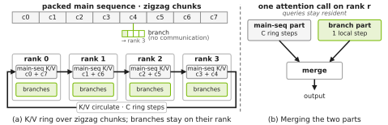
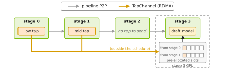
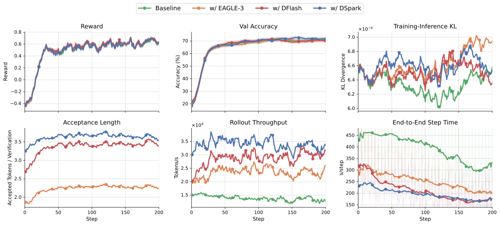
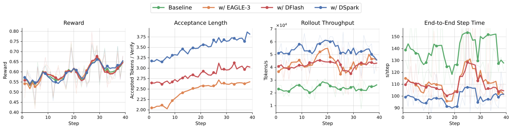
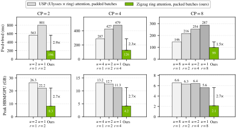
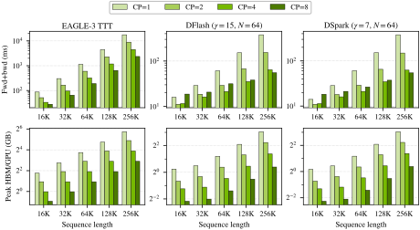
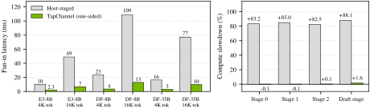

**Source:** *Online Draft Co-Training for Speculative Decoding in Large-Scale, Long-Context RL Post-Training* — [PDF](https://arxiv.org/pdf/2609.07108v1) · [arXiv](https://arxiv.org/abs/2609.07108v1)

marginparsep has been altered.   
topmargin has been altered.   
marginparwidth has been altered.   
marginparpush has been altered.   

The page layout violates the ICML style.

Please do not change the page layout, or include packages like geometry, savetrees, or fullpage, which change it for you.

We’re not able to reliably undo arbitrary changes to the style. Please remove the offending package(s), or layout-changing commands and try again.

Online Draft Co-Training for Speculative Decoding in Large-Scale, Long-Context RL Post-Training

Zili Wang Zhaopeng Qiu Yuekai Zhang Shuang Yu Junjie Lai

NVIDIA

{ziliw, alexq, yuekaiz, shuangy, julienl}@nvidia.com

###### Abstract

Abstract. Speculative decoding accelerates rollout generation, which dominates the cost of reinforcement learning (RL) post-training. Online co-training can further increase the draft’s accuracy, yielding greater speedups. However, scaling this approach to co-training on large models with long contexts poses two obstacles: (1) branch attention is unsupported by standard causal context-parallel (CP) implementations, and (2) target features span across pipeline-parallel (PP) stages. We address both with an end-to-end system for large-scale online draft co-training. For CP, we extend packed, load-balanced zigzag ring attention by merging rank-local branch attention with causal main-sequence attention. For PP, TapChannel transports intermediate target features across stages via a separate path, leaving the pipeline schedule unaffected. Experiments demonstrate that co-trained drafts closely track the policy baseline while delivering substantial rollout and end-to-end speedups across model scales up to 122B. Our CP design achieves strong scaling at 256K tokens with significant memory savings over prior work, and our PP transport incurs modest overhead. Code can be found [here](https://github.com/NVIDIA-NeMo/RL/issues/3698).

## 1 Introduction

Reinforcement learning (RL) post-training has become a standard paradigm for building reasoning and agentic Large Language Models (LLMs) ([Shao et al., 2024](https://arxiv.org/html/2609.07108v1#bib.bib1); [Yu et al., 2025](https://arxiv.org/html/2609.07108v1#bib.bib2); [GLM-5-Team et al., 2026](https://arxiv.org/html/2609.07108v1#bib.bib5)). The wall-clock time of RL post-training is often dominated by rollout generation. Speculative decoding (SD) mitigates this through parallel verification ([Leviathan et al., 2023](https://arxiv.org/html/2609.07108v1#bib.bib10); [Chen et al., 2023](https://arxiv.org/html/2609.07108v1#bib.bib11)): a small draft model generates multiple draft tokens, and the target policy verifies them in parallel, accelerating autoregressive generation without changing the output distribution. Recent RL frameworks have therefore integrated SD into their rollout engines, demonstrating that rollout speedups can translate into end-to-end training acceleration ([Zhang et al., 2026](https://arxiv.org/html/2609.07108v1#bib.bib17); [Chen et al., 2026b](https://arxiv.org/html/2609.07108v1#bib.bib18); [Liu et al., 2025](https://arxiv.org/html/2609.07108v1#bib.bib19); [Iso et al., 2026](https://arxiv.org/html/2609.07108v1#bib.bib24); [Kim et al., 2026](https://arxiv.org/html/2609.07108v1#bib.bib28); [veRL Team, 2026](https://arxiv.org/html/2609.07108v1#bib.bib8); [Zhu et al., 2025](https://arxiv.org/html/2609.07108v1#bib.bib4)).

Online co-training can further extend the draft model’s acceptance length as the RL policy evolves, yielding greater rollout speedups ([Zhao, 2024](https://arxiv.org/html/2609.07108v1#bib.bib9); [Zhang et al., 2026](https://arxiv.org/html/2609.07108v1#bib.bib17); [Chen et al., 2026b](https://arxiv.org/html/2609.07108v1#bib.bib18); [Wang et al., 2026a](https://arxiv.org/html/2609.07108v1#bib.bib25)). However, scaling this approach to large-model, long-context RL post-training is non-trivial. Advanced drafts such as EAGLE-3, DFlash, and DSpark introduce branch-structured attention and consume intermediate hidden states from the target model ([Li et al., 2026c](https://arxiv.org/html/2609.07108v1#bib.bib20); [Chen et al., 2026a](https://arxiv.org/html/2609.07108v1#bib.bib21); [Cheng et al., 2026](https://arxiv.org/html/2609.07108v1#bib.bib22)). Standard causal context parallelism (CP) does not support this branch structure, while under pipeline parallelism (PP), the required target features may reside on stages remote from the draft. Consequently, the draft cannot simply inherit the system’s existing parallelism configuration.

We address this by designing two mechanisms that extend the system’s existing CP and PP parallelism configuration to support large-scale draft co-training. For CP, each branch query attends to two key sets: a causal prefix of the main sequence and the keys of the branch tokens. We compute the causal component with packed zigzag-ring attention, handle the branch-local component on the owning rank, and merge the two results. This unified mechanism supports EAGLE-3, DFlash, and DSpark. For PP, we introduce _TapChannel_ , which transports intermediate target features across distributed PP stages on a side path independent of pipeline communication, leaving the pipeline schedule unchanged. Together, these two mechanisms yield a complete system design that makes online draft co-training practical for RL post-training on large models with long contexts.

Experiments across draft families, targets at various scale, and single- and multi-turn RL workloads demonstrate stable learning and scalable system performance. Co-trained drafts closely track the baseline in reward and accuracy, yielding 1.50–1.88\(\times\) end-to-end speedups. Our CP implementation outperforms USP by up to 2.9\(\times\) in latency with a 2.7\(\times\) reduction in per-GPU memory, achieving scaling at 256K tokens, while TapChannel enables online co-training with modest PP overhead.

Our contributions are summarized as follows:

  * Branch attention under CP. We decompose draft branch attention into a causal main-sequence component and a rank-local branch component, and merge both results to recover the attention output. This unified mechanism supports EAGLE-3, DFlash, and DSpark within a packed, load-balanced zigzag-ring execution. 
  * Out-of-schedule target-feature transport under PP. We introduce _TapChannel_ , which delivers intermediate target features across distributed PP stages without entering or altering the pipeline schedule. 
  * End-to-end draft co-training at scale. We integrate our CP and PP mechanisms into NeMo-RL ([, 2025](https://arxiv.org/html/2609.07108v1#bib.bib34)) framework, enabling online draft co-training on large models with long contexts. We evaluate our system across three draft families, target model sizes from 8B to 122B, and both single- and multi-turn RL workloads, measuring learning stability, rollout speedups, and system overhead. 

## 2 Related Work

#### Speculative decoding for RL rollouts.

Speculative decoding accelerates generation by letting a lightweight draft propose several tokens and using the large target model to verify them in parallel; rejection sampling preserves the target model’s output distribution, so the orocedure does not change the output distribution ([Leviathan et al., 2023](https://arxiv.org/html/2609.07108v1#bib.bib10); [Chen et al., 2023](https://arxiv.org/html/2609.07108v1#bib.bib11)). Recent systems adapt speculative decoding to the rollout engine in different ways. Nemo-RL [ (2025)](https://arxiv.org/html/2609.07108v1#bib.bib34) integrate MTP and EAGLE-3 drafting into both synchronous and asynchronous RL rollouts and study how deployment and draft configurations affect end-to-end training speed ([Iso et al., 2026](https://arxiv.org/html/2609.07108v1#bib.bib24)). SPEC-RL avoids a learned drafter altogether: it reuses response segments from the preceding policy iteration as speculative prefixes and verifies them under the current policy, retaining on-policy samples while exploiting cross-iteration similarity ([Liu et al., 2025](https://arxiv.org/html/2609.07108v1#bib.bib19)). EfficientRollout instead constructs a quantized self-drafter from the target, adjusts speculative length according to observed acceptance, and enables speculation only when the runtime is likely to benefit ([Kim et al., 2026](https://arxiv.org/html/2609.07108v1#bib.bib28)). These works establish that speculative decoding can accelerate RL in practice, but primarily optimize draft sourcing, serving configuration, and verification on the rollout side. Our focus is complementary: continuously training target-feature-conditioned drafts inside the distributed policy learner.

#### Draft adaptation under evolving RL policies.

A fixed draft loses alignment with an evolving policy; adapting it during RL recovers acceptance length and speedup. FastGRPO combines online draft learning with concurrency-aware configuration ([Zhang et al., 2026](https://arxiv.org/html/2609.07108v1#bib.bib17)); ReSpec dynamically selects speculative parameters and distills the policy into the drafter ([Chen et al., 2026b](https://arxiv.org/html/2609.07108v1#bib.bib18)). Parallel work adapts MTP modules rather than separate draft models: MTP-RL uses a parameter-sharing MTP module with advantage-aware optimization ([Wang et al., 2026a](https://arxiv.org/html/2609.07108v1#bib.bib25)); OCC derives an adaptive coefficient to balance auxiliary loss against policy update ([Wang et al., 2026c](https://arxiv.org/html/2609.07108v1#bib.bib26)); Bebop trains directly for acceptance using total-variation objectives and studies pre-RL adaptation ([Li et al., 2026b](https://arxiv.org/html/2609.07108v1#bib.bib27)). These methods improve draft adaptation at the objective level; we address the systems challenge of making co-training practical under CP and PP.

#### Target-feature-conditioned and parallel draft architectures.

Draft architectures trade proposal quality for sequential cost. Blockwise parallel decoding introduced multiple future-token predictors with prefix validation ([Stern et al., 2018](https://arxiv.org/html/2609.07108v1#bib.bib7)). MTP generalizes this as an auxiliary objective ([Gloeckle et al., 2024](https://arxiv.org/html/2609.07108v1#bib.bib3)); FastMTP reduces cost with a shared head and recursive conditioning ([Cai et al., 2025](https://arxiv.org/html/2609.07108v1#bib.bib13)). EAGLE-3 conditions a separate drafter on fused target-layer features and uses TTT to expose multi-step errors ([Li et al., 2026c](https://arxiv.org/html/2609.07108v1#bib.bib20)). DFlash produces candidate blocks in parallel via block diffusion ([Chen et al., 2026a](https://arxiv.org/html/2609.07108v1#bib.bib21)); DSpark combines a parallel backbone with a Markov head for dependency restoration ([Cheng et al., 2026](https://arxiv.org/html/2609.07108v1#bib.bib22)); Domino similarly separates parallel modeling from sequential dependency ([Huang et al., 2026a](https://arxiv.org/html/2609.07108v1#bib.bib29)). These architectures differ in training branches, attention masks, and feature interfaces.

 Figure 1: Illustration of branch attention under context parallelism. (a) The causal prefix is zigzag-sharded across CP ranks; branch-local keys stay local. (b) Each rank merges the ring attention result with local branch attention via Eq. ([2](https://arxiv.org/html/2609.07108v1#S3.E2 "In 3.2 Branch Attention under Context Parallelism ‣ 3 Method")).

Integrating these draft models into current distributed training systems remains a challenge. Large-model training combines tensor, pipeline, and other parallelism ([Shoeybi et al., 2019](https://arxiv.org/html/2609.07108v1#bib.bib14); [Yan et al., 2026](https://arxiv.org/html/2609.07108v1#bib.bib33)). As for long-context training, RingAttention distributes long sequences and overlaps KV communication with computation ([Liu et al., 2024](https://arxiv.org/html/2609.07108v1#bib.bib32)). These methods support causal attention training but do not handle draft-specific branch attention or cross-stage feature routing. P-EAGLE parallelizes EAGLE with structured masks ([Hui et al., 2026](https://arxiv.org/html/2609.07108v1#bib.bib30)); LongSpec addresses long-context inference with bounded KV cache and positional adaptation ([Yang et al., 2026](https://arxiv.org/html/2609.07108v1#bib.bib31)). SpecForge develops target–draft decoupling and hybrid-parallel TTT training, including sequence-parallel branch attention ([Li et al., 2026a](https://arxiv.org/html/2609.07108v1#bib.bib23)). Our setting differs from these works. The target is an evolving RL policy trained with existing CP and PP parallelism. Unlike previous work that modifies the parallel layout to accommodate draft training, we keep the target’s topology unchanged and instead adapt the system around it.

## 3 Method

 Figure 2: Illustration of TapChannel feature fan-in under PP=4. Tap-producing stages deliver target features to the draft stage over an out-of-schedule path, bypassing the standard adjacent-stage P2P communication (gray). Cross-node sources use GPUDirect RDMA; colocated sources use CUDA IPC.

We first describe the online co-training procedure (§[3.1](https://arxiv.org/html/2609.07108v1#S3.SS1 "3.1 Online Draft Co-Training in RL Post-Training ‣ 3 Method")) and then present the two mechanisms that support it: branch attention under context parallelism (§[3.2](https://arxiv.org/html/2609.07108v1#S3.SS2 "3.2 Branch Attention under Context Parallelism ‣ 3 Method")) and TapChannel under pipeline parallelism (§[3.3](https://arxiv.org/html/2609.07108v1#S3.SS3 "3.3 TapChannel under Pipeline Parallelism ‣ 3 Method")).

### 3.1 Online Draft Co-Training in RL Post-Training

Let \(\theta\) and \(\phi\) denote the policy and draft parameters. The draft is trained on the same policy rollout tokens, with a stop-gradient applied to the target features (\(H_{\theta}\)) collected from intermediate policy layers. The joint objective is

\[\begin{aligned}
 & \mathcal{L}(\theta,\phi)\;=\;\mathcal{L}_{\text{RL}}(\theta)\;+\;\lambda\,\mathcal{L}_{\text{draft}}\bigl(\phi;x,\operatorname{sg}(H_{\theta}(x))\bigr), &  & \text{(1)}
\end{aligned}\]

 

where \(x\) denotes the rollout tokens and \(\operatorname{sg}\) denotes stop-gradient. The draft model is instantiated as a submodule on the policy’s last pipeline stage and updated jointly along with the policy model.

### 3.2 Branch Attention under Context Parallelism

Standard causal context parallelism does not directly support the branch-structured attention introduced by draft training. SpecForge ([Li et al., 2026a](https://arxiv.org/html/2609.07108v1#bib.bib23)) addresses EAGLE-3 TTT (Train-Time Test) setting but relies on sequential ring sharding, which yields imbalanced causal workloads, and imposes constraints on the Ulysses dimension that can be restrictive for draft KV heads. As shown in Figure [1](https://arxiv.org/html/2609.07108v1#S2.F1 "Figure 1 ‣ Target-feature-conditioned and parallel draft architectures. ‣ 2 Related Work"), our design organizes each branch query with two key sets: a causal prefix of the main sequence, sharded across CP ranks, and a small set of branch-local keys, kept on the rank that owns the branch’s anchor. The two key sets are attended to independently and then merged.

The main-sequence component follows the same packed zigzag-ring attention as standard CP. For each ring step, the main-sequence K/V circulate across ranks while queries remain local; the locally computed branch component is then merged via Eq. ([2](https://arxiv.org/html/2609.07108v1#S3.E2 "In 3.2 Branch Attention under Context Parallelism ‣ 3 Method")). The merge follows the standard online-softmax reduction used between ring-attention steps:

\[\begin{aligned}
 & \ell=\log\!\left(e^{\ell_{\mathrm{m}}}+e^{\ell_{\mathrm{b}}}\right),\qquad O=e^{\ell_{\mathrm{m}}-\ell}\,O_{\mathrm{m}}\;+\;e^{\ell_{\mathrm{b}}-\ell}\,O_{\mathrm{b}}, &  & \text{(2)}
\end{aligned}\]

 

where \((O_{\mathrm{m}},\ell_{\mathrm{m}})\) and \((O_{\mathrm{b}},\ell_{\mathrm{b}})\) correspond to main-sequence and branch, respectively. \(O\) denotes the attention output and \(\ell\) denotes the log-sum-exp for the main-sequence and branch-local components.

Our method supports draft families with different branch structures. (1) EAGLE-3 [Li et al. (2026c)](https://arxiv.org/html/2609.07108v1#bib.bib20) employs Training-Time Test (TTT): during training, it simulates multi-step autoregressive generation by feeding its own previous predicted hidden state back as inputs over multiple steps. This creates a separate branch at _every_ draft position, each attending to a growing context of previously generated tokens within the draft. (2) DFlash [Chen et al. (2026a)](https://arxiv.org/html/2609.07108v1#bib.bib21) uses block diffusion language model to generate an entire block of tokens in a single forward pass. DSpark [Cheng et al. (2026)](https://arxiv.org/html/2609.07108v1#bib.bib22) extends DFlash with a lightweight Markov head that refines the block left-to-right with a low-rank, previous-token-conditioned bias, restoring causal dependencies among block positions at small additional cost. Despite their different generation strategies, all three architectures share the same requirement: each branch, whether a TTT position or a block position, must attend to both the causal prefix of the main sequence and its branch-local KV context.

#### Communication cost and overlap.

For a CP degree \(C\) and \(N\) main-sequence tokens evenly split across ranks, each rank holds \(N/C\) tokens. During the forward ring, each rank sends its local K and V to the other \(C-1\) ranks, yielding a per-rank outbound volume of

\[\begin{aligned}
 & V_{\mathrm{CP}}^{\mathrm{fwd}}=2(C-1)\frac{N}{C}d_{\mathrm{kv}}b, &  & \text{(3)}
\end{aligned}\]

 

where \(d_{\mathrm{kv}}\) is the per-token K/V width and \(b\) the bytes per element. Since branch-local K/V stay on their anchor-owning ranks, this cost is independent of the number or depth of branches. The backward pass replays the same K/V ring and accumulates gradients locally, incurring no additional branch-dependent traffic.

We overlap communication with attention at ring-step granularity: the exchange for the next shard is issued before the current attention step and waited on only at the subsequent boundary. The exposed overhead at step \(r\) is thus

\[\begin{aligned}
 & E_{\mathrm{CP}}^{(r)}=\max\left(t_{\mathrm{comm}}^{(r)}\;t_{\mathrm{attn}}^{(r)}\right) &  & \text{(4)}
\end{aligned}\]

 

Since attention computation scales quadratically with context length while communication scales linearly, longer contexts increase the overlap headroom. Conversely, aggressive strong scaling shortens the local context and can eventually expose communication as the bottleneck.

### 3.3 TapChannel under Pipeline Parallelism

Under pipeline parallelism, the layers producing the taps (target hidden states) span multiple stages, while the draft resides only on the last stage. Standard pipeline communication only connects adjacent stages and cannot deliver these non-adjacent features. Since taps require no return path, TapChannel transports them on a side path independent of the pipeline schedule (Figure [2](https://arxiv.org/html/2609.07108v1#S3.F2 "Figure 2 ‣ 3 Method")).

TapChannel implements this side path with a per-source mailbox on the draft stage. Each source has a pre‑allocated buffer slot in the draft stage’s memory. After a source finishes its policy forward for a microbatch, it writes the resulting taps into its slot; the draft stage reads that slot right before its own forward for the same microbatch.

To synchronize this producer‑consumer handshake without interfering with pipeline schedule, each slot carries a sequence stamp that both the source and the draft increment on each write and read. For colocated sources (CUDA IPC), the draft clears the stamp after reading. For cross‑node sources (dedicated NCCL communicator with GPUDirect RDMA), the stamp primarily orders operations; buffer reuse is managed separately by bounded in‑flight sends and receiver‑side CUDA events.

 Figure 3: Experimental results of Qwen3-8B online co-training with EAGLE-3 (yellow), DFlash (red) and DSpark (blue) on DAPOMath-17K, including reward, accuracy evaluated on AIME2024, KL divergence, accepted length, throughput and end-to-end step time.

#### Communication cost and overlap.

Let \(n\) be the number of token rows in a microbatch and \(\mathcal{S}\) the set of source stages that send features to the draft stage. Let \(d_{s}\) be the per-token feature dimension produced by source \(s\). For the first stage, \(d_{s}\) equals the input embedding width; for later stages, it equals the hidden size. Let \(b\) be the bytes per element. The feature payload delivered per microbatch is

\[\begin{aligned}
 & V_{\mathrm{Tap}}=bn\sum_{s\in\mathcal{S}}d_{s}. &  & \text{(5)}
\end{aligned}\]

 

Each feature is transferred directly once, regardless of the number of PP hops between its source and the draft; features produced on the draft stage itself require no transfer.

The pipeline schedule naturally provides a slack window between the time a source stage produces its tap and the draft stage’s forward for the same microbatch. If the tap transfer completes within this window, it adds no extra latency. For microbatch \(m\), let \(\Delta_{s,m}\) denote this slack for source \(s\), and \(\tau_{s,m}\) the transfer time. The residual rendezvous delay is given by:

\[\begin{aligned}
 & E_{\mathrm{Tap}}^{(m)}=\max_{s\in\mathcal{S}}\max\left(\tau_{s,m},\;\Delta_{s,m}\right), &  & \text{(6)}
\end{aligned}\]

 

Only the portion of a transfer that exceeds the slack incurs visible overhead. We empirically characterize these overheads and their implications for end-to-end training performance in Section [4.5](https://arxiv.org/html/2609.07108v1#S4.SS5 "4.5 Pipeline-Parallel Overhead ‣ 4 Experiments").

## 4 Experiments

We evaluate the correctness and efficiency of our draft co-training implementation. Specifically, we verify: (1) that our implementation preserves the RL learning trajectory; (2) speculative decoding gains across draft architectures, target scales, and single/multi-turn tasks; (3) CP attention efficiency at long sequences; and (4) the incremental cost of PP-side co-training.

 Figure 4: Qwen3-8B online co-training with EAGLE-3 (yellow), DFlash (red), and DSpark (blue) on NeMo Gym Workplace Assistant.

### 4.1 Experimental Setup

#### Models.

We evaluate three representative, advanced draft families: EAGLE-3 ([Li et al., 2026c](https://arxiv.org/html/2609.07108v1#bib.bib20)), DFlash ([Chen et al., 2026a](https://arxiv.org/html/2609.07108v1#bib.bib21)), and DSpark ([Cheng et al., 2026](https://arxiv.org/html/2609.07108v1#bib.bib22)). Qwen3-8B ([Team, 2025](https://arxiv.org/html/2609.07108v1#bib.bib12)) serves as the target model for the three draft families. We also evaluate on larger models, including Qwen3.5-35B-A3B and Qwen3.5-122B-A10B ([Team, 2026](https://arxiv.org/html/2609.07108v1#bib.bib16)) with DFlash, Nemotron-3.5-Lightning-30B-A3B ([NVIDIA, 2025](https://arxiv.org/html/2609.07108v1#bib.bib6)) with DSpark, and GPT-OSS-120B with DFlash, to test scalability and generality. Draft models are from official checkpoints.

Table 1: End-to-end performance across target scales and draft families. 

<table id="S4.T1.2" class="ltx_tabular ltx_centering ltx_guessed_headers ltx_align_middle">
<thead class="ltx_thead">
<tr id="S4.T1.2.1" class="ltx_tr">
<th id="S4.T1.2.1.1" class="ltx_td ltx_align_left ltx_th ltx_th_column ltx_th_row ltx_border_tt">Target Model</th>
<th id="S4.T1.2.1.2" class="ltx_td ltx_align_left ltx_th ltx_th_column ltx_th_row ltx_border_tt">Draft Model</th>
<th id="S4.T1.2.1.3" class="ltx_td ltx_align_center ltx_th ltx_th_column ltx_border_tt">Accepted Length <math id="S4.T1.m1" class="ltx_Math" alttext="\uparrow" display="inline" intent=":literal"><semantics><mo stretchy="false">↑</mo><annotation encoding="application/x-tex">\uparrow</annotation></semantics></math></th>
<th id="S4.T1.2.1.4" class="ltx_td ltx_align_center ltx_th ltx_th_column ltx_border_tt">Rollout Speedup <math id="S4.T1.m2" class="ltx_Math" alttext="\uparrow" display="inline" intent=":literal"><semantics><mo stretchy="false">↑</mo><annotation encoding="application/x-tex">\uparrow</annotation></semantics></math></th>
<th id="S4.T1.2.1.5" class="ltx_td ltx_nopad_r ltx_align_center ltx_th ltx_th_column ltx_border_tt">E2E Training Speedup <math id="S4.T1.m3" class="ltx_Math" alttext="\uparrow" display="inline" intent=":literal"><semantics><mo stretchy="false">↑</mo><annotation encoding="application/x-tex">\uparrow</annotation></semantics></math></th></tr>
</thead>
<tbody class="ltx_tbody">
<tr id="S4.T1.2.2" class="ltx_tr">
<th id="S4.T1.2.2.1" class="ltx_td ltx_align_left ltx_th ltx_th_row ltx_border_t" rowspan="3">Qwen3-8B</th>
<th id="S4.T1.2.2.2" class="ltx_td ltx_align_left ltx_th ltx_th_row ltx_border_t">EAGLE-3</th>
<td id="S4.T1.2.2.3" class="ltx_td ltx_align_center ltx_border_t">2.28</td>
<td id="S4.T1.2.2.4" class="ltx_td ltx_align_center ltx_border_t">1.63<math id="S4.T1.m4" class="ltx_Math" alttext="\times" display="inline" intent=":literal"><semantics><mo>×</mo><annotation encoding="application/x-tex">\times</annotation></semantics></math></td>
<td id="S4.T1.2.2.5" class="ltx_td ltx_nopad_r ltx_align_center ltx_border_t">1.50<math id="S4.T1.m5" class="ltx_Math" alttext="\times" display="inline" intent=":literal"><semantics><mo>×</mo><annotation encoding="application/x-tex">\times</annotation></semantics></math></td></tr>
<tr id="S4.T1.2.3" class="ltx_tr">
<th id="S4.T1.2.3.1" class="ltx_td ltx_align_left ltx_th ltx_th_row">DFlash</th>
<td id="S4.T1.2.3.2" class="ltx_td ltx_align_center">3.45</td>
<td id="S4.T1.2.3.3" class="ltx_td ltx_align_center">2.23<math id="S4.T1.m6" class="ltx_Math" alttext="\times" display="inline" intent=":literal"><semantics><mo>×</mo><annotation encoding="application/x-tex">\times</annotation></semantics></math></td>
<td id="S4.T1.2.3.4" class="ltx_td ltx_nopad_r ltx_align_center">1.88<math id="S4.T1.m7" class="ltx_Math" alttext="\times" display="inline" intent=":literal"><semantics><mo>×</mo><annotation encoding="application/x-tex">\times</annotation></semantics></math></td></tr>
<tr id="S4.T1.2.4" class="ltx_tr">
<th id="S4.T1.2.4.1" class="ltx_td ltx_align_left ltx_th ltx_th_row">DSpark</th>
<td id="S4.T1.2.4.2" class="ltx_td ltx_align_center">3.63</td>
<td id="S4.T1.2.4.3" class="ltx_td ltx_align_center">2.18<math id="S4.T1.m8" class="ltx_Math" alttext="\times" display="inline" intent=":literal"><semantics><mo>×</mo><annotation encoding="application/x-tex">\times</annotation></semantics></math></td>
<td id="S4.T1.2.4.4" class="ltx_td ltx_nopad_r ltx_align_center">1.83<math id="S4.T1.m9" class="ltx_Math" alttext="\times" display="inline" intent=":literal"><semantics><mo>×</mo><annotation encoding="application/x-tex">\times</annotation></semantics></math></td></tr>
<tr id="S4.T1.2.5" class="ltx_tr">
<th id="S4.T1.2.5.1" class="ltx_td ltx_align_left ltx_th ltx_th_row ltx_border_t">Qwen3.5-35B-A3B</th>
<th id="S4.T1.2.5.2" class="ltx_td ltx_align_left ltx_th ltx_th_row ltx_border_t">DFlash</th>
<td id="S4.T1.2.5.3" class="ltx_td ltx_align_center ltx_border_t">4.58</td>
<td id="S4.T1.2.5.4" class="ltx_td ltx_align_center ltx_border_t">1.50<math id="S4.T1.m10" class="ltx_Math" alttext="\times" display="inline" intent=":literal"><semantics><mo>×</mo><annotation encoding="application/x-tex">\times</annotation></semantics></math></td>
<td id="S4.T1.2.5.5" class="ltx_td ltx_nopad_r ltx_align_center ltx_border_t">1.46<math id="S4.T1.m11" class="ltx_Math" alttext="\times" display="inline" intent=":literal"><semantics><mo>×</mo><annotation encoding="application/x-tex">\times</annotation></semantics></math></td></tr>
<tr id="S4.T1.2.6" class="ltx_tr">
<th id="S4.T1.2.6.1" class="ltx_td ltx_align_left ltx_th ltx_th_row">Nemotron-3.5-Lightning-30B-A3B</th>
<th id="S4.T1.2.6.2" class="ltx_td ltx_align_left ltx_th ltx_th_row">DSpark</th>
<td id="S4.T1.2.6.3" class="ltx_td ltx_align_center">2.65</td>
<td id="S4.T1.2.6.4" class="ltx_td ltx_align_center">1.19<math id="S4.T1.m12" class="ltx_Math" alttext="\times" display="inline" intent=":literal"><semantics><mo>×</mo><annotation encoding="application/x-tex">\times</annotation></semantics></math></td>
<td id="S4.T1.2.6.5" class="ltx_td ltx_nopad_r ltx_align_center">1.16<math id="S4.T1.m13" class="ltx_Math" alttext="\times" display="inline" intent=":literal"><semantics><mo>×</mo><annotation encoding="application/x-tex">\times</annotation></semantics></math></td></tr>
<tr id="S4.T1.2.7" class="ltx_tr">
<th id="S4.T1.2.7.1" class="ltx_td ltx_align_left ltx_th ltx_th_row ltx_border_t">Qwen3.5-122B-A10B</th>
<th id="S4.T1.2.7.2" class="ltx_td ltx_align_left ltx_th ltx_th_row ltx_border_t">DFlash</th>
<td id="S4.T1.2.7.3" class="ltx_td ltx_align_center ltx_border_t">4.78</td>
<td id="S4.T1.2.7.4" class="ltx_td ltx_align_center ltx_border_t">1.72<math id="S4.T1.m14" class="ltx_Math" alttext="\times" display="inline" intent=":literal"><semantics><mo>×</mo><annotation encoding="application/x-tex">\times</annotation></semantics></math></td>
<td id="S4.T1.2.7.5" class="ltx_td ltx_nopad_r ltx_align_center ltx_border_t">1.35<math id="S4.T1.m15" class="ltx_Math" alttext="\times" display="inline" intent=":literal"><semantics><mo>×</mo><annotation encoding="application/x-tex">\times</annotation></semantics></math></td></tr>
<tr id="S4.T1.2.8" class="ltx_tr">
<th id="S4.T1.2.8.1" class="ltx_td ltx_align_left ltx_th ltx_th_row ltx_border_bb">GPT-OSS-120B</th>
<th id="S4.T1.2.8.2" class="ltx_td ltx_align_left ltx_th ltx_th_row ltx_border_bb">DFlash</th>
<td id="S4.T1.2.8.3" class="ltx_td ltx_align_center ltx_border_bb">3.80</td>
<td id="S4.T1.2.8.4" class="ltx_td ltx_align_center ltx_border_bb">1.48<math id="S4.T1.m16" class="ltx_Math" alttext="\times" display="inline" intent=":literal"><semantics><mo>×</mo><annotation encoding="application/x-tex">\times</annotation></semantics></math></td>
<td id="S4.T1.2.8.5" class="ltx_td ltx_nopad_r ltx_align_center ltx_border_bb">1.19<math id="S4.T1.m17" class="ltx_Math" alttext="\times" display="inline" intent=":literal"><semantics><mo>×</mo><annotation encoding="application/x-tex">\times</annotation></semantics></math></td></tr>
</tbody>
</table>

 

#### Tasks and training.

We conduct experiments in Nemo-RL [ (2025)](https://arxiv.org/html/2609.07108v1#bib.bib34) with GRPO ([Shao et al., 2024](https://arxiv.org/html/2609.07108v1#bib.bib1)) on DAPOMath-17K ([Yu et al., 2025](https://arxiv.org/html/2609.07108v1#bib.bib2)) and evaluate on AIME 2024 ([AoPS, 2024](https://arxiv.org/html/2609.07108v1#bib.bib15)), with 4,096 input and 16,384 response on H100 GPU (for Qwen3-8B, TP/PP/CP=2/2/2 and for Qwen3.5-35B-A3B, TP/PP/CP/EP=2/2/2/8). For multi-turn evaluation, we adapt the NeMo Gym Workplace Assistant [Styles et al. (2024)](https://arxiv.org/html/2609.07108v1#bib.bib35) on Qwen3-8B with sequence length of 32,768 with tool feedback. Workplace Assistant is a multi-turn, agentic tool-use environment within NVIDIA NeMo Gym, designed for complex task execution in simulated office scenarios. It is based on the WorkBench benchmark [Styles et al. (2024)](https://arxiv.org/html/2609.07108v1#bib.bib35), a simulated workplace tool-use environment with email, calendar, CRM, project management, and analytics databases. Experiments of larger models, including Nemotron-3.5-Lightning-30B-A3B (TP/PP/CP/EP=2/2/2/8), Qwen3.5-122B-A10B (TP/PP/CP/EP=4/4/2/16), and GPT-OSS 120B (TP/PP/CP/EP=4/4/2/16), are conducted on GB200 GPU.

#### Metrics.

We report training reward, validation accuracy, and training–inference KL divergence, which measures the per-token KL divergence between the log-probability distributions produced by the training and inference backends on the generated responses. This metric quantifies the numerical consistency between the two backends under identical weights; a near-zero value confirms that the implementation correctly synchronizes the inference engine with the training policy, preserving the on-policy assumption critical for GRPO. For speculative decoding, we report acceptance length, which is the mean number of tokens accepted per verification. Rollout throughput is also reported, with rollout speedup relative to the baseline and end-to-end speedup w.r.t the total policy-update time.

### 4.2 Verifying Policy Learning under Speculative Decoding

We select Qwen3-8B as the target for all three draft models. We compare four runs: baseline without neither online draft co-training nor rollour speculative decoding, and online co-training with EAGLE-3, DFlash, and DSpark. As shown in Figure [3](https://arxiv.org/html/2609.07108v1#S3.F3 "Figure 3 ‣ 3.3 TapChannel under Pipeline Parallelism ‣ 3 Method"), the reward, validation, and training-inference KL divergence results confirm that speculative decoding preserves the RL learning trajectory. The co-trained runs closely track the baseline learning trajectory across all three kind of draft models.

### 4.3 Performance across Drafts and Model Scales

Table [1](https://arxiv.org/html/2609.07108v1#S4.T1 "Table 1 ‣ Models. ‣ 4.1 Experimental Setup ‣ 4 Experiments") summarizes end-to-end results across three draft families and targets from 8B to 122B. Co-trained drafts reach 2.28–4.78 acceptance length, yielding 1.19–2.23\(\times\) rollout speedup and 1.16–1.88\(\times\) end-to-end training speedup. Comparing the three draft models, DFlash and DSpark consistently outperform EAGLE-3 in acceptance length, suggesting better speedup. Notably, while the larger MoE targets (Qwen3.5-122B and GPT-OSS-120B) achieve high acceptance lengths, their end-to-end speedups are lower, since each verification forward invokes sparse routing more expert compute [Huang et al. (2026b)](https://arxiv.org/html/2609.07108v1#bib.bib36). For linear-attention, since the verification step itself is comparatively less expensive, the relative speedup from speculation is inherently smaller [Wang et al. (2026b)](https://arxiv.org/html/2609.07108v1#bib.bib37).

 Figure 5: Comparison of packed zigzag-ring attention (ours) vs. padded USP attention under the same workload. Top: latency of the forward+backward pass; bottom: per-GPU peak memory. Each bracket marks the advantage over the best USP configuration. 

 Figure 6: Scaling of draft-training attention over CP=1, 2, 4, 8. Each group fixes the global sequence length and reports forward+backward latency (top) and peak HBM (bottom).

#### Multi-Turn Workloads

Workplace Assistant interleaves multiple model turns with tool calls and environment delays. As shown in Figure [4](https://arxiv.org/html/2609.07108v1#S4.F4 "Figure 4 ‣ 4 Experiments"), in our four-way comparison on this multi-turn workload, all configurations achieve consistent rewards, while acceptance length improves monotonically across training. However, the end-to-end speedup (1.25–1.43×) falls well below the rollout-phase speedup (1.75–2.23×), because rollout accounts for only 55.8% of the step time—tool execution and environment latency sit inside this phase and are unreachable by faster decoding. Against the single-turn results in Table [1](https://arxiv.org/html/2609.07108v1#S4.T1 "Table 1 ‣ Models. ‣ 4.1 Experimental Setup ‣ 4 Experiments"), where the same drafts reach 1.50–1.88×, this comparison isolates what the multi-turn structure costs.

### 4.4 Context-Parallel Attention Performance

We benchmark our packed zigzag-ring attention against the USP implementation from SpecForge ([Li et al., 2026a](https://arxiv.org/html/2609.07108v1#bib.bib23)) under matched GPU counts. The comparison focuses on EAGLE-3 TTT (3 passes) at the attention-operator level. We report forward/backward latency and per-GPU peak HBM.

#### Analysis

Figure [5](https://arxiv.org/html/2609.07108v1#S4.F5 "Figure 5 ‣ 4.3 Performance across Drafts and Model Scales ‣ 4 Experiments") compares our packed zigzag attention against USP under the same variable-length workload (longest 20,480 tokens). USP pads the batch to 2.25× the real token count; our packed implementation avoids this overhead. At CP=2, 4, and 8, packed zigzag outperforms the best USP variant by 2.9\(\times\), 2.3\(\times\), and 1.5\(\times\) in latency, with 2.7\(\times\) lower per-GPU peak memory.

#### Long-context scaling.

We evaluate our implementation across CP\(\in\{1,2,4,8\}\) at fixed global lengths up to 256K tokens (Figure [6](https://arxiv.org/html/2609.07108v1#S4.F6 "Figure 6 ‣ 4.3 Performance across Drafts and Model Scales ‣ 4 Experiments")). For TTT attention, latency drops from 17.7 s at CP=1 to 2.35 s at CP=8 (7.5\(\times\), 94% parallel efficiency), and per-GPU memory falls nearly linearly from 53.2 GB to 7.5 GB. Block-draft attention is launch-bound rather than FLOP-bound, which works in its favor: it stays cheap even at CP=8 (\(\leq\)55 ms from 16K to 256K), yet scales 6.9\(\times\) at 256K when the workload is substantial. Context parallelism thus rides the policy’s layout nearly for free.

### 4.5 Pipeline-Parallel Overhead

We measure the incremental cost of adding TapChannel to an existing PP policy, comparing the full method against the same pipeline-parallel policy with draft training disabled. We evaluate three configurations on Qwen3-8B: EAGLE-3, DFlash, and DSpark. We compare against a host-staging baseline that stages taps through pinned host memory.

Table 2: Pipeline-parallel overhead for Qwen3-8B, averaged over first 10 policy update steps. DSpark achieves the largest end-to-end speedup (1.85\(\times\)) with 14.6% update-time overhead. 

<table id="S4.T2.2" class="ltx_tabular ltx_centering ltx_guessed_headers ltx_align_middle">
<tbody class="ltx_tbody">
<tr id="S4.T2.2.1" class="ltx_tr">
<td id="S4.T2.2.1.1" class="ltx_td ltx_border_tt" style="padding-left:2.0pt;padding-right:2.0pt;"></td>
<th id="S4.T2.2.1.2" class="ltx_td ltx_th ltx_th_column ltx_border_tt" style="padding-left:2.0pt;padding-right:2.0pt;"></th>
<th id="S4.T2.2.1.3" class="ltx_td ltx_align_center ltx_th ltx_th_column ltx_border_tt" style="padding-left:2.0pt;padding-right:2.0pt;" colspan="2">Rollout</th>
<th id="S4.T2.2.1.4" class="ltx_td ltx_align_center ltx_th ltx_th_column ltx_border_tt" style="padding-left:2.0pt;padding-right:2.0pt;" colspan="3">Improvement</th>
<td id="S4.T2.2.1.5" class="ltx_td ltx_border_tt" style="padding-left:2.0pt;padding-right:2.0pt;"></td></tr>
<tr id="S4.T2.2.2" class="ltx_tr">
<th id="S4.T2.2.2.1" class="ltx_td ltx_align_left ltx_th ltx_th_column" style="padding-left:2.0pt;padding-right:2.0pt;">Draft</th>
<th id="S4.T2.2.2.2" class="ltx_td ltx_align_center ltx_th ltx_th_column" style="padding-left:2.0pt;padding-right:2.0pt;">Accepted <math id="S4.T2.m3" class="ltx_Math" alttext="\uparrow" display="inline" intent=":literal"><semantics><mo stretchy="false">↑</mo><annotation encoding="application/x-tex">\uparrow</annotation></semantics></math></th>
<th id="S4.T2.2.2.3" class="ltx_td ltx_align_center ltx_th ltx_th_column ltx_border_t" style="padding-left:2.0pt;padding-right:2.0pt;">Time</th>
<th id="S4.T2.2.2.4" class="ltx_td ltx_align_center ltx_th ltx_th_column ltx_border_t" style="padding-left:2.0pt;padding-right:2.0pt;">Speedup <math id="S4.T2.m4" class="ltx_Math" alttext="\uparrow" display="inline" intent=":literal"><semantics><mo stretchy="false">↑</mo><annotation encoding="application/x-tex">\uparrow</annotation></semantics></math></th>
<th id="S4.T2.2.2.5" class="ltx_td ltx_align_center ltx_th ltx_th_column ltx_border_t" style="padding-left:2.0pt;padding-right:2.0pt;">Time</th>
<th id="S4.T2.2.2.6" class="ltx_td ltx_align_center ltx_th ltx_th_column ltx_border_t" style="padding-left:2.0pt;padding-right:2.0pt;">Overhead <math id="S4.T2.m5" class="ltx_Math" alttext="\downarrow" display="inline" intent=":literal"><semantics><mo stretchy="false">↓</mo><annotation encoding="application/x-tex">\downarrow</annotation></semantics></math></th>
<th id="S4.T2.2.2.7" class="ltx_td ltx_align_center ltx_th ltx_th_column ltx_border_t" style="padding-left:2.0pt;padding-right:2.0pt;">Tap wait</th>
<th id="S4.T2.2.2.8" class="ltx_td ltx_align_center ltx_th ltx_th_column" style="padding-left:2.0pt;padding-right:2.0pt;">E2E <math id="S4.T2.m6" class="ltx_Math" alttext="\uparrow" display="inline" intent=":literal"><semantics><mo stretchy="false">↑</mo><annotation encoding="application/x-tex">\uparrow</annotation></semantics></math></th></tr>
<tr id="S4.T2.2.3" class="ltx_tr">
<td id="S4.T2.2.3.1" class="ltx_td ltx_align_left ltx_border_t" style="padding-left:2.0pt;padding-right:2.0pt;">None</td>
<td id="S4.T2.2.3.2" class="ltx_td ltx_align_center ltx_border_t" style="padding-left:2.0pt;padding-right:2.0pt;">—</td>
<td id="S4.T2.2.3.3" class="ltx_td ltx_align_center ltx_border_t" style="padding-left:2.0pt;padding-right:2.0pt;">329.2</td>
<td id="S4.T2.2.3.4" class="ltx_td ltx_align_center ltx_border_t" style="padding-left:2.0pt;padding-right:2.0pt;">—</td>
<td id="S4.T2.2.3.5" class="ltx_td ltx_align_center ltx_border_t" style="padding-left:2.0pt;padding-right:2.0pt;">31.5</td>
<td id="S4.T2.2.3.6" class="ltx_td ltx_align_center ltx_border_t" style="padding-left:2.0pt;padding-right:2.0pt;">—</td>
<td id="S4.T2.2.3.7" class="ltx_td ltx_align_center ltx_border_t" style="padding-left:2.0pt;padding-right:2.0pt;">—</td>
<td id="S4.T2.2.3.8" class="ltx_td ltx_align_center ltx_border_t" style="padding-left:2.0pt;padding-right:2.0pt;">1.00<math id="S4.T2.m7" class="ltx_Math" alttext="\times" display="inline" intent=":literal"><semantics><mo>×</mo><annotation encoding="application/x-tex">\times</annotation></semantics></math></td></tr>
<tr id="S4.T2.2.4" class="ltx_tr">
<td id="S4.T2.2.4.1" class="ltx_td ltx_align_left" style="padding-left:2.0pt;padding-right:2.0pt;">EAGLE-3</td>
<td id="S4.T2.2.4.2" class="ltx_td ltx_align_center" style="padding-left:2.0pt;padding-right:2.0pt;">1.89</td>
<td id="S4.T2.2.4.3" class="ltx_td ltx_align_center" style="padding-left:2.0pt;padding-right:2.0pt;">238.7</td>
<td id="S4.T2.2.4.4" class="ltx_td ltx_align_center" style="padding-left:2.0pt;padding-right:2.0pt;">1.38<math id="S4.T2.m8" class="ltx_Math" alttext="\times" display="inline" intent=":literal"><semantics><mo>×</mo><annotation encoding="application/x-tex">\times</annotation></semantics></math></td>
<td id="S4.T2.2.4.5" class="ltx_td ltx_align_center" style="padding-left:2.0pt;padding-right:2.0pt;">42.4</td>
<td id="S4.T2.2.4.6" class="ltx_td ltx_align_center" style="padding-left:2.0pt;padding-right:2.0pt;">34.3%</td>
<td id="S4.T2.2.4.7" class="ltx_td ltx_align_center" style="padding-left:2.0pt;padding-right:2.0pt;">0.37</td>
<td id="S4.T2.2.4.8" class="ltx_td ltx_align_center" style="padding-left:2.0pt;padding-right:2.0pt;">1.31<math id="S4.T2.m9" class="ltx_Math" alttext="\times" display="inline" intent=":literal"><semantics><mo>×</mo><annotation encoding="application/x-tex">\times</annotation></semantics></math></td></tr>
<tr id="S4.T2.2.5" class="ltx_tr">
<td id="S4.T2.2.5.1" class="ltx_td ltx_align_left" style="padding-left:2.0pt;padding-right:2.0pt;">DFlash</td>
<td id="S4.T2.2.5.2" class="ltx_td ltx_align_center" style="padding-left:2.0pt;padding-right:2.0pt;">2.84</td>
<td id="S4.T2.2.5.3" class="ltx_td ltx_align_center" style="padding-left:2.0pt;padding-right:2.0pt;">229.2</td>
<td id="S4.T2.2.5.4" class="ltx_td ltx_align_center" style="padding-left:2.0pt;padding-right:2.0pt;">1.44<math id="S4.T2.m10" class="ltx_Math" alttext="\times" display="inline" intent=":literal"><semantics><mo>×</mo><annotation encoding="application/x-tex">\times</annotation></semantics></math></td>
<td id="S4.T2.2.5.5" class="ltx_td ltx_align_center" style="padding-left:2.0pt;padding-right:2.0pt;">35.8</td>
<td id="S4.T2.2.5.6" class="ltx_td ltx_align_center" style="padding-left:2.0pt;padding-right:2.0pt;">13.6%</td>
<td id="S4.T2.2.5.7" class="ltx_td ltx_align_center" style="padding-left:2.0pt;padding-right:2.0pt;">0.57</td>
<td id="S4.T2.2.5.8" class="ltx_td ltx_align_center" style="padding-left:2.0pt;padding-right:2.0pt;">1.37<math id="S4.T2.m11" class="ltx_Math" alttext="\times" display="inline" intent=":literal"><semantics><mo>×</mo><annotation encoding="application/x-tex">\times</annotation></semantics></math></td></tr>
<tr id="S4.T2.2.6" class="ltx_tr">
<td id="S4.T2.2.6.1" class="ltx_td ltx_align_left ltx_border_bb" style="padding-left:2.0pt;padding-right:2.0pt;">DSpark</td>
<td id="S4.T2.2.6.2" class="ltx_td ltx_align_center ltx_border_bb" style="padding-left:2.0pt;padding-right:2.0pt;">3.37</td>
<td id="S4.T2.2.6.3" class="ltx_td ltx_align_center ltx_border_bb" style="padding-left:2.0pt;padding-right:2.0pt;">156.8</td>
<td id="S4.T2.2.6.4" class="ltx_td ltx_align_center ltx_border_bb" style="padding-left:2.0pt;padding-right:2.0pt;">2.10<math id="S4.T2.m12" class="ltx_Math" alttext="\times" display="inline" intent=":literal"><semantics><mo>×</mo><annotation encoding="application/x-tex">\times</annotation></semantics></math></td>
<td id="S4.T2.2.6.5" class="ltx_td ltx_align_center ltx_border_bb" style="padding-left:2.0pt;padding-right:2.0pt;">36.1</td>
<td id="S4.T2.2.6.6" class="ltx_td ltx_align_center ltx_border_bb" style="padding-left:2.0pt;padding-right:2.0pt;">14.6%</td>
<td id="S4.T2.2.6.7" class="ltx_td ltx_align_center ltx_border_bb" style="padding-left:2.0pt;padding-right:2.0pt;">0.54</td>
<td id="S4.T2.2.6.8" class="ltx_td ltx_align_center ltx_border_bb" style="padding-left:2.0pt;padding-right:2.0pt;">1.85<math id="S4.T2.m13" class="ltx_Math" alttext="\times" display="inline" intent=":literal"><semantics><mo>×</mo><annotation encoding="application/x-tex">\times</annotation></semantics></math></td></tr>
</tbody>
</table>

  

 Figure 7: TapChannel vs. host staging on a PP=4 fan-in. Left: fan-in latency; right: slowdown during transfers, measured as the time increased when transfers run concurrently. One-sided writes complete 4.5–8.5× faster than host staging, leave source stages within noise, and cost the receiving draft stage only 1.6% in HBM contention; host staging slows every rank by 83–88%.

#### Transport microbenchmark.

We first measure TapChannel’s raw transport cost on a PP=4 fan-in using the real tap layouts from the EAGLE-3 and DFlash checkpoints. Results are shown in Figure [7](https://arxiv.org/html/2609.07108v1#S4.F7 "Figure 7 ‣ 4.5 Pipeline-Parallel Overhead ‣ 4 Experiments"). One-sided writes achieve 27–39 GB/s and complete the fan-in 4.5–8.5\(\times\) aster than staging through pinned host memory. Critically, TapChannel does not sit on the critical path: side-stream transfers introduce negligible interference on source stages and incur only 1.6% contention on the receiving draft stage, whereas host staging slows every rank by \(>\)80%.

#### Full-run overhead.

We report the PP overhead results in Table [2](https://arxiv.org/html/2609.07108v1#S4.T2 "Table 2 ‣ 4.5 Pipeline-Parallel Overhead ‣ 4 Experiments"). Draft co-training adds modest time overhead (block drafts under 15%, EAGLE-3 at 34% due to its TTT passes), while speculative rollout reduces generation time by 28–52%, yielding net speedups of 1.31–1.85\(\times\). The Tap wait column further shows why this overhead does not translate into proportional slowdown: the draft stage waits only 0.4–0.6s per policy update for taps to arrive, or 1.5–2.2% of optimization time, confirming that rendezvous cost is largely overlapped by normal pipeline scheduling.

## 5 Conclusion

We presented a system for co-training target-feature-conditioned speculative drafts under CP and PP in long-context RL post-training. Two mechanisms enable this: packed zigzag-ring attention for branch-structured CP and TapChannel for cross-stage feature transport outside the pipeline schedule, supporting online co-training of EAGLE-3, DFlash, and DSpark. Experiments show that all three drafts preserve the RL learning trajectory while delivering consistent end-to-end speedups across target scales; the CP decomposition scales at long sequences with lower memory usage, and the PP overhead is modest. Future work includes tailoring speculative decoding to sparse MoE and linear-attention models, where its current benefits are limited.

## References

  * AoPS (2024) AoPS AIME 2024 dataset.  External Links: [Link](https://artofproblemsolving.com/wiki/index.php/2024_AIME_I,II) Cited by: [§4.1](https://arxiv.org/html/2609.07108v1#S4.SS1.SSS0.Px2.p1.1 "Tasks and training. ‣ 4.1 Experimental Setup ‣ 4 Experiments"). 
  * Cai et al. (2025) Y. Cai, X. Liang, X. Wang, J. Ma, H. Liang, J. Luo, X. Zuo, L. Duan, Y. Yin, and X. Chen Fastmtp: accelerating llm inference with enhanced multi-token prediction.  arXiv preprint arXiv:2509.18362.  Cited by: [§2](https://arxiv.org/html/2609.07108v1#S2.SS0.SSS0.Px3.p1.1 "Target-feature-conditioned and parallel draft architectures. ‣ 2 Related Work"). 
  * Chen et al. (2023) C. Chen, S. Borgeaud, G. Irving, J. Lespiau, L. Sifre, and J. Jumper Accelerating large language model decoding with speculative sampling.  arXiv preprint arXiv:2302.01318.  Cited by: [§1](https://arxiv.org/html/2609.07108v1#S1.p1.1 "1 Introduction"), [§2](https://arxiv.org/html/2609.07108v1#S2.SS0.SSS0.Px1.p1.1 "Speculative decoding for RL rollouts. ‣ 2 Related Work"). 
  * Chen et al. (2026a) J. Chen, Y. Liang, and Z. Liu Dflash: block diffusion for flash speculative decoding.  arXiv preprint arXiv:2602.06036.  Cited by: [§1](https://arxiv.org/html/2609.07108v1#S1.p2.1 "1 Introduction"), [§2](https://arxiv.org/html/2609.07108v1#S2.SS0.SSS0.Px3.p1.1 "Target-feature-conditioned and parallel draft architectures. ‣ 2 Related Work"), [§3.2](https://arxiv.org/html/2609.07108v1#S3.SS2.p3.1 "3.2 Branch Attention under Context Parallelism ‣ 3 Method"), [§4.1](https://arxiv.org/html/2609.07108v1#S4.SS1.SSS0.Px1.p1.1 "Models. ‣ 4.1 Experimental Setup ‣ 4 Experiments"). 
  * Chen et al. (2026b) Q. Chen, Z. Liu, P. Sun, S. Li, G. Wang, Z. Liu, Y. Wen, S. Feng, and T. Zhang Respec: towards optimizing speculative decoding in reinforcement learning systems.  Proceedings of Machine Learning and Systems 8, pp. 367–379.  Cited by: [§1](https://arxiv.org/html/2609.07108v1#S1.p1.1 "1 Introduction"), [§1](https://arxiv.org/html/2609.07108v1#S1.p2.1 "1 Introduction"), [§2](https://arxiv.org/html/2609.07108v1#S2.SS0.SSS0.Px2.p1.1 "Draft adaptation under evolving RL policies. ‣ 2 Related Work"). 
  * Cheng et al. (2026) X. Cheng, X. Yu, C. Shao, J. Li, Y. Xiong, Y. Qian, J. Zhu, S. Ma, X. Zhang, J. Ye, et al. DSpark: confidence-scheduled speculative decoding with semi-autoregressive generation.  arXiv preprint arXiv:2607.05147.  Cited by: [§1](https://arxiv.org/html/2609.07108v1#S1.p2.1 "1 Introduction"), [§2](https://arxiv.org/html/2609.07108v1#S2.SS0.SSS0.Px3.p1.1 "Target-feature-conditioned and parallel draft architectures. ‣ 2 Related Work"), [§3.2](https://arxiv.org/html/2609.07108v1#S3.SS2.p3.1 "3.2 Branch Attention under Context Parallelism ‣ 3 Method"), [§4.1](https://arxiv.org/html/2609.07108v1#S4.SS1.SSS0.Px1.p1.1 "Models. ‣ 4.1 Experimental Setup ‣ 4 Experiments"). 
  * GLM-5-Team et al. (2026) GLM-5-Team, :, A. Zeng, X. Lv, Z. Hou, Z. Du, Q. Zheng, B. Chen, D. Yin, C. Ge, C. Huang, C. Xie, C. Zhu, C. Yin, C. Wang, G. Pan, H. Zeng, H. Zhang, H. Wang, H. Chen, J. Zhang, J. Jiao, J. Guo, J. Wang, J. Du, J. Wu, K. Wang, L. Li, L. Fan, L. Zhong, M. Liu, M. Zhao, P. Du, Q. Dong, R. Lu, Shuang-Li, S. Cao, S. Liu, T. Jiang, X. Chen, X. Zhang, X. Huang, X. Dong, Y. Xu, Y. Wei, Y. An, Y. Niu, Y. Zhu, Y. Wen, Y. Cen, Y. Bai, Z. Qiao, Z. Wang, Z. Wang, Z. Zhu, Z. Liu, Z. Li, B. Wang, B. Wen, C. Huang, C. Cai, C. Yu, C. Li, C. Hu, C. Zhang, D. Zhang, D. Lin, D. Yang, D. Wang, D. Ai, E. Zhu, F. Yi, F. Chen, G. Wen, H. Sun, H. Zhao, H. Hu, H. Zhang, H. Liu, H. Zhang, H. Peng, H. Tai, H. Zhang, H. Liu, H. Wang, H. Yan, H. Ge, H. Liu, H. Chu, J. Zhao, J. Wang, J. Zhao, J. Ren, J. Wang, J. Zhang, J. Gui, J. Zhao, J. Li, J. An, J. Li, J. Yuan, J. Du, J. Liu, J. Zhi, J. Duan, K. Zhou, K. Wei, K. Wang, K. Luo, L. Zhang, L. Sha, L. Xu, L. Wu, L. Ding, L. Chen, M. Li, N. Lin, P. Ta, Q. Zou, R. Song, R. Yang, S. Tu, S. Yang, S. Wu, S. Zhang, S. Li, S. Li, S. Fan, W. Qin, W. Tian, W. Zhang, W. Yu, W. Liang, X. Kuang, X. Cheng, X. Li, X. Yan, X. Hu, X. Ling, X. Fan, X. Xia, X. Zhang, X. Zhang, X. Pan, X. Zou, X. Zhang, Y. Liu, Y. Wu, Y. Li, Y. Wang, Y. Zhu, Y. Tan, Y. Zhou, Y. Pan, Y. Zhang, Y. Su, Y. Geng, Y. Yan, Y. Tan, Y. Bi, Y. Shen, Y. Yang, Y. Li, Y. Liu, Y. Wang, Y. Li, Y. Wu, Y. Zhang, Y. Duan, Y. Zhang, Z. Liu, Z. Jiang, Z. Yan, Z. Zhang, Z. Wei, Z. Chen, Z. Feng, Z. Yao, Z. Chai, Z. Wang, Z. Zhang, B. Xu, M. Huang, H. Wang, J. Li, Y. Dong, and J. Tang GLM-5: from vibe coding to agentic engineering.  External Links: 2602.15763, [Link](https://arxiv.org/abs/2602.15763) Cited by: [§1](https://arxiv.org/html/2609.07108v1#S1.p1.1 "1 Introduction"). 
  * Gloeckle et al. (2024) F. Gloeckle, B. Y. Idrissi, B. Rozière, D. Lopez-Paz, and G. Synnaeve Better & faster large language models via multi-token prediction.  arXiv preprint arXiv:2404.19737.  Cited by: [§2](https://arxiv.org/html/2609.07108v1#S2.SS0.SSS0.Px3.p1.1 "Target-feature-conditioned and parallel draft architectures. ‣ 2 Related Work"). 
  * Huang et al. (2026a) J. Huang, Y. Zhang, Q. Zhang, H. Lin, H. Xu, and L. Zhang Domino: decoupling causal modeling from autoregressive drafting in speculative decoding.  arXiv preprint arXiv:2605.29707.  Cited by: [§2](https://arxiv.org/html/2609.07108v1#S2.SS0.SSS0.Px3.p1.1 "Target-feature-conditioned and parallel draft architectures. ‣ 2 Related Work"). 
  * Huang et al. (2026b) Z. Huang, L. Zhu, Z. Zhan, T. Hu, W. Mao, X. Yu, Y. Liu, and T. Zhang MoESD: unveil speculative decoding’s potential for accelerating sparse moe.  Advances in Neural Information Processing Systems 38, pp. 125276–125311.  Cited by: [§4.3](https://arxiv.org/html/2609.07108v1#S4.SS3.p1.1 "4.3 Performance across Drafts and Model Scales ‣ 4 Experiments"). 
  * Hui et al. (2026) M. Hui, X. Huang, J. C. Salas, Y. Sun, N. Pemberton, X. Song, A. Khetan, and G. Karypis P-eagle: parallel-drafting eagle with scalable training.  arXiv preprint arXiv:2602.01469.  Cited by: [§2](https://arxiv.org/html/2609.07108v1#S2.SS0.SSS0.Px3.p2.1 "Target-feature-conditioned and parallel draft architectures. ‣ 2 Related Work"). 
  * Iso et al. (2026) H. Iso, T. Mitra, S. Mondal, R. Shafipour, V. Elango, T. Kong, Y. Huang, S. Na, I. Putterman, B. Chislett, et al. Accelerating rl post-training rollouts via system-integrated speculative decoding.  arXiv preprint arXiv:2604.26779.  Cited by: [§1](https://arxiv.org/html/2609.07108v1#S1.p1.1 "1 Introduction"), [§2](https://arxiv.org/html/2609.07108v1#S2.SS0.SSS0.Px1.p1.1 "Speculative decoding for RL rollouts. ‣ 2 Related Work"). 
  * Kim et al. (2026) M. Kim, M. Lee, S. Oh, K. Galim, D. Kim, C. Hooper, H. Singh, A. Gholami, H. I. Koo, and W. Kang EfficientRollout: system-aware self-speculative decoding for rl rollouts.  arXiv preprint arXiv:2606.18967.  Cited by: [§1](https://arxiv.org/html/2609.07108v1#S1.p1.1 "1 Introduction"), [§2](https://arxiv.org/html/2609.07108v1#S2.SS0.SSS0.Px1.p1.1 "Speculative decoding for RL rollouts. ‣ 2 Related Work"). 
  * Leviathan et al. (2023) Y. Leviathan, M. Kalman, and Y. Matias Fast inference from transformers via speculative decoding.  In International Conference on Machine Learning,  pp. 19274–19286.  Cited by: [§1](https://arxiv.org/html/2609.07108v1#S1.p1.1 "1 Introduction"), [§2](https://arxiv.org/html/2609.07108v1#S2.SS0.SSS0.Px1.p1.1 "Speculative decoding for RL rollouts. ‣ 2 Related Work"). 
  * Li et al. (2026a) S. Li, C. Wang, Y. Zhu, Y. Wang, F. Yin, S. Shi, Y. Chen, X. Dong, Q. Chen, J. Pan, et al. SpecForge: a flexible and efficient open-source training framework for speculative decoding.  arXiv preprint arXiv:2603.18567.  Cited by: [§2](https://arxiv.org/html/2609.07108v1#S2.SS0.SSS0.Px3.p2.1 "Target-feature-conditioned and parallel draft architectures. ‣ 2 Related Work"), [§3.2](https://arxiv.org/html/2609.07108v1#S3.SS2.p1.1 "3.2 Branch Attention under Context Parallelism ‣ 3 Method"), [§4.4](https://arxiv.org/html/2609.07108v1#S4.SS4.p1.1 "4.4 Context-Parallel Attention Performance ‣ 4 Experiments"). 
  * Li et al. (2026b) Y. Li, H. Jiang, Y. Xu, J. Yang, Y. Zhang, Y. Cao, Y. Shen, F. Zhou, R. Men, J. Zhang, et al. Breaking entropy bounds: accelerating rl training via mtp with rejection sampling.  arXiv preprint arXiv:2606.12370.  Cited by: [§2](https://arxiv.org/html/2609.07108v1#S2.SS0.SSS0.Px2.p1.1 "Draft adaptation under evolving RL policies. ‣ 2 Related Work"). 
  * Li et al. (2026c) Y. Li, F. Wei, C. Zhang, and H. Zhang Eagle-3: scaling up inference acceleration of large language models via training-time test.  Advances in Neural Information Processing Systems 38, pp. 136737–136756.  Cited by: [§1](https://arxiv.org/html/2609.07108v1#S1.p2.1 "1 Introduction"), [§2](https://arxiv.org/html/2609.07108v1#S2.SS0.SSS0.Px3.p1.1 "Target-feature-conditioned and parallel draft architectures. ‣ 2 Related Work"), [§3.2](https://arxiv.org/html/2609.07108v1#S3.SS2.p3.1 "3.2 Branch Attention under Context Parallelism ‣ 3 Method"), [§4.1](https://arxiv.org/html/2609.07108v1#S4.SS1.SSS0.Px1.p1.1 "Models. ‣ 4.1 Experimental Setup ‣ 4 Experiments"). 
  * Liu et al. (2025) B. Liu, A. Wang, Z. Min, L. Yao, H. Zhang, Y. Liu, A. Zeng, and J. Su Spec-rl: accelerating on-policy reinforcement learning via speculative rollouts.  Cited by: [§1](https://arxiv.org/html/2609.07108v1#S1.p1.1 "1 Introduction"), [§2](https://arxiv.org/html/2609.07108v1#S2.SS0.SSS0.Px1.p1.1 "Speculative decoding for RL rollouts. ‣ 2 Related Work"). 
  * Liu et al. (2024) H. Liu, M. Zaharia, and P. Abbeel Ringattention with blockwise transformers for near-infinite context.  In International Conference on Learning Representations,  Vol. 2024, pp. 3992–4008.  Cited by: [§2](https://arxiv.org/html/2609.07108v1#S2.SS0.SSS0.Px3.p2.1 "Target-feature-conditioned and parallel draft architectures. ‣ 2 Related Work"). 
  * [20] (2025) NeMo rl: a scalable and efficient post-training library.  Note: <https://github.com/NVIDIA-NeMo/RL>GitHub repository Cited by: [3rd item](https://arxiv.org/html/2609.07108v1#S1.I1.i3.p1.1 "In 1 Introduction"), [§2](https://arxiv.org/html/2609.07108v1#S2.SS0.SSS0.Px1.p1.1 "Speculative decoding for RL rollouts. ‣ 2 Related Work"), [§4.1](https://arxiv.org/html/2609.07108v1#S4.SS1.SSS0.Px2.p1.1 "Tasks and training. ‣ 4.1 Experimental Setup ‣ 4 Experiments"). 
  * NVIDIA (2025) NVIDIA NVIDIA nemotron 3: efficient and open intelligence.  Note: White Paper External Links: [Link](https://arxiv.org/abs/2512.20856) Cited by: [§4.1](https://arxiv.org/html/2609.07108v1#S4.SS1.SSS0.Px1.p1.1 "Models. ‣ 4.1 Experimental Setup ‣ 4 Experiments"). 
  * Shao et al. (2024) Z. Shao, P. Wang, Q. Zhu, R. Xu, J. Song, X. Bi, H. Zhang, M. Zhang, Y. Li, Y. Wu, et al. Deepseekmath: pushing the limits of mathematical reasoning in open language models.  arXiv preprint arXiv:2402.03300.  Cited by: [§1](https://arxiv.org/html/2609.07108v1#S1.p1.1 "1 Introduction"), [§4.1](https://arxiv.org/html/2609.07108v1#S4.SS1.SSS0.Px2.p1.1 "Tasks and training. ‣ 4.1 Experimental Setup ‣ 4 Experiments"). 
  * Shoeybi et al. (2019) M. Shoeybi, M. Patwary, R. Puri, P. LeGresley, J. Casper, and B. Catanzaro Megatron-lm: training multi-billion parameter language models using model parallelism.  arXiv preprint arXiv:1909.08053.  Cited by: [§2](https://arxiv.org/html/2609.07108v1#S2.SS0.SSS0.Px3.p2.1 "Target-feature-conditioned and parallel draft architectures. ‣ 2 Related Work"). 
  * Stern et al. (2018) M. Stern, N. Shazeer, and J. Uszkoreit Blockwise parallel decoding for deep autoregressive models.  Advances in Neural Information Processing Systems 31.  Cited by: [§2](https://arxiv.org/html/2609.07108v1#S2.SS0.SSS0.Px3.p1.1 "Target-feature-conditioned and parallel draft architectures. ‣ 2 Related Work"). 
  * Styles et al. (2024) O. Styles, S. Miller, P. Cerda-Mardini, T. Guha, V. Sanchez, and B. Vidgen WorkBench: a benchmark dataset for agents in a realistic workplace setting.  arXiv preprint arXiv:2405.00823.  Cited by: [§4.1](https://arxiv.org/html/2609.07108v1#S4.SS1.SSS0.Px2.p1.1 "Tasks and training. ‣ 4.1 Experimental Setup ‣ 4 Experiments"). 
  * Team (2025) Q. Team Qwen3 technical report.  External Links: 2505.09388, [Link](https://arxiv.org/abs/2505.09388) Cited by: [§4.1](https://arxiv.org/html/2609.07108v1#S4.SS1.SSS0.Px1.p1.1 "Models. ‣ 4.1 Experimental Setup ‣ 4 Experiments"). 
  * Team (2026) Q. Team Qwen3.5: towards native multimodal agents.  External Links: [Link](https://qwen.ai/blog?id=qwen3.5) Cited by: [§4.1](https://arxiv.org/html/2609.07108v1#S4.SS1.SSS0.Px1.p1.1 "Models. ‣ 4.1 Experimental Setup ‣ 4 Experiments"). 
  * veRL Team (2026) veRL Team Multi-token prediction in verl.  ByteDance.  Note: https://verl.readthedocs.io/en/latest/advance/mtp.htmlAccessed: 2026-02-15 Cited by: [§1](https://arxiv.org/html/2609.07108v1#S1.p1.1 "1 Introduction"). 
  * Wang et al. (2026a) K. Wang, A. Zeng, Z. Du, Y. Hu, B. Zhang, X. Wang, J. Tang, and J. Zhang MTP-RL: acceleration of reinforcement learning rollouts with policy-aligned multi-token prediction.  In Findings of the Association for Computational Linguistics: ACL 2026, M. Liakata, V. P. Moreira, J. Zhang, and D. Jurgens (Eds.),  San Diego, California, United States, pp. 37530–37542.  External Links: [Link](https://aclanthology.org/2026.findings-acl.1871/), [Document](https://dx.doi.org/10.18653/v1/2026.findings-acl.1871), ISBN 979-8-89176-395-1 Cited by: [§1](https://arxiv.org/html/2609.07108v1#S1.p2.1 "1 Introduction"), [§2](https://arxiv.org/html/2609.07108v1#S2.SS0.SSS0.Px2.p1.1 "Draft adaptation under evolving RL policies. ‣ 2 Related Work"). 
  * Wang et al. (2026b) Z. Wang, X. Han, Z. Yang, F. Liu, X. Li, R. Gu, S. Zhong, and C. Tian SpecLA: efficient speculative decoding for linear-attention models.  arXiv preprint arXiv:2607.16673.  Cited by: [§4.3](https://arxiv.org/html/2609.07108v1#S4.SS3.p1.1 "4.3 Performance across Drafts and Model Scales ‣ 4 Experiments"). 
  * Wang et al. (2026c) Z. Wang, J. Chai, L. Chen, X. Wang, S. Xiang, and G. Yin Joint training of multi-token prediction in reinforcement learning via optimal coefficient calibration.  arXiv preprint arXiv:2605.28184.  Cited by: [§2](https://arxiv.org/html/2609.07108v1#S2.SS0.SSS0.Px2.p1.1 "Draft adaptation under evolving RL policies. ‣ 2 Related Work"). 
  * Yan et al. (2026) Z. Yan, H. Bai, X. Yao, D. Liu, T. Liu, H. Liu, P. Li, E. Wu, S. Fan, L. Tao, et al. Scalable training of mixture-of-experts models with megatron core.  arXiv preprint arXiv:2603.07685.  Cited by: [§2](https://arxiv.org/html/2609.07108v1#S2.SS0.SSS0.Px3.p2.1 "Target-feature-conditioned and parallel draft architectures. ‣ 2 Related Work"). 
  * Yang et al. (2026) P. Yang, C. Du, F. Zhang, H. Wang, T. Pang, C. Du, and B. An LongSpec: long-context lossless speculative decoding with efficient drafting and verification.  In Proceedings of the 64th Annual Meeting of the Association for Computational Linguistics (Volume 1: Long Papers),  pp. 1826–1844.  Cited by: [§2](https://arxiv.org/html/2609.07108v1#S2.SS0.SSS0.Px3.p2.1 "Target-feature-conditioned and parallel draft architectures. ‣ 2 Related Work"). 
  * Yu et al. (2025) Q. Yu, Z. Zhang, R. Zhu, Y. Yuan, X. Zuo, Y. Yue, W. Dai, T. Fan, G. Liu, L. Liu, et al. Dapo: an open-source llm reinforcement learning system at scale.  arXiv preprint arXiv:2503.14476.  Cited by: [§1](https://arxiv.org/html/2609.07108v1#S1.p1.1 "1 Introduction"), [§4.1](https://arxiv.org/html/2609.07108v1#S4.SS1.SSS0.Px2.p1.1 "Tasks and training. ‣ 4.1 Experimental Setup ‣ 4 Experiments"). 
  * Zhang et al. (2026) Y. Zhang, N. Lv, T. Wang, and J. Dang Fastgrpo: accelerating policy optimization via concurrency-aware speculative decoding and online draft learning.  In International Conference on Learning Representations,  Vol. 2026, pp. 59620–59636.  Cited by: [§1](https://arxiv.org/html/2609.07108v1#S1.p1.1 "1 Introduction"), [§1](https://arxiv.org/html/2609.07108v1#S1.p2.1 "1 Introduction"), [§2](https://arxiv.org/html/2609.07108v1#S2.SS0.SSS0.Px2.p1.1 "Draft adaptation under evolving RL policies. ‣ 2 Related Work"). 
  * Zhao (2024) C. Zhao Power up speculative decoding in reinforcement learning.  Note: <https://github.com/zhaochenyang20/Awesome-ML-SYS-Tutorial/blob/main/rlhf/slime/spec/readme-en.md>Part of the Awesome-ML-SYS-Tutorial repository. Cited by: [§1](https://arxiv.org/html/2609.07108v1#S1.p2.1 "1 Introduction"). 
  * Zhu et al. (2025) Z. Zhu, C. Xie, X. Lv, and slime Contributors Slime: an llm post-training framework for rl scaling.  Note: <https://github.com/THUDM/slime>GitHub repository. Corresponding author: Xin Lv Cited by: [§1](https://arxiv.org/html/2609.07108v1#S1.p1.1 "1 Introduction"). 

